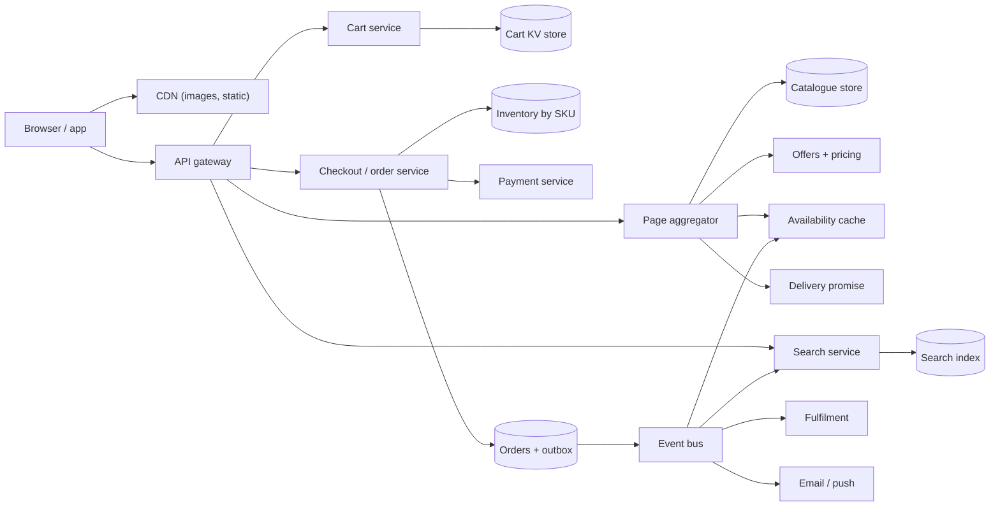

## In one minute
- **Browsing and buying are two different systems.** Browsing (product pages, search, recommendations) is read-heavy, latency-sensitive and allowed to be slightly stale. Buying (checkout, inventory, orders, payments) is low volume and must be correct. Split them early and give each its own consistency rules.
- **The product page is an aggregation problem.** One page pulls from dozens of services: catalog, offers, price, availability, delivery promise, reviews, ads. Fan-out amplifies tail latency, so every call needs a deadline and a fallback, and the page renders with whatever arrived in time.
- **The cart must always accept writes.** "Add to cart" is revenue. Amazon's Dynamo paper was written around exactly this: a cart store that stays writable during failures and merges divergent versions later.
- **Availability shown is a hint; the reservation at checkout is the truth.** The page can say "In stock" from a cache. Only a conditional decrement against a specific fulfilment centre's stock at order time decides whether the unit is yours.
- **Placing an order is a saga, not a transaction.** Reserve stock, authorise payment, persist the order, then hand off to fulfilment through events. Each step is idempotent and has a compensating action.

## Requirements

**Functional**
- Browse and search a catalogue of hundreds of millions of products, each with offers from Amazon and third-party sellers.
- Show a product page with price, availability and a delivery promise ("Arrives Thursday") for the customer's address.
- Add items to a cart that survives across devices and sessions, including a guest cart merged on sign-in.
- Check out: choose an address and payment method, see the split into shipments, place the order exactly once.
- View order history and status; cancel before shipment.

**Non-functional**
- Product page p99 under 300 ms at the origin; search p99 under 200 ms.
- Add to cart available at 99.99% or better, even during a partial outage.
- No overselling beyond a small, reconciled tolerance; no double charge; no lost order once the customer sees the confirmation.
- Survive Prime Day peaks of roughly 10× normal traffic without a scramble.

**Out of scope:** seller onboarding, warehouse robotics and pick-pack, the recommendation models themselves, ads auctions, returns. Payments are covered in depth in [Design Payment System](design-payment-system.md) and single-SKU stampedes in [Design Flash Sale](design-flash-sale.md).

## Back-of-envelope
Round assumed numbers, not Amazon's published figures.

- **DAU:** 100M. Each views 20 pages a day: 2B page views a day, or 2B / 86,400 ≈ 23K pages/s on average. Prime Day peak at 5× is about 115K pages/s.
- **Internal fan-out:** if a product page makes 40 backend calls, peak internal traffic is 115K × 40 ≈ 4.6M RPC/s. That number, not page views, sizes the service fleet.
- **Search:** 30% of page views start with a query: 600M a day, about 7K/s average and 35K/s at peak.
- **Cart writes:** 150M add or update operations a day ≈ 1.7K/s average, perhaps 20K/s at a deal launch.
- **Orders:** 10M orders a day ≈ 116/s average. Deals concentrate demand, so plan for 3K orders/s at peak. Each order touches about 3 inventory rows, so roughly 10K conditional writes/s.
- **Catalogue storage:** 500M items × 5 KB of attributes ≈ 2.5 TB, plus offers (2 per item on average, 500 B each) ≈ 0.5 TB. Small enough to replicate into several read-optimised stores. Images are separate: 500M × 6 images × 200 KB ≈ 600 TB in object storage behind a CDN.
- **Order storage:** 10M × 3 KB (order, lines, shipments, status history) ≈ 30 GB a day, about 55 TB over five years. With replicas and indexes, plan for 200 TB.
- **Bandwidth:** HTML of 120 KB × 115K/s ≈ 14 GB/s at peak from the origin tier, while images (perhaps 1 MB per page view) come from CDN edges at over 100 GB/s.

## API
Public endpoints are REST behind an API gateway. Internal calls are RPCs with deadlines.

```text
GET  /v1/products/{asin}?zip=98109
  -> { asin, title, images[], buy_box: { offer_id, seller, price_cents },
       availability: "in_stock" | "low" | "out", promise: "2026-10-22" }

GET  /v1/search?q=usb+c+cable&filters=brand:anker&cursor=...
  -> { results: [ { asin, title, price_cents, rating } ], facets: {...}, next_cursor }

PUT  /v1/cart/items          { asin, offer_id, qty }        -> { cart_version, items[] }
POST /v1/cart/merge          { guest_cart_id }               -> { cart_version, items[] }

POST /v1/checkout/preview    { address_id, payment_method_id }
  -> { checkout_id, shipments: [ { fc, items[], promise } ], total_cents, expires_at }

POST /v1/orders              { checkout_id, idempotency_key }
  -> 201 { order_id, status: "placed", shipments[] }
  -> 409 { reason: "item_unavailable", asin }  (preview again)

POST /v1/orders/{order_id}/cancel  -> { status: "cancelled" | "too_late" }
```

`checkout/preview` computes a plan and a total without reserving anything. `POST /orders` re-validates the plan, reserves, and is idempotent on `idempotency_key`, so a double-click or a retried mobile request returns the same `order_id`.

## Data model

**catalog_items** is a document store keyed by `asin`. Attributes vary wildly by category (a TV has a panel type, a shirt has sizes), so a schemaless document fits. Partition by `asin`: every read is a point lookup.

**offers** is keyed by `(asin, offer_id)` and partitioned by `asin`, so the buy box can read every offer for a product from one partition. Price changes often, so it lives apart from the slow-changing catalogue item.

**inventory** is keyed by `(sku, fc_id)` with `on_hand` and `reserved` integers, partitioned by `sku`. Allocation needs all fulfilment centres for a SKU at once, so one partition holds them. A hot SKU gets its stock split into several buckets per centre (see Failure modes).

**carts** is a key-value item keyed by `customer_id` (or `guest_cart_id`) holding the item list and a version vector. Partitioned by owner; one read, one write.

**orders** is partitioned by `customer_id` with sort key `created_at`, because the dominant read is "my orders, newest first". The `order_id` embeds the customer's shard bits so a lookup by order ID routes directly. Rows: order header, lines, shipments and an append-only status history.

**idempotency_keys** maps `(customer_id, key)` to `order_id` with a TTL of a day, written in the same transaction as the order header.

**outbox** rows are written in the order transaction and relayed to the event bus (see [Outbox Pattern](../sd/outbox-pattern.md)), so "order placed" is published if and only if the order exists.

## High-level design



**Read path (product page).**
1. The CDN serves images and static assets. The request for the page reaches the page aggregator.
2. The aggregator issues parallel calls with a shared deadline of about 150 ms: catalogue item, offers and price, availability for the nearest centres, delivery promise for the postcode, review summary, recommendations.
3. Required parts (title, price, buy button) block the render. Optional parts (recommendations, reviews) render as placeholders filled by the client if they miss the deadline.
4. Availability comes from a cache fed by inventory change events, a few seconds stale, which is fine for display.

**Write path (place order).**
1. The order service checks `idempotency_keys`; a known key returns the stored order.
2. It reloads the cart and recomputes prices; a changed price sends the customer back to preview.
3. It runs the allocator to choose fulfilment centres, then issues conditional reservations: `reserved += q` only if `on_hand - reserved >= q`. Any failure releases the reservations already taken.
4. It asks the payment service to authorise (not capture) the total.
5. In one local transaction it writes the order header, lines, shipments, the idempotency key and an outbox row. The customer sees "Order placed".
6. The relay publishes `OrderPlaced`. Fulfilment, availability, email and search ranking consume it. Payment is captured when each shipment leaves the building.

## Deep dives

### 1. The product page under fan-out
Options: wait for every dependency (the page is as slow as the slowest), precompute whole pages (impossible, since price and promise depend on the customer and the moment), or aggregate with deadlines and degrade. I choose the last, with a precomputed layer underneath: the catalogue item and its images are rendered into a cacheable fragment, while price, availability and promise are fetched live.

The arithmetic decides it. If each of 40 dependencies independently exceeds its own p99 1% of the time, the chance that at least one is slow on a given page is 1 - 0.99^40 ≈ 33%. So a page that waits for everything has a p67 equal to its dependencies' p99. This is not hypothetical: the Dynamo paper notes that one Amazon page typically called over 150 services, which is why Amazon wrote its SLAs at the 99.9th percentile rather than the mean ([Dynamo, SOSP 2007](https://www.allthingsdistributed.com/files/amazon-dynamo-sosp2007.pdf)). The fixes are a shared deadline, hedged requests for the few required calls (send a second copy after the p95 latency, take whichever returns first), and a strict list of what the page may render without. Hedging is cheap: in a Google benchmark, sending the backup request after a 10 ms delay cut the 99.9th-percentile latency of a 1,000-key read from 1,800 ms to 74 ms for only 2% more requests ([Dean and Barroso, "The Tail at Scale"](https://www.barroso.org/publications/TheTailAtScale.pdf)). Hedge only idempotent reads; never hedge a reservation or a payment call.

### 2. A cart that never says no
Options: a strongly consistent cart in a relational database (simple reads, but writes fail during a primary failover or partition), or an always-writable replicated cart that may diverge and is merged on read. The Dynamo paper chose the second for the shopping cart: writes go to any healthy replicas (sloppy quorum, hinted handoff), versions are tracked with vector clocks, and when a read finds siblings the application merges them by taking the union of items. The documented cost is that a deleted item can reappear, which customers tolerate far better than a failed "Add to cart". Divergence was rare in practice: over 24 hours, 99.94% of reads by the cart service saw exactly one version ([Dynamo, SOSP 2007](https://www.allthingsdistributed.com/files/amazon-dynamo-sosp2007.pdf)).

I would keep the semantics but implement them on a managed key-value store with conditional writes in a single region, and use version-vector merging only across regions. Don't assume the managed store gives you Dynamo's merge for free. DynamoDB, despite the name, replicates each partition through a Multi-Paxos group with a single leader rather than sloppy quorums ([DynamoDB, USENIX ATC 2022](https://www.usenix.org/system/files/atc22-elhemali.pdf)), and its default multi-Region global tables resolve concurrent writes to one item by last writer wins ([DynamoDB docs](https://docs.aws.amazon.com/amazondynamodb/latest/developerguide/V2globaltables_HowItWorks.html)). Two Regions writing the same cart item would silently drop one add. So either store each cart line as its own item, so concurrent adds touch different keys, or keep a version vector in the item and merge in the application. Guest-to-signed-in merge is the same operation: union of lines, quantity = max of the two, then cap at the per-item purchase limit. The cart never reserves stock; holding inventory for 150M idle carts would starve real buyers.

### 3. Inventory, allocation and the order saga
Three questions get tangled here. What do we show? A cached, approximate count. What do we promise? A delivery date computed by an allocator that knows which centres hold the items, their distance and their carrier cut-off times. What do we commit? A conditional reservation per `(sku, fc)` row.

The allocator prefers one shipment from the nearest centre that can fill the whole order, because every extra box costs shipping and packaging. If no single centre can, it greedily picks the centre that covers the most remaining units, and repeats.

The order itself is a saga ([Saga Pattern](../sd/saga-pattern.md)) rather than a distributed transaction: reserve, then authorise, then persist. If authorisation fails, release the reservations. If the order write fails after authorisation, void the authorisation. Reservations carry the order ID, so a sweeper can find and release any reservation older than ten minutes that has no order, which covers a crash between steps.

### Variant: a multi-tenant store builder

Now suppose we are not Amazon, the one retailer, but the platform that lets millions of independent merchants run their own shops. The requirements shift from one catalogue and one inventory to millions of small ones, with the hard problem being isolation: one merchant's flash sale must not slow the other shops sharing the hardware.

The data model gains a tenant key. Every row carries a `shop_id`, and every request belongs to exactly one shop, resolved from the domain at the edge. A single shared database is one failure domain, and a database per shop is impossible to migrate, back up and connect to at millions of shops. The middle path is sharding by `shop_id` and grouping shards into pods, where a pod is a shard plus its own cache and job queues, and any unit of work touches exactly one pod. This is the cell pattern applied to tenants: a pod failure affects only its shops, and the rule "no cross-pod work" is what keeps it true. Shopify describes this design and its pod failover ([Shopify Engineering](https://shopify.engineering/a-pods-architecture-to-allow-shopify-to-scale)).

Tenants grow unevenly, so pods drift out of balance, and Shopify reported its busiest and quietest shards differing by almost four times ([Shopify Engineering](https://shopify.engineering/mysql-database-shard-balancing-terabyte-scale)). Balance by measured weight, not shop count, and make shops movable while live. The move has four steps: batch-copy the shop's rows in primary-key order, tail the row-based binlog filtered to that `shop_id`, take a brief exclusive lock when replay lag is seconds and replay up to the recorded position, then flip the routing entry and delete the old copy. Buyers see a few seconds of retried writes, not downtime.

The hot-spot also looks different. In our Amazon design, popular items are spread over many fulfilment rows. Here a single drop can send tens of thousands of requests per second to one shop, one pod and one inventory row. Scaling the database up is too slow, so shape the traffic instead: serve storefront pages from the edge cache so browsing never reaches the database, and give checkout a per-shop throttle sized from the commit rate of the hottest row, with a queue page and a retry-after hint for the rest. Per-shop limits on connections and job queues protect neighbours on the same pod.

Finally, the platform has a third audience: third-party apps. They call an Admin API under per-shop rate limits and receive webhooks at least once with a short response deadline, so consumers must verify signatures and dedupe on the delivery identifier. Cart and order semantics stay as designed above; what changes is who is allowed to hurt whom.

## Down the stack

### Layer 1: The contract
- **Place order.** A `201` means the order header, lines and outbox row are durable on at least two replicas, the reservations exist, and payment is authorised. The same `idempotency_key` within 24 hours returns the same `order_id` and never reserves or authorises twice.
- **Reservation.** For every `(sku, fc)` row, `0 <= reserved <= on_hand` always holds. A reservation is released exactly once, by shipment, cancellation or the sweeper.
- **Display.** Availability and promise on the product page may be up to about 30 seconds stale and are not a commitment.
- **Cart.** A write acknowledged to the client is never lost, but a concurrent removal may be undone by merge.

### Layer 2: The mechanism
The reservation is one conditional update. In SQL it is `UPDATE inventory SET reserved = reserved + :q WHERE sku = :s AND fc = :f AND on_hand - reserved >= :q`, and success is "1 row affected". In DynamoDB it is an `UpdateItem` with `ConditionExpression: on_hand - reserved >= :q`, which fails with `ConditionalCheckFailedException`. Multi-row orders either use a store-level transaction for the handful of rows or reserve row by row and compensate on the first failure. DynamoDB `TransactWriteItems` takes up to 100 actions and 4 MB, no two actions may touch the same item, and the whole request is cancelled if any condition fails. Its `ClientRequestToken` makes a retry idempotent for only 10 minutes, and reusing it with different parameters returns `IdempotentParameterMismatch` ([DynamoDB API reference](https://docs.aws.amazon.com/amazondynamodb/latest/APIReference/API_TransactWriteItems.html)). That window is shorter than the order's 24-hour idempotency key, so the order service still needs its own key table.

The order write is one transaction on one partition (the customer's), containing the header, lines and outbox row. A relay tails the outbox, or the table's change stream, and publishes to the bus with the order ID as the message key, so consumers see each order's events in order and deduplicate by `(order_id, event_seq)`.

### Layer 3: The machine
- **A conditional write** in a replicated store costs one leader round trip plus a synchronous copy to another availability zone. Inter-zone round trips are typically 0.5 to 2 ms, and an NVMe `fsync` of the write-ahead log about 0.1 ms, so a reservation lands in 3 to 10 ms end to end.
- **Row contention.** While one update holds the row lock (or the leader serialises the item), others wait. At 2 ms per update, one row tops out near 500 reservations per second. A lightning deal on one SKU in one centre will exceed that, which is why hot stock is split into buckets.
- **The page.** 40 parallel RPCs, each a few KB of protobuf, cost little bandwidth but many connections; aggregators keep pooled HTTP/2 connections to each dependency so a call is one stream, not a TCP and TLS handshake (a full TLS 1.3 handshake adds one round trip, plus CPU for the key exchange).

### Why it's built this way
1. Reads outnumber purchases by about 200 to 1, so browsing is optimised for latency with caches and degradation, while buying is optimised for correctness.
2. Pages fan out to many services, so tail latency compounds, so deadlines and optional sections are mandatory.
3. A failed "Add to cart" loses revenue directly, so the cart favours availability and accepts merge anomalies.
4. Stock is physical and scarce, so commitment happens only at checkout, as a conditional write on a narrow row.
5. Inventory, payments and orders are owned by different teams on different stores, so the order is a saga with compensations instead of a cross-system lock.

## Failure modes
- **10× load on Prime Day.** Pre-scale from forecasts days ahead, pre-warm caches with deal pages, and shed optional work first: recommendations and reviews fall back to cached or empty, then search facets. Checkout and cart are the last to degrade. The real scale is large: during Prime Day 2025 DynamoDB peaked at 151 million requests per second for Amazon's own systems, and AWS ran over 6,800 fault-injection experiments beforehand to rehearse failures ([AWS News Blog](https://aws.amazon.com/blogs/aws/aws-services-scale-to-new-heights-for-prime-day-2025-key-metrics-and-milestones/)).
- **Hot SKU.** A deal sends 50K reservation attempts per second at one item. Split its stock into N buckets per centre, pick a bucket at random, and fall back to another bucket on failure. Put a queue or waiting room in front, as in [Design Flash Sale](design-flash-sale.md).
- **Payment provider slow.** Authorisation latency jumps to seconds. Accept the order in a "pending payment" state with reservations held, authorise asynchronously, and email the customer to fix the payment method if it fails. The reservation sweeper bounds the damage.
- **Region or zone outage.** Run the order path in independent cells per region, each statically stable: capacity provisioned so that losing one zone does not require launching new instances during the incident, because the control plane you would call to launch them may be the thing that is impaired ([Amazon Builders' Library](https://aws.amazon.com/builders-library/static-stability-using-availability-zones/)). Carts replicate across regions and merge; orders stay in their home region and fail over by promoting a replica, accepting a few seconds of possible loss mitigated by client retries with the same idempotency key.
- **Event bus backlog.** Fulfilment falls behind. Orders are already durable, so the customer is unaffected; alert on lag, and process newest-first for time-critical consumers like email, per the Builders' Library advice on insurmountable backlogs ([Amazon Builders' Library](https://aws.amazon.com/builders-library/avoiding-insurmountable-queue-backlogs/)).

## In the wild
- **Amazon, 2007: the shopping cart that never refuses a write.** The Dynamo paper describes a cart service that handled tens of millions of requests and over 3 million checkouts in a single day of the holiday peak. Writes went to any healthy replicas with hinted handoff, versions were tracked with vector clocks, and the cart merged divergent versions, accepting that a deleted item could come back. In a 24-hour profile 99.94% of reads saw a single version ([Dynamo, SOSP 2007](https://www.allthingsdistributed.com/files/amazon-dynamo-sosp2007.pdf)).
- **AWS, 2025: one regional dependency empties its own DNS.** In us-east-1 a delayed DynamoDB DNS Enactor applied a stale plan over a newer one, and the cleanup of old plans then deleted every IP address for the regional endpoint. DynamoDB errors lasted about 3 hours; EC2's lease manager depended on DynamoDB and fell into congestive collapse, so the whole event ran about 14.5 hours. AWS disabled the automation worldwide and added velocity limits and queue-based throttling ([AWS](https://aws.amazon.com/message/101925/)).
- **Ticketmaster, 2022: a single "SKU" meets bots.** For the Eras Tour presale about 1.5 million fans got codes, but bots and fans without codes drove 3.5 billion system requests, four times the previous peak. Ticketmaster slowed and postponed sales to stabilise, and about 15% of interactions hit errors, including passcode failures that dropped carted tickets ([Ticketmaster, archived](https://web.archive.org/web/20230101022610/https://business.ticketmaster.com/business-solutions/taylor-swift-the-eras-tour-onsale-explained/)).

## Trade-offs

| Option | Strengths | Weaknesses | Choose when |
|---|---|---|---|
| Aggregate page with deadlines | Fast, resilient to slow services | Partial pages, more client logic | Many independent page sections |
| Fully server-rendered, wait for all | Simple, complete pages | Tail latency of the slowest call | Few dependencies |
| Always-writable cart, merge on read | Never rejects adds | Deleted items can return | Cart and wishlist |
| Strongly consistent cart | Exact semantics | Writes fail during failover | Small scale, single region |
| Reserve at checkout | Stock not locked by idle carts | Customer can lose the item late | General retail |
| Reserve at add to cart | Customer keeps the item | Starves buyers, needs expiry | Tickets, limited drops |
| Saga for order placement | Independent failures, clear repair | Compensations to write and test | Services owned by different teams |
| Distributed transaction (2PC) | Atomic across stores | Couples availability, blocking | Single database or tightly coupled stores |

## Leadership lens
- **Rollout:** checkout changes ship behind a flag to a small slice of traffic and freeze weeks before Prime Day; game days rehearse zone loss and payment slowness.
- **Build first:** idempotent order placement with conditional reservations and the outbox, because a bug there costs money and trust. Next the page aggregator with deadlines, then search, then the delivery promise. Recommendations come last.
- **Team ownership:** catalogue, offers and pricing, search, cart, checkout and orders, inventory and allocation, payments, and the page aggregator are separate two-pizza teams, each owning its store and API.
- **Cost drivers:** CDN egress for images, the compute for page fan-out (millions of internal RPCs per second), the search cluster's memory, and replicated order storage. Order volume itself is cheap.
- **Review questions:** what is the oversell rate and who reconciles it; which page sections may be dropped and in what order; what happens to a reservation if the order service crashes between reserve and persist.

## Check yourself
1. A product page calls 40 dependencies, each slow 1% of the time. Why does waiting for all of them hurt, and what does the design do instead?
   **Answer:** The chance at least one is slow is 1 - 0.99^40, about 33%, so the page's p67 equals its dependencies' p99. The aggregator uses a shared deadline of about 150 ms, hedges the few required calls, and renders optional sections as placeholders if they miss it.
2. Why does the cart use an always-writable, merge-on-read store instead of a strongly consistent relational cart, and what anomaly does that accept?
   **Answer:** A failed "Add to cart" loses revenue directly, and a strongly consistent cart rejects writes during failover or partition. Merging siblings by union means a deleted item can reappear, which customers tolerate far better than a rejected add.
3. The order service crashes after reserving stock but before persisting the order. How is the stuck stock recovered?
   **Answer:** Reservations carry the order ID, so a sweeper releases any reservation older than ten minutes that has no order. Placing an order is a saga with compensations, not a distributed transaction.
4. Why must a lightning deal on one SKU split its stock into buckets? Use the row-contention numbers.
   **Answer:** At about 2 ms per conditional update, one `(sku, fc)` row tops out near 500 reservations per second, while a deal can send 50K attempts per second. Splitting stock into N buckets per centre, picking one at random and falling back on failure spreads that load across rows.

## Practice
**Task:** Build the allocator and order placement core. `Fulfillment(centers)` takes a list of centres `(id, distance, stock)` where `stock` maps SKU to units. `place(order_id, items)` takes a map of SKU to quantity and returns a list of shipments `(center_id, lines)` with `lines` sorted by SKU, or `None` if the order cannot be filled or is invalid (empty, or any quantity below 1). Prefer one centre that can fill the whole order (smallest distance, then smallest id). Otherwise repeatedly pick the centre covering the most remaining units (ties: smaller distance, then smaller id) and take what it has, in that pick order. Placement is all or nothing, stock is decremented on success, and placing a known `order_id` again returns the original result without touching stock. `cancel(order_id)` returns the stock and reports `True` once; a cancelled ID can never be placed again. `available(sku)` returns total units across centres.

```python starter
class Fulfillment:
    def __init__(self, centers):
        pass

    def available(self, sku):
        # TODO: total units of sku across centres
        raise NotImplementedError

    def place(self, order_id, items):
        # TODO: single centre if possible, else greedy split; idempotent
        raise NotImplementedError

    def cancel(self, order_id):
        # TODO: restore stock once
        raise NotImplementedError
```

```python tests
def test_single_center_nearest_then_id():
    f = Fulfillment([("A", 5, {"x": 2}), ("C", 2, {"x": 5}), ("B", 2, {"x": 2})])
    assert f.place("o1", {"x": 1}) == [("B", [("x", 1)])]
    assert f.available("x") == 8

def test_one_box_beats_nearer_split():
    f = Fulfillment([("A", 1, {"x": 1}), ("B", 1, {"y": 1}), ("C", 9, {"x": 1, "y": 1})])
    assert f.place("o1", {"x": 1, "y": 1}) == [("C", [("x", 1), ("y", 1)])]

def test_greedy_split_by_coverage():
    f = Fulfillment([("A", 1, {"x": 2}), ("B", 2, {"x": 1, "y": 3}), ("C", 3, {"z": 1})])
    got = f.place("o1", {"x": 3, "y": 1, "z": 1})
    assert got == [("A", [("x", 2)]), ("B", [("x", 1), ("y", 1)]), ("C", [("z", 1)])]
    assert f.available("y") == 2
    assert f.available("x") == 0

def test_insufficient_is_all_or_nothing():
    f = Fulfillment([("A", 1, {"x": 1}), ("B", 2, {"x": 1})])
    assert f.place("o1", {"x": 3}) is None
    assert f.available("x") == 2, "nothing was taken"
    assert f.place("o2", {"x": 2}) == [("A", [("x", 1)]), ("B", [("x", 1)])]

def test_retry_is_idempotent():
    f = Fulfillment([("A", 1, {"x": 3})])
    first = f.place("o1", {"x": 2})
    assert f.place("o1", {"x": 2}) == first
    assert f.available("x") == 1, "stock taken once"

def test_invalid_orders():
    f = Fulfillment([("A", 1, {"x": 3})])
    assert f.place("o1", {}) is None
    assert f.place("o2", {"x": 0}) is None
    assert f.place("o3", {"nope": 1}) is None
    assert f.available("nope") == 0

def test_cancel_restores_once():
    f = Fulfillment([("A", 1, {"x": 1}), ("B", 2, {"x": 1})])
    f.place("o1", {"x": 2})
    assert f.cancel("o1") is True
    assert f.available("x") == 2
    assert f.cancel("o1") is False
    assert f.cancel("ghost") is False
    assert f.place("o1", {"x": 1}) is None, "cancelled id is burned"
```

```python solution
class Fulfillment:
    def __init__(self, centers):
        self._centers = [(cid, dist, dict(stock)) for cid, dist, stock in centers]
        self._orders = {}
        self._cancelled = set()

    def available(self, sku):
        return sum(c[2].get(sku, 0) for c in self._centers)

    def place(self, order_id, items):
        if order_id in self._cancelled:
            return None
        if order_id in self._orders:
            return self._orders[order_id]
        if not items or any(q < 1 for q in items.values()):
            return None
        need = dict(items)
        whole = [c for c in self._centers
                 if all(c[2].get(s, 0) >= q for s, q in need.items())]
        plan = []
        if whole:
            best = min(whole, key=lambda c: (c[1], c[0]))
            plan.append((best, dict(need)))
        else:
            used = set()
            while need:
                best, best_key = None, None
                for c in self._centers:
                    if c[0] in used:
                        continue
                    cover = sum(min(c[2].get(s, 0), q) for s, q in need.items())
                    key = (-cover, c[1], c[0])
                    if cover > 0 and (best_key is None or key < best_key):
                        best, best_key = c, key
                if best is None:
                    return None
                used.add(best[0])
                take = {}
                for s in list(need):
                    t = min(best[2].get(s, 0), need[s])
                    if t > 0:
                        take[s] = t
                        need[s] -= t
                        if need[s] == 0:
                            del need[s]
                plan.append((best, take))
        for c, take in plan:
            for s, t in take.items():
                c[2][s] -= t
        result = [(c[0], sorted(take.items())) for c, take in plan]
        self._orders[order_id] = result
        return result

    def cancel(self, order_id):
        result = self._orders.pop(order_id, None)
        if result is None:
            return False
        by_id = {c[0]: c for c in self._centers}
        for cid, lines in result:
            for s, q in lines:
                stock = by_id[cid][2]
                stock[s] = stock.get(s, 0) + q
        self._cancelled.add(order_id)
        return True
```

```typescript starter
export interface Center {
  id: string;
  distance: number;
  stock: Record<string, number>;
}

export interface Shipment {
  center: string;
  lines: [string, number][];
}

export class Fulfillment {
  constructor(centers: Center[]) {}

  available(sku: string): number {
    throw new Error("TODO");
  }

  place(orderId: string, items: Record<string, number>): Shipment[] | null {
    throw new Error("TODO");
  }

  cancel(orderId: string): boolean {
    throw new Error("TODO");
  }
}
```

```typescript tests
test("single center nearest then id", () => {
  const f = new Fulfillment([
    { id: "A", distance: 5, stock: { x: 2 } },
    { id: "C", distance: 2, stock: { x: 5 } },
    { id: "B", distance: 2, stock: { x: 2 } },
  ]);
  assertEqual(f.place("o1", { x: 1 }), [{ center: "B", lines: [["x", 1]] }]);
  assertEqual(f.available("x"), 8);
});

test("one box beats nearer split", () => {
  const f = new Fulfillment([
    { id: "A", distance: 1, stock: { x: 1 } },
    { id: "B", distance: 1, stock: { y: 1 } },
    { id: "C", distance: 9, stock: { x: 1, y: 1 } },
  ]);
  assertEqual(f.place("o1", { x: 1, y: 1 }), [{ center: "C", lines: [["x", 1], ["y", 1]] }]);
});

test("greedy split by coverage", () => {
  const f = new Fulfillment([
    { id: "A", distance: 1, stock: { x: 2 } },
    { id: "B", distance: 2, stock: { x: 1, y: 3 } },
    { id: "C", distance: 3, stock: { z: 1 } },
  ]);
  assertEqual(f.place("o1", { x: 3, y: 1, z: 1 }), [
    { center: "A", lines: [["x", 2]] },
    { center: "B", lines: [["x", 1], ["y", 1]] },
    { center: "C", lines: [["z", 1]] },
  ]);
  assertEqual(f.available("y"), 2);
  assertEqual(f.available("x"), 0);
});

test("insufficient is all or nothing", () => {
  const f = new Fulfillment([
    { id: "A", distance: 1, stock: { x: 1 } },
    { id: "B", distance: 2, stock: { x: 1 } },
  ]);
  assertEqual(f.place("o1", { x: 3 }), null);
  assertEqual(f.available("x"), 2, "nothing was taken");
  assertEqual(f.place("o2", { x: 2 }), [
    { center: "A", lines: [["x", 1]] },
    { center: "B", lines: [["x", 1]] },
  ]);
});

test("retry is idempotent", () => {
  const f = new Fulfillment([{ id: "A", distance: 1, stock: { x: 3 } }]);
  const first = f.place("o1", { x: 2 });
  assertEqual(f.place("o1", { x: 2 }), first);
  assertEqual(f.available("x"), 1, "stock taken once");
});

test("invalid orders", () => {
  const f = new Fulfillment([{ id: "A", distance: 1, stock: { x: 3 } }]);
  assertEqual(f.place("o1", {}), null);
  assertEqual(f.place("o2", { x: 0 }), null);
  assertEqual(f.place("o3", { nope: 1 }), null);
  assertEqual(f.available("nope"), 0);
});

test("cancel restores once", () => {
  const f = new Fulfillment([
    { id: "A", distance: 1, stock: { x: 1 } },
    { id: "B", distance: 2, stock: { x: 1 } },
  ]);
  f.place("o1", { x: 2 });
  assertEqual(f.cancel("o1"), true);
  assertEqual(f.available("x"), 2);
  assertEqual(f.cancel("o1"), false);
  assertEqual(f.cancel("ghost"), false);
  assertEqual(f.place("o1", { x: 1 }), null, "cancelled id is burned");
});
```

```typescript solution
export interface Center {
  id: string;
  distance: number;
  stock: Record<string, number>;
}

export interface Shipment {
  center: string;
  lines: [string, number][];
}

export class Fulfillment {
  private centers: Center[];
  private orders = new Map<string, Shipment[]>();
  private cancelled = new Set<string>();

  constructor(centers: Center[]) {
    this.centers = centers.map((c) => ({ id: c.id, distance: c.distance, stock: { ...c.stock } }));
  }

  available(sku: string): number {
    let total = 0;
    for (const c of this.centers) total += c.stock[sku] ?? 0;
    return total;
  }

  place(orderId: string, items: Record<string, number>): Shipment[] | null {
    if (this.cancelled.has(orderId)) return null;
    const prior = this.orders.get(orderId);
    if (prior) return prior;
    const skus = Object.keys(items);
    if (skus.length === 0 || skus.some((s) => items[s] < 1)) return null;
    const need = new Map<string, number>(skus.map((s) => [s, items[s]]));
    const better = (a: Center, b: Center) =>
      a.distance !== b.distance ? a.distance < b.distance : a.id < b.id;
    const plan: [Center, Map<string, number>][] = [];
    let whole: Center | null = null;
    for (const c of this.centers) {
      let ok = true;
      for (const [s, q] of need) if ((c.stock[s] ?? 0) < q) ok = false;
      if (ok && (whole === null || better(c, whole))) whole = c;
    }
    if (whole) {
      plan.push([whole, new Map(need)]);
    } else {
      const used = new Set<string>();
      while (need.size > 0) {
        let best: Center | null = null;
        let bestCover = 0;
        for (const c of this.centers) {
          if (used.has(c.id)) continue;
          let cover = 0;
          for (const [s, q] of need) cover += Math.min(c.stock[s] ?? 0, q);
          if (cover === 0) continue;
          if (best === null || cover > bestCover || (cover === bestCover && better(c, best))) {
            best = c;
            bestCover = cover;
          }
        }
        if (best === null) return null;
        used.add(best.id);
        const take = new Map<string, number>();
        for (const [s, q] of [...need]) {
          const t = Math.min(best.stock[s] ?? 0, q);
          if (t > 0) {
            take.set(s, t);
            if (q - t === 0) need.delete(s);
            else need.set(s, q - t);
          }
        }
        plan.push([best, take]);
      }
    }
    const result: Shipment[] = [];
    for (const [c, take] of plan) {
      for (const [s, t] of take) c.stock[s] -= t;
      const lines = [...take.entries()].sort((a, b) => (a[0] < b[0] ? -1 : a[0] > b[0] ? 1 : 0));
      result.push({ center: c.id, lines });
    }
    this.orders.set(orderId, result);
    return result;
  }

  cancel(orderId: string): boolean {
    const result = this.orders.get(orderId);
    if (!result) return false;
    for (const sh of result) {
      const c = this.centers.find((x) => x.id === sh.center)!;
      for (const [s, q] of sh.lines) c.stock[s] = (c.stock[s] ?? 0) + q;
    }
    this.orders.delete(orderId);
    this.cancelled.add(orderId);
    return true;
  }
}
```

```go starter
package practice

type Center struct {
	ID       string
	Distance int
	Stock    map[string]int
}

type Line struct {
	SKU string
	Qty int
}

type Shipment struct {
	Center string
	Lines  []Line
}

type Fulfillment struct{}

func NewFulfillment(centers []Center) *Fulfillment { return &Fulfillment{} }

func (f *Fulfillment) Available(sku string) int { panic("TODO") }

// Place returns the shipments and true, or nil and false if the order cannot be placed.
func (f *Fulfillment) Place(orderID string, items map[string]int) ([]Shipment, bool) {
	panic("TODO")
}

func (f *Fulfillment) Cancel(orderID string) bool { panic("TODO") }
```

```go tests
package practice

import (
	"reflect"
	"testing"
)

func TestSingleCenterNearestThenID(t *testing.T) {
	f := NewFulfillment([]Center{
		{"A", 5, map[string]int{"x": 2}},
		{"C", 2, map[string]int{"x": 5}},
		{"B", 2, map[string]int{"x": 2}},
	})
	got, ok := f.Place("o1", map[string]int{"x": 1})
	if !ok || !reflect.DeepEqual(got, []Shipment{{"B", []Line{{"x", 1}}}}) {
		t.Fatalf("got %v %v", got, ok)
	}
	if f.Available("x") != 8 {
		t.Fatal("want 8")
	}
}

func TestOneBoxBeatsNearerSplit(t *testing.T) {
	f := NewFulfillment([]Center{
		{"A", 1, map[string]int{"x": 1}},
		{"B", 1, map[string]int{"y": 1}},
		{"C", 9, map[string]int{"x": 1, "y": 1}},
	})
	got, ok := f.Place("o1", map[string]int{"x": 1, "y": 1})
	if !ok || !reflect.DeepEqual(got, []Shipment{{"C", []Line{{"x", 1}, {"y", 1}}}}) {
		t.Fatalf("got %v", got)
	}
}

func TestGreedySplitByCoverage(t *testing.T) {
	f := NewFulfillment([]Center{
		{"A", 1, map[string]int{"x": 2}},
		{"B", 2, map[string]int{"x": 1, "y": 3}},
		{"C", 3, map[string]int{"z": 1}},
	})
	got, ok := f.Place("o1", map[string]int{"x": 3, "y": 1, "z": 1})
	want := []Shipment{
		{"A", []Line{{"x", 2}}},
		{"B", []Line{{"x", 1}, {"y", 1}}},
		{"C", []Line{{"z", 1}}},
	}
	if !ok || !reflect.DeepEqual(got, want) {
		t.Fatalf("got %v", got)
	}
	if f.Available("y") != 2 || f.Available("x") != 0 {
		t.Fatal("stock not decremented")
	}
}

func TestInsufficientIsAllOrNothing(t *testing.T) {
	f := NewFulfillment([]Center{
		{"A", 1, map[string]int{"x": 1}},
		{"B", 2, map[string]int{"x": 1}},
	})
	if _, ok := f.Place("o1", map[string]int{"x": 3}); ok {
		t.Fatal("should fail")
	}
	if f.Available("x") != 2 {
		t.Fatal("nothing was taken")
	}
	got, ok := f.Place("o2", map[string]int{"x": 2})
	if !ok || !reflect.DeepEqual(got, []Shipment{{"A", []Line{{"x", 1}}}, {"B", []Line{{"x", 1}}}}) {
		t.Fatalf("got %v", got)
	}
}

func TestRetryIsIdempotent(t *testing.T) {
	f := NewFulfillment([]Center{{"A", 1, map[string]int{"x": 3}}})
	first, _ := f.Place("o1", map[string]int{"x": 2})
	second, ok := f.Place("o1", map[string]int{"x": 2})
	if !ok || !reflect.DeepEqual(first, second) {
		t.Fatal("retry should return the original result")
	}
	if f.Available("x") != 1 {
		t.Fatal("stock taken once")
	}
}

func TestInvalidOrders(t *testing.T) {
	f := NewFulfillment([]Center{{"A", 1, map[string]int{"x": 3}}})
	if _, ok := f.Place("o1", map[string]int{}); ok {
		t.Fatal("empty order")
	}
	if _, ok := f.Place("o2", map[string]int{"x": 0}); ok {
		t.Fatal("zero quantity")
	}
	if _, ok := f.Place("o3", map[string]int{"nope": 1}); ok {
		t.Fatal("unknown sku")
	}
	if f.Available("nope") != 0 {
		t.Fatal("want 0")
	}
}

func TestCancelRestoresOnce(t *testing.T) {
	f := NewFulfillment([]Center{
		{"A", 1, map[string]int{"x": 1}},
		{"B", 2, map[string]int{"x": 1}},
	})
	f.Place("o1", map[string]int{"x": 2})
	if !f.Cancel("o1") || f.Available("x") != 2 {
		t.Fatal("cancel should restore stock")
	}
	if f.Cancel("o1") || f.Cancel("ghost") {
		t.Fatal("cancel only once, unknown is false")
	}
	if _, ok := f.Place("o1", map[string]int{"x": 1}); ok {
		t.Fatal("cancelled id is burned")
	}
}
```

```go solution
package practice

import (
	"sort"
	"sync"
)

type Center struct {
	ID       string
	Distance int
	Stock    map[string]int
}

type Line struct {
	SKU string
	Qty int
}

type Shipment struct {
	Center string
	Lines  []Line
}

type Fulfillment struct {
	mu        sync.Mutex
	centers   []*Center
	orders    map[string][]Shipment
	cancelled map[string]bool
}

func NewFulfillment(centers []Center) *Fulfillment {
	f := &Fulfillment{orders: map[string][]Shipment{}, cancelled: map[string]bool{}}
	for _, c := range centers {
		stock := map[string]int{}
		for k, v := range c.Stock {
			stock[k] = v
		}
		f.centers = append(f.centers, &Center{c.ID, c.Distance, stock})
	}
	return f
}

func (f *Fulfillment) Available(sku string) int {
	f.mu.Lock()
	defer f.mu.Unlock()
	total := 0
	for _, c := range f.centers {
		total += c.Stock[sku]
	}
	return total
}

func better(a, b *Center) bool {
	if a.Distance != b.Distance {
		return a.Distance < b.Distance
	}
	return a.ID < b.ID
}

func (f *Fulfillment) Place(orderID string, items map[string]int) ([]Shipment, bool) {
	f.mu.Lock()
	defer f.mu.Unlock()
	if f.cancelled[orderID] {
		return nil, false
	}
	if prior, ok := f.orders[orderID]; ok {
		return prior, true
	}
	if len(items) == 0 {
		return nil, false
	}
	need := map[string]int{}
	for s, q := range items {
		if q < 1 {
			return nil, false
		}
		need[s] = q
	}
	type step struct {
		c    *Center
		take map[string]int
	}
	var plan []step
	var whole *Center
	for _, c := range f.centers {
		ok := true
		for s, q := range need {
			if c.Stock[s] < q {
				ok = false
			}
		}
		if ok && (whole == nil || better(c, whole)) {
			whole = c
		}
	}
	if whole != nil {
		plan = append(plan, step{whole, need})
	} else {
		used := map[string]bool{}
		for len(need) > 0 {
			var best *Center
			bestCover := 0
			for _, c := range f.centers {
				if used[c.ID] {
					continue
				}
				cover := 0
				for s, q := range need {
					cover += min(c.Stock[s], q)
				}
				if cover == 0 {
					continue
				}
				if best == nil || cover > bestCover || (cover == bestCover && better(c, best)) {
					best, bestCover = c, cover
				}
			}
			if best == nil {
				return nil, false
			}
			used[best.ID] = true
			take := map[string]int{}
			for s, q := range need {
				t := min(best.Stock[s], q)
				if t > 0 {
					take[s] = t
					if q == t {
						delete(need, s)
					} else {
						need[s] = q - t
					}
				}
			}
			plan = append(plan, step{best, take})
		}
	}
	result := []Shipment{}
	for _, st := range plan {
		lines := []Line{}
		for s, t := range st.take {
			st.c.Stock[s] -= t
			lines = append(lines, Line{s, t})
		}
		sort.Slice(lines, func(i, j int) bool { return lines[i].SKU < lines[j].SKU })
		result = append(result, Shipment{st.c.ID, lines})
	}
	f.orders[orderID] = result
	return result, true
}

func (f *Fulfillment) Cancel(orderID string) bool {
	f.mu.Lock()
	defer f.mu.Unlock()
	result, ok := f.orders[orderID]
	if !ok {
		return false
	}
	for _, sh := range result {
		for _, c := range f.centers {
			if c.ID == sh.Center {
				for _, l := range sh.Lines {
					c.Stock[l.SKU] += l.Qty
				}
			}
		}
	}
	delete(f.orders, orderID)
	f.cancelled[orderID] = true
	return true
}
```

## Mock interview
**Prompt:** Design Amazon's shopping experience: product pages, search, cart, checkout and order history for 100 million daily users, with Prime Day peaks at ten times normal. Focus on how a customer goes from a product page to a confirmed order without overselling or double charging.

- Follow-up: The product page calls 40 services and its p99 has doubled. How do you find the cause, and how do you design the page so one slow service cannot do this again?
- Follow-up: The order service crashes after reserving stock and authorising payment, but before writing the order. What state is left behind, and what cleans it up?
- Follow-up: Why not reserve stock when the item goes into the cart? When would you?

**A strong answer covers:**
- A clear split between browse (cached, stale-tolerant, degradable) and buy (conditional writes, idempotency, sagas).
- Fan-out arithmetic and the fixes: shared deadlines, hedged requests for required calls, optional sections rendered later.
- An always-writable cart with a defined merge rule, and the anomaly it allows.
- Allocation across fulfilment centres, preferring one shipment, with conditional per-row reservations and bucketing for hot SKUs.
- Order placement as reserve, authorise, persist with an outbox, plus compensations and a sweeper for half-finished orders.
- Capacity and failure planning for peaks: pre-scaling, load shedding order, cells and static stability.

## Sources and further study
**Primary**
- [Dean and Barroso, "The Tail at Scale" (CACM 2013)](https://www.barroso.org/publications/TheTailAtScale.pdf): why fan-out amplifies tail latency, and hedged and tied requests as the fix.
- [Amazon DynamoDB: A Scalable, Predictably Performant, and Fully Managed NoSQL Database Service (USENIX ATC 2022)](https://www.usenix.org/system/files/atc22-elhemali.pdf): how DynamoDB departs from the original Dynamo, with Multi-Paxos replication groups.
- [Shopify Engineering: A pods architecture to allow Shopify to scale](https://shopify.engineering/a-pods-architecture-to-allow-shopify-to-scale): tenant sharding into isolated pods and live failover.

**Systems docs**
- [DynamoDB TransactWriteItems](https://docs.aws.amazon.com/amazondynamodb/latest/APIReference/API_TransactWriteItems.html): limits, cancellation reasons and the 10-minute client token.
- [How DynamoDB global tables work](https://docs.aws.amazon.com/amazondynamodb/latest/developerguide/V2globaltables_HowItWorks.html): last-writer-wins in MREC, and the three-Region MRSC mode with no transactions.
- [AWS: Prime Day 2025 key metrics](https://aws.amazon.com/blogs/aws/aws-services-scale-to-new-heights-for-prime-day-2025-key-metrics-and-milestones/): the measured peak load behind Amazon's retail systems.

**Books**
- *Designing Data-Intensive Applications* (1st edition), Martin Kleppmann, chapter 5 "Replication", section "Leaderless Replication": sloppy quorums, hinted handoff and merging concurrent writes, with the shopping cart as the example.
- *Building Microservices* (2nd edition), Sam Newman, chapter 6 "Workflow": sagas for order placement, using an e-commerce example (MusicCorp).

**Other curricula**
- [system-design-primer: Design Amazon's sales ranking by category feature](https://github.com/donnemartin/system-design-primer/blob/master/solutions/system_design/sales_rank/README.md): frames e-commerce as a batch analytics problem over order logs, served through caches and read replicas.
- [Azure Architecture Center: Compensating Transaction pattern](https://learn.microsoft.com/en-us/azure/architecture/patterns/compensating-transaction): frames order cancellation as undo steps that must be idempotent and may themselves fail.
- [Azure Architecture Center: Architectural approaches for storage and data in multitenant solutions](https://learn.microsoft.com/en-us/azure/architecture/guide/multitenant/approaches/storage-data): frames tenancy as shared, sharded or per-tenant data.

## Watch
- [AWS re:Invent 2018: Amazon DynamoDB Deep Dive: Advanced Design Patterns (Amazon Web Services)](https://www.youtube.com/watch?v=HaEPXoXVf2k): Rick Houlihan models order, inventory and customer access patterns in a single key-value table, the way retail teams at Amazon moved off relational databases.

## Free resources
- [Dynamo: Amazon's Highly Available Key-value Store (SOSP 2007)](https://www.allthingsdistributed.com/files/amazon-dynamo-sosp2007.pdf): the shopping cart's requirements, sloppy quorums, vector clocks and the merge anomaly, from the source.
- [Static stability using Availability Zones (Amazon Builders' Library)](https://aws.amazon.com/builders-library/static-stability-using-availability-zones/): how to provision so a zone loss needs no emergency scaling.
- [Making retries safe with idempotent APIs (Amazon Builders' Library)](https://aws.amazon.com/builders-library/making-retries-safe-with-idempotent-APIs/): client request tokens and the semantics a retried "place order" needs.
- [Avoiding insurmountable queue backlogs (Amazon Builders' Library)](https://aws.amazon.com/builders-library/avoiding-insurmountable-queue-backlogs/): what to do when order events pile up faster than consumers drain them.
- [Timeouts, retries and backoff with jitter (Amazon Builders' Library)](https://aws.amazon.com/builders-library/timeouts-retries-and-backoff-with-jitter/): picking deadlines for a fan-out page and avoiding retry storms.
- [Pattern: Saga (microservices.io)](https://microservices.io/patterns/data/saga.html): choreography versus orchestration for a multi-service order.
