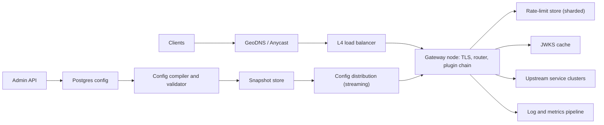

## In one minute
- **Split the data plane from the control plane.** Gateway nodes forward traffic using an immutable, in-memory config snapshot. A separate control plane validates, versions and pushes that snapshot. A control plane outage must never stop traffic; nodes keep serving the last known good config.
- **Compile routes, don't scan them.** Thousands of routes are compiled into a segment trie with explicit precedence (literal beats parameter beats wildcard, longer prefix beats shorter). Matching costs microseconds and the result is deterministic, so two nodes never route the same request differently.
- **Run a fixed, per-route plugin chain with a declared failure policy.** Authentication runs before rate limiting so quotas are charged to a known consumer, and each plugin says whether it fails open or closed when its dependency is down.
- **Keep the gateway stateless and cheap per request.** Verify JWTs locally against cached keys, keep rate-limit counters in a sharded in-memory store with a local fallback, and reuse pooled upstream connections. Every network hop added on the hot path shows up in every API's p99.
- **Protect the backends from the clients and from the gateway itself.** Timeouts, retry budgets, circuit breakers and load shedding live here, because this is the only place that sees all traffic.

## Requirements

**Functional**
- Route requests by host, method and path pattern (with path parameters and prefix wildcards) to upstream service clusters, with weighted splits for canaries.
- Authenticate callers with API keys or JWTs and attach the consumer identity to the upstream request.
- Enforce rate limits and quotas per consumer, per route and per plan.
- Apply per-route plugins: header rewrites, request size limits, CORS, response caching for a few GET routes.
- Emit access logs, metrics and trace spans for every request.
- Change routes and plugins through an admin API with no deploy and no dropped connections.

**Non-functional**
- Gateway overhead under 1 ms at p50 and under 5 ms at p99, excluding the upstream.
- 99.99% availability for the data plane, which is about 52 minutes of downtime a year.
- 500k requests per second at global peak across three regions, with room for 2x growth.
- A config change reaches every node within 10 seconds, and each request sees exactly one config version.

**Out of scope**
- East-west service-to-service traffic (a service mesh), the developer portal and billing, a full web application firewall, and GraphQL federation.

## Back-of-envelope
- **Traffic.** Assume 100M daily active users and about 50 API calls each per day: 5B requests per day. 5 × 10^9 / 86,400 ≈ 58k RPS on average. Mobile traffic peaks around 3x the daily mean and launches add more, so plan for 200k RPS normal peak and 500k RPS as the design point.
- **Nodes.** A modern proxy with TLS termination, JWT verification and logging handles very roughly 3k to 6k RPS per core; I'll assume 4k. A 16-core node then does about 60k RPS at 90% CPU, but we run at 50% to absorb spikes, so about 30k RPS per node. 500k / 30k ≈ 17 nodes, so roughly 8 per region across three regions, where any two regions can carry the full load. Round up to 10 per region.
- **Bandwidth.** Average request 2 KB and response 10 KB: 12 KB × 500k = 6 GB/s, about 48 Gbit/s at peak, spread over 30 nodes is 1.6 Gbit/s each. NICs are not the bottleneck; CPU for TLS and parsing is.
- **Connections.** 20M idle keep-alive clients over 30 nodes is about 670k connections per node; at roughly 10 KB each that is 7 GB of memory to budget.
- **Logs.** 5B × 500 bytes = 2.5 TB per day, or about 4.5 PB over 5 years. Keep 30 days raw (75 TB) and only aggregates after that.
- **Config and state.** 10k routes × 2 KB = 20 MB of config. 10M API keys × about 100 bytes of hot state is 1 GB of counters, which fits in a small sharded in-memory store.

## API
The data plane accepts any HTTP request. The control plane is a small admin API.

```http
PUT /admin/v1/routes/{route_id}
{ "hosts": ["api.example.com"], "method": "GET",
  "path": "/v2/orders/:order_id", "upstream": "orders-svc",
  "plugins": [ {"name": "jwt_auth", "on_error": "closed"},
               {"name": "rate_limit", "limit": 100, "window_s": 1, "on_error": "open"} ],
  "timeout_ms": 2000, "retry": {"on": ["connect-failure"], "max": 1} }
-> 200 { "route_id": "...", "config_version": 41872 }

GET /admin/v1/config/versions/{n}          -> 200 { "version": n, "sha256": "...", "created_by": "...", "diff": [...] }
POST /admin/v1/config/rollback {"to": n}   -> 202 { "config_version": 41873 }

Data plane responses added by the gateway:
429 { "error": "rate_limited" }  + Retry-After, RateLimit, RateLimit-Policy
401 { "error": "unauthenticated" }  503 { "error": "upstream_unavailable" }
```

The rate-limit headers follow the current IETF draft, which replaced the older `RateLimit-Limit`, `RateLimit-Remaining` and `RateLimit-Reset` trio with two structured fields, for example `RateLimit: "default";r=50;t=30`. It is still an Internet-Draft, not an RFC, so clients must tolerate changes ([IETF draft-11](https://www.ietf.org/archive/id/draft-ietf-httpapi-ratelimit-headers-11.html)).

Nodes receive config over a streaming RPC similar to Envoy's xDS: the node sends the version it has, the control plane streams the next snapshot, and the node ACKs or NACKs it ([Envoy xDS protocol](https://www.envoyproxy.io/docs/envoy/latest/api-docs/xds_protocol)).

## Data model
- **routes** (Postgres): `route_id` PK, `host`, `method`, `path_pattern`, `upstream_cluster`, `plugins` JSONB, `timeout_ms`, `updated_at`. Unique index on (`host`, `method`, `path_pattern`) so two teams can't register the same shape. The dataset is tiny and changes need transactions and an audit trail, so a single relational primary with replicas is the right store. No partitioning needed.
- **clusters**: `cluster_id` PK, `lb_policy`, `health_check`, `circuit_breaker` thresholds. Endpoints come from service discovery and are not stored here.
- **consumers**: `consumer_id` PK, `plan`, `status`; **api_keys**: `key_hash` PK (SHA-256 of the key, never the key), `consumer_id`, `created_at`, `revoked_at`. Lookups are by hash only, so the primary key is the index.
- **config_versions**: `version` (monotonic bigint) PK, `snapshot_sha256`, `author`, `created_at`. The compiled snapshot is a blob in object storage keyed by its hash.
- **Rate-limit counters** (sharded Redis-like store): key `rl:{consumer_id}:{route_id}:{window_start}` with a TTL of two windows. The partition key is `consumer_id`, so all of one consumer's counters share a shard and a multi-counter check is one round trip.

## High-level design



**Request path.** DNS or anycast sends the client to the nearest region. An L4 load balancer spreads TCP connections across gateway nodes. The node terminates TLS, parses HTTP, and looks up the route in its current snapshot. It then runs the route's plugin chain: authenticate (verify the JWT signature with a cached public key, or hash the API key and look it up in a local cache backed by the consumer store), then rate limit (one round trip to the counter shard, or a local token bucket for hot keys), then transforms. If every plugin passes, the node picks a healthy upstream endpoint, reuses a pooled connection, and forwards the request with the consumer id and trace context in headers. The response streams back through response-phase plugins.

**Config path.** An engineer changes a route through the admin API. The change is written to Postgres with a new version number. The compiler loads the full config, validates it (no pattern conflicts, all clusters exist, plugin configs parse), compiles it into the snapshot format, stores it by hash, and notifies the distribution service, which streams it to every connected node. Each node builds the new route trie off the hot path and swaps a single pointer. In-flight requests finish on the old snapshot.

## Deep dives

### 1. Route matching and precedence
Options: a linear scan of regexes in priority order, a hash map on exact path, or a segment trie. A regex scan costs O(routes) per request and makes precedence depend on list order. A hash map can't do parameters. I'd compile a trie per (host, method), where each node has three kinds of children: literal segments in a hash map, a single parameter child, and a single wildcard terminal. Lookup tries literal first, then parameter, then wildcard, backtracking if a deeper branch fails. That yields the rule "the most specific route wins, compared segment by segment": `/users/me` beats `/users/:id`, `/static/css/*` beats `/static/*`, and `/orgs/:org/repos/:repo` beats `/orgs/*`. Lookup is O(path segments), which is a few hundred nanoseconds. The compiler rejects ambiguous shapes such as `/a/:x` and `/a/:y` on the same method, because nothing in the URL can disambiguate them. Regex routes, if allowed at all, run after the trie fails and use a linear-time engine such as RE2.

### 2. The plugin chain, auth and rate limiting
Order matters and is fixed by the platform, not by each team: request-size limit, authentication, authorization, rate limiting, transforms, then the upstream call. Authentication comes before rate limiting so the quota is charged to a known consumer; unauthenticated traffic gets a separate, much smaller per-IP bucket so a credential-stuffing burst can't spend a real customer's quota. JWTs are verified locally against a cached JWKS in tens of microseconds, so the identity provider is off the hot path; the cost is that revocation waits for token expiry. High-risk routes can instead ask the identity provider on each call through token introspection ([RFC 7662](https://www.rfc-editor.org/rfc/rfc7662)), paying a round trip for instant revocation.

Two security rules come with forwarding identity in headers. The gateway must strip any consumer-id or identity headers the client sent before adding its own, and backends must accept traffic only from the gateway (mutual TLS or a network policy), or a caller can bypass auth and quotas by going around it. Azure's Gateway Offloading pattern lists both: prevent gateway bypass, and never treat unverified forwarded headers as proof of identity ([Azure Architecture Center](https://learn.microsoft.com/en-us/azure/architecture/patterns/gateway-offloading)).

For rate limiting I considered three options. Purely local buckets need no network but each node sees only 1/N of a consumer's traffic, so a limit of 100 RPS becomes anywhere from 100 to 100 × N. A central counter store is accurate but adds a round trip (around 200 to 500 µs in-region) and a dependency. Hybrid: a central sliding-window counter for normal keys, plus local token leases for the few very hot keys, where a node fetches a batch of 50 tokens and spends them locally. I'd choose the hybrid. Every plugin declares `on_error`: auth fails closed, rate limiting fails open to a conservative local limit, because a counter outage should not become an API outage. Envoy's global rate limit filter makes the same choice explicit: it allows traffic when the rate limit service doesn't answer unless `failure_mode_deny` is set, and its call times out after 20 ms by default ([Envoy docs](https://www.envoyproxy.io/docs/envoy/latest/api-v3/extensions/filters/http/ratelimit/v3/rate_limit.proto)).

### 3. Config distribution and safe change
A bad route can take down every API at once, so config is treated like code. Changes are validated by the compiler, diffed, and rolled out in waves: first to a canary node group carrying about 1% of traffic, watched for error rate and latency for a few minutes, then to everyone. Nodes NACK a snapshot they can't load and keep the old one. Snapshots are immutable and content addressed, so every node can report exactly which hash it's serving and rollback is a pointer move. Below a few tens of MB, push full snapshots rather than deltas, because a full snapshot is idempotent and can't drift. If the control plane is down, nodes keep serving and new nodes boot from the latest snapshot in object storage.

## Down the stack

### Layer 1: The contract
A request entering a healthy node is matched against exactly one config version and either forwarded to one upstream endpoint or rejected with a gateway-generated status (401, 404, 413, 429, 503, 504). Non-idempotent methods are retried only when the gateway can prove the upstream never received the request, such as a connect failure or a refused stream, which is the rule HTTP itself sets for automatic retries ([RFC 9110, section 9.2.2](https://www.rfc-editor.org/rfc/rfc9110#section-9.2.2)). Gateway overhead is under 1 ms p50 and 5 ms p99. Rate limits are enforced within about 10% of the configured value inside a region and are best effort across regions. Managed gateways promise no more: AWS API Gateway documents its token-bucket throttles as targets applied on a best-effort basis, not guaranteed ceilings ([AWS docs](https://docs.aws.amazon.com/apigateway/latest/developerguide/api-gateway-request-throttling.html)). A config change becomes visible on all nodes within 10 seconds, and a node never mixes routes from two versions within one request.

### Layer 2: The mechanism
In an Envoy-style proxy, a listener accepts connections and runs a network filter chain. The HTTP connection manager decodes HTTP/1.1 or HTTP/2 frames into a stream and runs HTTP filters in order (`decodeHeaders`, `decodeData`, then `encodeHeaders` on the way back). Any filter can stop iteration and send a local reply, which is how auth and rate limiting short-circuit. The route table is a list of virtual hosts, each with routes. The config arrives over xDS as `DiscoveryResponse` messages carrying `version_info`, a `nonce` and typed resources (listeners, routes, clusters, endpoints). The node answers with a `DiscoveryRequest` that echoes the nonce and either the new version (ACK) or the old version plus `error_detail` (NACK). Each worker thread holds a thread-local pointer to the active snapshot, and the main thread publishes a new one by posting it to every worker's event loop, a read-copy-update pattern with no locks on the request path ([Envoy threading model](https://www.envoyproxy.io/docs/envoy/latest/intro/arch_overview/intro/threading_model)). Upstream clusters hold per-worker connection pools, outlier detection (eject an endpoint after N consecutive 5xx) and circuit breaker counters (max pending requests, max retries in flight).

### Layer 3: The machine
Each worker runs a single-threaded event loop around `epoll_wait`. With `SO_REUSEPORT`, the kernel hashes incoming SYNs across one listen socket per worker, so no lock is taken on accept. A full TLS 1.3 handshake with an ECDHE key exchange and an ECDSA certificate costs very roughly 0.3 to 1 ms of CPU on the server; session resumption cuts most of that, which is why resumption rates are a capacity metric. Reads land in kernel socket buffers (default sizes are tens of KB, and autotuning grows them up to a few MB), and the proxy copies them into its own buffer slices. Per-connection buffer limits ("watermarks") matter: 600k connections each buffering 64 KB would need 38 GB. Upstream connections are kept alive so a request skips the TCP handshake (one in-region RTT, around 0.2 to 0.5 ms) and the TLS handshake. Stats counters are per worker and merged periodically, because a shared atomic counter incremented by 16 cores bounces one 64-byte cache line between them and can cost 50 to 100 ns per increment under contention. Access logs go to an in-memory ring buffer and are flushed with batched `writev` calls rather than one `write` per request.

### Why it's built this way
1. Every API pays the gateway's latency on every call, so the hot path must do no blocking I/O except what's unavoidable (the upstream call and at most one counter lookup).
2. Blocking I/O is avoided by event loops, and event loops can't share mutable state cheaply, so config is immutable and swapped by pointer per worker.
3. Immutable snapshots need a producer, so a control plane compiles and validates them; because it is off the hot path, it can be slow, strongly consistent and sometimes unavailable.
4. A shared gateway is a shared blast radius, so config changes are staged, versioned and reversible, and each plugin has a declared failure mode.
5. CPU, mostly TLS and parsing, is the scarce resource, so connection reuse and session resumption decide the node count more than bandwidth does.

## Failure modes
- **10x load.** A launch or a retry storm multiplies traffic. Mitigation: per-node concurrency limits that shed with 503 before CPU saturates, priority classes so health checks and paid tiers are shed last, retry budgets (retries at most 10% of requests, the per-client figure Google uses ([Google SRE book, ch. 21](https://sre.google/sre-book/handling-overload/))) so the gateway doesn't amplify an upstream brownout, and autoscaling on CPU with pre-scaling for known events.
- **Region outage.** DNS or anycast withdraws the region and traffic moves to the other two, which must already have the headroom (the reason for 50% target utilization). Rate-limit counters are regional, so a consumer can briefly get up to its limit in each region; that is accepted and documented.
- **Hot key.** One customer sends 50k RPS on one route, so one counter shard melts. Mitigation: detect keys above a threshold and switch them to local token leases, and give that consumer its own shard if it persists.
- **Counter store down.** Rate limiting fails open to a local per-node bucket set to limit ÷ node count, which bounds the overshoot.
- **Bad config push.** Validation catches most errors; the canary wave catches the rest; nodes NACK unloadable snapshots and keep the last good one; rollback is one API call.
- **Slow upstream.** Per-route timeouts, outlier ejection and circuit breakers stop one slow service from starving every other route. Set the breaker limits per cluster on purpose: Envoy's are on by default with modest values such as 1,024 connections per cluster ([Envoy circuit breaking](https://www.envoyproxy.io/docs/envoy/latest/intro/arch_overview/upstream/circuit_breaking)), because a shared proxy left on defaults can start rejecting unrelated traffic once timeouts and retries pile up.

## In the wild
- **Canva, 2024: a stalled CDN asset releases a herd on the API gateway.** After a deploy, one JavaScript chunk stalled on a lossy network path, and CDN request coalescing held about 270,000 users on the same fetch. When it finally loaded, every waiting client hit the API at once, about 1.5M requests per second or 3x peak. Gateway tasks, already slowed by lock contention in a telemetry library, ran out of memory faster than autoscaling could replace them, and canva.com was down for about 52 minutes. Canva blocked traffic at the CDN, let regions back in under rate limits, and added load shedding to the gateway ([Canva](https://www.canva.dev/blog/engineering/canva-incident-report-api-gateway-outage/)).
- **Google Cloud, 2025: the API policy checker crash-loops worldwide.** Service Control checks authorization, policy and quota on every Google Cloud API request, the job of a gateway plugin chain. A policy record with blank fields replicated globally within seconds and hit new quota code that had no error handling and no feature flag, so the binary crashed in every region. The kill switch was rolled out within about 40 minutes, but restarting tasks without randomized exponential backoff overloaded a Spanner table, so us-central1 took up to about 2 hours 40 minutes to recover. Google committed to making Service Control fail open ([Google Cloud incident report](https://status.cloud.google.com/incidents/ow5i3PPK96RduMcb1SsW)).
- **Cloudflare, 2025: a fail-closed auth plugin blocks every login.** Cloudflare Access reads identity and policy data from Workers KV. When the storage provider behind KV failed, 100% of identity-based Access logins failed for about 2.5 hours, because Access fails closed by design. It is the plugin failure policy in this lesson playing out: closed was the safe choice for auth, but it made a storage outage an access outage ([Cloudflare](https://blog.cloudflare.com/cloudflare-service-outage-june-12-2025/)).

## Trade-offs

| Option | Strengths | Weaknesses | Choose when |
|---|---|---|---|
| Central gateway fleet | One place for auth, quotas and telemetry; easy to audit | Shared blast radius; extra hop | Public APIs, many teams, compliance needs |
| Per-service gateway (backend for frontend) | Teams own their edge; isolation | Duplicated policy; drift between teams | Few large clients with very different needs |
| Local rate limits only | No network hop; never fails | Inaccurate by up to N times | Coarse abuse protection |
| Central counter store | Accurate limits | Extra round trip; a dependency | Paid quotas and contractual limits |
| JWT verified locally | No IdP call per request | Revocation waits for expiry | Short-lived tokens (5 to 15 minutes) |
| Opaque token introspection | Instant revocation | IdP on the hot path | High-risk admin APIs |
| Full snapshot push | Simple; no drift | Large payloads at scale | Config under tens of MB |

## Leadership lens
- **Rollout.** Start by putting the gateway in front of one low-risk API in pass-through mode with only logging, then add auth, then rate limits in shadow mode (log the decision, don't enforce) for two weeks before enforcing.
- **Ownership.** A platform team owns the data plane, the plugin catalog and the control plane. Product teams own their route definitions as code in their own repos, reviewed by CI checks the platform team writes. Custom plugins need a sandbox (Wasm with CPU limits) or they become the platform team's outage.
- **Cost drivers.** CPU for TLS and JWT verification, log volume (often more than the nodes themselves), and cross-zone data transfer between gateway and upstreams. Sample success logs and keep all error logs.
- **Build first.** The route compiler with conflict detection and the versioned snapshot pipeline. Plugins are easy to add later; a safe config pipeline is hard to retrofit.
- **Design review questions.** What does each plugin do when its dependency is down? How long does an emergency rollback take, end to end?

## Check yourself
1. The rate-limit counter store goes down. What should the gateway do, and why is that plugin configured differently from authentication?
   **Answer:** Rate limiting fails open to a local per-node bucket set to the limit divided by the node count, which bounds the overshoot, because a counter outage should not become an API outage. Authentication fails closed, since letting unauthenticated calls through is not an acceptable degradation.
2. Why choose a hybrid of a central sliding-window counter plus local token leases over purely local buckets or a purely central store?
   **Answer:** Purely local buckets need no network hop, but each node sees only 1/N of a consumer's traffic, so a limit can be exceeded up to N times. A central store is accurate but adds a round trip and a dependency for every key; the hybrid keeps central accuracy for normal keys and gives the few very hot keys batches of local tokens so they do not melt one shard.
3. Walk through the node-count estimate. Why run nodes at 50% CPU instead of 90%?
   **Answer:** At about 4k RPS per core, a 16-core node does about 60k RPS at 90% CPU, or 30k at 50%, so 500k RPS needs about 17 nodes, rounded up to 10 per region across three regions. The 50% target leaves headroom for spikes and lets two regions carry the full load if a third is withdrawn.
4. Why are routes compiled into a segment trie instead of a priority-ordered list of regexes?
   **Answer:** A regex scan costs O(routes) per request and makes precedence depend on list order, while the trie matches in O(path segments) with a fixed rule: literal beats parameter beats wildcard. That makes matching deterministic across nodes, and the compiler can reject ambiguous shapes like `/a/:x` and `/a/:y` up front.

## Practice
**Task:** Build the core of a gateway node. A `Router` stores routes as (method, pattern, route id). Patterns are `/`-separated segments that are literals, parameters (`:name`) or a final `*` that matches zero or more remaining segments and is captured as param `*` joined by `/`. Empty segments are ignored, so a trailing slash doesn't matter. When several routes match, compare their segment ranks left to right (literal 0, parameter 1, wildcard 2) and pick the smallest; a route that is a strict prefix of another in rank order wins; then an exact method beats `ANY`; then the earlier registration wins. A `Gateway` wraps the router with a per-route plugin chain run in order: `auth` looks up the `authorization` header in a token-to-consumer map (401 if missing or unknown), and `rate_limit` allows `limit` requests per fixed window of `window_ms` per (route, consumer), where the consumer is `anon` if no auth has run yet (429 when exceeded). Return status 404, 401, 429 or 200 with the route id, params and consumer.

```python starter
def split_path(path):
    return [s for s in path.split("/") if s]


class Router:
    def __init__(self):
        self.routes = []

    def add(self, method, pattern, route_id):
        # TODO: store the route
        raise NotImplementedError

    def match(self, method, path):
        # TODO: return (route_id, params) or None
        raise NotImplementedError


class Gateway:
    def __init__(self, tokens, clock):
        self.tokens = tokens
        self.clock = clock

    def add_route(self, method, pattern, route_id, plugins=()):
        raise NotImplementedError

    def handle(self, method, path, headers):
        # TODO: return {"status", "route", "params", "consumer"}
        raise NotImplementedError
```

```python tests
def _gw():
    now = [0]
    gw = Gateway({"tok-a": "alice", "tok-b": "bob"}, lambda: now[0])
    return gw, now


def test_literal_beats_param():
    r = Router()
    r.add("GET", "/users/:id", "by_id")
    r.add("GET", "/users/me", "me")
    assert r.match("GET", "/users/me") == ("me", {})
    assert r.match("GET", "/users/42") == ("by_id", {"id": "42"})


def test_longer_prefix_wins():
    r = Router()
    r.add("GET", "/static/*", "all")
    r.add("GET", "/static/css/*", "css")
    assert r.match("GET", "/static/css/a/b.css") == ("css", {"*": "a/b.css"})
    assert r.match("GET", "/static/js/x.js") == ("all", {"*": "js/x.js"})
    assert r.match("GET", "/static") == ("all", {"*": ""})


def test_param_beats_wildcard_and_multi_params():
    r = Router()
    r.add("GET", "/orgs/*", "fallback")
    r.add("GET", "/orgs/:org/repos/:repo", "repo")
    assert r.match("GET", "/orgs/acme/repos/web/") == ("repo", {"org": "acme", "repo": "web"})
    assert r.match("GET", "/orgs/acme/members") == ("fallback", {"*": "acme/members"})


def test_method_any_and_registration_order():
    r = Router()
    r.add("ANY", "/items/:x", "any")
    r.add("GET", "/items/:y", "get")
    r.add("GET", "/items/:z", "later")
    assert r.match("GET", "/items/1") == ("get", {"y": "1"})
    assert r.match("DELETE", "/items/1") == ("any", {"x": "1"})
    assert r.match("GET", "/nothing") is None


def test_auth_plugin():
    gw, now = _gw()
    gw.add_route("GET", "/orders/:id", "orders", [("auth",)])
    assert gw.handle("GET", "/orders/7", {})["status"] == 401
    res = gw.handle("GET", "/orders/7", {"authorization": "tok-a"})
    assert res == {"status": 200, "route": "orders", "params": {"id": "7"}, "consumer": "alice"}
    assert gw.handle("GET", "/missing", {})["status"] == 404


def test_rate_limit_per_consumer_and_window():
    gw, now = _gw()
    gw.add_route("GET", "/search", "search", [("auth",), ("rate_limit", 2, 1000)])
    a = {"authorization": "tok-a"}
    statuses = [gw.handle("GET", "/search", a)["status"] for _ in range(3)]
    assert statuses == [200, 200, 429]
    assert gw.handle("GET", "/search", {"authorization": "tok-b"})["status"] == 200
    now[0] = 999
    assert gw.handle("GET", "/search", a)["status"] == 429
    now[0] = 1000
    assert gw.handle("GET", "/search", a)["status"] == 200


def test_chain_order_matters():
    gw, now = _gw()
    gw.add_route("POST", "/login", "login", [("rate_limit", 1, 1000), ("auth",)])
    assert gw.handle("POST", "/login", {"authorization": "bad"})["status"] == 401
    res = gw.handle("POST", "/login", {"authorization": "tok-a"})
    assert res["status"] == 429, "anon budget was spent before auth ran"
    assert res["consumer"] is None
```

```python solution
def split_path(path):
    return [s for s in path.split("/") if s]


def _rank(seg):
    if seg == "*":
        return 2
    if seg.startswith(":"):
        return 1
    return 0


def _bind(segs, parts):
    params = {}
    for i, s in enumerate(segs):
        if s == "*":
            params["*"] = "/".join(parts[i:])
            return params
        if i >= len(parts):
            return None
        if s.startswith(":"):
            params[s[1:]] = parts[i]
        elif s != parts[i]:
            return None
    return params if len(segs) == len(parts) else None


class Router:
    def __init__(self):
        self.routes = []

    def add(self, method, pattern, route_id):
        self.routes.append((method, split_path(pattern), route_id, len(self.routes)))

    def match(self, method, path):
        parts = split_path(path)
        best = None
        for m, segs, rid, order in self.routes:
            if m != "ANY" and m != method:
                continue
            params = _bind(segs, parts)
            if params is None:
                continue
            key = ([_rank(s) for s in segs], 0 if m == method else 1, order)
            if best is None or key < best[0]:
                best = (key, rid, params)
        return None if best is None else (best[1], best[2])


class Gateway:
    def __init__(self, tokens, clock):
        self.tokens = tokens
        self.clock = clock
        self.router = Router()
        self.plugins = {}
        self.counters = {}

    def add_route(self, method, pattern, route_id, plugins=()):
        self.router.add(method, pattern, route_id)
        self.plugins[route_id] = list(plugins)

    def handle(self, method, path, headers):
        m = self.router.match(method, path)
        if m is None:
            return {"status": 404, "route": None, "params": {}, "consumer": None}
        rid, params = m
        consumer = None

        def reply(status):
            return {"status": status, "route": rid, "params": params, "consumer": consumer}

        for p in self.plugins[rid]:
            if p[0] == "auth":
                c = self.tokens.get(headers.get("authorization", ""))
                if c is None:
                    return reply(401)
                consumer = c
            elif p[0] == "rate_limit":
                limit, window = p[1], p[2]
                win = self.clock() // window
                key = (rid, consumer if consumer is not None else "anon")
                cur_win, n = self.counters.get(key, (win, 0))
                if cur_win != win:
                    n = 0
                if n >= limit:
                    return reply(429)
                self.counters[key] = (win, n + 1)
        return reply(200)
```

```typescript starter
export type Plugin = { kind: "auth" } | { kind: "rate_limit"; limit: number; windowMs: number };
export type Params = Record<string, string>;
export interface Response {
  status: number;
  route: string | null;
  params: Params;
  consumer: string | null;
}

export class Router {
  add(method: string, pattern: string, routeId: string): void {
    throw new Error("TODO");
  }
  match(method: string, path: string): [string, Params] | null {
    throw new Error("TODO");
  }
}

export class Gateway {
  constructor(tokens: Record<string, string>, clock: () => number) {}
  addRoute(method: string, pattern: string, routeId: string, plugins: Plugin[] = []): void {
    throw new Error("TODO");
  }
  handle(method: string, path: string, headers: Record<string, string>): Response {
    throw new Error("TODO");
  }
}
```

```typescript tests
function mkGw(): { gw: Gateway; clock: { now: number } } {
  const clock = { now: 0 };
  const gw = new Gateway({ "tok-a": "alice", "tok-b": "bob" }, () => clock.now);
  return { gw, clock };
}

test("literal beats param", () => {
  const r = new Router();
  r.add("GET", "/users/:id", "by_id");
  r.add("GET", "/users/me", "me");
  assertEqual(r.match("GET", "/users/me"), ["me", {}]);
  assertEqual(r.match("GET", "/users/42"), ["by_id", { id: "42" }]);
});

test("longer prefix wins", () => {
  const r = new Router();
  r.add("GET", "/static/*", "all");
  r.add("GET", "/static/css/*", "css");
  assertEqual(r.match("GET", "/static/css/a/b.css"), ["css", { "*": "a/b.css" }]);
  assertEqual(r.match("GET", "/static/js/x.js"), ["all", { "*": "js/x.js" }]);
  assertEqual(r.match("GET", "/static"), ["all", { "*": "" }]);
});

test("param beats wildcard and multi params", () => {
  const r = new Router();
  r.add("GET", "/orgs/*", "fallback");
  r.add("GET", "/orgs/:org/repos/:repo", "repo");
  assertEqual(r.match("GET", "/orgs/acme/repos/web/"), ["repo", { org: "acme", repo: "web" }]);
  assertEqual(r.match("GET", "/orgs/acme/members"), ["fallback", { "*": "acme/members" }]);
});

test("method ANY and registration order", () => {
  const r = new Router();
  r.add("ANY", "/items/:x", "any");
  r.add("GET", "/items/:y", "get");
  r.add("GET", "/items/:z", "later");
  assertEqual(r.match("GET", "/items/1"), ["get", { y: "1" }]);
  assertEqual(r.match("DELETE", "/items/1"), ["any", { x: "1" }]);
  assertEqual(r.match("GET", "/nothing"), null);
});

test("auth plugin", () => {
  const { gw } = mkGw();
  gw.addRoute("GET", "/orders/:id", "orders", [{ kind: "auth" }]);
  assertEqual(gw.handle("GET", "/orders/7", {}).status, 401);
  assertEqual(gw.handle("GET", "/orders/7", { authorization: "tok-a" }), {
    status: 200, route: "orders", params: { id: "7" }, consumer: "alice",
  });
  assertEqual(gw.handle("GET", "/missing", {}).status, 404);
});

test("rate limit per consumer and window", () => {
  const { gw, clock } = mkGw();
  gw.addRoute("GET", "/search", "search", [{ kind: "auth" }, { kind: "rate_limit", limit: 2, windowMs: 1000 }]);
  const a = { authorization: "tok-a" };
  const s = [0, 1, 2].map(() => gw.handle("GET", "/search", a).status);
  assertEqual(s, [200, 200, 429]);
  assertEqual(gw.handle("GET", "/search", { authorization: "tok-b" }).status, 200);
  clock.now = 999;
  assertEqual(gw.handle("GET", "/search", a).status, 429);
  clock.now = 1000;
  assertEqual(gw.handle("GET", "/search", a).status, 200);
});

test("chain order matters", () => {
  const { gw } = mkGw();
  gw.addRoute("POST", "/login", "login", [{ kind: "rate_limit", limit: 1, windowMs: 1000 }, { kind: "auth" }]);
  assertEqual(gw.handle("POST", "/login", { authorization: "bad" }).status, 401);
  const res = gw.handle("POST", "/login", { authorization: "tok-a" });
  assertEqual(res.status, 429, "anon budget spent before auth");
  assertEqual(res.consumer, null);
});
```

```typescript solution
export type Plugin = { kind: "auth" } | { kind: "rate_limit"; limit: number; windowMs: number };
export type Params = Record<string, string>;
export interface Response {
  status: number;
  route: string | null;
  params: Params;
  consumer: string | null;
}

function splitPath(p: string): string[] {
  return p.split("/").filter((s) => s.length > 0);
}

function rank(seg: string): number {
  if (seg === "*") return 2;
  if (seg.startsWith(":")) return 1;
  return 0;
}

function bind(segs: string[], parts: string[]): Params | null {
  const params: Params = {};
  for (let i = 0; i < segs.length; i++) {
    const s = segs[i];
    if (s === "*") {
      params["*"] = parts.slice(i).join("/");
      return params;
    }
    if (i >= parts.length) return null;
    if (s.startsWith(":")) params[s.slice(1)] = parts[i];
    else if (s !== parts[i]) return null;
  }
  return segs.length === parts.length ? params : null;
}

function compareKeys(a: number[], b: number[]): number {
  const n = Math.min(a.length, b.length);
  for (let i = 0; i < n; i++) if (a[i] !== b[i]) return a[i] - b[i];
  return a.length - b.length;
}

interface RouteEntry { method: string; segs: string[]; id: string; order: number }

export class Router {
  private routes: RouteEntry[] = [];

  add(method: string, pattern: string, routeId: string): void {
    this.routes.push({ method, segs: splitPath(pattern), id: routeId, order: this.routes.length });
  }

  match(method: string, path: string): [string, Params] | null {
    const parts = splitPath(path);
    let best: { key: number[]; tail: number[]; id: string; params: Params } | null = null;
    for (const r of this.routes) {
      if (r.method !== "ANY" && r.method !== method) continue;
      const params = bind(r.segs, parts);
      if (params === null) continue;
      const key = r.segs.map(rank);
      const tail = [r.method === method ? 0 : 1, r.order];
      let c = -1;
      if (best !== null) {
        c = compareKeys(key, best.key);
        if (c === 0) c = compareKeys(tail, best.tail);
      }
      if (c < 0) best = { key, tail, id: r.id, params };
    }
    return best === null ? null : [best.id, best.params];
  }
}

export class Gateway {
  private router = new Router();
  private plugins = new Map<string, Plugin[]>();
  private counters = new Map<string, [number, number]>();

  constructor(private tokens: Record<string, string>, private clock: () => number) {}

  addRoute(method: string, pattern: string, routeId: string, plugins: Plugin[] = []): void {
    this.router.add(method, pattern, routeId);
    this.plugins.set(routeId, plugins.slice());
  }

  handle(method: string, path: string, headers: Record<string, string>): Response {
    const m = this.router.match(method, path);
    if (m === null) return { status: 404, route: null, params: {}, consumer: null };
    const [rid, params] = m;
    let consumer: string | null = null;
    const reply = (status: number): Response => ({ status, route: rid, params, consumer });
    for (const p of this.plugins.get(rid) || []) {
      if (p.kind === "auth") {
        const tok = headers["authorization"] || "";
        const c = Object.prototype.hasOwnProperty.call(this.tokens, tok) ? this.tokens[tok] : undefined;
        if (c === undefined) return reply(401);
        consumer = c;
      } else {
        const win = Math.floor(this.clock() / p.windowMs);
        const key = rid + "\u0000" + (consumer === null ? "anon" : consumer);
        const cur = this.counters.get(key);
        let n = cur && cur[0] === win ? cur[1] : 0;
        if (n >= p.limit) return reply(429);
        this.counters.set(key, [win, n + 1]);
      }
    }
    return reply(200);
  }
}
```

```go starter
package practice

type Plugin struct {
	Kind     string // "auth" or "rate_limit"
	Limit    int
	WindowMs int64
}

type Response struct {
	Status   int
	Route    string // "" when no route matched
	Params   map[string]string
	Consumer string // "" when unauthenticated
}

type Router struct{}

func NewRouter() *Router { return &Router{} }

func (r *Router) Add(method, pattern, routeID string) {
	panic("TODO")
}

// Match returns the route id, its params, and whether any route matched.
func (r *Router) Match(method, path string) (string, map[string]string, bool) {
	panic("TODO")
}

type Gateway struct{}

func NewGateway(tokens map[string]string, clock func() int64) *Gateway { return &Gateway{} }

func (g *Gateway) AddRoute(method, pattern, routeID string, plugins []Plugin) {
	panic("TODO")
}

func (g *Gateway) Handle(method, path string, headers map[string]string) Response {
	panic("TODO")
}
```

```go tests
package practice

import (
	"reflect"
	"testing"
)

func expectMatch(t *testing.T, r *Router, method, path, wantID string, wantParams map[string]string) {
	t.Helper()
	id, params, ok := r.Match(method, path)
	if !ok || id != wantID || !reflect.DeepEqual(params, wantParams) {
		t.Fatalf("%s %s: got (%q, %v, %v), want (%q, %v)", method, path, id, params, ok, wantID, wantParams)
	}
}

func newTestGateway() (*Gateway, *int64) {
	now := int64(0)
	g := NewGateway(map[string]string{"tok-a": "alice", "tok-b": "bob"}, func() int64 { return now })
	return g, &now
}

func TestLiteralBeatsParam(t *testing.T) {
	r := NewRouter()
	r.Add("GET", "/users/:id", "by_id")
	r.Add("GET", "/users/me", "me")
	expectMatch(t, r, "GET", "/users/me", "me", map[string]string{})
	expectMatch(t, r, "GET", "/users/42", "by_id", map[string]string{"id": "42"})
}

func TestLongerPrefixWins(t *testing.T) {
	r := NewRouter()
	r.Add("GET", "/static/*", "all")
	r.Add("GET", "/static/css/*", "css")
	expectMatch(t, r, "GET", "/static/css/a/b.css", "css", map[string]string{"*": "a/b.css"})
	expectMatch(t, r, "GET", "/static/js/x.js", "all", map[string]string{"*": "js/x.js"})
	expectMatch(t, r, "GET", "/static", "all", map[string]string{"*": ""})
}

func TestParamBeatsWildcard(t *testing.T) {
	r := NewRouter()
	r.Add("GET", "/orgs/*", "fallback")
	r.Add("GET", "/orgs/:org/repos/:repo", "repo")
	expectMatch(t, r, "GET", "/orgs/acme/repos/web/", "repo", map[string]string{"org": "acme", "repo": "web"})
	expectMatch(t, r, "GET", "/orgs/acme/members", "fallback", map[string]string{"*": "acme/members"})
}

func TestMethodAnyAndOrder(t *testing.T) {
	r := NewRouter()
	r.Add("ANY", "/items/:x", "any")
	r.Add("GET", "/items/:y", "get")
	r.Add("GET", "/items/:z", "later")
	expectMatch(t, r, "GET", "/items/1", "get", map[string]string{"y": "1"})
	expectMatch(t, r, "DELETE", "/items/1", "any", map[string]string{"x": "1"})
	if _, _, ok := r.Match("GET", "/nothing"); ok {
		t.Fatal("expected no match")
	}
}

func TestAuthPlugin(t *testing.T) {
	g, _ := newTestGateway()
	g.AddRoute("GET", "/orders/:id", "orders", []Plugin{{Kind: "auth"}})
	if s := g.Handle("GET", "/orders/7", map[string]string{}).Status; s != 401 {
		t.Fatalf("want 401, got %d", s)
	}
	got := g.Handle("GET", "/orders/7", map[string]string{"authorization": "tok-a"})
	want := Response{Status: 200, Route: "orders", Params: map[string]string{"id": "7"}, Consumer: "alice"}
	if !reflect.DeepEqual(got, want) {
		t.Fatalf("got %+v", got)
	}
	if s := g.Handle("GET", "/missing", nil).Status; s != 404 {
		t.Fatalf("want 404, got %d", s)
	}
}

func TestRateLimitPerConsumerAndWindow(t *testing.T) {
	g, now := newTestGateway()
	g.AddRoute("GET", "/search", "search", []Plugin{{Kind: "auth"}, {Kind: "rate_limit", Limit: 2, WindowMs: 1000}})
	a := map[string]string{"authorization": "tok-a"}
	var got []int
	for i := 0; i < 3; i++ {
		got = append(got, g.Handle("GET", "/search", a).Status)
	}
	if !reflect.DeepEqual(got, []int{200, 200, 429}) {
		t.Fatalf("got %v", got)
	}
	if s := g.Handle("GET", "/search", map[string]string{"authorization": "tok-b"}).Status; s != 200 {
		t.Fatalf("bob should pass, got %d", s)
	}
	*now = 999
	if s := g.Handle("GET", "/search", a).Status; s != 429 {
		t.Fatalf("same window, got %d", s)
	}
	*now = 1000
	if s := g.Handle("GET", "/search", a).Status; s != 200 {
		t.Fatalf("new window, got %d", s)
	}
}

func TestChainOrderMatters(t *testing.T) {
	g, _ := newTestGateway()
	g.AddRoute("POST", "/login", "login", []Plugin{{Kind: "rate_limit", Limit: 1, WindowMs: 1000}, {Kind: "auth"}})
	if s := g.Handle("POST", "/login", map[string]string{"authorization": "bad"}).Status; s != 401 {
		t.Fatalf("want 401, got %d", s)
	}
	res := g.Handle("POST", "/login", map[string]string{"authorization": "tok-a"})
	if res.Status != 429 || res.Consumer != "" {
		t.Fatalf("anon budget spent before auth: %+v", res)
	}
}
```

```go solution
package practice

import "strings"

type Plugin struct {
	Kind     string // "auth" or "rate_limit"
	Limit    int
	WindowMs int64
}

type Response struct {
	Status   int
	Route    string
	Params   map[string]string
	Consumer string
}

type routeEntry struct {
	method string
	segs   []string
	id     string
	order  int
}

type Router struct{ routes []routeEntry }

func NewRouter() *Router { return &Router{} }

func splitPath(p string) []string {
	var out []string
	for _, s := range strings.Split(p, "/") {
		if s != "" {
			out = append(out, s)
		}
	}
	return out
}

func rank(seg string) int {
	if seg == "*" {
		return 2
	}
	if strings.HasPrefix(seg, ":") {
		return 1
	}
	return 0
}

func bind(segs, parts []string) (map[string]string, bool) {
	params := map[string]string{}
	for i, s := range segs {
		if s == "*" {
			params["*"] = strings.Join(parts[i:], "/")
			return params, true
		}
		if i >= len(parts) {
			return nil, false
		}
		if strings.HasPrefix(s, ":") {
			params[s[1:]] = parts[i]
		} else if s != parts[i] {
			return nil, false
		}
	}
	return params, len(segs) == len(parts)
}

func compareInts(a, b []int) int {
	for i := 0; i < len(a) && i < len(b); i++ {
		if a[i] != b[i] {
			return a[i] - b[i]
		}
	}
	return len(a) - len(b)
}

func (r *Router) Add(method, pattern, routeID string) {
	r.routes = append(r.routes, routeEntry{method, splitPath(pattern), routeID, len(r.routes)})
}

func (r *Router) Match(method, path string) (string, map[string]string, bool) {
	parts := splitPath(path)
	var bestKey, bestTail []int
	var bestID string
	var bestParams map[string]string
	found := false
	for _, rt := range r.routes {
		if rt.method != "ANY" && rt.method != method {
			continue
		}
		params, ok := bind(rt.segs, parts)
		if !ok {
			continue
		}
		key := make([]int, len(rt.segs))
		for i, s := range rt.segs {
			key[i] = rank(s)
		}
		exact := 1
		if rt.method == method {
			exact = 0
		}
		tail := []int{exact, rt.order}
		c := 0
		if found {
			c = compareInts(key, bestKey)
			if c == 0 {
				c = compareInts(tail, bestTail)
			}
		}
		if !found || c < 0 {
			found, bestKey, bestTail, bestID, bestParams = true, key, tail, rt.id, params
		}
	}
	return bestID, bestParams, found
}

type counter struct {
	window int64
	n      int
}

type Gateway struct {
	tokens   map[string]string
	clock    func() int64
	router   *Router
	plugins  map[string][]Plugin
	counters map[string]counter
}

func NewGateway(tokens map[string]string, clock func() int64) *Gateway {
	return &Gateway{tokens: tokens, clock: clock, router: NewRouter(),
		plugins: map[string][]Plugin{}, counters: map[string]counter{}}
}

func (g *Gateway) AddRoute(method, pattern, routeID string, plugins []Plugin) {
	g.router.Add(method, pattern, routeID)
	g.plugins[routeID] = append([]Plugin(nil), plugins...)
}

func (g *Gateway) Handle(method, path string, headers map[string]string) Response {
	rid, params, ok := g.router.Match(method, path)
	if !ok {
		return Response{Status: 404, Params: map[string]string{}}
	}
	consumer := ""
	reply := func(status int) Response {
		return Response{Status: status, Route: rid, Params: params, Consumer: consumer}
	}
	for _, p := range g.plugins[rid] {
		switch p.Kind {
		case "auth":
			c, found := g.tokens[headers["authorization"]]
			if !found {
				return reply(401)
			}
			consumer = c
		case "rate_limit":
			win := g.clock() / p.WindowMs
			who := consumer
			if who == "" {
				who = "anon"
			}
			key := rid + "\x00" + who
			cur := g.counters[key]
			if cur.window != win {
				cur = counter{window: win}
			}
			if cur.n >= p.Limit {
				return reply(429)
			}
			g.counters[key] = counter{window: win, n: cur.n + 1}
		}
	}
	return reply(200)
}
```

## Mock interview
**Prompt:** Design an API gateway for a company with 200 microservices behind one public API, serving 500k requests per second at peak across three regions. It must handle authentication, per-customer rate limits and routing, and add no more than a few milliseconds.

- Follow-up: Walk me through how a new route goes from an engineer's pull request to serving traffic on every node, and how you'd roll it back at 3 a.m.
- Follow-up: Your rate-limit store has a 30-second outage. What happens to traffic, and what does a customer with a contractual limit see?
- Follow-up: Why not skip the gateway and give every service its own auth and rate-limit library?

**A strong answer covers:**
- A clear data plane and control plane split, with nodes that keep serving on the last good snapshot.
- Deterministic route precedence compiled into a trie, with conflicts rejected at config time rather than discovered in production.
- A fixed plugin order with auth before quota, and an explicit fail-open or fail-closed choice per plugin.
- Node count and memory derived from CPU per request and connection counts, not bandwidth.
- Protection for backends: timeouts, retry budgets, outlier ejection and load shedding.
- Honest limits: regional rate-limit counters, JWT revocation delay, and the gateway as a shared blast radius.

## Sources and further study
**Primary**
- [IETF draft-ietf-httpapi-ratelimit-headers-11](https://www.ietf.org/archive/id/draft-ietf-httpapi-ratelimit-headers-11.html): the `RateLimit-Policy` and `RateLimit` fields that replace the older per-value headers.
- [RFC 9110, section 9.2.2: Idempotent methods](https://www.rfc-editor.org/rfc/rfc9110#section-9.2.2): which methods a proxy may retry automatically, and when it may not.
- [RFC 7662: OAuth 2.0 Token Introspection](https://www.rfc-editor.org/rfc/rfc7662): the online alternative to local JWT verification when revocation must be instant.

**Systems docs**
- [Envoy xDS protocol](https://www.envoyproxy.io/docs/envoy/latest/api-docs/xds_protocol): versions, nonces, ACK and NACK in the config stream this design copies.
- [Envoy global rate limit filter](https://www.envoyproxy.io/docs/envoy/latest/api-v3/extensions/filters/http/ratelimit/v3/rate_limit.proto): descriptors, the 20 ms default timeout and `failure_mode_deny`.
- [AWS API Gateway request throttling](https://docs.aws.amazon.com/apigateway/latest/developerguide/api-gateway-request-throttling.html): token-bucket limits layered per client, per method, per account and per Region.

**Books**
- *Building Microservices* (2nd edition), Sam Newman, chapter 5 "Implementing Microservice Communication", section "Service Meshes and API Gateways": where API gateways sit relative to service meshes and service discovery in microservice communication.
- *Site Reliability Engineering*, Beyer et al. (Google), chapter 21 "Handling Overload" and chapter 22 "Addressing Cascading Failures": retry budgets, criticality and load shedding at the front door.

**Other curricula**
- [Azure Architecture Center: Gateway Offloading pattern](https://learn.microsoft.com/en-us/azure/architecture/patterns/gateway-offloading): frames the gateway as a place for cross-cutting concerns only, with explicit warnings about bypass, forwarded headers and business logic.
- [Azure Architecture Center: Backends for Frontends pattern](https://learn.microsoft.com/en-us/azure/architecture/patterns/backends-for-frontends): the per-client gateway alternative from the trade-offs table.

## Watch
- [What is API Gateway? (ByteByteGo)](https://www.youtube.com/watch?v=6ULyxuHKxg8): a short overview of what a gateway does on each request.
- [API Gateways in System Design Interviews w/ Ex-Meta Staff Engineer (Hello Interview)](https://www.youtube.com/watch?v=7-6F3b14baA): how to present a gateway in an interview and when it matters.
- [Envoy Proxy Crash Course (Hussein Nasser)](https://www.youtube.com/watch?v=40gKzHQWgP0): listeners, clusters, L4 and L7 proxying and TLS in a real proxy.

## Free resources
- [Envoy HTTP routing](https://www.envoyproxy.io/docs/envoy/latest/intro/arch_overview/http/http_routing): how a production proxy structures virtual hosts, routes, retries and timeouts.
- [Envoy threading model](https://www.envoyproxy.io/docs/envoy/latest/intro/arch_overview/intro/threading_model): why workers are single-threaded event loops with thread-local config.
- [Envoy HTTP filters](https://www.envoyproxy.io/docs/envoy/latest/intro/arch_overview/http/http_filters): the filter chain model behind gateway plugins.
- [API gateway pattern (microservices.io)](https://microservices.io/patterns/apigateway.html): the pattern, its variants and its costs.
- [How we built Pingora (Cloudflare)](https://blog.cloudflare.com/how-we-built-pingora-the-proxy-that-connects-cloudflare-to-the-internet/): connection reuse and CPU savings at very large proxy scale.
- [Using load shedding to avoid overload (AWS Builders' Library)](https://aws.amazon.com/builders-library/using-load-shedding-to-avoid-overload/): how to shed load before a fleet tips over.
