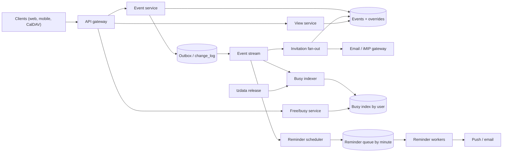

## In one minute
- Store a recurring series as a rule plus exceptions, not as thousands of rows. Expand it at read time for views, and materialize a bounded horizon (about 13 months) only for free/busy and reminders.
- Store local wall-clock time plus an IANA zone ID such as `America/New_York`. A weekly 9:00 meeting must stay at 9:00 across daylight saving and time zone law changes, so UTC instants are derived, not the source of truth.
- The organizer's copy is authoritative. Invitations fan out asynchronously through an outbox, and RSVPs flow back as small writes. Partition by calendar so one user's writes stay on one shard.
- Free/busy is the hot read behind "find a time". Serve it from a rebuildable per-user busy index sorted by start time, scanned in parallel and merged.
- Reminders peak hard because most meetings start on the hour. Prefetch the next few minutes into memory and make delivery idempotent.

## Requirements
Functional:
- Create, edit and delete events on one or more calendars, with attendees.
- Recurring events, with edits to one occurrence, this and following, or the whole series.
- Invite attendees, including other organizations by email; attendees RSVP.
- Day, week and month views, and free/busy lookup to find a meeting time.
- Reminders by push or email, and incremental sync for web, mobile and CalDAV clients.

Non-functional:
- Read-your-writes for the author; attendees see invitations within seconds.
- Week view p99 under 200 ms; free/busy for 10 attendees p99 under 300 ms.
- Reminders within 30 seconds of schedule, never silently lost.
- 99.99% read availability and no lost events.

Out of scope: room booking policy (a room is just a calendar), video links, smart scheduling and the email transport. iCalendar ([RFC 5545](https://www.rfc-editor.org/rfc/rfc5545)) is the interchange format. Its JSON successor, JSCalendar ([RFC 8984](https://www.rfc-editor.org/rfc/rfc8984)), carries the same model (rules, overrides, zone IDs) and is a reasonable internal API shape.

## Back-of-envelope
Users: assume 500 million monthly and 100 million daily.

Reads: 10 view loads per daily user is 1 billion a day, or 1 billion / 86,400 = 11,600 per second. Weekday mornings peak at about 3x: 35,000 per second.

Free/busy: 20 million queries a day over 5 attendees each is 100 million per-user lookups, about 1,200 per second, 4,000 at peak.

Writes: 1.5 creates or edits per daily user is 150 million a day, 1,700 per second, 5,000 at peak. With 3 attendees on average, derived writes (attendee copies, busy rows) reach about 15,000 per second at peak.

Storage: 60 million new events a day at about 1 KB is 60 GB; 180 million attendee copies at 200 bytes is 36 GB. Call it 100 GB a day, 36 TB a year, 180 TB over 5 years, 540 TB with three replicas. The busy index is bounded by the horizon: 500 million users x 400 intervals x 32 bytes is about 6.4 TB.

Reminders: 4 per daily user is 400 million a day, about 4,600 per second on average. They cluster at :50 and :20 for meetings on the hour and half hour, so a large time zone's peak minute can carry a few hundred thousand, tens of times the average.

Bandwidth: 35,000 week views x 15 KB is about 525 MB/s at peak, mostly cacheable.

## API
```
POST /v1/calendars/{cal}/events                 Idempotency-Key: <uuid>
  body { title, start: {local: "2026-11-02T09:00", tz: "Europe/Berlin"},
         end: {...}, rrule: "FREQ=WEEKLY;BYDAY=MO,WE;COUNT=20",
         attendees: ["a@x.com", "b@y.org"], reminders: [{minutes: 10, via: "push"}] }
  -> 201 { event_id, version: 1 }

GET  /v1/calendars/{cal}/instances?from=2026-11-02T00:00Z&to=2026-11-09T00:00Z
  -> { instances: [ { event_id, original_start, start, end, title, rsvp } ] }

PATCH /v1/calendars/{cal}/events/{id}?scope=this|following|all
  body { original_start: "2026-11-09T09:00", changes: {...}, if_version: 7 }
  -> 200 { event_id, version: 8 }   | 409 { error: "VERSION_CONFLICT" }

POST /v1/calendars/{cal}/events/{id}/rsvp   body { response: "accepted" }

POST /v1/freebusy
  body { users: ["a@x.com", ...], from, to }
  -> { busy: { "a@x.com": [ [start, end], ... ] } }

GET  /v1/calendars/{cal}/changes?sync_token=abc
  -> { changed: [...], deleted: [...], next_sync_token }   | 410 Gone (full resync)
```

`instances` returns expanded occurrences; `original_start` (iCalendar's RECURRENCE-ID property) identifies an occurrence even after it has been moved. Google Calendar's API uses the same idea: an instance's `originalStartTime` identifies it within the series even if it was rescheduled ([Google Calendar API](https://developers.google.com/workspace/calendar/api/guides/recurringevents)). The `scope` parameter on edits is how the client tells the server which of the three edit meanings it wants. `if_version` gives optimistic concurrency, because two people editing a shared event at once is normal.

## Data model
`calendars(calendar_id PK, owner_id, default_tz, acl)`.

`events(calendar_id, event_id)`, partitioned by `calendar_id`. Columns: `organizer_calendar_id`, `start_local`, `end_local`, `tzid`, `all_day`, `rrule`, `exdates`, `attendees` (a list with RSVP status), `version`, `change_seq`. The organizer's row is authoritative; an attendee copy holds a pointer to it plus private fields (reminders, RSVP). A series edit is a single-row, single-shard write.

`overrides(calendar_id, event_id, original_start)`: one row per modified or cancelled occurrence, holding only the changed fields. This is RFC 5545's RECURRENCE-ID model, and it keeps a series with three exceptions at four small rows instead of hundreds.

`busy_index(user_id, start_utc, event_id, end_utc, status)`: partition `user_id`, clustered by `start_utc`. Busy-blocking occurrences inside the horizon, in UTC because overlap tests need a common timeline. One range scan per user.

`change_log(calendar_id, seq, event_id, op)`: an append-only sequence per calendar. A sync token is an encoded `(calendar_id, seq)`. Rows older than about 30 days are truncated; a client presenting an older token gets `410 Gone`, discards its local copy and does a full sync, the same contract Google Calendar's sync API uses ([Google Calendar API](https://developers.google.com/workspace/calendar/api/guides/sync)).

`reminder_queue(fire_minute, shard, reminder_id, user_id, payload)`: partitioned by the minute it fires plus a shard number, so the workers for one minute read a few known partitions instead of scanning.

A wide-column or NewSQL store (Spanner, CockroachDB, Cassandra) fits, because every access is "this calendar" or "this user between two times".

## High-level design


Write path: the event service validates the rule, then writes the event row and a `change_log` row in one single-partition transaction and returns. That outbox write is the only synchronous work. A relay publishes the change to a stream keyed by `calendar_id`, and three consumers react: fan-out writes attendee copies and sends iTIP email to external attendees, the busy indexer expands the series over the horizon, and the reminder scheduler enqueues the next few days of reminders.

Read path: the view service reads one calendar partition, expands each rule over the window in the event's own zone, applies overrides, converts to the viewer's zone, and joins attendee copies to their cached masters. Free/busy runs one range scan per user in parallel.

## Deep dives

### Recurring events: rules, materialization and "this and following"
Materializing every occurrence makes queries simple range scans, but an endless daily event is infinite, a series edit rewrites hundreds of rows, and a rule typo can create millions. Storing only the rule makes edits one row, but "is Alice busy Tuesday?" means expanding all her series, which is expensive across many users.

I choose a hybrid. Rule plus overrides is the truth. Views expand on the fly, since a view covers a week or a month. Free/busy and reminders use a rolling-horizon materialization, rebuilt when a series changes and extended nightly.

Edits have three scopes. "This occurrence" writes an override keyed by `original_start`. "All occurrences" edits the master; whether conflicting overrides survive is a product policy to decide explicitly. "This and all following" splits the series: the old master gets an `UNTIL` just before the split point, and a new master starts at the split with the new values. Both must be written atomically, which is easy because both live on the organizer's partition.

RFC 5545 allows `FREQ=SECONDLY`, so cap expansion per query and reject sub-daily rules at write time. Expansion also has a trap with impossible dates: a rule for "the 31st of every month" or "every 29 February" generates invalid dates, and RFC 5545 says those instances are silently dropped, not moved ([RFC 5545 §3.3.10](https://www.rfc-editor.org/rfc/rfc5545#section-3.3.10)). Users usually expect the last day of the month instead. RFC 7529 adds an `RSCALE` rule part with `SKIP=BACKWARD` or `SKIP=FORWARD` to say exactly that ([RFC 7529](https://www.rfc-editor.org/rfc/rfc7529)); without it, write such rules as `BYMONTHDAY=-1`.

### Time zones and daylight saving
An event at 09:00 every Monday in Berlin is 08:00 UTC in winter and 07:00 UTC in summer. If you store the first instance as a UTC instant and add 7 x 24 hours, the meeting drifts by an hour twice a year. So the master stores `start_local` plus `tzid`, and each occurrence's instant is computed with the time zone database during expansion.

Two edge cases need explicit rules. In the spring-forward gap, a local time like 02:30 does not exist; RFC 5545 says to interpret it using the offset before the gap, which effectively moves it forward by the gap length. In the fall-back overlap, 01:30 happens twice; the RFC says it means the first occurrence ([RFC 5545 §3.3.5](https://www.rfc-editor.org/rfc/rfc5545#section-3.3.5)). Pin both rules in your shared library and test them, because language runtimes differ in their defaults. All-day events are "floating" dates with no zone: a birthday on 3 March is 3 March wherever you are.

Governments change zone rules with little notice, and IANA ships several tzdata releases a year: five in 2026 by the end of September, the latest moving Manitoba to permanent UTC-5 from 31 October 2026 ([tzdb NEWS](https://data.iana.org/time-zones/tzdb/NEWS)). Busy rows record the tzdata version that produced them, and a new release triggers re-expansion for affected zones; otherwise free/busy silently disagrees with the freshly computed view.

### Invitations, cross-organization attendees and free/busy
Internal attendees get a lightweight copy on their own partition, so each view is a single-partition read. An RSVP is a conditional update of one attendee entry on the master, which bumps its version and fans out again.

For attendees in other systems, the interchange is iTIP ([RFC 5546](https://www.rfc-editor.org/rfc/rfc5546)) messages carried in email as iMIP ([RFC 6047](https://www.rfc-editor.org/rfc/rfc6047)): a `METHOD:REQUEST` iCalendar attachment for invites and `METHOD:REPLY` for responses. CalDAV servers can run the same fan-out themselves: RFC 6638 makes the server, not the client, deliver scheduling messages when an organizer saves an event, which is exactly the role of our fan-out worker ([RFC 6638](https://www.rfc-editor.org/rfc/rfc6638)). The fan-out worker records a sent marker per `(event_id, version, attendee)` so retries do not duplicate invitations.

An all-hands with 40,000 attendees breaks naive fan-out: one edit means 40,000 writes and emails. Above a threshold, attendees get no copy; views join the master by reference and RSVPs go to sharded counters. That is the hot key shape, solved by changing the data layout for the few hot keys.

Free/busy exposes only intervals unless the ACL allows more. Merging the lists into free slots is a sorted sweep, the practice task below.

## Down the stack

### Layer 1: The contract
`POST /freebusy` for up to 50 users (the same per-query cap Google Calendar's free/busy API sets ([Google Calendar API](https://developers.google.com/workspace/calendar/api/v3/reference/freebusy/query))) and a window of at most 90 days returns, for each user, a sorted list of non-overlapping busy intervals in UTC, covering every opaque, non-declined occurrence that starts inside the window. The organizer's own just-committed writes are reflected (the service reads the organizer's busy rows from the leader). Other users' changes appear within the indexer lag, which has a 5-second target. Users the caller may not see return an `access_denied` entry rather than failing the whole request.

### Layer 2: The mechanism
The busy index is a wide row per `user_id`, clustered by `start_utc`, in an LSM store such as Bigtable or Cassandra. A query is one range scan from `window_start - max_event_length` to `window_end`, so events that started before the window but overlap it are found. The indexer consumes the stream in `calendar_id` order, and each upsert carries the master's `version`; a lower version than the stored one is ignored, so replays are harmless.

### Layer 3: The machine
A busy user has about 400 future intervals in the 13-month horizon. At 32 bytes each (8-byte start and end, 16-byte event ID) that is about 13 KB, which fits in one or two 64 KB SSTable blocks. If the block is in the block cache, the scan costs tens of microseconds of CPU; if not, one NVMe read is about 100 microseconds. So the tail of a 10-user query is set by the slowest of 10 servers, not by work, and hedged requests (a second read to another replica after the p95 delay) cut it. Expansion for the view path calls a time zone conversion per occurrence; with the zone's transition table cached, a binary search over a few hundred transitions takes on the order of 100 ns, so expanding a month for 200 series is a few milliseconds of CPU at most.

### Why it's built this way
1. People schedule in local wall-clock time, and time zone rules change, so the source of truth is local time plus a zone ID, and instants are derived.
2. Derived instants for an infinite rule cannot all be stored, so they are materialized only over a bounded horizon.
3. Free/busy for many users must be fast, so the derived data is laid out per user and sorted by start time, making each lookup a single sequential scan.
4. Derived data lags and can be wrong after a tzdata or code change, so it is versioned and rebuildable from the masters.
5. Cross-partition writes are expensive and fragile, so the only synchronous write is to the organizer's partition, and everything else flows through an outbox.

## Failure modes
- **10x load on Monday morning:** cache each expanded week keyed by `(calendar_id, week, change_seq)`, which any change invalidates, and shed background scheduling queries before interactive ones.
- **Top-of-hour reminder burst:** reminders due at 08:50 local for a large time zone arrive together. Workers prefetch the next 5 minutes into an in-memory timing wheel, spreading the database reads, and may send a few seconds early to fit push provider rate limits.
- **Region outage:** users are homed to a region, with synchronous replication to a second region for the event store. On failover the reminder scheduler replays from its checkpoint; dedupe on `(reminder_id, occurrence_start)`. A duplicate is annoying, a miss is a missed meeting, so prefer at-least-once.
- **Hot key:** a 40,000-person all-hands or a company holidays calendar subscribed by everyone. Do not copy it into each calendar; read it by reference through a heavily cached master, and shard RSVP counters.
- **Rule bomb:** a rule that expands to millions of instances, or a 100,000-event import. Cap expansion per series and per request, and throttle bulk imports on a separate queue.
- **Time zone database update:** a country abolishes daylight saving on two weeks' notice. Ship the tzdata release, then re-index affected users from a work queue, with a dashboard tracking how many busy rows still carry the old version.

## In the wild
- **Egypt, 2016: daylight saving cancelled two days out.** Egypt had announced DST from 7 July 2016, and tzdata carried that rule. The government then reversed itself on short notice, and tz release 2016f, dated 5 July, said Cairo would not switch on 7 July after all. Any calendar that had already expanded July meetings into UTC under the old rule was an hour wrong until it re-indexed, which is the "tzdata version on every busy row" requirement in practice ([tzdb NEWS](https://data.iana.org/time-zones/tzdb/NEWS)).
- **Lebanon, 2023: three tz releases in a week.** Release 2023a (22 March) carried Lebanon's normal DST start. Lebanon then announced a delay to 20/21 April, shipped as 2023b on 23 March, and reversed the delay days later, so 2023c (28 March) reverted to 2023a's data. A calendar that re-expanded on 2023b and did not re-expand again on 2023c shows meetings an hour off for a month. Re-indexing must be idempotent and keyed by release, not a one-off migration ([tzdb NEWS](https://data.iana.org/time-zones/tzdb/NEWS)).
- **Microsoft Azure, 2012: "same day next year" on 29 February.** The guest agent created certificates valid until the same date one year later, which on 29 February 2012 produced 29 February 2013, a date that does not exist. Creation failed, hosts read the timeouts as hardware faults, and automatic healing spread the failure across clusters; service management was switched off worldwide for about 10.5 hours. It is the same impossible-date problem as a yearly recurrence on 29 February ([Microsoft Azure](https://azure.microsoft.com/en-us/blog/summary-of-windows-azure-service-disruption-on-feb-29th-2012/)).

## Trade-offs
| Choice | Strengths | Weaknesses | Choose when |
|---|---|---|---|
| Store rule only, expand on read | Tiny storage, one-row edits | Free/busy and reminders must expand many series | Small scale or view-only features |
| Materialize all occurrences | Simple range queries | Infinite series, write amplification on edits | Bounded series only, such as class timetables |
| Rule as truth plus materialized horizon | Fast free/busy, cheap edits | Two representations to keep in sync | General-purpose calendars (chosen) |
| Copy event to every attendee | Single-partition reads per user | Fan-out cost on every edit; huge events hurt | Normal meetings with a few attendees |
| Reference organizer's master | One write per edit | Cross-partition read on every view | Very large events and shared calendars |
| Store UTC instants | Easy comparisons | DST drift and broken future events after rule changes | Past events and logs only |

## Leadership lens
- Build first: single-user events with time zones and recurrence, done correctly, plus the change log for sync. Every later feature (invites, free/busy, reminders) is a consumer of the change stream, so the outbox is the foundation.
- Team ownership: events core owns masters and recurrence, scheduling owns free/busy, notifications owns reminders. Keep one shared recurrence and time zone library, because two implementations will disagree on edge cases.
- Rollout: run the busy index in shadow mode against on-the-fly expansion for sampled users and alert on mismatches before it serves traffic.
- Cost drivers: fan-out for large events, reminder capacity sized for the top of the hour, and external email.
- Question to ask in review: "What happens to this series on the day the clocks change, and on the day a country changes its rules?" If nobody can answer, the design is not done.

## Check yourself
1. Why store a weekly 09:00 Berlin meeting as local time plus `tzid` instead of a UTC instant for the first occurrence?
   **Answer:** Adding 7 x 24 hours to a UTC instant makes the meeting drift by an hour twice a year at daylight saving changes, and breaks future events when a government changes its zone rules. Storing local wall-clock time plus the IANA zone ID and deriving each instant during expansion keeps it at 09:00.
2. A country abolishes daylight saving on two weeks' notice. What silently goes wrong if nothing is done, and how does the design recover?
   **Answer:** The busy index was expanded under the old rules, so free/busy disagrees with freshly computed views. Busy rows record the tzdata version that produced them, so the new release triggers re-indexing of affected users from a work queue, tracked by a dashboard of rows still on the old version.
3. Why is the chosen recurrence model a rule plus overrides with a materialized horizon, rather than storing only the rule or materializing every occurrence?
   **Answer:** Rule-only makes free/busy expand every series for every user, while full materialization cannot store infinite series and turns a series edit into hundreds of row writes. The hybrid keeps edits to one row and gives free/busy and reminders fast range scans, at the cost of two representations to keep in sync.
4. Estimate the size of one busy user's busy-index row and explain why a 10-user free/busy query's tail is set by servers rather than work.
   **Answer:** About 400 future intervals at 32 bytes each is about 13 KB, one or two SSTable blocks, so a scan costs tens of microseconds cached or about 100 microseconds from NVMe. The query waits for the slowest of 10 servers, which is why hedged requests to another replica cut the tail.

## Practice
**Task:** Implement the two core routines of the scheduling path. Times are integer minutes on a UTC timeline where minute 0 is a Monday at 00:00, so a day is 1,440 minutes and a week is 10,080. `expand(rule, window_start, window_end)` takes a rule with `start`, `duration`, `freq` (`"DAILY"` or `"WEEKLY"`), `interval` (at least 1), `count` (0 means unlimited), `until` (an inclusive limit on occurrence starts, or -1 for none), `byday` (weekday numbers 0 to 6, Monday is 0; used only for weekly rules, and empty means the start's weekday) and `exdates` (occurrence starts to skip). It returns `(start, end)` pairs of occurrences that overlap the half-open window, in time order. As in RFC 5545, excluded occurrences still count towards `count`, and weekly candidates before `start` are skipped. Raise an error for an interval below 1, a negative duration or an unknown frequency. `free_slots(busy, window_start, window_end, min_len)` takes a list of busy-interval lists (one per attendee), and returns the gaps inside the window, at least `min_len` long, where nobody is busy.

```python starter
DAY = 1440
WEEK = 7 * DAY


def expand(rule, window_start, window_end):
    # TODO: generate candidates in order, apply count/until/exdates, keep overlaps
    raise NotImplementedError


def free_slots(busy, window_start, window_end, min_len):
    # TODO: clip, sort and sweep the busy intervals
    raise NotImplementedError
```

```python tests
def rule(**kw):
    r = {"start": 0, "duration": 60, "freq": "WEEKLY", "interval": 1,
         "count": 0, "until": -1, "byday": [], "exdates": []}
    r.update(kw)
    return r


def test_weekly_byday_with_count():
    r = rule(start=540, byday=[0, 2, 4], count=5)
    got = expand(r, 0, 4 * WEEK)
    starts = [s for s, _ in got]
    assert starts == [540, 2 * DAY + 540, 4 * DAY + 540, 7 * DAY + 540, 9 * DAY + 540]
    assert got[0] == (540, 600)


def test_exdate_still_consumes_count():
    r = rule(start=540, byday=[0, 2, 4], count=5, exdates=[2 * DAY + 540])
    starts = [s for s, _ in expand(r, 0, 4 * WEEK)]
    assert starts == [540, 4 * DAY + 540, 7 * DAY + 540, 9 * DAY + 540]


def test_daily_interval_until_inclusive():
    r = rule(start=600, freq="DAILY", interval=2, until=600 + 4 * DAY)
    starts = [s for s, _ in expand(r, 0, 30 * DAY)]
    assert starts == [600, 2 * DAY + 600, 4 * DAY + 600]


def test_window_keeps_overlapping_occurrence():
    r = rule(start=1380, duration=120, freq="DAILY")
    got = expand(r, DAY, 3 * DAY)
    assert got == [(1380, 1500), (DAY + 1380, DAY + 1500), (2 * DAY + 1380, 2 * DAY + 1500)]


def test_weekly_interval_skips_days_before_start():
    r = rule(start=2 * DAY + 600, byday=[2, 0], interval=2, count=3)
    starts = [s for s, _ in expand(r, 0, 10 * WEEK)]
    assert starts == [2 * DAY + 600, 2 * WEEK + 600, 2 * WEEK + 2 * DAY + 600]


def test_invalid_rule_raises():
    try:
        expand(rule(interval=0), 0, WEEK)
    except ValueError:
        return
    assert False, "interval 0 must raise"


def test_free_slots_merge_and_min_len():
    busy = [[(60, 120), (300, 360)], [(100, 200), (350, 420)]]
    assert free_slots(busy, 0, 480, 60) == [(0, 60), (200, 300), (420, 480)]
    assert free_slots(busy, 0, 480, 61) == [(200, 300)]


def test_free_slots_clip_and_edges():
    assert free_slots([[(-100, 30)], [(470, 600)]], 0, 480, 10) == [(30, 470)]
    assert free_slots([], 0, 480, 30) == [(0, 480)]
    assert free_slots([[(0, 480)]], 0, 480, 1) == []
```

```python solution
DAY = 1440
WEEK = 7 * DAY


def _candidates(rule):
    start = rule["start"]
    step = rule["interval"]
    if rule["freq"] == "DAILY":
        k = 0
        while True:
            yield start + k * step * DAY
            k += 1
    days = sorted(set(rule["byday"])) or [(start // DAY) % 7]
    week0 = start - start % WEEK
    tod = start % DAY
    w = 0
    while True:
        for d in days:
            t = week0 + w * WEEK + d * DAY + tod
            if t >= start:
                yield t
        w += step


def expand(rule, window_start, window_end):
    if rule["interval"] < 1 or rule["duration"] < 0 or rule["freq"] not in ("DAILY", "WEEKLY"):
        raise ValueError("invalid rule")
    count, until, dur = rule["count"], rule["until"], rule["duration"]
    skip = set(rule["exdates"])
    out = []
    produced = 0
    for t in _candidates(rule):
        if count and produced == count:
            break
        if until >= 0 and t > until:
            break
        if t >= window_end:
            break
        produced += 1
        if t in skip:
            continue
        if t + dur > window_start:
            out.append((t, t + dur))
    return out


def free_slots(busy, window_start, window_end, min_len):
    ivs = []
    for person in busy:
        for s, e in person:
            if s < e and s < window_end and e > window_start:
                ivs.append((max(s, window_start), min(e, window_end)))
    ivs.sort()
    out = []
    cur = window_start
    for s, e in ivs:
        if s > cur and s - cur >= min_len:
            out.append((cur, s))
        cur = max(cur, e)
    if window_end > cur and window_end - cur >= min_len:
        out.append((cur, window_end))
    return out
```

```typescript starter
export const DAY = 1440;
export const WEEK = 7 * DAY;

export interface Rule {
  start: number;
  duration: number;
  freq: string;
  interval: number;
  count: number;
  until: number;
  byday: number[];
  exdates: number[];
}

export function expand(rule: Rule, windowStart: number, windowEnd: number): [number, number][] {
  throw new Error("TODO");
}

export function freeSlots(busy: [number, number][][], windowStart: number, windowEnd: number,
                          minLen: number): [number, number][] {
  throw new Error("TODO");
}
```

```typescript tests
function mkRule(p: Partial<Rule>): Rule {
  return Object.assign({ start: 0, duration: 60, freq: "WEEKLY", interval: 1, count: 0,
    until: -1, byday: [], exdates: [] }, p);
}

test("weekly byday with count", () => {
  const got = expand(mkRule({ start: 540, byday: [0, 2, 4], count: 5 }), 0, 4 * WEEK);
  assertEqual(got.map((o) => o[0]),
    [540, 2 * DAY + 540, 4 * DAY + 540, 7 * DAY + 540, 9 * DAY + 540], "starts");
  assertEqual(got[0], [540, 600], "first occurrence");
});

test("exdate still consumes count", () => {
  const r = mkRule({ start: 540, byday: [0, 2, 4], count: 5, exdates: [2 * DAY + 540] });
  assertEqual(expand(r, 0, 4 * WEEK).map((o) => o[0]),
    [540, 4 * DAY + 540, 7 * DAY + 540, 9 * DAY + 540], "excluded still counted");
});

test("daily interval until inclusive", () => {
  const r = mkRule({ start: 600, freq: "DAILY", interval: 2, until: 600 + 4 * DAY });
  assertEqual(expand(r, 0, 30 * DAY).map((o) => o[0]), [600, 2 * DAY + 600, 4 * DAY + 600], "until");
});

test("window keeps overlapping occurrence", () => {
  const got = expand(mkRule({ start: 1380, duration: 120, freq: "DAILY" }), DAY, 3 * DAY);
  assertEqual(got, [[1380, 1500], [DAY + 1380, DAY + 1500], [2 * DAY + 1380, 2 * DAY + 1500]], "overlap");
});

test("weekly interval skips days before start", () => {
  const r = mkRule({ start: 2 * DAY + 600, byday: [2, 0], interval: 2, count: 3 });
  assertEqual(expand(r, 0, 10 * WEEK).map((o) => o[0]),
    [2 * DAY + 600, 2 * WEEK + 600, 2 * WEEK + 2 * DAY + 600], "biweekly");
});

test("invalid rule throws", () => {
  let threw = false;
  try { expand(mkRule({ interval: 0 }), 0, WEEK); } catch (e) { threw = true; }
  assert(threw, "interval 0 must throw");
});

test("free slots merge and min length", () => {
  const busy: [number, number][][] = [[[60, 120], [300, 360]], [[100, 200], [350, 420]]];
  assertEqual(freeSlots(busy, 0, 480, 60), [[0, 60], [200, 300], [420, 480]], "min 60");
  assertEqual(freeSlots(busy, 0, 480, 61), [[200, 300]], "min 61");
});

test("free slots clip and edges", () => {
  assertEqual(freeSlots([[[-100, 30]], [[470, 600]]], 0, 480, 10), [[30, 470]], "clip");
  assertEqual(freeSlots([], 0, 480, 30), [[0, 480]], "empty");
  assertEqual(freeSlots([[[0, 480]]], 0, 480, 1), [], "full");
});
```

```typescript solution
export const DAY = 1440;
export const WEEK = 7 * DAY;

export interface Rule {
  start: number;
  duration: number;
  freq: string;
  interval: number;
  count: number;
  until: number;
  byday: number[];
  exdates: number[];
}

function* candidates(rule: Rule): Generator<number> {
  const start = rule.start;
  if (rule.freq === "DAILY") {
    for (let k = 0; ; k++) yield start + k * rule.interval * DAY;
  }
  let days = Array.from(new Set(rule.byday)).sort((a, b) => a - b);
  if (days.length === 0) days = [Math.floor(start / DAY) % 7];
  const week0 = start - (start % WEEK);
  const tod = start % DAY;
  for (let w = 0; ; w += rule.interval) {
    for (const d of days) {
      const t = week0 + w * WEEK + d * DAY + tod;
      if (t >= start) yield t;
    }
  }
}

export function expand(rule: Rule, windowStart: number, windowEnd: number): [number, number][] {
  if (rule.interval < 1 || rule.duration < 0 || (rule.freq !== "DAILY" && rule.freq !== "WEEKLY")) {
    throw new Error("invalid rule");
  }
  const skip = new Set(rule.exdates);
  const out: [number, number][] = [];
  let produced = 0;
  for (const t of candidates(rule)) {
    if (rule.count > 0 && produced === rule.count) break;
    if (rule.until >= 0 && t > rule.until) break;
    if (t >= windowEnd) break;
    produced++;
    if (skip.has(t)) continue;
    if (t + rule.duration > windowStart) out.push([t, t + rule.duration]);
  }
  return out;
}

export function freeSlots(busy: [number, number][][], windowStart: number, windowEnd: number,
                          minLen: number): [number, number][] {
  const ivs: [number, number][] = [];
  for (const person of busy) {
    for (const [s, e] of person) {
      if (s < e && s < windowEnd && e > windowStart) {
        ivs.push([Math.max(s, windowStart), Math.min(e, windowEnd)]);
      }
    }
  }
  ivs.sort((a, b) => a[0] - b[0] || a[1] - b[1]);
  const out: [number, number][] = [];
  let cur = windowStart;
  for (const [s, e] of ivs) {
    if (s > cur && s - cur >= minLen) out.push([cur, s]);
    cur = Math.max(cur, e);
  }
  if (windowEnd > cur && windowEnd - cur >= minLen) out.push([cur, windowEnd]);
  return out;
}
```

```go starter
package practice

const Day = 1440
const Week = 7 * Day

type Rule struct {
	Start, Duration int
	Freq            string
	Interval        int
	Count           int
	Until           int
	ByDay           []int
	ExDates         []int
}

type Interval struct {
	Start, End int
}

func Expand(r Rule, windowStart, windowEnd int) ([]Interval, error) {
	panic("TODO")
}

func FreeSlots(busy [][]Interval, windowStart, windowEnd, minLen int) []Interval {
	panic("TODO")
}
```

```go tests
package practice

import (
	"reflect"
	"testing"
)

func mkRule(f func(r *Rule)) Rule {
	r := Rule{Start: 0, Duration: 60, Freq: "WEEKLY", Interval: 1, Count: 0, Until: -1}
	f(&r)
	return r
}

func starts(t *testing.T, r Rule, ws, we int) []int {
	t.Helper()
	got, err := Expand(r, ws, we)
	if err != nil {
		t.Fatalf("unexpected error: %v", err)
	}
	out := []int{}
	for _, o := range got {
		out = append(out, o.Start)
	}
	return out
}

func TestWeeklyByDayWithCount(t *testing.T) {
	r := mkRule(func(r *Rule) { r.Start = 540; r.ByDay = []int{0, 2, 4}; r.Count = 5 })
	want := []int{540, 2*Day + 540, 4*Day + 540, 7*Day + 540, 9*Day + 540}
	if got := starts(t, r, 0, 4*Week); !reflect.DeepEqual(got, want) {
		t.Fatalf("got %v want %v", got, want)
	}
	got, _ := Expand(r, 0, 4*Week)
	if got[0] != (Interval{540, 600}) {
		t.Fatalf("first occurrence %v", got[0])
	}
}

func TestExDateStillConsumesCount(t *testing.T) {
	r := mkRule(func(r *Rule) {
		r.Start = 540
		r.ByDay = []int{0, 2, 4}
		r.Count = 5
		r.ExDates = []int{2*Day + 540}
	})
	want := []int{540, 4*Day + 540, 7*Day + 540, 9*Day + 540}
	if got := starts(t, r, 0, 4*Week); !reflect.DeepEqual(got, want) {
		t.Fatalf("got %v want %v", got, want)
	}
}

func TestDailyIntervalUntilInclusive(t *testing.T) {
	r := mkRule(func(r *Rule) { r.Start = 600; r.Freq = "DAILY"; r.Interval = 2; r.Until = 600 + 4*Day })
	want := []int{600, 2*Day + 600, 4*Day + 600}
	if got := starts(t, r, 0, 30*Day); !reflect.DeepEqual(got, want) {
		t.Fatalf("got %v want %v", got, want)
	}
}

func TestWindowKeepsOverlappingOccurrence(t *testing.T) {
	r := mkRule(func(r *Rule) { r.Start = 1380; r.Duration = 120; r.Freq = "DAILY" })
	got, err := Expand(r, Day, 3*Day)
	want := []Interval{{1380, 1500}, {Day + 1380, Day + 1500}, {2*Day + 1380, 2*Day + 1500}}
	if err != nil || !reflect.DeepEqual(got, want) {
		t.Fatalf("got %v %v want %v", got, err, want)
	}
}

func TestWeeklyIntervalSkipsDaysBeforeStart(t *testing.T) {
	r := mkRule(func(r *Rule) { r.Start = 2*Day + 600; r.ByDay = []int{2, 0}; r.Interval = 2; r.Count = 3 })
	want := []int{2*Day + 600, 2*Week + 600, 2*Week + 2*Day + 600}
	if got := starts(t, r, 0, 10*Week); !reflect.DeepEqual(got, want) {
		t.Fatalf("got %v want %v", got, want)
	}
}

func TestInvalidRuleErrors(t *testing.T) {
	if _, err := Expand(mkRule(func(r *Rule) { r.Interval = 0 }), 0, Week); err == nil {
		t.Fatal("interval 0 must return an error")
	}
}

func TestFreeSlotsMergeAndMinLen(t *testing.T) {
	busy := [][]Interval{{{60, 120}, {300, 360}}, {{100, 200}, {350, 420}}}
	if got := FreeSlots(busy, 0, 480, 60); !reflect.DeepEqual(got, []Interval{{0, 60}, {200, 300}, {420, 480}}) {
		t.Fatalf("min 60: %v", got)
	}
	if got := FreeSlots(busy, 0, 480, 61); !reflect.DeepEqual(got, []Interval{{200, 300}}) {
		t.Fatalf("min 61: %v", got)
	}
}

func TestFreeSlotsClipAndEdges(t *testing.T) {
	if got := FreeSlots([][]Interval{{{-100, 30}}, {{470, 600}}}, 0, 480, 10); !reflect.DeepEqual(got, []Interval{{30, 470}}) {
		t.Fatalf("clip: %v", got)
	}
	if got := FreeSlots(nil, 0, 480, 30); !reflect.DeepEqual(got, []Interval{{0, 480}}) {
		t.Fatalf("empty: %v", got)
	}
	if got := FreeSlots([][]Interval{{{0, 480}}}, 0, 480, 1); len(got) != 0 {
		t.Fatalf("full: %v", got)
	}
}
```

```go solution
package practice

import (
	"errors"
	"sort"
)

const Day = 1440
const Week = 7 * Day

type Rule struct {
	Start, Duration int
	Freq            string
	Interval        int
	Count           int
	Until           int
	ByDay           []int
	ExDates         []int
}

type Interval struct {
	Start, End int
}

// candidates returns a function yielding occurrence starts in time order.
func candidates(r Rule) func() int {
	if r.Freq == "DAILY" {
		k := 0
		return func() int {
			t := r.Start + k*r.Interval*Day
			k++
			return t
		}
	}
	seen := map[int]bool{}
	days := []int{}
	for _, d := range r.ByDay {
		if !seen[d] {
			seen[d] = true
			days = append(days, d)
		}
	}
	sort.Ints(days)
	if len(days) == 0 {
		days = []int{(r.Start / Day) % 7}
	}
	week0 := r.Start - r.Start%Week
	tod := r.Start % Day
	w, i := 0, 0
	return func() int {
		for {
			t := week0 + w*Week + days[i]*Day + tod
			i++
			if i == len(days) {
				i = 0
				w += r.Interval
			}
			if t >= r.Start {
				return t
			}
		}
	}
}

func Expand(r Rule, windowStart, windowEnd int) ([]Interval, error) {
	if r.Interval < 1 || r.Duration < 0 || (r.Freq != "DAILY" && r.Freq != "WEEKLY") {
		return nil, errors.New("invalid rule")
	}
	skip := map[int]bool{}
	for _, x := range r.ExDates {
		skip[x] = true
	}
	next := candidates(r)
	out := []Interval{}
	produced := 0
	for {
		t := next()
		if r.Count > 0 && produced == r.Count {
			break
		}
		if r.Until >= 0 && t > r.Until {
			break
		}
		if t >= windowEnd {
			break
		}
		produced++
		if skip[t] {
			continue
		}
		if t+r.Duration > windowStart {
			out = append(out, Interval{t, t + r.Duration})
		}
	}
	return out, nil
}

func FreeSlots(busy [][]Interval, windowStart, windowEnd, minLen int) []Interval {
	ivs := []Interval{}
	for _, person := range busy {
		for _, iv := range person {
			if iv.Start < iv.End && iv.Start < windowEnd && iv.End > windowStart {
				ivs = append(ivs, Interval{max(iv.Start, windowStart), min(iv.End, windowEnd)})
			}
		}
	}
	sort.Slice(ivs, func(a, b int) bool {
		if ivs[a].Start != ivs[b].Start {
			return ivs[a].Start < ivs[b].Start
		}
		return ivs[a].End < ivs[b].End
	})
	out := []Interval{}
	cur := windowStart
	for _, iv := range ivs {
		if iv.Start > cur && iv.Start-cur >= minLen {
			out = append(out, Interval{cur, iv.Start})
		}
		cur = max(cur, iv.End)
	}
	if windowEnd > cur && windowEnd-cur >= minLen {
		out = append(out, Interval{cur, windowEnd})
	}
	return out
}
```

## Mock interview
**Prompt:** Design a calendar service like Google Calendar or Outlook for 100 million daily users, with recurring events, invitations across organizations, free/busy lookup and reminders. The interviewer cares most about recurrence and correctness over time.

- Follow-up: A user edits "this and all following" occurrences of a weekly meeting that already has two moved instances. What exactly do you write, and what happens to the moved instances?
- Follow-up: A country cancels daylight saving time with three weeks' notice. Which parts of your system are now wrong, and how do they get fixed?
- Follow-up: Why not store every occurrence as a row and make everything a range query?

**A strong answer covers:**
- Rule plus overrides as the source of truth, with read-time expansion for views and a bounded, versioned materialization for free/busy and reminders.
- Local time plus IANA zone ID for recurring events, explicit handling of DST gaps and overlaps, floating all-day dates, and a re-index plan for tzdata updates.
- Organizer-authoritative masters partitioned by calendar, a transactional outbox, and asynchronous fan-out to attendee copies and iTIP email, with idempotency per version.
- A per-user busy index sorted by time, parallel range scans, a sorted merge, and hedged reads for tail latency.
- Reminder peaks at the top of the hour, prefetching into an in-memory timing wheel, and at-least-once delivery with deduplication.
- A special path for very large events and shared calendars to avoid fan-out hot keys.

## Sources and further study
**Primary**
- [RFC 5546: iTIP](https://www.rfc-editor.org/rfc/rfc5546): the REQUEST, REPLY, CANCEL and COUNTER methods that cross-organization invitations use.
- [RFC 6638: Scheduling Extensions to CalDAV](https://www.rfc-editor.org/rfc/rfc6638): server-side delivery of invitations and replies through scheduling inbox and outbox collections.
- [RFC 7529: Non-Gregorian Recurrence Rules](https://www.rfc-editor.org/rfc/rfc7529): `RSCALE` and `SKIP` for impossible dates such as 31 April.
- [RFC 8984: JSCalendar](https://www.rfc-editor.org/rfc/rfc8984): the JSON successor to iCalendar, with recurrence overrides keyed by original start.

**Systems docs**
- [tzdb NEWS (IANA)](https://data.iana.org/time-zones/tzdb/NEWS): every tz release with the rule changes it carries; the input to the re-index job.
- [Free/busy query (Google Calendar API)](https://developers.google.com/workspace/calendar/api/v3/reference/freebusy/query): a production free/busy contract with its expansion limits.

**Books**
- Designing Data-Intensive Applications (Kleppmann, 1st ed., 2017), Ch 11 "Stream Processing": change data capture and derived views, the model behind the busy index and its rebuilds.
- Designing Data-Intensive Applications (Kleppmann, 1st ed., 2017), Ch 8 "The Trouble with Distributed Systems", section "Unreliable Clocks": why wall-clock time is a poor source of truth.

**Other curricula**
- [Materialized View pattern (Azure Architecture Center)](https://learn.microsoft.com/en-us/azure/architecture/patterns/materialized-view): frames the busy index as a prepopulated view that can always be rebuilt from the source data.
- [system-design-primer (Donne Martin)](https://github.com/donnemartin/system-design-primer): no calendar walkthrough, but its consistency and asynchronism sections cover the eventual consistency and queue-based fan-out this design relies on.

## Watch
- [System Design Interview: Design Google Calendar (James Peralta)](https://www.youtube.com/watch?v=ObOO3T4v_yE): a structured walkthrough of requirements, data model and recurring events.
- [System Design Mock Interview with @Alpha-Code: Design Google Calendar (James Peralta)](https://www.youtube.com/watch?v=ItjVOI3EK44): a mock interview with a dedicated segment on recurring events and notifications.
- [Design a Calendar for 100 Million Users (interviewing.io)](https://www.youtube.com/watch?v=flcc1a5ajyM): a senior and staff level mock interview with interviewer feedback.

## Free resources
- [RFC 5545: iCalendar](https://datatracker.ietf.org/doc/html/rfc5545): the definitive specification of RRULE, EXDATE, RECURRENCE-ID and time zone handling.
- [RFC 4791: CalDAV](https://datatracker.ietf.org/doc/html/rfc4791): how calendar clients sync and query servers, including free/busy reports.
- [Recurring events (Google Calendar API)](https://developers.google.com/calendar/api/guides/recurringevents): how a production API exposes series, instances and exceptions.
- [Synchronize resources efficiently (Google Calendar API)](https://developers.google.com/calendar/api/guides/sync): sync tokens and the 410 Gone full-resync contract.
- [Time Zone Database (IANA)](https://www.iana.org/time-zones): the tz database and its release history, the reason re-indexing exists.
