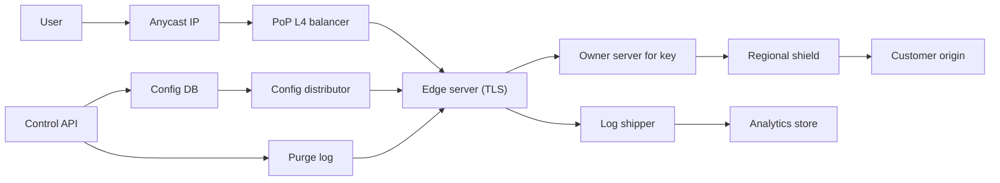

## In one minute
- **A CDN is a routing problem first and a caching problem second.** Getting each user to a nearby, healthy point of presence (PoP) decides latency. Anycast steers coarsely; the PoP's load balancer steers finely.
- **Cache each object once per PoP, not once per server.** Hash the cache key to one owner server so the PoP acts as one large cache, and copy only the hottest objects more widely.
- **Hit ratio comes from the hierarchy.** Edge, regional shield, then origin, with request collapsing at each level, so a miss in 250 PoPs costs a handful of origin fetches.
- **Purge is a write path with a deadline.** Use tag generation counters, so purging a million objects worldwide is one small message rather than a scan of every disk.
- **Every config push is a global deploy.** Rules and WAF signatures reach every PoP within seconds, so stage them the way you stage code.

## Requirements

**Functional**
- Customers create a distribution: hostnames, origins and cache rules (TTLs, which query parameters and headers go into the key).
- Serve `GET` and `HEAD` over HTTPS from the edge, with conditional requests (`If-None-Match`) and range requests (`Range: bytes=...`).
- Purge by exact URL, by prefix and by surrogate tag (for example every object tagged `product-4411`), plus a "soft purge" that marks objects stale instead of deleting them.
- Serve stale content when the origin fails, if the customer allows it.
- Per-customer logs and metrics (requests, bytes, hit ratio, status codes).

**Non-functional**
- Time to first byte (TTFB) under 50 ms at p95 for cache hits for users on a decent network.
- 99.99% availability for cached content, which means surviving the loss of a server, a PoP or an upstream transit link without customer action.
- Purges take effect in every PoP within 5 seconds at p99. Config changes take effect within 30 seconds.
- Origin offload of 95% or more by bytes for cacheable content.
- One customer's flash crowd or attack must not degrade other customers.

**Out of scope**
- Edge compute, video transcoding, DNS hosting as a product, and billing.

## Back-of-envelope
These are round planning numbers for a mid-sized commercial CDN, not any vendor's published figures.

- **Requests:** 100 billion per day. 100 × 10^9 / 86,400 s ≈ 1.16M requests per second on average. Daily peaks run about 3x, so plan for 3.5M per second.
- **Bandwidth:** the average response is about 150 KB (small API and image responses, plus large video segments that dominate bytes). 1.16M × 150 KB ≈ 174 GB/s ≈ 1.4 Tbit/s on average and about 4.2 Tbit/s at peak.
- **PoPs:** 250 PoPs, unevenly loaded. The largest carries about 5% of traffic, 210 Gbit/s at peak. If a server sustains about 40 Gbit/s of TLS traffic, that PoP needs 6 servers, and about 12 with headroom for failures and attacks.
- **Cache storage:** 2 billion distinct objects a day at 150 KB is a 300 TB daily working set. A large PoP with 12 servers of 8 × 7.68 TB NVMe holds about 740 TB, and each server keeps its hottest few hundred GB in RAM.
- **Origin traffic:** at 95% byte offload, origins receive about 70 Gbit/s on average. Without a shield tier, every PoP would miss separately and that would be several times higher.
- **Logs:** 100 billion requests × about 300 bytes per log record ≈ 30 TB per day. Keeping 30 days of raw logs is 900 TB. Rollups kept for 5 years at about 1% of raw size are about 550 TB. Logs are the only large durable storage; the cache itself is disposable.
- **Purges:** 10,000 purge requests per minute at peak, each fanned out to 250 PoPs, gives about 42,000 PoP-level messages per second. That is small, but the 5-second deadline makes it latency-critical.

## API

```
# Control plane (customer-facing, authenticated)
PUT /v1/distributions/{dist_id}
  { "hostnames": ["static.shop.example"],
    "origins": [{"host": "origin.shop.example", "weight": 100}],
    "cache_key": {"query_params": ["v", "size"], "headers": ["accept-encoding"]},
    "default_ttl_s": 3600, "serve_stale_if_error_s": 86400 }
  -> 200 { "version": 418, "status": "propagating" }

POST /v1/distributions/{dist_id}/purge
  { "type": "tag", "values": ["product-4411"], "mode": "soft" }
  -> 202 { "purge_id": "pg_9a1c", "status": "propagating" }

GET /v1/purges/{purge_id}
  -> 200 { "status": "complete", "pops_acked": 250, "pops_total": 250 }

# Data plane (end users)
GET https://static.shop.example/img/hero.jpg?v=12
  Range: bytes=0-1048575
  -> 206  Content-Range: bytes 0-1048575/8388608
          Cache-Status: shield-fra; fwd=uri-miss; stored, edge-fra3; hit
          Age: 532
```

The data plane is ordinary HTTP under RFC 9110 and RFC 9111. `Cache-Status` follows RFC 9211, which lists caches from the one nearest the origin to the one nearest the user, so the shield's entry (a miss it stored earlier) comes before the edge's hit ([RFC 9211](https://www.rfc-editor.org/rfc/rfc9211)). The control plane is asynchronous on purpose: "applied everywhere" is a distributed acknowledgement the caller polls for, not something one request can promise.

## Data model
- **distributions** (Postgres, the control-plane source of truth): `dist_id`, `customer_id`, `version`, `config_json`, `created_at`. Changes are rare and need transactions and history, so each one writes a new immutable version.
- **hostname_map** (compiled and shipped to every server): `hostname -> (dist_id, version)`, a read-only in-memory table, so a lookup never leaves the box.
- **purge_log** (a replicated, ordered log such as Kafka or a Raft log): `seq`, `dist_id`, `type` (`url`, `prefix`, `tag`), `value`, `mode`, `issued_at`. PoPs consume it in order and acknowledge the highest `seq` they have applied, which is what `GET /v1/purges/{id}` reports.
- **Per-server cache index** (in RAM on each cache server): `hash(cache_key) -> {disk_offset, size, stored_at, ttl, etag, tags[], tag_generations[]}`, at about 100 to 150 bytes per entry. With 30 million objects per server that is 3 to 5 GB of RAM, which is why the index stays in memory while the bodies live on SSD.
- **tag_generations** (in RAM on each server, fed by the purge log): `(dist_id, tag) -> generation`. Deep dive 3 explains why this beats enumerating objects.
- **Request logs** (a columnar store such as ClickHouse): partitioned by `(customer_id, hour)`, because every query is "my traffic, for this time range".

## High-level design



**Read path.** DNS returns an anycast address and BGP delivers packets to a nearby PoP, where a layer 4 balancer spreads connections across servers. The receiving server terminates TLS, maps the hostname to a distribution, computes the cache key and hashes it onto the PoP's ring to find the owner server, forwarding to it if needed (about 100 µs inside the PoP). On a miss, the owner collapses concurrent requests for the same key into one fetch from the regional shield. The shield runs the same logic and fetches from the origin only on its own miss. Each layer stores the response as it streams back, if the headers allow.

**Write path.** A config change becomes a new version in Postgres. The distributor compiles a snapshot and pushes it in stages (canary PoPs, then 10%, then everyone), and servers swap snapshots atomically between requests. A purge is appended to the purge log; servers apply entries in `seq` order and report their applied `seq`.

## Deep dives

### 1. Getting users to the right PoP, and to the right server inside it
**DNS steering** answers each resolver with a PoP chosen by geography, measured latency and load. It gives fine control, but it routes by the resolver's location rather than the user's, and every change waits for DNS TTLs. **Anycast** announces the same prefix from every PoP and lets BGP pick, so a PoP that withdraws its routes stops receiving new connections within seconds, and a volumetric attack spreads across all PoPs instead of landing on one. Its weakness is that "nearest" means best BGP path, not lowest latency, and a route change mid-connection can land packets on a PoP with no state for them. I'd use anycast by default and DNS steering for coarse shifts such as draining a region. The Anycast Routing lesson covers the BGP mechanics.

Inside the PoP, the L4 balancer uses ECMP from the routers plus a consistent-hash table (in the style of Maglev, or Cloudflare's Unimog) so a server added or removed moves few connections. The more interesting choice is the second hash, from cache key to owner server. If every server cached everything it served, a 12-server PoP would hold only one server's worth of distinct content. Hashing keys to owners makes the PoP one large cache. The cost is an internal hop and hot keys: a viral object would pin one server. So each server also keeps a small local cache of keys it forwards above, say, 1,000 requests per second.

### 2. The cache hierarchy, collapsing and admission
**Tiers.** Each PoP is assigned to one shield PoP in its region, so a miss goes edge, then shield, then origin. With 250 edge PoPs and 12 shields, a cold object costs at most 12 origin fetches instead of 250, and the shields' large disks hold the long tail that small PoPs evict. A customer with one origin can pick a single shield next to it for maximum offload. Cloudflare's Tiered Cache offers both shapes: a latency-chosen single upper tier per origin, or regional upper-tier pools chosen by hashing the cache key ([Cloudflare docs](https://developers.cloudflare.com/cache/how-to/tiered-cache/)).

**Collapsing.** When a popular object expires, hundreds of requests can miss in the same millisecond. The owner keeps an in-flight table keyed by cache key: the first miss fetches, and later ones wait on that fetch and stream the same bytes as they arrive. If the response turns out to be uncacheable (`private`, or a `Set-Cookie`), it must not be shared: the waiters fetch on their own and the key is marked "do not collapse" for a while. The Cache Stampede lesson covers the general pattern.

**Admission and eviction.** Plain LRU on SSD lets one-hit wonders, such as a crawler walking a catalogue, push out objects that are requested every hour. Two cheap defences work well: admit an object to SSD only on its second request within a window (tracked with a small counting filter), and split the cache into probation and protected segments so a newcomer can't evict anything that has proven itself. Akamai found that 74% of about 400 million cached objects on a typical cluster were requested only once in two days, and cache-on-second-hit with two rotating Bloom filters cut disk writes by 44% while raising byte hit rate ([Maggs and Sitaraman, CCR 2015](https://people.cs.umass.edu/~ramesh/Site/HOME_files/CCRpaper_1.pdf)). Facebook's photo caching study found that a segmented LRU (S4LRU) raised the edge object-hit ratio by 8.5% over FIFO, cutting downstream requests by 20.8% ([Huang et al., SOSP 2013](https://www.cs.cornell.edu/~qhuang/papers/sosp_fbanalysis.pdf)).

**Large objects.** A 4 GB software download or a long video file is not cached as one unit. The edge fetches it in fixed slices (for example 1 MB, using range requests to the origin) and stores each slice as its own cache entry, the approach nginx ships as its slice module ([nginx docs](https://nginx.org/en/docs/http/ngx_http_slice_module.html)). A seek costs one slice fetch, and eviction can drop a file's cold end while keeping its popular start. The danger is stitching slices from two versions, so every slice records the ETag and a mismatch discards them. The practice builds exactly this.

### 3. Purging worldwide in five seconds
URL purges are easy: hash the key and delete the index entry. Tag and prefix purges are the hard part. "Purge everything tagged `product-4411`" might match 3 objects or 3 million, spread across 250 PoPs and many servers, and scanning indexes to find them misses the deadline.

**Tag generations.** Each server keeps a counter per `(distribution, tag)`. When an object is stored, its index entry records the current generation of each of its tags. A tag purge simply increments the counter. On lookup, the server compares the entry's recorded generations with the current ones, and a mismatch means the entry is treated as purged (hard mode) or stale and must be revalidated (soft mode). A purge therefore costs one tiny message and one hash-table write per server, no matter how many objects it covers. Dead entries are reclaimed by normal eviction. Prefix purges use a generation per configured prefix, and "purge all" is a generation on the distribution.

**Delivery.** Each PoP streams the replicated purge log from a nearby relay and resumes from its last applied `seq` after a disconnect, so no purge is lost. Meeting 5 seconds is mostly about not queuing: keep purges off the log and config channels, and alert when any PoP's applied `seq` lags.

**Soft purge as the default.** A hard purge of a popular tag empties caches worldwide at once and stampedes the origin. Marking objects stale lets the edge serve the old copy while one collapsed revalidation per PoP runs. Fastly works this way: a soft purge marks content stale and a hard purge makes it unusable at once, and a purge-all can never be soft, so Fastly suggests tagging every object with a shared surrogate key to get a soft purge-all ([Fastly docs](https://www.fastly.com/documentation/guides/full-site-delivery/purging/soft-purges/)).

## Down the stack

### Layer 1: The contract
A cache hit returns bytes that were valid under RFC 9111 at the time they are served: within their freshness lifetime, or within an explicit `stale-while-revalidate` or `stale-if-error` window ([RFC 5861](https://www.rfc-editor.org/rfc/rfc5861)). A response marked `no-store` or `private` is never shared between users. A request whose key matches a purge with sequence number `s` is never served a copy stored before `s` once that PoP has acknowledged `s`, and the target is that every PoP acknowledges within 5 seconds at p99. Range responses are always assembled from a single version of the object, identified by its ETag.

### Layer 2: The mechanism
Each cache server keeps the index in RAM as a hash table keyed by a 128-bit hash of the cache key. Bodies are written to SSD in large append-only segments (tens of MB), and each index entry stores its segment and offset. Eviction works per segment, which keeps SSD writes sequential and spares the flash. The in-flight table for collapsing maps a key to a list of waiting requests and a growing buffer that waiters read from. A server persists its applied purge `seq`, so it resumes in order after a restart.

### Layer 3: The machine
A RAM hit costs a hash lookup (about 100 ns) and a copy into the TLS record layer. An SSD hit adds an NVMe read of roughly 80 to 100 µs for the first 4 KB block. The expensive part is encryption: AES-GCM with AES-NI runs at a few GB/s per core, so a server pushing 40 Gbit/s (5 GB/s) spends several cores on crypto alone. Kernel TLS (kTLS) lets `sendfile` move bytes from the page cache to the socket without a user-space copy, and some NICs offload the encryption. On the network side, a new TCP connection starts with a congestion window of 10 segments, about 14 KB ([RFC 6928](https://www.rfc-editor.org/rfc/rfc6928)), so a 150 KB response needs several round trips to reach full speed. This is why a PoP 10 ms away beats an origin 120 ms away by far more than the 110 ms difference for the first request. TLS 1.3 needs one round trip for the handshake ([RFC 8446](https://www.rfc-editor.org/rfc/rfc8446)), and resumption or QUIC 0-RTT removes it for returning users.

### Why it's built this way
1. Light in fibre covers about 200 km per millisecond, and TCP and TLS need several round trips per connection, so serving from close to the user is the only way to cut latency once the server is fast.
2. Close to the user means hundreds of small sites with limited disk, so each PoP must act as one cache (key hashing) and lean on a shield tier for the long tail.
3. Many users ask for the same object at the same moment, so misses must be collapsed or the origin sees a multiple of the edge's load.
4. Caches make it hard to change answers, so purge and config delivery are first-class write paths with ordering, acknowledgements and deadlines.
5. Every config change reaches every server, so a config push carries the blast radius of a global deploy and needs the same staging.

## Failure modes
- **10x load from a flash crowd.** One object jumps to 500,000 requests per second. Collapsing makes it one fetch per PoP, hot-key replication spreads it across servers, and fair queuing on origin fetches protects other customers.
- **PoP or region outage.** The PoP withdraws its anycast routes when health checks fail, and neighbours absorb the traffic at a lower hit ratio. Plan capacity for absorbing a neighbour.
- **Origin outage.** Serve stale content within the customer's `stale-if-error` window, and back off origin retries with jitter so recovery is not a stampede. Soft purge keeps old copies available for exactly this case.
- **Bad config push.** In July 2019, Cloudflare deployed a WAF rule containing a regular expression that backtracked badly, and CPU exhaustion took down its proxies globally for about 27 minutes ([Cloudflare](https://blog.cloudflare.com/details-of-the-cloudflare-outage-on-july-2-2019/)). Stage pushes through canary PoPs, gate on CPU and error rates, and keep a rollback path independent of the failing component.
- **Cache poisoning.** An unkeyed header such as `X-Forwarded-Host` changes the origin's response, and the edge caches the malicious variant for everyone ([PortSwigger research](https://portswigger.net/research/practical-web-cache-poisoning)). Strip headers that are not in the key before forwarding, and don't cache responses that `Vary` on headers the key ignores.
- **Purge storm.** A deploy script purges `/*` every minute and the refill load swamps shield and origin. Rate-limit hard purges and steer customers to versioned URLs.

## In the wild
- **Fastly, 2021: a valid customer config trips a latent bug everywhere.** A software change shipped on 12 May lay dormant until a customer pushed a valid configuration on 8 June that met its exact trigger conditions. About 85% of Fastly's network then returned errors. Fastly detected it within a minute and 95% of the network recovered within 49 minutes once the configuration was disabled ([Fastly](https://www.fastly.com/blog/summary-of-june-8-outage)).
- **Valve Steam, 2015: a caching rule serves logged-in pages to strangers.** During a DoS attack that pushed store traffic 2,000% above normal sale levels, a second caching configuration was deployed that wrongly cached responses for authenticated users. For about 90 minutes, store pages for about 34,000 users may have been shown to others, including partial card digits and email addresses. Valve closed the store, fixed the configuration and confirmed edge caches were purged before reopening ([Valve](https://store.steampowered.com/oldnews/19852)).
- **Akamai, 2015: cache-on-second-hit in production (write-up).** With 74% of objects on a typical cluster requested only once in two days, Akamai stopped writing first-time objects to disk. Byte hit rate rose from about 74% to 83% and disk writes fell from 10,209 to 5,738 per second, using two Bloom filters that rotate so old history is forgotten ([Maggs and Sitaraman, CCR 2015](https://people.cs.umass.edu/~ramesh/Site/HOME_files/CCRpaper_1.pdf)).

## Trade-offs

| Option | Strengths | Weaknesses | Choose when |
|---|---|---|---|
| Anycast routing | Fast failover, spreads DDoS, no TTL wait | BGP path is not lowest latency; route shifts can break long connections | Default for a global CDN |
| DNS steering | Fine-grained, load-aware control | Resolver location, TTL delays | Draining regions, dedicated customer pools |
| Key hashing inside a PoP | PoP behaves as one large cache | Extra internal hop; hot keys need replication | PoPs with more than a few servers |
| Shield tier | Large origin offload; holds long tail | Extra hop on misses; shield becomes critical | Most customers; mandatory for weak origins |
| Hard purge | Content gone at once | Synchronised refill stampedes origin | Legal takedowns, leaked data |
| Soft purge via generations | O(1) per purge; origin protected | Briefly serves stale content during revalidation | Default for content updates |

## Leadership lens
- **Build first.** One PoP with TLS termination, key hashing, collapsing and a single shield, plus the purge log with acknowledgements. Routing sophistication and fancy admission policies can come later; correct purging and safe config pushes cannot.
- **Rollout.** Start with a few PoPs in the busiest regions, run them dark against mirrored traffic, then grow where latency measurements show the largest gains.
- **Ownership.** An edge team owns the cache server. A network team owns PoPs, BGP and capacity. A control-plane team owns the API, purge log and staged config rollout, and security ships WAF rules through that same pipeline.
- **Cost drivers.** Transit and peering bandwidth dominate, then servers. Hit ratio is a cost lever too. Settlement-free peering, or embedding caches inside ISPs as Netflix's Open Connect does, cuts bandwidth cost.
- **Design review questions.** What is the blast radius of a bad config push, and how fast can it be rolled back? What does a 0% hit ratio in one region do to customer origins?

## Check yourself
1. Why do tag purges use per-tag generation counters instead of scanning the cache index for matching objects?
   **Answer:** A tag can match 3 objects or 3 million across 250 PoPs, and scanning indexes misses the 5-second deadline. Incrementing a `(distribution, tag)` counter costs one small message and one hash-table write per server; entries whose recorded generation no longer matches are treated as purged or stale, and dead entries are reclaimed by normal eviction.
2. A customer hard-purges a popular tag. What goes wrong, and why is soft purge the default?
   **Answer:** Caches worldwide empty at once and the synchronized refill stampedes the origin. Soft purge marks objects stale, so the edge keeps serving the old copy while one collapsed revalidation per PoP runs, at the cost of briefly serving stale content.
3. Why hash cache keys to an owner server inside a PoP instead of letting each server cache what it serves, and what is the cost?
   **Answer:** If every server cached everything it served, a 12-server PoP would hold only one server's worth of distinct content; key hashing makes the PoP one large cache. The cost is an extra internal hop and hot keys pinning one server, handled by a small local cache for keys forwarded above about 1,000 requests per second.
4. With 250 edge PoPs and 12 shields, what does a cold object cost the origin, and why does the per-server cache index live in RAM?
   **Answer:** At most 12 origin fetches instead of 250, because each PoP misses to its regional shield. The index is about 100 to 150 bytes per entry, so 30 million objects per server is only 3 to 5 GB of RAM, while bodies stay on SSD.

## Practice
**Task:** Build the slice cache an edge server uses for large objects. `SliceCache(capacity, slice_size, fetch)` stores slices in an LRU bounded by total bytes. `fetch(key, index)` is the origin: it returns `None` for an unknown object, otherwise `(data, total, etag)` where `data` is bytes `[index * slice_size, (index + 1) * slice_size)` of the object (shorter for the last slice, empty past the end), `total` is the object length and `etag` its version. `read(key, start, end=None)` serves an inclusive byte range and returns `(status, body)`: `(404, "")` for an unknown object, `(416, "")` if `start >= total` or `end < start`, otherwise `(206, body)` with `end` clamped to `total - 1` (`None` means to the end). Fetch only the slices the range needs, in ascending order, and serve cached slices without calling `fetch`; each slice lookup, hit or miss, makes that slice most recently used. Only non-empty slices no larger than `capacity` are cached; after inserting, evict least recently used slices until `used() <= capacity`. If any slice's ETag differs from the first slice's ETag in a read, drop every cached slice of that key and return `(502, "")`.

```python starter
class SliceCache:
    def __init__(self, capacity, slice_size, fetch):
        self.capacity = capacity
        self.slice_size = slice_size
        self.fetch = fetch

    def used(self):
        # TODO: total bytes of cached slices
        raise NotImplementedError

    def read(self, key, start, end=None):
        # TODO: return (status, body)
        raise NotImplementedError
```

```python tests
def make_origin(objects, slice_size=4):
    calls = []

    def fetch(key, index):
        calls.append((key, index))
        if key not in objects:
            return None
        body, etag = objects[key]
        return (body[index * slice_size:(index + 1) * slice_size], len(body), etag)

    return fetch, calls


def test_full_read_then_all_hits():
    fetch, calls = make_origin({"/a": ("abcdefghij", "v1")})
    c = SliceCache(100, 4, fetch)
    assert c.read("/a", 0) == (206, "abcdefghij")
    assert calls == [("/a", 0), ("/a", 1), ("/a", 2)]
    assert c.read("/a", 0) == (206, "abcdefghij")
    assert len(calls) == 3, "second read is served from cache"
    assert c.used() == 10


def test_range_fetches_only_needed_slices():
    fetch, calls = make_origin({"/a": ("abcdefghij", "v1")})
    c = SliceCache(100, 4, fetch)
    assert c.read("/a", 2, 5) == (206, "cdef")
    assert calls == [("/a", 0), ("/a", 1)]
    assert c.read("/a", 4, 7) == (206, "efgh")
    assert len(calls) == 2
    assert c.read("/a", 9, 50) == (206, "j"), "end is clamped to the object"
    assert calls[-1] == ("/a", 2)


def test_unsatisfiable_and_missing():
    fetch, calls = make_origin({"/a": ("abcdefghij", "v1")})
    c = SliceCache(100, 4, fetch)
    assert c.read("/a", 10) == (416, "")
    assert c.read("/a", 12) == (416, "")
    assert c.read("/a", 5, 3) == (416, "")
    assert c.read("/missing", 0) == (404, "")


def test_lru_eviction_by_bytes():
    fetch, calls = make_origin({"/a": ("abcdefghij", "v1")})
    c = SliceCache(8, 4, fetch)
    c.read("/a", 0, 3)
    c.read("/a", 4, 7)
    assert c.used() == 8
    c.read("/a", 8, 9)
    assert c.used() == 6, "slice 0 was least recently used"
    assert c.read("/a", 4, 7) == (206, "efgh")
    assert c.read("/a", 0, 3) == (206, "abcd")
    assert c.used() == 8, "slice 2 evicted to make room for slice 0"
    c.read("/a", 8, 9)
    assert [i for _, i in calls] == [0, 1, 2, 0, 2]


def test_version_mismatch_drops_key():
    objects = {"/a": ("abcdefghij", "v1"), "/b": ("xy", "v1")}
    fetch, calls = make_origin(objects)
    c = SliceCache(100, 4, fetch)
    c.read("/a", 0, 3)
    c.read("/b", 0)
    objects["/a"] = ("ABCDEFGHIJ", "v2")
    assert c.read("/a", 0, 7) == (502, ""), "never stitch two versions"
    assert c.used() == 2, "only /b remains cached"
    assert c.read("/a", 0, 7) == (206, "ABCDEFGH")


def test_oversized_slice_not_cached():
    fetch, calls = make_origin({"/a": ("abcdefghij", "v1")})
    c = SliceCache(3, 4, fetch)
    assert c.read("/a", 0, 3) == (206, "abcd")
    assert c.used() == 0
    assert c.read("/a", 1, 2) == (206, "bc")
    assert len(calls) == 2
```

```python solution
from collections import OrderedDict


class SliceCache:
    def __init__(self, capacity, slice_size, fetch):
        self.capacity = capacity
        self.slice_size = slice_size
        self.fetch = fetch
        self.entries = OrderedDict()  # (key, index) -> (data, total, etag)
        self.bytes = 0

    def used(self):
        return self.bytes

    def _slice(self, key, index):
        k = (key, index)
        if k in self.entries:
            self.entries.move_to_end(k)
            return self.entries[k]
        got = self.fetch(key, index)
        if got is None:
            return None
        data = got[0]
        if 0 < len(data) <= self.capacity:
            self.entries[k] = got
            self.bytes += len(data)
            while self.bytes > self.capacity:
                _, old = self.entries.popitem(last=False)
                self.bytes -= len(old[0])
        return got

    def _drop(self, key):
        for k in [k for k in self.entries if k[0] == key]:
            self.bytes -= len(self.entries.pop(k)[0])

    def read(self, key, start, end=None):
        size = self.slice_size
        first = start // size
        got = self._slice(key, first)
        if got is None:
            return (404, "")
        total, etag = got[1], got[2]
        if start >= total or (end is not None and end < start):
            return (416, "")
        last = total - 1 if end is None or end >= total else end
        parts = [got[0]]
        for index in range(first + 1, last // size + 1):
            more = self._slice(key, index)
            if more is None or more[2] != etag:
                self._drop(key)
                return (502, "")
            parts.append(more[0])
        offset = start - first * size
        return (206, "".join(parts)[offset:offset + last - start + 1])
```

```typescript starter
export type Fetch = (key: string, index: number) => [string, number, string] | null;

export class SliceCache {
  constructor(public capacity: number, public sliceSize: number, public fetch: Fetch) {}

  used(): number {
    throw new Error("TODO");
  }

  read(key: string, start: number, end: number | null = null): [number, string] {
    throw new Error("TODO");
  }
}
```

```typescript tests
function makeOrigin(objects: { [k: string]: [string, string] }, size: number = 4) {
  const calls: [string, number][] = [];
  const fetch: Fetch = (key, index) => {
    calls.push([key, index]);
    const o = objects[key];
    if (o === undefined) return null;
    return [o[0].slice(index * size, (index + 1) * size), o[0].length, o[1]];
  };
  return { fetch, calls };
}

test("full read then all hits", () => {
  const o = makeOrigin({ "/a": ["abcdefghij", "v1"] });
  const c = new SliceCache(100, 4, o.fetch);
  assertEqual(c.read("/a", 0), [206, "abcdefghij"]);
  assertEqual(o.calls, [["/a", 0], ["/a", 1], ["/a", 2]]);
  assertEqual(c.read("/a", 0), [206, "abcdefghij"]);
  assertEqual(o.calls.length, 3, "second read is served from cache");
  assertEqual(c.used(), 10);
});

test("range fetches only needed slices", () => {
  const o = makeOrigin({ "/a": ["abcdefghij", "v1"] });
  const c = new SliceCache(100, 4, o.fetch);
  assertEqual(c.read("/a", 2, 5), [206, "cdef"]);
  assertEqual(o.calls, [["/a", 0], ["/a", 1]]);
  assertEqual(c.read("/a", 4, 7), [206, "efgh"]);
  assertEqual(o.calls.length, 2);
  assertEqual(c.read("/a", 9, 50), [206, "j"], "end is clamped");
  assertEqual(o.calls[o.calls.length - 1], ["/a", 2]);
});

test("unsatisfiable and missing", () => {
  const o = makeOrigin({ "/a": ["abcdefghij", "v1"] });
  const c = new SliceCache(100, 4, o.fetch);
  assertEqual(c.read("/a", 10), [416, ""]);
  assertEqual(c.read("/a", 12), [416, ""]);
  assertEqual(c.read("/a", 5, 3), [416, ""]);
  assertEqual(c.read("/missing", 0), [404, ""]);
});

test("lru eviction by bytes", () => {
  const o = makeOrigin({ "/a": ["abcdefghij", "v1"] });
  const c = new SliceCache(8, 4, o.fetch);
  c.read("/a", 0, 3);
  c.read("/a", 4, 7);
  assertEqual(c.used(), 8);
  c.read("/a", 8, 9);
  assertEqual(c.used(), 6, "slice 0 was least recently used");
  assertEqual(c.read("/a", 4, 7), [206, "efgh"]);
  assertEqual(c.read("/a", 0, 3), [206, "abcd"]);
  assertEqual(c.used(), 8, "slice 2 evicted");
  c.read("/a", 8, 9);
  assertEqual(o.calls.map((x) => x[1]), [0, 1, 2, 0, 2]);
});

test("version mismatch drops key", () => {
  const objects: { [k: string]: [string, string] } = { "/a": ["abcdefghij", "v1"], "/b": ["xy", "v1"] };
  const o = makeOrigin(objects);
  const c = new SliceCache(100, 4, o.fetch);
  c.read("/a", 0, 3);
  c.read("/b", 0);
  objects["/a"] = ["ABCDEFGHIJ", "v2"];
  assertEqual(c.read("/a", 0, 7), [502, ""], "never stitch two versions");
  assertEqual(c.used(), 2, "only /b remains cached");
  assertEqual(c.read("/a", 0, 7), [206, "ABCDEFGH"]);
});

test("oversized slice not cached", () => {
  const o = makeOrigin({ "/a": ["abcdefghij", "v1"] });
  const c = new SliceCache(3, 4, o.fetch);
  assertEqual(c.read("/a", 0, 3), [206, "abcd"]);
  assertEqual(c.used(), 0);
  assertEqual(c.read("/a", 1, 2), [206, "bc"]);
  assertEqual(o.calls.length, 2);
});
```

```typescript solution
export type Fetch = (key: string, index: number) => [string, number, string] | null;

interface Entry {
  key: string;
  data: string;
  total: number;
  etag: string;
}

export class SliceCache {
  private entries = new Map<string, Entry>();
  private bytes = 0;

  constructor(public capacity: number, public sliceSize: number, public fetch: Fetch) {}

  used(): number {
    return this.bytes;
  }

  private slice(key: string, index: number): Entry | null {
    const id = key + "\u0000" + index;
    const hit = this.entries.get(id);
    if (hit !== undefined) {
      this.entries.delete(id);
      this.entries.set(id, hit);
      return hit;
    }
    const got = this.fetch(key, index);
    if (got === null) return null;
    const e: Entry = { key, data: got[0], total: got[1], etag: got[2] };
    if (e.data.length > 0 && e.data.length <= this.capacity) {
      this.entries.set(id, e);
      this.bytes += e.data.length;
      while (this.bytes > this.capacity) {
        const oldest = this.entries.keys().next().value as string;
        this.bytes -= (this.entries.get(oldest) as Entry).data.length;
        this.entries.delete(oldest);
      }
    }
    return e;
  }

  private drop(key: string): void {
    for (const [id, e] of Array.from(this.entries.entries())) {
      if (e.key === key) {
        this.bytes -= e.data.length;
        this.entries.delete(id);
      }
    }
  }

  read(key: string, start: number, end: number | null = null): [number, string] {
    const size = this.sliceSize;
    const first = Math.floor(start / size);
    const got = this.slice(key, first);
    if (got === null) return [404, ""];
    if (start >= got.total || (end !== null && end < start)) return [416, ""];
    const last = end === null || end >= got.total ? got.total - 1 : end;
    let body = got.data;
    for (let i = first + 1; i <= Math.floor(last / size); i++) {
      const more = this.slice(key, i);
      if (more === null || more.etag !== got.etag) {
        this.drop(key);
        return [502, ""];
      }
      body += more.data;
    }
    const offset = start - first * size;
    return [206, body.slice(offset, offset + last - start + 1)];
  }
}
```

```go starter
package practice

// Fetch returns slice index of the object: its data, the object's total
// length and its ETag. ok is false for an unknown object.
type Fetch func(key string, index int) (data string, total int, etag string, ok bool)

type SliceCache struct{}

func NewSliceCache(capacity, sliceSize int, fetch Fetch) *SliceCache {
	return &SliceCache{}
}

func (c *SliceCache) Used() int {
	panic("TODO")
}

// Read serves bytes [start, end] inclusive; end < 0 means to the end.
// It returns (status, body).
func (c *SliceCache) Read(key string, start, end int) (int, string) {
	panic("TODO")
}
```

```go tests
package practice

import (
	"fmt"
	"testing"
)

type origin struct {
	objects map[string][2]string
	calls   []string
}

func (o *origin) fetch(key string, index int) (string, int, string, bool) {
	o.calls = append(o.calls, fmt.Sprintf("%s:%d", key, index))
	obj, ok := o.objects[key]
	if !ok {
		return "", 0, "", false
	}
	body := obj[0]
	lo, hi := index*4, (index+1)*4
	if lo > len(body) {
		lo = len(body)
	}
	if hi > len(body) {
		hi = len(body)
	}
	return body[lo:hi], len(body), obj[1], true
}

func newOrigin() *origin {
	return &origin{objects: map[string][2]string{"/a": {"abcdefghij", "v1"}}}
}

func expectRead(t *testing.T, c *SliceCache, key string, start, end, status int, body string) {
	t.Helper()
	s, b := c.Read(key, start, end)
	if s != status || b != body {
		t.Fatalf("Read(%s, %d, %d) = (%d, %q), want (%d, %q)", key, start, end, s, b, status, body)
	}
}

func TestFullReadThenAllHits(t *testing.T) {
	o := newOrigin()
	c := NewSliceCache(100, 4, o.fetch)
	expectRead(t, c, "/a", 0, -1, 206, "abcdefghij")
	if fmt.Sprint(o.calls) != "[/a:0 /a:1 /a:2]" {
		t.Fatalf("calls %v", o.calls)
	}
	expectRead(t, c, "/a", 0, -1, 206, "abcdefghij")
	if len(o.calls) != 3 || c.Used() != 10 {
		t.Fatalf("calls %v used %d", o.calls, c.Used())
	}
}

func TestRangeFetchesOnlyNeededSlices(t *testing.T) {
	o := newOrigin()
	c := NewSliceCache(100, 4, o.fetch)
	expectRead(t, c, "/a", 2, 5, 206, "cdef")
	if fmt.Sprint(o.calls) != "[/a:0 /a:1]" {
		t.Fatalf("calls %v", o.calls)
	}
	expectRead(t, c, "/a", 4, 7, 206, "efgh")
	if len(o.calls) != 2 {
		t.Fatalf("calls %v", o.calls)
	}
	expectRead(t, c, "/a", 9, 50, 206, "j")
	if o.calls[len(o.calls)-1] != "/a:2" {
		t.Fatalf("calls %v", o.calls)
	}
}

func TestUnsatisfiableAndMissing(t *testing.T) {
	c := NewSliceCache(100, 4, newOrigin().fetch)
	expectRead(t, c, "/a", 10, -1, 416, "")
	expectRead(t, c, "/a", 12, -1, 416, "")
	expectRead(t, c, "/a", 5, 3, 416, "")
	expectRead(t, c, "/missing", 0, -1, 404, "")
}

func TestLRUEvictionByBytes(t *testing.T) {
	o := newOrigin()
	c := NewSliceCache(8, 4, o.fetch)
	c.Read("/a", 0, 3)
	c.Read("/a", 4, 7)
	if c.Used() != 8 {
		t.Fatalf("used %d", c.Used())
	}
	c.Read("/a", 8, 9)
	if c.Used() != 6 {
		t.Fatalf("slice 0 should be evicted, used %d", c.Used())
	}
	expectRead(t, c, "/a", 4, 7, 206, "efgh")
	expectRead(t, c, "/a", 0, 3, 206, "abcd")
	if c.Used() != 8 {
		t.Fatalf("slice 2 should be evicted, used %d", c.Used())
	}
	c.Read("/a", 8, 9)
	if fmt.Sprint(o.calls) != "[/a:0 /a:1 /a:2 /a:0 /a:2]" {
		t.Fatalf("calls %v", o.calls)
	}
}

func TestVersionMismatchDropsKey(t *testing.T) {
	o := newOrigin()
	o.objects["/b"] = [2]string{"xy", "v1"}
	c := NewSliceCache(100, 4, o.fetch)
	c.Read("/a", 0, 3)
	c.Read("/b", 0, -1)
	o.objects["/a"] = [2]string{"ABCDEFGHIJ", "v2"}
	expectRead(t, c, "/a", 0, 7, 502, "")
	if c.Used() != 2 {
		t.Fatalf("only /b should remain, used %d", c.Used())
	}
	expectRead(t, c, "/a", 0, 7, 206, "ABCDEFGH")
}

func TestOversizedSliceNotCached(t *testing.T) {
	o := newOrigin()
	c := NewSliceCache(3, 4, o.fetch)
	expectRead(t, c, "/a", 0, 3, 206, "abcd")
	if c.Used() != 0 {
		t.Fatalf("used %d", c.Used())
	}
	expectRead(t, c, "/a", 1, 2, 206, "bc")
	if len(o.calls) != 2 {
		t.Fatalf("calls %v", o.calls)
	}
}
```

```go solution
package practice

import (
	"container/list"
	"strings"
)

type Fetch func(key string, index int) (data string, total int, etag string, ok bool)

type sliceID struct {
	key   string
	index int
}

type entry struct {
	id    sliceID
	data  string
	total int
	etag  string
}

type SliceCache struct {
	capacity, sliceSize int
	fetch               Fetch
	lru                 *list.List // front = most recently used
	index               map[sliceID]*list.Element
	bytes               int
}

func NewSliceCache(capacity, sliceSize int, fetch Fetch) *SliceCache {
	return &SliceCache{capacity: capacity, sliceSize: sliceSize, fetch: fetch,
		lru: list.New(), index: map[sliceID]*list.Element{}}
}

func (c *SliceCache) Used() int { return c.bytes }

func (c *SliceCache) slice(key string, i int) (*entry, bool) {
	id := sliceID{key, i}
	if el, ok := c.index[id]; ok {
		c.lru.MoveToFront(el)
		return el.Value.(*entry), true
	}
	data, total, etag, ok := c.fetch(key, i)
	if !ok {
		return nil, false
	}
	e := &entry{id, data, total, etag}
	if len(data) > 0 && len(data) <= c.capacity {
		c.index[id] = c.lru.PushFront(e)
		c.bytes += len(data)
		for c.bytes > c.capacity {
			back := c.lru.Back()
			old := back.Value.(*entry)
			c.lru.Remove(back)
			delete(c.index, old.id)
			c.bytes -= len(old.data)
		}
	}
	return e, true
}

func (c *SliceCache) drop(key string) {
	for id, el := range c.index {
		if id.key == key {
			c.bytes -= len(el.Value.(*entry).data)
			c.lru.Remove(el)
			delete(c.index, id)
		}
	}
}

func (c *SliceCache) Read(key string, start, end int) (int, string) {
	size := c.sliceSize
	first := start / size
	head, ok := c.slice(key, first)
	if !ok {
		return 404, ""
	}
	if start >= head.total || (end >= 0 && end < start) {
		return 416, ""
	}
	last := end
	if end < 0 || end >= head.total {
		last = head.total - 1
	}
	var b strings.Builder
	b.WriteString(head.data)
	for i := first + 1; i <= last/size; i++ {
		more, ok := c.slice(key, i)
		if !ok || more.etag != head.etag {
			c.drop(key)
			return 502, ""
		}
		b.WriteString(more.data)
	}
	offset := start - first*size
	return 206, b.String()[offset : offset+last-start+1]
}
```

## Mock interview
**Prompt:** Design a content delivery network that serves static assets, software downloads and video segments for 100,000 customer websites, at about 3.5 million requests per second and 4 Tbit/s at peak, from roughly 250 locations.

- Follow-up: A customer's product page is updated and they purge the tag `product-4411`, which covers 2 million objects across every PoP. How does that complete within 5 seconds, and what happens to their origin right afterwards?
- Follow-up: One PoP's hit ratio drops from 94% to 60% overnight with unchanged traffic. What could cause it?
- Follow-up: Why not cache every object on every server in a PoP and skip the internal hop? When would you change your answer?

**A strong answer covers:**
- Anycast for coarse routing with automatic route withdrawal, and consistent hashing of cache keys inside each PoP, with hot-key replication.
- A shield tier plus request collapsing, with the arithmetic showing how many origin fetches a cold object costs.
- Purge as an ordered, acknowledged log with tag generations, and soft purge to avoid refill stampedes.
- Precise HTTP caching semantics: cache keys, `Vary`, `stale-if-error`, and never sharing `private` responses.
- Config pushes treated as global deploys, with staging, automated health checks and fast rollback.
- Cost awareness: bandwidth dominates, and hit ratio drives both cost and latency.

## Sources and further study
**Primary**
- [RFC 9211: The Cache-Status HTTP Response Header Field](https://www.rfc-editor.org/rfc/rfc9211): the standard way for each cache tier to report hit, forward reason, collapsing and storage.
- [RFC 5861: HTTP Cache-Control Extensions for Stale Content](https://www.rfc-editor.org/rfc/rfc5861): the `stale-while-revalidate` and `stale-if-error` directives behind soft purge and origin-outage serving.
- [Practical Web Cache Poisoning (PortSwigger, 2018)](https://portswigger.net/research/practical-web-cache-poisoning): unkeyed inputs such as `X-Forwarded-Host`, with real exploits and the defences.

**Systems docs**
- [Fastly: Soft purges](https://www.fastly.com/documentation/guides/full-site-delivery/purging/soft-purges/): how a production CDN separates marking stale from deleting.
- [Fastly: Purging with surrogate keys](https://www.fastly.com/documentation/guides/full-site-delivery/purging/purging-with-surrogate-keys/): tag-based purging, the feature deep dive 3 builds.

**Books**
- *Understanding Distributed Systems*, Roberto Vitillo, chapters "HTTP caching" and "Content delivery networks": freshness and validation, then overlay routing and caching tiers in a few pages.
- *Computer Networking: A Top-Down Approach* (8th edition), Kurose and Ross, chapter 2 "Application Layer", section on video streaming and CDNs: cluster placement (enter deep versus bring home) and how DNS redirects users.

**Other curricula**
- [donnemartin/system-design-primer](https://github.com/donnemartin/system-design-primer): frames a CDN as a component and splits it into push and pull CDNs by who uploads content.
- [Azure Architecture Center: CDN guidance](https://learn.microsoft.com/en-us/azure/architecture/best-practices/cdn): the customer's view, covering versioning, cache control, CORS and a fallback when the CDN itself fails.

## Watch
- [What is a CDN & why Developers should Care about using one (GOTO 2016)](https://www.youtube.com/watch?v=farO15_0NUQ): Fastly's founder Artur Bergman on how a CDN works from the inside and how to use one well.
- [System Design: Content Delivery Networks (Gaurav Sen)](https://www.youtube.com/watch?v=8zX0rue2Hic): an interview-oriented walkthrough of edge caching and routing.
- [What Is A CDN? How Does It Work? (ByteByteGo)](https://www.youtube.com/watch?v=RI9np1LWzqw): a short refresher on PoPs, routing and caching.

## Free resources
- [RFC 9111: HTTP Caching](https://www.rfc-editor.org/rfc/rfc9111): the rules every shared cache must follow, including freshness, validation and `Vary`.
- [Unimog: Cloudflare's edge load balancer](https://blog.cloudflare.com/unimog-cloudflares-edge-load-balancer/): how traffic is spread across servers inside a PoP without breaking connections.
- [Tiered Cache (Cloudflare docs)](https://developers.cloudflare.com/cache/how-to/tiered-cache/): how upper-tier PoPs reduce origin traffic in a real CDN.
- [ngx_http_slice_module (nginx docs)](https://nginx.org/en/docs/http/ngx_http_slice_module.html): the range-slicing technique from the practice, as shipped in nginx.
- [An Analysis of Facebook Photo Caching (SOSP 2013)](https://www.cs.cornell.edu/~qhuang/papers/sosp_fbanalysis.pdf): measured hit ratios across browser, edge and origin caches, and what better eviction buys.
- [Netflix Open Connect](https://openconnect.netflix.com/en/): a CDN that places its appliances inside ISP networks.
