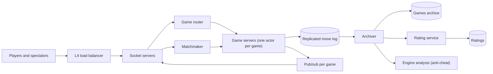

## In one minute
- Each live game has exactly one owner: an in-memory actor on one game server, found by hashing the game ID. It validates moves, orders them by ply number and runs the clocks. Two servers must never both believe they own a game.
- The server's clock is the only clock that counts. Clients display time, but the server measures elapsed time, subtracts a capped estimate of network lag, applies the increment and declares a flag. In bullet chess a 100 ms error decides games.
- Moves carry a ply number, so a resent move is a harmless duplicate and an out-of-order move is rejected. This one integer gives idempotency, ordering and reconnection for free.
- Matchmaking is a batch job, not a request: every second or so, sort the waiting players in each time-control pool by rating and pair neighbours, widening the acceptable rating gap the longer someone waits.
- Everything heavy is asynchronous and off the move path: rating updates, persistence of the finished game, engine analysis for cheat detection, and spectator fan-out.

## Requirements
Functional:
- Seek a rated or casual game by time control (1+0 bullet, 3+2 blitz, 15+10 rapid) and get a similarly rated opponent, or challenge a friend by link.
- Real-time moves with server-side legality and detection of mate, stalemate, repetition, the 50-move rule and insufficient material.
- Clocks with optional increment; running out of time loses.
- Resign, draw offers, takebacks and reconnection.
- Spectating, game history, PGN export and rating updates.

Non-functional:
- Move relay p99 under 50 ms server-side.
- Clock fairness regardless of server queues or the opponent's connection.
- A server crash loses no accepted move; the game resumes within seconds.
- Cheat detection may lag by hours.

Out of scope: puzzles, chat moderation and the analysis board.

## Back-of-envelope
Games: assume 10 million games a day, about twice the 5 million a day that Lichess has cited publicly ([Lichess at Big Techday 2022](https://www.youtube.com/watch?v=crKNBSpO2_I)). That is 10,000,000 / 86,400 = about 116 new games per second, with an evening peak of perhaps 3x, so 350 per second.

Concurrency: if the average game lasts 10 minutes, the average number of live games is 116 x 600 s = about 70,000, and about 210,000 at peak. That is 420,000 players in games. Adding lobby users and spectators, plan for about 1 million concurrent WebSocket connections.

Moves: an average game has about 80 plies (40 moves each). 10 million x 80 = 800 million moves a day, about 9,300 per second on average and 28,000 at peak. Bullet games move faster, so plan for 50,000.

Storage: a move fits in 2 bytes (from-square, to-square and promotion piece fit in 16 bits) and a clock reading per ply in 2 more (tenths of a second, up to about 109 minutes). 80 plies x 4 bytes = 320 bytes, plus about 200 bytes of metadata, is about 0.5 KB per game. That is 5 GB per day, 1.8 TB a year and about 9 TB over 5 years.

Bandwidth: a move message is about 100 bytes. At 50,000 moves per second, each sent to two players and on average four spectators, that is 50,000 x 6 x 100 bytes = 30 MB/s. Bandwidth is trivial; the hard resource is open connections, at roughly 10 to 50 KB of kernel and application memory each, so 1 million connections need 10 to 50 GB of RAM across the socket tier.

## API
```
POST /v1/seeks            { time_control: "3+2", rated: true, rating_range: null }
  -> 202 { seek_id }      (match arrives later over the socket)
DELETE /v1/seeks/{id}

WS /v1/socket             (one socket per client, multiplexed)
  client -> { t: "move", game: "g7Hq2", ply: 23, uci: "e7e8q", lag_ms: 41 }
  server -> { t: "move", game: "g7Hq2", ply: 23, uci: "e7e8q", san: "e8=Q+",
              clock: { white_ms: 151200, black_ms: 143900 } }
  server -> { t: "reject", game: "g7Hq2", ply: 23, reason: "illegal" }
  server -> { t: "end", game: "g7Hq2", result: "1-0", reason: "timeout" }
  client -> { t: "resign" | "draw_offer" | "draw_accept" | "takeback", game, ply }
  client -> { t: "ping", sent_at }   server -> { t: "pong", sent_at }

GET  /v1/games/{id}            -> { white, black, moves, clocks, result }
GET  /v1/games/{id}.pgn        -> PGN text
GET  /v1/users/{id}/games?cursor=...
```

UCI notation (`e7e8q`) is unambiguous and trivial to parse; SAN is for display. The ply number is the idempotency and ordering key, and ping and pong let the server estimate round-trip time.

## Data model
`games(game_id PK, white_id, black_id, time_control, rated, status, result, termination, moves BLOB, clocks BLOB, initial_fen, started_at, ended_at)`. Partition key `game_id`, a short random ID. Moves and clocks are packed byte arrays because a game is always read whole.

`user_games(user_id, ended_at DESC, game_id, opponent_id, result)`: partitioned by user, clustered by time, written once at game end.

`ratings(user_id, perf)` with `rating, deviation, volatility, games`: one row per user per time-control family. Glicko-2 needs all three numbers, and the rating deviation is what makes a new player's rating move fast.

`live_games` lives in memory on the owning game server: the board (12 bitboards of 8 bytes, plus side to move, castling rights, en passant square and halfmove counter), a list of Zobrist hashes of past positions for repetition, both clocks, the ply, pending offers and the connected sockets. A durable copy of each accepted ply is appended to a replicated move log (a Redis stream with replicas, or a Kafka topic partitioned by `game_id`) so a crash loses nothing that was acknowledged.

## High-level design


Write path for a move: the client sends `{move, ply, lag_ms}` on its WebSocket. The socket server looks up the owning game server (consistent hash of `game_id`, with a lease so ownership is unique) and forwards the message. The game actor checks the ply, checks the turn, stops the mover's clock with lag compensation, validates legality with its move generator, applies the move, adds the increment, appends the ply to the move log, and publishes the new state on the game's pub/sub channel. Socket servers subscribed to that channel push it to both players and to spectators.

Read paths: a reconnecting player gets the full move list and clocks from the actor and replays them. Spectators of popular games go through a fan-out tier, sometimes deliberately delayed. History reads go to the archive.

When a game ends, the actor emits an end event. The archiver writes the packed game and the `user_games` rows, the rating service applies Glicko-2 to both players, and rated games are queued for engine analysis.

## Deep dives

### One owner per game and crash recovery
Option one is a stateless service that reads the game from a database, validates, and writes back with a version check. It survives crashes, but every move pays a database round trip, races need optimistic retries, and clock logic spreads across processes.

Option two, which I choose, is an actor per game in memory, owned by exactly one game server. All messages for a game go to its mailbox and are processed one at a time, so there are no locks and no races. Ownership comes from consistent hashing plus a lease in a coordination service (etcd or ZooKeeper). A server that loses its lease must stop accepting moves before the lease expires, which is why the lease is checked against a local monotonic clock with a safety margin.

Durability: the actor appends each accepted ply to the replicated move log (about 1 ms within a zone) before broadcasting it, so no client sees a move that could be lost. After a crash, the new owner replays the log, restores the logged clocks, and pauses both clocks during recovery. Clients reconnect and resend unacknowledged moves by ply; duplicates are dropped. If recovery cannot save a game fairly, abort it: Lichess aborts games in which someone lost on time because Lichess itself restarted ([Lichess FAQ](https://lichess.org/faq)).

### Clocks, lag and flagging
The server records when each turn starts. When a move arrives, elapsed time is `now - turn_start`. A player on a 150 ms round trip loses about 75 ms per move in transit, 3 seconds over a 40-move bullet game. So the server subtracts a lag estimate: the client reports how long the move spent in transit by its own measurement, and the server caps that credit at a value derived from the ping history (for example the player's recent median round-trip plus a margin, never above a fixed maximum such as 500 ms). The cap matters, because a client that claims huge lag would otherwise get free time. Lichess implements the cap as a per-player quota that behaves like a token bucket: each move earns credit (up to one second, less in faster time controls; 0.39 s per move in 1+0 bullet), compensation can never exceed the credit banked, and the bank holds at most seven moves' worth ([scalachess LagTracker](https://github.com/lichess-org/scalachess/blob/master/core/src/main/scala/LagTracker.scala)).

Flagging is decided only by the server. Each game actor registers its next possible flag time (`turn_start + remaining`) in a timing wheel; when it fires, the actor checks the clock and ends the game. A move arriving after the flag time is rejected even if the client still showed time. A flag is a draw, not a loss, if the opponent could not checkmate by any possible series of legal moves, for example with a bare king ([FIDE Laws, article 6.9](https://handbook.fide.com/chapter/E012023)). Lichess notes this is hard to decide automatically in rare positions and by default sides with the player who did not run out of time ([Lichess FAQ](https://lichess.org/faq)).

### Matchmaking and ratings
A seek joins a pool keyed by `(time_control, rated, variant)`. Instead of matching on arrival, the matcher runs a batch cycle about once a second per pool. It sorts seekers by rating and greedily pairs neighbours whose gap is within both players' current windows. Each window starts at about 100 points and grows with wait time, so a 2,700 player at 4 a.m. still gets a game within a minute. A peak pool holds a few thousand seekers, so one process per pool sorts them in under a millisecond.

Ratings use Glicko-2, which tracks rating, deviation and volatility ([Glickman](http://www.glicko.net/glicko/glicko2.pdf)). Lichess starts players at 1500 with a deviation of 1000 and treats a rating as provisional while the deviation is above 110 ([Lichess FAQ](https://lichess.org/faq)). Updates happen after the game in the rating service, as a conditional write per player, so they never slow the move path. Anti-cheat is also asynchronous: rated games are queued for engine analysis, and the move-by-move agreement with the engine plus timing patterns feed a model and human review. Lichess runs this at scale with fishnet, which distributes Stockfish analysis to volunteer machines that each request a personal key ([fishnet](https://github.com/lichess-org/fishnet)).

## Down the stack

### Layer 1: The contract
For each game, the server accepts at most one move per ply, in order, and every subscriber receives accepted moves in ply order with no gaps. A move is broadcast only after it is durable in the move log. The clock reported with each move is the server's value after lag compensation and increment. A resent move with an already-accepted ply returns the accepted state, never a second application. The server alone decides timeouts.

### Layer 2: The mechanism
The socket tier holds WebSocket connections (RFC 6455) and is separate from game logic, so deploying game code does not drop a million sockets. Lichess has the same split: the main Scala application, lila, and a separate WebSocket server, lila-ws, which talks to it over Redis ([lila-ws](https://github.com/lichess-org/lila-ws)). Inside the game actor, legality uses bitboards: 64-bit integers per piece type and color, with precomputed attack tables, so generating legal moves for a position takes on the order of a microsecond. Threefold repetition uses Zobrist hashing: each (piece, square) pair has a random 64-bit key, the position hash is the XOR of the present pieces' keys plus side-to-move and castling keys, and each move updates it with two or three XORs. The actor keeps the hashes since the last capture or pawn move and counts matches. Know which rules are automatic: under FIDE Laws, threefold repetition and the 50-move rule are draws a player must claim, while fivefold repetition and 75 moves without a pawn move or capture end the game automatically ([FIDE Laws, article 9](https://handbook.fide.com/chapter/E012023)). Sites choose whether to auto-claim the softer ones.

### Layer 3: The machine
A move message is about 60 bytes of JSON in a WebSocket frame with a 2-byte header from the server (clients must add a 4-byte mask, [RFC 6455, section 5.3](https://www.rfc-editor.org/rfc/rfc6455#section-5.3)), well inside one TCP segment. Socket servers set `TCP_NODELAY`, because Nagle's algorithm combined with delayed ACKs can hold a small write for tens of milliseconds, which in bullet chess is visible. One `epoll_wait` loop thread can multiplex tens of thousands of idle connections; most of the per-connection cost is socket buffers in the kernel. A live game's state is about 1 to 2 KB, so 200,000 live games are about 400 MB of RAM, which a handful of game servers hold easily. Processing a move (ply check, clock arithmetic, legality, Zobrist update) takes a few microseconds of CPU. The dominant costs are the 1 ms log append and the network: a transatlantic round trip is about 70 to 90 ms, which is why lag compensation exists at all.

### Why it's built this way
1. A move must be applied exactly once and in order, so one process owns each game and serializes its messages.
2. In-memory state is lost on a crash, so each accepted ply is appended to a replicated log before anyone sees it.
3. Networks add tens of milliseconds that differ by player, and bullet games are decided by milliseconds, so the server measures time and compensates for lag up to a cap.
4. Socket connections are numerous and fragile, while game logic changes often, so they live in separate tiers.
5. Ratings, archiving and cheat detection are slow, so they consume the end-of-game event asynchronously.

## Failure modes
- **10x load (a tournament start or a famous streamer's event):** thousands of games start in one second. Create pairings in batches and shed spectators before players' moves.
- **Game server crash:** leases expire after a few seconds; the new owner replays the move log and pauses both clocks during recovery. Clients see "reconnecting" and resend unacknowledged moves by ply.
- **Split brain:** a paused server (a long GC pause) wakes up still believing it owns games. Leases with fencing tokens on the move log append reject its writes, so it cannot fork a game; a lease alone is not enough, because the pause can outlast it ([Kleppmann](https://martin.kleppmann.com/2016/02/08/how-to-do-distributed-locking.html)).
- **Region outage:** live games in that region are lost unless the move log replicates across regions. Most platforms accept aborting or adjudicating those games, since cross-region synchronous appends add 70 ms or more to every move.
- **Hot key:** a world championship game watched by 500,000 spectators. Never fan out from the game actor directly; publish once to a broadcast tier that relays through a tree of socket servers, and add a deliberate delay for spectators.
- **Cheating bursts and abuse:** engine use, sandbagging and stalling. Analyze asynchronously, abort games where a player never makes a first move, and score disconnection timeouts as losses after a grace period.

## In the wild
- **Chess.com, 2023: the boom outgrows the database.** Traffic nearly doubled from early December 2022; on 20 January 2023 Chess.com had 10 million daily active members and a record 31.7 million games, with more than a million games an hour and about 16,000 moves a second on average. At the noon to 4 p.m. ET peak the database could not write fast enough, servers became exhausted, and players saw 502 errors and game timeouts. The plan was new live-chess and database servers, separating tables, sharding, moving services into memory and splitting off the database that held users and gameplay ([Chess.com](https://www.chess.com/blog/CHESScom/chess-is-booming-and-our-servers-are-struggling)).
- **Lichess, 2022: lag compensation was worth exploiting in hyperbullet.** Players complained that "laggers" gained from compensation in the fastest time controls, so a maintainer proposed scaling the per-move lag quota with the game's total time instead of a step table. The current code grants min(1 s, total seconds × 2/5 + 0.15 s) per move, so a 1+0 game earns 0.39 s rather than the earlier 0.45 s, shrinking what a faked lag can buy ([lila issue 12097](https://github.com/lichess-org/lila/issues/12097), [scalachess](https://github.com/lichess-org/scalachess/blob/master/core/src/main/scala/LagTracker.scala)).

## Trade-offs
| Choice | Strengths | Weaknesses | Choose when |
|---|---|---|---|
| Stateless service plus database per move | Simple, crash-safe | Database round trip per move, races need retries | Correspondence chess, low volume |
| Actor per game in memory plus move log | Microsecond logic, natural ordering | Ownership and failover must be engineered | Real-time play (chosen) |
| Client-side clocks | No server timers | Trivially cheatable | Never for rated play |
| Server clocks with capped lag credit | Fair across connections | Lag estimate can be gamed within the cap | Online play at any speed |
| Match on arrival | Lowest latency when busy | Poor pairs when quiet | Very large pools only |
| Batch matching with widening windows | Better pairs, simple to scale per pool | Up to a cycle of extra wait | General matchmaking (chosen) |

## Leadership lens
- Build first: the game actor with server clocks, ply-based idempotency and the move log, tested with simulated latency and crashes. Matchmaking and ratings are simpler and can start as one process.
- Team ownership: realtime (sockets, game servers), competitive (matchmaking, ratings, tournaments) and fair play (cheat detection and appeals).
- Cost drivers: socket memory, spectator traffic, and engine analysis CPU, which can dwarf everything else.
- Rollout: game servers drain and hand off games on deploy; track games aborted per deploy.
- Question for design review: "Show me the exact sequence when a player's move and their flag time arrive in the same millisecond." The answer reveals whether the clock logic is single-threaded and server-owned.

## Check yourself
1. A game server pauses for a long GC and wakes up still believing it owns its games. What stops it from forking a game?
   **Answer:** Ownership is a lease, and the move log append carries a fencing token, so writes from the stale owner are rejected. The server is also meant to stop accepting moves before its lease expires, checked against a local monotonic clock with a safety margin.
2. Why does the server cap the lag credit it gives a move instead of trusting the client's reported transit time?
   **Answer:** Without compensation, a player on a 150 ms round trip loses about 3 seconds over a 40-move bullet game, but a client that claims huge lag would otherwise get free time. So the credit is capped from the player's ping history, never above a fixed maximum such as 500 ms, accepting that the estimate can be gamed within the cap.
3. Why use an in-memory actor per game plus a move log rather than a stateless service that reads and writes the database on every move?
   **Answer:** The actor processes one message at a time, so there are no locks or races and move logic costs microseconds, while the stateless option pays a database round trip per move and needs optimistic retries. The price is that ownership and failover must be engineered, using leases and replaying the replicated move log after a crash.
4. Estimate the storage per finished game and explain why bandwidth is not the hard resource.
   **Answer:** 80 plies at 4 bytes (2 for the move, 2 for the clock) is 320 bytes plus about 200 bytes of metadata, about 0.5 KB per game or 5 GB a day. Move traffic at 50,000 moves per second to six recipients is only about 30 MB/s; the hard resource is about 1 million open connections at 10 to 50 KB each.

## Practice
**Task:** Implement the server-authoritative clock and move gate for one game. `ChessClock(base_ms, increment_ms, max_lag_ms, now)` starts a game at time `now` with white to move and both sides holding `base_ms`. `submit(color, ply, lag_ms, now)` returns `"over"` if the game has ended, `"duplicate"` if `ply` was already accepted (plies are numbered from 1), `"out_of_order"` if it skips ahead, and `"not_your_turn"` if `color` (`"white"` or `"black"`) is not to move. Otherwise it charges `max(0, now - turn_start - min(max(lag_ms, 0), max_lag_ms))`; if that is at least the mover's remaining time, the mover's clock goes to 0, the opponent wins and the result is `"flagged"`; else the time is deducted, the increment added, the turn passes and the result is `"ok"`. `remaining(color, now)` returns the live value for the side to move (never below 0) and the stored value otherwise. `check_flag(now)` ends the game if the side to move has run out, and returns the winner's color, or an empty string if nobody has won.

```python starter
class ChessClock:
    def __init__(self, base_ms, increment_ms, max_lag_ms, now):
        pass

    def submit(self, color, ply, lag_ms, now):
        # TODO: ply gate, turn gate, lag-compensated charge, flag or increment
        raise NotImplementedError

    def remaining(self, color, now):
        raise NotImplementedError

    def check_flag(self, now):
        raise NotImplementedError
```

```python tests
def test_moves_charge_time_and_add_increment():
    c = ChessClock(60000, 2000, 100, 0)
    assert c.submit("white", 1, 0, 5000) == "ok"
    assert c.remaining("white", 8000) == 57000, "5 s spent, 2 s added"
    assert c.remaining("black", 8000) == 57000, "black's clock runs from 5000"
    assert c.submit("black", 2, 0, 9000) == "ok"
    assert c.remaining("black", 9000) == 58000


def test_lag_credit_is_capped():
    c = ChessClock(60000, 0, 100, 0)
    assert c.submit("white", 1, 80, 1000) == "ok"
    assert c.remaining("white", 1000) == 59080
    assert c.submit("black", 2, 500, 2000) == "ok"
    assert c.remaining("black", 2000) == 59100, "credit capped at 100 ms"


def test_ply_and_turn_gates():
    c = ChessClock(60000, 0, 0, 0)
    assert c.submit("white", 1, 0, 1000) == "ok"
    assert c.submit("white", 1, 0, 1500) == "duplicate"
    assert c.submit("white", 3, 0, 1500) == "out_of_order"
    assert c.submit("white", 2, 0, 1500) == "not_your_turn"
    assert c.remaining("white", 1500) == 59000, "rejected moves change nothing"


def test_flag_on_late_move():
    c = ChessClock(1000, 5000, 0, 0)
    assert c.submit("white", 1, 0, 1000) == "flagged", "elapsed equal to remaining flags"
    assert c.check_flag(1000) == "black"
    assert c.remaining("white", 5000) == 0
    assert c.submit("black", 2, 0, 1100) == "over"


def test_timer_flag_without_move():
    c = ChessClock(1000, 0, 0, 0)
    assert c.check_flag(999) == ""
    assert c.check_flag(1000) == "black"
    assert c.remaining("white", 2000) == 0
    assert c.submit("white", 1, 0, 1000) == "over"


def test_increment_rescues_then_black_flags():
    c = ChessClock(1000, 2000, 0, 0)
    assert c.submit("white", 1, 0, 999) == "ok"
    assert c.remaining("white", 999) == 2001
    assert c.submit("black", 2, 0, 1999) == "flagged"
    assert c.check_flag(5000) == "white"


def test_negative_lag_is_ignored():
    c = ChessClock(10000, 0, 300, 0)
    assert c.submit("white", 1, -500, 1000) == "ok"
    assert c.remaining("white", 1000) == 9000
```

```python solution
class ChessClock:
    def __init__(self, base_ms, increment_ms, max_lag_ms, now):
        self.left = {"white": base_ms, "black": base_ms}
        self.inc = increment_ms
        self.max_lag = max_lag_ms
        self.turn_start = now
        self.to_move = "white"
        self.plies = 0
        self.winner = ""

    @staticmethod
    def _other(color):
        return "black" if color == "white" else "white"

    def _flag(self, color):
        self.left[color] = 0
        self.winner = self._other(color)

    def submit(self, color, ply, lag_ms, now):
        if self.winner:
            return "over"
        if ply <= self.plies:
            return "duplicate"
        if ply != self.plies + 1:
            return "out_of_order"
        if color != self.to_move:
            return "not_your_turn"
        credit = min(max(lag_ms, 0), self.max_lag)
        spent = max(0, now - self.turn_start - credit)
        if spent >= self.left[color]:
            self._flag(color)
            return "flagged"
        self.left[color] += self.inc - spent
        self.plies += 1
        self.to_move = self._other(color)
        self.turn_start = now
        return "ok"

    def remaining(self, color, now):
        if self.winner or color != self.to_move:
            return self.left[color]
        return max(0, self.left[color] - (now - self.turn_start))

    def check_flag(self, now):
        if not self.winner and self.remaining(self.to_move, now) == 0:
            self._flag(self.to_move)
        return self.winner
```

```typescript starter
export class ChessClock {
  constructor(baseMs: number, incrementMs: number, maxLagMs: number, now: number) {}

  submit(color: string, ply: number, lagMs: number, now: number): string {
    throw new Error("TODO");
  }

  remaining(color: string, now: number): number {
    throw new Error("TODO");
  }

  checkFlag(now: number): string {
    throw new Error("TODO");
  }
}
```

```typescript tests
test("moves charge time and add increment", () => {
  const c = new ChessClock(60000, 2000, 100, 0);
  assertEqual(c.submit("white", 1, 0, 5000), "ok", "first move");
  assertEqual(c.remaining("white", 8000), 57000, "5 s spent, 2 s added");
  assertEqual(c.remaining("black", 8000), 57000, "black runs from 5000");
  assertEqual(c.submit("black", 2, 0, 9000), "ok", "reply");
  assertEqual(c.remaining("black", 9000), 58000, "black after increment");
});

test("lag credit is capped", () => {
  const c = new ChessClock(60000, 0, 100, 0);
  assertEqual(c.submit("white", 1, 80, 1000), "ok", "move");
  assertEqual(c.remaining("white", 1000), 59080, "80 ms credit");
  assertEqual(c.submit("black", 2, 500, 2000), "ok", "move");
  assertEqual(c.remaining("black", 2000), 59100, "credit capped at 100 ms");
});

test("ply and turn gates", () => {
  const c = new ChessClock(60000, 0, 0, 0);
  assertEqual(c.submit("white", 1, 0, 1000), "ok", "move");
  assertEqual(c.submit("white", 1, 0, 1500), "duplicate", "dup");
  assertEqual(c.submit("white", 3, 0, 1500), "out_of_order", "skip");
  assertEqual(c.submit("white", 2, 0, 1500), "not_your_turn", "turn");
  assertEqual(c.remaining("white", 1500), 59000, "unchanged");
});

test("flag on late move", () => {
  const c = new ChessClock(1000, 5000, 0, 0);
  assertEqual(c.submit("white", 1, 0, 1000), "flagged", "equal flags");
  assertEqual(c.checkFlag(1000), "black", "winner");
  assertEqual(c.remaining("white", 5000), 0, "zeroed");
  assertEqual(c.submit("black", 2, 0, 1100), "over", "game over");
});

test("timer flag without move", () => {
  const c = new ChessClock(1000, 0, 0, 0);
  assertEqual(c.checkFlag(999), "", "not yet");
  assertEqual(c.checkFlag(1000), "black", "flag");
  assertEqual(c.remaining("white", 2000), 0, "zero");
  assertEqual(c.submit("white", 1, 0, 1000), "over", "over");
});

test("increment rescues then black flags", () => {
  const c = new ChessClock(1000, 2000, 0, 0);
  assertEqual(c.submit("white", 1, 0, 999), "ok", "just in time");
  assertEqual(c.remaining("white", 999), 2001, "after increment");
  assertEqual(c.submit("black", 2, 0, 1999), "flagged", "black out");
  assertEqual(c.checkFlag(5000), "white", "winner");
});

test("negative lag is ignored", () => {
  const c = new ChessClock(10000, 0, 300, 0);
  assertEqual(c.submit("white", 1, -500, 1000), "ok", "move");
  assertEqual(c.remaining("white", 1000), 9000, "no extra charge");
});
```

```typescript solution
export class ChessClock {
  private left: { [color: string]: number };
  private inc: number;
  private maxLag: number;
  private turnStart: number;
  private toMove = "white";
  private plies = 0;
  private winner = "";

  constructor(baseMs: number, incrementMs: number, maxLagMs: number, now: number) {
    this.left = { white: baseMs, black: baseMs };
    this.inc = incrementMs;
    this.maxLag = maxLagMs;
    this.turnStart = now;
  }

  private static other(color: string): string {
    return color === "white" ? "black" : "white";
  }

  private flag(color: string): void {
    this.left[color] = 0;
    this.winner = ChessClock.other(color);
  }

  submit(color: string, ply: number, lagMs: number, now: number): string {
    if (this.winner) return "over";
    if (ply <= this.plies) return "duplicate";
    if (ply !== this.plies + 1) return "out_of_order";
    if (color !== this.toMove) return "not_your_turn";
    const credit = Math.min(Math.max(lagMs, 0), this.maxLag);
    const spent = Math.max(0, now - this.turnStart - credit);
    if (spent >= this.left[color]) {
      this.flag(color);
      return "flagged";
    }
    this.left[color] += this.inc - spent;
    this.plies++;
    this.toMove = ChessClock.other(color);
    this.turnStart = now;
    return "ok";
  }

  remaining(color: string, now: number): number {
    if (this.winner || color !== this.toMove) return this.left[color];
    return Math.max(0, this.left[color] - (now - this.turnStart));
  }

  checkFlag(now: number): string {
    if (!this.winner && this.remaining(this.toMove, now) === 0) this.flag(this.toMove);
    return this.winner;
  }
}
```

```go starter
package practice

type ChessClock struct{}

func NewChessClock(baseMs, incrementMs, maxLagMs, now int64) *ChessClock {
	return &ChessClock{}
}

func (c *ChessClock) Submit(color string, ply int, lagMs, now int64) string { panic("TODO") }

func (c *ChessClock) Remaining(color string, now int64) int64 { panic("TODO") }

func (c *ChessClock) CheckFlag(now int64) string { panic("TODO") }
```

```go tests
package practice

import "testing"

func expectStr(t *testing.T, got, want, msg string) {
	t.Helper()
	if got != want {
		t.Fatalf("%s: got %q want %q", msg, got, want)
	}
}

func expectInt(t *testing.T, got, want int64, msg string) {
	t.Helper()
	if got != want {
		t.Fatalf("%s: got %d want %d", msg, got, want)
	}
}

func TestMovesChargeTimeAndAddIncrement(t *testing.T) {
	c := NewChessClock(60000, 2000, 100, 0)
	expectStr(t, c.Submit("white", 1, 0, 5000), "ok", "first move")
	expectInt(t, c.Remaining("white", 8000), 57000, "white")
	expectInt(t, c.Remaining("black", 8000), 57000, "black running")
	expectStr(t, c.Submit("black", 2, 0, 9000), "ok", "reply")
	expectInt(t, c.Remaining("black", 9000), 58000, "black after increment")
}

func TestLagCreditIsCapped(t *testing.T) {
	c := NewChessClock(60000, 0, 100, 0)
	expectStr(t, c.Submit("white", 1, 80, 1000), "ok", "move")
	expectInt(t, c.Remaining("white", 1000), 59080, "80 ms credit")
	expectStr(t, c.Submit("black", 2, 500, 2000), "ok", "move")
	expectInt(t, c.Remaining("black", 2000), 59100, "capped credit")
}

func TestPlyAndTurnGates(t *testing.T) {
	c := NewChessClock(60000, 0, 0, 0)
	expectStr(t, c.Submit("white", 1, 0, 1000), "ok", "move")
	expectStr(t, c.Submit("white", 1, 0, 1500), "duplicate", "dup")
	expectStr(t, c.Submit("white", 3, 0, 1500), "out_of_order", "skip")
	expectStr(t, c.Submit("white", 2, 0, 1500), "not_your_turn", "turn")
	expectInt(t, c.Remaining("white", 1500), 59000, "unchanged")
}

func TestFlagOnLateMove(t *testing.T) {
	c := NewChessClock(1000, 5000, 0, 0)
	expectStr(t, c.Submit("white", 1, 0, 1000), "flagged", "equal flags")
	expectStr(t, c.CheckFlag(1000), "black", "winner")
	expectInt(t, c.Remaining("white", 5000), 0, "zeroed")
	expectStr(t, c.Submit("black", 2, 0, 1100), "over", "over")
}

func TestTimerFlagWithoutMove(t *testing.T) {
	c := NewChessClock(1000, 0, 0, 0)
	expectStr(t, c.CheckFlag(999), "", "not yet")
	expectStr(t, c.CheckFlag(1000), "black", "flag")
	expectInt(t, c.Remaining("white", 2000), 0, "zero")
	expectStr(t, c.Submit("white", 1, 0, 1000), "over", "over")
}

func TestIncrementRescuesThenBlackFlags(t *testing.T) {
	c := NewChessClock(1000, 2000, 0, 0)
	expectStr(t, c.Submit("white", 1, 0, 999), "ok", "just in time")
	expectInt(t, c.Remaining("white", 999), 2001, "after increment")
	expectStr(t, c.Submit("black", 2, 0, 1999), "flagged", "black out")
	expectStr(t, c.CheckFlag(5000), "white", "winner")
}

func TestNegativeLagIsIgnored(t *testing.T) {
	c := NewChessClock(10000, 0, 300, 0)
	expectStr(t, c.Submit("white", 1, -500, 1000), "ok", "move")
	expectInt(t, c.Remaining("white", 1000), 9000, "no extra charge")
}
```

```go solution
package practice

type ChessClock struct {
	left      map[string]int64
	inc       int64
	maxLag    int64
	turnStart int64
	toMove    string
	plies     int
	winner    string
}

func NewChessClock(baseMs, incrementMs, maxLagMs, now int64) *ChessClock {
	return &ChessClock{
		left:      map[string]int64{"white": baseMs, "black": baseMs},
		inc:       incrementMs,
		maxLag:    maxLagMs,
		turnStart: now,
		toMove:    "white",
	}
}

func other(color string) string {
	if color == "white" {
		return "black"
	}
	return "white"
}

func (c *ChessClock) flag(color string) {
	c.left[color] = 0
	c.winner = other(color)
}

func (c *ChessClock) Submit(color string, ply int, lagMs, now int64) string {
	if c.winner != "" {
		return "over"
	}
	if ply <= c.plies {
		return "duplicate"
	}
	if ply != c.plies+1 {
		return "out_of_order"
	}
	if color != c.toMove {
		return "not_your_turn"
	}
	credit := min(max(lagMs, 0), c.maxLag)
	spent := max(0, now-c.turnStart-credit)
	if spent >= c.left[color] {
		c.flag(color)
		return "flagged"
	}
	c.left[color] += c.inc - spent
	c.plies++
	c.toMove = other(color)
	c.turnStart = now
	return "ok"
}

func (c *ChessClock) Remaining(color string, now int64) int64 {
	if c.winner != "" || color != c.toMove {
		return c.left[color]
	}
	return max(0, c.left[color]-(now-c.turnStart))
}

func (c *ChessClock) CheckFlag(now int64) string {
	if c.winner == "" && c.Remaining(c.toMove, now) == 0 {
		c.flag(c.toMove)
	}
	return c.winner
}
```

## Mock interview
**Prompt:** Design an online chess platform like Lichess or Chess.com for 10 million games a day and 1 million concurrent connections, supporting bullet through classical time controls, rated matchmaking and spectators.

- Follow-up: The game server holding 20,000 live games crashes. Walk me through what each player sees and what state is recovered from where.
- Follow-up: A player in Sydney plays one in London in a 1+0 game. How do you keep the clocks fair, and how could a cheater abuse your lag compensation?
- Follow-up: Why not keep game state in Redis and make the game servers stateless?

**A strong answer covers:**
- Arithmetic showing moves per second are modest and that open connections and latency, not throughput, are the constraints.
- A single owner per game (actor plus lease with fencing), with ply numbers for ordering, idempotency and reconnection.
- Server-authoritative clocks with capped lag credit, timer-driven flagging, and correct handling of the move-versus-flag race.
- A replicated move log appended before broadcast, and crash recovery by replay with paused clocks.
- Batch matchmaking per time-control pool with widening rating windows, and Glicko-2 updates off the move path.
- Asynchronous engine analysis for cheating, and a broadcast tier with delay for very popular games.

## Sources and further study
**Primary**
- [FIDE Laws of Chess (2023)](https://handbook.fide.com/chapter/E012023): the authoritative rules for flagging, insufficient material, repetition and the 50 and 75 move rules.
- [etcd API: leases](https://etcd.io/docs/v3.5/learning/api/): TTL leases and keep-alives, the primitive behind one owner per game.

**Systems docs**
- [scalachess](https://github.com/lichess-org/scalachess): Lichess's chess rules and clock library, including move generation, `Clock` and the lag quota.
- [Lichess FAQ](https://lichess.org/faq): how the live site handles flagging draws, provisional ratings and games lost to a server restart.
- [Kleppmann, "How to do distributed locking"](https://martin.kleppmann.com/2016/02/08/how-to-do-distributed-locking.html): why game ownership needs fencing tokens, not just leases.

**Books**
- *Designing Data-Intensive Applications*, Martin Kleppmann, chapter 8 "The Trouble with Distributed Systems": process pauses, unreliable clocks and fencing, the failure modes of a lease-owned game actor.
- *System Design Interview, Volume 2*, Alex Xu and Sahn Lam, chapter 10 "Real-time Gaming Leaderboard": score updates and ranking at scale, the same off-the-move-path pattern as ratings here.

**Other curricula**
- [Azure Architecture Center: Leader Election pattern](https://learn.microsoft.com/en-us/azure/architecture/patterns/leader-election): frames single ownership as electing one coordinator and stresses detecting a failed or unreachable leader, and the delay while a new one takes over.

## Watch
- [Lichess @ Big Techday 22: Serving 5 Million Chess Games a Day with 125 Volunteers and €5 Donations (Lichess)](https://www.youtube.com/watch?v=crKNBSpO2_I): how a real chess platform runs on a small team and budget.
- [Design Online Chess: Meta and OpenAI System Design Interview Question (ShowOffer)](https://www.youtube.com/watch?v=A7ISCoZab2I): an interview-style walkthrough of requirements, entities and deep dives.

## Free resources
- [lila (Lichess source code)](https://github.com/lichess-org/lila): the open-source server behind Lichess, including game, clock and rating code.
- [lila-ws](https://github.com/lichess-org/lila-ws): Lichess's separate WebSocket server, a real example of splitting the socket tier from game logic.
- [fishnet](https://github.com/lichess-org/fishnet): distributed Stockfish analysis on volunteer machines.
- [Glicko-2 (Mark Glickman, PDF)](http://www.glicko.net/glicko/glicko2.pdf): the rating algorithm, with a worked example.
- [Zobrist hashing (Chess Programming Wiki)](https://www.chessprogramming.org/Zobrist_Hashing): the incremental position hash used for repetition detection.
- [RFC 6455: The WebSocket Protocol](https://www.rfc-editor.org/rfc/rfc6455): frame format and masking, the wire protocol under every move.
