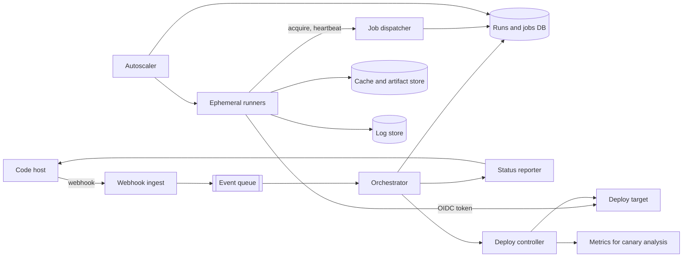

## In one minute
- A CI/CD system is a distributed job scheduler with an unusual workload: bursty, untrusted, input-heavy jobs whose results gate production. Design it as an event-driven orchestrator over a durable job state machine, with a separate fleet of disposable runners that pull work.
- Runners are ephemeral and pull-based. Each job gets a fresh VM or microVM, leases one job at a time with a heartbeat, and is destroyed afterwards. This bounds the blast radius of hostile code and makes "the runner died" an ordinary, retryable event.
- Most of a pipeline's time is spent fetching and rebuilding things that did not change. Content-addressed caching (a key derived from the hashes of every input) is the biggest lever for both speed and cost.
- Keep main green with a merge queue: test each change against the tip it will actually land on, not the stale base it branched from.
- Deployment is the dangerous half. Build an immutable artifact once, sign it, then promote that exact digest through environments with one deploy at a time per environment, automatic canary analysis, and short-lived credentials obtained by OIDC rather than stored secrets.

## Requirements
Functional:
- On a push, pull request or schedule, read the pipeline definition at that commit and run its jobs as a DAG (build, test, lint, package, deploy), with matrix fan-out and per-job runner labels (Linux, macOS, GPU).
- Stream live logs; store logs, test reports and artifacts; report status back to the code host as commit checks.
- Cache dependencies and build outputs across runs; reuse results whose inputs did not change.
- Deploy a built artifact to staging and production, with approvals, canary steps and one-click rollback.
- Cancel superseded runs (a new push to the same pull request) and serialize deploys per environment.

Non-functional:
- Time from push to first job starting under 15 seconds at p95; a no-op pipeline for an unchanged component finishes in under a minute.
- No lost runs: every accepted webhook produces exactly one pipeline run, and every job ends in a terminal state.
- Strong isolation between tenants and between untrusted pull requests and deploy credentials.
- Scheduler availability 99.95%; a scheduler outage must not kill jobs that are already running.

Out of scope: the source code host itself, the test frameworks, and the internals of the deploy target (Kubernetes, serverless), which we drive through an API.

## Back-of-envelope
Assume a large company or a mid-sized hosted CI service: 20,000 active developers.

Runs: each developer pushes about 10 times a day, giving 200,000 pipeline runs per day. Peaks follow working hours across time zones, so take 3x the average: 200,000 / 86,400 is 2.3 runs per second on average and about 7 per second at peak. Each run fans out to about 10 jobs, so 2 million jobs per day, 23 per second average, 70 per second peak.

Concurrency: with a median job duration of 6 minutes, average concurrency is 2,000,000 x 6 / 1,440 minutes, about 8,300 jobs at once. Peak is around 25,000 concurrent runners. Heartbeats at 25,000 / 15 s are about 1,700 writes per second, which a single well-tuned Postgres primary can absorb, but they are better kept in a cache with only lease expiries written to the database.

Logs: about 2 MB per job uncompressed, so 4 TB per day, roughly 600 GB per day after compression. With 90-day retention, about 55 TB.

Caches and artifacts: if each job uploads or downloads 300 MB of dependency and build cache, 2 million jobs move 600 TB per day through the cache, about 7 GB/s on average and over 20 GB/s at peak. This is the system's bandwidth bill, and it is why caches must sit in the same region (ideally the same zone) as runners. Stored artifacts with a 30-day TTL and content deduplication come to perhaps 1 to 2 PB.

Compute: 25,000 peak runners at 4 vCPUs is 100,000 vCPUs at peak. At a few cents per vCPU-hour, compute is by far the largest cost, which is why caching and test selection pay for themselves.

## API
```
POST /v1/hooks/{provider}              (code host webhook; signed, carries delivery_id)
  -> 202

POST /v1/repos/{repo}/runs             body { ref, sha, trigger: "manual", inputs }
  -> 201 { run_id, status: "queued" }

GET  /v1/runs/{run_id}
  -> { run_id, sha, status, jobs: [ { job_id, name, status, attempt, started_at, ended_at } ] }

POST /v1/runs/{run_id}/cancel          -> 202
POST /v1/jobs/{job_id}/retry           -> 201 { job_id, attempt }

GET  /v1/jobs/{job_id}/logs?offset=N   (chunked; WebSocket upgrade for live tail)

# Runner protocol (runner -> scheduler, long poll)
POST /v1/runner/acquire   body { runner_id, labels, capacity: 1 }
  -> 200 { job_id, lease_token, lease_ttl_s, spec, oidc_audience } | 204 after 30 s
POST /v1/runner/jobs/{job_id}/heartbeat   body { lease_token }  -> 200 | 409 (lease lost)
POST /v1/runner/jobs/{job_id}/complete    body { lease_token, result, outputs }

# Deploy
POST /v1/deployments  body { environment, artifact_digest, strategy: "canary", steps: [5, 25, 100] }
  -> 201 { deployment_id, status: "waiting_for_lock" | "running" }
```
Runners only make outbound calls, so self-hosted runners can sit behind a firewall.

## Data model
**runs** (Postgres, partitioned by `repo_id` hash, primary key `run_id`): `repo_id`, `sha`, `ref`, `trigger`, `delivery_id` (unique per provider, the idempotency key for webhooks), `concurrency_group`, `status`, `created_at`. One row per pipeline execution.

**jobs** (same shard as the run): `job_id`, `run_id`, `name`, `needs` (array of job names), `labels`, `status` (`blocked`, `queued`, `leased`, `running`, `succeeded`, `failed`, `cancelled`), `attempt`, `lease_owner`, `lease_token` (monotonic integer), `lease_expires_at`, `cache_key`. An index on `(labels_hash, status, queued_at)` serves dequeue. Keeping jobs with their run makes "job finished, unblock its dependents" one single-shard transaction.

**environments and deploy_locks** (small, global): one row per `(repo, environment)` with `holder_deployment_id` and `fencing_token`. A deploy must hold the lock; the token is passed to the deploy target so a stale deployer is rejected.

**log chunks** (object storage, key `logs/{run_id}/{job_id}/{attempt}/{seq}`): runners upload 64 KB to 1 MB chunks; a small index of chunk offsets lives in the jobs row or a key-value store. Live tail is served from a short-lived buffer before chunks are persisted.

**content-addressed store** (object storage, key `cas/{sha256}`): artifacts, cache archives and build outputs. An action cache maps `cache_key -> list of output digests`. Content addressing makes uploads idempotent and deduplicates across repos for free.

**artifact attestations**: for each release artifact, a signed provenance document (which commit, which pipeline, which runner image) stored next to the digest, following SLSA. The current spec is v1.2, which adds a Source track to the Build track ([SLSA](https://slsa.dev/spec/v1.2/whats-new)).

## High-level design


Write path: the code host delivers a signed webhook. Ingest verifies the signature, inserts `delivery_id` into a dedupe table, and enqueues the event, returning 202 within a few hundred milliseconds so the host does not retry. The orchestrator fetches the pipeline file at that exact SHA (never from the default branch, which would let a later commit change an earlier run), expands matrices into jobs, and writes the run and its jobs in one transaction. Jobs with no `needs` go to `queued`; the rest are `blocked`. If the run has a concurrency group (for example `pr-4512`), older runs in that group are cancelled in the same transaction.

Execution path: an idle runner long-polls `acquire` with its labels. The dispatcher picks the oldest queued job matching those labels with `SELECT ... FOR UPDATE SKIP LOCKED LIMIT 1`, sets it to `leased` with a new lease token and a 60-second expiry, and returns the job spec and a short-lived token. The runner restores caches, runs the steps, streams logs, heartbeats every 15 seconds, uploads outputs to the content-addressed store, and calls `complete` with its lease token. The orchestrator marks the job done, moves dependents whose `needs` are all satisfied to `queued`, and posts a commit status. A runner that disappears stops heartbeating; a reaper moves expired leases back to `queued` with `attempt + 1`, and any late `complete` carrying the old token is rejected.

Deploy path: a deploy job does not hold cloud keys. It requests an OIDC token from the CI system whose claims name the repo, branch and environment, and exchanges it with the cloud provider for credentials that last minutes. The deploy controller acquires the environment lock, rolls out the artifact digest in canary steps, compares error rate and latency with the baseline after each step, and rolls back automatically on regression.

## Deep dives

### Scheduling and the runner fleet
Push versus pull: a push scheduler must track every runner's address and health and handle the case where it sends a job to a runner that just died. Pull inverts that: runners ask for work only when idle, so a dead runner simply stops asking. The cost is a cheap long-poll connection per idle runner.

Isolation: shared long-lived runners leak state between jobs (a poisoned cache directory, a leftover credential, a background process). Ephemeral runners, one VM per job, destroyed after, remove that class of bug and attack. Full VMs take 20 to 60 seconds to boot, which would blow the 15-second start target, so the autoscaler keeps a warm pool sized from the recent queue arrival rate per label, for example the 95th percentile of arrivals over the next two minutes. MicroVMs such as Firecracker boot in well under a second and restore from snapshots, which shrinks the pool you need. GitHub's own guidance for self-hosted fleets matches this: register runners with `--ephemeral` so each takes exactly one job and is then deregistered, and do not autoscale persistent runners ([GitHub docs](https://docs.github.com/en/actions/hosting-your-own-runners/managing-self-hosted-runners/autoscaling-with-self-hosted-runners)).

Fairness: one team's 500-way test matrix must not starve everyone else. Dequeue per label is ordered by a per-tenant fair-share score (running jobs divided by quota) and then by age, not purely first-in-first-out. Hard quotas cap any tenant at a fraction of the fleet.

Choice: pull-based ephemeral runners with leases and fencing tokens, a warm pool per label, and weighted fair queuing across tenants. The same lease mechanism appears in [Design Job Scheduler](design-job-scheduler.md) and [Handling Long-Running Tasks](handling-long-running-tasks.md).

### Build avoidance: caching and test selection
The cheapest job is one that does not run. A build step is a function of its inputs: source files, dependency lockfile, toolchain image digest, environment variables and the outputs of the steps it depends on. Hash all of them into a cache key, Merkle style, where each step's key includes its dependencies' keys. If the key is already in the action cache, download the outputs instead of running the step. A change to one library file then changes only that library's key and the keys of things that depend on it, and the rest of a monorepo is reused. This is how Bazel's remote cache and remote execution work, with an action cache of results and a content-addressable store of output files ([Bazel docs](https://bazel.build/remote/caching)), and the practice task implements the key computation and the resulting plan.

Correctness depends on hermeticity: if a step reads something not in its key (the current time, a network fetch, an unpinned base image), the cache returns stale results. Coarse cache keys such as `hash(lockfile)` for a dependency directory are a pragmatic middle ground: they cannot be wrong about code, only about what is installed.

Test selection goes further: run only tests whose dependency closure includes a changed file, plus a periodic full run to catch what the graph misses. Google's TAP system does this at the scale of its whole monorepo ([Google Research](https://research.google/pubs/taming-google-scale-continuous-testing/)).

### Keeping main green and deploying safely
Two changes can each pass against an old base and break when combined. A merge queue fixes this: approved pull requests enter a queue, the system builds the speculative merge of each one on top of the ones ahead of it, and lands them in order only if green. To keep throughput up, it tests several speculative merges in parallel and, when one fails, drops that change and rebuilds the ones behind it. GitHub's merge queue builds these speculative merges on temporary `gh-readonly-queue/{base_branch}` branches, triggers CI with a separate `merge_group` event (a required check that only listens to `pull_request` never reports, and the merge fails), and caps concurrent builds at between 1 and 100 ([GitHub docs](https://docs.github.com/en/repositories/configuring-branches-and-merges-in-your-repository/configuring-pull-request-merges/managing-a-merge-queue)). Uber's SubmitQueue is the large-scale version: its 2025 refinements cut CI resource use by about 53% and P95 wait time by about 37% across Uber's Go, iOS and Android monorepos ([arXiv](https://arxiv.org/abs/2501.03440)).

Deploys must be serialized per environment, so the deploy controller takes a lease-based lock with a fencing token, and the deploy target rejects writes carrying an older token. The artifact is identified by digest (`image@sha256:...`), so what was tested is byte for byte what ships, and rollback is redeploying the previous digest. Credentials come from OIDC federation, scoped by claims such as `environment:production`, so a pull request from a fork, which runs without those claims, cannot obtain production access even if it changes the pipeline file. Write trust policies against the exact subject format: GitHub's classic subject looks like `repo:octo-org/octo-repo:environment:prod`, but repositories created after 15 July 2026 default to an immutable format that includes owner and repository IDs, so a policy copied from an older repo may silently never match ([GitHub OIDC docs](https://docs.github.com/en/actions/concepts/security/openid-connect)). See [Canary Releases](../sd/canary-releases.md) and [Rollbacks and Immutable Infrastructure](../sd/rollbacks-and-immutable-infrastructure.md) for the rollout mechanics.

## Down the stack

### Layer 1: The contract
Each accepted webhook `delivery_id` creates at most one run. Each job ends in exactly one terminal state, but its steps may execute more than once (at-least-once execution), so jobs must be safe to repeat; deploy steps achieve this by being declarative ("make production run digest D") rather than imperative. Only the holder of the current lease token can complete a job or write its outputs as final. A cache hit for key K returns outputs that some successful execution with key K produced. At most one deployment per environment is in progress, enforced by a fencing token checked at the target.

### Layer 2: The mechanism
Dequeue is a Postgres transaction (`SKIP LOCKED` is documented for exactly this multi-consumer queue table ([Postgres docs](https://www.postgresql.org/docs/current/sql-select.html))): `SELECT job_id FROM jobs WHERE labels_hash = $1 AND status = 'queued' ORDER BY priority, queued_at FOR UPDATE SKIP LOCKED LIMIT 1`, then `UPDATE ... SET status = 'leased', lease_token = lease_token + 1, lease_expires_at = now() + interval '60 s'`. `SKIP LOCKED` lets hundreds of dispatcher threads dequeue concurrently without blocking on each other's rows. Completion is a conditional update `WHERE job_id = $1 AND lease_token = $2`; zero rows updated means the lease was lost and the runner discards its result. Unblocking dependents is a second statement in the same transaction that decrements a `pending_needs` counter on child jobs and flips those that reach zero to `queued`. The action cache follows the Bazel Remote Execution API's split between an action cache (`ActionResult` keyed by action digest) and a content-addressable store (blobs keyed by SHA-256 digest), so writes of blobs are idempotent and the action entry is written last.

### Layer 3: The machine
Starting a job is dominated by bytes, not CPU. A shallow `git clone --depth=1` of a large monorepo still moves hundreds of MB; a persistent mirror on the runner image plus `git fetch` of the delta cuts that to a few MB. Pulling a 1 GB container image means downloading compressed layers at perhaps 200 to 500 MB/s from a same-region registry and decompressing gzip on one core at roughly 100 to 300 MB/s, so 5 to 10 seconds, which is why runner images are pre-baked into the VM snapshot. A 2 GB dependency cache tarball takes about 10 seconds to download and extract and then creates tens of thousands of small files, each an inode allocation and directory entry update, so restore can be bound by metadata operations on the runner's disk rather than by bandwidth. Firecracker's specification promises 125 ms or less from the `InstanceStart` API call to the guest's `/sbin/init`, with under 5 MiB of VMM memory overhead ([Firecracker spec](https://github.com/firecracker-microvm/firecracker/blob/main/SPECIFICATION.md)), against tens of seconds for a full cloud VM.

### Why it's built this way
1. Jobs run untrusted code, so each runs in a throwaway VM, which makes runners unreliable by design and forces leases, heartbeats and retries.
2. Retries mean steps can run twice, so outputs are content addressed and deploys are declarative, which makes duplicates harmless.
3. Fresh VMs start empty, so every job would re-download and rebuild the world; content-addressed caching keyed by input hashes turns that into a lookup.
4. Cache traffic is petabytes per day, and cross-region bandwidth is expensive, so caches and runners live in the same region.
5. The pipeline can reach production, so credentials are short-lived and scoped to claims about the run, not stored as long-lived secrets anyone with write access could read.

## Failure modes
- **10x load** (a company-wide dependency bump touching every repo, or a release day): the queue grows, and the autoscaler is bounded by cloud capacity and quota. Fair-share dequeue keeps interactive pull-request jobs flowing; low-priority scheduled jobs are deferred. Cancel superseded runs aggressively.
- **Region outage**: running jobs in that region are lost; their leases expire and they are retried elsewhere once the control plane fails over to a replica in another region. Caches are regional, so the first runs after failover are slow but correct. Deploys hold until the deploy lock store is available again rather than risking two concurrent deploys.
- **Hot key**: a popular monorepo where hundreds of jobs restore the same 2 GB cache object at once saturates a single object-storage prefix and the network path. Front the store with a regional read-through cache tier and spread reads, or bake the cache into the runner image daily.
- **Poisoned cache**: a non-hermetic step stores a bad output under a key that keeps hitting. Include toolchain image digests in keys, allow per-key invalidation, and never let untrusted pull-request jobs write to caches that protected-branch builds read.
- **Poisoned pipeline**: a third-party step or a privileged trigger runs attacker code with secrets in reach. On GitHub, `pull_request_target` runs with the base repository's secrets and a write token, so checking out and building a fork's code there hands both to the fork's author ([GitHub Security Lab](https://securitylab.github.com/resources/github-actions-preventing-pwn-requests/)). Pin third-party actions to full commit SHAs (or a workflow lockfile, which GitHub now calls the strongest protection), never run public-repo PRs on self-hosted runners, and keep build and deploy credentials in separate jobs ([GitHub secure use](https://docs.github.com/en/actions/reference/security/secure-use)).
- **Flaky tests**: retries hide them until the queue is full of reruns. Record per-test pass rates, quarantine tests below a threshold automatically, and report flakiness to the owning team instead of retrying forever.

## In the wild
- **Codecov, 2021: a CI script that exfiltrated every runner's environment.** A mistake in how Codecov built its Docker images exposed a storage credential, and from 31 January an attacker used it to add one line to the Bash Uploader that many pipelines piped from `curl` into `bash`. For about two months the line sent each CI runner's environment variables (tokens, keys) and git remote to the attacker, until a customer's checksum check failed on 1 April ([Codecov](https://about.codecov.io/security-update/)).
- **tj-actions/changed-files, 2025: mutable tags as a supply-chain hole.** Attackers moved existing version tags of an Action used by more than 23,000 repositories to a malicious commit that dumped runner secrets, base64-encoded, into workflow logs that anyone can read on public repos. It became CVE-2025-30066, and the advice was to rotate secrets and pin actions to full commit SHAs ([GitHub advisory](https://github.com/advisories/GHSA-mrrh-fwg8-r2c3)).
- **CircleCI, 2023: one stolen session, every customer's secrets.** Malware stole an engineer's already 2FA-authenticated SSO session; the attacker minted production tokens and pulled encryption keys from a running process, which made customers' stored environment variables and tokens readable. CircleCI told every customer to rotate all secrets and planned automatic OAuth token rotation and a shift from OAuth to GitHub Apps, the short-lived-credential design this lesson recommends ([CircleCI](https://circleci.com/blog/jan-4-2023-incident-report/)).

## Trade-offs
| Option | Strengths | Weaknesses | Choose when |
|---|---|---|---|
| Long-lived shared runners | Warm caches, fast start, cheap | State leaks between jobs, weak isolation | Trusted internal repos with tight budgets |
| Ephemeral VM per job | Strong isolation, reproducible | Cold caches, boot latency, needs warm pools | Multi-tenant or open-source workloads |
| Coarse cache keys (lockfile hash) | Simple, works with any tool | Rebuilds whole steps on small changes | Most repos without a hermetic build system |
| Hermetic build graph with remote cache | Rebuilds only what changed, shareable across machines | Migration cost, every input must be declared | Large monorepos with slow builds |
| Merge queue | Main stays green under high merge rates | Adds queue latency, needs parallel speculation | Many merges per hour into one branch |
| Direct merge after PR checks | Lowest latency | Semantic conflicts break main | Small teams, low merge rate |

## Leadership lens
- Build first: the webhook-to-run path with idempotent ingest, the job state machine with leases, and ephemeral runners with a warm pool. Caching comes next because it is the biggest cost lever; the merge queue comes when breakages on main become a weekly event.
- Ownership: a Developer Productivity team owns the orchestrator, runner fleet and caches as a product with SLOs (queue time, success rate excluding user failures). Product teams own their pipeline definitions and their flaky tests. Security owns runner images, OIDC trust policies and provenance.
- Rollout: run the new system in shadow on a few repos, comparing outcomes and durations with the old one, then migrate repo by repo with a fallback switch. Never migrate deploy pipelines first.
- Cost drivers: runner compute (by far), cache and artifact egress, then log storage. Publish per-team cost and queue-time dashboards; visibility changes behaviour faster than quotas.
- Review questions: what is p95 time-to-first-job and how much of it is image pull; can a fork's pull request read any secret or write any shared cache; what is our cache hit rate per repo; how do we roll back a bad deploy, and how long does it take.

## Check yourself
1. A runner's VM dies mid-job, then a replacement finishes the retried job. Later the original runner's delayed `complete` call arrives. Why does it not overwrite the result?
   **Answer:** The reaper moved the expired lease back to `queued` with a new, higher lease token, and completion is a conditional update `WHERE job_id = $1 AND lease_token = $2`. The stale token matches zero rows, so the old runner's result is discarded.
2. Why does the design choose pull-based ephemeral runners over a push scheduler with long-lived shared runners?
   **Answer:** Pull means a dead runner simply stops asking for work, and a fresh VM per job removes state leaks such as poisoned cache directories or leftover credentials. The costs are cold caches and boot latency, which is why the autoscaler keeps a warm pool per label sized from recent queue arrivals.
3. Estimate peak concurrent jobs and explain why cache traffic forces caches to sit next to runners.
   **Answer:** 2 million jobs a day at a 6-minute median is about 8,300 concurrent on average and about 25,000 at peak. At 300 MB of cache per job that is 600 TB per day, over 20 GB/s at peak, so caches must be in the same region, ideally the same zone, as the runners.
4. A non-hermetic step stores a bad output under a cache key that keeps hitting. Why does this happen, and how is it contained?
   **Answer:** The step read something not in its key, such as the current time, a network fetch or an unpinned base image, so the key no longer captures its inputs. Include toolchain image digests in keys, allow per-key invalidation, and never let untrusted pull-request jobs write caches that protected-branch builds read.

## Practice
**Task:** Implement the build-avoidance planner. `fnv1a32(s)` returns the 32-bit FNV-1a hash of the string's bytes (offset basis 2166136261, prime 16777619) as 8 lowercase hex digits. `cache_keys(targets, file_hashes)` takes targets (a map from name to `srcs`, a list of file paths, and `deps`, a list of target names) and returns each target's key: `fnv1a32(name + "|" + srcs_part + "|" + deps_part)`, where `srcs_part` joins `path=hash` for each source sorted by path with commas, and `deps_part` joins `dep=key` for each dependency sorted by name with commas. It is an error if a dependency is not a known target, a source has no hash, or the dependencies form a cycle. `plan(targets, file_hashes, cache)` returns the names of targets whose key is not in `cache`, in a topological order where, among targets that are ready at the same time, the alphabetically smallest comes first.

```python starter
def fnv1a32(s):
    # TODO: 32-bit FNV-1a as 8 lowercase hex digits
    raise NotImplementedError


def cache_keys(targets, file_hashes):
    # TODO: Merkle-style keys; raise ValueError on unknown dep, missing hash or cycle
    raise NotImplementedError


def plan(targets, file_hashes, cache):
    raise NotImplementedError
```

```python tests
def _repo():
    return {
        "app": {"srcs": ["app/main.py"], "deps": ["lib", "util"]},
        "lib": {"srcs": ["lib/b.py", "lib/a.py"], "deps": ["util"]},
        "util": {"srcs": ["util/u.py"], "deps": []},
        "docs": {"srcs": ["docs/index.md"], "deps": []},
    }

def _hashes():
    return {"app/main.py": "h1", "lib/a.py": "h2", "lib/b.py": "h3",
            "util/u.py": "h4", "docs/index.md": "h5"}

def test_fnv1a32_known_values():
    assert fnv1a32("") == "811c9dc5"
    assert fnv1a32("a") == "e40c292c"

def test_key_format():
    keys = cache_keys(_repo(), _hashes())
    assert keys["util"] == fnv1a32("util|util/u.py=h4|")
    assert keys["lib"] == fnv1a32("lib|lib/a.py=h2,lib/b.py=h3|util=" + keys["util"])

def test_change_propagates_only_downstream():
    before = cache_keys(_repo(), _hashes())
    h = _hashes()
    h["lib/a.py"] = "h2-edited"
    after = cache_keys(_repo(), h)
    assert after["lib"] != before["lib"] and after["app"] != before["app"]
    assert after["util"] == before["util"] and after["docs"] == before["docs"]

def test_order_of_lists_does_not_matter():
    t = _repo()
    t["app"] = {"srcs": ["app/main.py"], "deps": ["util", "lib"]}
    t["lib"] = {"srcs": ["lib/a.py", "lib/b.py"], "deps": ["util"]}
    assert cache_keys(t, _hashes()) == cache_keys(_repo(), _hashes())

def test_plan_cold_and_warm():
    assert plan(_repo(), _hashes(), set()) == ["docs", "util", "lib", "app"]
    cache = set(cache_keys(_repo(), _hashes()).values())
    assert plan(_repo(), _hashes(), cache) == []
    h = _hashes()
    h["util/u.py"] = "h4-edited"
    assert plan(_repo(), h, cache) == ["util", "lib", "app"]

def test_errors():
    bad_dep = {"a": {"srcs": [], "deps": ["ghost"]}}
    missing = {"a": {"srcs": ["nope.py"], "deps": []}}
    cycle = {"a": {"srcs": [], "deps": ["b"]}, "b": {"srcs": [], "deps": ["a"]}}
    for targets in (bad_dep, missing, cycle):
        try:
            cache_keys(targets, {})
            assert False, "expected ValueError"
        except ValueError:
            pass
    try:
        plan(cycle, {}, set())
        assert False, "plan should reject cycles too"
    except ValueError:
        pass
```

```python solution
import heapq


def fnv1a32(s):
    h = 2166136261
    for b in s.encode("utf-8"):
        h ^= b
        h = (h * 16777619) & 0xFFFFFFFF
    return "%08x" % h


def cache_keys(targets, file_hashes):
    keys = {}
    state = {}

    def visit(name):
        if state.get(name) == "done":
            return keys[name]
        if state.get(name) == "visiting":
            raise ValueError("cycle at " + name)
        state[name] = "visiting"
        spec = targets[name]
        parts = []
        for path in sorted(spec["srcs"]):
            if path not in file_hashes:
                raise ValueError("no hash for " + path)
            parts.append(path + "=" + file_hashes[path])
        dep_parts = []
        for dep in sorted(set(spec["deps"])):
            if dep not in targets:
                raise ValueError("unknown dep " + dep)
            dep_parts.append(dep + "=" + visit(dep))
        keys[name] = fnv1a32(name + "|" + ",".join(parts) + "|" + ",".join(dep_parts))
        state[name] = "done"
        return keys[name]

    for name in sorted(targets):
        visit(name)
    return keys


def plan(targets, file_hashes, cache):
    keys = cache_keys(targets, file_hashes)
    pending = {n: len(set(t["deps"])) for n, t in targets.items()}
    children = {n: [] for n in targets}
    for n, t in targets.items():
        for d in set(t["deps"]):
            children[d].append(n)
    ready = [n for n, c in pending.items() if c == 0]
    heapq.heapify(ready)
    out = []
    while ready:
        n = heapq.heappop(ready)
        if keys[n] not in cache:
            out.append(n)
        for c in children[n]:
            pending[c] -= 1
            if pending[c] == 0:
                heapq.heappush(ready, c)
    return out
```

```typescript starter
export interface Target {
  srcs: string[];
  deps: string[];
}

export function fnv1a32(s: string): string {
  throw new Error("TODO");
}

export function cacheKeys(
  targets: Record<string, Target>,
  fileHashes: Record<string, string>
): Record<string, string> {
  throw new Error("TODO");
}

export function plan(
  targets: Record<string, Target>,
  fileHashes: Record<string, string>,
  cache: string[]
): string[] {
  throw new Error("TODO");
}
```

```typescript tests
function repo(): Record<string, Target> {
  return {
    app: { srcs: ["app/main.py"], deps: ["lib", "util"] },
    lib: { srcs: ["lib/b.py", "lib/a.py"], deps: ["util"] },
    util: { srcs: ["util/u.py"], deps: [] },
    docs: { srcs: ["docs/index.md"], deps: [] },
  };
}

function hashes(): Record<string, string> {
  return {
    "app/main.py": "h1",
    "lib/a.py": "h2",
    "lib/b.py": "h3",
    "util/u.py": "h4",
    "docs/index.md": "h5",
  };
}

function throws(fn: () => void): boolean {
  try {
    fn();
    return false;
  } catch (e) {
    return true;
  }
}

test("fnv1a32 known values", () => {
  assertEqual(fnv1a32(""), "811c9dc5");
  assertEqual(fnv1a32("a"), "e40c292c");
});

test("key format", () => {
  const keys = cacheKeys(repo(), hashes());
  assertEqual(keys["util"], fnv1a32("util|util/u.py=h4|"));
  assertEqual(keys["lib"], fnv1a32("lib|lib/a.py=h2,lib/b.py=h3|util=" + keys["util"]));
});

test("change propagates only downstream", () => {
  const before = cacheKeys(repo(), hashes());
  const h = hashes();
  h["lib/a.py"] = "h2-edited";
  const after = cacheKeys(repo(), h);
  assert(after["lib"] !== before["lib"] && after["app"] !== before["app"], "downstream changes");
  assert(after["util"] === before["util"] && after["docs"] === before["docs"], "others stable");
});

test("order of lists does not matter", () => {
  const t = repo();
  t["app"] = { srcs: ["app/main.py"], deps: ["util", "lib"] };
  t["lib"] = { srcs: ["lib/a.py", "lib/b.py"], deps: ["util"] };
  const a = cacheKeys(t, hashes());
  const b = cacheKeys(repo(), hashes());
  for (const name of Object.keys(b)) assertEqual(a[name], b[name], name);
});

test("plan cold and warm", () => {
  assertEqual(plan(repo(), hashes(), []), ["docs", "util", "lib", "app"]);
  const keys = cacheKeys(repo(), hashes());
  const cache = Object.keys(keys).map((k) => keys[k]);
  assertEqual(plan(repo(), hashes(), cache), []);
  const h = hashes();
  h["util/u.py"] = "h4-edited";
  assertEqual(plan(repo(), h, cache), ["util", "lib", "app"]);
});

test("errors", () => {
  const badDep = { a: { srcs: [], deps: ["ghost"] } };
  const missing = { a: { srcs: ["nope.py"], deps: [] } };
  const cycle = { a: { srcs: [], deps: ["b"] }, b: { srcs: [], deps: ["a"] } };
  assert(throws(() => cacheKeys(badDep, {})), "unknown dep");
  assert(throws(() => cacheKeys(missing, {})), "missing hash");
  assert(throws(() => cacheKeys(cycle, {})), "cycle");
  assert(throws(() => plan(cycle, {}, [])), "plan rejects cycle");
});
```

```typescript solution
export interface Target {
  srcs: string[];
  deps: string[];
}

export function fnv1a32(s: string): string {
  let h = 2166136261;
  const bytes = unescape(encodeURIComponent(s));
  for (let i = 0; i < bytes.length; i++) {
    h ^= bytes.charCodeAt(i);
    h = Math.imul(h, 16777619) >>> 0;
  }
  return ("00000000" + h.toString(16)).slice(-8);
}

export function cacheKeys(
  targets: Record<string, Target>,
  fileHashes: Record<string, string>
): Record<string, string> {
  const keys: Record<string, string> = {};
  const state: Record<string, string> = {};
  const has = (o: object, k: string) => Object.prototype.hasOwnProperty.call(o, k);

  const visit = (name: string): string => {
    if (state[name] === "done") return keys[name];
    if (state[name] === "visiting") throw new Error("cycle at " + name);
    state[name] = "visiting";
    const spec = targets[name];
    const parts = spec.srcs.slice().sort().map((path) => {
      if (!has(fileHashes, path)) throw new Error("no hash for " + path);
      return path + "=" + fileHashes[path];
    });
    const deps = Array.from(new Set(spec.deps)).sort();
    const depParts = deps.map((dep) => {
      if (!has(targets, dep)) throw new Error("unknown dep " + dep);
      return dep + "=" + visit(dep);
    });
    keys[name] = fnv1a32(name + "|" + parts.join(",") + "|" + depParts.join(","));
    state[name] = "done";
    return keys[name];
  };

  for (const name of Object.keys(targets).sort()) visit(name);
  return keys;
}

export function plan(
  targets: Record<string, Target>,
  fileHashes: Record<string, string>,
  cache: string[]
): string[] {
  const keys = cacheKeys(targets, fileHashes);
  const cached = new Set(cache);
  const pending: Record<string, number> = {};
  const children: Record<string, string[]> = {};
  for (const n of Object.keys(targets)) children[n] = [];
  for (const n of Object.keys(targets)) {
    const deps = Array.from(new Set(targets[n].deps));
    pending[n] = deps.length;
    for (const d of deps) children[d].push(n);
  }
  let ready = Object.keys(targets).filter((n) => pending[n] === 0);
  const out: string[] = [];
  while (ready.length > 0) {
    ready.sort();
    const n = ready.shift() as string;
    if (!cached.has(keys[n])) out.push(n);
    for (const c of children[n]) {
      pending[c] -= 1;
      if (pending[c] === 0) ready.push(c);
    }
  }
  return out;
}
```

```go starter
package practice

// Target is one buildable unit: its source files and the targets it depends on.
type Target struct {
	Srcs []string
	Deps []string
}

func Fnv1a32(s string) string {
	panic("TODO")
}

func CacheKeys(targets map[string]Target, fileHashes map[string]string) (map[string]string, error) {
	panic("TODO")
}

func Plan(targets map[string]Target, fileHashes map[string]string, cache map[string]bool) ([]string, error) {
	panic("TODO")
}
```

```go tests
package practice

import (
	"reflect"
	"testing"
)

func repo() map[string]Target {
	return map[string]Target{
		"app":  {Srcs: []string{"app/main.py"}, Deps: []string{"lib", "util"}},
		"lib":  {Srcs: []string{"lib/b.py", "lib/a.py"}, Deps: []string{"util"}},
		"util": {Srcs: []string{"util/u.py"}},
		"docs": {Srcs: []string{"docs/index.md"}},
	}
}

func hashes() map[string]string {
	return map[string]string{"app/main.py": "h1", "lib/a.py": "h2", "lib/b.py": "h3",
		"util/u.py": "h4", "docs/index.md": "h5"}
}

func mustKeys(t *testing.T, targets map[string]Target, h map[string]string) map[string]string {
	t.Helper()
	k, err := CacheKeys(targets, h)
	if err != nil {
		t.Fatal(err)
	}
	return k
}

func TestFnv1a32KnownValues(t *testing.T) {
	if Fnv1a32("") != "811c9dc5" || Fnv1a32("a") != "e40c292c" {
		t.Fatalf("got %s %s", Fnv1a32(""), Fnv1a32("a"))
	}
}

func TestKeyFormat(t *testing.T) {
	k := mustKeys(t, repo(), hashes())
	if k["util"] != Fnv1a32("util|util/u.py=h4|") {
		t.Fatal("util key")
	}
	if k["lib"] != Fnv1a32("lib|lib/a.py=h2,lib/b.py=h3|util="+k["util"]) {
		t.Fatal("lib key")
	}
}

func TestChangePropagatesOnlyDownstream(t *testing.T) {
	before := mustKeys(t, repo(), hashes())
	h := hashes()
	h["lib/a.py"] = "h2-edited"
	after := mustKeys(t, repo(), h)
	if after["lib"] == before["lib"] || after["app"] == before["app"] {
		t.Fatal("downstream keys should change")
	}
	if after["util"] != before["util"] || after["docs"] != before["docs"] {
		t.Fatal("unrelated keys should not change")
	}
}

func TestOrderOfListsDoesNotMatter(t *testing.T) {
	tg := repo()
	tg["app"] = Target{Srcs: []string{"app/main.py"}, Deps: []string{"util", "lib"}}
	tg["lib"] = Target{Srcs: []string{"lib/a.py", "lib/b.py"}, Deps: []string{"util"}}
	if !reflect.DeepEqual(mustKeys(t, tg, hashes()), mustKeys(t, repo(), hashes())) {
		t.Fatal("keys must not depend on list order")
	}
}

func TestPlanColdAndWarm(t *testing.T) {
	got, err := Plan(repo(), hashes(), map[string]bool{})
	if err != nil || !reflect.DeepEqual(got, []string{"docs", "util", "lib", "app"}) {
		t.Fatalf("cold plan: %v %v", got, err)
	}
	cache := map[string]bool{}
	for _, v := range mustKeys(t, repo(), hashes()) {
		cache[v] = true
	}
	got, _ = Plan(repo(), hashes(), cache)
	if len(got) != 0 {
		t.Fatalf("warm plan should be empty, got %v", got)
	}
	h := hashes()
	h["util/u.py"] = "h4-edited"
	got, _ = Plan(repo(), h, cache)
	if !reflect.DeepEqual(got, []string{"util", "lib", "app"}) {
		t.Fatalf("partial plan: %v", got)
	}
}

func TestErrors(t *testing.T) {
	cases := []map[string]Target{
		{"a": {Deps: []string{"ghost"}}},
		{"a": {Srcs: []string{"nope.py"}}},
		{"a": {Deps: []string{"b"}}, "b": {Deps: []string{"a"}}},
	}
	for i, c := range cases {
		if _, err := CacheKeys(c, map[string]string{}); err == nil {
			t.Fatalf("case %d: expected error", i)
		}
	}
	if _, err := Plan(cases[2], map[string]string{}, map[string]bool{}); err == nil {
		t.Fatal("plan should reject cycles")
	}
}
```

```go solution
package practice

import (
	"fmt"
	"sort"
	"strings"
)

// Target is one buildable unit: its source files and the targets it depends on.
type Target struct {
	Srcs []string
	Deps []string
}

func Fnv1a32(s string) string {
	h := uint32(2166136261)
	for i := 0; i < len(s); i++ {
		h ^= uint32(s[i])
		h *= 16777619
	}
	return fmt.Sprintf("%08x", h)
}

func uniqueSorted(xs []string) []string {
	seen := map[string]bool{}
	out := []string{}
	for _, x := range xs {
		if !seen[x] {
			seen[x] = true
			out = append(out, x)
		}
	}
	sort.Strings(out)
	return out
}

func CacheKeys(targets map[string]Target, fileHashes map[string]string) (map[string]string, error) {
	keys := map[string]string{}
	state := map[string]int{} // 1 visiting, 2 done
	var visit func(name string) (string, error)
	visit = func(name string) (string, error) {
		switch state[name] {
		case 2:
			return keys[name], nil
		case 1:
			return "", fmt.Errorf("cycle at %s", name)
		}
		state[name] = 1
		spec := targets[name]
		srcs := append([]string(nil), spec.Srcs...)
		sort.Strings(srcs)
		parts := []string{}
		for _, p := range srcs {
			h, ok := fileHashes[p]
			if !ok {
				return "", fmt.Errorf("no hash for %s", p)
			}
			parts = append(parts, p+"="+h)
		}
		depParts := []string{}
		for _, d := range uniqueSorted(spec.Deps) {
			if _, ok := targets[d]; !ok {
				return "", fmt.Errorf("unknown dep %s", d)
			}
			k, err := visit(d)
			if err != nil {
				return "", err
			}
			depParts = append(depParts, d+"="+k)
		}
		keys[name] = Fnv1a32(name + "|" + strings.Join(parts, ",") + "|" + strings.Join(depParts, ","))
		state[name] = 2
		return keys[name], nil
	}
	names := make([]string, 0, len(targets))
	for n := range targets {
		names = append(names, n)
	}
	sort.Strings(names)
	for _, n := range names {
		if _, err := visit(n); err != nil {
			return nil, err
		}
	}
	return keys, nil
}

func Plan(targets map[string]Target, fileHashes map[string]string, cache map[string]bool) ([]string, error) {
	keys, err := CacheKeys(targets, fileHashes)
	if err != nil {
		return nil, err
	}
	pending := map[string]int{}
	children := map[string][]string{}
	ready := []string{}
	for n, t := range targets {
		deps := uniqueSorted(t.Deps)
		pending[n] = len(deps)
		for _, d := range deps {
			children[d] = append(children[d], n)
		}
		if len(deps) == 0 {
			ready = append(ready, n)
		}
	}
	out := []string{}
	for len(ready) > 0 {
		sort.Strings(ready)
		n := ready[0]
		ready = ready[1:]
		if !cache[keys[n]] {
			out = append(out, n)
		}
		for _, c := range children[n] {
			pending[c]--
			if pending[c] == 0 {
				ready = append(ready, c)
			}
		}
	}
	return out, nil
}
```

## Mock interview
**Prompt:** Design a CI/CD system like GitHub Actions or Buildkite for a company with 20,000 engineers, about 200,000 pipeline runs and 2 million jobs a day, and production deploys several times an hour.

- Follow-up: A runner VM vanishes halfway through a job that uploads artifacts and then deploys. Walk me through what each component sees and what the final state is.
- Follow-up: A contributor opens a pull request from a fork that edits the pipeline file to print secrets. What stops them?
- Follow-up: The median pipeline takes 25 minutes and engineers are unhappy. Where does the time go, and what would you change first?

**A strong answer covers:**
- Arithmetic from runs to jobs to concurrent runners (about 25,000 at peak) and to cache bandwidth, identifying compute and cache egress as the cost drivers.
- Idempotent webhook ingest, pipeline definition read at the exact SHA, and a durable job state machine with dependents unblocked transactionally.
- Pull-based ephemeral runners with leases, heartbeats and fencing tokens, warm pools per label and fair-share scheduling across tenants.
- Content-addressed caching with Merkle-style keys, hermeticity as the correctness condition, and test selection.
- A merge queue for main, build-once promote-by-digest, per-environment deploy locks, canary analysis with automatic rollback.
- OIDC short-lived credentials scoped by claims, untrusted fork builds without secrets or cache write access, and signed provenance.

## Sources and further study
**Primary**
- [Juloori et al., "CI at Scale: Lean, Green, and Fast" (ICSE 2025)](https://arxiv.org/abs/2501.03440): Uber's speculative merge queue and the changes that halved its CI resource use.
- [Agache et al., "Firecracker: Lightweight Virtualization for Serverless Applications" (NSDI 2020)](https://www.usenix.org/conference/nsdi20/presentation/agache): the microVM design that makes one-VM-per-job affordable.

**Systems docs**
- [GitHub Actions: secure use reference](https://docs.github.com/en/actions/reference/security/secure-use): SHA pinning, workflow lockfiles and why public repos should not use self-hosted runners.
- [GitHub Actions: autoscaling with self-hosted runners](https://docs.github.com/en/actions/hosting-your-own-runners/managing-self-hosted-runners/autoscaling-with-self-hosted-runners): ephemeral runners and `workflow_job` webhooks for scaling.
- [Firecracker specification](https://github.com/firecracker-microvm/firecracker/blob/main/SPECIFICATION.md): the boot-time and memory-overhead targets the project tests against.

**Books**
- *Software Engineering at Google*, Winters, Manshreck and Wright, Ch 23 "Continuous Integration" and Ch 24 "Continuous Delivery": presubmit versus post-submit testing, TAP, and shipping small changes behind flags ([read free](https://abseil.io/resources/swe-book/html/ch23.html)).
- *Site Reliability Engineering*, Beyer et al. (Google), Ch 8 "Release Engineering": hermetic builds, self-service releases and enforcing policy in the build system ([read free](https://sre.google/sre-book/release-engineering/)).

**Other curricula**
- [AWS Builders' Library: Automating safe, hands-off deployments](https://builder.aws.com/content/3ErTKQOTKc5NIw031UePBPxTQ6I/automating-safe-hands-off-deployments): frames the deploy half as one-box stages and waves with bake times of an hour or more and automatic rollback on an aggregate alarm.
- [Martin Fowler: Continuous Integration](https://martinfowler.com/articles/continuousIntegration.html): frames CI as a team practice first (integrate to mainline daily, keep the build fast and fixed), with tooling second.

## Watch
- [How to design a modern CI/CD Pipeline (DevOps Journey)](https://www.youtube.com/watch?v=KnSBNd3b0qI): the components of a modern pipeline and how they fit together.
- [CI/CD In 5 Minutes (ByteByteGo)](https://www.youtube.com/watch?v=42UP1fxi2SY): a fast map of stages and why each one exists.
- [CI/CD Is Dead, Agents Need Continuous Compute and Computers (AI Engineer)](https://www.youtube.com/watch?v=VktrqzQgytY): why pipelines built for human commit rates strain when agents open changes continuously.

## Free resources
- [Remote Caching (Bazel docs)](https://bazel.build/remote/caching): the action cache and content-addressable store split behind build avoidance.
- [Remote Execution APIs (Bazel, GitHub)](https://github.com/bazelbuild/remote-apis): the protocol definitions for action digests, `ActionResult` and CAS blobs.
- [Taming Google-Scale Continuous Testing (Google Research)](https://research.google/pubs/taming-google-scale-continuous-testing/): dependency-based test selection at very high commit rates.
- [Managing a merge queue (GitHub docs)](https://docs.github.com/en/repositories/configuring-branches-and-merges-in-your-repository/configuring-pull-request-merges/managing-a-merge-queue): how speculative merges keep the main branch green.
- [About security hardening with OpenID Connect (GitHub docs)](https://docs.github.com/en/actions/security-for-github-actions/security-hardening-your-deployments/about-security-hardening-with-openid-connect): short-lived, claim-scoped cloud credentials for deploy jobs.
- [SLSA specification v1.2](https://slsa.dev/spec/v1.2/): build provenance levels, the new Source track, and what a trustworthy build platform must guarantee.
