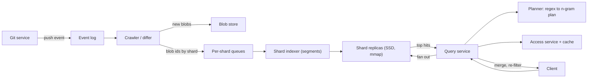

## In one minute
- **Index trigrams, then verify.** A trigram index turns substring and regex search into a boolean query over three-character keys. It returns a small candidate set, and the real matcher runs only on those. The index is a filter, never the answer.
- **Plan the regex before touching the index.** Extract the literals any match must contain. A regex with no usable literal cannot be narrowed, so give it a budget and a refusal path.
- **Shard by content, not repository.** Hashing the blob id spreads load and stores each distinct file once, though forks and vendored copies dominate. The price is that every query fans out to every shard.
- **Reindex on push by diffing, with immutable segments.** A push becomes a small segment plus tombstones, merged in the background, against a stated freshness target.
- **Enforce permissions twice.** Rewrite the query with the caller's visible repositories, then filter the merged results again.

## Requirements

**Functional**
- Search all indexed repositories for an exact substring or a regex, filtered by repository, organisation, language and path.
- Return ranked results with file, line numbers and snippets, with pagination.
- A push to a default branch becomes searchable quickly; deleted files and repositories disappear.
- Callers only see code in repositories they can read, and visibility changes take effect quickly.

**Non-functional**
- Literal queries: p50 under 200 ms, p99 under 1 s. Regex queries get a hard budget (for example 2 s) and a clear "too broad" error beyond it.
- Freshness p99 under 60 s from push; permission revocation under 1 minute; availability 99.9%.
- Index size within a small multiple of the deduplicated corpus.

**Out of scope**
- Semantic search, code navigation, searching commits or issues, and non-default branches.

## Back-of-envelope
Assume a hosting service with 50M indexed repositories. The sizes below are round figures I chose for the arithmetic, and the corpus shape follows what GitHub published for its beta, about 45M repositories, 115 TB of code and 15.5B documents, of which only about 28 TB was unique after deduplication ([GitHub Engineering](https://github.blog/engineering/the-technology-behind-githubs-new-code-search/)).

- **Corpus:** 100 TB raw, about 30 TB unique after blob-level dedup.
- **Index:** a non-positional trigram index was about 20% of source size in Google Code Search, 77 MB for 420 MB of Linux sources ([Cox](https://swtch.com/~rsc/regexp/regexp4.html)); positional trigrams cost about 3x in Zoekt ([Zoekt design](https://github.com/sourcegraph/zoekt/blob/main/doc/design.md)). Take postings at 30% plus compressed content at 30%: 30 TB × 0.6 ≈ 18 TB per copy, 54 TB with 3 replicas.
- **Why not grep:** ripgrep scans about 0.6 GB/s per core ([GitHub Engineering](https://github.blog/engineering/the-technology-behind-githubs-new-code-search/)). 30 TB ÷ 0.6 GB/s = 50,000 core-seconds per query, about 24 s even on 2,048 cores. Brute force serves 0.01 QPS.
- **Query load:** 5M daily searchers × 10 searches = 50M/day ≈ 580 QPS average, 1,700 QPS at a 3x peak.
- **Fan-out cost:** 18 TB ÷ 18 GB per shard = 1,000 shards. Most shards have a tiny candidate set for a selective query, so assume 1 ms of CPU on average: 1,700 QPS × 1,000 shards × 1 ms = 1,700 cores, about 55 hosts of 32 cores in total. Storage needs 54 TB ÷ 2 TB usable per host ≈ 27 hosts, so CPU binds. Run 3 replica sets of about 20 hosts (900 GB each), roughly 60 hosts and 1,900 cores, with headroom for a lost replica. Queries on common trigrams cost 100 ms or more per shard and are the real sizing risk.
- **Push load:** 5M pushes/day ≈ 58/s average, 175/s peak. At 3 changed blobs per push and 8 KB per blob that is 120 GB/day of changed text, of which about 40% is new content, so 48 GB/day of new unique text, 17.5 TB/year, about 88 TB over 5 years. With the index, 54 TB now grows to roughly 150 TB, and 450 TB with 3 replicas.
- **Bandwidth:** 100 hits × 1 KB of snippets = 100 KB per response, so 1,700 × 100 KB = 170 MB/s at the edge. Internal fan-out is 20 hosts × 1,700 QPS ≈ 34k small RPCs per second.

## API
```http
POST /v1/search
{ "q": "class\\s+\\w+Handler", "mode": "regex",       // "literal" or "regex"
  "filters": { "org": "acme", "lang": ["Go"], "path": "internal/**", "repo": null },
  "page_size": 50, "cursor": null, "timeout_ms": 2000 }

200 { "results": [ { "repo": "acme/api", "path": "internal/http/handler.go", "blob": "9f1c...",
                     "score": 12.7, "lines": [ { "n": 41, "text": "...", "ranges": [[6, 20]] } ] } ],
      "next_cursor": "opaque", "partial": false, "shards_failed": 0,
      "index_lag_ms": 3400 }
422 { "error": "query_too_broad", "hint": "add a literal of 3+ characters or a repo/org filter" }
```
```http
GET  /v1/blob/{blob_id}?repo=acme/api&path=...       # file view, permission checked
POST /internal/events/push   { repo_id, before_sha, after_sha, ref }   # from the Git service
```
`partial` and `shards_failed` make a degraded answer visible to the caller instead of silently incomplete. `index_lag_ms` lets a client explain "your commit is not indexed yet".

## Data model
- **Repository table** (relational, keyed by `repo_id`): `owner`, `visibility`, `org_id`, `default_branch`, `indexed_sha`, `index_state`, `pushed_at`. Authoritative for what is indexed and at which commit.
- **Blob store** (content-addressed by Git object id): the text of each distinct file. It is the source for rebuilds, so the index never has to be.
- **Document in a shard**: dense local `doc_id`, `blob_id`, `lang`, `size`, `static_score` and the list of `(repo_id, path)` references. One document may belong to thousands of repositories. Higher static score gets a lower id, which lets a query stop early.
- **Posting lists** (per shard): `ngram -> sorted doc_ids`, delta and varint encoded, memory-mapped, plus lists by language and repository id for filters.
- **Permission data** (cache from the access service): a `public` flag, `org -> repo_ids` and `user -> private repo_ids`, resolved at query time with short TTLs.
- **Shard function**: `hash(blob_id) mod N`. Each shard's state is its offset in an ordered event log, so a replica rebuilt from the log reaches the same state.

## High-level design


**Write path.** The Git service emits a push event to an ordered log. The differ compares `before_sha` and `after_sha`, lists added, changed and deleted paths, and keeps only blob ids the system has not seen. New blobs are written to the content-addressed store and routed to their shard by `hash(blob_id)`. The shard indexer builds an immutable segment of the new documents, appends tombstones for removed `(repo, path)` references, and publishes it to the replicas. A repository state row records the `indexed_sha` once the shards that care have acknowledged.

**Read path.** The query service parses the request, plans the regex into an n-gram boolean expression, and asks the access service for the caller's readable repositories. It rewrites the query to carry the permission clause, sends it to one replica of every shard, and each shard intersects posting lists, verifies candidates against stored content and returns its top hits by score. The query service merges the lists, re-checks permissions on the survivors, builds snippets and returns a page.

## Deep dives

### 1. The index and the query planner
**Options.** Word-level inverted indexes, as in Lucene, split text at word boundaries, so they cannot answer `ndl` inside `handler`, or punctuation such as `->`. Word indexes do use k-grams for wildcards ([Stanford IR book](https://nlp.stanford.edu/IR-book/html/htmledition/k-gram-indexes-for-wildcard-queries-1.html)), but only over dictionary terms. A suffix array over the whole corpus answers any substring directly, and livegrep runs RE2 on the candidate regions it finds ([Nelhage](https://blog.nelhage.com/2015/02/regular-expression-search-with-suffix-arrays/)), but a suffix array needs several bytes per input byte, which hurts at 30 TB and is awkward to update. Trigram posting lists sit between: Cox found 2-grams too unselective and 4-grams too numerous ([Cox](https://swtch.com/~rsc/regexp/regexp4.html)).

**Choice.** Trigram posting lists per shard, with positions only where they pay for themselves. Zoekt keeps positional trigrams and checks that two rare ones sit at the right distance, at about 3x corpus size ([Zoekt design](https://github.com/sourcegraph/zoekt/blob/main/doc/design.md)). GitHub's engine also builds n-gram indexes (trigrams in its worked example) separately for content, symbols and paths ([GitHub Engineering](https://github.blog/engineering/the-technology-behind-githubs-new-code-search/)). Variable-length keys that make common text rarer are a possible refinement, not something I rely on here.

**The planner is the hard part.** A literal `limits` becomes `lim AND imi AND mit AND its`. A regex is analysed bottom-up for the strings, prefixes and suffixes any match must contain; `Google.*Search` becomes the AND of the trigrams of both words, and a set of alternatives becomes an OR ([Cox](https://swtch.com/~rsc/regexp/regexp4.html)). Case-insensitive search multiplies alternatives, and `.*` yields no constraint at all. The planner must therefore return a plan with an estimated cost: intersect the rarest lists first, use document-frequency statistics to estimate candidates, and when the plan is `ANY`, reject the query unless filters narrow it to a bounded number of repositories. Return `query_too_broad` rather than burning a thousand cores.

**Verification.** Check candidates with a linear-time engine such as RE2, never a backtracking one, so a user pattern cannot run in exponential time.

### 2. Sharding and incremental reindex
**Options.** (a) Shard by repository: filters can skip shards, but big repositories create skew and forks are indexed repeatedly. (b) Shard by blob id: even load and one copy of each distinct file, but every query touches every shard.

**Choice.** Shard by `hash(blob_id)`. GitHub made the same choice, keying shards by Git blob object id to spread documents evenly and avoid hot shards, and reports dedup and delta indexing cutting 115 TB to about 28 TB ([GitHub Engineering](https://github.blog/engineering/the-technology-behind-githubs-new-code-search/)). Because a document lists every `(repo, path)` that contains it, a fork costs a few bytes of reference per file, not a second copy. Repo and org filters become posting lists inside each shard.

**Incremental reindex.** A push is a diff. Added or changed blobs make a new tiny segment in their shards. Deleted files and renamed paths remove a `(repo, path)` reference, and a document with no references is dropped at merge time. A shard applies events in log order, so a shard replica is a deterministic function of its stream, and reaching a given offset is a precise statement of freshness. Background merges bound the segment count. Merging also re-sorts documents by score so the best ones get the lowest ids, as in [GitHub's compaction](https://github.blog/engineering/the-technology-behind-githubs-new-code-search/). A force-push is a diff against the stored `indexed_sha`; if that commit is unreachable, re-walk the repository.

**Rule of thumb.** The index is derived data. Jepsen found Elasticsearch 1.5 losing acknowledged writes under faults and recommended not using the search index as system of record ([Jepsen](https://aphyr.com/posts/323-call-me-maybe-elasticsearch-1-5-0)). Keep Git and the blob store authoritative, make every indexing step idempotent by `(blob_id, repo_id, path)`, and be able to rebuild any shard from the blob store.

### 3. Ranking, permissions and tail latency
**Ranking.** Results should rank by usefulness, not by index order. Cheap signals include whether the match is a symbol definition, in a comment or string, on a word boundary, near other matches, file path length and recency; Zoekt lists several ([Zoekt design](https://github.com/sourcegraph/zoekt/blob/main/doc/design.md)). Split ranking in two. A static score per document (popularity, language, whether it is vendored or generated) is baked into document order at merge time, so each shard can stop after enough high-scoring verified hits. A dynamic score (match quality) reorders those few.

**Permissions.** The index holds a repo-to-blob mapping, so permission is a property of the `(repo, path)` reference, not of the blob. A blob in one public and one private repository must be visible only through the public reference to a stranger. The query service builds a clause: `PublicRepo() OR RepoIDs(user_private_repos)` (GitHub's query rewrite adds such clauses and filters again after merging, per [its write-up](https://github.blog/engineering/the-technology-behind-githubs-new-code-search/)). Do not expand huge repository lists per query; cache per-org bitmaps with short TTLs and invalidate on change. The post-merge check asks the access service about the few hundred surviving results, so a stale cache can only cause a delayed removal of results, never a leak of anything the second check denies. Fail closed: if the access service is unreachable, return only public results.

**Tail latency.** A query waits for the slowest of about 1,000 shard answers. If each shard exceeds 100 ms in 1% of cases, then 1 − 0.99^1000 is essentially 100% of queries hit at least one slow shard. Four mitigations stack. Send each shard request to one replica chosen by load, and hedge to a second replica after the p95 latency. Give every request a deadline and have shards return partial results by score order rather than finishing a full intersection. Cap per-query CPU. Report `partial: true` when a shard times out, because a visible partial answer beats a silent one.

## Down the stack

### Layer 1: The contract
Every returned line matches the query exactly, because verification runs on the real text. Results are complete up to `index_lag_ms` and the `partial` flag. A user never sees a result from a repository they cannot read, and a push is searchable within the freshness target. Not promised: matches in skipped files (binary, huge, invalid UTF-8, too many distinct trigrams; Cox's indexer skips such files, per [his article](https://swtch.com/~rsc/regexp/regexp4.html)), which a production system must surface to users.

### Layer 2: The mechanism
A shard file holds a format version, a trigram dictionary mapping each trigram to a posting-list offset, the posting lists, the document table, and compressed content with a line-offset table for snippets. Posting lists store gaps between sorted doc ids as variable-length integers, so a common trigram costs a byte or two per document. Zoekt uses `uint32` offsets, which caps content near 1 GB per shard and shows that shard size is a design constraint ([Zoekt design](https://github.com/sourcegraph/zoekt/blob/main/doc/design.md)). Queries evaluate the plan with iterators that advance the shortest lists first, so full lists are never materialised; GitHub also reads lists lazily ([GitHub Engineering](https://github.blog/engineering/the-technology-behind-githubs-new-code-search/)). Each surviving doc is verified and kept in a bounded heap.

### Layer 3: The machine
Shards are read-mostly and mapped with `mmap`, so the page cache decides which lists are hot. A query touches few, mostly sequential lists, so NVMe (about 100 us per random 4 KB read, several GB/s sequential) suffices: a cold 1 MB list costs about 0.4 ms. GitHub reports about one core per query per shard, roughly 640 QPS on a 64-core host, with per-shard p99 near 100 ms ([GitHub Engineering](https://github.blog/engineering/the-technology-behind-githubs-new-code-search/)). Throttle merges, which compete for SSD bandwidth, and publish segments by atomic manifest swap.

### Why it's built this way
1. Grep needs 50,000 core-seconds per query at 30 TB, so build an index.
2. Code has no word boundaries and users want regexes, so index fixed-size substrings; trigrams balance selectivity against key count.
3. A trigram match is only necessary, so verify; this keeps the index free of positions.
4. Most of the corpus is duplicate, so key content by hash and store references; that also gives the shard function.
5. Content-hash sharding forces fan-out, so tail latency, early termination and replicas become the central operational concerns.

## Failure modes
- **10x query load.** Fan-out multiplies it by the shard count. Shed load by query class (regex first), cache popular literal queries for seconds, and add replica sets rather than shards.
- **A query with no usable literal** (`.*`, `\w+`). The planner flags an unbounded plan and returns `422`; with a repo filter it may run on a bounded candidate list under a deadline.
- **A common trigram.** `for` matches most documents. Keep frequency statistics in the planner, intersect the rarest list first, and consider longer or variable-length grams for common text.
- **Slow or dead shard replica.** Hedged requests and failover hide it; `partial` and `shards_failed` expose any query that still lost a shard. Alert on the partial-response rate.
- **Region outage.** The index is derived, so a second region keeps replicas fed from the same event log; log lag decides freshness after failover.
- **Mass push or monorepo import.** Blob-hash sharding spreads it over all shards. Throttle per-repo indexing so it cannot starve others' freshness.
- **Permission change race.** The post-merge check closes the gap within the cache TTL; for urgent cases an invalidation event evicts the repository from caches.

## In the wild
- **GitHub, 2023: a new code search engine, Blackbird.** The earlier Elasticsearch-based search dated from when GitHub had about 8M repositories, and the count grew past 200M. GitHub built a Rust engine over n-gram indexes, sharded by Git blob id, and its beta covered about 45M repositories and 115 TB of code in 15.5B documents. Deduplication and delta indexing cut the corpus to about 28 TB and halved a full index build from about 36 to about 18 hours; per-shard p99 is around 100 ms ([GitHub Engineering](https://github.blog/engineering/the-technology-behind-githubs-new-code-search/)).
- **Google Code Search, 2012 write-up: trigram index for regex search.** Russ Cox described the index behind Google's Code Search and published an open-source version. A regex is converted into a trigram query that selects candidate files, and the full regex then runs only on those. On Linux 3.1.3, `hello world` narrowed 36,972 files to 25 and ran in 0.01 s against 1.96 s for brute force. The index was about 20% of source size, and case-insensitive queries gave a much smaller speedup ([Cox](https://swtch.com/~rsc/regexp/regexp4.html)).
- **Jepsen on Elasticsearch, 2015: a search index is not a system of record.** Jepsen showed Elasticsearch 1.5.0 losing acknowledged writes under partitions, pauses and process kills (about 10% under `kill -9` because the translog was fsynced on a timer). The advice was to keep data in a safer database and continuously upsert it into the index, which is the same rule that makes a code-search index rebuildable from Git and the blob store ([Jepsen](https://aphyr.com/posts/323-call-me-maybe-elasticsearch-1-5-0)).

## Trade-offs
| Option | Strengths | Weaknesses | Choose when |
|---|---|---|---|
| Trigram postings + verify | Exact regex and substring, small index, simple to update | Weak on common or short literals, needs a regex planner | General code search with regex support |
| Positional trigrams (Zoekt style) | Fewer false candidates, phrase checks without reading content | About 3x corpus size, heavier writes | Smaller corpora, latency matters most |
| Sparse n-grams | Rarer keys for common text, fewer candidates | More complex build and query planning | Very large corpus where common grams dominate cost |
| Suffix array (livegrep style) | Direct substring and regex lookup on one structure | Several bytes per input byte, hard to update incrementally | Single-repo or batch-built indexes |
| Shard by blob hash | Even load, dedup, hot-shard free | All queries fan out | Millions of repos with many forks |

## Leadership lens
- **Roll out in stages.** Index public default branches of a few thousand repositories and compare with grep to measure recall, then shadow real queries, then a cohort, and add private repositories only after a red-team review of the permission path.
- **Ownership.** Ingest and freshness, the query engine and planner, and permissions and ranking. Permissions get a named owner and a suite of known-leak scenarios run on every release.
- **Cost drivers.** SSD and replicas dominate (about 450 TB at five years above), and fan-out CPU follows queries times shards. Track the dedup ratio as a first-class metric.
- **Ask in design review.** What happens to a query with no literal? Who is paged for the freshness SLO? How long does a shard rebuild take? Which permission check fails closed?
- **Build first.** A single-node trigram index with verifier and permission filter, then the push differ, then sharding.

## Check yourself
1. Why must a trigram query always be followed by a verification step, and what would break if you trusted the index alone?
   **Answer:** A document can contain every trigram of the query without containing the query as a contiguous string (for example `abc bcd` for `abcd`). The index proves a necessary condition only, so without verification you would return false positives, and any regex that the planner approximates would return wrong lines.
2. Your service shards by blob hash and p99 per shard is 100 ms across 1,000 shards. Why is the user-visible p99 much worse, and what do you change?
   **Answer:** The query waits for the slowest shard, so a 1% per-shard slow rate hits nearly every query at 1,000-way fan-out. Hedge to another replica after about p95, impose a deadline with partial results ordered by score, and cap per-query CPU.
3. A file exists in a public fork and a private repository, with the same content. How does the design keep it from leaking?
   **Answer:** Visibility is attached to each `(repo, path)` reference, not to the blob. The query is rewritten to public repositories plus the caller's readable ones, and results are filtered again after the merge, failing closed if the access service is down.
4. Using the numbers in this lesson, why does dedup matter more than index compression?
   **Answer:** Dedup cut the corpus from 100 TB to about 30 TB, a 70% reduction before indexing, and everything downstream (index, replicas, build time, I/O) scales with unique content. Compression typically gains a smaller constant factor on the remainder.

## Practice
**Task:** Build the core of a trigram code index. `trigrams(s)` returns the sorted distinct lowercase 3-character substrings of `s` (fewer than three characters gives none). `CodeIndex` keeps one posting set per trigram and a table of documents (repo, text, SHA-1 of text). `add(doc_id, repo, text)` indexes a document, or replaces it if the id exists, and returns false without touching postings when the content hash is unchanged. `remove(doc_id)` deletes the document and its postings, dropping empty posting sets. `sync_repo(repo, files)` makes the repo equal to a `path -> text` map using doc ids `repo:path`, and returns `(added, removed, skipped)` where added counts new and changed files. `candidates(query, repos)` lowercases the query, intersects the posting sets of its trigrams starting from the smallest, and keeps only documents whose repo is in `repos` (`None` means all repos); a query shorter than three characters has no trigram filter, so every permitted document is a candidate. `search(query, repos, limit)` verifies each candidate by counting non-overlapping case-insensitive occurrences, drops zero counts, and returns `(doc_id, count)` pairs sorted by count descending then doc id, cut to `limit`. An empty query returns nothing. Tests use ASCII text only.

```python starter
class CodeIndex:
    def __init__(self):
        pass

    def add(self, doc_id, repo, text):
        # TODO: return False if unchanged, else (re)index and return True
        raise NotImplementedError

    def remove(self, doc_id):
        raise NotImplementedError

    def sync_repo(self, repo, files):
        # TODO: return (added, removed, skipped)
        raise NotImplementedError

    def candidates(self, query, repos=None):
        raise NotImplementedError

    def search(self, query, repos=None, limit=10):
        raise NotImplementedError


def trigrams(s):
    # TODO
    raise NotImplementedError
```

```python tests
def test_trigrams_distinct_sorted_lowercase():
    assert trigrams("Limits") == ["imi", "its", "lim", "mit"]
    assert trigrams("aaaa") == ["aaa"]
    assert trigrams("ab") == []

def test_substring_search_counts_and_ranks():
    ix = CodeIndex()
    ix.add("r:a.py", "r", "limit = 1\nlimit = 2\n")
    ix.add("r:b.py", "r", "unlimited")
    ix.add("r:c.py", "r", "nothing here")
    assert ix.search("limit") == [("r:a.py", 2), ("r:b.py", 1)]
    assert ix.search("limit", limit=1) == [("r:a.py", 2)]

def test_verify_step_removes_trigram_false_positives():
    ix = CodeIndex()
    ix.add("d1", "r", "abc bcd")
    ix.add("d2", "r", "xabcdx")
    assert ix.candidates("abcd") == ["d1", "d2"]
    assert ix.search("abcd") == [("d2", 1)]

def test_short_query_scans_and_case_is_ignored():
    ix = CodeIndex()
    ix.add("d1", "r", "if X then")
    ix.add("d2", "r", "else")
    assert ix.candidates("if") == ["d1", "d2"]
    assert ix.search("IF") == [("d1", 1)]
    assert ix.search("") == []

def test_permission_filter_by_repo():
    ix = CodeIndex()
    ix.add("pub:f", "pub", "secret_token")
    ix.add("priv:f", "priv", "secret_token")
    assert [d for d, _ in ix.search("secret")] == ["priv:f", "pub:f"]
    assert ix.search("secret", {"pub"}) == [("pub:f", 1)]
    assert ix.search("secret", set()) == []

def test_replace_and_remove_clean_postings():
    ix = CodeIndex()
    assert ix.add("d", "r", "alpha beta") is True
    assert ix.add("d", "r", "alpha beta") is False
    assert ix.add("d", "r", "gamma delta") is True
    assert ix.search("alpha") == []
    assert ix.search("gamma") == [("d", 1)]
    assert ix.remove("d") is True
    assert ix.remove("d") is False
    assert ix.search("gamma") == []

def test_sync_repo_applies_a_push():
    ix = CodeIndex()
    assert ix.sync_repo("r", {"a": "one two", "b": "three four"}) == (2, 0, 0)
    res = ix.sync_repo("r", {"a": "one two", "b": "three FIVE", "c": "six"})
    assert res == (2, 0, 1)
    res = ix.sync_repo("r", {"c": "six"})
    assert res == (0, 2, 1)
    ix.add("other:x", "other", "six")
    ix.sync_repo("r", {})
    assert ix.search("six") == [("other:x", 1)]
```

```python solution
import hashlib


def trigrams(s):
    s = s.lower()
    return sorted({s[i:i + 3] for i in range(len(s) - 2)})


class CodeIndex:
    def __init__(self):
        self.postings = {}
        self.docs = {}

    def add(self, doc_id, repo, text):
        h = hashlib.sha1(text.encode("utf-8")).hexdigest()
        old = self.docs.get(doc_id)
        if old is not None:
            if old[2] == h and old[0] == repo:
                return False
            self.remove(doc_id)
        self.docs[doc_id] = (repo, text, h)
        for t in trigrams(text):
            self.postings.setdefault(t, set()).add(doc_id)
        return True

    def remove(self, doc_id):
        old = self.docs.pop(doc_id, None)
        if old is None:
            return False
        for t in trigrams(old[1]):
            s = self.postings[t]
            s.discard(doc_id)
            if not s:
                del self.postings[t]
        return True

    def sync_repo(self, repo, files):
        wanted = {repo + ":" + p: txt for p, txt in files.items()}
        added = removed = skipped = 0
        for doc_id in sorted(wanted):
            if self.add(doc_id, repo, wanted[doc_id]):
                added += 1
            else:
                skipped += 1
        for doc_id in [d for d, v in self.docs.items() if v[0] == repo and d not in wanted]:
            self.remove(doc_id)
            removed += 1
        return (added, removed, skipped)

    def candidates(self, query, repos=None):
        q = query.lower()
        if len(q) < 3:
            ids = set(self.docs)
        else:
            lists = []
            for t in trigrams(q):
                p = self.postings.get(t)
                if p is None:
                    return []
                lists.append(p)
            lists.sort(key=len)
            ids = set(lists[0])
            for p in lists[1:]:
                ids &= p
                if not ids:
                    break
        if repos is not None:
            ids = {d for d in ids if self.docs[d][0] in repos}
        return sorted(ids)

    def search(self, query, repos=None, limit=10):
        if query == "":
            return []
        q = query.lower()
        hits = []
        for d in self.candidates(query, repos):
            n = self.docs[d][1].lower().count(q)
            if n > 0:
                hits.append((d, n))
        hits.sort(key=lambda h: (-h[1], h[0]))
        return hits[:limit]
```

```typescript starter
export function trigrams(s: string): string[] {
  // TODO
  throw new Error("TODO");
}

export class CodeIndex {
  add(docId: string, repo: string, text: string): boolean {
    // TODO: false if unchanged, else (re)index and return true
    throw new Error("TODO");
  }

  remove(docId: string): boolean {
    throw new Error("TODO");
  }

  syncRepo(repo: string, files: Record<string, string>): [number, number, number] {
    // TODO: [added, removed, skipped]
    throw new Error("TODO");
  }

  candidates(query: string, repos: Set<string> | null = null): string[] {
    throw new Error("TODO");
  }

  search(query: string, repos: Set<string> | null = null, limit = 10): [string, number][] {
    throw new Error("TODO");
  }
}
```

```typescript tests
test("trigrams distinct sorted lowercase", () => {
  assertEqual(trigrams("Limits"), ["imi", "its", "lim", "mit"]);
  assertEqual(trigrams("aaaa"), ["aaa"]);
  assertEqual(trigrams("ab"), []);
});

test("substring search counts and ranks", () => {
  const ix = new CodeIndex();
  ix.add("r:a.py", "r", "limit = 1\nlimit = 2\n");
  ix.add("r:b.py", "r", "unlimited");
  ix.add("r:c.py", "r", "nothing here");
  assertEqual(ix.search("limit"), [["r:a.py", 2], ["r:b.py", 1]]);
  assertEqual(ix.search("limit", null, 1), [["r:a.py", 2]]);
});

test("verify step removes trigram false positives", () => {
  const ix = new CodeIndex();
  ix.add("d1", "r", "abc bcd");
  ix.add("d2", "r", "xabcdx");
  assertEqual(ix.candidates("abcd"), ["d1", "d2"]);
  assertEqual(ix.search("abcd"), [["d2", 1]]);
});

test("short query scans and case is ignored", () => {
  const ix = new CodeIndex();
  ix.add("d1", "r", "if X then");
  ix.add("d2", "r", "else");
  assertEqual(ix.candidates("if"), ["d1", "d2"]);
  assertEqual(ix.search("IF"), [["d1", 1]]);
  assertEqual(ix.search(""), []);
});

test("permission filter by repo", () => {
  const ix = new CodeIndex();
  ix.add("pub:f", "pub", "secret_token");
  ix.add("priv:f", "priv", "secret_token");
  assertEqual(ix.search("secret").map((h) => h[0]), ["priv:f", "pub:f"]);
  assertEqual(ix.search("secret", new Set(["pub"])), [["pub:f", 1]]);
  assertEqual(ix.search("secret", new Set<string>()), []);
});

test("replace and remove clean postings", () => {
  const ix = new CodeIndex();
  assert(ix.add("d", "r", "alpha beta") === true, "first add");
  assert(ix.add("d", "r", "alpha beta") === false, "unchanged");
  assert(ix.add("d", "r", "gamma delta") === true, "changed");
  assertEqual(ix.search("alpha"), []);
  assertEqual(ix.search("gamma"), [["d", 1]]);
  assert(ix.remove("d") === true, "removed");
  assert(ix.remove("d") === false, "already gone");
  assertEqual(ix.search("gamma"), []);
});

test("syncRepo applies a push", () => {
  const ix = new CodeIndex();
  assertEqual(ix.syncRepo("r", { a: "one two", b: "three four" }), [2, 0, 0]);
  assertEqual(ix.syncRepo("r", { a: "one two", b: "three FIVE", c: "six" }), [2, 0, 1]);
  assertEqual(ix.syncRepo("r", { c: "six" }), [0, 2, 1]);
  ix.add("other:x", "other", "six");
  ix.syncRepo("r", {});
  assertEqual(ix.search("six"), [["other:x", 1]]);
});
```

```typescript solution
export function trigrams(s: string): string[] {
  const t = s.toLowerCase();
  const out = new Set<string>();
  for (let i = 0; i + 3 <= t.length; i++) out.add(t.slice(i, i + 3));
  return Array.from(out).sort();
}

function hash(s: string): string {
  let h = 5381;
  for (let i = 0; i < s.length; i++) h = (Math.imul(h, 33) + s.charCodeAt(i)) | 0;
  return s.length + ":" + h;
}

function countOcc(text: string, q: string): number {
  let n = 0;
  let i = text.indexOf(q);
  while (i >= 0) {
    n++;
    i = text.indexOf(q, i + q.length);
  }
  return n;
}

export class CodeIndex {
  private postings = new Map<string, Set<string>>();
  private docs = new Map<string, { repo: string; text: string; h: string }>();

  add(docId: string, repo: string, text: string): boolean {
    const h = hash(text);
    const old = this.docs.get(docId);
    if (old) {
      if (old.h === h && old.text === text && old.repo === repo) return false;
      this.remove(docId);
    }
    this.docs.set(docId, { repo, text, h });
    for (const t of trigrams(text)) {
      let s = this.postings.get(t);
      if (!s) {
        s = new Set<string>();
        this.postings.set(t, s);
      }
      s.add(docId);
    }
    return true;
  }

  remove(docId: string): boolean {
    const old = this.docs.get(docId);
    if (!old) return false;
    this.docs.delete(docId);
    for (const t of trigrams(old.text)) {
      const s = this.postings.get(t);
      if (!s) continue;
      s.delete(docId);
      if (s.size === 0) this.postings.delete(t);
    }
    return true;
  }

  syncRepo(repo: string, files: Record<string, string>): [number, number, number] {
    const wanted = new Set<string>();
    let added = 0;
    let removed = 0;
    let skipped = 0;
    for (const p of Object.keys(files).sort()) {
      const id = repo + ":" + p;
      wanted.add(id);
      if (this.add(id, repo, files[p])) added++;
      else skipped++;
    }
    for (const [id, d] of Array.from(this.docs.entries())) {
      if (d.repo === repo && !wanted.has(id)) {
        this.remove(id);
        removed++;
      }
    }
    return [added, removed, skipped];
  }

  candidates(query: string, repos: Set<string> | null = null): string[] {
    const q = query.toLowerCase();
    let ids: string[];
    if (q.length < 3) {
      ids = Array.from(this.docs.keys());
    } else {
      const lists: Set<string>[] = [];
      for (const t of trigrams(q)) {
        const p = this.postings.get(t);
        if (!p) return [];
        lists.push(p);
      }
      lists.sort((a, b) => a.size - b.size);
      ids = Array.from(lists[0]).filter((d) => lists.every((l) => l.has(d)));
    }
    if (repos !== null) ids = ids.filter((d) => repos.has(this.docs.get(d)!.repo));
    return ids.sort();
  }

  search(query: string, repos: Set<string> | null = null, limit = 10): [string, number][] {
    if (query === "") return [];
    const q = query.toLowerCase();
    const hits: [string, number][] = [];
    for (const d of this.candidates(query, repos)) {
      const n = countOcc(this.docs.get(d)!.text.toLowerCase(), q);
      if (n > 0) hits.push([d, n]);
    }
    hits.sort((a, b) => b[1] - a[1] || (a[0] < b[0] ? -1 : a[0] > b[0] ? 1 : 0));
    return hits.slice(0, limit);
  }
}
```

```go starter
package practice

// Hit is one search result.
type Hit struct {
	DocID string
	Count int
}

// Trigrams returns the sorted distinct lowercase 3-byte substrings of s.
func Trigrams(s string) []string {
	// TODO
	panic("TODO")
}

type CodeIndex struct{}

func NewCodeIndex() *CodeIndex {
	return &CodeIndex{}
}

// Add returns false when the content is unchanged.
func (ix *CodeIndex) Add(docID, repo, text string) bool {
	panic("TODO")
}

func (ix *CodeIndex) Remove(docID string) bool {
	panic("TODO")
}

// SyncRepo returns (added, removed, skipped).
func (ix *CodeIndex) SyncRepo(repo string, files map[string]string) (int, int, int) {
	panic("TODO")
}

// Candidates: repos == nil means all repos.
func (ix *CodeIndex) Candidates(query string, repos map[string]bool) []string {
	panic("TODO")
}

func (ix *CodeIndex) Search(query string, repos map[string]bool, limit int) []Hit {
	panic("TODO")
}
```

```go tests
package practice

import (
	"reflect"
	"testing"
)

func ids(h []Hit) []string {
	out := []string{}
	for _, x := range h {
		out = append(out, x.DocID)
	}
	return out
}

func TestTrigrams(t *testing.T) {
	if got := Trigrams("Limits"); !reflect.DeepEqual(got, []string{"imi", "its", "lim", "mit"}) {
		t.Fatalf("got %v", got)
	}
	if got := Trigrams("aaaa"); !reflect.DeepEqual(got, []string{"aaa"}) {
		t.Fatalf("got %v", got)
	}
	if got := Trigrams("ab"); len(got) != 0 {
		t.Fatalf("got %v", got)
	}
}

func TestSearchCountsAndRanks(t *testing.T) {
	ix := NewCodeIndex()
	ix.Add("r:a.py", "r", "limit = 1\nlimit = 2\n")
	ix.Add("r:b.py", "r", "unlimited")
	ix.Add("r:c.py", "r", "nothing here")
	want := []Hit{{"r:a.py", 2}, {"r:b.py", 1}}
	if got := ix.Search("limit", nil, 10); !reflect.DeepEqual(got, want) {
		t.Fatalf("got %v", got)
	}
	if got := ix.Search("limit", nil, 1); !reflect.DeepEqual(got, want[:1]) {
		t.Fatalf("limit: got %v", got)
	}
}

func TestVerifyRemovesFalsePositives(t *testing.T) {
	ix := NewCodeIndex()
	ix.Add("d1", "r", "abc bcd")
	ix.Add("d2", "r", "xabcdx")
	if got := ix.Candidates("abcd", nil); !reflect.DeepEqual(got, []string{"d1", "d2"}) {
		t.Fatalf("candidates %v", got)
	}
	if got := ix.Search("abcd", nil, 10); !reflect.DeepEqual(got, []Hit{{"d2", 1}}) {
		t.Fatalf("search %v", got)
	}
}

func TestShortQueryAndCase(t *testing.T) {
	ix := NewCodeIndex()
	ix.Add("d1", "r", "if X then")
	ix.Add("d2", "r", "else")
	if got := ix.Candidates("if", nil); !reflect.DeepEqual(got, []string{"d1", "d2"}) {
		t.Fatalf("candidates %v", got)
	}
	if got := ix.Search("IF", nil, 10); !reflect.DeepEqual(got, []Hit{{"d1", 1}}) {
		t.Fatalf("search %v", got)
	}
	if got := ix.Search("", nil, 10); len(got) != 0 {
		t.Fatalf("empty query %v", got)
	}
}

func TestPermissionFilter(t *testing.T) {
	ix := NewCodeIndex()
	ix.Add("pub:f", "pub", "secret_token")
	ix.Add("priv:f", "priv", "secret_token")
	if got := ids(ix.Search("secret", nil, 10)); !reflect.DeepEqual(got, []string{"priv:f", "pub:f"}) {
		t.Fatalf("all %v", got)
	}
	if got := ix.Search("secret", map[string]bool{"pub": true}, 10); !reflect.DeepEqual(got, []Hit{{"pub:f", 1}}) {
		t.Fatalf("pub %v", got)
	}
	if got := ix.Search("secret", map[string]bool{}, 10); len(got) != 0 {
		t.Fatalf("none %v", got)
	}
}

func TestReplaceAndRemove(t *testing.T) {
	ix := NewCodeIndex()
	if !ix.Add("d", "r", "alpha beta") {
		t.Fatal("first add")
	}
	if ix.Add("d", "r", "alpha beta") {
		t.Fatal("unchanged should be false")
	}
	if !ix.Add("d", "r", "gamma delta") {
		t.Fatal("changed should be true")
	}
	if got := ix.Search("alpha", nil, 10); len(got) != 0 {
		t.Fatalf("stale postings %v", got)
	}
	if got := ix.Search("gamma", nil, 10); !reflect.DeepEqual(got, []Hit{{"d", 1}}) {
		t.Fatalf("gamma %v", got)
	}
	if !ix.Remove("d") || ix.Remove("d") {
		t.Fatal("remove semantics")
	}
	if got := ix.Search("gamma", nil, 10); len(got) != 0 {
		t.Fatalf("after remove %v", got)
	}
}

func TestSyncRepoAppliesPush(t *testing.T) {
	ix := NewCodeIndex()
	check := func(a, r, s, wa, wr, ws int) {
		t.Helper()
		if a != wa || r != wr || s != ws {
			t.Fatalf("got (%d,%d,%d) want (%d,%d,%d)", a, r, s, wa, wr, ws)
		}
	}
	a, r, s := ix.SyncRepo("r", map[string]string{"a": "one two", "b": "three four"})
	check(a, r, s, 2, 0, 0)
	a, r, s = ix.SyncRepo("r", map[string]string{"a": "one two", "b": "three FIVE", "c": "six"})
	check(a, r, s, 2, 0, 1)
	a, r, s = ix.SyncRepo("r", map[string]string{"c": "six"})
	check(a, r, s, 0, 2, 1)
	ix.Add("other:x", "other", "six")
	ix.SyncRepo("r", map[string]string{})
	if got := ix.Search("six", nil, 10); !reflect.DeepEqual(got, []Hit{{"other:x", 1}}) {
		t.Fatalf("got %v", got)
	}
}
```

```go solution
package practice

import (
	"crypto/sha1"
	"sort"
	"strings"
)

// Hit is one search result.
type Hit struct {
	DocID string
	Count int
}

// Trigrams returns the sorted distinct lowercase 3-byte substrings of s.
func Trigrams(s string) []string {
	s = strings.ToLower(s)
	seen := map[string]bool{}
	for i := 0; i+3 <= len(s); i++ {
		seen[s[i:i+3]] = true
	}
	out := make([]string, 0, len(seen))
	for t := range seen {
		out = append(out, t)
	}
	sort.Strings(out)
	return out
}

type doc struct {
	repo string
	text string
	hash [20]byte
}

type CodeIndex struct {
	postings map[string]map[string]bool
	docs     map[string]*doc
}

func NewCodeIndex() *CodeIndex {
	return &CodeIndex{postings: map[string]map[string]bool{}, docs: map[string]*doc{}}
}

// Add returns false when the content is unchanged.
func (ix *CodeIndex) Add(docID, repo, text string) bool {
	h := sha1.Sum([]byte(text))
	if old, ok := ix.docs[docID]; ok {
		if old.hash == h && old.repo == repo {
			return false
		}
		ix.Remove(docID)
	}
	ix.docs[docID] = &doc{repo: repo, text: text, hash: h}
	for _, t := range Trigrams(text) {
		p := ix.postings[t]
		if p == nil {
			p = map[string]bool{}
			ix.postings[t] = p
		}
		p[docID] = true
	}
	return true
}

func (ix *CodeIndex) Remove(docID string) bool {
	old, ok := ix.docs[docID]
	if !ok {
		return false
	}
	delete(ix.docs, docID)
	for _, t := range Trigrams(old.text) {
		if p := ix.postings[t]; p != nil {
			delete(p, docID)
			if len(p) == 0 {
				delete(ix.postings, t)
			}
		}
	}
	return true
}

// SyncRepo returns (added, removed, skipped).
func (ix *CodeIndex) SyncRepo(repo string, files map[string]string) (int, int, int) {
	added, removed, skipped := 0, 0, 0
	wanted := map[string]bool{}
	for p, txt := range files {
		id := repo + ":" + p
		wanted[id] = true
		if ix.Add(id, repo, txt) {
			added++
		} else {
			skipped++
		}
	}
	var stale []string
	for id, d := range ix.docs {
		if d.repo == repo && !wanted[id] {
			stale = append(stale, id)
		}
	}
	for _, id := range stale {
		ix.Remove(id)
		removed++
	}
	return added, removed, skipped
}

// Candidates: repos == nil means all repos.
func (ix *CodeIndex) Candidates(query string, repos map[string]bool) []string {
	q := strings.ToLower(query)
	var ids []string
	if len(q) < 3 {
		for id := range ix.docs {
			ids = append(ids, id)
		}
	} else {
		var lists []map[string]bool
		for _, t := range Trigrams(q) {
			p := ix.postings[t]
			if p == nil {
				return []string{}
			}
			lists = append(lists, p)
		}
		sort.Slice(lists, func(i, j int) bool { return len(lists[i]) < len(lists[j]) })
		for id := range lists[0] {
			ok := true
			for _, l := range lists[1:] {
				if !l[id] {
					ok = false
					break
				}
			}
			if ok {
				ids = append(ids, id)
			}
		}
	}
	out := []string{}
	for _, id := range ids {
		if repos == nil || repos[ix.docs[id].repo] {
			out = append(out, id)
		}
	}
	sort.Strings(out)
	return out
}

func (ix *CodeIndex) Search(query string, repos map[string]bool, limit int) []Hit {
	hits := []Hit{}
	if query == "" {
		return hits
	}
	q := strings.ToLower(query)
	for _, id := range ix.Candidates(query, repos) {
		if n := strings.Count(strings.ToLower(ix.docs[id].text), q); n > 0 {
			hits = append(hits, Hit{id, n})
		}
	}
	sort.Slice(hits, func(i, j int) bool {
		if hits[i].Count != hits[j].Count {
			return hits[i].Count > hits[j].Count
		}
		return hits[i].DocID < hits[j].DocID
	})
	if len(hits) > limit {
		hits = hits[:limit]
	}
	return hits
}
```

## Mock interview
**Prompt:** Design code search for a hosting service with 50M repositories and about 100 TB of source. Users run substring and regex queries with repo, org and language filters, and expect results in under a second. A push should be searchable within a minute, and private code must never leak.

- Follow-up: A user searches the regex `.*` restricted to one organisation with 2M files. What does your system do, and what about the same query with no filter?
- Follow-up: Walk me through exactly what happens, in order, between a push to a repository and the first query that finds the new line. What if the push was a force-push?
- Follow-up: A file is identical in a public fork and a private repository. How does a stranger never see the private path, even with a stale permission cache?
- Follow-up: You have 1,000 shards and a per-shard p99 of 100 ms. Why is the overall p99 bad, and what would you change before adding hardware?

**A strong answer covers:**
- Why grep and word-level indexes fail, with the arithmetic (tens of thousands of core-seconds per brute-force query) and the trigram index as a necessary-condition filter followed by exact verification.
- A regex planner that extracts required literals, bounds unusable patterns, and verifies with linear-time matching.
- Sharding by content hash with dedup, the cost of full fan-out, and how filters become posting lists instead of shard skipping.
- Incremental indexing as diff, immutable segments, tombstones and background merges, driven by an ordered log, with the index treated as rebuildable derived data.
- Permissions as a property of the `(repo, path)` reference, enforced as a query clause and re-checked after the merge, failing closed.
- Tail-latency tactics: hedging, deadlines with partial results, per-query CPU budgets, and an explicit freshness and `partial` signal in the API.

## Sources and further study
**Primary**
- [Regular Expression Matching with a Trigram Index (Russ Cox)](https://swtch.com/~rsc/regexp/regexp4.html): the regex-to-trigram-query analysis, index size and timings behind Google Code Search.
- [The technology behind GitHub's new code search](https://github.blog/engineering/the-technology-behind-githubs-new-code-search/): n-gram indexes, blob-id sharding, deduplication, Kafka-driven ingest and the permission rewrite at 45M repositories.
- [Regular expression search with suffix arrays (Nelhage)](https://blog.nelhage.com/2015/02/regular-expression-search-with-suffix-arrays/): the suffix-array alternative used by livegrep, with its limits.

**Systems docs**
- [Zoekt design notes](https://github.com/sourcegraph/zoekt/blob/main/doc/design.md): shard layout, positional trigrams, ranking signals and size caps.
- [sourcegraph/zoekt](https://github.com/sourcegraph/zoekt): indexing commands, the index server and the search API.
- [google/codesearch](https://github.com/google/codesearch): the open-source trigram indexer and `csearch` tool from the article above.
- [Jepsen: Elasticsearch 1.5.0](https://aphyr.com/posts/323-call-me-maybe-elasticsearch-1-5-0): why a search index should be derived data.

**Books**
- *Introduction to Information Retrieval*, Manning, Raghavan and Schütze, chapter 3 "Dictionaries and tolerant retrieval": k-gram indexes and posting-list intersection.
- *Designing Data-Intensive Applications*, Martin Kleppmann, chapter 3 "Storage and Retrieval": segments, merging and full-text indexes in log-structured storage.

**Other curricula**
- [donnemartin/system-design-primer](https://github.com/donnemartin/system-design-primer): has no code-search scenario; its search coverage stays at the level of a generic search cluster, which is why substring and regex search needs the extra material here.

## Watch
- [Lessons from building GitHub code search (Luke Francl, Strange Loop 2023)](https://www.youtube.com/watch?v=CqZA_KmygKw): the engineering team's own account of building the n-gram engine.

## Free resources
- [Stanford IR book: k-gram indexes for wildcard queries](https://nlp.stanford.edu/IR-book/html/htmledition/k-gram-indexes-for-wildcard-queries-1.html): the textbook treatment of the same idea.
- [livegrep](https://github.com/livegrep/livegrep): runnable regex code search to experiment with.
- [About GitHub code search](https://docs.github.com/en/search-github/github-code-search/about-github-code-search): the user-facing behaviour and syntax of a production system.
- [ripgrep](https://github.com/BurntSushi/ripgrep): the baseline scanner whose throughput motivates the index.
