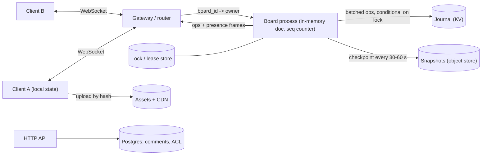

## In one minute
- **Use the server as the single orderer.** A whiteboard is a tree of objects with properties, not a long text. One process per board that stamps every change with a sequence number gives last-writer-wins per property, and it is far simpler than operational transformation or a general CRDT.
- **Make the unit of conflict small.** Model the board as `(object, property) -> value`. Two people changing different properties, or different objects, never conflict. Only the same property on the same object does, and then the later arrival wins.
- **Split durable state from ephemeral state.** Shapes and comments are logged and recoverable. Cursors, selections and drag-in-progress positions are broadcast and forgotten. Mixing them multiplies your write load by 100.
- **Recover from a snapshot plus an op log.** The in-memory board is checkpointed every so often. Between checkpoints, batched changes go to a journal with sequence numbers, so a crash loses under a second, not a minute.
- **Fan out per board, and only what the viewer can see.** Pin a board to one process, tick-batch presence, and send large boards lazily by viewport, because the hot case is one board with hundreds of viewers, not millions of boards.

## Requirements

**Functional**
- Many users draw and edit shapes, text, connectors and images on one infinite canvas. Everyone sees changes within a fraction of a second.
- Live cursors, selections and user names for everyone on the board (presence).
- Comments pinned to a point or object, with replies and resolve.
- Editing continues through short disconnects and offline periods, and merges on return.
- Undo and redo per user. Version history and "restore this version".
- Share by link with view, comment or edit roles.

**Non-functional**
- Remote edits visible in under 150 ms in the same region at p95. Local edits apply instantly (optimistic).
- No acknowledged edit is lost. A server crash loses at most about one second of unacknowledged work, and the client resends it.
- All viewers of a board converge to the same state.
- Boards up to 100,000 objects open in a few seconds. Up to 100 active editors and 1,000 viewers on one board.

**Out of scope:** rich text inside a shape (see the Google Docs chapter), video calls and billing.

## Back-of-envelope
- Peak: 1M concurrent editors across 200k live boards, so 5 per board on average.
- Cursors: half of users are moving a pointer at any moment, sampled at 10 Hz. Inbound 1M x 0.5 x 10 = 5M updates/s. With 4 other viewers each, outbound is about 20M messages/s. That is the biggest number in the system, and it never touches disk.
- Durable changes: 5% of editors are dragging or typing at any moment. Intermediate drag positions are ephemeral, and only the batched result per 500 ms window is journaled. If 10% of live boards are dirty in a window, that is 200k x 0.1 / 0.5 s = 40k journal writes/s at peak. Average is about 10k/s.
- Board size: 2,000 objects x 300 B = 600 KB typical, 30 MB for a 100k-object board (about 5 MB compressed). With 50M boards at 300 KB average, snapshots are 15 TB, and three retained versions make 45 TB.
- Hot board: 100 editors at 10 Hz is 1,000 cursor updates/s in. Sent naively to 99 others, that is 99k messages/s from one process. Batched into a 100 ms tick frame, it is 10 frames/s per recipient, or 1,000 frames/s total.

## API
Clients talk to the board over one WebSocket. Reads of metadata and comments use plain HTTP.

```text
GET  /boards/{id}/open?resume_seq=1840      -> 101 upgrade; or 200 {snapshot_url, seq} for a cold load

client -> server
  {t:"hello", user, last_seq}                # last_seq lets the server send only the missing tail
  {t:"op", cid:"c91-17", ops:[{obj, prop, value}]}   # cid = client op id, for idempotent retry
  {t:"presence", cursor:[x,y], sel:["r1","r7"], vp:[x0,y0,x1,y1]}   # ephemeral
  {t:"viewport", vp:[x0,y0,x1,y1]}           # what I can see; for large boards

server -> client
  {t:"ack", cid, seq}                        # my op got this sequence number
  {t:"ops", from_seq, to_seq, ops:[...]}     # other people's changes, in order
  {t:"reject", cid, reason:"cycle"}          # the server refused (for example a reparent loop)
  {t:"presence_frame", users:{u7:{cursor, sel}, ...}}   # tick-batched

POST /boards/{id}/comments        {anchor:{obj|point}, body, parent_id}
GET  /boards/{id}/versions        -> [{seq, at, label}]
POST /boards/{id}/restore         {seq}
```

## Data model
**Live document** (in the board process, memory): `Map<ObjectID, Map<Property, Value>>`. The tree is expressed through a `parent` property on the child and a `position` property, a fractional index string that orders siblings. Figma describes its document in this shape, and keeps the parent link on the child so object identity survives a move ([Figma](https://www.figma.com/blog/how-figmas-multiplayer-technology-works/)).

**Journal** (key-value store, partition key `board_id`, sort key `seq_start`): each item is a batch `{seq_start, seq_end, ops[]}`. Partition by board so one board's replay is one range scan. A lock row `(board_id -> owner_uuid, lease_expiry)` makes appends conditional so only the owner can write.

**Snapshots** (object store): `boards/{id}/{seq}.bin`, a compressed binary encoding of the full map plus the `seq` it covers. A small `latest` pointer row names the newest.

**Comments, users, permissions** (Postgres, partition by `board_id`): ordinary relational rows with their own sync channel. Figma keeps these outside its multiplayer system for the same reason: different trade-offs for offline use, security and performance ([Figma](https://www.figma.com/blog/how-figmas-multiplayer-technology-works/)).

**Assets** (object store plus CDN): images by content hash. The document holds only the hash.

**Presence**: not stored. It lives in the board process, keyed by connection, and expires on disconnect.

## High-level design



**Write path.** A user drags a rectangle. The client applies the new `x` and `y` locally and sends an `op` with a client id. The gateway routes by `board_id` to the one process that owns the board. That process validates the op (permission, schema, no reparent cycle), assigns the next sequence number, updates the in-memory map, acknowledges the sender, and broadcasts the op to everyone else. A background task appends the batch to the journal under the lock, and a timer writes a snapshot.

**Read path.** A cold open fetches the latest snapshot from the object store (through a CDN-style cache), then asks the board process for ops since the snapshot's `seq` and joins the live stream. A reconnect sends `last_seq` in `hello` and receives only the tail. If the tail is too long or no longer retained, the server sends a fresh copy instead.

**Presence path.** Cursors go to the board process, which keeps the latest per user and emits one `presence_frame` per tick to each viewer, filtered to that viewer's interest.

## Deep dives

### 1. Ordering: server authority versus CRDTs
Options:
- **Operational transformation.** Works well for text but transform functions grow with each operation pair, and correctness proofs are hard. Figma rejected it as unnecessarily complex for a tree of objects ([Figma](https://www.figma.com/blog/how-figmas-multiplayer-technology-works/)).
- **A general CRDT** (Yjs, Automerge). Merges without any central server and supports true peer-to-peer and long offline sessions. The cost is metadata (tombstones, per-op ids) that you carry for every object, and less freedom to enforce rules. A CRDT cannot easily say "no" to a reparent that creates a loop, because it must converge on whatever arrives.
- **Server-ordered, per-property last-writer-wins.** The board process sees every change in one order, so there is no merge algorithm. Figma's design keeps the latest value per property and treats a conflict as two clients writing the same property of the same object ([Figma](https://www.figma.com/blog/how-figmas-multiplayer-technology-works/)).

**Choice:** server-ordered LWW, because a whiteboard has a natural central point (the board) and users are almost always online. Use CRDT-style techniques only where concurrency needs to be conflict-free by construction. Two examples. Sibling order uses fractional indexing: a new item between positions "a" and "b" gets a string between them, so an insert edits one value. The cost is index growth and possible interleaving, which Figma judged acceptable for design documents, and it breaks the tie of two identical indices by having the server assign a unique position to the second insert ([Figma](https://www.figma.com/blog/realtime-editing-of-ordered-sequences/)). Reparenting stores the parent on the child, and the server rejects any change that would create a cycle, which is one of the rules a central orderer makes easy.

### 2. Large boards and large rooms
A 100k-object board is 5 to 30 MB. Sending it whole on every open is slow and wasteful.
- **Load by region.** Partition objects by a coarse spatial grid or by frame. The snapshot stores grid cells separately, and the client asks for the cells under its viewport, then updates as the user pans. Ops for objects outside the viewport are skipped using the client's `viewport` message.
- **Keep the server's authority whole.** The board process still holds the full map, because validation (cycle checks, permissions) needs the whole tree. Only the wire traffic is sliced.
- **Presence is the real fan-out problem in a big room.** Tick-batch it, drop cursors outside the viewport, lower the cursor rate as viewer count grows, and make followers of one presenter share one stream.
### 3. Snapshots plus an op log, and offline edits
Memory is volatile, so state needs a durable form. Figma first checkpointed the whole file every 30 to 60 seconds, which meant up to a minute of lost work after a crash, and a surge of checkpoints on every deploy. It added a journal: every change gets an incrementing sequence number, checkpoints record the sequence they cover, and recovery loads the checkpoint and then replays journal entries with a higher sequence ([Figma](https://www.figma.com/blog/making-multiplayer-more-reliable/)).

Details that matter:
- **Batch the journal.** Clients may send updates many times a second but the log does not need that granularity. Batches carry a start and end sequence number (call them `seq_start` and `seq_end`), and replay is safe because last-writer-wins makes the final state at `seq_end` correct even if the snapshot sits inside the batch ([Figma](https://www.figma.com/blog/making-multiplayer-more-reliable/)).
- **One writer.** Two processes opening the same board would write conflicting histories. A lock row plus conditional appends makes the second one fail rather than corrupt the log ([Figma](https://www.figma.com/blog/making-multiplayer-more-reliable/)).
- **Detect holes.** Replay must see seq n+1 after n. A gap means a lost batch, and recovery must stop and alert rather than load a wrong board. The practice problem tests this.
- **Offline edits.** The simple model: the client records its local changes, and on reconnect downloads a fresh copy and reapplies those changes on top. That is the design Figma describes ([Figma](https://www.figma.com/blog/how-figmas-multiplayer-technology-works/)). Reapplied edits win over what others did meanwhile for the same property, which is predictable and sometimes rude. Show the user a notice if a long offline session overlapped with remote edits.
## Down the stack

### Layer 1: The contract
- **Convergence.** After all messages are delivered, every client's board equals the server's board, with no extra rounds of merging.
- **Per-property last-writer-wins.** For one `(object, property)`, the value with the highest server sequence number wins. Writes to different properties are independent.
- **Acknowledged means journaled soon.** An `ack` guarantees ordering, not durability. Durability follows within the batch interval (target under 1 s). The client keeps unacknowledged ops and resends them with the same `cid` after a reconnect, and the server drops duplicates by `cid`.
- **Rejections are explicit.** Invalid ops (cycle, no permission, schema violation) return `reject`, and the client rolls its local value back to the server's.
- **Presence is best effort.** It may drop or lag, and it disappears within a few seconds of a disconnect.

### Layer 2: The mechanism
- **Sequence stamping.** The board process holds a counter. Each accepted op becomes `(seq, obj, prop, value)`. Because one thread owns the board, there is no lock around the counter.
- **Cycle check.** For `parent = P` on object `O`, walk from `P` up through `parent` links. If you reach `O`, reject. The walk is bounded by tree depth.
- **Presence protocol.** Libraries such as Yjs treat awareness as separate from the document: it is not persisted, and a client that goes offline has its state removed and others are told ([Yjs docs](https://docs.yjs.dev/getting-started/adding-awareness)). Do the same with a heartbeat: if a connection is silent for about 30 s, evict its presence.
### Layer 3: The machine
- **WebSocket frames.** Each message has a 2 to 14 byte header, and client-to-server frames carry a 4-byte masking key. Ping and pong control frames detect dead peers ([RFC 6455](https://www.rfc-editor.org/rfc/rfc6455)). A 40-byte cursor update becomes about 50 bytes on the wire plus TCP and TLS overhead, so batching many into a frame matters more than compressing them.
- **Tick loop.** The board process runs a 30 to 100 ms tick. In each tick it drains inbound messages, applies ops, and builds one outbound frame per recipient. This turns an O(n^2) message storm into O(n) frames per tick.
### Why it's built this way
1. People are sensitive to lag of about 100 ms in what they see, so changes apply locally first and the server only orders them.
2. Orderings that disagree are the root of conflicts, so one owner per board creates a single order and removes the need for merge algorithms.
3. One owner per board makes memory the source of truth, which is volatile, so a journal with sequence numbers plus periodic snapshots bounds data loss and recovery time.
4. A journal write per 33 ms update would swamp storage, so intermediate state is ephemeral and the durable stream is batched and coalesced, which last-writer-wins permits.
5. Cursor traffic scales with the square of viewers, so presence is tick-batched, filtered by viewport and kept off disk.

## Failure modes
- **Board process crashes.** The router sees the lease expire, starts a new owner, which loads the snapshot, replays the journal tail (under a second of loss), and clients reconnect with `last_seq` and resend pending ops. Duplicates are dropped by `cid`.
- **Split brain (two owners).** Conditional journal writes under a lease fence the old owner. The old owner must stop acknowledging when a write fails, or clients will see acks for ops that never become durable.
- **Journal gap or corrupt batch.** Recovery stops at the hole, alerts and falls back to the last snapshot that predates it, marking the board "needs review". Never load a partial board silently.
- **Hot board (a webinar with 1,000 viewers).** Cap editors, move viewers to relay processes, drop cursor rate with load and show cursors only for the presenter and recent editors.
- **Deploy.** Closing every board at once makes a checkpoint storm. With a journal, close connections, wait for the journal flush (under one second at p99 for Figma, per [Figma](https://www.figma.com/blog/making-multiplayer-more-reliable/)) and let clients reconnect with random jitter so they do not all return at once.
## In the wild
- **Figma, 2019: multiplayer without OT.** Figma's server is the authority: it holds the document, keeps the latest value per property and rejects reparenting that would form a cycle. Offline clients reload a fresh copy and reapply their edits. The team chose this over OT because it was simpler to build and reason about ([source](https://www.figma.com/blog/how-figmas-multiplayer-technology-works/)).
- **Figma, 2022: a write-ahead log for multiplayer.** Checkpoints every 30 to 60 seconds left a window for loss and caused write spikes at each deploy. A DynamoDB journal with sequence numbers, batching and lock-guarded appends cut that, and 95% of edits were saved within 600 ms ([source](https://www.figma.com/blog/making-multiplayer-more-reliable/)).
- **Notion, 2025: offline mode with a CRDT.** Pages marked available offline migrate to a CRDT data model for conflict resolution, because a client may be away long enough that server-ordered writes cannot reconcile. The blog also describes a persistent storage layer, evolved from a SQLite cache, that records why each page is available offline ([source](https://www.notion.com/blog/how-we-made-notion-available-offline)).

## Trade-offs

| Option | Strengths | Weaknesses | Choose when |
|---|---|---|---|
| Server-ordered per-property LWW | Simple, can enforce rules (cycles, permissions), small metadata | Needs a live owner per board, offline merges are last-writer | Online-first tools, object-based canvases |
| General CRDT (Yjs, Automerge) | Peer-to-peer, long offline, no central orderer | Tombstones and ids grow, harder to enforce invariants | Local-first products, rich text inside shapes |
| Operational transformation | Compact steady state, good for text | Complex transform functions, needs a central server | Long text documents |
| Journal plus snapshots | Bounded loss, fast deploys | Two stores to keep consistent, gap handling | Memory-resident state |
| Viewport-sliced loading | Fast open, less bandwidth | More protocol, harder cursor and selection logic | Large infinite canvases |

## Leadership lens
- **Build first:** one board process, WebSocket, per-property LWW, snapshot every minute, and local-first drawing with optimistic apply. Add the journal before you promise "no lost work", and add viewport loading when the p95 board crosses a few thousand objects.
- **Questions for design review:** What is the unit of conflict? What happens when two processes think they own a board? What is the recovery time for a 100k-object board? Which data is allowed to be lost?
- **Cost drivers:** connection memory, presence fan-out bandwidth (the largest message count), and snapshot storage. Journal writes are small by comparison once batched.
## Check yourself
1. Two users drag the same rectangle at the same time, one changing `x` and the other changing `fill`. What does each see, and why is it different if both change `x`?
   **Answer:** Both changes survive, because `x` and `fill` are separate properties. If both change `x`, the later arrival at the board process wins and everyone converges to that value.
2. Your journal replays sequence numbers 1 to 40, then 42 to 50. What do you do and why?
   **Answer:** Stop and fall back, because batch 41 is lost and loading the rest would produce a board that never existed. Alert, use an earlier snapshot, and mark the board for review.
3. Why not store cursors in the journal like shapes?
   **Answer:** They are 100x more frequent, are worthless a second later, and would turn a 10k writes/s journal into a million. Presence is broadcast from memory and dropped on disconnect.
4. A 100-person workshop board is slow. Where does the load come from, and what changes?
   **Answer:** Cursor fan-out grows as editors times viewers: 1,000 updates/s in becomes 99k messages/s out. Tick-batch into frames, lower the rate with viewer count, filter by viewport, and send view-only users through relay processes.

## Practice
**Task:** Build the authoritative board core. `Board` keeps a map `object -> property -> value` and a log of `(seq, obj, prop, value)`. `set` assigns the next sequence number and applies last-writer-wins per property, but a `parent` change that would put an object under itself or one of its descendants is rejected, uses no sequence number and is not logged. `ops_since(seq)` returns the log tail. `snapshot()` returns a deep copy with the current `seq`. `restore(snapshot, log)` rebuilds a board from a snapshot plus any log entries, skipping entries the snapshot already covers, applying the rest in order, and failing if the next entry is not exactly `seq + 1`. An empty string means the root has no parent.

```python starter
class Board:
    def __init__(self):
        self.seq = 0
        self.state = {}   # obj -> {prop: value}
        self.log = []     # (seq, obj, prop, value)

    def get(self, obj, prop):
        # TODO
        raise NotImplementedError

    def set(self, obj, prop, value):
        # TODO: return the new seq, or None if a "parent" change would make a cycle
        raise NotImplementedError

    def ops_since(self, seq):
        # TODO
        raise NotImplementedError

    def snapshot(self):
        # TODO: {"seq": int, "state": deep copy}
        raise NotImplementedError


def restore(snapshot, log):
    # TODO: rebuild a Board from a snapshot plus log entries; ValueError on a gap
    raise NotImplementedError
```

```python tests
def test_different_properties_both_survive():
    b = Board()
    b.set("r1", "color", "red")
    b.set("r1", "x", "40")
    assert b.get("r1", "color") == "red" and b.get("r1", "x") == "40"

def test_same_property_last_arrival_wins():
    b = Board()
    assert b.set("r1", "x", "10") == 1
    assert b.set("r1", "x", "99") == 2
    assert b.get("r1", "x") == "99", "second arrival wins"
    assert b.get("r1", "y") is None

def test_ops_since_returns_tail():
    b = Board()
    b.set("a", "p", "1")
    b.set("b", "p", "2")
    b.set("c", "p", "3")
    assert b.ops_since(1) == [(2, "b", "p", "2"), (3, "c", "p", "3")]
    assert b.ops_since(3) == []

def test_reparent_cycle_rejected_without_consuming_seq():
    b = Board()
    b.set("g", "parent", "root")
    b.set("c", "parent", "g")
    assert b.set("g", "parent", "c") is None, "g under its own child"
    assert b.set("g", "parent", "g") is None, "self parent"
    assert b.seq == 2 and len(b.log) == 2
    assert b.get("g", "parent") == "root"
    assert b.set("c", "parent", "root") == 3, "legal move still works"

def test_restore_from_snapshot_and_log_matches_live():
    b = Board()
    b.set("a", "x", "1")
    b.set("a", "y", "2")
    snap = b.snapshot()
    b.set("a", "x", "3")
    b.set("b", "x", "4")
    r = restore(snap, b.log)
    assert r.state == b.state and r.seq == b.seq == 4
    assert r.log == b.ops_since(2), "only the replayed tail is kept"

def test_snapshot_is_a_copy_and_old_entries_skipped():
    b = Board()
    b.set("a", "x", "1")
    snap = b.snapshot()
    b.set("a", "x", "2")
    assert snap["state"]["a"]["x"] == "1", "later writes do not leak in"
    r = restore(snap, b.log)  # log still holds seq 1, which the snapshot covers
    assert r.get("a", "x") == "2" and r.seq == 2

def test_restore_detects_gap():
    b = Board()
    for i in range(4):
        b.set("a", "p", str(i))
    snap = {"seq": 1, "state": {"a": {"p": "0"}}}
    try:
        restore(snap, [op for op in b.log if op[0] != 3])
    except ValueError:
        return
    assert False, "missing seq 3 must raise"
```

```python solution
class Board:
    def __init__(self):
        self.seq = 0
        self.state = {}
        self.log = []

    def get(self, obj, prop):
        return self.state.get(obj, {}).get(prop)

    def _cycle(self, obj, parent):
        cur = parent
        while cur:
            if cur == obj:
                return True
            cur = self.get(cur, "parent")
        return False

    def _put(self, op):
        seq, obj, prop, value = op
        self.state.setdefault(obj, {})[prop] = value
        self.seq = seq
        self.log.append(op)

    def set(self, obj, prop, value):
        if prop == "parent" and value and self._cycle(obj, value):
            return None
        self._put((self.seq + 1, obj, prop, value))
        return self.seq

    def ops_since(self, seq):
        return [op for op in self.log if op[0] > seq]

    def snapshot(self):
        return {"seq": self.seq,
                "state": {o: dict(p) for o, p in self.state.items()}}


def restore(snapshot, log):
    b = Board()
    b.seq = snapshot["seq"]
    b.state = {o: dict(p) for o, p in snapshot["state"].items()}
    for op in sorted(log):
        if op[0] <= b.seq:
            continue
        if op[0] != b.seq + 1:
            raise ValueError("gap before seq %d" % op[0])
        b._put(op)
    return b
```

```typescript starter
export interface Op { seq: number; obj: string; prop: string; value: string }
export interface Snapshot { seq: number; state: Record<string, Record<string, string>> }

export class Board {
  seq = 0;
  state: Record<string, Record<string, string>> = {};
  log: Op[] = [];

  get(obj: string, prop: string): string | undefined {
    // TODO
    throw new Error("TODO");
  }

  // Returns the new seq, or null if a "parent" change would make a cycle.
  set(obj: string, prop: string, value: string): number | null {
    // TODO
    throw new Error("TODO");
  }

  opsSince(seq: number): Op[] {
    // TODO
    throw new Error("TODO");
  }

  snapshot(): Snapshot {
    // TODO
    throw new Error("TODO");
  }
}

// Throws on a gap in sequence numbers.
export function restore(snap: Snapshot, log: Op[]): Board {
  // TODO
  throw new Error("TODO");
}
```

```typescript tests
function op(seq: number, obj: string, prop: string, value: string): Op {
  return { seq, obj, prop, value };
}

test("different properties both survive", () => {
  const b = new Board();
  b.set("r1", "color", "red");
  b.set("r1", "x", "40");
  assertEqual([b.get("r1", "color"), b.get("r1", "x")], ["red", "40"]);
});

test("same property: last arrival wins", () => {
  const b = new Board();
  assertEqual(b.set("r1", "x", "10"), 1);
  assertEqual(b.set("r1", "x", "99"), 2);
  assertEqual(b.get("r1", "x"), "99");
  assert(b.get("r1", "y") === undefined, "unset property is undefined");
});

test("opsSince returns the tail", () => {
  const b = new Board();
  b.set("a", "p", "1");
  b.set("b", "p", "2");
  b.set("c", "p", "3");
  assertEqual(b.opsSince(1), [op(2, "b", "p", "2"), op(3, "c", "p", "3")]);
  assertEqual(b.opsSince(3), []);
});

test("reparent cycle is rejected and consumes no seq", () => {
  const b = new Board();
  b.set("g", "parent", "root");
  b.set("c", "parent", "g");
  assertEqual(b.set("g", "parent", "c"), null);
  assertEqual(b.set("g", "parent", "g"), null);
  assertEqual([b.seq, b.log.length], [2, 2]);
  assertEqual(b.get("g", "parent"), "root");
  assertEqual(b.set("c", "parent", "root"), 3);
});

test("restore from snapshot plus log matches live board", () => {
  const b = new Board();
  b.set("a", "x", "1");
  b.set("a", "y", "2");
  const snap = b.snapshot();
  b.set("a", "x", "3");
  b.set("b", "x", "4");
  const r = restore(snap, b.log);
  assertEqual(r.state, b.state);
  assertEqual(r.seq, 4);
  assertEqual(r.log, b.opsSince(2));
});

test("snapshot is a copy and covered entries are skipped", () => {
  const b = new Board();
  b.set("a", "x", "1");
  const snap = b.snapshot();
  b.set("a", "x", "2");
  assertEqual(snap.state["a"]["x"], "1");
  const r = restore(snap, b.log);
  assertEqual([r.get("a", "x"), r.seq], ["2", 2]);
});

test("restore detects a gap", () => {
  const b = new Board();
  for (let i = 0; i < 4; i++) b.set("a", "p", String(i));
  const snap: Snapshot = { seq: 1, state: { a: { p: "0" } } };
  let threw = false;
  try {
    restore(snap, b.log.filter((o) => o.seq !== 3));
  } catch (e) {
    threw = true;
  }
  assert(threw, "missing seq 3 must throw");
});
```

```typescript solution
export interface Op { seq: number; obj: string; prop: string; value: string }
export interface Snapshot { seq: number; state: Record<string, Record<string, string>> }

function copyState(s: Record<string, Record<string, string>>): Record<string, Record<string, string>> {
  const out: Record<string, Record<string, string>> = {};
  for (const o of Object.keys(s)) out[o] = { ...s[o] };
  return out;
}

export class Board {
  seq = 0;
  state: Record<string, Record<string, string>> = {};
  log: Op[] = [];

  get(obj: string, prop: string): string | undefined {
    const p = this.state[obj];
    return p === undefined ? undefined : p[prop];
  }

  private cycle(obj: string, parent: string): boolean {
    let cur: string | undefined = parent;
    while (cur) {
      if (cur === obj) return true;
      cur = this.get(cur, "parent");
    }
    return false;
  }

  put(o: Op): void {
    if (this.state[o.obj] === undefined) this.state[o.obj] = {};
    this.state[o.obj][o.prop] = o.value;
    this.seq = o.seq;
    this.log.push(o);
  }

  set(obj: string, prop: string, value: string): number | null {
    if (prop === "parent" && value !== "" && this.cycle(obj, value)) return null;
    this.put({ seq: this.seq + 1, obj, prop, value });
    return this.seq;
  }

  opsSince(seq: number): Op[] {
    return this.log.filter((o) => o.seq > seq);
  }

  snapshot(): Snapshot {
    return { seq: this.seq, state: copyState(this.state) };
  }
}

export function restore(snap: Snapshot, log: Op[]): Board {
  const b = new Board();
  b.seq = snap.seq;
  b.state = copyState(snap.state);
  const tail = log.filter((o) => o.seq > snap.seq).sort((a, c) => a.seq - c.seq);
  for (const o of tail) {
    if (o.seq !== b.seq + 1) throw new Error("gap before seq " + o.seq);
    b.put(o);
  }
  return b;
}
```

```go starter
package practice

import "errors"

var ErrCycle = errors.New("reparent would create a cycle")
var ErrGap = errors.New("gap in sequence numbers")

type Op struct {
	Seq              int
	Obj, Prop, Value string
}

type Snapshot struct {
	Seq   int
	State map[string]map[string]string
}

type Board struct {
	Seq   int
	State map[string]map[string]string
	Log   []Op
}

func NewBoard() *Board {
	return &Board{State: map[string]map[string]string{}}
}

// Get returns the value and whether the property is set.
func (b *Board) Get(obj, prop string) (string, bool) {
	// TODO
	panic("TODO")
}

// Set returns the new seq, or ErrCycle if a "parent" change would make a cycle.
func (b *Board) Set(obj, prop, value string) (int, error) {
	// TODO
	panic("TODO")
}

func (b *Board) OpsSince(seq int) []Op {
	// TODO
	panic("TODO")
}

func (b *Board) Snapshot() Snapshot {
	// TODO
	panic("TODO")
}

// Restore rebuilds a board from a snapshot plus log entries; ErrGap on a hole.
func Restore(s Snapshot, log []Op) (*Board, error) {
	// TODO
	panic("TODO")
}
```

```go tests
package practice

import (
	"errors"
	"reflect"
	"testing"
)

func mustSet(t *testing.T, b *Board, obj, prop, val string) int {
	t.Helper()
	n, err := b.Set(obj, prop, val)
	if err != nil {
		t.Fatalf("unexpected error: %v", err)
	}
	return n
}

func TestDifferentPropertiesBothSurvive(t *testing.T) {
	b := NewBoard()
	mustSet(t, b, "r1", "color", "red")
	mustSet(t, b, "r1", "x", "40")
	c, _ := b.Get("r1", "color")
	x, _ := b.Get("r1", "x")
	if c != "red" || x != "40" {
		t.Fatalf("got %q %q", c, x)
	}
}

func TestSamePropertyLastArrivalWins(t *testing.T) {
	b := NewBoard()
	if mustSet(t, b, "r1", "x", "10") != 1 || mustSet(t, b, "r1", "x", "99") != 2 {
		t.Fatal("seq should count 1, 2")
	}
	if v, _ := b.Get("r1", "x"); v != "99" {
		t.Fatalf("got %q", v)
	}
	if _, ok := b.Get("r1", "y"); ok {
		t.Fatal("unset property reported as set")
	}
}

func TestOpsSinceReturnsTail(t *testing.T) {
	b := NewBoard()
	mustSet(t, b, "a", "p", "1")
	mustSet(t, b, "b", "p", "2")
	mustSet(t, b, "c", "p", "3")
	want := []Op{{2, "b", "p", "2"}, {3, "c", "p", "3"}}
	if got := b.OpsSince(1); !reflect.DeepEqual(got, want) {
		t.Fatalf("got %v", got)
	}
	if got := b.OpsSince(3); len(got) != 0 {
		t.Fatalf("got %v", got)
	}
}

func TestCycleRejectedWithoutConsumingSeq(t *testing.T) {
	b := NewBoard()
	mustSet(t, b, "g", "parent", "root")
	mustSet(t, b, "c", "parent", "g")
	if _, err := b.Set("g", "parent", "c"); !errors.Is(err, ErrCycle) {
		t.Fatalf("want ErrCycle, got %v", err)
	}
	if _, err := b.Set("g", "parent", "g"); !errors.Is(err, ErrCycle) {
		t.Fatalf("want ErrCycle, got %v", err)
	}
	if b.Seq != 2 || len(b.Log) != 2 {
		t.Fatalf("seq %d log %d", b.Seq, len(b.Log))
	}
	if mustSet(t, b, "c", "parent", "root") != 3 {
		t.Fatal("legal move should get seq 3")
	}
}

func TestRestoreMatchesLive(t *testing.T) {
	b := NewBoard()
	mustSet(t, b, "a", "x", "1")
	mustSet(t, b, "a", "y", "2")
	snap := b.Snapshot()
	mustSet(t, b, "a", "x", "3")
	mustSet(t, b, "b", "x", "4")
	r, err := Restore(snap, b.Log)
	if err != nil {
		t.Fatal(err)
	}
	if !reflect.DeepEqual(r.State, b.State) || r.Seq != 4 {
		t.Fatalf("state %v seq %d", r.State, r.Seq)
	}
	if !reflect.DeepEqual(r.Log, b.OpsSince(2)) {
		t.Fatalf("log %v", r.Log)
	}
}

func TestSnapshotIsCopyAndCoveredEntriesSkipped(t *testing.T) {
	b := NewBoard()
	mustSet(t, b, "a", "x", "1")
	snap := b.Snapshot()
	mustSet(t, b, "a", "x", "2")
	if snap.State["a"]["x"] != "1" {
		t.Fatal("snapshot aliased live state")
	}
	r, err := Restore(snap, b.Log)
	if err != nil {
		t.Fatal(err)
	}
	if v, _ := r.Get("a", "x"); v != "2" || r.Seq != 2 {
		t.Fatalf("got %q seq %d", v, r.Seq)
	}
}

func TestRestoreDetectsGap(t *testing.T) {
	b := NewBoard()
	for _, v := range []string{"0", "1", "2", "3"} {
		mustSet(t, b, "a", "p", v)
	}
	snap := Snapshot{Seq: 1, State: map[string]map[string]string{"a": {"p": "0"}}}
	var log []Op
	for _, o := range b.Log {
		if o.Seq != 3 {
			log = append(log, o)
		}
	}
	if _, err := Restore(snap, log); !errors.Is(err, ErrGap) {
		t.Fatalf("want ErrGap, got %v", err)
	}
}
```

```go solution
package practice

import (
	"errors"
	"sort"
)

var ErrCycle = errors.New("reparent would create a cycle")
var ErrGap = errors.New("gap in sequence numbers")

type Op struct {
	Seq              int
	Obj, Prop, Value string
}

type Snapshot struct {
	Seq   int
	State map[string]map[string]string
}

type Board struct {
	Seq   int
	State map[string]map[string]string
	Log   []Op
}

func NewBoard() *Board {
	return &Board{State: map[string]map[string]string{}}
}

func copyState(s map[string]map[string]string) map[string]map[string]string {
	out := make(map[string]map[string]string, len(s))
	for o, props := range s {
		m := make(map[string]string, len(props))
		for k, v := range props {
			m[k] = v
		}
		out[o] = m
	}
	return out
}

func (b *Board) Get(obj, prop string) (string, bool) {
	v, ok := b.State[obj][prop]
	return v, ok
}

func (b *Board) cycle(obj, parent string) bool {
	cur := parent
	for cur != "" {
		if cur == obj {
			return true
		}
		cur, _ = b.Get(cur, "parent")
	}
	return false
}

func (b *Board) put(o Op) {
	if b.State[o.Obj] == nil {
		b.State[o.Obj] = map[string]string{}
	}
	b.State[o.Obj][o.Prop] = o.Value
	b.Seq = o.Seq
	b.Log = append(b.Log, o)
}

func (b *Board) Set(obj, prop, value string) (int, error) {
	if prop == "parent" && value != "" && b.cycle(obj, value) {
		return 0, ErrCycle
	}
	b.put(Op{b.Seq + 1, obj, prop, value})
	return b.Seq, nil
}

func (b *Board) OpsSince(seq int) []Op {
	var out []Op
	for _, o := range b.Log {
		if o.Seq > seq {
			out = append(out, o)
		}
	}
	return out
}

func (b *Board) Snapshot() Snapshot {
	return Snapshot{Seq: b.Seq, State: copyState(b.State)}
}

func Restore(s Snapshot, log []Op) (*Board, error) {
	b := &Board{Seq: s.Seq, State: copyState(s.State)}
	tail := make([]Op, 0, len(log))
	for _, o := range log {
		if o.Seq > s.Seq {
			tail = append(tail, o)
		}
	}
	sort.Slice(tail, func(i, j int) bool { return tail[i].Seq < tail[j].Seq })
	for _, o := range tail {
		if o.Seq != b.Seq+1 {
			return nil, ErrGap
		}
		b.put(o)
	}
	return b, nil
}
```

## Mock interview
**Prompt:** Design a collaborative whiteboard like Miro or FigJam. Up to 100 people edit one board at the same time and 1,000 more can watch. Boards hold up to 100,000 shapes, and users see live cursors and can leave comments. About 1M people are editing at peak across 200k boards.

- Follow-up: Two people move the same sticky note at the same moment, while a third deletes the frame it sits in. Walk me through what the server does and what each client sees.
- Follow-up: The server holding a board crashes. What do users notice, and exactly which data could be lost?
- Follow-up: The product team wants multi-day offline editing on a phone. What do you change, and what do you give up?

**A strong answer covers:**
- A conflict unit smaller than the board (object and property), with server-assigned sequence numbers and last-writer-wins per property, plus a reasoned comparison to OT and CRDTs.
- One owner process per board, routed by `board_id`, with leases and fenced writes to prevent split brain.
- A split between durable data (ops, comments) and ephemeral presence, with tick-batched, viewport-filtered cursor frames.
- Snapshot plus journal with sequence numbers, batched writes, replay and gap detection, and a stated recovery-point objective.
- Large boards: spatial or frame-based lazy loading, relay processes for viewers, and caps on editors.
- Offline behaviour: reapply on top of a fresh copy for short gaps, and the honest case for CRDTs when offline sessions are long.

## Sources and further study
**Primary**
- [Shapiro et al., "A comprehensive study of Convergent and Commutative Replicated Data Types" (INRIA, 2011)](https://inria.hal.science/inria-00555588): the definitions of state-based and operation-based CRDTs.
- [Gentle and Kleppmann, "Collaborative Text Editing with Eg-walker" (2024)](https://arxiv.org/abs/2409.14252): a recent hybrid of OT and CRDT ideas, relevant for text inside shapes.
- [RFC 6455: The WebSocket Protocol](https://www.rfc-editor.org/rfc/rfc6455): framing, masking and the ping/pong control frames.

**Systems docs**
- [Yjs: Awareness and Presence](https://docs.yjs.dev/getting-started/adding-awareness): presence kept outside the document and cleaned up on disconnect.
- [Automerge documentation](https://automerge.org/docs/hello/): a JSON-like CRDT with full history.
- [Cloudflare Durable Objects](https://developers.cloudflare.com/durable-objects/): single-instance addressable objects, the platform tldraw's reference backend uses for rooms.
- [Excalidraw: building P2P collaboration](https://blog.excalidraw.com/building-excalidraw-p2p-collaboration-feature/): a different design, with end-to-end encrypted rooms and a relay.

**Books**
- *Designing Data-Intensive Applications*, Martin Kleppmann, chapter 5 "Replication": multi-leader conflict handling, with collaborative editing as an example.

**Other curricula**
- [donnemartin/system-design-primer](https://github.com/donnemartin/system-design-primer): no whiteboard chapter, but its realtime and consistency sections cover the building blocks.

## Watch
- [CRDTs: The Hard Parts (Martin Kleppmann)](https://www.youtube.com/watch?v=x7drE24geUw): what CRDTs solve and where they still struggle, useful for the CRDT versus server-ordering decision.

## Free resources
- [How Figma's multiplayer technology works](https://www.figma.com/blog/how-figmas-multiplayer-technology-works/): the canonical write-up of a server-ordered, property-level design.
- [Making multiplayer more reliable (Figma)](https://www.figma.com/blog/making-multiplayer-more-reliable/): journal, checkpoints and lock-guarded writes.
- [Realtime editing of ordered sequences (Figma)](https://www.figma.com/blog/realtime-editing-of-ordered-sequences/): fractional indexing and its trade-offs.
- [tldraw sync](https://tldraw.dev/docs/sync): an open-source whiteboard sync library and its room-per-process backend.
- [Local-first software (Ink and Switch)](https://www.inkandswitch.com/local-first/): the case for CRDT-based, offline-capable apps.
- [CRDTs go brrr (Joseph Gentle)](https://josephg.com/blog/crdts-go-brrr/): how fast CRDT implementations got.
