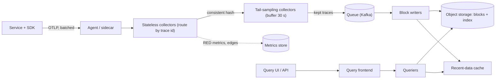

## In one minute
- **Propagate identity, not data.** Every service passes a `traceparent` header ([W3C Trace Context](https://www.w3.org/TR/trace-context/)) with a trace id, the caller's span id and a sampled flag. Each service reports its own spans out of band, and the backend stitches them together by trace id.
- **Sampling is the whole cost model.** Recording every span at millions per second is unaffordable. Head sampling decides at the root, which is cheap but blind. Tail sampling decides after the trace finishes, which keeps the errors and slow traces but needs a stateful buffer.
- **Tail sampling forces trace-aware routing.** All spans of one trace must reach the same decision-making collector, so a stateless tier routes by trace id in front of a stateful tier that buffers.
- **Store traces for lookup by id, search by attribute.** Fetching by trace id is a key lookup on immutable blocks in object storage. Searching by attributes is a columnar scan, not a secondary index on every tag.
- **Protect the application and the pipeline.** Tracing must never slow or crash the service it observes, so exporters are asynchronous with bounded queues that drop on overflow, and the collector sheds load before it falls over.

## Requirements

**Functional**
- Instrument services in several languages and propagate context across HTTP, gRPC and message queues.
- Collect spans from every service and assemble the full trace as a tree, even when spans arrive out of order and from different hosts.
- Fetch a trace by id. Search for traces by service, operation, duration, status and arbitrary attributes in a time range.
- Keep every trace that contains an error or exceeds a latency threshold, plus a small random baseline of the rest.
- Show service dependencies and the critical path of a trace.

**Non-functional**
- Under 1% added CPU and no blocking calls on the request path. A tracing outage must never become a service outage.
- 1M spans per second on average and 2M at peak, with spans visible in search within about a minute.
- Query a trace by id in under 2 seconds. Attribute search over the last hour in under 10 seconds.
- 7 days of full-fidelity traces, then 30 days for kept error and slow traces only.

**Out of scope**: metrics and logging pipelines (we only link to them by trace id), profiling, and the UI.

## Back-of-envelope
Assume 50,000 user requests per second at the edge at peak, each touching about 40 spans across services. The average is half the peak.

- **Spans:** 50,000 × 40 = 2M spans/s at peak, 1M/s average.
- **Wire bytes:** a span with a dozen attributes is about 500 bytes in OTLP protobuf. 2M × 500 B = 1 GB/s, or 8 Gbit/s at peak, before any sampling.
- **If we kept everything:** 1M/s × 500 B × 86,400 s = about 43 TB per day, and about 300 TB for 7 days. That is the number that kills a design that skips sampling.
- **With sampling:** keep roughly 1% baseline, 1% slow and 0.5% errors, so about 2.5% of traces. That is 43 TB × 0.025 = about 1.1 TB/day. Columnar compression of 4:1 gives about 270 GB/day, so about 2 TB for 7 days and 8 TB for 30 days. At object-storage prices that is tens of dollars per month. Compute dominates the bill.
- **Tail buffer:** 25,000 new traces per second on average × a 30 second decision wait = 750,000 traces in memory. At 40 spans × 500 B = 20 KB per trace that is 15 GB of payload, and several times that in a language runtime. Spread it over 20 collectors and each holds about 40,000 traces, close to the OpenTelemetry default of 50,000 ([tail sampling processor](https://github.com/open-telemetry/opentelemetry-collector-contrib/tree/main/processor/tailsamplingprocessor)).
- **Ingest CPU:** if one core handles about 20,000 spans per second (measure your own), 2M spans/s needs about 100 cores at the first tier, before the tail tier and storage writers.

## API
Applications never call the backend directly. They use an SDK that exports over OTLP, and the collector speaks the same protocol ([OTLP spec](https://opentelemetry.io/docs/specs/otlp/)).

```
# Propagation (HTTP header, W3C): version-traceid-parentid-flags
traceparent: 00-4bf92f3577b34da6a3ce929d0e0e4736-00f067aa0ba902b7-01
tracestate:  vendor1=opaque,othervendor=value

# Export (OTLP/gRPC, batched)
rpc Export(ExportTraceServiceRequest) returns (ExportTraceServiceResponse)
  resource_spans[] -> scope_spans[] -> spans[]
    { trace_id(16B), span_id(8B), parent_span_id, name, kind,
      start_time_unix_nano, end_time_unix_nano, attributes[], events[], status }
  response.partial_success { rejected_spans, error_message }

# Query
GET /api/traces/{trace_id}
POST /api/search
  { "q": "{ resource.service.name = \"checkout\" && status = error && duration > 2s }",
    "start": "2026-10-17T10:00:00Z", "end": "2026-10-17T11:00:00Z", "limit": 20 }
  -> [ { trace_id, root_service, root_name, start, duration_ms, span_count } ]
```

## Data model
A span is immutable once it ends, so storage is append-only.

- **Span:** `trace_id` (128-bit), `span_id` (64-bit), `parent_span_id`, `name`, `kind`, `start`, `end`, `status`, resource attributes (`service.name`, `k8s.pod`), span attributes and events.
- **Block:** a batch of spans for a time window, sorted by `trace_id`, written once to object storage as a columnar file with a footer, a trace-id index and a Bloom filter. Tempo's block format is Apache Parquet, which stores attributes in columns so a query reads only the columns it needs ([Tempo architecture](https://grafana.com/docs/tempo/latest/introduction/architecture/)).
- **Partition key:** `trace_id`. Hashing by trace id keeps a whole trace on one node for the tail sampler and writes a trace to one block, so fetch by id touches few files.
- **Secondary data:** a small, separate store of pre-aggregated service-to-service edges and RED metrics, computed in the collector, so dashboards never scan raw spans.
- **Retention:** blocks are named by time range, so expiry is deleting objects, not rewriting data.

## High-level design



**Write path.**
1. The SDK creates a root span, makes the head decision (usually "record everything and mark sampled" or a low-rate probability), and injects `traceparent` into outgoing calls.
2. On span end, the SDK hands the span to a batch processor with a bounded queue. A background thread exports batches to a local agent. A full queue drops spans and increments a counter.
3. The first-tier collectors are stateless. They validate, enrich with resource attributes, compute RED metrics, and forward spans using a load-balancing exporter that hashes the trace id.
4. The tail tier buffers every span of a trace until it is "done", then applies policies: any error, duration over a threshold, a rate limit per service, then a probabilistic baseline.
5. Kept traces go to a queue, and block writers cut sorted, compressed blocks to object storage.

**Read path.**
1. By id: the query frontend looks in the recent-data cache, then asks storage nodes. Each block's Bloom filter rules out most blocks without reading them. Matches are read by range from object storage.
2. By attributes: the frontend splits the time range into jobs, queriers scan only the needed columns in parallel, and results are merged and limited.

## Deep dives

### 1. Head versus tail sampling
**Head sampling** decides when the root span starts, from the trace id or a fixed rate. It is nearly free and the decision travels in the sampled flag, so every service agrees. Its flaw is that it cannot know the outcome: an error that appears in the fifth span of a 1% sampled trace is lost 99% of the time, and OpenTelemetry's own guide says tail sampling is the answer when you must keep every error ([OpenTelemetry sampling](https://opentelemetry.io/docs/concepts/sampling/)).

**Tail sampling** decides after the trace is complete. It sees errors, latency and the whole shape, but each trace must be held in memory until the last span arrives, and "last" is unknowable. A `decision_wait` timer (default 30 seconds in the OpenTelemetry processor) is the guess. A late span either finds the decision already made or arrives after a trace was dropped.

**Choice:** both. Head-sample generously, for example record everything when the cost allows, or at 10 to 25% when it does not, and tail-sample for the keep decision. Drop most healthy, fast traces; keep all errors and slow traces. Make the baseline deterministic from the trace id: compare a hash of the id to a threshold. Every collector that sees the same id then agrees, and raising the rate only adds traces. OpenTelemetry's probability-sampling work encodes that threshold in `tracestate` so downstream components know the effective rate and can weight counts ([spec](https://opentelemetry.io/docs/specs/otel/trace/tracestate-probability-sampling/)).

### 2. Making the tail sampler scale
The tail sampler is stateful, and the documentation is blunt: all spans for a trace must reach the same collector instance ([README](https://github.com/open-telemetry/opentelemetry-collector-contrib/tree/main/processor/tailsamplingprocessor)). Two tiers solve this. A stateless tier receives spans from anywhere and uses a consistent hash on `trace_id` to choose a tail node. Consistent hashing matters because when a tail node joins or dies, only about 1/N of traces move. The traces in flight during the change get split across two nodes and make bad decisions, and you accept that and measure it.

Memory is the limit. The buffer holds `num_traces` traces, evicts the oldest when full, and every eviction is a trace decided too early. Alert on evictions, because they silently degrade the "keep every error" promise. Keep a small cache of recent decisions so late spans of an already-kept trace are forwarded and late spans of a dropped trace are discarded cheaply.

Alternatives: keep the buffer out of process by writing every span to a log keyed by trace id and deciding at read or compaction time. That costs 40 TB/day of writes, which is the cost we are avoiding.

### 3. Storage and query
Two queries with opposite shapes. **By trace id** is a point lookup, so blocks are sorted by trace id and carry a Bloom filter. A 1% false-positive filter for 100 million ids needs about 120 MB, small enough to cache. **By attributes** is a search, and the temptation is an inverted index on every tag. At 2 attributes × 40 spans × 25,000 traces per second that index would be larger and busier than the data, and attribute cardinality is unbounded (user ids, URLs).

The alternative is a columnar block format: each attribute is a column, with dictionary encoding and a min/max per row group, so a query on `status = error AND service = checkout` reads two columns and skips row groups by statistics. Cost scales with time range, not with trace count, and parallelism comes from splitting a range into many row-group jobs. This is the design Tempo uses; Jaeger's older Elasticsearch and Cassandra backends instead index chosen tags, which gives faster narrow queries but a heavy write and storage bill ([Jaeger architecture](https://www.jaegertracing.io/docs/latest/architecture/)).

To keep the last minute searchable, writers also keep recent spans in memory or a local WAL, and queriers merge that with object storage.

## Down the stack

### Layer 1: The contract
- **Propagation:** `traceparent` is `version-traceid-parentid-flags`, 55 characters for version `00`: a 32 hex trace id, a 16 hex parent id, and 2 hex flags. All-zero ids and version `ff` are invalid, and uppercase hex is not allowed ([W3C Trace Context](https://www.w3.org/TR/trace-context/#traceparent-header-field-values)). A service that cannot parse the header starts a new trace.
- **The sampled flag** is the least significant bit of the flags byte. It means the caller may have recorded data, and a component that defers its decision should propagate it unchanged.
- **Delivery:** spans are best effort. We promise that kept traces are complete to within the decision window, not that every span is stored. Missing spans appear as gaps, and the UI marks an orphan whose parent never arrived.
- **Freshness:** a kept trace is searchable within about 60 seconds: 30 for the decision wait plus block cut time.

### Layer 2: The mechanism
- **SDK:** a `TracerProvider` holds a sampler and a span processor. The `BatchSpanProcessor` has a bounded queue, a batch size and a scheduled delay, and it exports from its own thread ([OpenTelemetry SDK spec](https://opentelemetry.io/docs/specs/otel/trace/sdk/)). The sampler runs at span start, so a non-recording span costs almost nothing.
- **Collector:** receivers, processors and exporters wired into pipelines. A memory limiter processor refuses data when the process nears its limit, and the refusal turns into back-pressure to the sender ([Collector architecture](https://opentelemetry.io/docs/collector/architecture/)).
- **Tail sampler policies:** `status_code`, `latency` (duration from the earliest start to the latest end), `rate_limiting` and probabilistic, combined with OR logic. A trace is kept if any policy keeps it.
- **Writers:** sort by trace id, build row groups, write the footer, Bloom filter and index, then upload with a single multi-part put. Compaction merges small blocks and removes duplicates, because retried exports can deliver the same span twice and `(trace_id, span_id)` identifies it.

### Layer 3: The machine
- **Hot path:** starting and ending a span is a few allocations, two clock reads (about 20 to 50 ns each with the vDSO) and a lock-free enqueue, well under a microsecond. Dapper measured the cost of tracing every request as 16.3% added latency in a web search cluster, but rates below 1 in 16 were within experimental error ([Dapper paper](https://static.googleusercontent.com/media/research.google.com/en//archive/papers/dapper-2010-1.pdf)). Modern SDKs are cheaper, yet the lesson holds: a recorded span is much costlier than an unrecorded one.
- **Wire:** a batch of 512 spans at 500 B is 256 KB, which fits in one gRPC message and amortises TCP and TLS cost. gzip or zstd shrinks span data about 5 to 10 times because names and attribute keys repeat.
- **Collector memory:** Go-based collectors allocate heavily and the GC runs concurrently, so the heap needs headroom, often 2x the live set, and a memory limit set below the container limit to avoid OOM kills.
- **Object storage:** a GET has a first-byte latency of tens of milliseconds, so reading a trace means a few ranged GETs (footer, index, row group), around 100 to 300 ms with caching of footers and Bloom filters.

### Why it's built this way
1. Tracing every request is too expensive for the application and the budget, so we sample.
2. Head sampling cannot see failures that happen later, so the valuable decision moves to the tail.
3. The tail decision needs a whole trace in one place, so spans are routed by trace id into a memory buffer.
4. Memory and wait time are bounded, so decisions are approximate, late spans are handled with a cache and evictions are monitored.
5. Kept data is immutable and queried by time, so it fits large sorted columnar blocks in object storage rather than a database with secondary indexes.

## Failure modes
- **10x traffic spike:** tail buffers fill and evict. Mitigation: a memory limiter that sheds new traces cleanly, head-sample down at the SDK through remote config, and keep error policies ahead of baseline ones. A hot service that emits 1,000-span traces gets a per-trace span cap.
- **Collector or tail node loss:** the hash ring remaps traces in flight. Only about 1/N are affected. Mitigation: run with spare capacity, drain nodes before restart, and use a short decision wait for high-volume services.
- **Hot trace id:** a retry storm or batch job puts millions of spans under one trace id, overloading one tail node and one block. Mitigation: cap spans per trace, and split such jobs into linked traces using span links rather than one parent.
- **Backend outage or slow object storage:** the queue absorbs minutes of data, then writers lag. Keep the queue sized for a few hours and drop the oldest baseline traces before error traces.
- **Region outage:** each region has its own full pipeline and storage, because cross-region span traffic at 8 Gbit/s is too costly. A global query fans out to regional query frontends. A trace that crosses regions is stored in two places and joined at query time.
- **Clock skew:** child spans appear to start before parents. Display by parent links, not timestamps, and flag skew rather than rewriting.
- **Cardinality bomb:** a developer puts a user id into the span name, and the name index explodes. Limit name cardinality in the collector and push high-cardinality values into attributes.

## In the wild
- **Google, 2010: Dapper and the cost of sampling.** In a web search cluster, tracing every request raised average latency by 16.3%, while rates below 1 in 16 were within experimental error. Production defaulted to 1 in 1,024, which was enough for high-volume services but missed events in low-traffic ones, so Google moved toward adaptive sampling by target rate; the collection daemon never used more than 0.3% of one core ([Dapper paper](https://static.googleusercontent.com/media/research.google.com/en//archive/papers/dapper-2010-1.pdf)).
- **Slack, 2020: traces as queryable rows.** Slack flattened spans into a simple SpanEvent record and ingested about 310 million traces and 8.5 billion spans per day (around 2 Tb of trace data, as the post states it) into Honeycomb and a Presto warehouse. Most services sampled at 1 to 2% while low-volume ones kept 100%, and a slash command could trace every request from one client for two minutes ([Slack Engineering](https://slack.engineering/tracing-at-slack-thinking-in-causal-graphs/)).
- **Honeycomb, 2025: the telemetry pipeline is itself a production system.** Honeycomb's EU Kafka cluster lost redundancy and about a quarter of event partitions had no leader. Unbalanced brokers filled their disks and ingest was switched off with under 5% disk left. Customers saw about 6 hours of full ingest outage and about 18 hours of delayed SLO processing, and the fix was a rehearsed evacuation to a new cluster ([Honeycomb status page](https://status.honeycomb.io/incidents/pjzh0mtqw3vt)).

## Trade-offs

| Option | Strengths | Weaknesses | Choose when |
|---|---|---|---|
| Head sampling only | No buffering, constant cost, consistent across services | Misses rare errors and slow outliers | Very high volume, cost matters more than completeness |
| Tail sampling | Keeps every error and slow trace | Stateful, memory heavy, needs trace-id routing, approximate under churn | Failures must always be debuggable |
| Tag-indexed store (Elasticsearch, Cassandra) | Fast narrow queries on chosen tags | Large write amplification, cardinality limits | Small volume or a fixed set of search tags |
| Columnar blocks on object storage | Cheap, any attribute searchable, scales with parallel scans | Search is a scan, slower for a very selective query | Large volume with free-form attribute search |
| Spans to a queue, decide at write | Absorbs bursts, replayable | Pays to ship and store all spans first | Moderate volume with bursty load |
| Generate metrics from all spans | Accurate RED metrics despite sampling | Extra CPU at the collector | Dashboards and alerts depend on span data |

## Leadership lens
- **Rollout:** start with a library and a collector for one critical request path, 100% sampled at low volume. Add propagation through gateways and queues next, since a single service that drops the header breaks every trace through it. Add tail sampling only when the bill or the volume forces it.
- **Ownership:** the platform team owns the pipeline, SDK defaults and sampling policy. Service teams own naming and attributes. Publish a short convention: low-cardinality span names, no personal data in attributes.
- **Cost drivers:** spans per request (instrumentation depth), the kept fraction, retention, and collector compute. Show each team its own span volume. Cost per team changes behaviour faster than a policy document.
- **Questions for design review:** What happens to a trace when one service does not propagate? What is the eviction rate in the tail tier? Which attributes can contain personal data, and who scrubs them? How do you know that sampling kept all errors?
- **Build first:** propagation plus a single-tier collector writing to object storage, then metrics from spans, then the tail tier.

## Check yourself
1. A service's error rate is 0.2%, and you head-sample at 1%. What fraction of failing requests produce a stored trace, and what changes with tail sampling?
   **Answer:** About 1% of them, because the decision is independent of the outcome, so 99% of errors are invisible. Tail sampling keeps all of them, at the cost of buffering every trace until it finishes.
2. Why must the tail-sampling tier be fed by a router that hashes on trace id?
   **Answer:** A policy such as "keep if any span has an error" is only right if one node sees every span of the trace. Without trace-id routing, each node sees a fragment and makes inconsistent decisions, so kept traces are incomplete.
3. Why store traces in Bloom-filtered blocks sorted by trace id rather than indexing every attribute?
   **Answer:** Fetching by id needs only a point lookup, which the sort order and Bloom filters give cheaply. A tag index would cost more to write than the data itself, and attribute cardinality is unbounded, so attribute search uses column scans.
4. At 1M spans per second and 500 bytes per span, how much do you ingest per day, and how much do you store with 2.5% kept and 4:1 compression?
   **Answer:** 1M × 500 B × 86,400 = about 43 TB/day ingested. Keeping 2.5% gives about 1.1 TB, and compression gives about 270 GB/day.

## Practice
**Task:** Implement the sampling core of a trace pipeline, driven by an injected clock in milliseconds.
- `parse_traceparent(header)` returns the trace id, parent id and sampled flag, or nothing when the header is invalid: version `00` needs exactly four dash-separated fields, a 32 hex trace id that is not all zeros, a 16 hex parent id that is not all zeros, 2 hex flags, lowercase hex only, and version `ff` is never valid. The sampled flag is the lowest bit of the flags.
- `head_sample(trace_id, rate)` is deterministic: keep when the integer value of the last 14 hex digits of the trace id is below `rate × 2^56`. Rate 0 keeps nothing and rate 1 keeps everything.
- `TailSampler(wait_ms, max_traces, slow_ms, baseline_rate, clock)` buffers spans by trace id. `add(span)` returns nothing while the trace is buffered, and the final keep or drop decision once the trace has been decided. A new trace arriving when `max_traces` traces are buffered evicts the oldest, which counts in `evicted` and is decided as dropped.
- `flush()` decides every trace whose first span arrived at least `wait_ms` ago, oldest first. A trace is kept with reason `error` if any span has an error, else `slow` if its duration (latest end minus earliest start) is at least `slow_ms`, else `baseline` if `head_sample(trace_id, baseline_rate)` is true. Otherwise it is dropped. It returns only the kept traces, each with its spans in arrival order.

```python starter
from dataclasses import dataclass


@dataclass
class Span:
    trace_id: str
    span_id: str
    start: int
    end: int
    error: bool = False


def parse_traceparent(header):
    # TODO: return (trace_id, parent_id, sampled) or None
    raise NotImplementedError


def head_sample(trace_id, rate):
    # TODO
    raise NotImplementedError


class TailSampler:
    def __init__(self, wait_ms, max_traces, slow_ms, baseline_rate, clock):
        self.evicted = 0

    def add(self, span):
        # TODO: None while buffered, else the stored decision (True/False)
        raise NotImplementedError

    def flush(self):
        # TODO: list of (trace_id, reason, spans) for kept traces
        raise NotImplementedError
```

```python tests
class FakeClock:
    def __init__(self):
        self.now = 0

    def __call__(self):
        return self.now


def tid(n):
    return "%032x" % n


def sp(t, sid, start, end, error=False):
    return Span(tid(t), sid, start, end, error)


def test_parse_valid():
    h = "00-4bf92f3577b34da6a3ce929d0e0e4736-00f067aa0ba902b7-01"
    assert parse_traceparent(h) == ("4bf92f3577b34da6a3ce929d0e0e4736", "00f067aa0ba902b7", True)
    h0 = "00-4bf92f3577b34da6a3ce929d0e0e4736-00f067aa0ba902b7-00"
    assert parse_traceparent(h0)[2] is False
    h2 = "00-4bf92f3577b34da6a3ce929d0e0e4736-00f067aa0ba902b7-03"
    assert parse_traceparent(h2)[2] is True


def test_parse_invalid():
    good = "00-4bf92f3577b34da6a3ce929d0e0e4736-00f067aa0ba902b7-01"
    assert parse_traceparent(good) is not None
    bad = [
        "",
        "00-4bf92f3577b34da6a3ce929d0e0e4736-00f067aa0ba902b7",
        "00-4bf92f3577b34da6a3ce929d0e0e4736-00f067aa0ba902b7-01-extra",
        "ff-4bf92f3577b34da6a3ce929d0e0e4736-00f067aa0ba902b7-01",
        "00-00000000000000000000000000000000-00f067aa0ba902b7-01",
        "00-4bf92f3577b34da6a3ce929d0e0e4736-0000000000000000-01",
        "00-4BF92F3577B34DA6A3CE929D0E0E4736-00f067aa0ba902b7-01",
        "00-4bf92f3577b34da6a3ce929d0e0e47-00f067aa0ba902b7-01",
        "00-4bf92f3577b34da6a3ce929d0e0e4736-00f067aa0ba902b7-1",
    ]
    for h in bad:
        assert parse_traceparent(h) is None, h


def test_head_sample_is_deterministic_and_proportional():
    ids = ["%032x" % (i * (1 << 56) // 100) for i in range(100)]
    kept = [t for t in ids if head_sample(t, 0.25)]
    assert len(kept) == 25
    assert kept == ids[:25], "the decision depends only on the id"
    assert not head_sample(ids[0], 0)
    assert all(head_sample(t, 1) for t in ids)
    assert all(head_sample(t, 0.5) for t in kept), "raising the rate only adds traces"


def test_tail_keeps_error_after_wait():
    c = FakeClock()
    s = TailSampler(1000, 100, 500, 0.0, c)
    assert s.add(sp(1, "a", 0, 100)) is None
    c.now = 10
    assert s.add(sp(1, "b", 10, 50, True)) is None
    c.now = 999
    assert s.flush() == []
    c.now = 1000
    out = s.flush()
    assert len(out) == 1
    assert out[0][0] == tid(1) and out[0][1] == "error"
    assert [x.span_id for x in out[0][2]] == ["a", "b"]
    assert s.flush() == [], "decided traces are not returned twice"


def test_tail_slow_and_priority():
    c = FakeClock()
    s = TailSampler(100, 100, 500, 0.0, c)
    s.add(sp(1, "a", 0, 100))
    s.add(sp(1, "b", 50, 600))
    s.add(sp(2, "a", 0, 499))
    s.add(sp(3, "a", 0, 900, True))
    c.now = 100
    out = s.flush()
    assert [(o[0], o[1]) for o in out] == [(tid(1), "slow"), (tid(3), "error")]


def test_tail_baseline():
    c = FakeClock()
    s = TailSampler(100, 100, 500, 1.0, c)
    s.add(sp(7, "a", 0, 10))
    c.now = 100
    out = s.flush()
    assert [(o[0], o[1]) for o in out] == [(tid(7), "baseline")]


def test_late_spans_get_stored_decision():
    c = FakeClock()
    s = TailSampler(100, 100, 500, 0.0, c)
    s.add(sp(1, "a", 0, 10, True))
    s.add(sp(2, "a", 0, 10))
    c.now = 100
    assert len(s.flush()) == 1
    assert s.add(sp(1, "late", 90, 120)) is True
    assert s.add(sp(2, "late", 90, 120)) is False
    assert s.add(sp(3, "new", 100, 120)) is None


def test_eviction_drops_oldest():
    c = FakeClock()
    s = TailSampler(100, 2, 500, 0.0, c)
    s.add(sp(1, "a", 0, 10, True))
    c.now = 1
    s.add(sp(2, "a", 0, 10, True))
    c.now = 2
    s.add(sp(3, "a", 0, 10, True))
    assert s.evicted == 1
    assert s.add(sp(1, "b", 5, 6, True)) is False
    c.now = 200
    assert [o[0] for o in s.flush()] == [tid(2), tid(3)]
```

```python solution
from dataclasses import dataclass

_HEX = set("0123456789abcdef")


@dataclass
class Span:
    trace_id: str
    span_id: str
    start: int
    end: int
    error: bool = False


def _hex(s, n):
    return len(s) == n and all(ch in _HEX for ch in s)


def parse_traceparent(header):
    parts = header.split("-")
    if len(parts) < 4:
        return None
    version, tid, pid, flags = parts[0], parts[1], parts[2], parts[3]
    if not _hex(version, 2) or version == "ff":
        return None
    if version == "00" and len(parts) != 4:
        return None
    if not _hex(tid, 32) or tid == "0" * 32:
        return None
    if not _hex(pid, 16) or pid == "0" * 16:
        return None
    if not _hex(flags, 2):
        return None
    return (tid, pid, (int(flags, 16) & 1) == 1)


def head_sample(trace_id, rate):
    if rate <= 0:
        return False
    low = int(trace_id[-14:], 16)
    return low < int(rate * (1 << 56))


class TailSampler:
    def __init__(self, wait_ms, max_traces, slow_ms, baseline_rate, clock):
        self.wait_ms = wait_ms
        self.max_traces = max_traces
        self.slow_ms = slow_ms
        self.baseline_rate = baseline_rate
        self.clock = clock
        self.pending = {}
        self.decided = {}
        self.evicted = 0

    def add(self, span):
        t = span.trace_id
        if t in self.decided:
            return self.decided[t]
        if t not in self.pending:
            if len(self.pending) >= self.max_traces:
                oldest = next(iter(self.pending))
                del self.pending[oldest]
                self.decided[oldest] = False
                self.evicted += 1
            self.pending[t] = [self.clock(), []]
        self.pending[t][1].append(span)
        return None

    def _reason(self, trace_id, spans):
        if any(s.error for s in spans):
            return "error"
        duration = max(s.end for s in spans) - min(s.start for s in spans)
        if duration >= self.slow_ms:
            return "slow"
        if head_sample(trace_id, self.baseline_rate):
            return "baseline"
        return None

    def flush(self):
        now = self.clock()
        out = []
        for t in list(self.pending):
            first, spans = self.pending[t]
            if now - first < self.wait_ms:
                break
            del self.pending[t]
            reason = self._reason(t, spans)
            self.decided[t] = reason is not None
            if reason is not None:
                out.append((t, reason, spans))
        return out
```

```typescript starter
export interface Span {
  traceId: string;
  spanId: string;
  start: number;
  end: number;
  error: boolean;
}

export interface Kept {
  traceId: string;
  reason: string;
  spans: Span[];
}

export type Clock = () => number;

export function parseTraceparent(
  header: string
): { traceId: string; parentId: string; sampled: boolean } | null {
  // TODO
  throw new Error("TODO");
}

export function headSample(traceId: string, rate: number): boolean {
  // TODO
  throw new Error("TODO");
}

export class TailSampler {
  evicted = 0;

  constructor(
    waitMs: number,
    maxTraces: number,
    slowMs: number,
    baselineRate: number,
    clock: Clock
  ) {}

  add(span: Span): boolean | null {
    // TODO: null while buffered, else the stored decision
    throw new Error("TODO");
  }

  flush(): Kept[] {
    // TODO
    throw new Error("TODO");
  }
}
```

```typescript tests
function fakeClock(): { now: number; fn: Clock } {
  const c = { now: 0, fn: (): number => c.now };
  return c;
}

function tid(n: number): string {
  return n.toString(16).padStart(32, "0");
}

function sp(t: number, id: string, start: number, end: number, error = false): Span {
  return { traceId: tid(t), spanId: id, start, end, error };
}

test("parse valid", () => {
  const h = "00-4bf92f3577b34da6a3ce929d0e0e4736-00f067aa0ba902b7-01";
  assertEqual(parseTraceparent(h), {
    traceId: "4bf92f3577b34da6a3ce929d0e0e4736",
    parentId: "00f067aa0ba902b7",
    sampled: true,
  });
  const h0 = "00-4bf92f3577b34da6a3ce929d0e0e4736-00f067aa0ba902b7-00";
  assertEqual(parseTraceparent(h0)!.sampled, false);
  const h2 = "00-4bf92f3577b34da6a3ce929d0e0e4736-00f067aa0ba902b7-03";
  assertEqual(parseTraceparent(h2)!.sampled, true);
});

test("parse invalid", () => {
  const good = "00-4bf92f3577b34da6a3ce929d0e0e4736-00f067aa0ba902b7-01";
  assert(parseTraceparent(good) !== null, "good header");
  const bad = [
    "",
    "00-4bf92f3577b34da6a3ce929d0e0e4736-00f067aa0ba902b7",
    "00-4bf92f3577b34da6a3ce929d0e0e4736-00f067aa0ba902b7-01-extra",
    "ff-4bf92f3577b34da6a3ce929d0e0e4736-00f067aa0ba902b7-01",
    "00-00000000000000000000000000000000-00f067aa0ba902b7-01",
    "00-4bf92f3577b34da6a3ce929d0e0e4736-0000000000000000-01",
    "00-4BF92F3577B34DA6A3CE929D0E0E4736-00f067aa0ba902b7-01",
    "00-4bf92f3577b34da6a3ce929d0e0e47-00f067aa0ba902b7-01",
    "00-4bf92f3577b34da6a3ce929d0e0e4736-00f067aa0ba902b7-1",
  ];
  for (const h of bad) {
    assert(parseTraceparent(h) === null, h);
  }
});

test("head sample is deterministic and proportional", () => {
  const ids: string[] = [];
  for (let i = 0; i < 100; i++) {
    ids.push(((BigInt(i) * (1n << 56n)) / 100n).toString(16).padStart(32, "0"));
  }
  const kept = ids.filter((t) => headSample(t, 0.25));
  assertEqual(kept.length, 25);
  assertEqual(kept, ids.slice(0, 25), "depends only on the id");
  assert(!headSample(ids[0], 0), "rate 0");
  assert(ids.every((t) => headSample(t, 1)), "rate 1");
  assert(kept.every((t) => headSample(t, 0.5)), "raising the rate only adds traces");
});

test("tail keeps error after wait", () => {
  const c = fakeClock();
  const s = new TailSampler(1000, 100, 500, 0, c.fn);
  assertEqual(s.add(sp(1, "a", 0, 100)), null);
  c.now = 10;
  assertEqual(s.add(sp(1, "b", 10, 50, true)), null);
  c.now = 999;
  assertEqual(s.flush().length, 0, "too early");
  c.now = 1000;
  const out = s.flush();
  assertEqual(out.length, 1);
  assertEqual(out[0].traceId, tid(1));
  assertEqual(out[0].reason, "error");
  assertEqual(out[0].spans.map((x) => x.spanId), ["a", "b"]);
  assertEqual(s.flush().length, 0, "not returned twice");
});

test("tail slow and priority", () => {
  const c = fakeClock();
  const s = new TailSampler(100, 100, 500, 0, c.fn);
  s.add(sp(1, "a", 0, 100));
  s.add(sp(1, "b", 50, 600));
  s.add(sp(2, "a", 0, 499));
  s.add(sp(3, "a", 0, 900, true));
  c.now = 100;
  assertEqual(s.flush().map((o) => [o.traceId, o.reason]), [
    [tid(1), "slow"],
    [tid(3), "error"],
  ]);
});

test("tail baseline", () => {
  const c = fakeClock();
  const s = new TailSampler(100, 100, 500, 1, c.fn);
  s.add(sp(7, "a", 0, 10));
  c.now = 100;
  assertEqual(s.flush().map((o) => [o.traceId, o.reason]), [[tid(7), "baseline"]]);
});

test("late spans get the stored decision", () => {
  const c = fakeClock();
  const s = new TailSampler(100, 100, 500, 0, c.fn);
  s.add(sp(1, "a", 0, 10, true));
  s.add(sp(2, "a", 0, 10));
  c.now = 100;
  assertEqual(s.flush().length, 1);
  assertEqual(s.add(sp(1, "late", 90, 120)), true);
  assertEqual(s.add(sp(2, "late", 90, 120)), false);
  assertEqual(s.add(sp(3, "new", 100, 120)), null);
});

test("eviction drops the oldest", () => {
  const c = fakeClock();
  const s = new TailSampler(100, 2, 500, 0, c.fn);
  s.add(sp(1, "a", 0, 10, true));
  c.now = 1;
  s.add(sp(2, "a", 0, 10, true));
  c.now = 2;
  s.add(sp(3, "a", 0, 10, true));
  assertEqual(s.evicted, 1);
  assertEqual(s.add(sp(1, "b", 5, 6, true)), false);
  c.now = 200;
  assertEqual(s.flush().map((o) => o.traceId), [tid(2), tid(3)]);
});
```

```typescript solution
export interface Span {
  traceId: string;
  spanId: string;
  start: number;
  end: number;
  error: boolean;
}

export interface Kept {
  traceId: string;
  reason: string;
  spans: Span[];
}

export type Clock = () => number;

function isHex(s: string, n: number): boolean {
  return s.length === n && /^[0-9a-f]+$/.test(s);
}

export function parseTraceparent(
  header: string
): { traceId: string; parentId: string; sampled: boolean } | null {
  const parts = header.split("-");
  if (parts.length < 4) return null;
  const [version, traceId, parentId, flags] = parts;
  if (!isHex(version, 2) || version === "ff") return null;
  if (version === "00" && parts.length !== 4) return null;
  if (!isHex(traceId, 32) || /^0+$/.test(traceId)) return null;
  if (!isHex(parentId, 16) || /^0+$/.test(parentId)) return null;
  if (!isHex(flags, 2)) return null;
  return { traceId, parentId, sampled: (parseInt(flags, 16) & 1) === 1 };
}

export function headSample(traceId: string, rate: number): boolean {
  if (rate <= 0) return false;
  const low = BigInt("0x" + traceId.slice(-14));
  const threshold = BigInt(Math.floor(rate * 2 ** 56));
  return low < threshold;
}

export class TailSampler {
  evicted = 0;
  private pending = new Map<string, { first: number; spans: Span[] }>();
  private decided = new Map<string, boolean>();

  constructor(
    private waitMs: number,
    private maxTraces: number,
    private slowMs: number,
    private baselineRate: number,
    private clock: Clock
  ) {}

  add(span: Span): boolean | null {
    const t = span.traceId;
    const d = this.decided.get(t);
    if (d !== undefined) return d;
    let entry = this.pending.get(t);
    if (entry === undefined) {
      if (this.pending.size >= this.maxTraces) {
        const oldest = this.pending.keys().next().value as string;
        this.pending.delete(oldest);
        this.decided.set(oldest, false);
        this.evicted++;
      }
      entry = { first: this.clock(), spans: [] };
      this.pending.set(t, entry);
    }
    entry.spans.push(span);
    return null;
  }

  private reason(traceId: string, spans: Span[]): string | null {
    if (spans.some((s) => s.error)) return "error";
    const duration =
      Math.max(...spans.map((s) => s.end)) - Math.min(...spans.map((s) => s.start));
    if (duration >= this.slowMs) return "slow";
    if (headSample(traceId, this.baselineRate)) return "baseline";
    return null;
  }

  flush(): Kept[] {
    const now = this.clock();
    const out: Kept[] = [];
    for (const [t, entry] of Array.from(this.pending.entries())) {
      if (now - entry.first < this.waitMs) break;
      this.pending.delete(t);
      const reason = this.reason(t, entry.spans);
      this.decided.set(t, reason !== null);
      if (reason !== null) out.push({ traceId: t, reason, spans: entry.spans });
    }
    return out;
  }
}
```

```go starter
package practice

type Span struct {
	TraceID string
	SpanID  string
	Start   int64
	End     int64
	Error   bool
}

type Kept struct {
	TraceID string
	Reason  string
	Spans   []Span
}

type Clock func() int64

// ParseTraceparent returns ok=false for an invalid header.
func ParseTraceparent(h string) (traceID, parentID string, sampled, ok bool) {
	panic("TODO")
}

func HeadSample(traceID string, rate float64) bool {
	panic("TODO")
}

type TailSampler struct{}

func NewTailSampler(waitMs int64, maxTraces int, slowMs int64, baselineRate float64, clock Clock) *TailSampler {
	return &TailSampler{}
}

// Add returns decided=false while the trace is buffered, else the stored decision in keep.
func (s *TailSampler) Add(sp Span) (decided, keep bool) {
	panic("TODO")
}

func (s *TailSampler) Flush() []Kept {
	panic("TODO")
}

func (s *TailSampler) Evicted() int {
	panic("TODO")
}
```

```go tests
package practice

import (
	"fmt"
	"testing"
)

type fakeClock struct{ now int64 }

func (c *fakeClock) fn() int64 { return c.now }

func tid(n uint64) string { return fmt.Sprintf("%032x", n) }

func sp(t uint64, id string, start, end int64, err bool) Span {
	return Span{TraceID: tid(t), SpanID: id, Start: start, End: end, Error: err}
}

func TestParseValid(t *testing.T) {
	tr, p, s, ok := ParseTraceparent("00-4bf92f3577b34da6a3ce929d0e0e4736-00f067aa0ba902b7-01")
	if !ok || tr != "4bf92f3577b34da6a3ce929d0e0e4736" || p != "00f067aa0ba902b7" || !s {
		t.Fatalf("got %v %v %v %v", tr, p, s, ok)
	}
	_, _, s, ok = ParseTraceparent("00-4bf92f3577b34da6a3ce929d0e0e4736-00f067aa0ba902b7-00")
	if !ok || s {
		t.Fatalf("flag 00 should be unsampled")
	}
	_, _, s, ok = ParseTraceparent("00-4bf92f3577b34da6a3ce929d0e0e4736-00f067aa0ba902b7-03")
	if !ok || !s {
		t.Fatalf("flag 03 has the sampled bit")
	}
}

func TestParseInvalid(t *testing.T) {
	bad := []string{
		"",
		"00-4bf92f3577b34da6a3ce929d0e0e4736-00f067aa0ba902b7",
		"00-4bf92f3577b34da6a3ce929d0e0e4736-00f067aa0ba902b7-01-extra",
		"ff-4bf92f3577b34da6a3ce929d0e0e4736-00f067aa0ba902b7-01",
		"00-00000000000000000000000000000000-00f067aa0ba902b7-01",
		"00-4bf92f3577b34da6a3ce929d0e0e4736-0000000000000000-01",
		"00-4BF92F3577B34DA6A3CE929D0E0E4736-00f067aa0ba902b7-01",
		"00-4bf92f3577b34da6a3ce929d0e0e47-00f067aa0ba902b7-01",
		"00-4bf92f3577b34da6a3ce929d0e0e4736-00f067aa0ba902b7-1",
	}
	for _, h := range bad {
		if _, _, _, ok := ParseTraceparent(h); ok {
			t.Fatalf("accepted %q", h)
		}
	}
}

func TestHeadSample(t *testing.T) {
	ids := make([]string, 100)
	for i := range ids {
		ids[i] = fmt.Sprintf("%032x", uint64(i)*(1<<56)/100)
	}
	kept := 0
	for i, id := range ids {
		k := HeadSample(id, 0.25)
		if k != (i < 25) {
			t.Fatalf("id %d: got %v", i, k)
		}
		if k {
			kept++
			if !HeadSample(id, 0.5) {
				t.Fatalf("raising the rate must only add traces")
			}
		}
		if HeadSample(id, 0) || !HeadSample(id, 1) {
			t.Fatalf("rate 0 and 1 are absolute")
		}
	}
	if kept != 25 {
		t.Fatalf("kept %d", kept)
	}
}

func TestTailKeepsErrorAfterWait(t *testing.T) {
	c := &fakeClock{}
	s := NewTailSampler(1000, 100, 500, 0, c.fn)
	if d, _ := s.Add(sp(1, "a", 0, 100, false)); d {
		t.Fatal("buffered")
	}
	c.now = 10
	s.Add(sp(1, "b", 10, 50, true))
	c.now = 999
	if len(s.Flush()) != 0 {
		t.Fatal("too early")
	}
	c.now = 1000
	out := s.Flush()
	if len(out) != 1 || out[0].TraceID != tid(1) || out[0].Reason != "error" {
		t.Fatalf("got %+v", out)
	}
	if len(out[0].Spans) != 2 || out[0].Spans[0].SpanID != "a" || out[0].Spans[1].SpanID != "b" {
		t.Fatalf("spans %+v", out[0].Spans)
	}
	if len(s.Flush()) != 0 {
		t.Fatal("returned twice")
	}
}

func TestTailSlowAndPriority(t *testing.T) {
	c := &fakeClock{}
	s := NewTailSampler(100, 100, 500, 0, c.fn)
	s.Add(sp(1, "a", 0, 100, false))
	s.Add(sp(1, "b", 50, 600, false))
	s.Add(sp(2, "a", 0, 499, false))
	s.Add(sp(3, "a", 0, 900, true))
	c.now = 100
	out := s.Flush()
	if len(out) != 2 || out[0].TraceID != tid(1) || out[0].Reason != "slow" ||
		out[1].TraceID != tid(3) || out[1].Reason != "error" {
		t.Fatalf("got %+v", out)
	}
}

func TestTailBaseline(t *testing.T) {
	c := &fakeClock{}
	s := NewTailSampler(100, 100, 500, 1, c.fn)
	s.Add(sp(7, "a", 0, 10, false))
	c.now = 100
	out := s.Flush()
	if len(out) != 1 || out[0].Reason != "baseline" {
		t.Fatalf("got %+v", out)
	}
}

func TestLateSpansGetStoredDecision(t *testing.T) {
	c := &fakeClock{}
	s := NewTailSampler(100, 100, 500, 0, c.fn)
	s.Add(sp(1, "a", 0, 10, true))
	s.Add(sp(2, "a", 0, 10, false))
	c.now = 100
	if len(s.Flush()) != 1 {
		t.Fatal("one kept")
	}
	if d, k := s.Add(sp(1, "late", 90, 120, false)); !d || !k {
		t.Fatal("late span of kept trace")
	}
	if d, k := s.Add(sp(2, "late", 90, 120, false)); !d || k {
		t.Fatal("late span of dropped trace")
	}
	if d, _ := s.Add(sp(3, "new", 100, 120, false)); d {
		t.Fatal("new trace is buffered")
	}
}

func TestEvictionDropsOldest(t *testing.T) {
	c := &fakeClock{}
	s := NewTailSampler(100, 2, 500, 0, c.fn)
	s.Add(sp(1, "a", 0, 10, true))
	c.now = 1
	s.Add(sp(2, "a", 0, 10, true))
	c.now = 2
	s.Add(sp(3, "a", 0, 10, true))
	if s.Evicted() != 1 {
		t.Fatalf("evicted %d", s.Evicted())
	}
	if d, k := s.Add(sp(1, "b", 5, 6, true)); !d || k {
		t.Fatal("evicted trace is decided as dropped")
	}
	c.now = 200
	out := s.Flush()
	if len(out) != 2 || out[0].TraceID != tid(2) || out[1].TraceID != tid(3) {
		t.Fatalf("got %+v", out)
	}
}
```

```go solution
package practice

import (
	"strconv"
	"strings"
)

type Span struct {
	TraceID string
	SpanID  string
	Start   int64
	End     int64
	Error   bool
}

type Kept struct {
	TraceID string
	Reason  string
	Spans   []Span
}

type Clock func() int64

func isHex(s string, n int) bool {
	if len(s) != n {
		return false
	}
	for _, ch := range s {
		if !(ch >= '0' && ch <= '9' || ch >= 'a' && ch <= 'f') {
			return false
		}
	}
	return true
}

func allZero(s string) bool { return strings.Trim(s, "0") == "" }

func ParseTraceparent(h string) (traceID, parentID string, sampled, ok bool) {
	parts := strings.Split(h, "-")
	if len(parts) < 4 {
		return "", "", false, false
	}
	version, tr, pid, flags := parts[0], parts[1], parts[2], parts[3]
	if !isHex(version, 2) || version == "ff" {
		return "", "", false, false
	}
	if version == "00" && len(parts) != 4 {
		return "", "", false, false
	}
	if !isHex(tr, 32) || allZero(tr) || !isHex(pid, 16) || allZero(pid) || !isHex(flags, 2) {
		return "", "", false, false
	}
	f, err := strconv.ParseUint(flags, 16, 8)
	if err != nil {
		return "", "", false, false
	}
	return tr, pid, f&1 == 1, true
}

func HeadSample(traceID string, rate float64) bool {
	if rate <= 0 || len(traceID) < 14 {
		return false
	}
	low, err := strconv.ParseUint(traceID[len(traceID)-14:], 16, 64)
	if err != nil {
		return false
	}
	return low < uint64(rate*float64(uint64(1)<<56))
}

type pendingTrace struct {
	id    string
	first int64
	spans []Span
}

type TailSampler struct {
	waitMs       int64
	maxTraces    int
	slowMs       int64
	baselineRate float64
	clock        Clock
	order        []*pendingTrace
	pending      map[string]*pendingTrace
	decided      map[string]bool
	evicted      int
}

func NewTailSampler(waitMs int64, maxTraces int, slowMs int64, baselineRate float64, clock Clock) *TailSampler {
	return &TailSampler{
		waitMs: waitMs, maxTraces: maxTraces, slowMs: slowMs, baselineRate: baselineRate, clock: clock,
		pending: map[string]*pendingTrace{}, decided: map[string]bool{},
	}
}

func (s *TailSampler) Add(sp Span) (decided, keep bool) {
	if k, ok := s.decided[sp.TraceID]; ok {
		return true, k
	}
	p, ok := s.pending[sp.TraceID]
	if !ok {
		if len(s.order) >= s.maxTraces {
			oldest := s.order[0]
			s.order = s.order[1:]
			delete(s.pending, oldest.id)
			s.decided[oldest.id] = false
			s.evicted++
		}
		p = &pendingTrace{id: sp.TraceID, first: s.clock()}
		s.pending[sp.TraceID] = p
		s.order = append(s.order, p)
	}
	p.spans = append(p.spans, sp)
	return false, false
}

func (s *TailSampler) reason(p *pendingTrace) string {
	lo, hi := p.spans[0].Start, p.spans[0].End
	for _, sp := range p.spans {
		if sp.Error {
			return "error"
		}
		if sp.Start < lo {
			lo = sp.Start
		}
		if sp.End > hi {
			hi = sp.End
		}
	}
	if hi-lo >= s.slowMs {
		return "slow"
	}
	if HeadSample(p.id, s.baselineRate) {
		return "baseline"
	}
	return ""
}

func (s *TailSampler) Flush() []Kept {
	now := s.clock()
	var out []Kept
	for len(s.order) > 0 {
		p := s.order[0]
		if now-p.first < s.waitMs {
			break
		}
		s.order = s.order[1:]
		delete(s.pending, p.id)
		r := s.reason(p)
		s.decided[p.id] = r != ""
		if r != "" {
			out = append(out, Kept{TraceID: p.id, Reason: r, Spans: p.spans})
		}
	}
	return out
}

func (s *TailSampler) Evicted() int { return s.evicted }
```

## Mock interview
**Prompt:** Design a distributed tracing system for a company with 2,000 services and 50,000 user requests per second at peak, where a typical request touches 40 spans. Engineers must be able to find any failed or slow request by id or by attributes within a minute, and the tracing bill must stay a small fraction of the infrastructure bill.

- Follow-up: Walk me through exactly how a trace id travels from the edge through an HTTP call, a Kafka message and a batch job, and what you see in the UI when one service drops the header.
- Follow-up: Your tail-sampling tier loses a node during a traffic spike. Which traces are affected, how do you know, and what do you do about it?
- Follow-up: A team wants to search by `user_id` and `cart_id` across 30 days. Do you add an index? What does it cost, and what else could you offer?

**A strong answer covers:**
- Context propagation through `traceparent` and `tracestate`, with the sampled flag, plus the practical gaps: queues, thread pools, async code, and a service that does not forward the header.
- A back-of-envelope that gets to millions of spans per second and tens of TB per day unsampled, showing why sampling is required.
- Head versus tail sampling with the failure each one has, and a combination: a cheap deterministic baseline from the trace id and tail policies for errors and latency.
- A two-tier collector with consistent hashing on trace id, a bounded decision window, and monitoring of evictions and late spans.
- Storage as immutable, trace-id-sorted columnar blocks in object storage with Bloom filters, and the reasoning against indexing every tag.
- Protection of the application: asynchronous bounded exporters that drop, memory limiters and back-pressure, per-trace span caps, and RED metrics computed before sampling so dashboards stay accurate.

## Sources and further study
**Primary**
- [W3C Trace Context](https://www.w3.org/TR/trace-context/): the `traceparent` and `tracestate` header formats, validity rules and the sampled flag.
- [Dapper, a Large-Scale Distributed Systems Tracing Infrastructure (Google, 2010)](https://static.googleusercontent.com/media/research.google.com/en//archive/papers/dapper-2010-1.pdf): the original design, overhead measurements and sampling discussion.
- [OpenTelemetry Protocol (OTLP) specification](https://opentelemetry.io/docs/specs/otlp/): the wire format and partial-success semantics for span export.

**Systems docs**
- [OpenTelemetry: Sampling concepts](https://opentelemetry.io/docs/concepts/sampling/): head and tail sampling, with their trade-offs.
- [OpenTelemetry tail sampling processor](https://github.com/open-telemetry/opentelemetry-collector-contrib/tree/main/processor/tailsamplingprocessor): policies, `decision_wait`, `num_traces` and the same-instance requirement.
- [Jaeger sampling](https://www.jaegertracing.io/docs/latest/sampling/): remote sampling strategies and the default probabilistic rate.
- [Grafana Tempo architecture](https://grafana.com/docs/tempo/latest/introduction/architecture/): distributors, Kafka as a write-ahead log, Parquet blocks in object storage.
- [OpenTelemetry Collector architecture](https://opentelemetry.io/docs/collector/architecture/): receivers, processors, exporters and pipelines.

**Books**
- *Observability Engineering*, Majors, Fong-Jones and Miranda, chapter 6 "Stitching Events into Traces" and chapter 7 "Instrumentation with OpenTelemetry": how traces are built from events and how to instrument.
- *Designing Data-Intensive Applications*, Martin Kleppmann, chapter 3 "Storage and Retrieval" (1st edition): column-oriented storage, compression and why scans beat indexes for analytics.

## Free resources
- [Tracing at Slack: Thinking in Causal Graphs](https://slack.engineering/tracing-at-slack-thinking-in-causal-graphs/): a production design with sampling rates and volumes.
- [Jaeger architecture](https://www.jaegertracing.io/docs/latest/architecture/): agent, collector, ingester and query components, and the storage backends.
- [Tempo Parquet schema](https://grafana.com/docs/tempo/latest/operations/schema/): how spans are laid out in columns for attribute search.
- [OpenTelemetry tracestate probability sampling](https://opentelemetry.io/docs/specs/otel/trace/tracestate-probability-sampling/): consistent sampling thresholds carried across services.
- [OpenTelemetry trace SDK specification](https://opentelemetry.io/docs/specs/otel/trace/sdk/): samplers and span processors.
