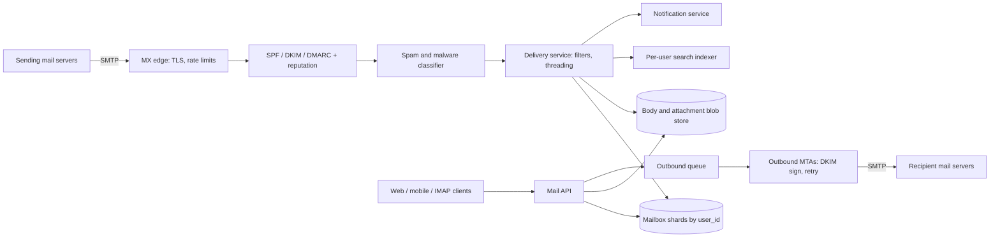

## In one minute
- **Saying "250 OK" is a promise.** Once the inbound server accepts a message over SMTP, the sender deletes its copy. Accept only after the message is durably replicated; until then, answer with a temporary failure and let the sender retry.
- **Partition everything by user.** A mailbox is private, almost never queried across users, and small enough per user to live on one shard. Message metadata, labels, the search index and the change log all hang off `user_id`.
- **Labels, not folders.** A message is stored once and carries a set of labels; Inbox, Starred and Spam are just labels. Views are indexes keyed by `(user, label, date)`, and unread counters are maintained with the labels in one transaction.
- **Most incoming mail is abuse.** Authentication (SPF, DKIM, DMARC), sender reputation and a classifier sit in front of storage, and the cheapest rejection happens before `DATA` is even read.
- **Sync is a per-user change log.** Web, mobile and IMAP clients ask "what changed since history id N", which makes offline catch-up and live updates the same code path.

## Requirements

**Functional**
- Receive email from the internet over SMTP and send email to any domain, with attachments up to 25 MB. Gmail itself replaces a larger attachment with a Drive link rather than refusing it ([Gmail help](https://support.google.com/mail/answer/6584)).
- Show the inbox as conversations (threads), newest first, with unread counts per label.
- Apply labels, archive, star, mark read, delete, and filter rules that run on arrival.
- Search a user's whole mailbox by sender, subject, body text, attachment name and date, in under a second.
- Sync to web, Android, iOS and third-party IMAP clients, with push notifications for new mail.
- Classify spam and phishing, and let users report mistakes.

**Non-functional**
- No accepted message is ever lost (eleven nines of durability for stored mail).
- New mail visible in the inbox within 5 s of the SMTP transaction completing, p95.
- Inbox list under 200 ms p99; search under 1 s p99.
- Availability of 99.9% for reading and 99.99% for accepting inbound mail (senders retry, but users notice delays).

**Out of scope:** chat, Meet, calendar invites beyond plain attachments, the ads system, and the internals of the spam model.

## Back-of-envelope
Assumed round numbers, not Google's figures.

- **Accounts and DAU:** 1.5B accounts, 600M DAU.
- **Inbound delivered mail:** 40 messages per account per day (inactive accounts still receive newsletters): 1.5B × 40 = 60B a day. 60B / 86,400 ≈ 700K messages/s on average; peaks around 2× put it near 1.4M/s.
- **Rejected attempts:** connection-level spam is at least as large again, so the SMTP edge sees roughly 3M connection attempts/s at peak, most dropped cheaply.
- **Outbound:** 10 sent per DAU: 6B a day, about 70K/s average.
- **Storage:** average stored message 50 KB after compression, with attachments counted once per unique hash. 60B × 50 KB = 3 PB a day. Over 5 years: 3 PB × 1,825 ≈ 5.5 EB logical, before replication. The 15 GB free quota caps individual users, but the aggregate is the dominant cost.
- **Metadata:** each message row (ids, labels, thread, snippet, sizes) is about 1 KB: 60 TB a day, about 110 PB over 5 years. Still far smaller than bodies, and the part that must be fast.
- **Reads:** each DAU opens the inbox 20 times a day: 12B list requests/day ≈ 140K/s average, around 400K/s at peak. Search: 2 per DAU per day ≈ 14K/s.
- **Bandwidth in:** 1.4M/s × 50 KB ≈ 70 GB/s at peak, more on the wire because MIME base64 inflates attachments by a third.

## API

```text
SMTP (port 25, from other mail servers)
  EHLO, STARTTLS, MAIL FROM:<a@x.com>, RCPT TO:<b@gmail.com>, DATA ... "."
  -> 250 OK (durably accepted) | 4xx (try later) | 5xx (permanent reject)

POST /v1/messages/send           { raw_mime_or_fields, client_request_id }
                              -> { message_id, thread_id }
GET  /v1/threads?label=INBOX&page_token=..&limit=50
                              -> { threads: [ { thread_id, snippet, last_date, unread, senders } ], next_page_token }
GET  /v1/threads/{thread_id}  -> { messages: [ { message_id, headers, body_ref, attachments } ] }
POST /v1/messages/{id}/modify { add_labels: ["STARRED"], remove_labels: ["UNREAD"] }
GET  /v1/search?q=from:alice has:attachment after:2026/01/01&page_token=..
GET  /v1/history?start_history_id=918273&limit=500
                              -> { changes: [ { history_id, message_id, kind, labels } ], history_id: 918301 }
IMAP4rev2 (port 993) for third-party clients, mapped onto labels and the history log
```

`send` is idempotent on `client_request_id`, so a retried tap on a phone does not send twice. The history endpoint mirrors the public Gmail API, where `history.list` takes a `startHistoryId` and returns everything that changed after it.

## Data model

**messages** partitioned by `user_id`, primary key `(user_id, message_id)`. Columns: `thread_id`, `internal_date`, `labels` (a small set), `size`, `snippet`, `header_digest`, `body_ref`, `rfc822_message_id`. A user's mailbox lives on one shard, so a label change and its counter update are one local transaction.

**label_index** primary key `(user_id, label, internal_date DESC, message_id)`. This is the inbox: the first page of `INBOX` is a prefix scan returning 50 rows. Every label add or remove writes or deletes one index row.

**threads** primary key `(user_id, thread_id)`. Columns: `subject_norm`, `last_date`, `message_count`, `label_union`. Thread lists are served from a parallel `(user_id, label, last_date DESC, thread_id)` index so a conversation appears once, at the time of its newest message.

**label_counts** `(user_id, label) -> total, unread`. Updated in the same transaction as the label change; a background job recounts periodically to repair drift.

**history** primary key `(user_id, history_id)`. One row per change (message added, deleted, labels changed). `history_id` is a per-user monotonic counter, and old rows are trimmed. Gmail promises history for typically at least a week, sometimes less, and answers a too-old `startHistoryId` with HTTP 404, which tells the client to do a full sync ([Gmail API](https://developers.google.com/workspace/gmail/api/guides/sync)).

**bodies and attachments** live in a blob store keyed by content hash. The same 5 MB PDF sent to 2,000 employees is stored once with a reference count, and the body store is encrypted at rest with per-user or per-tenant keys.

**search index** is a per-user inverted index, also on the user's shard: terms to posting lists of `message_id`s, plus fields for `from`, `to`, `subject` and `filename`.

## High-level design



**Inbound write path.**
1. A sending server looks up the MX record for `gmail.com` and opens an SMTP connection to the nearest edge. The edge checks connection rate limits and IP reputation, and can refuse before reading a byte of content.
2. During the SMTP dialogue the edge verifies SPF on the envelope sender, then reads the message, verifies DKIM signatures and evaluates the DMARC policy of the visible `From` domain.
3. The classifier scores the message. Clear spam can still be accepted and filed under the Spam label; clear malware is rejected with a 5xx.
4. The delivery service writes the body to the blob store, then, in one transaction on the recipient's shard, inserts the message row, label index rows, counter updates and a history row. It runs the user's filters and the threading logic first, so the labels and `thread_id` are known at insert.
5. Only after that transaction commits on a quorum of replicas does the edge reply `250 OK`. For a message to many local recipients, each recipient's delivery is a separate idempotent transaction keyed by `(user_id, rfc822_message_id, queue_id)`.
6. The indexer adds the message to the user's search index asynchronously, and the notification service wakes connected clients.

**Read path.** The client asks for the `INBOX` thread list: a prefix scan of the thread-label index on the user's shard, with snippets stored inline so no bodies are fetched. Opening a thread reads its message rows and fetches bodies from the blob store (cached), with attachments downloaded on demand through signed URLs. Background clients poll or are pushed a new `history_id` and call `history` to apply only the changes.

**Outbound path.** `send` writes the message to the sender's Sent label and enqueues it. Outbound MTAs sign with DKIM, group by destination domain, and deliver with per-domain concurrency limits. A 4xx response schedules a retry with backoff for up to several days; a 5xx produces a bounce message back to the sender.

## Deep dives

### 1. Accepting mail without losing it or drowning in spam
The SMTP contract is the heart of the system: after `250`, the sending server forgets the message. Options: accept into a local disk queue on the edge and deliver later (classic Postfix design, fast but the message lives on one machine for a while), or deliver synchronously into replicated storage before answering (slower SMTP sessions, no single-machine window). At this scale I would take a middle path: the edge writes the message to a replicated inbound queue (a quorum across three zones) before answering, and delivery workers drain the queue into mailboxes. The `250` then means "durable in three zones", and a dead edge loses nothing.

Spam defence is layered by cost. Connection-level checks (IP reputation, rate limits, DNS blocklists) are microseconds and stop most abuse before `DATA`. Authentication comes next: SPF checks that the connecting IP may send for the envelope domain, DKIM verifies a signature over headers and body with a key published in DNS ([RFC 6376](https://www.rfc-editor.org/rfc/rfc6376)), and DMARC requires that one of them aligns with the visible `From` domain and tells receivers what to do when neither does. DMARC was an Informational RFC (7489) for a decade; in May 2026 it became Standards Track as RFC 9989, which replaces the public suffix list with a bounded DNS tree walk to find the organizational domain and drops the `pct` tag ([RFC 9989](https://www.rfc-editor.org/rfc/rfc9989)). Records still start with `v=DMARC1`. Since February 2024 Gmail requires every sender to use SPF or DKIM, TLS and a spam rate under 0.3%, and senders of more than 5,000 messages a day to Gmail to also pass DMARC alignment and support one-click unsubscribe ([Google sender guidelines](https://support.google.com/a/answer/81126)), using the `List-Unsubscribe-Post` header from [RFC 8058](https://www.rfc-editor.org/rfc/rfc8058). Only messages that survive reach the expensive classifier, which uses content, sender history and the recipient's own behaviour. This is the overload problem shape solved by ordering filters from cheapest to most expensive, the same structure a web application firewall or an API gateway uses.

### 2. Labels, threads and counters on one shard
Folders would mean storing a message in one place and moving it; labels let a message be in Inbox and Work at once without copies. The cost is an index row per label per message and a counter per label, all of which must agree. Keeping one user's data on one shard makes every mailbox mutation a single-shard transaction, which avoids distributed transactions entirely. The penalty is that a giant mailbox (a shared support inbox with 50M messages) makes a big shard; split by user into virtual shards and move heavy users individually.

Threading has no perfect answer. Headers say who replied to whom: `In-Reply-To` and `References` carry the RFC 5322 `Message-ID`s of earlier messages. Subjects say what humans think a conversation is. Gmail combines them: its API adds a message to a thread only when the `References` and `In-Reply-To` headers point into it and the subject matches ([Gmail API](https://developers.google.com/workspace/gmail/api/guides/threads)), so changing the subject starts a new conversation, and two unrelated "Hello" emails never merge on subject alone. Messages also arrive out of order (a reply can land before its parent), so the threader must remember which unknown ids have been referenced and merge threads when the missing link appears. The practice task builds exactly this.

### 3. Search per user
A global inverted index over 5 EB of mail would be enormous, and every query would have to filter by owner, a security risk if the filter is ever wrong. A per-user index is small (a typical mailbox of 20,000 messages indexes into tens of megabytes), lives next to the mailbox, and isolates users by construction. Indexing happens asynchronously on delivery, so a message may take a few seconds to become searchable; that is an acceptable relaxation, while the inbox itself must be immediate.

The challenge is the long tail. Most users search recent mail, so recent segments sit on SSD or in memory and old segments on cheaper storage, merged LSM-style. Very large mailboxes get their index split by time range and queried in parallel. Operators like `from:`, `has:attachment` and `after:` map to fielded postings and a date-sorted docid order, so a query for recent mail can stop as soon as it has enough hits.

## Down the stack

### Layer 1: The contract
- **Inbound.** A `250` reply to the end of `DATA` means the message is durable on at least three replicas in different zones and will appear in every listed recipient's mailbox exactly once. A 4xx means nothing was kept and the sender should retry; a 5xx means a permanent refusal.
- **Mailbox.** A label change, its index rows, its counters and its history row commit atomically per user. A read after a write by the same client sees the write.
- **History.** `history_id` increases with every change in a mailbox. Reading after `N` returns every change with id greater than `N` in order, or tells the client its cursor is too old.
- **Outbound.** An accepted `send` is delivered, bounced with a reason, or reported as delayed; it is never silently dropped and never sent twice for the same `client_request_id`.

### Layer 2: The mechanism
SMTP ([RFC 5321](https://www.rfc-editor.org/rfc/rfc5321)) is a line-based command and reply protocol, and its successor, rfc5321bis, is approved and waiting in the RFC Editor queue as an Internet Standard ([IETF datatracker](https://datatracker.ietf.org/doc/draft-ietf-emailcore-rfc5321bis/)): `EHLO` advertises extensions such as `STARTTLS`, `SIZE`, `PIPELINING` and `8BITMIME`; `MAIL FROM` sets the envelope sender used for bounces; one `RCPT TO` per recipient; `DATA` streams the message until a line containing a single dot. The message itself (RFC 5322 headers plus MIME parts) is separate from the envelope, which is why SPF checks the envelope and DMARC checks the header `From`.

A DKIM signature is a header with tags such as `d=` (signing domain), `s=` (selector), `bh=` (hash of the canonicalised body) and `b=` (signature over the chosen headers). The receiver fetches the public key from `<selector>._domainkey.<domain>` in DNS. MTA-STS ([RFC 8461](https://www.rfc-editor.org/rfc/rfc8461)) lets a domain require TLS for inbound delivery so a network attacker cannot strip `STARTTLS`.

IMAP, now at IMAP4rev2 ([RFC 9051](https://www.rfc-editor.org/rfc/rfc9051)), gives every message a `UID` that only increases within a mailbox, plus a `UIDVALIDITY` value that changes if UIDs are ever reassigned, which forces clients to resync. The CONDSTORE and QRESYNC extensions ([RFC 7162](https://www.rfc-editor.org/rfc/rfc7162)) add a per-message modification sequence, the IMAP equivalent of `history_id`. Gmail exposes labels to IMAP clients as folders, so a message with two labels appears in two IMAP folders.

### Layer 3: The machine
- **Bytes on the wire.** A 50 KB message is about 35 TCP segments at a 1,448-byte MSS. Base64 turns every 3 bytes of attachment into 4 characters, so a 15 MB attachment travels as 20 MB, which is why the 25 MB attachment limit sits well below the larger total message size limit.
- **TLS cost.** A full TLS 1.3 handshake with an ECDHE key exchange costs about a millisecond of CPU on the server. Millions of short SMTP connections per second make that a real fleet cost, so session resumption and connection reuse by large senders matter.
- **Durable accept.** Waiting for a quorum write across zones adds 1 to 3 ms of network round trips plus a log `fsync` on each replica (tens of microseconds on NVMe with power-loss protection, milliseconds on spinning disks). SMTP sessions last hundreds of milliseconds anyway, so this is affordable.
- **Index layout.** Posting lists store sorted docids as delta-encoded varints, often a byte or two per entry. A 20,000-message mailbox with 300 distinct terms per message is 6M postings, roughly 10 MB, which reads from SSD in a few milliseconds.
- **Dedup by hash.** SHA-256 over a 5 MB attachment takes about 3 ms; one hash lookup then saves storing it 2,000 times.

### Why it's built this way
1. SMTP senders delete their copy after `250`, so the receiving side must make the message durable before saying yes.
2. Spam outnumbers real mail, so filters run in order of cost and reject as early in the SMTP dialogue as possible.
3. Mail is private and accessed per user, so partitioning by user makes every mailbox change a local transaction and every search a single-shard query.
4. Users want one message in several views, so labels plus per-label indexes replace folders, and counters update in the same transaction.
5. Clients go offline and many of them are third-party, so sync is a per-user ordered change log, exposed as history ids to Google's own apps and as UIDs and modification sequences to IMAP.

## Failure modes
- **10x load from a spam wave or a large mailing.** Shed at the edge first: tighten per-IP and per-sender-domain rate limits and answer 4xx so legitimate senders retry later. Delivery workers have a queue in front of them, so mailbox shards see a smoothed rate.
- **Region outage.** MX records list several regions; senders try the next one. Inbound queues are replicated across zones, and mailbox shards fail over to replicas in another region with asynchronous lag; history ids continue from the replicated state, and clients that see a gap do a resync.
- **Hot mailbox.** A support inbox receiving thousands of messages a minute, or a mailing to 100,000 users of one company, concentrates writes. Move hot users to dedicated shards, batch counter updates, and fan out a large local mailing as many small independent deliveries.
- **Classifier mistake.** A bad model push sends a bank's statements to Spam for everyone. Roll models out gradually with shadow scoring, and alert on per-sender spam rate jumps for high-reputation domains.
- **Outbound reputation damage.** A compromised account sends a phishing burst and gets shared IPs blocklisted. Separate IP pools by traffic class, rate-limit new and suspicious accounts, and scan outbound mail with the same classifier.

## In the wild
- **Mailchimp (Mandrill), 2019: transaction-ID wraparound on a hot shard.** One Postgres shard took a disproportionate share of writes because of how data was hashed, its autovacuum fell behind, and the database stopped accepting writes to protect itself from XID wraparound. The outage lasted about 40 hours, and only about 80% of queued email went out during it. The fix included wraparound alerting, a reminder that per-tenant sharding still needs hot-shard monitoring ([Mailchimp](https://mailchimp.com/what-we-learned-from-the-recent-mandrill-outage/)).
- **Microsoft Exchange, 2022: a date in a signature file stalls mail queues.** On 1 January, the malware-scanning engine inside on-premises Exchange Server 2016 and 2019 could not convert the new signature version "2201010001" to a `long`, failed to load, and left messages stuck in transport queues worldwide. Microsoft shipped a script that reset the engine and had to ask every customer to run it. A filter that sits inline before delivery can stop all mail, so it needs a fail-open path ([Microsoft Exchange Team](https://techcommunity.microsoft.com/blog/exchange/email-stuck-in-exchange-on-premises-transport-queues/3049447)).

## Trade-offs

| Option | Strengths | Weaknesses | Choose when |
|---|---|---|---|
| Edge disk queue before delivery | Fast SMTP replies, simple | Message on one machine until delivered | Small or single-site mail systems |
| Replicated queue before `250` | No single-machine loss window | Extra latency and infrastructure | Large providers |
| Labels | One copy, many views | Index row and counter per label | Multi-view mailboxes like Gmail |
| Folders | Simple model, maps to IMAP | One location per message | Classic mail servers |
| Per-user search index | Isolation, small and local | Many small indexes to manage | Private data per user |
| Global search index | Cross-user queries, fewer files | Huge, every query must filter by owner | Shared corpora, not personal mail |
| Thread by headers and subject | Matches user expectation | Edge cases with edited subjects | Consumer mail |

## Leadership lens
- **Build first:** the durable inbound path (SMTP edge, replicated queue, delivery into a user-partitioned store) and the history log. Then labels, threads and counters. Search and the classifier can start simple, since a basic blocklist and an asynchronous indexer give a usable product.
- **Team ownership:** an edge and deliverability team (SMTP, TLS, authentication, outbound reputation), a mailbox storage team (shards, labels, history, IMAP), a search team, and an abuse team that owns the classifier and its rollout. Abuse needs its own on-call because attackers do not wait for business hours.
- **Cost drivers:** stored bodies and attachments dominate, so compression, attachment dedup and cold-tier storage pay most. Next is CPU for TLS and classification at the edge.
- **Rollout:** mail is forever, so storage format changes must read old data. Migrate users shard by shard with dual reads and a per-user rollback, and never change spam behaviour for everyone at once.
- **Review questions:** what exactly must be durable before we return `250`; how do we know a counter is correct; what happens to a client whose history cursor has expired.

## Check yourself
1. Why does the edge write to a replicated inbound queue before replying `250 OK`, instead of queuing on its local disk?
   **Answer:** After `250` the sending server deletes its copy, so the message must already survive any single machine failure. A local disk queue is fast but leaves the message on one machine until delivery, while a quorum write across three zones costs only a few milliseconds inside an SMTP session that lasts hundreds of milliseconds anyway.
2. A spam wave or huge mailing brings 10x inbound load. How should the system respond without losing legitimate mail?
   **Answer:** Shed at the edge first by tightening per-IP and per-sender-domain rate limits and answering 4xx, so legitimate senders simply retry later. The queue in front of delivery workers smooths the rate that mailbox shards actually see.
3. Why use a per-user search index rather than one global inverted index?
   **Answer:** A global index over exabytes of mail would be enormous and every query would have to filter by owner, which is a security risk if that filter is ever wrong. A per-user index is small, lives on the user's shard and isolates users by construction, at the cost of managing many small indexes.
4. Roughly how much storage do message bodies need compared with metadata, and what does that imply for cost?
   **Answer:** About 60B messages a day at 50 KB each is 3 PB a day, around 5.5 EB over five years, while 1 KB metadata rows add only about 60 TB a day. Bodies and attachments dominate cost, so compression, attachment dedup by content hash and cold-tier storage pay the most.

## Practice
**Task:** Build the conversation threader that runs at delivery. `normalize_subject(s)` lowercases, collapses whitespace runs to one space, trims, and then repeatedly strips a leading `re:`, `fwd:` or `fw:` prefix plus following whitespace. `Threader.add(msg_id, in_reply_to, references, subject)` files a message (with `in_reply_to` possibly empty) and returns its thread id; thread ids are integers starting at 1 in creation order. Candidate threads are those containing a message whose id this message cites (in `in_reply_to` or `references`), plus those containing a message that earlier cited this message's id. Keep only candidates whose normalised subject (set by the thread's first message) equals this message's normalised subject. With no match, start a new thread. With one or more matches, join the smallest id and merge the other matching threads into it. Adding a known `msg_id` again changes nothing and returns its thread. `thread_of(msg_id)` returns the thread id or 0, and `messages(thread_id)` returns the thread's message ids in arrival order (empty for unknown or merged-away threads).

```python starter
def normalize_subject(s):
    # TODO
    raise NotImplementedError


class Threader:
    def __init__(self):
        pass

    def add(self, msg_id, in_reply_to, references, subject):
        # TODO: return the thread id
        raise NotImplementedError

    def thread_of(self, msg_id):
        raise NotImplementedError

    def messages(self, thread_id):
        raise NotImplementedError
```

```python tests
def test_normalize_subject():
    assert normalize_subject("RE:  fwd: Budget   Q3 ") == "budget q3"
    assert normalize_subject("Re:Re:Fw: hi") == "hi"
    assert normalize_subject("Rebate offer") == "rebate offer", "only whole prefixes with a colon"

def test_reply_chain_joins_thread():
    t = Threader()
    assert t.add("a", "", [], "Lunch?") == 1
    assert t.add("b", "a", ["a"], "Re: Lunch?") == 1
    assert t.add("c", "b", ["a", "b"], "RE: re: lunch?") == 1
    assert t.messages(1) == ["a", "b", "c"]

def test_subject_change_or_no_headers_starts_new_thread():
    t = Threader()
    t.add("a", "", [], "Lunch?")
    assert t.add("b", "a", ["a"], "Dinner instead") == 2, "subject changed"
    assert t.add("c", "", [], "Lunch?") == 3, "same subject but no references"
    assert t.thread_of("zzz") == 0

def test_reply_before_parent():
    t = Threader()
    assert t.add("r", "p", ["p"], "Re: Plan") == 1
    assert t.add("p", "", [], "Plan") == 1, "parent joins the thread that cited it"
    assert t.messages(1) == ["r", "p"]

def test_missing_link_merges_threads():
    t = Threader()
    assert t.add("a", "", [], "Trip") == 1
    assert t.add("c", "b", ["b"], "Re: Trip") == 2, "b not seen yet"
    assert t.add("b", "a", ["a"], "Re: Trip") == 1
    assert t.messages(1) == ["a", "c", "b"]
    assert t.messages(2) == []
    assert t.thread_of("c") == 1

def test_duplicate_delivery_is_ignored():
    t = Threader()
    t.add("a", "", [], "Hi")
    t.add("b", "a", [], "Re: Hi")
    assert t.add("a", "", [], "Hi") == 1
    assert t.messages(1) == ["a", "b"]
    assert t.messages(9) == []
```

```python solution
def normalize_subject(s):
    t = " ".join(s.split()).lower()
    changed = True
    while changed:
        changed = False
        for p in ("re:", "fwd:", "fw:"):
            if t.startswith(p):
                t = t[len(p):].strip()
                changed = True
    return t


class Threader:
    def __init__(self):
        self._thread = {}
        self._order = {}
        self._members = {}
        self._subject = {}
        self._cited_by = {}
        self._next = 1

    def add(self, msg_id, in_reply_to, references, subject):
        if msg_id in self._thread:
            return self._thread[msg_id]
        subj = normalize_subject(subject)
        cites = list(references)
        if in_reply_to:
            cites.append(in_reply_to)
        cands = set()
        for r in cites:
            if r in self._thread:
                cands.add(self._thread[r])
        for m in self._cited_by.get(msg_id, []):
            cands.add(self._thread[m])
        matching = sorted(c for c in cands if self._subject[c] == subj)
        if matching:
            tid = matching[0]
            for other in matching[1:]:
                for m in self._members.pop(other):
                    self._thread[m] = tid
                    self._members[tid].append(m)
                del self._subject[other]
        else:
            tid = self._next
            self._next += 1
            self._members[tid] = []
            self._subject[tid] = subj
        self._order[msg_id] = len(self._order)
        self._thread[msg_id] = tid
        self._members[tid].append(msg_id)
        for r in cites:
            self._cited_by.setdefault(r, []).append(msg_id)
        return tid

    def thread_of(self, msg_id):
        return self._thread.get(msg_id, 0)

    def messages(self, thread_id):
        return sorted(self._members.get(thread_id, []), key=lambda m: self._order[m])
```

```typescript starter
export function normalizeSubject(s: string): string {
  throw new Error("TODO");
}

export class Threader {
  add(msgId: string, inReplyTo: string, references: string[], subject: string): number {
    throw new Error("TODO");
  }
  threadOf(msgId: string): number {
    throw new Error("TODO");
  }
  messages(threadId: number): string[] {
    throw new Error("TODO");
  }
}
```

```typescript tests
test("normalize subject", () => {
  assertEqual(normalizeSubject("RE:  fwd: Budget   Q3 "), "budget q3");
  assertEqual(normalizeSubject("Re:Re:Fw: hi"), "hi");
  assertEqual(normalizeSubject("Rebate offer"), "rebate offer", "only whole prefixes with a colon");
});

test("reply chain joins thread", () => {
  const t = new Threader();
  assertEqual(t.add("a", "", [], "Lunch?"), 1);
  assertEqual(t.add("b", "a", ["a"], "Re: Lunch?"), 1);
  assertEqual(t.add("c", "b", ["a", "b"], "RE: re: lunch?"), 1);
  assertEqual(t.messages(1), ["a", "b", "c"]);
});

test("subject change or no headers starts new thread", () => {
  const t = new Threader();
  t.add("a", "", [], "Lunch?");
  assertEqual(t.add("b", "a", ["a"], "Dinner instead"), 2, "subject changed");
  assertEqual(t.add("c", "", [], "Lunch?"), 3, "same subject but no references");
  assertEqual(t.threadOf("zzz"), 0);
});

test("reply before parent", () => {
  const t = new Threader();
  assertEqual(t.add("r", "p", ["p"], "Re: Plan"), 1);
  assertEqual(t.add("p", "", [], "Plan"), 1, "parent joins the thread that cited it");
  assertEqual(t.messages(1), ["r", "p"]);
});

test("missing link merges threads", () => {
  const t = new Threader();
  assertEqual(t.add("a", "", [], "Trip"), 1);
  assertEqual(t.add("c", "b", ["b"], "Re: Trip"), 2, "b not seen yet");
  assertEqual(t.add("b", "a", ["a"], "Re: Trip"), 1);
  assertEqual(t.messages(1), ["a", "c", "b"]);
  assertEqual(t.messages(2), []);
  assertEqual(t.threadOf("c"), 1);
});

test("duplicate delivery is ignored", () => {
  const t = new Threader();
  t.add("a", "", [], "Hi");
  t.add("b", "a", [], "Re: Hi");
  assertEqual(t.add("a", "", [], "Hi"), 1);
  assertEqual(t.messages(1), ["a", "b"]);
  assertEqual(t.messages(9), []);
});
```

```typescript solution
export function normalizeSubject(s: string): string {
  let t = s.split(/\s+/).filter((w) => w.length > 0).join(" ").toLowerCase();
  let changed = true;
  while (changed) {
    changed = false;
    for (const p of ["re:", "fwd:", "fw:"]) {
      if (t.startsWith(p)) {
        t = t.slice(p.length).trim();
        changed = true;
      }
    }
  }
  return t;
}

export class Threader {
  private thread = new Map<string, number>();
  private order = new Map<string, number>();
  private members = new Map<number, string[]>();
  private subject = new Map<number, string>();
  private citedBy = new Map<string, string[]>();
  private next = 1;

  add(msgId: string, inReplyTo: string, references: string[], subject: string): number {
    const known = this.thread.get(msgId);
    if (known !== undefined) return known;
    const subj = normalizeSubject(subject);
    const cites = references.slice();
    if (inReplyTo) cites.push(inReplyTo);
    const cands = new Set<number>();
    for (const r of cites) {
      const c = this.thread.get(r);
      if (c !== undefined) cands.add(c);
    }
    for (const m of this.citedBy.get(msgId) ?? []) cands.add(this.thread.get(m)!);
    const matching = [...cands].filter((c) => this.subject.get(c) === subj).sort((a, b) => a - b);
    let tid: number;
    if (matching.length > 0) {
      tid = matching[0];
      const into = this.members.get(tid)!;
      for (const other of matching.slice(1)) {
        for (const m of this.members.get(other)!) {
          this.thread.set(m, tid);
          into.push(m);
        }
        this.members.delete(other);
        this.subject.delete(other);
      }
    } else {
      tid = this.next++;
      this.members.set(tid, []);
      this.subject.set(tid, subj);
    }
    this.order.set(msgId, this.order.size);
    this.thread.set(msgId, tid);
    this.members.get(tid)!.push(msgId);
    for (const r of cites) {
      const list = this.citedBy.get(r) ?? [];
      list.push(msgId);
      this.citedBy.set(r, list);
    }
    return tid;
  }

  threadOf(msgId: string): number {
    return this.thread.get(msgId) ?? 0;
  }

  messages(threadId: number): string[] {
    const list = (this.members.get(threadId) ?? []).slice();
    return list.sort((a, b) => this.order.get(a)! - this.order.get(b)!);
  }
}
```

```go starter
package practice

func NormalizeSubject(s string) string { panic("TODO") }

type Threader struct{}

func NewThreader() *Threader { return &Threader{} }

func (t *Threader) Add(msgID, inReplyTo string, references []string, subject string) int {
	panic("TODO")
}

func (t *Threader) ThreadOf(msgID string) int { panic("TODO") }

func (t *Threader) Messages(threadID int) []string { panic("TODO") }
```

```go tests
package practice

import (
	"reflect"
	"testing"
)

func TestNormalizeSubject(t *testing.T) {
	cases := map[string]string{
		"RE:  fwd: Budget   Q3 ": "budget q3",
		"Re:Re:Fw: hi":           "hi",
		"Rebate offer":           "rebate offer",
	}
	for in, want := range cases {
		if got := NormalizeSubject(in); got != want {
			t.Fatalf("%q: got %q want %q", in, got, want)
		}
	}
}

func TestReplyChainJoinsThread(t *testing.T) {
	th := NewThreader()
	if th.Add("a", "", nil, "Lunch?") != 1 || th.Add("b", "a", []string{"a"}, "Re: Lunch?") != 1 ||
		th.Add("c", "b", []string{"a", "b"}, "RE: re: lunch?") != 1 {
		t.Fatal("all three belong to thread 1")
	}
	if got := th.Messages(1); !reflect.DeepEqual(got, []string{"a", "b", "c"}) {
		t.Fatalf("got %v", got)
	}
}

func TestSubjectChangeOrNoHeadersStartsNewThread(t *testing.T) {
	th := NewThreader()
	th.Add("a", "", nil, "Lunch?")
	if th.Add("b", "a", []string{"a"}, "Dinner instead") != 2 {
		t.Fatal("subject changed")
	}
	if th.Add("c", "", nil, "Lunch?") != 3 {
		t.Fatal("same subject but no references")
	}
	if th.ThreadOf("zzz") != 0 {
		t.Fatal("unknown message")
	}
}

func TestReplyBeforeParent(t *testing.T) {
	th := NewThreader()
	if th.Add("r", "p", []string{"p"}, "Re: Plan") != 1 || th.Add("p", "", nil, "Plan") != 1 {
		t.Fatal("parent joins the thread that cited it")
	}
	if got := th.Messages(1); !reflect.DeepEqual(got, []string{"r", "p"}) {
		t.Fatalf("got %v", got)
	}
}

func TestMissingLinkMergesThreads(t *testing.T) {
	th := NewThreader()
	if th.Add("a", "", nil, "Trip") != 1 || th.Add("c", "b", []string{"b"}, "Re: Trip") != 2 {
		t.Fatal("c starts its own thread before b is seen")
	}
	if th.Add("b", "a", []string{"a"}, "Re: Trip") != 1 {
		t.Fatal("b joins thread 1")
	}
	if got := th.Messages(1); !reflect.DeepEqual(got, []string{"a", "c", "b"}) {
		t.Fatalf("got %v", got)
	}
	if len(th.Messages(2)) != 0 || th.ThreadOf("c") != 1 {
		t.Fatal("thread 2 merged away")
	}
}

func TestDuplicateDeliveryIsIgnored(t *testing.T) {
	th := NewThreader()
	th.Add("a", "", nil, "Hi")
	th.Add("b", "a", nil, "Re: Hi")
	if th.Add("a", "", nil, "Hi") != 1 {
		t.Fatal("duplicate returns its thread")
	}
	if got := th.Messages(1); !reflect.DeepEqual(got, []string{"a", "b"}) {
		t.Fatalf("got %v", got)
	}
	if len(th.Messages(9)) != 0 {
		t.Fatal("unknown thread is empty")
	}
}
```

```go solution
package practice

import (
	"sort"
	"strings"
)

func NormalizeSubject(s string) string {
	t := strings.ToLower(strings.Join(strings.Fields(s), " "))
	for changed := true; changed; {
		changed = false
		for _, p := range []string{"re:", "fwd:", "fw:"} {
			if strings.HasPrefix(t, p) {
				t = strings.TrimSpace(t[len(p):])
				changed = true
			}
		}
	}
	return t
}

type Threader struct {
	thread  map[string]int
	order   map[string]int
	members map[int][]string
	subject map[int]string
	citedBy map[string][]string
	next    int
}

func NewThreader() *Threader {
	return &Threader{
		thread:  map[string]int{},
		order:   map[string]int{},
		members: map[int][]string{},
		subject: map[int]string{},
		citedBy: map[string][]string{},
		next:    1,
	}
}

func (t *Threader) Add(msgID, inReplyTo string, references []string, subject string) int {
	if tid, ok := t.thread[msgID]; ok {
		return tid
	}
	subj := NormalizeSubject(subject)
	cites := append([]string{}, references...)
	if inReplyTo != "" {
		cites = append(cites, inReplyTo)
	}
	cands := map[int]bool{}
	for _, r := range cites {
		if c, ok := t.thread[r]; ok {
			cands[c] = true
		}
	}
	for _, m := range t.citedBy[msgID] {
		cands[t.thread[m]] = true
	}
	matching := []int{}
	for c := range cands {
		if t.subject[c] == subj {
			matching = append(matching, c)
		}
	}
	sort.Ints(matching)
	var tid int
	if len(matching) > 0 {
		tid = matching[0]
		for _, other := range matching[1:] {
			for _, m := range t.members[other] {
				t.thread[m] = tid
				t.members[tid] = append(t.members[tid], m)
			}
			delete(t.members, other)
			delete(t.subject, other)
		}
	} else {
		tid = t.next
		t.next++
		t.members[tid] = []string{}
		t.subject[tid] = subj
	}
	t.order[msgID] = len(t.order)
	t.thread[msgID] = tid
	t.members[tid] = append(t.members[tid], msgID)
	for _, r := range cites {
		t.citedBy[r] = append(t.citedBy[r], msgID)
	}
	return tid
}

func (t *Threader) ThreadOf(msgID string) int { return t.thread[msgID] }

func (t *Threader) Messages(threadID int) []string {
	out := append([]string{}, t.members[threadID]...)
	sort.Slice(out, func(i, j int) bool { return t.order[out[i]] < t.order[out[j]] })
	return out
}
```

## Mock interview
**Prompt:** Design Gmail. Assume 1.5 billion accounts, 60 billion delivered messages a day, 25 MB attachments and full-text search over each user's mailbox. Start with what happens between another company's mail server opening a connection and the message appearing in the user's inbox on their phone.

- Follow-up: The delivery service crashes after writing the message row but before the edge replied `250`. What does the sender do, and how do you avoid a duplicate in the inbox?
- Follow-up: A newsletter goes to 30 million of your users at once. Which parts of the system feel it, and how do you protect them?
- Follow-up: Why not keep one global search index with an owner field instead of millions of per-user indexes?

**A strong answer covers:**
- The meaning of `250 OK` and a replicated inbound queue before accepting, with idempotent delivery keyed by recipient and message id so sender retries do not duplicate.
- Layered abuse defence ordered by cost: connection reputation and rate limits, SPF, DKIM and DMARC, then a classifier, with 4xx backpressure under load.
- A user-partitioned store where labels, label indexes, counters and the history row commit in one local transaction, and threads are built from headers plus subject.
- Per-user search indexes updated asynchronously, with hot and cold tiers for large mailboxes.
- Sync through a per-user history id (and UIDs with modification sequences for IMAP), plus outbound queues with per-domain retry and IP reputation management.

## Sources and further study
**Primary**
- [RFC 8058: one-click unsubscribe](https://www.rfc-editor.org/rfc/rfc8058): the `List-Unsubscribe-Post` header that bulk-sender rules now require.
- [RFC 9051: IMAP4rev2](https://www.rfc-editor.org/rfc/rfc9051): the current IMAP base protocol, including UIDs and UIDVALIDITY.
- [RFC 8461: SMTP MTA Strict Transport Security](https://www.rfc-editor.org/rfc/rfc8461): how a domain forces TLS on inbound delivery.

**Systems docs**
- [Google: email sender guidelines](https://support.google.com/a/answer/81126): what Gmail requires from all senders and from bulk senders.
- [rfc5321bis on the IETF datatracker](https://datatracker.ietf.org/doc/draft-ietf-emailcore-rfc5321bis/): the revised SMTP specification heading to Internet Standard.

**Books**
- *System Design Interview, Volume 2*, Alex Xu and Sahn Lam, chapter 8 "Distributed Email Service": mail servers, metadata storage, search and deliverability at interview depth.
- *Computer Networking: A Top-Down Approach* (8th edition), Kurose and Ross, chapter 2 "Application Layer": SMTP, mail access protocols and how they differ from HTTP.

**Other curricula**
- [Azure Architecture Center: Queue-Based Load Leveling](https://learn.microsoft.com/en-us/azure/architecture/patterns/queue-based-load-leveling): frames a queue between a bursty producer and a slower service, the role the inbound queue plays here.
- [donnemartin/system-design-primer](https://github.com/donnemartin/system-design-primer): uses email as its example of eventual consistency and has no email design of its own.

## Watch
- [SPF, DKIM, DMARC was never so simple! (Christian Lempa)](https://www.youtube.com/watch?v=Yg3QL8To6uQ): how the three sender authentication mechanisms fit together and what receivers check.

## Free resources
- [RFC 5321: Simple Mail Transfer Protocol](https://www.rfc-editor.org/rfc/rfc5321): the envelope, the command sequence and what a `250` reply commits the receiver to.
- [RFC 9989: DMARC](https://www.rfc-editor.org/rfc/rfc9989): alignment of SPF and DKIM with the visible `From` domain and receiver policy; obsoletes RFC 7489 (May 2026).
- [RFC 6376: DomainKeys Identified Mail (DKIM) Signatures](https://www.rfc-editor.org/rfc/rfc6376): the signature header tags, canonicalisation and DNS key lookup.
- [Synchronizing clients with Gmail (Gmail API)](https://developers.google.com/workspace/gmail/api/guides/sync): full and partial sync with `historyId`, the model behind the history log.
- [RFC 7162: IMAP CONDSTORE and QRESYNC](https://www.rfc-editor.org/rfc/rfc7162): modification sequences that let IMAP clients resynchronise efficiently.
- [Managing threads (Gmail API)](https://developers.google.com/workspace/gmail/api/guides/threads): how Gmail groups messages into threads and what a client must send to keep a reply in its thread.
