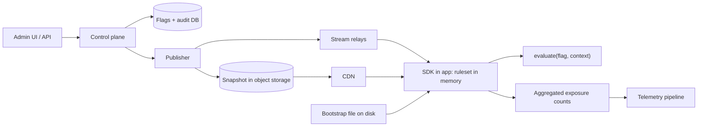

## In one minute
- **Evaluate in the process that needs the answer.** The SDK keeps the whole ruleset in memory and evaluates a flag as a pure function of `(ruleset, context)`. A flag check costs well under a microsecond and has no network call, so the flag service can never sit on the request path ([Unleash architecture](https://docs.getunleash.io/understanding-unleash/unleash-overview)).
- **Stream versioned changes and resync cheaply.** A long-lived connection pushes each change in about a second, every message carries a monotonically increasing version, and a periodic poll repairs anything the stream dropped.
- **Hash for stable percentage rollouts.** `hash(flag salt, user id) mod 10000` gives each user a fixed bucket per flag. Raising 5% to 20% only adds users, nobody flips back, and a per-flag salt keeps two flags from picking the same people.
- **Fail static.** When the control plane is down the SDK keeps serving the last good ruleset, then a baked-in default. A flag outage must never become an application outage.
- **Treat every change as a production deploy.** Validate it, attribute it in an audit log, canary it by environment, and make the kill switch the highest-precedence rule so one click wins over everything else.

## Requirements

**Functional**
- Boolean and multivariate flags per environment (dev, staging, prod), with a default and an off value.
- Targeting rules on user attributes (country, plan, app version), user and segment allow-lists, and ordered rule evaluation.
- Percentage rollouts that are sticky per user and can be ramped up and down.
- A kill switch per flag that overrides every other rule.
- An audit log of who changed what, when, and why, with the ability to roll back to a version.
- SDKs for server languages that evaluate locally. Browsers and phones get pre-evaluated results.

**Non-functional**
- Evaluation under 1 microsecond and zero network calls at evaluation time.
- Propagation: p99 under 5 s from publish to every connected SDK, under 2 s for kill switches.
- The control plane can be fully down and applications keep working indefinitely.
- 99.99% availability of the read path, which is allowed to be stale but never wrong about a published version.
- No user attributes leave the application unless the flag is evaluated server-side for a browser or phone.

**Out of scope**
- Experiment statistics (p-values, sequential testing). We emit exposure events and stop there.
- A full configuration service for arbitrary JSON. We cover flags with rules.

## Back-of-envelope
Assume 50,000 server processes, 2,000 projects and 5,000 flags per environment.
- **Evaluations**: 50,000 processes × 2,000 checks/s = 100 million checks/s in aggregate. All local, so the service sees none of it.
- **Ruleset size**: 5,000 flags × 600 B of rules = 3 MB per environment, around 400 KB gzipped. A full snapshot to 50,000 SDKs is 20 GB gzipped, which is why a flag change travels as a delta of roughly 1 KB: 50 MB of fan-out per change instead of 20 GB.
- **Changes**: 2,000 flag edits a day, average 0.02 per second, bursts of 10 per second during a release. Trivial for a database, which tells you the hard parts are fan-out and safety, not throughput.
- **Connections**: 50,000 SDK streams. A relay node holds about 20,000 idle HTTP streams comfortably, so 5 to 10 relays per region.
- **Audit storage**: 2,000 entries/day × 2 KB = 4 MB/day, about 7 GB over 5 years. Store diffs, not snapshots: a 3 MB snapshot per edit would be 6 GB/day.
- **Exposure telemetry**: raw events are impossible at 100 million/s. Each SDK sends aggregated counts per flag and variation every minute: about 600 counters × 30 B = 18 KB per SDK per minute, 15 MB/s overall.

## API
```http
# Control plane (humans and automation)
PUT  /v1/projects/{p}/envs/{e}/flags/{key}      # body: flag definition, header If-Match: <flag version>
POST /v1/projects/{p}/envs/{e}/flags/{key}/kill # body: {"on": true, "reason": "INC-4411"}
GET  /v1/projects/{p}/envs/{e}/audit?flag=checkout&limit=50
POST /v1/projects/{p}/envs/{e}/rollback         # body: {"to_version": 4812}

# Data plane (SDKs)
GET  /sdk/stream?since=4812        # text/event-stream: put (snapshot) and patch (delta) events
GET  /sdk/ruleset                  # full snapshot, ETag = version, served from CDN or object store
POST /sdk/events                   # aggregated exposure counts
```
```json
{ "key": "checkout-v2", "salt": "k3x9", "enabled": true, "kill": false,
  "rules": [ { "attribute": "country", "values": ["ID", "SG"], "variation": "on" } ],
  "rollout_bp": 2000, "rollout_variation": "on",
  "fallthrough": "off", "off_variation": "off" }
```
`rollout_bp` is in basis points (2000 = 20%). A stream event looks like `event: patch / id: 4813 / data: {"upsert":[...],"delete":[...]}`; the `id` is the ruleset version.

## Data model
- **`flags`** keyed by `(project, env, flag_key)`: definition JSON, per-flag `version`, `salt` (random, fixed at creation), `archived_at`. Strong consistency matters here, so a single relational primary per region is enough at 2,000 writes a day.
- **`ruleset_versions`** keyed by `(project, env, version)`: the monotonically increasing environment version, plus the changed keys. The current snapshot is materialised in object storage under `rulesets/{project}/{env}/latest.json.gz`.
- **`audit_log`** append-only, keyed by `(project, env, seq)`: actor, time, flag, before and after diff, free-text reason, and the resulting environment version. Never updated, never deleted inside the retention window.
- **`segments`** keyed by `(project, env, segment_key)`: a reusable list of rules or user ids, referenced by flags. Large id lists are stored as a sorted array or Bloom filter so the ruleset stays small.
- **`sdk_keys`** hashed, scoped to one environment. Server keys can read rules; client keys can only read pre-evaluated results.

The environment version, not the flag version, is the unit the SDK tracks. A single integer lets an SDK say "I have 4812" and a relay answer with exactly the changes since.

## High-level design


**Write path.** An engineer saves a flag. The control plane checks permissions, validates the definition (known operators, rollout between 0 and 10000, referenced segments exist), then in one transaction updates `flags`, appends the audit row and increments the environment version. The publisher writes the new snapshot to object storage first and then emits a patch with that version to the relays, so a client that misses the patch can always fetch a snapshot at least as new.

**Read path.** At startup an SDK loads the bootstrap file if present, then fetches the snapshot from the CDN, then opens the stream with `since=<version>`. Evaluation never touches the network. A background poll every 30 to 60 seconds sends `If-None-Match: <version>` so a missed event is repaired within a minute even when the stream silently stalled.

## Deep dives

### 1. Getting changes to 50,000 processes
- **Polling only.** Each SDK fetches the snapshot on an interval. It is simple, cache-friendly and survives proxies, and Unleash's backend SDKs work this way with a delay of a few seconds ([Unleash docs](https://docs.getunleash.io/understanding-unleash/unleash-overview)). The catch: a 1 s interval across 50,000 SDKs is 50,000 requests/s for a mostly unchanged answer, and a kill switch still waits a full interval.
- **Streaming.** A server-sent events connection pushes a patch the moment it is published. The SSE standard gives you automatic reconnection and a `Last-Event-ID` header so the server can resume from the last version seen ([WHATWG HTML standard](https://html.spec.whatwg.org/multipage/server-sent-events.html)). The catch is that proxies idle-timeout streams, and a half-open connection looks healthy while delivering nothing.
- **Choice: stream plus poll.** Use the stream for speed and a slow conditional poll as the correctness backstop. Every message carries the environment version, and the SDK applies a message only if its version is higher than the current one. Duplicates and reordering become harmless, and on a gap the SDK fetches the full snapshot. Envoy's xDS protocol solves the same problem with versioned resources and an explicit ACK or NACK, so a bad update is rejected without breaking the running config ([Envoy xDS](https://www.envoyproxy.io/docs/envoy/latest/api-docs/xds_protocol)).

Fan-out is the real scale problem: relays hold the 50,000 connections. After a relay restarts, 20,000 SDKs reconnect at once, so each waits a random delay (capped exponential backoff with jitter), because synchronised retries turn one failure into a cascade ([Google SRE book](https://sre.google/sre-book/addressing-cascading-failures/)).

### 2. Stable percentage rollouts and targeting
A rollout must satisfy three properties: the same user always gets the same answer, increasing the percentage only adds users, and different flags select statistically independent groups.

- **Random per request** fails the first property.
- **Store an assignment per user** satisfies it but needs a lookup on every evaluation.
- **Hash.** Compute `bucket = hash(flag_key + "." + salt + "." + user_id) mod 10000`. The user is in the rollout if `bucket < rollout_bp`. Raising `rollout_bp` from 500 to 2000 only adds buckets 500 to 1999, so nobody drops out. Unleash documents the same idea: a normalised MurmurHash of the user id gives consistent and random distribution ([Unleash activation strategies](https://docs.getunleash.io/reference/activation-strategies)).

The salt matters. If every flag hashed only the user id, the same 5% of users would be the guinea pigs for every experiment. With a per-flag salt each flag draws an independent 5%, and changing a salt on purpose reshuffles everyone, which restarts an experiment cleanly.

Multivariate flags split the 10,000 buckets into consecutive ranges, for example A 0 to 3333, B 3334 to 6666, C the rest. Targeting rules run before the rollout and are evaluated in order, first match wins; a user-id allow-list is just a rule. The result is returned with a *reason* (`KILLED`, `OFF`, `RULE:2`, `ROLLOUT`, `FALLTHROUGH`, `MISSING_FLAG`), which is exactly what OpenFeature's resolution details carry, so debugging "why did this user get that?" never needs a guess ([OpenFeature spec](https://openfeature.dev/specification/sections/providers)).

The unit you hash is a product decision: user id for logged-in features, device id for anonymous traffic, organisation id when a whole tenant must see one experience. A context with no id cannot be bucketed, so the fallthrough must be safe.

### 3. Fail-static and safe changes
The control plane will be down sometimes, so every layer needs a defined behaviour:

1. **Control plane down.** SDKs and relays keep the last version; nothing running changes.
2. **Relay or stream down.** The SDK polls the CDN snapshot, then falls back to its in-memory copy.
3. **Cold start with everything down.** Load the bootstrap file from the image or local disk, else use the coded default at the call site.

This is *static stability*: the system keeps doing what it was doing when a dependency is impaired, though it stops seeing updates ([AWS Builders' Library](https://aws.amazon.com/builders-library/static-stability-using-availability-zones/)). Each call site chooses its code default deliberately, and it should be the safe, old behaviour.

The harder half is making a bad change survivable, because flags change production behaviour everywhere in seconds. Facebook's configuration system treats such changes as code: reviewed, validated, canaried and distributed through one pipeline, with thousands of changes a day and trillions of checks ([SOSP 2015 paper](https://research.facebook.com/publications/holistic-configuration-management-at-facebook/)). Apply that here:
- **Validate on write**, including a dry-run evaluation against sample contexts.
- **Roll out rulesets by environment and cell**, with automatic halt if the error rate moves.
- **Each SDK validates before swapping.** Parse into a fresh object, check it, then swap one pointer. A malformed payload is dropped and the old ruleset keeps serving.
- **Kill switch has top precedence and a short path**: checked first, and pushed ahead of queued patches.
- **Retire flags.** Long-lived release flags become dead code with live switches, so give each a removal date ([Fowler](https://martinfowler.com/articles/feature-toggles.html)).

## Down the stack

### Layer 1: The contract
- **Evaluation** is deterministic: the same ruleset and context give the same `(value, reason)` in every SDK and language. That needs a hash with a fixed specification, not a language's built-in hash.
- **Freshness** is bounded: a connected SDK reflects a published version within 5 s at p99. A disconnected one serves its last version and reports `stale`.
- **Monotonic versions**: a process never moves backwards to an older version, and a rollback is a new, higher version whose content equals an old one.
- **Never throws**: any internal error returns the call-site default with an `ERROR` reason.
- **Audit completeness**: every published version has exactly one audit entry naming an actor.

### Layer 2: The mechanism
- **Stream framing**: SSE lines `event: patch`, `id: 4813`, `data: {...}` then a blank line, plus a `: keepalive` comment every 15 to 30 s so idle proxies stay open.
- **Resume**: on reconnect the SDK sends `Last-Event-ID: 4813`. The relay replays from a ring buffer of the last few thousand patches, or sends a `put` event with a fresh snapshot when the gap is too large.
- **Snapshot endpoint**: `ETag` equal to the version, short `max-age`, served from a CDN so a fleet restart hits storage once per edge.
- **Hash**: 32-bit FNV-1a or MurmurHash3 over UTF-8 bytes of `flag_key.salt.unit_id`, taken mod 10000. FNV-1a is a loop of XOR and multiply by `0x01000193`; Murmur3 distributes better for very small rollouts.
- **Swap**: the SDK holds one immutable `Ruleset` object behind an atomic pointer. Evaluation reads the pointer once and uses that snapshot throughout, so a patch arriving mid-evaluation can never produce a half-old, half-new answer.
- **Pre-evaluated clients**: for browsers, an edge function evaluates all flags for one context and returns a small JSON map, so rules never reach untrusted code.

### Layer 3: The machine
- **Evaluation cost**: a hashed lookup of the flag (about 20 to 50 ns), a short rule loop over strings, and a 20-byte FNV hash (about 20 ns) put a check around 100 to 300 ns, all on data that stays in L1 and L2 cache.
- **Parse cost and GC**: decoding 3 MB of JSON takes roughly 10 to 30 ms and allocates tens of MB. Do it only when the version changes, off the request path, not on every poll.
- **Network**: a 1 KB patch is one TCP segment (MSS about 1,460 B), so delivery is one relay-to-SDK half round trip, a few milliseconds in-region. A fresh TLS handshake costs 1 to 2 round trips, so SDKs keep the stream open.
- **Relay sockets**: 20,000 streams per node means 20,000 file descriptors, and the kernel's `epoll_wait` loop wakes on writes only.
- **Disk**: the bootstrap file is written with write-to-temp, `fsync`, then `rename` so a crash leaves either the old or the new file, never half of one.

### Why it's built this way
1. A flag check is on every request, and a network round trip costs 0.5 ms in-region against 0.2 microseconds in memory, so evaluate locally.
2. Local evaluation means every process holds a copy, so copies drift. Version numbers and a poll backstop make drift bounded and detectable.
3. A pure function of ruleset and context lets the hash be the assignment, so no per-user state is needed and the answer is reproducible on any machine.
4. A flag change can alter behaviour everywhere in seconds, so safety (validation, staged rollout, audit, kill switch) is more important than raw speed.
5. The control plane is the least available part, because it is the one humans edit. Therefore the data plane must not depend on it to keep running.

## Failure modes
- **Control plane outage.** Nothing changes for running apps. Editing is blocked; the kill switch needs a break-glass path (a second API key to the publisher or a config in object storage) so an operator can disable a feature even when the UI is down.
- **Region outage.** SDKs fail over to relays in another region or keep serving their cache.
- **Reconnect storm at 10x.** A relay restart or network blip makes tens of thousands of SDKs reconnect together. Mitigate with full jitter, a connection cap per relay with 503 plus `Retry-After`, and snapshots from the CDN rather than the origin.
- **Hot flag.** A flag with a huge segment (millions of user ids) bloats every patch. Keep such lists out of the ruleset: evaluate server-side, or use a compact Bloom filter or a lookup the app already has.
- **Poison ruleset.** A bad rule crashes or mis-serves everywhere at once. SDK-side validation and swap-after-parse, canaried publishing, and rollback as a version bump.
- **Hash drift between SDKs.** If the Go and Java SDKs hash differently, one user sees different values on different services. Ship shared test vectors (`bucket("checkout","s1","user-1") == 2468`) in every SDK's test suite.

## In the wild
- **Google Cloud, 2025: a global change with no flag.** On 12 June, Service Control crashed worldwide when a policy row with blank fields hit a quota-check code path added on 29 May that had no feature flag and no error handling. A "red button" kill of the bad path took about 40 minutes to roll out, but us-central1 needed far longer because restarting tasks overloaded Spanner without randomized backoff. Google committed to feature-flagging such code, failing open and replicating global data incrementally ([Google Cloud incident report](https://status.cloud.google.com/incidents/ow5i3PPK96RduMcb1SsW)).
- **Knight Capital, 2012: a reused flag and a half-finished deploy.** New code was copied to only 7 of 8 servers, and it reused a flag that once enabled the retired "Power Peg" logic. The eighth server ran the old logic, sent about 4 million executions in 154 stocks in roughly 45 minutes and lost over $460 million; removing the new code from the other seven made all eight run it. The SEC cited the missing deployment review and written procedures ([SEC order](https://www.sec.gov/litigation/admin/2013/34-70694.pdf)).
- **PostHog, 2025: the flag service as the outage.** Between 21 and 30 October the PostHog feature flags service had four incidents totalling about 12 hours. On 24 October a new IP-keyed rate limiter saw only the load balancer address, shared one bucket, and about 97% of flag evaluations returned 429 for 72 minutes. This is a service that clients call on every request, so its outage became its customers' outage ([PostHog post-mortem](https://posthog.com/handbook/company/post-mortems/2025-10-21-feature-flags-recurring-outages)).

## Trade-offs
| Option | Strengths | Weaknesses | Choose when |
|---|---|---|---|
| Local evaluation of a streamed ruleset | Sub-microsecond, survives control-plane outage, attributes stay private | Ruleset in every process, staleness, SDK per language | Backend services, the default |
| Remote evaluation API per check | One implementation, rules never leave the server | Latency and availability on every request, per-check cost | Browsers and phones, via an edge cache |
| Hash-based bucketing | No state, sticky, monotonic | Cannot move one user without a rule, unit choice matters | Percentage rollouts |
| Fail-static to last good | App unaffected by control-plane outage | New kill switches do not arrive | Always, with a break-glass path for urgent changes |

## Leadership lens
- **Build first**: local evaluation, a snapshot endpoint, one hash with shared test vectors, kill switch and audit log. Streaming and relays come second, targeting UI third. Or buy: the SDK contract matters more than the vendor, so put OpenFeature in front of whichever one you pick ([OpenFeature](https://openfeature.dev/specification/)).
- **Ownership**: a platform team owns the service, SDKs and on-call. Product teams own flag lifecycle: each flag has an owner, a type (release, experiment, ops, permission) and an expiry. Fowler's categories are a useful vocabulary for this ([Fowler](https://martinfowler.com/articles/feature-toggles.html)).
- **Review questions**: what does this flag default to if the service is gone? who can flip it in production and how is that audited? what is the removal date? how does the kill switch reach the process in under 5 seconds?
- **Cost drivers**: mostly SDK maintenance across languages and exposure telemetry volume, not compute. Flag debt (stale flags, combinatorial test matrices) is the largest organisational cost.
- **Separation of change from deploy**: decoupling launch from release is the reason to run this at all, and it is the pattern the SRE workbook recommends for reducing release risk ([SRE Workbook](https://sre.google/workbook/canarying-releases/)).

## Check yourself
1. Why must the hash include a per-flag salt, and what happens if you change the salt later?
   **Answer:** Without a salt, the same low-numbered buckets are chosen by every flag, so the same users receive every experiment and results are correlated. Changing the salt moves every user to a new random bucket, which restarts the experiment but also reshuffles who sees the feature.
2. A relay restarts and 20,000 SDKs reconnect at the same instant. What goes wrong and what do you do?
   **Answer:** The relay and snapshot origin face a synchronised burst that can trip its limits and fail again in lockstep. SDKs reconnect after a randomised exponential backoff, resume with `Last-Event-ID`, and fetch snapshots from a CDN, while relays cap connections and return `Retry-After`.
3. The control plane has been down for six hours and a feature is misbehaving. What can an operator still do?
   **Answer:** Apps keep serving the last ruleset, so nothing breaks, but the normal UI path is dead. A break-glass path writes the kill switch directly to the publisher or object store snapshot, which relays and the polling backstop then deliver.
4. Why store 50,000 SDK copies of 3 MB instead of asking a service per check, given 100 million checks a second?
   **Answer:** A remote check would be 100 million requests/s of 0.5 ms round trips and would put the flag service on every request path. Local evaluation costs memory (3 MB per process) and bounded staleness, a far better trade.

## Practice
**Task:** Implement the in-process core of a flag service: stable hashing, flag evaluation and a fail-static client, driven by an injected clock that returns milliseconds. Ids and keys are ASCII.
- `bucket(flag_key, salt, unit_id)` returns the 32-bit FNV-1a hash (offset `2166136261`, prime `16777619`, over the bytes of `flag_key + "." + salt + "." + unit_id`) modulo 10000.
- `evaluate_flag(flag, ctx)` returns `(value, reason)`. Order: if `kill`, return `off_variation` with reason `KILLED`; if not `enabled`, `off_variation` with `OFF`; then rules in order, where a rule matches when `ctx[attribute]` exists and is in `values`, returning its variation with reason `RULE:<index>`; then the rollout: if `rollout_bp >= 10000` return `rollout_variation` with `ROLLOUT`; if `rollout_bp > 0` and `ctx["key"]` is missing return `fallthrough` with `NO_KEY`; if the bucket of `ctx["key"]` is below `rollout_bp` return `rollout_variation` with `ROLLOUT`; otherwise `fallthrough` with `FALLTHROUGH`.
- `FlagClient(clock, max_stale_ms)` holds the last good ruleset. `apply(version, flags)` replaces it with a full snapshot only if `version` is higher than the current one and returns whether it did; each accepted update appends an audit entry `(version, at, changed)` where `changed` is the sorted keys that were added, removed or modified.
- `evaluate(key, ctx, default)` returns `(default, "NO_RULESET")` before any update and `(default, "MISSING_FLAG")` for an unknown key; it keeps serving the last ruleset forever. `status()` returns `empty`, `fresh`, or `stale` when more than `max_stale_ms` have passed since the last accepted update.

```python starter
def fnv1a32(s):
    # TODO: 32-bit FNV-1a over the UTF-8 bytes of s
    raise NotImplementedError


def bucket(flag_key, salt, unit_id):
    # TODO
    raise NotImplementedError


def evaluate_flag(flag, ctx):
    # TODO: returns (value, reason)
    raise NotImplementedError


class FlagClient:
    def __init__(self, clock, max_stale_ms):
        # TODO
        pass

    def apply(self, version, flags):
        # TODO
        raise NotImplementedError

    def evaluate(self, key, ctx, default):
        # TODO
        raise NotImplementedError

    def status(self):
        # TODO
        raise NotImplementedError

    def audit(self):
        # TODO: list of dicts {"version", "at", "changed"}
        raise NotImplementedError
```

```python tests
class FakeClock:
    def __init__(self):
        self.now = 0

    def __call__(self):
        return self.now


def mk(**kw):
    f = {"key": "checkout", "salt": "s1", "enabled": True, "kill": False, "rules": [],
         "rollout_bp": 0, "rollout_variation": "on", "fallthrough": "off", "off_variation": "off"}
    f.update(kw)
    return f


def test_bucket_is_stable_and_in_range():
    assert bucket("checkout", "s1", "user-1") == 2468
    assert bucket("checkout", "s1", "user-2") == 5325
    for i in range(300):
        assert 0 <= bucket("checkout", "s1", "u" + str(i)) < 10000


def test_kill_and_off_beat_everything():
    rules = [{"attribute": "country", "values": ["ID"], "variation": "on"}]
    f = mk(rules=rules, rollout_bp=10000)
    assert evaluate_flag(f, {"country": "ID", "key": "a"}) == ("on", "RULE:0")
    assert evaluate_flag(mk(rules=rules, kill=True), {"country": "ID"}) == ("off", "KILLED")
    assert evaluate_flag(mk(rules=rules, enabled=False), {"country": "ID"}) == ("off", "OFF")


def test_first_matching_rule_wins():
    rules = [{"attribute": "country", "values": ["ID"], "variation": "id"},
             {"attribute": "plan", "values": ["pro"], "variation": "pro"}]
    f = mk(rules=rules)
    assert evaluate_flag(f, {"country": "ID", "plan": "pro"}) == ("id", "RULE:0")
    assert evaluate_flag(f, {"country": "SG", "plan": "pro"}) == ("pro", "RULE:1")
    assert evaluate_flag(f, {"country": "SG"}) == ("off", "FALLTHROUGH")


def test_rollout_edges():
    assert evaluate_flag(mk(rollout_bp=0), {"key": "user-1"}) == ("off", "FALLTHROUGH")
    assert evaluate_flag(mk(rollout_bp=10000), {}) == ("on", "ROLLOUT")
    assert evaluate_flag(mk(rollout_bp=5000), {}) == ("off", "NO_KEY")
    assert evaluate_flag(mk(rollout_bp=2469), {"key": "user-1"}) == ("on", "ROLLOUT")
    assert evaluate_flag(mk(rollout_bp=2468), {"key": "user-1"}) == ("off", "FALLTHROUGH")


def test_ramp_only_adds_users_and_is_roughly_uniform():
    users = ["u" + str(i) for i in range(10000)]

    def on(bp, salt="s1"):
        f = mk(rollout_bp=bp, salt=salt)
        return set(u for u in users if evaluate_flag(f, {"key": u})[0] == "on")

    small, mid = on(2000), on(5000)
    assert small <= mid, "raising the percentage must not remove anyone"
    assert 2700 <= len(on(3000)) <= 3300
    assert on(5000, "s2") != mid, "a new salt reshuffles"


def test_client_ignores_old_versions_and_records_audit():
    clock = FakeClock()
    c = FlagClient(clock, 60000)
    assert c.apply(1, [mk(key="a"), mk(key="b")]) is True
    clock.now = 500
    assert c.apply(2, [mk(key="a"), mk(key="b", rollout_bp=100), mk(key="c")]) is True
    assert c.apply(2, [mk(key="z")]) is False
    assert c.apply(1, [mk(key="z")]) is False
    clock.now = 900
    assert c.apply(3, [mk(key="a"), mk(key="c")]) is True
    assert c.audit() == [{"version": 1, "at": 0, "changed": ["a", "b"]},
                         {"version": 2, "at": 500, "changed": ["b", "c"]},
                         {"version": 3, "at": 900, "changed": ["b"]}]


def test_fail_static_serves_last_ruleset_when_stale():
    clock = FakeClock()
    c = FlagClient(clock, 1000)
    assert c.status() == "empty"
    assert c.evaluate("checkout", {}, "dflt") == ("dflt", "NO_RULESET")
    c.apply(7, [mk(rollout_bp=10000)])
    assert c.status() == "fresh"
    clock.now = 1000
    assert c.status() == "fresh"
    clock.now = 3600000
    assert c.status() == "stale"
    assert c.evaluate("checkout", {}, "dflt") == ("on", "ROLLOUT")
    assert c.evaluate("nope", {}, "dflt") == ("dflt", "MISSING_FLAG")
```

```python solution
def fnv1a32(s):
    h = 0x811C9DC5
    for b in s.encode("utf-8"):
        h ^= b
        h = (h * 0x01000193) & 0xFFFFFFFF
    return h


def bucket(flag_key, salt, unit_id):
    return fnv1a32(flag_key + "." + salt + "." + unit_id) % 10000


def evaluate_flag(flag, ctx):
    if flag.get("kill"):
        return flag["off_variation"], "KILLED"
    if not flag.get("enabled"):
        return flag["off_variation"], "OFF"
    for i, rule in enumerate(flag.get("rules", [])):
        v = ctx.get(rule["attribute"])
        if v is not None and v in rule["values"]:
            return rule["variation"], "RULE:" + str(i)
    bp = flag.get("rollout_bp", 0)
    if bp >= 10000:
        return flag["rollout_variation"], "ROLLOUT"
    if bp > 0:
        uid = ctx.get("key")
        if uid is None:
            return flag["fallthrough"], "NO_KEY"
        if bucket(flag["key"], flag.get("salt", ""), uid) < bp:
            return flag["rollout_variation"], "ROLLOUT"
    return flag["fallthrough"], "FALLTHROUGH"


class FlagClient:
    def __init__(self, clock, max_stale_ms):
        self.clock = clock
        self.max_stale_ms = max_stale_ms
        self.version = 0
        self.flags = {}
        self.updated_at = None
        self._audit = []

    def apply(self, version, flags):
        if version <= self.version:
            return False
        new = {f["key"]: f for f in flags}
        keys = set(new) | set(self.flags)
        changed = sorted(k for k in keys if new.get(k) != self.flags.get(k))
        now = self.clock()
        self._audit.append({"version": version, "at": now, "changed": changed})
        self.flags = new
        self.version = version
        self.updated_at = now
        return True

    def evaluate(self, key, ctx, default):
        if self.updated_at is None:
            return default, "NO_RULESET"
        flag = self.flags.get(key)
        if flag is None:
            return default, "MISSING_FLAG"
        return evaluate_flag(flag, ctx)

    def status(self):
        if self.updated_at is None:
            return "empty"
        if self.clock() - self.updated_at > self.max_stale_ms:
            return "stale"
        return "fresh"

    def audit(self):
        return list(self._audit)
```

The same problem in **TypeScript** and **Go**:

```typescript starter
export type Clock = () => number;
export type Ctx = Record<string, string>;

export interface Rule { attribute: string; values: string[]; variation: string }

export interface Flag {
  key: string;
  salt: string;
  enabled: boolean;
  kill: boolean;
  rules: Rule[];
  rolloutBp: number;
  rolloutVariation: string;
  fallthrough: string;
  offVariation: string;
}

export interface Result { value: string; reason: string }
export interface AuditEntry { version: number; at: number; changed: string[] }

export function fnv1a32(s: string): number {
  throw new Error("TODO");
}

export function bucket(flagKey: string, salt: string, unitId: string): number {
  throw new Error("TODO");
}

export function evaluateFlag(flag: Flag, ctx: Ctx): Result {
  throw new Error("TODO");
}

export class FlagClient {
  constructor(clock: Clock, maxStaleMs: number) {}
  apply(version: number, flags: Flag[]): boolean { throw new Error("TODO"); }
  evaluate(key: string, ctx: Ctx, dflt: string): Result { throw new Error("TODO"); }
  status(): string { throw new Error("TODO"); }
  audit(): AuditEntry[] { throw new Error("TODO"); }
}
```

```typescript tests
function mk(over: Partial<Flag> = {}): Flag {
  return { key: "checkout", salt: "s1", enabled: true, kill: false, rules: [], rolloutBp: 0,
           rolloutVariation: "on", fallthrough: "off", offVariation: "off", ...over };
}

test("bucket is stable and in range", () => {
  assertEqual(bucket("checkout", "s1", "user-1"), 2468);
  assertEqual(bucket("checkout", "s1", "user-2"), 5325);
  for (let i = 0; i < 300; i++) {
    const b = bucket("checkout", "s1", "u" + i);
    assert(b >= 0 && b < 10000, "range");
  }
});

test("kill and off beat everything", () => {
  const rules = [{ attribute: "country", values: ["ID"], variation: "on" }];
  assertEqual(evaluateFlag(mk({ rules, rolloutBp: 10000 }), { country: "ID", key: "a" }), { value: "on", reason: "RULE:0" });
  assertEqual(evaluateFlag(mk({ rules, kill: true }), { country: "ID" }), { value: "off", reason: "KILLED" });
  assertEqual(evaluateFlag(mk({ rules, enabled: false }), { country: "ID" }), { value: "off", reason: "OFF" });
});

test("first matching rule wins", () => {
  const rules = [
    { attribute: "country", values: ["ID"], variation: "id" },
    { attribute: "plan", values: ["pro"], variation: "pro" },
  ];
  const f = mk({ rules });
  assertEqual(evaluateFlag(f, { country: "ID", plan: "pro" }), { value: "id", reason: "RULE:0" });
  assertEqual(evaluateFlag(f, { country: "SG", plan: "pro" }), { value: "pro", reason: "RULE:1" });
  assertEqual(evaluateFlag(f, { country: "SG" }), { value: "off", reason: "FALLTHROUGH" });
});

test("rollout edges", () => {
  assertEqual(evaluateFlag(mk({ rolloutBp: 0 }), { key: "user-1" }), { value: "off", reason: "FALLTHROUGH" });
  assertEqual(evaluateFlag(mk({ rolloutBp: 10000 }), {}), { value: "on", reason: "ROLLOUT" });
  assertEqual(evaluateFlag(mk({ rolloutBp: 5000 }), {}), { value: "off", reason: "NO_KEY" });
  assertEqual(evaluateFlag(mk({ rolloutBp: 2469 }), { key: "user-1" }), { value: "on", reason: "ROLLOUT" });
  assertEqual(evaluateFlag(mk({ rolloutBp: 2468 }), { key: "user-1" }), { value: "off", reason: "FALLTHROUGH" });
});

test("ramp only adds users and is roughly uniform", () => {
  const users: string[] = [];
  for (let i = 0; i < 10000; i++) users.push("u" + i);
  const on = (bp: number, salt = "s1"): Set<string> => {
    const f = mk({ rolloutBp: bp, salt });
    return new Set(users.filter((u) => evaluateFlag(f, { key: u }).value === "on"));
  };
  const small = on(2000);
  const mid = on(5000);
  small.forEach((u) => assert(mid.has(u), "raising the percentage must not remove anyone"));
  const n = on(3000).size;
  assert(n >= 2700 && n <= 3300, "uniform: " + n);
  const other = on(5000, "s2");
  assert(other.size !== mid.size || Array.from(other).some((u) => !mid.has(u)), "a new salt reshuffles");
});

test("client ignores old versions and records audit", () => {
  let now = 0;
  const c = new FlagClient(() => now, 60000);
  assertEqual(c.apply(1, [mk({ key: "a" }), mk({ key: "b" })]), true);
  now = 500;
  assertEqual(c.apply(2, [mk({ key: "a" }), mk({ key: "b", rolloutBp: 100 }), mk({ key: "c" })]), true);
  assertEqual(c.apply(2, [mk({ key: "z" })]), false);
  assertEqual(c.apply(1, [mk({ key: "z" })]), false);
  now = 900;
  assertEqual(c.apply(3, [mk({ key: "a" }), mk({ key: "c" })]), true);
  assertEqual(c.audit(), [
    { version: 1, at: 0, changed: ["a", "b"] },
    { version: 2, at: 500, changed: ["b", "c"] },
    { version: 3, at: 900, changed: ["b"] },
  ]);
});

test("fail static serves last ruleset when stale", () => {
  let now = 0;
  const c = new FlagClient(() => now, 1000);
  assertEqual(c.status(), "empty");
  assertEqual(c.evaluate("checkout", {}, "dflt"), { value: "dflt", reason: "NO_RULESET" });
  c.apply(7, [mk({ rolloutBp: 10000 })]);
  assertEqual(c.status(), "fresh");
  now = 1000;
  assertEqual(c.status(), "fresh");
  now = 3600000;
  assertEqual(c.status(), "stale");
  assertEqual(c.evaluate("checkout", {}, "dflt"), { value: "on", reason: "ROLLOUT" });
  assertEqual(c.evaluate("nope", {}, "dflt"), { value: "dflt", reason: "MISSING_FLAG" });
});
```

```typescript solution
export type Clock = () => number;
export type Ctx = Record<string, string>;

export interface Rule { attribute: string; values: string[]; variation: string }

export interface Flag {
  key: string;
  salt: string;
  enabled: boolean;
  kill: boolean;
  rules: Rule[];
  rolloutBp: number;
  rolloutVariation: string;
  fallthrough: string;
  offVariation: string;
}

export interface Result { value: string; reason: string }
export interface AuditEntry { version: number; at: number; changed: string[] }

export function fnv1a32(s: string): number {
  let h = 0x811c9dc5;
  for (let i = 0; i < s.length; i++) {
    h ^= s.charCodeAt(i) & 0xff;
    h = Math.imul(h, 0x01000193) >>> 0;
  }
  return h >>> 0;
}

export function bucket(flagKey: string, salt: string, unitId: string): number {
  return fnv1a32(flagKey + "." + salt + "." + unitId) % 10000;
}

export function evaluateFlag(flag: Flag, ctx: Ctx): Result {
  if (flag.kill) return { value: flag.offVariation, reason: "KILLED" };
  if (!flag.enabled) return { value: flag.offVariation, reason: "OFF" };
  for (let i = 0; i < flag.rules.length; i++) {
    const r = flag.rules[i];
    const v = ctx[r.attribute];
    if (v !== undefined && r.values.indexOf(v) >= 0) return { value: r.variation, reason: "RULE:" + i };
  }
  const bp = flag.rolloutBp;
  if (bp >= 10000) return { value: flag.rolloutVariation, reason: "ROLLOUT" };
  if (bp > 0) {
    const uid = ctx["key"];
    if (uid === undefined) return { value: flag.fallthrough, reason: "NO_KEY" };
    if (bucket(flag.key, flag.salt, uid) < bp) return { value: flag.rolloutVariation, reason: "ROLLOUT" };
  }
  return { value: flag.fallthrough, reason: "FALLTHROUGH" };
}

export class FlagClient {
  private version = 0;
  private flags: Map<string, Flag> = new Map();
  private updatedAt: number | null = null;
  private log: AuditEntry[] = [];

  constructor(private clock: Clock, private maxStaleMs: number) {}

  apply(version: number, flags: Flag[]): boolean {
    if (version <= this.version) return false;
    const next = new Map<string, Flag>();
    flags.forEach((f) => next.set(f.key, f));
    const keys = new Set<string>();
    next.forEach((_, k) => keys.add(k));
    this.flags.forEach((_, k) => keys.add(k));
    const changed: string[] = [];
    keys.forEach((k) => {
      if (JSON.stringify(next.get(k)) !== JSON.stringify(this.flags.get(k))) changed.push(k);
    });
    changed.sort();
    const now = this.clock();
    this.log.push({ version, at: now, changed });
    this.flags = next;
    this.version = version;
    this.updatedAt = now;
    return true;
  }

  evaluate(key: string, ctx: Ctx, dflt: string): Result {
    if (this.updatedAt === null) return { value: dflt, reason: "NO_RULESET" };
    const f = this.flags.get(key);
    if (f === undefined) return { value: dflt, reason: "MISSING_FLAG" };
    return evaluateFlag(f, ctx);
  }

  status(): string {
    if (this.updatedAt === null) return "empty";
    return this.clock() - this.updatedAt > this.maxStaleMs ? "stale" : "fresh";
  }

  audit(): AuditEntry[] {
    return this.log.slice();
  }
}
```

```go starter
package practice

type Clock func() int64

type Rule struct {
	Attribute string
	Values    []string
	Variation string
}

type Flag struct {
	Key              string
	Salt             string
	Enabled          bool
	Kill             bool
	Rules            []Rule
	RolloutBp        int
	RolloutVariation string
	Fallthrough      string
	OffVariation     string
}

type AuditEntry struct {
	Version int
	At      int64
	Changed []string
}

func Fnv1a32(s string) uint32 { panic("TODO") }

func Bucket(flagKey, salt, unitID string) int { panic("TODO") }

// EvaluateFlag returns the value and the reason.
func EvaluateFlag(f Flag, ctx map[string]string) (string, string) { panic("TODO") }

type FlagClient struct{}

func NewFlagClient(clock Clock, maxStaleMs int64) *FlagClient { return &FlagClient{} }

func (c *FlagClient) Apply(version int, flags []Flag) bool { panic("TODO") }

func (c *FlagClient) Evaluate(key string, ctx map[string]string, def string) (string, string) {
	panic("TODO")
}

func (c *FlagClient) Status() string { panic("TODO") }

func (c *FlagClient) Audit() []AuditEntry { panic("TODO") }
```

```go tests
package practice

import (
	"fmt"
	"strings"
	"testing"
)

func mk(mod func(*Flag)) Flag {
	f := Flag{Key: "checkout", Salt: "s1", Enabled: true, RolloutVariation: "on",
		Fallthrough: "off", OffVariation: "off"}
	if mod != nil {
		mod(&f)
	}
	return f
}

func expect(t *testing.T, gotV, gotR, wantV, wantR string) {
	t.Helper()
	if gotV != wantV || gotR != wantR {
		t.Fatalf("got (%s, %s), want (%s, %s)", gotV, gotR, wantV, wantR)
	}
}

func TestBucketIsStableAndInRange(t *testing.T) {
	if b := Bucket("checkout", "s1", "user-1"); b != 2468 {
		t.Fatalf("user-1 bucket %d", b)
	}
	if b := Bucket("checkout", "s1", "user-2"); b != 5325 {
		t.Fatalf("user-2 bucket %d", b)
	}
	for i := 0; i < 300; i++ {
		b := Bucket("checkout", "s1", fmt.Sprintf("u%d", i))
		if b < 0 || b >= 10000 {
			t.Fatalf("out of range %d", b)
		}
	}
}

func TestKillAndOffBeatEverything(t *testing.T) {
	rules := []Rule{{Attribute: "country", Values: []string{"ID"}, Variation: "on"}}
	v, r := EvaluateFlag(mk(func(f *Flag) { f.Rules = rules; f.RolloutBp = 10000 }), map[string]string{"country": "ID", "key": "a"})
	expect(t, v, r, "on", "RULE:0")
	v, r = EvaluateFlag(mk(func(f *Flag) { f.Rules = rules; f.Kill = true }), map[string]string{"country": "ID"})
	expect(t, v, r, "off", "KILLED")
	v, r = EvaluateFlag(mk(func(f *Flag) { f.Rules = rules; f.Enabled = false }), map[string]string{"country": "ID"})
	expect(t, v, r, "off", "OFF")
}

func TestFirstMatchingRuleWins(t *testing.T) {
	f := mk(func(f *Flag) {
		f.Rules = []Rule{
			{Attribute: "country", Values: []string{"ID"}, Variation: "id"},
			{Attribute: "plan", Values: []string{"pro"}, Variation: "pro"},
		}
	})
	v, r := EvaluateFlag(f, map[string]string{"country": "ID", "plan": "pro"})
	expect(t, v, r, "id", "RULE:0")
	v, r = EvaluateFlag(f, map[string]string{"country": "SG", "plan": "pro"})
	expect(t, v, r, "pro", "RULE:1")
	v, r = EvaluateFlag(f, map[string]string{"country": "SG"})
	expect(t, v, r, "off", "FALLTHROUGH")
}

func TestRolloutEdges(t *testing.T) {
	v, r := EvaluateFlag(mk(func(f *Flag) { f.RolloutBp = 0 }), map[string]string{"key": "user-1"})
	expect(t, v, r, "off", "FALLTHROUGH")
	v, r = EvaluateFlag(mk(func(f *Flag) { f.RolloutBp = 10000 }), map[string]string{})
	expect(t, v, r, "on", "ROLLOUT")
	v, r = EvaluateFlag(mk(func(f *Flag) { f.RolloutBp = 5000 }), map[string]string{})
	expect(t, v, r, "off", "NO_KEY")
	v, r = EvaluateFlag(mk(func(f *Flag) { f.RolloutBp = 2469 }), map[string]string{"key": "user-1"})
	expect(t, v, r, "on", "ROLLOUT")
	v, r = EvaluateFlag(mk(func(f *Flag) { f.RolloutBp = 2468 }), map[string]string{"key": "user-1"})
	expect(t, v, r, "off", "FALLTHROUGH")
}

func onSet(bp int, salt string) map[string]bool {
	out := map[string]bool{}
	f := mk(func(f *Flag) { f.RolloutBp = bp; f.Salt = salt })
	for i := 0; i < 10000; i++ {
		u := fmt.Sprintf("u%d", i)
		if v, _ := EvaluateFlag(f, map[string]string{"key": u}); v == "on" {
			out[u] = true
		}
	}
	return out
}

func TestRampOnlyAddsUsersAndIsRoughlyUniform(t *testing.T) {
	small, mid := onSet(2000, "s1"), onSet(5000, "s1")
	for u := range small {
		if !mid[u] {
			t.Fatalf("%s dropped out when the percentage was raised", u)
		}
	}
	if n := len(onSet(3000, "s1")); n < 2700 || n > 3300 {
		t.Fatalf("not uniform: %d", n)
	}
	other := onSet(5000, "s2")
	same := len(other) == len(mid)
	for u := range other {
		if !mid[u] {
			same = false
		}
	}
	if same {
		t.Fatal("a new salt must reshuffle")
	}
}

func TestClientIgnoresOldVersionsAndRecordsAudit(t *testing.T) {
	var now int64
	c := NewFlagClient(func() int64 { return now }, 60000)
	key := func(k string, bp int) Flag { return mk(func(f *Flag) { f.Key = k; f.RolloutBp = bp }) }
	if !c.Apply(1, []Flag{key("a", 0), key("b", 0)}) {
		t.Fatal("v1 should apply")
	}
	now = 500
	if !c.Apply(2, []Flag{key("a", 0), key("b", 100), key("c", 0)}) {
		t.Fatal("v2 should apply")
	}
	if c.Apply(2, []Flag{key("z", 0)}) || c.Apply(1, []Flag{key("z", 0)}) {
		t.Fatal("old or equal versions must be rejected")
	}
	now = 900
	if !c.Apply(3, []Flag{key("a", 0), key("c", 0)}) {
		t.Fatal("v3 should apply")
	}
	want := []AuditEntry{{1, 0, []string{"a", "b"}}, {2, 500, []string{"b", "c"}}, {3, 900, []string{"b"}}}
	got := c.Audit()
	if len(got) != len(want) {
		t.Fatalf("audit length %d", len(got))
	}
	for i := range want {
		if got[i].Version != want[i].Version || got[i].At != want[i].At ||
			strings.Join(got[i].Changed, ",") != strings.Join(want[i].Changed, ",") {
			t.Fatalf("audit[%d] = %+v, want %+v", i, got[i], want[i])
		}
	}
}

func TestFailStaticServesLastRulesetWhenStale(t *testing.T) {
	var now int64
	c := NewFlagClient(func() int64 { return now }, 1000)
	if c.Status() != "empty" {
		t.Fatal("expected empty")
	}
	v, r := c.Evaluate("checkout", map[string]string{}, "dflt")
	expect(t, v, r, "dflt", "NO_RULESET")
	c.Apply(7, []Flag{mk(func(f *Flag) { f.RolloutBp = 10000 })})
	if c.Status() != "fresh" {
		t.Fatal("expected fresh")
	}
	now = 1000
	if c.Status() != "fresh" {
		t.Fatal("exactly max_stale is still fresh")
	}
	now = 3600000
	if c.Status() != "stale" {
		t.Fatal("expected stale")
	}
	v, r = c.Evaluate("checkout", map[string]string{}, "dflt")
	expect(t, v, r, "on", "ROLLOUT")
	v, r = c.Evaluate("nope", map[string]string{}, "dflt")
	expect(t, v, r, "dflt", "MISSING_FLAG")
}
```

```go solution
package practice

import (
	"reflect"
	"sort"
	"strconv"
)

type Clock func() int64

type Rule struct {
	Attribute string
	Values    []string
	Variation string
}

type Flag struct {
	Key              string
	Salt             string
	Enabled          bool
	Kill             bool
	Rules            []Rule
	RolloutBp        int
	RolloutVariation string
	Fallthrough      string
	OffVariation     string
}

type AuditEntry struct {
	Version int
	At      int64
	Changed []string
}

func Fnv1a32(s string) uint32 {
	h := uint32(2166136261)
	for i := 0; i < len(s); i++ {
		h ^= uint32(s[i])
		h *= 16777619
	}
	return h
}

func Bucket(flagKey, salt, unitID string) int {
	return int(Fnv1a32(flagKey+"."+salt+"."+unitID) % 10000)
}

// EvaluateFlag returns the value and the reason.
func EvaluateFlag(f Flag, ctx map[string]string) (string, string) {
	if f.Kill {
		return f.OffVariation, "KILLED"
	}
	if !f.Enabled {
		return f.OffVariation, "OFF"
	}
	for i, r := range f.Rules {
		if v, ok := ctx[r.Attribute]; ok {
			for _, want := range r.Values {
				if v == want {
					return r.Variation, "RULE:" + strconv.Itoa(i)
				}
			}
		}
	}
	if f.RolloutBp >= 10000 {
		return f.RolloutVariation, "ROLLOUT"
	}
	if f.RolloutBp > 0 {
		uid, ok := ctx["key"]
		if !ok {
			return f.Fallthrough, "NO_KEY"
		}
		if Bucket(f.Key, f.Salt, uid) < f.RolloutBp {
			return f.RolloutVariation, "ROLLOUT"
		}
	}
	return f.Fallthrough, "FALLTHROUGH"
}

type FlagClient struct {
	clock      Clock
	maxStaleMs int64
	version    int
	flags      map[string]Flag
	loaded     bool
	updatedAt  int64
	log        []AuditEntry
}

func NewFlagClient(clock Clock, maxStaleMs int64) *FlagClient {
	return &FlagClient{clock: clock, maxStaleMs: maxStaleMs, flags: map[string]Flag{}}
}

func (c *FlagClient) Apply(version int, flags []Flag) bool {
	if version <= c.version {
		return false
	}
	next := map[string]Flag{}
	for _, f := range flags {
		next[f.Key] = f
	}
	changed := []string{}
	for k, nf := range next {
		if of, ok := c.flags[k]; !ok || !reflect.DeepEqual(of, nf) {
			changed = append(changed, k)
		}
	}
	for k := range c.flags {
		if _, ok := next[k]; !ok {
			changed = append(changed, k)
		}
	}
	sort.Strings(changed)
	now := c.clock()
	c.log = append(c.log, AuditEntry{Version: version, At: now, Changed: changed})
	c.flags = next
	c.version = version
	c.updatedAt = now
	c.loaded = true
	return true
}

func (c *FlagClient) Evaluate(key string, ctx map[string]string, def string) (string, string) {
	if !c.loaded {
		return def, "NO_RULESET"
	}
	f, ok := c.flags[key]
	if !ok {
		return def, "MISSING_FLAG"
	}
	return EvaluateFlag(f, ctx)
}

func (c *FlagClient) Status() string {
	if !c.loaded {
		return "empty"
	}
	if c.clock()-c.updatedAt > c.maxStaleMs {
		return "stale"
	}
	return "fresh"
}

func (c *FlagClient) Audit() []AuditEntry {
	out := make([]AuditEntry, len(c.log))
	copy(out, c.log)
	return out
}
```

## Mock interview
**Prompt:** Design a feature flag service for a company with 50,000 server processes and 100 million users. Engineers must be able to roll a feature out to 1%, then 10%, then everyone, target by country and plan, and switch it off within seconds if it misbehaves. Flag checks happen on every request.

- Follow-up: Walk me through exactly how a user is assigned to the 10% group, and what happens to them when you go from 10% to 25%.
- Follow-up: Your control plane and database are down for an hour while a bad flag is hurting production. What can you do, and what did you design in advance for it?
- Follow-up: Would you rather push changes over a stream or have SDKs poll? What goes wrong with each at 50,000 clients?

**A strong answer covers:**
- Local evaluation from an in-memory ruleset, with the numbers that rule out a remote check per request.
- A deterministic hash of flag salt and user id mod 10000, monotonic ramp-up, and independence between flags via the salt.
- Versioned delta stream with a conditional-poll backstop, snapshots from a CDN, and jittered reconnects.
- Fail-static layers: last good ruleset, bootstrap file, coded call-site defaults, and a break-glass kill path.
- Change safety: validation on write, staged publishing, atomic swap after parsing, an immutable audit log and rollback as a new version.
- Honest limits: bounded staleness, unit-of-hash choice, flag debt, and privacy for browser and mobile clients.

## Sources and further study
**Primary**
- [Holistic Configuration Management at Facebook (SOSP 2015)](https://research.facebook.com/publications/holistic-configuration-management-at-facebook/): treats flag and config changes as reviewed, canaried code at very large scale.
- [HTML Standard: Server-sent events](https://html.spec.whatwg.org/multipage/server-sent-events.html): event stream format, reconnection and `Last-Event-ID` resume.
- [OpenFeature specification](https://openfeature.dev/specification/): provider interface, evaluation context and resolution reasons.

**Systems docs**
- [Unleash: architecture overview](https://docs.getunleash.io/understanding-unleash/unleash-overview): SDKs cache all flag data in memory and evaluate locally.
- [Unleash: activation strategies](https://docs.getunleash.io/reference/activation-strategies): rollout percentage via normalised MurmurHash and stickiness.
- [Envoy xDS protocol](https://www.envoyproxy.io/docs/envoy/latest/api-docs/xds_protocol): versioned config push with ACK and NACK.
- [AWS Builders' Library: static stability](https://aws.amazon.com/builders-library/static-stability-using-availability-zones/): keep working when a dependency is impaired.

**Books**
- *Site Reliability Engineering*, Beyer et al. (Google), chapter 22 "Addressing Cascading Failures": retries, backoff with jitter and why synchronised clients amplify failure.
- *Release It!*, Michael Nygard, chapter 5 "Stability Patterns": timeouts, circuit breakers and fail-fast patterns for dependencies.
- *Accelerate*, Forsgren, Humble and Kim, chapter 4 "Technical Practices": evidence that decoupling deploy from release supports delivery performance.

**Other curricula**
- [Martin Fowler: Feature Toggles](https://martinfowler.com/articles/feature-toggles.html): frames flags by category and lifespan, and warns about the cost of long-lived toggles.

## Free resources
- [OpenFeature: introduction](https://openfeature.dev/docs/reference/intro/): the vendor-neutral client API worth coding against.
- [Canarying releases (SRE Workbook)](https://sre.google/workbook/canarying-releases/): separating feature launches from binary releases.
- [Addressing cascading failures (SRE book)](https://sre.google/sre-book/addressing-cascading-failures/): why jittered backoff and load shedding matter during recovery.
- [PostHog: feature flags recurring outages](https://posthog.com/handbook/company/post-mortems/2025-10-21-feature-flags-recurring-outages): a candid post-mortem of a flag service under load.
