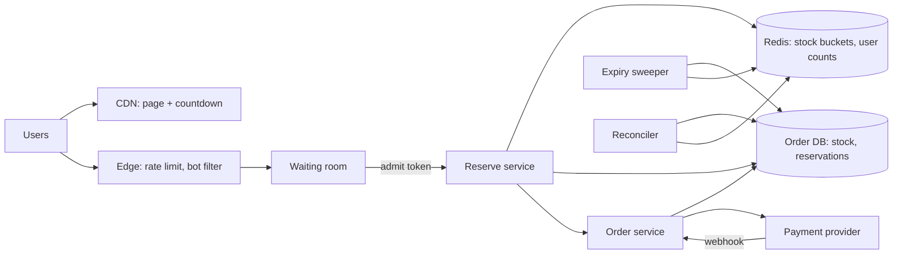

## In one minute
- A flash sale is a contention problem disguised as a scale problem: millions of requests chase a few thousand units of one SKU. Most of the work is saying "no" cheaply and fairly.
- Put a **waiting room** at the edge so the backend sees a controlled admission rate, not the raw stampede.
- Decrement inventory with an **atomic check-and-decrement** in memory (a Redis Lua script), with the per-user limit checked in the same atomic step. Split hot stock into buckets so one key on one core is not the ceiling.
- Treat the in-memory reservation as a ticket to try, not the sale. The order database does a final conditional decrement and is the record of truth, and every step from reserve to order to payment is **idempotent**.
- Reservations expire and return stock, and a reconciler compares Redis, the order DB and payments after every sale.

## Requirements
Functional:
- Merchants schedule a sale: SKU, units, price, start time, per-user limit (for example 2).
- Before the start, users see a countdown; at the start, they click buy and either get a reservation or a clear "sold out".
- A reservation lasts a few minutes while the user pays. Paid reservations become orders; unpaid ones return stock.
- Users can see their order status, and retries never create duplicate orders or charges.

Non-functional:
- Never oversell. Undersell (a few units left unsold at the end) is acceptable and can be swept into a second wave.
- Fairness: roughly first-come, first-served among real users; bots and scripted retries must not dominate.
- The rest of the store must keep working during the sale. A flash sale must not take down checkout for normal products.
- Reserve decision p99 under 500 ms for admitted users.

Out of scope: building the payment processor, recommendation and search, multi-SKU carts during the sale (we allow one sale SKU per order), and shipping.

## Back-of-envelope
Planning assumptions: 100,000 units of one phone, limit 2 per user, starting at noon.

- Interested users: 10M, most of whom open the page in the last two minutes. The page and countdown are static and come from a CDN.
- The click at noon: if 10M users click within 10 seconds, each with about 1.5 attempts including retries, edge traffic is 10M × 1.5 / 10 s = **1.5M requests per second**. Daily averages are irrelevant; the peak is the target. Real cliffs look like this: at the start of Singles' Day 2018, one Alibaba database cluster saw transactions jump about 122 times in the first second after midnight, on the way to a peak of 491,000 sales transactions per second ([X-Engine, SIGMOD 2019](https://users.cs.utah.edu/~lifeifei/papers/sigmod-xengine.pdf)).
- Admitted to the reserve API: the waiting room admits, say, 50,000 users per second. Units go in roughly 100,000 / 1.6 (average units per order) ≈ 62,500 reservations, so admitted demand exceeds stock within about 1.5 to 2 seconds.
- Order writes: about 62,500 orders, created over roughly 2 to 5 minutes as users pay, so a few hundred to 1,000 inserts per second into the order DB.
- Storage: an order with line items and payment metadata is about 2 KB, so a sale produces 62,500 × 2 KB ≈ 125 MB. With 50 big sales per year plus everyday orders, flash-sale data over 5 years is about 125 MB × 250 ≈ 31 GB. Request logs dominate: 1.5M rps × 10 s × 500 B ≈ 7.5 GB for the noon burst alone.
- Bandwidth: at the edge, 1.5M rps × about 1 KB of request and response is roughly 1.5 GB/s, which is CDN and edge-proxy territory, not origin territory.

## API
```text
GET  /v1/sales/{saleId}                      -> {sku, price, startsAt, limit, state:"upcoming|live|sold_out"}
POST /v1/sales/{saleId}/queue                -> {queueToken, position, etaSeconds}
GET  /v1/sales/{saleId}/queue/{queueToken}   -> {state:"waiting|admitted", admitToken?}

POST /v1/sales/{saleId}/reservations
  Headers: Admit-Token, Idempotency-Key: <uuid>
  {qty: 1}
  -> 201 {reservationId:"r_81", expiresAt}
  -> 409 {error:"sold_out" | "limit_reached"}

POST /v1/reservations/{reservationId}/order
  Headers: Idempotency-Key: <uuid>
  {paymentMethodId}
  -> 201 {orderId:"o_55", status:"pending_payment|paid"}

GET  /v1/orders/{orderId}
```
The admit token is a short-lived signed token (user ID, sale ID, expiry) that the reserve endpoint verifies statelessly. The reserve and order endpoints both accept client-generated idempotency keys.

## Data model
- **Redis, per sale.** `sale:{id}:stock:{b}` integer counters, one per bucket b (16 buckets of 6,250 units each); `sale:{id}:user:{uid}` an integer of units reserved by the user, with a TTL just beyond the sale; `sale:{id}:req:{key}` the stored result for an idempotency key, TTL one hour. Keys use a hash tag (`{sale:id:b}`) when bucket and user state must live in the same Redis Cluster slot. More on that below.
- **`sales`** (SQL): `sale_id PK, sku, price, total_units, per_user_limit, starts_at, state`. Small, cached, read by everything.
- **`stock_buckets`** (SQL): `(sale_id, bucket) PK, remaining`. The authoritative stock, split the same way as Redis so the final decrement also avoids a single hot row.
- **`reservations`** (SQL): `reservation_id PK, sale_id, user_id, qty, bucket, expires_at, status, idempotency_key UNIQUE`. Partition key `sale_id`; index on `(sale_id, status, expires_at)` for the expiry sweeper.
- **`orders`** (SQL): `order_id PK, reservation_id UNIQUE, user_id, sale_id, amount, payment_intent_id UNIQUE, status`. Partition by `user_id` like the rest of the order system so "my orders" is one shard. The unique `reservation_id` makes order creation idempotent at the database level.
- **`user_sale_counts`** (SQL): `(sale_id, user_id) PK, units`. A durable mirror of the per-user limit, updated in the same transaction as the reservation insert.

## High-level design


Write path. Before the sale, a loader writes stock buckets to Redis and SQL and warms the sale record into every cache. At noon, the CDN keeps serving the static page while clicks go to the edge, which applies per-IP and per-account rate limits and bot scoring, then to the waiting room. The waiting room hands out admit tokens at a fixed rate, randomising order among everyone who arrived in the first second so that a few milliseconds of network advantage do not decide the winner. An admitted user calls reserve. The reserve service runs one Lua script that checks the idempotency key, checks the user's count against the limit, picks a bucket with stock, and decrements. On success it inserts the reservation row and conditionally decrements the matching SQL bucket in one transaction. Then the user pays; the order service creates the order with the reservation ID as its unique key and the payment intent with the same key, and marks the order paid when the provider's webhook arrives.

Read path. The sale page, price and countdown come from the CDN. "Is it sold out?" comes from a single flag in Redis that the reserve service flips when all buckets hit zero, replicated to the edge config so the edge can answer "sold out" without touching origin. Order status reads go to the order DB through a cache.

## Deep dives

### Atomic decrement on a hot key
The naive `GET stock; if > 0 then DECR` has the classic race. Options considered. A SQL conditional `UPDATE` on one row is correct, but every buyer serialises on its row lock and WAL commit, topping out around a few thousand updates per second. Alibaba hit exactly this wall: in 2012 its inventory database ran out of capacity at midnight on Double Eleven, and the fix was to turn the lock scramble on a hot item's row into an orderly queue inside the database ([Alibaba Cloud](https://www.alibabacloud.com/blog/a-decade-of-evolution-of-alibabas-databases---part-1_594444)). Plain Redis `DECR` with a compensating `INCR` on a negative result is fast but lets the counter dip below zero. Third, a Lua script that reads, checks and decrements atomically, which Redis guarantees: while a script runs, all other server activity is blocked ([Redis docs](https://redis.io/docs/latest/develop/programmability/eval-intro/)).

Choice: the Lua script, plus bucketing. One Redis key lives on one shard and one core, which handles roughly tens of thousands to around 100,000 simple scripts per second. That leaves little headroom at 50,000 admits per second, so we split stock into 16 buckets across shards. The reserve service hashes the user to a starting bucket and, if that bucket is empty, tries the next few. Near the end, buckets drain unevenly and some users see "sold out" while another bucket still has a few units. That is undersell, which we accept and fix with a "last units" sweep that consolidates leftovers into one bucket after the first minute.

### Per-user limit and fairness
The limit must be checked atomically with the decrement, or a user firing 20 parallel requests can pass the check 20 times. So the same script reads `sale:{id}:user:{uid}`, rejects if `count + qty > limit`, and increments it alongside the stock. That requires the user key and the bucket key in the same Redis Cluster slot, which conflicts with spreading buckets across shards. The fix is to route by user: hash the user ID to choose a bucket, place the user's counter in that bucket's slot with a hash tag, and only fall back to other buckets through a second script that checks the limit key first. A durable copy in `user_sale_counts` catches anyone who slips through a Redis failover.

Admission order matters too. Shopify's first flash-sale throttle let a fixed number of checkouts through per window and had everyone else poll; because polling was effectively a lottery, some buyers waited up to 40 minutes, about as long as the sale ([Shopify Engineering](https://shopify.engineering/surviving-flashes-of-high-write-traffic-using-scriptable-load-balancers-part-i)). That is why the waiting room here randomises only within the first second and is first-come, first-served after that.

The limit is per account, so fairness also depends on account quality: require login, require accounts older than a few days for high-demand sales, run bot scoring at the edge, and make the waiting room the only way to get an admit token.

### From reservation to paid order, exactly once
Redis and the SQL database cannot commit together, so a crash between the two writes leaves them disagreeing. Options considered: two-phase commit (not supported across Redis and SQL, and slow), Redis as the only truth (asynchronous replication means a failover can forget decrements and oversell), or SQL as the truth with Redis as a filter.

Choice: SQL is the truth. Redis lets through at most about the number of units in stock, so only around 60,000 requests ever reach the database, at a rate it can handle. The reservation transaction does `UPDATE stock_buckets SET remaining = remaining - $q WHERE sale_id=$s AND bucket=$b AND remaining >= $q` and inserts the reservation and user-count rows. If the conditional update matches nothing, Redis was optimistic; we return "sold out" and increment the Redis counter back. Order creation is idempotent through the unique `reservation_id`, and the payment intent uses the reservation ID as its idempotency key, so a double-clicked "pay" produces one order and one charge. A sweeper expires unpaid reservations, returning units to the SQL bucket and then to Redis; if the Redis increment is lost, the reconciler fixes it later. The error direction is always undersell.

## Down the stack

### Layer 1: The contract
Reserve either returns a reservation for exactly `qty` units or a definite refusal (sold out, limit reached). The sum of active and paid reservations never exceeds the sale's units, and no user's total exceeds the limit, as recorded in the order DB. Retrying any call with the same idempotency key returns the original result and has no further effect. Redis state may briefly undercount available stock (undersell) but never lets the DB oversell, because the DB re-checks.

### Layer 2: The mechanism
Redis processes commands on one main thread. `EVALSHA` runs a cached Lua script as a single command, so no other client's command interleaves with it: the `GET` of the idempotency key, the comparison against the user limit, the `DECRBY` on the bucket and the `INCRBY` on the user counter are observed by everyone as one step. The script must declare every key it touches in `KEYS` so Redis Cluster can verify they share one of its 16,384 hash slots, which is what the `{...}` hash tag guarantees ([Redis Cluster spec](https://redis.io/docs/latest/operate/oss_and_stack/reference/cluster-spec/)); a cross-slot script is rejected with `CROSSSLOT`. The script cache itself is volatile: a restart or a failover to a replica can empty it, and `EVALSHA` then fails with `NOSCRIPT` until the client reloads the script ([Redis docs](https://redis.io/docs/latest/develop/programmability/eval-intro/)). Since Redis 7.0, Redis Functions (`FUNCTION LOAD`, then `FCALL`) are the alternative: the code is persisted to the AOF and replicated to replicas like data, though in a Redis Cluster you still load it on every primary yourself ([Redis docs](https://redis.io/docs/latest/develop/programmability/functions-intro/)). Writes go to the replication stream asynchronously, and the `WAIT` command can block until N replicas acknowledge, at a latency cost. Even then Redis does not promise the write survives: the docs say `WAIT` does not make Redis strongly consistent, and a failover can still lose a write that reached replicas ([Redis docs](https://redis.io/docs/latest/commands/wait/)). In the SQL tier, the conditional `UPDATE ... WHERE remaining >= $q` takes a row lock on the bucket row; concurrent transactions queue on that lock, and under Read Committed each re-evaluates the predicate against the latest committed value when it gets the lock, so the count never goes negative.

### Layer 3: The machine
A small Lua script runs in perhaps 5 to 20 microseconds of CPU. Redis spends more time on networking than on the script: each request is a `read` from a socket that `epoll_wait` reported ready, RESP parsing, and a `write` back. Redis 6+ can offload socket reads and writes to I/O threads, but the script itself runs on one core, so one shard handles on the order of 100,000 scripts per second at best. Round-trip time inside one availability zone is about 0.2 to 0.5 ms, so pipelining and connection pooling matter more than script speed. With AOF set to `appendfsync everysec`, the default policy, a crash can lose up to about one second of decrements ([Redis docs](https://redis.io/docs/latest/operate/oss_and_stack/management/persistence/)), which is the formal reason Redis cannot be the ledger. On the SQL side, each bucket row update costs a WAL append and, at commit, an `fdatasync` on NVMe of around 50 to 200 microseconds, amortised by group commit across concurrent transactions.

### Why it's built this way
1. Demand exceeds supply by 100x or more, so the cheapest possible "no" must happen as early as possible: CDN, edge, waiting room, then memory, then disk.
2. A single counter must be updated atomically, and atomic updates on one key serialise on one core, so we split the counter into buckets and accept a little undersell at the tail.
3. In-memory stores replicate asynchronously and fsync lazily, so they cannot be the ledger; the durable database re-checks every decision that matters.
4. Networks and users retry, so every step carries an idempotency key and a unique constraint that turns duplicates into lookups.
5. Payments are slow and fallible, so reservations expire and return stock instead of holding it forever.

## Failure modes
- **10x the expected crowd.** The waiting room absorbs it: admission rate is fixed, so the backend load does not change; only queue position grows. The edge and CDN must be sized for the raw request rate, and the "sold out" flag pushed to the edge cuts traffic as soon as stock is gone.
- **Redis primary fails mid-sale.** The replica may lack the last few decrements, so it thinks more stock exists. The SQL conditional decrement rejects the excess; those users see "sold out" a moment later than ideal. Pause admission for a few seconds during failover, and expect `NOSCRIPT` from the new primary until the reserve script is reloaded (or use Redis Functions, which replicate).
- **Region outage.** Run each sale in one home region with a cold standby. Losing that region during a two-minute sale is rare and the right answer is to pause and reschedule, not to run active-active inventory, which would need cross-region consensus on every decrement.
- **Hot key on the sale record or the sold-out flag.** Every request reads it. Cache it in process memory on every reserve server with a 1-second refresh, and push it to the edge.
- **Payment provider slowdown.** Reservations expire before payment completes. Extend reservations once when payment starts and cap the extension; reconcile late successful payments by refunding if the reservation already expired and its stock was resold.
- **Spill-over onto normal checkout.** Run flash-sale services in separate pools and databases so a sale cannot exhaust connections that regular checkout needs.

## In the wild
- **Alibaba, 2012: the midnight inventory row.** At 00:00 on Double Eleven 2012, Alibaba's inventory database ran out of capacity: every buyer of a popular item updated the same row, threads fought over its row lock, and throughput collapsed. Alibaba reports a large number of oversold orders that night. For 2013 its database team built two fixes into AliSQL, queuing updates to the same row and a concurrency-control change, both behind switches, and a 2016 rework made inventory deduction about 10 times faster again ([Alibaba Cloud](https://www.alibabacloud.com/blog/a-decade-of-evolution-of-alibabas-databases---part-1_594444)).
- **Shopify, 2016: one store's sale takes down its neighbours.** Checkout was write-heavy, with every step updating the same MySQL record. A Kylie Cosmetics flash sale in February 2016 overloaded its database shard and took down the other stores on that shard too. Shopify answered with a leaky-bucket throttle in its Nginx and OpenResty edge, which then needed a fairer queue because random polling left some buyers waiting 40 minutes ([Shopify Engineering](https://shopify.engineering/surviving-flashes-of-high-write-traffic-using-scriptable-load-balancers-part-i)). It is the case for separate pools and databases for sale traffic.
- **Twilio, 2013: a Redis balance store that could not be written.** A network blip made Redis replicas resync at once, and a misdiagnosed restart left the billing master read-only with balances at zero. Usage kept triggering automatic card recharges that could not update the balance, so customers were charged repeatedly; 1.4% were affected and all were refunded. Twilio added fail-safes that block charges when a balance is missing or unwritable, and validation against its double-entry ledger. Redis held money-like state with nothing durable re-checking it ([Twilio](https://www.twilio.com/en-us/blog/company/communications/billing-incident-post-mortem-breakdown-analysis-and-root-cause-html)).

## Trade-offs
| Option | Strengths | Weaknesses | Choose when |
|---|---|---|---|
| SQL conditional decrement only | Simple, durable, correct | One hot row caps at a few thousand per second | Small sales, stock under a few thousand |
| Redis Lua gate + SQL truth | Absorbs huge bursts, DB stays correct | Two stores to reconcile, slight undersell | Large, spiky sales (our choice) |
| Redis as the only truth | Fastest, simplest | Failover can oversell | Losing a few units is acceptable |
| Queue all requests, single consumer | Perfect ordering, no contention | Users wait for a result; consumer is a bottleneck | Lottery-style or "register interest" sales |
| Bucketed counters | Spreads load across cores and shards | Uneven drain, tail undersell | Any key above about 50,000 updates per second |

## Leadership lens
- Build first: the reserve Lua script and the SQL conditional decrement with a load test that fires 1M requests at 1,000 units and asserts exactly 1,000 sold. Then the waiting room; then the sweeper and reconciler.
- Rollout: start with small sales (a few hundred units) using SQL only, add the Redis gate once you have measured row-lock limits, and run game days that replay a recorded noon burst against staging.
- Ownership: a growth or promotions team owns sale configuration and the waiting room; the inventory team owns the reserve path and reconciliation; payments owns intents and refunds.
- Cost drivers: CDN and edge capacity for a 10-second spike, and a dedicated Redis and DB pool that sits idle between sales. Pre-scale before announced sales instead of relying on autoscaling, which reacts in minutes.

## Check yourself
1. Why is the in-memory Redis decrement treated as a ticket to try rather than the sale itself?
   **Answer:** Redis replicates asynchronously and fsyncs lazily, so a failover or crash can forget recent decrements and oversell if it were the ledger. SQL is the truth: its conditional `UPDATE ... WHERE remaining >= $q` re-checks every reservation, and Redis only filters traffic down to roughly the number of units in stock.
2. The Redis primary fails in the middle of the sale. What do users see, and why is nothing oversold?
   **Answer:** The replica may lack the last few decrements and believe more stock exists, but the SQL conditional decrement rejects the excess, so those users see "sold out" a moment later than ideal. Admission is paused for a few seconds during failover.
3. What does splitting stock into 16 buckets buy, and what does it cost?
   **Answer:** One Redis key lives on one core that handles at most around 100,000 scripts per second, which leaves little headroom at 50,000 admits per second, so buckets spread the load across shards. The cost is uneven drain near the end, where some users see "sold out" while another bucket still has units, an undersell fixed by a "last units" sweep.
4. With 10M users clicking within 10 seconds, what request rate must the edge handle, and why does the backend not see it?
   **Answer:** About 10M times 1.5 attempts over 10 seconds, roughly 1.5M requests per second. The waiting room admits a fixed rate such as 50,000 users per second, so backend load stays the same however large the crowd, and only queue positions grow.

## Practice
**Task:** Implement an in-memory flash-sale inventory. `FlashSale(stock, limit)` starts with `stock` units and a per-user limit. `reserve(user, qty, requestId)` returns a reservation ID `"r1"`, `"r2"`, ... (numbered across the whole sale), or one of `"invalid"` (qty < 1), `"limit"` (the user's active plus committed units would exceed the limit) or `"sold_out"` (fewer than `qty` units remain; never partial). Checks run in that order. A repeated `requestId` returns the original result and changes nothing. `commit(reservationId)` turns an active reservation into an order and returns `"o1"`, `"o2"`, ...; committing again returns the same order ID; unknown or cancelled reservations return `""`. `cancel(reservationId)` returns an active, uncommitted reservation's units to stock and to the user's quota and returns true, otherwise false. `remaining()` returns units left.

```python starter
class FlashSale:
    def __init__(self, stock, limit):
        # TODO
        pass

    def reserve(self, user, qty, request_id):
        raise NotImplementedError

    def commit(self, reservation_id):
        raise NotImplementedError

    def cancel(self, reservation_id):
        raise NotImplementedError

    def remaining(self):
        raise NotImplementedError
```

```python tests
def test_reserve_decrements_and_never_partial():
    s = FlashSale(3, 5)
    assert s.reserve("ann", 2, "q1") == "r1"
    assert s.remaining() == 1
    assert s.reserve("bob", 2, "q2") == "sold_out"
    assert s.remaining() == 1
    assert s.reserve("bob", 1, "q3") == "r2"
    assert s.remaining() == 0


def test_per_user_limit():
    s = FlashSale(10, 2)
    assert s.reserve("ann", 1, "a") == "r1"
    assert s.reserve("ann", 2, "b") == "limit"
    assert s.reserve("ann", 1, "c") == "r2"
    assert s.reserve("ann", 1, "d") == "limit"
    assert s.reserve("bob", 2, "e") == "r3"


def test_idempotent_request_id():
    s = FlashSale(5, 5)
    assert s.reserve("ann", 2, "same") == "r1"
    assert s.reserve("ann", 2, "same") == "r1"
    assert s.remaining() == 3, "retry must not decrement twice"
    s2 = FlashSale(1, 5)
    assert s2.reserve("ann", 3, "x") == "sold_out"
    assert s2.reserve("ann", 3, "x") == "sold_out"


def test_commit_is_idempotent():
    s = FlashSale(5, 5)
    r1 = s.reserve("ann", 1, "a")
    r2 = s.reserve("bob", 1, "b")
    assert s.commit(r2) == "o1"
    assert s.commit(r2) == "o1"
    assert s.commit(r1) == "o2"
    assert s.commit("r99") == ""


def test_cancel_returns_stock_and_quota():
    s = FlashSale(2, 2)
    r = s.reserve("ann", 2, "a")
    assert s.cancel(r)
    assert not s.cancel(r)
    assert s.remaining() == 2
    assert s.commit(r) == ""
    r2 = s.reserve("ann", 2, "b")
    assert s.commit(r2) == "o1"
    assert not s.cancel(r2), "committed reservation cannot be cancelled"
    assert s.remaining() == 0


def test_invalid_qty():
    s = FlashSale(5, 5)
    assert s.reserve("ann", 0, "a") == "invalid"
    assert s.reserve("ann", -1, "b") == "invalid"
    assert s.remaining() == 5


def test_never_oversells():
    s = FlashSale(5, 1)
    wins = [s.reserve("u%d" % i, 1, "k%d" % i) for i in range(50)]
    assert len([w for w in wins if w.startswith("r")]) == 5
    assert s.remaining() == 0
```

```python solution
class FlashSale:
    def __init__(self, stock, limit):
        self.stock = stock
        self.limit = limit
        self.per_user = {}
        self.results = {}
        self.res = {}       # rid -> {"user", "qty", "state", "order"}
        self.next_res = 1
        self.next_order = 1

    def remaining(self):
        return self.stock

    def reserve(self, user, qty, request_id):
        if request_id in self.results:
            return self.results[request_id]
        if qty < 1:
            out = "invalid"
        elif self.per_user.get(user, 0) + qty > self.limit:
            out = "limit"
        elif qty > self.stock:
            out = "sold_out"
        else:
            self.stock -= qty
            self.per_user[user] = self.per_user.get(user, 0) + qty
            out = "r%d" % self.next_res
            self.next_res += 1
            self.res[out] = {"user": user, "qty": qty, "state": "active", "order": ""}
        self.results[request_id] = out
        return out

    def commit(self, reservation_id):
        r = self.res.get(reservation_id)
        if r is None or r["state"] == "cancelled":
            return ""
        if r["state"] == "active":
            r["order"] = "o%d" % self.next_order
            self.next_order += 1
            r["state"] = "committed"
        return r["order"]

    def cancel(self, reservation_id):
        r = self.res.get(reservation_id)
        if r is None or r["state"] != "active":
            return False
        r["state"] = "cancelled"
        self.stock += r["qty"]
        self.per_user[r["user"]] -= r["qty"]
        return True
```

```typescript starter
export class FlashSale {
  constructor(stock: number, limit: number) {}
  reserve(user: string, qty: number, requestId: string): string {
    throw new Error("TODO");
  }
  commit(reservationId: string): string {
    throw new Error("TODO");
  }
  cancel(reservationId: string): boolean {
    throw new Error("TODO");
  }
  remaining(): number {
    throw new Error("TODO");
  }
}
```

```typescript tests
test("reserve decrements and never partial", () => {
  const s = new FlashSale(3, 5);
  assertEqual(s.reserve("ann", 2, "q1"), "r1");
  assertEqual(s.remaining(), 1);
  assertEqual(s.reserve("bob", 2, "q2"), "sold_out");
  assertEqual(s.remaining(), 1);
  assertEqual(s.reserve("bob", 1, "q3"), "r2");
  assertEqual(s.remaining(), 0);
});

test("per user limit", () => {
  const s = new FlashSale(10, 2);
  assertEqual(s.reserve("ann", 1, "a"), "r1");
  assertEqual(s.reserve("ann", 2, "b"), "limit");
  assertEqual(s.reserve("ann", 1, "c"), "r2");
  assertEqual(s.reserve("ann", 1, "d"), "limit");
  assertEqual(s.reserve("bob", 2, "e"), "r3");
});

test("idempotent request id", () => {
  const s = new FlashSale(5, 5);
  assertEqual(s.reserve("ann", 2, "same"), "r1");
  assertEqual(s.reserve("ann", 2, "same"), "r1");
  assertEqual(s.remaining(), 3, "retry must not decrement twice");
  const s2 = new FlashSale(1, 5);
  assertEqual(s2.reserve("ann", 3, "x"), "sold_out");
  assertEqual(s2.reserve("ann", 3, "x"), "sold_out");
});

test("commit is idempotent", () => {
  const s = new FlashSale(5, 5);
  const r1 = s.reserve("ann", 1, "a");
  const r2 = s.reserve("bob", 1, "b");
  assertEqual(s.commit(r2), "o1");
  assertEqual(s.commit(r2), "o1");
  assertEqual(s.commit(r1), "o2");
  assertEqual(s.commit("r99"), "");
});

test("cancel returns stock and quota", () => {
  const s = new FlashSale(2, 2);
  const r = s.reserve("ann", 2, "a");
  assert(s.cancel(r), "cancel");
  assert(!s.cancel(r), "second cancel");
  assertEqual(s.remaining(), 2);
  assertEqual(s.commit(r), "");
  const r2 = s.reserve("ann", 2, "b");
  assertEqual(s.commit(r2), "o1");
  assert(!s.cancel(r2), "committed reservation cannot be cancelled");
  assertEqual(s.remaining(), 0);
});

test("invalid qty", () => {
  const s = new FlashSale(5, 5);
  assertEqual(s.reserve("ann", 0, "a"), "invalid");
  assertEqual(s.reserve("ann", -1, "b"), "invalid");
  assertEqual(s.remaining(), 5);
});

test("never oversells", () => {
  const s = new FlashSale(5, 1);
  let wins = 0;
  for (let i = 0; i < 50; i++) {
    if (s.reserve("u" + i, 1, "k" + i).startsWith("r")) wins++;
  }
  assertEqual(wins, 5);
  assertEqual(s.remaining(), 0);
});
```

```typescript solution
interface Reservation {
  user: string;
  qty: number;
  state: "active" | "committed" | "cancelled";
  order: string;
}

export class FlashSale {
  private perUser = new Map<string, number>();
  private results = new Map<string, string>();
  private res = new Map<string, Reservation>();
  private nextRes = 1;
  private nextOrder = 1;

  constructor(private stock: number, private limit: number) {}

  remaining(): number {
    return this.stock;
  }

  reserve(user: string, qty: number, requestId: string): string {
    const prev = this.results.get(requestId);
    if (prev !== undefined) return prev;
    const used = this.perUser.get(user) ?? 0;
    let out: string;
    if (qty < 1) out = "invalid";
    else if (used + qty > this.limit) out = "limit";
    else if (qty > this.stock) out = "sold_out";
    else {
      this.stock -= qty;
      this.perUser.set(user, used + qty);
      out = "r" + this.nextRes++;
      this.res.set(out, { user, qty, state: "active", order: "" });
    }
    this.results.set(requestId, out);
    return out;
  }

  commit(reservationId: string): string {
    const r = this.res.get(reservationId);
    if (!r || r.state === "cancelled") return "";
    if (r.state === "active") {
      r.order = "o" + this.nextOrder++;
      r.state = "committed";
    }
    return r.order;
  }

  cancel(reservationId: string): boolean {
    const r = this.res.get(reservationId);
    if (!r || r.state !== "active") return false;
    r.state = "cancelled";
    this.stock += r.qty;
    this.perUser.set(r.user, (this.perUser.get(r.user) ?? 0) - r.qty);
    return true;
  }
}
```

```go starter
package practice

type FlashSale struct{}

func NewFlashSale(stock, limit int) *FlashSale {
	return &FlashSale{}
}

func (s *FlashSale) Reserve(user string, qty int, requestID string) string {
	panic("TODO")
}

func (s *FlashSale) Commit(reservationID string) string {
	panic("TODO")
}

func (s *FlashSale) Cancel(reservationID string) bool {
	panic("TODO")
}

func (s *FlashSale) Remaining() int {
	panic("TODO")
}
```

```go tests
package practice

import (
	"fmt"
	"strings"
	"testing"
)

func eq(t *testing.T, got, want interface{}, msg string) {
	t.Helper()
	if got != want {
		t.Fatalf("%s: got %v, want %v", msg, got, want)
	}
}

func TestReserveDecrementsAndNeverPartial(t *testing.T) {
	s := NewFlashSale(3, 5)
	eq(t, s.Reserve("ann", 2, "q1"), "r1", "first")
	eq(t, s.Remaining(), 1, "remaining")
	eq(t, s.Reserve("bob", 2, "q2"), "sold_out", "partial")
	eq(t, s.Remaining(), 1, "remaining after refusal")
	eq(t, s.Reserve("bob", 1, "q3"), "r2", "last unit")
	eq(t, s.Remaining(), 0, "empty")
}

func TestPerUserLimit(t *testing.T) {
	s := NewFlashSale(10, 2)
	eq(t, s.Reserve("ann", 1, "a"), "r1", "a")
	eq(t, s.Reserve("ann", 2, "b"), "limit", "b")
	eq(t, s.Reserve("ann", 1, "c"), "r2", "c")
	eq(t, s.Reserve("ann", 1, "d"), "limit", "d")
	eq(t, s.Reserve("bob", 2, "e"), "r3", "e")
}

func TestIdempotentRequestID(t *testing.T) {
	s := NewFlashSale(5, 5)
	eq(t, s.Reserve("ann", 2, "same"), "r1", "first")
	eq(t, s.Reserve("ann", 2, "same"), "r1", "retry")
	eq(t, s.Remaining(), 3, "retry must not decrement twice")
	s2 := NewFlashSale(1, 5)
	eq(t, s2.Reserve("ann", 3, "x"), "sold_out", "first")
	eq(t, s2.Reserve("ann", 3, "x"), "sold_out", "retry")
}

func TestCommitIsIdempotent(t *testing.T) {
	s := NewFlashSale(5, 5)
	r1 := s.Reserve("ann", 1, "a")
	r2 := s.Reserve("bob", 1, "b")
	eq(t, s.Commit(r2), "o1", "commit r2")
	eq(t, s.Commit(r2), "o1", "recommit r2")
	eq(t, s.Commit(r1), "o2", "commit r1")
	eq(t, s.Commit("r99"), "", "unknown")
}

func TestCancelReturnsStockAndQuota(t *testing.T) {
	s := NewFlashSale(2, 2)
	r := s.Reserve("ann", 2, "a")
	eq(t, s.Cancel(r), true, "cancel")
	eq(t, s.Cancel(r), false, "second cancel")
	eq(t, s.Remaining(), 2, "stock back")
	eq(t, s.Commit(r), "", "commit cancelled")
	r2 := s.Reserve("ann", 2, "b")
	eq(t, s.Commit(r2), "o1", "commit")
	eq(t, s.Cancel(r2), false, "committed reservation cannot be cancelled")
	eq(t, s.Remaining(), 0, "sold")
}

func TestInvalidQty(t *testing.T) {
	s := NewFlashSale(5, 5)
	eq(t, s.Reserve("ann", 0, "a"), "invalid", "zero")
	eq(t, s.Reserve("ann", -1, "b"), "invalid", "negative")
	eq(t, s.Remaining(), 5, "unchanged")
}

func TestNeverOversells(t *testing.T) {
	s := NewFlashSale(5, 1)
	wins := 0
	for i := 0; i < 50; i++ {
		if strings.HasPrefix(s.Reserve(fmt.Sprintf("u%d", i), 1, fmt.Sprintf("k%d", i)), "r") {
			wins++
		}
	}
	eq(t, wins, 5, "wins")
	eq(t, s.Remaining(), 0, "remaining")
}
```

```go solution
package practice

import (
	"fmt"
	"sync"
)

type reservation struct {
	user  string
	qty   int
	state string // active, committed, cancelled
	order string
}

type FlashSale struct {
	mu        sync.Mutex
	stock     int
	limit     int
	perUser   map[string]int
	results   map[string]string
	res       map[string]*reservation
	nextRes   int
	nextOrder int
}

func NewFlashSale(stock, limit int) *FlashSale {
	return &FlashSale{stock: stock, limit: limit, perUser: map[string]int{},
		results: map[string]string{}, res: map[string]*reservation{}, nextRes: 1, nextOrder: 1}
}

func (s *FlashSale) Remaining() int {
	s.mu.Lock()
	defer s.mu.Unlock()
	return s.stock
}

func (s *FlashSale) Reserve(user string, qty int, requestID string) string {
	s.mu.Lock()
	defer s.mu.Unlock()
	if prev, ok := s.results[requestID]; ok {
		return prev
	}
	var out string
	switch {
	case qty < 1:
		out = "invalid"
	case s.perUser[user]+qty > s.limit:
		out = "limit"
	case qty > s.stock:
		out = "sold_out"
	default:
		s.stock -= qty
		s.perUser[user] += qty
		out = fmt.Sprintf("r%d", s.nextRes)
		s.nextRes++
		s.res[out] = &reservation{user: user, qty: qty, state: "active"}
	}
	s.results[requestID] = out
	return out
}

func (s *FlashSale) Commit(reservationID string) string {
	s.mu.Lock()
	defer s.mu.Unlock()
	r, ok := s.res[reservationID]
	if !ok || r.state == "cancelled" {
		return ""
	}
	if r.state == "active" {
		r.order = fmt.Sprintf("o%d", s.nextOrder)
		s.nextOrder++
		r.state = "committed"
	}
	return r.order
}

func (s *FlashSale) Cancel(reservationID string) bool {
	s.mu.Lock()
	defer s.mu.Unlock()
	r, ok := s.res[reservationID]
	if !ok || r.state != "active" {
		return false
	}
	r.state = "cancelled"
	s.stock += r.qty
	s.perUser[r.user] -= r.qty
	return true
}
```

## Mock interview
**Prompt:** Design a flash sale for an e-commerce site: 100,000 units of a new phone go on sale at noon, limit two per customer, and we expect around 10 million people to try to buy in the first few seconds. The rest of the store must stay healthy.

- Follow-up: show me exactly how you decrement stock so that two requests for the last unit cannot both succeed. Where does that code run, and how fast can it go?
- Follow-up: your Redis primary fails over 20 seconds into the sale. What can go wrong and how does the design contain it?
- Follow-up: why not just put every request on a queue and process them one at a time?

**A strong answer covers:**
- Layered rejection: CDN for static content, edge rate limits and bot filtering, a waiting room with a fixed admission rate, then the inventory check.
- An atomic check-and-decrement that also enforces the per-user limit in the same step, with a clear statement of the single-key throughput ceiling and bucketing to exceed it.
- A durable store as the record of truth with a conditional decrement, and an explicit argument for why the in-memory gate cannot be the ledger.
- Idempotency keys and unique constraints on reservation, order and payment, so retries and double clicks are harmless.
- Expiring reservations, a sweeper, and a reconciler, with undersell chosen over oversell as the safe error direction.
- Isolation of flash-sale infrastructure from normal checkout.

## Sources and further study
**Primary**
- [X-Engine: An Optimized Storage Engine for Large-Scale E-Commerce Transaction Processing (Huang et al., SIGMOD 2019)](https://users.cs.utah.edu/~lifeifei/papers/sigmod-xengine.pdf): Alibaba's measurements of the Singles' Day midnight cliff and of hot records under flash sales.

**Systems docs**
- [Redis functions (Redis docs)](https://redis.io/docs/latest/develop/programmability/functions-intro/): why functions supersede cached `EVAL` scripts, and how they persist and replicate.
- [Redis cluster specification (Redis docs)](https://redis.io/docs/latest/operate/oss_and_stack/reference/cluster-spec/): hash slots, hash tags, multi-key rules, and the windows in which acknowledged writes can be lost.
- [WAIT (Redis docs)](https://redis.io/docs/latest/commands/wait/): what synchronous acknowledgement does and does not guarantee.
- [Redis persistence (Redis docs)](https://redis.io/docs/latest/operate/oss_and_stack/management/persistence/): AOF fsync policies and how much data each can lose.

**Books**
- Designing Data-Intensive Applications (Kleppmann, 1st ed., 2017), Ch 5 "Replication": asynchronous replication and failover data loss, the reason Redis is a gate and not the ledger.
- Release It! (Nygard, 2nd ed., 2018), Ch 5 "Stability Patterns" (Bulkheads, Fail Fast) and Ch 9 "Interconnect" (Demand Control): the patterns behind isolating sale traffic and refusing work early.

**Other curricula**
- [Queue-Based Load Leveling (Azure Architecture Center)](https://learn.microsoft.com/en-us/azure/architecture/patterns/queue-based-load-leveling): frames the waiting room as a buffer that lets the backend run at its own pace, and flags at-least-once delivery and idempotent consumers.
- [Handling overload (Google SRE book)](https://sre.google/sre-book/handling-overload/): frames rejection as a first-class feature, with per-customer limits and cheap early refusal.

## Watch
- [Flash Sale System: System Design Interview (TechPrep)](https://www.youtube.com/watch?v=U2Acfwcah80): an interview-style walkthrough of the same question.
- [Redis Deep Dive w/ a Ex-Meta Senior Manager (Hello Interview)](https://www.youtube.com/watch?v=fmT5nlEkl3U): Redis's threading model, atomic operations and hot-key handling, which the reserve path depends on.

## Free resources
- [Surviving flashes of high-write traffic using scriptable load balancers, part I (Shopify Engineering)](https://shopify.engineering/surviving-flashes-of-high-write-traffic-using-scriptable-load-balancers-part-i): how Shopify throttles checkout floods at the edge during flash sales.
- [Surviving flashes of high-write traffic, part II (Shopify Engineering)](https://shopify.engineering/surviving-flashes-of-high-write-traffic-using-scriptable-load-balancers-part-ii): the leaky-bucket queue and fairness details behind that edge throttle.
- [Scripting with Lua (Redis docs)](https://redis.io/docs/latest/develop/interact/programmability/eval-intro/): the atomicity guarantees and key-declaration rules for scripts.
- [Implementing Stripe-like idempotency keys in Postgres (Brandur Leach)](https://brandur.org/idempotency-keys): a thorough design for idempotent multi-step operations backed by a database.
- [Cloudflare Waiting Room (Cloudflare blog)](https://blog.cloudflare.com/cloudflare-waiting-room/): a production virtual queue that admits users at a controlled rate.
