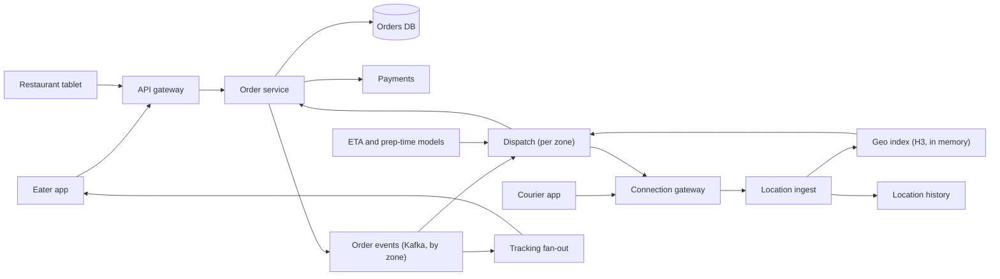

## In one minute
- This is a three-sided marketplace: eaters, restaurants and couriers. The interesting system is not the menu or the cart but the dispatch loop that decides which courier takes which orders and when to send them.
- Dispatch is a periodic optimization, not a nearest-courier lookup. Every few tens of seconds per zone, score candidate (courier, order bundle) pairs and solve an assignment problem, because a greedy instant match wastes couriers and makes food wait.
- Batching two orders from the same or nearby restaurants onto one courier is the biggest efficiency lever, and it is constrained by a promised delivery time. The core trade-off is courier cost against eater wait.
- Everything depends on two predictions: when the food will be ready and how long travel takes. Bad ETAs create either cold food (courier late) or idle couriers (courier early).
- Keep the order and payment state machine strongly consistent and the courier location stream lossy. They have different volumes, different stores and different failure handling.

## Requirements
Functional:
- Eaters browse nearby restaurants and menus, place an order, pay, and track it live.
- Restaurants receive orders (tablet or POS integration), accept them, and mark them ready.
- Couriers go online, stream their location, receive offers for one or more orders, accept or decline, and confirm pickup and drop-off.
- The system quotes an ETA at checkout and keeps it updated.

Non-functional:
- An order is assigned to at most one courier at a time, and a courier never receives conflicting offers.
- Offer latency: a new order gets a courier within a minute or two in a healthy market, and dispatch decisions are made in seconds.
- Ordering and payment availability above 99.95%. Dinner peaks are several times the daily average, so the system must scale to the peak, not the mean.
- Tracking freshness: courier positions on the eater's map lag by no more than about 5 to 10 seconds.

Out of scope: restaurant onboarding, promotions, ratings, grocery and retail, courier pay calculation and fraud. Search and recommendations get one paragraph, not a deep dive.

## Back-of-envelope
Planning numbers only. Assume 10 million orders per day across the platform. The daily average is 10M / 86,400, which is about 115 orders per second. Food is peaky: lunch and dinner might carry 60% of orders in about 5 hours, so dinner peak is roughly 10M x 0.6 / 18,000 seconds, about 330 per second, call it 500 per second with regional skew.

Couriers: assume 1 million online at the national peak, each sending a location every 5 seconds. That is 200,000 updates per second. At about 100 bytes each, that is 20 MB/s of ingress, a small bandwidth but a high message rate.

Dispatch work: a busy metro might have 3,000 open orders and 8,000 couriers at once. A full cost matrix would be 24 million pairs, but restricting each order to couriers within a few kilometres leaves maybe 50 candidates per order, so about 150,000 scored pairs per optimization round per metro. Each needs a travel-time estimate, which is why travel time comes from a precomputed or cached model, not a live routing call per pair.

Storage: orders at about 3 KB each (items, prices, addresses, state history) give 30 GB per day, roughly 55 TB over five years. Menus: 1 million restaurants x 200 items x 1 KB is about 200 GB, read-heavy and cacheable. Location history at 200,000 updates per second x 100 bytes is about 1.7 TB per day raw. Keep on-delivery traces at full resolution for disputes and ETA training, and downsample the rest.

Read traffic: tracking screens poll or subscribe for each active order. With perhaps 1 million active orders at peak and an update every 5 seconds, that is another 200,000 pushes per second out, mirroring the ingest.

## API
```
POST /v1/orders            Idempotency-Key: <uuid>
  body { restaurant_id, items: [ { item_id, qty, options } ], address, payment_method_id }
  -> 201 { order_id, state: "PLACED", quoted_eta: "2026-10-15T19:42:00Z" }

GET  /v1/orders/{id}        -> { state, courier: { lat, lng }, eta }
WS   /v1/orders/{id}/stream <- { state | courier_location | eta } events

// Restaurant
POST /v1/restaurant/orders/{id}/accept  body { prep_minutes }
POST /v1/restaurant/orders/{id}/ready

// Courier, over a persistent connection
-> LocationUpdate { courier_id, lat, lng, ts, status }
<- Offer { offer_id, orders: [ { order_id, pickup, dropoff } ], route, pay, expires_at }
-> OfferResponse { offer_id, accept: bool }
POST /v1/courier/orders/{id}/pickup | /dropoff
```

## Data model
**orders** (relational, partition key `order_id`, with a secondary index on `(restaurant_id, created_at)` and `(eater_id, created_at)`): items, totals, addresses, `state`, `courier_id`, `offer_id`, `version`, timestamps per state. Partitioned by order because almost all writes are to one order; the restaurant and eater indexes serve their dashboards. Strong consistency, since state drives money and the courier contract.

**order_events** (append-only log, Kafka topic partitioned by `zone_id`): every state change, consumed by dispatch, tracking, ETA and analytics. Partitioning by zone means one dispatcher instance sees all events for its zone in order.

**courier_state** (in memory in the dispatch service for its zone, backed by a replicated key-value store): `courier_id -> { status, lat, lng, last_ts, active_orders, offer_id, version }`. The `offer_id` and `version` fields make "this courier has an outstanding offer" a compare-and-set, which prevents conflicting offers.

**geo index** (in memory, keyed by H3 cell at a resolution of roughly 0.1 to 0.7 square kilometres, that is resolution 9 or 8 ([H3 cell statistics](https://h3geo.org/docs/core-library/restable/))): `cell -> set(courier_id)`, used to find candidates near a restaurant with a ring search.

**menus and restaurants** (document store plus cache, partition key `restaurant_id`): read-mostly; published to a CDN-backed cache and to a search index with a `geo_point` and opening hours.

**location_history** (wide-column or object store, partition `(courier_id, day)`): written asynchronously from the location stream.

## High-level design


Write path (order): the eater checks out. The order service validates the cart against the menu, authorizes payment with an idempotency key, writes the order as PLACED and publishes an event. The restaurant accepts and gives a prep estimate. The event lands in the zone's dispatch partition, and the order joins that zone's pool of unassigned orders with a target ready time and a promised delivery deadline.

Dispatch loop: every 20 to 60 seconds (shorter at peak), the zone's dispatcher takes the pool, generates candidate bundles (single orders and pairs from the same or nearby restaurants), finds nearby couriers through the H3 ring search, predicts pickup and drop-off times for each (courier, bundle), discards pairs that break a deadline, and solves the assignment. It may also choose to wait: if the food will not be ready for 15 minutes, sending a courier now only makes them idle at the restaurant. Chosen offers are written as a conditional update on the order (`state = UNASSIGNED AND version = v`) and the courier (`offer_id IS NULL`), then pushed over the courier's connection with an expiry of around 30 to 60 seconds. A decline or a timeout returns the orders to the pool for the next round.

Read path (tracking): the eater's app subscribes to the order's stream. The tracking service joins order events with the assigned courier's location stream and pushes an update every few seconds with a refreshed ETA.

## Deep dives

### Assignment and batching
The options, from simplest to best:
1. Greedy on arrival: give each new order to the nearest idle courier. Fast and simple, but it ignores orders arriving seconds later, never batches, and sends couriers to food that is not ready.
2. Periodic bipartite matching: collect orders for a short window, build a cost matrix of (courier, order), and solve minimum-cost matching (the Hungarian algorithm or a min-cost-flow solver). Better global outcomes, but one courier still gets one order.
3. Periodic matching over bundles: candidates include pairs (and sometimes triples) of orders, and the solver picks a set of (courier, bundle) pairs so that each order and courier appears at most once. This is a set-packing problem; in practice it is solved with a mixed-integer program under a time limit, or with a greedy heuristic plus local improvement. DoorDash has written publicly about moving from Hungarian matching to a MIP solver for this reason: the Hungarian algorithm is polynomial but too slow on large real-time instances and cannot express routes with two or more deliveries. In its benchmarks Gurobi solved the matching up to 10 times faster than the Hungarian algorithm and averaged 34 times faster than the open-source CBC solver, and the optimizer runs on several regional instances multiple times a minute ([DoorDash Engineering, 2020](https://careersatdoordash.com/blog/next-generation-optimization-for-dasher-dispatch-at-doordash/)).

I choose option 3 with a heuristic fallback. The cost of a candidate combines courier travel and wait time, eater lateness against the promise, and food sitting time. The hard constraint is that every order in a bundle meets its deadline. Only pair orders whose restaurants are close and whose drop-offs are roughly on the way. The candidate generator is where most of the speed comes from: pruning to the few dozen couriers and a handful of partner orders that are plausible keeps the problem small enough to solve within a few seconds.

The practice task implements the greedy version of this with an explicit deadline check, which is the baseline you would ship first and then measure the optimizer against.

### ETA and prep-time prediction
The pickup time is `max(courier arrival, food ready)` and the delivery time adds travel. Both terms are predictions with errors. Prep time comes from the restaurant's estimate, corrected by a model trained on history (time of day, order size, current queue at that restaurant). Travel time comes from a routing engine for the final quote and from a cheaper learned model or cached zone-to-zone matrix for the hundreds of thousands of candidate pairs per round. Uber has described a similar split for its ETA system: a routing-engine estimate corrected by a learned residual model, which it calls ETA post-processing. Its DeepETA model must answer in a few milliseconds, so it uses a linear-time transformer and bucketized inputs, and each prediction touches only about 0.25% of the parameters ([Uber Engineering, 2022](https://www.uber.com/us/en/blog/deepeta-how-uber-predicts-arrival-times/)). Two things matter in design review: use quantiles, not means, when checking deadlines (a p80 travel time protects the promise), and feed actual pickup and drop-off timestamps back as training labels.

### Exactly one courier per order
Offers can race: two dispatch rounds overlap after a restart, or a courier accepts an offer just as it expires and the order is reassigned. Make every transition a conditional write. Creating an offer sets `order.offer_id` only if it is null and the order is UNASSIGNED; accepting succeeds only if the offer ID still matches and has not expired, using the server's clock. One dispatcher owns each zone through a lease (etcd or ZooKeeper), and every write carries the lease's fencing token, so a paused old owner cannot write after a new one takes over. The token only helps if the orders store checks it and rejects anything lower than the highest it has seen; checking the lease in the dispatcher just before writing is not enough, because the pause can land between the check and the write ([Kleppmann](https://martin.kleppmann.com/2016/02/08/how-to-do-distributed-locking.html)). Accepting a batch must also update every order in it and the courier atomically, or not at all; Uber called out exactly this all-or-nothing requirement as hard to guarantee on its old fulfillment stack and moved those writes into single transactions ([Uber Engineering, 2021](https://www.uber.com/us/en/blog/fulfillment-platform-rearchitecture/)). The courier app treats offers as idempotent by `offer_id`.

## Down the stack

### Layer 1: The contract
For each order, at most one accepted offer exists at any time, and an accepted offer is never silently replaced; reassignment requires an explicit unassign event. A dispatch round in a zone finishes within its time budget (say 5 seconds) or falls back to the greedy result. Location updates are at-most-once and may be dropped; order events are at-least-once and consumers are idempotent by `(order_id, version)`. ETAs carry a confidence bound, and the quoted promise is the upper bound.

### Layer 2: The mechanism
Order events flow through a Kafka topic partitioned by zone, so the dispatcher for a zone is a single consumer with ordered input. Its in-memory state (open orders, courier positions, outstanding offers) is rebuilt on startup by replaying the topic from the last snapshot. Candidate generation uses H3: convert the restaurant to a cell, then expand rings with `gridDisk` (named `kRing` before H3 v4) until enough idle couriers are found or a radius cap is hit. Near one of the 12 pentagons per resolution the fast variant can fail, so production code falls back to `gridDiskDistances` ([H3 traversal API](https://h3geo.org/docs/api/traversal/)). Scoring calls an ETA model batched over all candidate pairs. The solver gets a time limit and returns its best feasible solution so far. Writes go to the orders database as single-row compare-and-set operations keyed by `order_id`, with the fencing token stored on the row.

### Layer 3: The machine
A zone's state is small: 3,000 orders and 8,000 couriers at a few hundred bytes each is a few megabytes, so it lives in the heap of one process. 150,000 candidate pairs with a 32-byte cost record is about 5 MB, which fits in L3 cache on a modern server, so scoring is memory-bandwidth friendly if laid out as arrays instead of maps of objects. A batched ETA model on CPU might score 150,000 pairs in tens of milliseconds. The location stream (200,000 small messages per second nationally) is mostly per-message overhead: TLS records, a syscall or two per message unless batched, and serialization. Batching reads with `epoll` and coalescing writes into the geo index per tick keeps it to a modest number of cores. On a JVM or Go runtime, a large heap of short-lived location objects can cause GC pauses in the tens of milliseconds, so reuse buffers and keep per-courier state in preallocated structs.

### Why it's built this way
1. Couriers are the scarce, expensive resource, so each courier hour should carry as many deliveries as the promise allows, and that means batching.
2. Batching needs a view of several orders at once, so dispatch waits a short window and optimizes, instead of matching instantly.
3. Optimizing needs thousands of time predictions per second, so travel time comes from cheap models, with a routing engine only for the final route.
4. Optimizing in one place needs consistent local state, so each zone has one owner fed by an ordered log, and a fencing token protects against two owners.
5. Delivery promises are made to people, so feasibility is a hard constraint on quantile ETAs, and courier cost is what gets minimized within it.

## Failure modes
- **10x load** (a storm or a big sporting event): the candidate set explodes. Shrink the search radius, lengthen the dispatch window, raise delivery fees or quoted times, and throttle new orders per zone before couriers drown. Keep checkout up even if the promise grows.
- **Dispatcher crash**: the lease expires in seconds, another instance replays the zone's partition from the snapshot and resumes. Outstanding offers survive because they are rows in the orders database.
- **Region outage**: orders DB has a synchronous replica in another zone and asynchronous cross-region replication. Zones are independent, so fail over market by market. Couriers already carrying food keep their instructions on the device and can complete drop-off offline, syncing later.
- **Hot restaurant** (a viral promotion): one restaurant gets hundreds of orders. Cap its intake by prep capacity, quote longer prep times, and batch aggressively from it, since many orders share a pickup.
- **Bad ETA model deploy**: deadlines start being missed. Shadow-score new models first, compare quantile error per city, and keep a one-click rollback.
- **Slow shared dependency**: one database gets slower, callers time out and retry, and the extra in-flight requests hit connection and request limits in the shared service proxy, which then rejects traffic for unrelated flows too. Envoy's per-cluster circuit breakers default to 1,024 connections, 1,024 pending requests, 1,024 active requests and 3 concurrent retries ([Envoy docs](https://www.envoyproxy.io/docs/envoy/latest/api-v3/config/cluster/v3/circuit_breaker.proto)), so audit them rather than inherit them. Cap retries with a budget and propagate deadlines so doomed work stops early ([Google SRE book, Ch 22](https://sre.google/sre-book/addressing-cascading-failures/)).
- **Restaurant tablet offline**: orders sit unaccepted. Fall back to phone calls through an ops tool after a short timeout and auto-cancel with a refund if nobody confirms.

## In the wild
- **DoorDash, 2022: a database resize becomes a three-and-a-half-hour outage.** At 9:40 am on 12 May a routine operation began shrinking the delivery service's database cluster. Latency alerts came and went for hours; at 4:04 pm Dashers could not accept orders or confirm drop-offs, and pausing the resize made things worse. Slow responses plus retries filled connection and request limits in the shared Envoy layer, left at its default circuit-breaker settings, so Envoy returned 503s to unrelated flows, including the website. Recovery came at 7:30 pm. DoorDash audited Envoy settings, removed a migration-era database proxy, and refunded customers and compensated Dashers ([DoorDash Engineering](https://careersatdoordash.com/blog/doordashs-may-12th-outage/)).
- **DoorDash, 2020: from Hungarian matching to a MIP solver.** DoorDash's earlier dispatch framed assignment as one delivery per route and solved it with the Hungarian algorithm, which was too slow on large instances and could not build multi-delivery routes. Reformulated as a mixed-integer program, it was solved up to 10 times faster by Gurobi, which also benchmarked 34 times faster than CBC on DoorDash's problems; the speed was spent on solving larger regions at once ([DoorDash Engineering](https://careersatdoordash.com/blog/next-generation-optimization-for-dasher-dispatch-at-doordash/)).
- **Uber, 2022: ETAs as a routing estimate plus a learned correction.** Uber's DeepETA predicts the residual between the routing engine's estimate and observed arrival times. The team tested seven architectures, chose a self-attention encoder-decoder, and used a linear transformer, which approximates attention without building the full attention matrix, to meet a few-millisecond serving budget ([Uber Engineering](https://www.uber.com/us/en/blog/deepeta-how-uber-predicts-arrival-times/)).

## Trade-offs
| Option | Strengths | Weaknesses | Choose when |
| --- | --- | --- | --- |
| Greedy nearest courier | Simple, instant | No batching, ignores near-future orders | Launching a small market |
| Periodic bipartite matching | Global view, fast solvers | One order per courier | Low order density |
| Bundle matching with MIP | Batching, best courier utilisation | Solver time and tuning cost | Dense markets at peak |
| Dispatch early | Courier arrives before food is ready | Courier idle time | Fast-prep restaurants, scarce couriers |
| Dispatch just in time | Little idle time | Risk of late pickup if ETA is wrong | Reliable prep-time predictions |

## Leadership lens
- Build first: the order state machine with conditional transitions and the zone-partitioned event log. A greedy dispatcher on top is good enough to launch; the optimizer is an upgrade behind the same interface, measured by A/B tests per market (deliveries per courier hour, lateness rate).
- Ownership: Ordering and Payments, Logistics (dispatch, ETA), Courier platform (app, location, offers), and Restaurant integrations. Logistics owns the dispatch contract; the others integrate through events.
- Cost drivers: courier pay dominates everything; a few percent better batching outweighs the entire infrastructure bill. On the infrastructure side, the location pipeline and map or routing API calls are the largest lines.
- Rollout: switch dispatch algorithms per zone with a flag, run new ones in shadow mode first, and compare predicted against realised outcomes before cutover.
- Questions to ask: what is the deadline the solver enforces and who sets it; what happens to an order no courier can serve in time; how do we detect a zone with no owning dispatcher.

## Check yourself
1. Why does dispatch run as a periodic optimization over bundles rather than assigning each new order to the nearest idle courier?
   **Answer:** Greedy matching on arrival ignores orders arriving seconds later, never batches, and sends couriers to food that is not ready. Collecting orders for a short window lets the solver pair orders from nearby restaurants onto one courier within the promised deadline, at the cost of solver time and tuning.
2. A dispatcher instance pauses and a new owner takes over the zone. What stops the old one from issuing conflicting offers?
   **Answer:** Each zone is owned through a lease, and every write carries the lease's fencing token, so a paused old owner's writes are rejected. Offers are also conditional writes that set `order.offer_id` only if it is null and the order is UNASSIGNED, so an order never has two accepted offers.
3. Why are deadlines checked against quantile ETAs, and what is the trade-off between dispatching early and just in time?
   **Answer:** A p80 travel time protects the promise, whereas a mean would miss the deadline often when predictions run long. Dispatching early means the courier waits idle for food, while dispatching just in time cuts idle time but risks late pickup if the prep-time or travel ETA is wrong.
4. In a busy metro with 3,000 open orders and 8,000 couriers, how large is the scoring problem per round and how is it kept tractable?
   **Answer:** A full matrix would be 24 million pairs, but limiting each order to about 50 nearby couriers via H3 ring search leaves around 150,000 scored pairs per round. Travel times for those pairs come from a cheap cached or learned model rather than a live routing call per pair.

## Practice
**Task:** Write `assign(orders, couriers)`, a greedy batch dispatcher for one zone. Positions are integer grid points and travel time is Manhattan distance in minutes, starting at time 0. Process orders by `(deadline, id)`; for each unassigned order pick the free courier with the earliest single-order delivery time `max(dist(courier, restaurant), ready) + dist(restaurant, customer)` (ties by courier ID), and leave the order unassigned if no courier meets its deadline. Then try to batch one more unassigned order from the same restaurant onto that courier: the pickup waits for both orders to be ready, either drop-off sequence may be used if both deadlines hold, and the partner and sequence with the earliest final drop-off win (ties keep queue order, current order first). Return the assignments as `(courier_id, [order_ids in drop-off order], finish_time)` in creation order, plus the unassigned order IDs.

```python starter
from dataclasses import dataclass


@dataclass
class Order:
    id: str
    restaurant: tuple
    customer: tuple
    ready: int
    deadline: int


@dataclass
class Courier:
    id: str
    pos: tuple


def assign(orders, couriers):
    # TODO: return (assignments, unassigned)
    raise NotImplementedError
```

```python tests
def test_nearest_courier_wins():
    o = Order("o1", (0, 0), (0, 5), 0, 30)
    a, u = assign([o], [Courier("c1", (10, 0)), Courier("c2", (2, 0))])
    assert a == [("c2", ["o1"], 7)]
    assert u == []

def test_same_restaurant_orders_are_batched():
    orders = [Order("o1", (0, 0), (0, 5), 0, 30), Order("o2", (0, 0), (1, 5), 0, 30)]
    a, u = assign(orders, [Courier("c1", (1, 0)), Courier("c2", (5, 5))])
    assert a == [("c1", ["o1", "o2"], 7)], "one courier carries both"
    assert u == []

def test_batch_rejected_when_it_breaks_a_deadline():
    orders = [Order("o1", (0, 0), (0, 5), 0, 10), Order("o2", (0, 0), (0, -5), 0, 10)]
    a, u = assign(orders, [Courier("c1", (0, 0)), Courier("c2", (0, 1))])
    assert a == [("c1", ["o1"], 5), ("c2", ["o2"], 6)]

def test_infeasible_order_is_unassigned():
    orders = [Order("late", (0, 0), (0, 20), 0, 10), Order("ok", (5, 5), (5, 6), 0, 50)]
    a, u = assign(orders, [Courier("c1", (0, 0))])
    assert a == [("c1", ["ok"], 11)]
    assert u == ["late"]

def test_waits_for_food_to_be_ready():
    a, u = assign([Order("o1", (0, 0), (3, 0), 8, 20)], [Courier("c1", (0, 0))])
    assert a == [("c1", ["o1"], 11)], "courier waits until minute 8"

def test_different_restaurants_and_batch_size_cap():
    orders = [Order("o1", (0, 0), (0, 3), 0, 100), Order("o2", (0, 1), (0, 3), 0, 100),
              Order("o3", (0, 0), (0, 4), 0, 100), Order("o4", (0, 0), (0, 5), 0, 100)]
    a, u = assign(orders, [Courier("c1", (0, 0))])
    assert a == [("c1", ["o1", "o3"], 4)], "same restaurant, at most two orders"
    assert u == ["o2", "o4"]

def test_courier_ties_break_by_id():
    o = Order("o1", (0, 0), (0, 1), 0, 10)
    a, _ = assign([o], [Courier("c2", (1, 0)), Courier("c1", (-1, 0))])
    assert a == [("c1", ["o1"], 2)]

def test_better_drop_off_sequence_is_chosen():
    orders = [Order("o1", (0, 0), (0, 10), 0, 20), Order("o2", (0, 0), (0, 3), 0, 21)]
    a, u = assign(orders, [Courier("c1", (0, 0))])
    assert a == [("c1", ["o2", "o1"], 10)], "drop the nearer customer first"
```

```python solution
from dataclasses import dataclass


@dataclass
class Order:
    id: str
    restaurant: tuple
    customer: tuple
    ready: int
    deadline: int


@dataclass
class Courier:
    id: str
    pos: tuple


def _dist(a, b):
    return abs(a[0] - b[0]) + abs(a[1] - b[1])


def _single(c, o):
    return max(_dist(c.pos, o.restaurant), o.ready) + _dist(o.restaurant, o.customer)


def _batch(c, a, b):
    pickup = max(_dist(c.pos, a.restaurant), a.ready, b.ready)
    best = None
    for first, second in ((a, b), (b, a)):
        t1 = pickup + _dist(first.restaurant, first.customer)
        t2 = t1 + _dist(first.customer, second.customer)
        if t1 <= first.deadline and t2 <= second.deadline:
            if best is None or t2 < best[0]:
                best = (t2, [first.id, second.id])
    return best


def assign(orders, couriers):
    queue = sorted(orders, key=lambda o: (o.deadline, o.id))
    free = sorted(couriers, key=lambda c: c.id)
    done, assignments, unassigned = set(), [], []
    for o in queue:
        if o.id in done:
            continue
        done.add(o.id)
        best = None
        for c in free:
            t = _single(c, o)
            if t <= o.deadline and (best is None or t < best[0]):
                best = (t, c)
        if best is None:
            unassigned.append(o.id)
            continue
        finish, courier = best
        plan = (finish, [o.id])
        partner = None
        for o2 in queue:
            if o2.id in done or o2.restaurant != o.restaurant:
                continue
            r = _batch(courier, o, o2)
            if r is not None and (partner is None or r[0] < partner[0][0]):
                partner = (r, o2)
        if partner is not None:
            plan = partner[0]
            done.add(partner[1].id)
        free.remove(courier)
        assignments.append((courier.id, plan[1], plan[0]))
    return assignments, unassigned
```

```typescript starter
export type Point = [number, number];
export interface Order { id: string; restaurant: Point; customer: Point; ready: number; deadline: number; }
export interface Courier { id: string; pos: Point; }
export interface Assignment { courier: string; orders: string[]; finish: number; }

export function assign(orders: Order[], couriers: Courier[]): { assignments: Assignment[]; unassigned: string[] } {
  throw new Error("TODO");
}
```

```typescript tests
const ord = (id: string, r: Point, c: Point, ready: number, deadline: number): Order =>
  ({ id, restaurant: r, customer: c, ready, deadline });
const cour = (id: string, pos: Point): Courier => ({ id, pos });

test("nearest courier wins", () => {
  const r = assign([ord("o1", [0, 0], [0, 5], 0, 30)], [cour("c1", [10, 0]), cour("c2", [2, 0])]);
  assertEqual(r, { assignments: [{ courier: "c2", orders: ["o1"], finish: 7 }], unassigned: [] }, "nearest");
});

test("same restaurant orders are batched", () => {
  const r = assign([ord("o1", [0, 0], [0, 5], 0, 30), ord("o2", [0, 0], [1, 5], 0, 30)],
    [cour("c1", [1, 0]), cour("c2", [5, 5])]);
  assertEqual(r.assignments, [{ courier: "c1", orders: ["o1", "o2"], finish: 7 }], "batched");
});

test("batch rejected when it breaks a deadline", () => {
  const r = assign([ord("o1", [0, 0], [0, 5], 0, 10), ord("o2", [0, 0], [0, -5], 0, 10)],
    [cour("c1", [0, 0]), cour("c2", [0, 1])]);
  assertEqual(r.assignments, [{ courier: "c1", orders: ["o1"], finish: 5 },
    { courier: "c2", orders: ["o2"], finish: 6 }], "split");
});

test("infeasible order is unassigned", () => {
  const r = assign([ord("late", [0, 0], [0, 20], 0, 10), ord("ok", [5, 5], [5, 6], 0, 50)], [cour("c1", [0, 0])]);
  assertEqual(r, { assignments: [{ courier: "c1", orders: ["ok"], finish: 11 }], unassigned: ["late"] }, "late");
});

test("waits for food to be ready", () => {
  const r = assign([ord("o1", [0, 0], [3, 0], 8, 20)], [cour("c1", [0, 0])]);
  assertEqual(r.assignments, [{ courier: "c1", orders: ["o1"], finish: 11 }], "ready at 8");
});

test("different restaurants and batch size cap", () => {
  const r = assign([ord("o1", [0, 0], [0, 3], 0, 100), ord("o2", [0, 1], [0, 3], 0, 100),
    ord("o3", [0, 0], [0, 4], 0, 100), ord("o4", [0, 0], [0, 5], 0, 100)], [cour("c1", [0, 0])]);
  assertEqual(r, { assignments: [{ courier: "c1", orders: ["o1", "o3"], finish: 4 }], unassigned: ["o2", "o4"] }, "cap");
});

test("courier ties break by id", () => {
  const r = assign([ord("o1", [0, 0], [0, 1], 0, 10)], [cour("c2", [1, 0]), cour("c1", [-1, 0])]);
  assertEqual(r.assignments, [{ courier: "c1", orders: ["o1"], finish: 2 }], "tie");
});

test("better drop-off sequence is chosen", () => {
  const r = assign([ord("o1", [0, 0], [0, 10], 0, 20), ord("o2", [0, 0], [0, 3], 0, 21)], [cour("c1", [0, 0])]);
  assertEqual(r.assignments, [{ courier: "c1", orders: ["o2", "o1"], finish: 10 }], "nearer first");
});
```

```typescript solution
export type Point = [number, number];
export interface Order { id: string; restaurant: Point; customer: Point; ready: number; deadline: number; }
export interface Courier { id: string; pos: Point; }
export interface Assignment { courier: string; orders: string[]; finish: number; }

const dist = (a: Point, b: Point): number => Math.abs(a[0] - b[0]) + Math.abs(a[1] - b[1]);
const same = (a: Point, b: Point): boolean => a[0] === b[0] && a[1] === b[1];

function single(c: Courier, o: Order): number {
  return Math.max(dist(c.pos, o.restaurant), o.ready) + dist(o.restaurant, o.customer);
}

function batch(c: Courier, a: Order, b: Order): [number, string[]] | null {
  const pickup = Math.max(dist(c.pos, a.restaurant), a.ready, b.ready);
  let best: [number, string[]] | null = null;
  for (const [f, s] of [[a, b], [b, a]] as [Order, Order][]) {
    const t1 = pickup + dist(f.restaurant, f.customer);
    const t2 = t1 + dist(f.customer, s.customer);
    if (t1 <= f.deadline && t2 <= s.deadline && (best === null || t2 < best[0])) best = [t2, [f.id, s.id]];
  }
  return best;
}

export function assign(orders: Order[], couriers: Courier[]): { assignments: Assignment[]; unassigned: string[] } {
  const queue = [...orders].sort((x, y) => x.deadline - y.deadline || (x.id < y.id ? -1 : x.id > y.id ? 1 : 0));
  let free = [...couriers].sort((x, y) => (x.id < y.id ? -1 : x.id > y.id ? 1 : 0));
  const done = new Set<string>();
  const assignments: Assignment[] = [];
  const unassigned: string[] = [];
  for (const o of queue) {
    if (done.has(o.id)) continue;
    done.add(o.id);
    let best: [number, Courier] | null = null;
    for (const c of free) {
      const t = single(c, o);
      if (t <= o.deadline && (best === null || t < best[0])) best = [t, c];
    }
    if (best === null) { unassigned.push(o.id); continue; }
    const courier = best[1];
    let plan: [number, string[]] = [best[0], [o.id]];
    let partner: [[number, string[]], Order] | null = null;
    for (const o2 of queue) {
      if (done.has(o2.id) || !same(o2.restaurant, o.restaurant)) continue;
      const r = batch(courier, o, o2);
      if (r !== null && (partner === null || r[0] < partner[0][0])) partner = [r, o2];
    }
    if (partner !== null) { plan = partner[0]; done.add(partner[1].id); }
    free = free.filter((c) => c !== courier);
    assignments.push({ courier: courier.id, orders: plan[1], finish: plan[0] });
  }
  return { assignments, unassigned };
}
```

```go starter
package practice

type Point struct{ X, Y int }

type Order struct {
	ID                   string
	Restaurant, Customer Point
	Ready, Deadline      int
}

type Courier struct {
	ID  string
	Pos Point
}

type Assignment struct {
	Courier string
	Orders  []string
	Finish  int
}

func Assign(orders []Order, couriers []Courier) ([]Assignment, []string) {
	panic("TODO")
}
```

```go tests
package practice

import (
	"reflect"
	"testing"
)

func check(t *testing.T, gotA []Assignment, gotU []string, wantA []Assignment, wantU []string) {
	t.Helper()
	if !reflect.DeepEqual(gotA, wantA) {
		t.Fatalf("assignments = %+v, want %+v", gotA, wantA)
	}
	if !reflect.DeepEqual(gotU, wantU) {
		t.Fatalf("unassigned = %v, want %v", gotU, wantU)
	}
}

func TestNearestCourierWins(t *testing.T) {
	a, u := Assign([]Order{{"o1", Point{0, 0}, Point{0, 5}, 0, 30}},
		[]Courier{{"c1", Point{10, 0}}, {"c2", Point{2, 0}}})
	check(t, a, u, []Assignment{{"c2", []string{"o1"}, 7}}, []string{})
}

func TestSameRestaurantOrdersAreBatched(t *testing.T) {
	a, u := Assign([]Order{{"o1", Point{0, 0}, Point{0, 5}, 0, 30}, {"o2", Point{0, 0}, Point{1, 5}, 0, 30}},
		[]Courier{{"c1", Point{1, 0}}, {"c2", Point{5, 5}}})
	check(t, a, u, []Assignment{{"c1", []string{"o1", "o2"}, 7}}, []string{})
}

func TestBatchRejectedWhenItBreaksADeadline(t *testing.T) {
	a, u := Assign([]Order{{"o1", Point{0, 0}, Point{0, 5}, 0, 10}, {"o2", Point{0, 0}, Point{0, -5}, 0, 10}},
		[]Courier{{"c1", Point{0, 0}}, {"c2", Point{0, 1}}})
	check(t, a, u, []Assignment{{"c1", []string{"o1"}, 5}, {"c2", []string{"o2"}, 6}}, []string{})
}

func TestInfeasibleOrderIsUnassigned(t *testing.T) {
	a, u := Assign([]Order{{"late", Point{0, 0}, Point{0, 20}, 0, 10}, {"ok", Point{5, 5}, Point{5, 6}, 0, 50}},
		[]Courier{{"c1", Point{0, 0}}})
	check(t, a, u, []Assignment{{"c1", []string{"ok"}, 11}}, []string{"late"})
}

func TestWaitsForFoodToBeReady(t *testing.T) {
	a, u := Assign([]Order{{"o1", Point{0, 0}, Point{3, 0}, 8, 20}}, []Courier{{"c1", Point{0, 0}}})
	check(t, a, u, []Assignment{{"c1", []string{"o1"}, 11}}, []string{})
}

func TestDifferentRestaurantsAndBatchSizeCap(t *testing.T) {
	a, u := Assign([]Order{
		{"o1", Point{0, 0}, Point{0, 3}, 0, 100}, {"o2", Point{0, 1}, Point{0, 3}, 0, 100},
		{"o3", Point{0, 0}, Point{0, 4}, 0, 100}, {"o4", Point{0, 0}, Point{0, 5}, 0, 100},
	}, []Courier{{"c1", Point{0, 0}}})
	check(t, a, u, []Assignment{{"c1", []string{"o1", "o3"}, 4}}, []string{"o2", "o4"})
}

func TestCourierTiesBreakByID(t *testing.T) {
	a, u := Assign([]Order{{"o1", Point{0, 0}, Point{0, 1}, 0, 10}},
		[]Courier{{"c2", Point{1, 0}}, {"c1", Point{-1, 0}}})
	check(t, a, u, []Assignment{{"c1", []string{"o1"}, 2}}, []string{})
}

func TestBetterDropOffSequenceIsChosen(t *testing.T) {
	a, u := Assign([]Order{{"o1", Point{0, 0}, Point{0, 10}, 0, 20}, {"o2", Point{0, 0}, Point{0, 3}, 0, 21}},
		[]Courier{{"c1", Point{0, 0}}})
	check(t, a, u, []Assignment{{"c1", []string{"o2", "o1"}, 10}}, []string{})
}
```

```go solution
package practice

import "sort"

type Point struct{ X, Y int }

type Order struct {
	ID                   string
	Restaurant, Customer Point
	Ready, Deadline      int
}

type Courier struct {
	ID  string
	Pos Point
}

type Assignment struct {
	Courier string
	Orders  []string
	Finish  int
}

func abs(x int) int {
	if x < 0 {
		return -x
	}
	return x
}

func dist(a, b Point) int { return abs(a.X-b.X) + abs(a.Y-b.Y) }

func maxInt(xs ...int) int {
	m := xs[0]
	for _, x := range xs[1:] {
		if x > m {
			m = x
		}
	}
	return m
}

func single(c Courier, o Order) int {
	return maxInt(dist(c.Pos, o.Restaurant), o.Ready) + dist(o.Restaurant, o.Customer)
}

func batch(c Courier, a, b Order) (int, []string, bool) {
	pickup := maxInt(dist(c.Pos, a.Restaurant), a.Ready, b.Ready)
	best, seq, ok := 0, []string(nil), false
	for _, p := range [][2]Order{{a, b}, {b, a}} {
		f, s := p[0], p[1]
		t1 := pickup + dist(f.Restaurant, f.Customer)
		t2 := t1 + dist(f.Customer, s.Customer)
		if t1 <= f.Deadline && t2 <= s.Deadline && (!ok || t2 < best) {
			best, seq, ok = t2, []string{f.ID, s.ID}, true
		}
	}
	return best, seq, ok
}

func Assign(orders []Order, couriers []Courier) ([]Assignment, []string) {
	queue := append([]Order(nil), orders...)
	sort.SliceStable(queue, func(i, j int) bool {
		if queue[i].Deadline != queue[j].Deadline {
			return queue[i].Deadline < queue[j].Deadline
		}
		return queue[i].ID < queue[j].ID
	})
	free := append([]Courier(nil), couriers...)
	sort.SliceStable(free, func(i, j int) bool { return free[i].ID < free[j].ID })
	done := map[string]bool{}
	assignments, unassigned := []Assignment{}, []string{}
	for _, o := range queue {
		if done[o.ID] {
			continue
		}
		done[o.ID] = true
		bestIdx, bestT := -1, 0
		for i, c := range free {
			if t := single(c, o); t <= o.Deadline && (bestIdx < 0 || t < bestT) {
				bestIdx, bestT = i, t
			}
		}
		if bestIdx < 0 {
			unassigned = append(unassigned, o.ID)
			continue
		}
		courier := free[bestIdx]
		finish, seq := bestT, []string{o.ID}
		partner := ""
		for _, o2 := range queue {
			if done[o2.ID] || o2.Restaurant != o.Restaurant {
				continue
			}
			if t, s, ok := batch(courier, o, o2); ok && (partner == "" || t < finish) {
				finish, seq, partner = t, s, o2.ID
			}
		}
		if partner != "" {
			done[partner] = true
		}
		free = append(free[:bestIdx], free[bestIdx+1:]...)
		assignments = append(assignments, Assignment{courier.ID, seq, finish})
	}
	return assignments, unassigned
}
```

## Mock interview
**Prompt:** Design a food delivery service like DoorDash or Uber Eats for about 10 million orders a day, with roughly 1 million couriers online at the dinner peak. Focus on how orders get to couriers.

- Follow-up: You said you batch orders. How do you decide whether to give two orders to one courier, and what stops batching from making the first eater's food cold?
- Follow-up: The dispatcher for Manhattan crashes mid-round with 200 offers outstanding. What happens to those orders and couriers?
- Follow-up: When would you dispatch a courier before the food is ready, and what data tells you you got it wrong?

**A strong answer covers:**
- The arithmetic separating the location firehose (hundreds of thousands of messages per second) from the order write rate (hundreds per second), with different stores and guarantees.
- Dispatch as a periodic per-zone optimization over (courier, bundle) candidates, with hard deadline constraints and a time-boxed solver plus greedy fallback.
- Candidate pruning with a geo index so the problem stays small, and cheap travel-time models for scoring.
- Prep-time and travel-time predictions using quantiles, with feedback from real pickup and drop-off times.
- Conditional writes and fenced zone ownership so an order never has two accepted couriers.
- Market-level metrics (deliveries per courier hour, lateness) and per-zone rollout of algorithm changes.

## Sources and further study
**Primary**
- [Next-Generation Optimization for Dasher Dispatch (DoorDash Engineering)](https://careersatdoordash.com/blog/next-generation-optimization-for-dasher-dispatch-at-doordash/): the MIP formulation, solver benchmarks and why the Hungarian algorithm was dropped.
- [DoorDash's May 12th Outage (DoorDash Engineering)](https://careersatdoordash.com/blog/doordashs-may-12th-outage/): a detailed timeline of a cascading failure through a shared proxy layer.
- [How to do distributed locking (Martin Kleppmann)](https://martin.kleppmann.com/2016/02/08/how-to-do-distributed-locking.html): fencing tokens for the zone-ownership lease.

**Systems docs**
- [Envoy circuit breaker configuration](https://www.envoyproxy.io/docs/envoy/latest/api-v3/config/cluster/v3/circuit_breaker.proto): the default connection, request and retry limits, and retry budgets.
- [H3 grid traversal API](https://h3geo.org/docs/api/traversal/): `gridDisk`, `gridRing` and the pentagon fallbacks used for courier candidate search.

**Books**
- *Designing Machine Learning Systems*, Chip Huyen, Ch 7 "Model Deployment and Prediction Service" and Ch 8 "Data Distribution Shifts and Monitoring": batch versus online prediction for ETAs, and catching a model whose errors drift.
- *Site Reliability Engineering*, Beyer et al. (Google), Ch 22 "Addressing Cascading Failures": retry budgets, deadline propagation and load shedding for the order and dispatch paths.

**Other curricula**
- [AWS Builders' Library: Timeouts, retries, and backoff with jitter](https://aws.amazon.com/builders-library/timeouts-retries-and-backoff-with-jitter/): frames retries as a load amplifier that must be capped and jittered, the mechanism behind the 2022 outage.
- [Azure Architecture Center: Leader Election pattern](https://learn.microsoft.com/en-us/azure/architecture/patterns/leader-election): frames single-owner-per-zone dispatch as electing one coordinator among instances, with leases and failover.

## Watch
- [System Design of DoorDash: Geo-Hashing and WebSockets (Gaurav Sen)](https://www.youtube.com/watch?v=iRhSAR3ldTw): location indexing and persistent connections for courier tracking.
- [Design Navigation Systems like Google Maps, Uber and DoorDash (Irtiza Hafiz)](https://www.youtube.com/watch?v=HC-3J8ycXFs): the routing and ETA services that dispatch depends on.

## Free resources
- [Uber's Fulfillment Platform re-architecture (Uber Engineering)](https://www.uber.com/us/en/blog/fulfillment-platform-rearchitecture/): how Uber models deliveries and batch offers, including all-or-nothing updates when a courier accepts a batch.
- [DeepETA: How Uber Predicts Arrival Times (Uber Engineering)](https://www.uber.com/us/en/blog/deepeta-how-uber-predicts-arrival-times/): a routing estimate corrected by a learned model, the pattern used for delivery ETAs.
- [H3 documentation](https://h3geo.org/docs/): hexagonal cells and ring queries for candidate generation.
- [Vehicle routing problem (Wikipedia)](https://en.wikipedia.org/wiki/Vehicle_routing_problem): the family of optimization problems behind batching with time windows.
