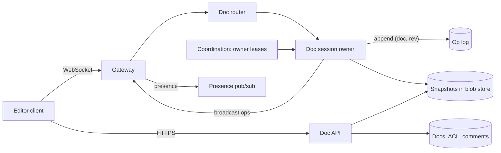

## In one minute
- Pick the concurrency model first. A **central server that assigns every operation a revision number** and transforms stale operations (client-server operational transformation) is simpler to reason about than peer-to-peer schemes and fits an always-online editor. CRDTs are the alternative when offline and peer-to-peer matter more.
- Give each document **exactly one live owner process** at a time. That owner holds the document in memory, orders edits, and is the only writer of the document's operation log. Fence it so a deposed owner cannot write.
- Ack an edit only after it is **durably appended** to the operation log at its revision. The log, plus periodic snapshots, is the document.
- The client edits optimistically against its local copy, keeps **one operation in flight**, and buffers the rest, so typing never waits on the network.
- Presence (cursors, selections) is ephemeral and best-effort; it should never share a durability path with edits.

## Requirements
Functional:
- Create, open and edit rich-text documents; several people edit at once and see each other's changes within about a second.
- See collaborators' cursors and selections.
- Comments anchored to text ranges, version history with named versions, and restore.
- Share with view, comment or edit permissions.

Non-functional:
- Convergence: everyone who has received the same set of edits sees the same document.
- Intent preservation: concurrent edits are merged in a way that matches what each author meant (typing in different places should both survive).
- Local keystroke latency under 50 ms regardless of network; remote edits visible in under 500 ms p95 within a region.
- No acknowledged edit is ever lost. High availability for opening and reading documents.

Out of scope: full offline editing for days (we tolerate short disconnects), spreadsheets and slides, spelling and grammar services, and export formats.

## Back-of-envelope
Planning assumptions, not published figures.

- DAU: 50M people who edit at least once. At the busiest hour about 5M are actively editing at the same moment.
- Clients batch keystrokes and send at most one operation batch every 100 to 200 ms while typing, and nothing while idle. Averaged over active editors (who pause to read and think), say 0.3 batches per second each. Peak write rate: 5M × 0.3 = **1.5M operations per second**. Average across the day is perhaps a fifth of that, around 300,000 per second.
- Fan-out: most documents have one editor; a few have dozens. If the average active document has 1.5 connected viewers, broadcast traffic is about 1.5 × 1.5M ≈ 2.25M messages per second at peak.
- Operation size: about 100 bytes with metadata. Daily op volume: 300,000/s × 86,400 s × 100 B ≈ 2.6 TB per day of raw log. Over 5 years that would be about 4.7 PB, which is why logs are compacted into snapshots and only coarse version history is kept forever.
- Snapshots: say 2B documents averaging 50 KB of content and formatting, about 100 TB, replicated three ways to about 300 TB.
- Bandwidth: 2.25M messages × 100 B ≈ 225 MB/s out at peak, plus about 150 MB/s in. Document opens dominate bytes: 20M opens per hour × 50 KB ≈ 280 MB/s.
- Connections: 5M concurrent WebSockets at roughly 20 to 50 KB of kernel and app memory each is 100 to 250 GB of RAM spread over the gateway fleet, so a few hundred gateway machines.

## API
```text
GET  /v1/docs/{docId}                       -> {snapshot, rev, acl}
WS   /v1/docs/{docId}/session               (after auth and ACL check)

client -> server
  {type:"op", clientId, seq: 41, baseRev: 1207, op:[{retain:15},{insert:"hi"}]}
  {type:"presence", cursor: 17, selection:[17,22]}
server -> client
  {type:"ack", seq: 41, rev: 1209}
  {type:"op", rev: 1208, author, op:[...]}      // others' ops, in rev order
  {type:"presence", user, cursor, selection}
  {type:"resync", fromRev: 1180}                // client fell too far behind

GET  /v1/docs/{docId}/ops?fromRev=1180&toRev=1209
GET  /v1/docs/{docId}/versions              -> [{rev, time, authors, name?}]
POST /v1/docs/{docId}/comments              {anchorRev, start, end, body}
```
`clientId` plus `seq` makes resends after a reconnect idempotent: the server remembers the highest `seq` per client and returns the original ack for a duplicate.

## Data model
- **`documents`**: `doc_id PK, owner_id, title, latest_snapshot_rev, latest_rev, created_at`. Partition by `doc_id`.
- **`doc_ops`**: `(doc_id, rev) PK, client_id, seq, author_id, op_bytes, ts`. Partition by `doc_id`, clustered by `rev`, so loading "everything after the snapshot" is one contiguous range scan. A conditional insert that fails if `(doc_id, rev)` already exists is the core write; it doubles as a fencing check.
- **`doc_snapshots`**: `(doc_id, rev) PK, content_blob_ref`. Written every N operations (say 500) or every few minutes of activity; the blob lives in object storage. Old ops behind a snapshot are kept for 30 days for fine-grained history, then compacted.
- **`acl`**: `(doc_id, principal) PK, role`, with a reverse index `(principal, doc_id)` for "shared with me". Cached at the gateway with short TTLs; revocation pushes a disconnect to live sessions.
- **`comments`**: `(doc_id, comment_id) PK, anchor_start, anchor_end, anchor_rev, thread`. Anchors are transformed through later ops the same way cursors are.
- **`session_owner`** (in a coordination service): `doc_id -> {server, epoch}`, held under a lease.

A store with per-row conditional writes and strong per-partition ordering fits `doc_ops`: Bigtable or Spanner-like systems, Cassandra with lightweight transactions at a cost, or sharded Postgres. Snapshots go to object storage because they are large, immutable and read in full.

## High-level design


Write path. A user types. The client applies the edit to its local model immediately, then, if no operation is in flight, sends it with the revision it was based on; otherwise it composes it into a buffer. The gateway forwards the message to the document's session owner, found through the router's lookup of `session_owner`. The owner checks for a duplicate `(clientId, seq)`, then transforms the operation against every operation in its in-memory log after `baseRev`, assigns the next revision, and does a conditional append of `(doc_id, rev)` to the op log. When the append succeeds it applies the op to its in-memory document, acks the author with the revision, and broadcasts the transformed op to every other connected client. Each recipient transforms it against its own in-flight and buffered operations before applying it.

Read path. Opening a document fetches the latest snapshot and the ops after it (or asks the session owner, which has both in memory), renders, and opens the WebSocket with that revision as its starting point. Viewers without edit permission get the same op stream, read-only. Version history reads snapshots and replays ops up to the chosen revision.

## Deep dives

### Ordering concurrent edits: OT or CRDT
Options considered. First, locking paragraphs. It is simple but feels broken: people block each other. A close cousin is diffing whole document versions and merging them on the server, which is what Google Docs did before 2010; it mis-merges when one person restyles words another is replacing ([Google Drive blog](https://drive.googleblog.com/2010/09/whats-different-about-new-google-docs_21.html)). Second, CRDTs (as in Yjs and Automerge): every character gets a unique, ordered identity, and merges commute, so no central ordering is needed. They are excellent for offline and peer-to-peer use, at the cost of per-character metadata (much reduced by modern implementations: one 2021 rewrite replayed an editing trace in 56 ms that took an older Automerge nearly 5 minutes, [Joseph Gentle](https://josephg.com/blog/crdts-go-brrr/)) and tombstones that must be garbage collected. Convergence alone is not enough: several published text CRDTs can interleave two people's concurrently typed words character by character ([Kleppmann et al., PaPoC 2019](https://martin.kleppmann.com/papers/interleaving-papoc19.pdf)), so check the algorithm, not just the library's popularity. Third, client-server OT in the style of the Jupiter system, which is widely reported to underlie Docs: the server keeps a single linear history, each client has at most one unacknowledged operation, and the server transforms a stale operation against the operations it missed. Google described exactly this protocol in 2010: the document is a revision log of insert-text, delete-text and apply-style changes, and a client "never" sends more than one pending change at a time ([Google Drive blog](https://drive.googleblog.com/2010/09/whats-different-about-new-google-docs_22.html), [part 3](https://drive.googleblog.com/2010/09/whats-different-about-new-google-docs.html)).

Choice: client-server OT. With one ordering point, we only need the transform function to satisfy the simpler convergence property for two concurrent operations (often called TP1); the harder property needed for peer-to-peer OT (TP2) is avoided because the server serialises everything ([Wikipedia: Operational transformation](https://en.wikipedia.org/wiki/Operational_transformation)). The research line has kept moving: Eg-walker (2024) stores an OT-like event graph but merges like a CRDT, using an order of magnitude less steady-state memory than existing CRDTs and merging long offline branches orders of magnitude faster than OT ([Gentle and Kleppmann](https://arxiv.org/abs/2409.14252)). It is worth naming if the interviewer pushes on offline editing. The client keeps three states: synchronised, awaiting ack, and awaiting ack with a buffer. That bounds the transform work to "ops the server applied since my base revision". Rich text adds formatting attributes, but the structure is the same: operations are sequences of retain, insert and delete with attributes, and the transform walks two sequences in step.

### One owner per document
OT needs a single serialisation point per document, so each document is assigned to one session server by consistent hashing over the doc ID, confirmed by a lease in the coordination service that carries an increasing epoch. The owner keeps the current text, the recent op log (enough to transform any reasonably stale op) and the connected client list in memory. If a client's `baseRev` is older than the in-memory window, the server asks it to resync.

Split brain is the danger: an owner pauses, its lease expires, a new owner takes over, and the old one wakes and keeps accepting edits. The conditional append to `doc_ops` is what makes this safe. Both owners compute "next rev = 1209", only one append can create `(doc_id, 1209)`, and the loser discovers it is stale, drops its sessions and lets clients reconnect to the new owner. Some stores also let us check the epoch inside the same conditional write, which rejects the stale owner even earlier.

### Storage, snapshots and history
Replaying a million ops to open a long-lived document would be slow, so the owner writes a snapshot every 500 ops or so, asynchronously, to the blob store and records its revision. Opening a document then costs one blob read plus at most a few hundred op reads. History is kept at three resolutions: every op for 30 days (powers "see who typed this" and fine-grained restore), periodic snapshots grouped into sessions for the visible history list, and named versions kept forever. Compaction merges old ops into the snapshots and deletes the log rows. Comments and cursors are positions in a moving document, so they are stored with the revision they were anchored at and transformed forward through later ops, the same way cursors are.

## Down the stack

### Layer 1: The contract
Every acknowledged operation has a unique revision number, and revision numbers for a document are dense and increasing. All clients apply the same operations in revision order (after their own local transforms), so any two clients at the same revision show identical documents. An ack means the operation is durable in the op log. A resend with the same `(clientId, seq)` is acknowledged once and applied once. Presence messages have no guarantees: they may be dropped or reordered and are superseded by the next update.

### Layer 2: The mechanism
The server-side transform for one incoming op `A` with base revision `b` is a fold: for each logged op `B` with revision greater than `b`, replace `A` with `transform(A, B)`. For inserts at the same position the rule must be deterministic; we let the already-logged insert win, so the incoming text lands after it. A delete of a character that a concurrent op already deleted becomes a no-op. The client runs the mirror image: when a remote op `R` arrives, it transforms `R` against its in-flight op `P` and buffer `Q`, applies the transformed `R`, and replaces `P` and `Q` with their transformed versions, so its own pending edits stay valid against the new base. When the ack arrives, the buffer becomes the in-flight op and is sent with the acked revision as its base. Durability is a conditional put on `(doc_id, rev)`; in Bigtable-style stores that is a check-and-mutate on the row, and in Postgres it is an `INSERT` that fails on the primary key.

### Layer 3: The machine
A keystroke batch serialises to roughly 60 to 150 bytes of JSON or a few dozen bytes of a binary encoding, sent as one WebSocket frame inside one TCP segment. Gateways set `TCP_NODELAY` so Nagle's algorithm does not hold small frames for up to 40 ms waiting for an ACK. A gateway multiplexes tens of thousands of sockets with `epoll_wait`; each idle connection costs a few kilobytes of kernel socket buffer plus application state. Round trips dominate: 10 to 40 ms within a region, 100 to 200 ms across continents, which is why session owners live in the region nearest most editors and clients never wait for acks to show their own typing. The durable append is the slowest server step: a replicated write across zones costs a few milliseconds, and an owner pipelines appends so throughput is not limited to one op per round trip. A 50 KB document plus a 1,000-op tail is well under 1 MB of heap, so one server can own tens of thousands of active documents.

### Why it's built this way
1. Network round trips are tens to hundreds of milliseconds and typing must feel instant, so clients apply edits locally and reconcile later.
2. Local-first editing makes concurrent edits inevitable, so we need a merge rule; one central ordering point keeps that rule simple enough to get right.
3. A single orderer per document is a single point of failure, so ownership is a lease that moves, with conditional appends to fence old owners.
4. An ever-growing log makes opens slow and storage expensive, so we snapshot and compact, keeping fine detail only where users actually need it.

## Failure modes
- **10x load.** Gateways scale horizontally behind the load balancer. Session owners scale by document count; the router rebalances hash ranges as servers are added, migrating documents by draining their sessions. If the op log store is the bottleneck, owners batch several ops per append.
- **Session owner crash.** Clients see the socket close, back off with jitter, and reconnect. The new owner loads the latest snapshot and log tail, clients resend their in-flight op with the same `(clientId, seq)`, and dedupe prevents double application. Users see a "reconnecting" banner for a few seconds; typing continues locally throughout.
- **Region outage.** The op log is replicated synchronously across zones and asynchronously across regions. Documents fail over to an owner in another region; with asynchronous replication, the last second of acked ops in the failed region could be missing. Clients still hold those ops as acked but not reflected, so the reconnect protocol compares revisions and resubmits from the client's copy where possible.
- **Hot document.** A company all-hands doc with 500 editors and 50,000 viewers. Editors stay on the owner; viewers are served by a read-only fan-out tier that subscribes to the owner's stream, so broadcast cost leaves the critical path. Cap simultaneous editing sessions and degrade the rest to view or comment. Google's own limit is that a file can be edited from at most 100 open tabs or devices at once; beyond that only the owner and some editors can edit ([Google Docs Editors Help](https://support.google.com/docs/answer/2494822?hl=en)).
- **Slow or malicious client.** A client that never acks or floods ops gets rate-limited per connection, and its outbound queue is bounded; beyond the bound it is told to resync.

## In the wild
- **Google Docs, 2010: the rebuilt editor is client-server OT.** Google replaced the old diff-and-merge Docs with a revision log of three change types (insert text, delete text, apply style) that is replayed to display a document. Clients apply edits locally, send at most one pending change, and transform incoming changes against their own; the server transforms late changes against every revision committed since the client's last sync, exactly the state machine in this lesson ([Google Drive blog](https://drive.googleblog.com/2010/09/whats-different-about-new-google-docs_22.html)).
- **Figma, 2019: multiplayer without OT.** Figma judged OT too complex for a tree of design objects. Each document gets one server process over WebSockets that is the authority; properties merge last-writer-wins in the order the server receives them, child order uses fractional indexing, reparenting that would create a cycle is rejected, and clients that were offline download a fresh copy and reapply their edits ([Figma](https://www.figma.com/blog/how-figmas-multiplayer-technology-works/)).

## Trade-offs
| Option | Strengths | Weaknesses | Choose when |
|---|---|---|---|
| Client-server OT | Small ops, simple server ordering, proven in Docs | Needs a live server per doc; weak offline story | Always-online collaborative editors (our choice) |
| CRDT (Yjs, Automerge) | Offline, peer-to-peer, no central orderer | Metadata and tombstones, harder rich-text semantics | Local-first apps, long offline periods |
| Paragraph locks | Trivial to implement | Users block each other | Structured forms, low concurrency |
| Last-writer-wins per document | No merge logic | Loses work | Never for shared text |
| Snapshot every N ops | Fast opens, bounded replay | Snapshot write cost, extra storage | Any long-lived document |

## Leadership lens
- Build first: the transform function with a randomised convergence test (generate random concurrent ops, apply in both orders, assert equal results) and the client state machine. Every bug in this product eventually shows up as divergence, and that test catches most of them.
- Rollout: ship plain text with one owner per document and a single region first, then rich text, comments and presence, then multi-region placement.
- Ownership: an editor-core team owns the op model and client engine; a realtime team owns gateways, routing and session owners; a storage team owns the op log, snapshots and history. The op format is a shared contract and needs versioning from day one.
- Cost drivers: idle WebSocket connections (memory on gateways), op log storage before compaction, and cross-region replication.
- Design review question: how do we detect divergence in production? Answer: clients periodically send a hash of their document at a revision, and the server compares.

## Check yourself
1. Why choose client-server OT over a CRDT for this editor?
   **Answer:** With one server ordering every operation, the transform only needs the simpler two-operation convergence property (TP1), and ops stay small. CRDTs need no central orderer and suit offline or peer-to-peer use, but carry per-character metadata and tombstones, so they fit local-first apps better than an always-online editor.
2. An old session owner pauses, its lease expires, and it wakes up after a new owner has taken over. Why can it not corrupt the document?
   **Answer:** Every edit is a conditional append of `(doc_id, rev)` to the op log, so when both owners try to write the same next revision only one append succeeds. The loser discovers it is stale, drops its sessions and lets clients reconnect to the new owner.
3. A session owner crashes. Why does no edit get lost or applied twice?
   **Answer:** An edit is acked only after it is durably appended to the op log, so the new owner rebuilds state from the latest snapshot plus the log tail. Clients resend their in-flight op with the same `(clientId, seq)`, and the server's dedupe returns the original ack instead of applying it again.
4. Why are snapshots and compaction needed, based on the estimate of the raw op log?
   **Answer:** At about 300,000 ops per second averaged over the day and 100 bytes each, the raw log grows by about 2.6 TB a day, roughly 4.7 PB over five years. Snapshotting every 500 or so ops keeps opens to one blob read plus a short tail, and compaction keeps fine-grained ops only for 30 days.

## Practice
**Task:** Build the server side of client-server OT for plain text. `DocServer(initial)` starts at revision 0. Operations are `{kind, pos, text}`: `"ins"` inserts `text` at `pos`, `"del"` deletes the one character at `pos`, and `"noop"` does nothing. `submit(clientId, seq, baseRev, op)` transforms `op` against every op applied after `baseRev`, applies it, appends it to the history, and returns the new revision and the transformed op. Transform rules against an earlier op: an insert shifts right past an earlier insert at a lower or equal position; any op shifts left past an earlier delete at a lower position; an insert at exactly the deleted position stays put; a delete of the same character becomes a noop (which still takes a revision). A repeated `(clientId, seq)` returns the original result without applying anything. A `baseRev` below 0 or above the current revision returns revision -1 and no op. `text()` returns the document and `opsSince(rev)` returns the applied ops after `rev`.

```python starter
class DocServer:
    def __init__(self, initial=""):
        # TODO
        pass

    def submit(self, client_id, seq, base_rev, op):
        raise NotImplementedError

    def text(self):
        raise NotImplementedError

    def ops_since(self, rev):
        raise NotImplementedError
```

```python tests
def ins(pos, text):
    return {"kind": "ins", "pos": pos, "text": text}


def rm(pos):
    return {"kind": "del", "pos": pos, "text": ""}


def test_sequential_edits():
    d = DocServer()
    assert d.submit("a", 1, 0, ins(0, "hello")) == (1, ins(0, "hello"))
    assert d.submit("a", 2, 1, ins(5, " world"))[0] == 2
    assert d.text() == "hello world"


def test_concurrent_inserts_shift():
    d = DocServer("ac")
    d.submit("a", 1, 0, ins(1, "b"))
    rev, op = d.submit("b", 1, 0, ins(2, "d"))
    assert (rev, op) == (2, ins(3, "d"))
    assert d.text() == "abcd"


def test_same_position_insert_tie():
    d = DocServer("!")
    d.submit("a", 1, 0, ins(0, "x"))
    d.submit("b", 1, 0, ins(0, "y"))
    assert d.text() == "xy!", "earlier insert stays first"


def test_double_delete_becomes_noop():
    d = DocServer("abc")
    d.submit("a", 1, 0, rm(1))
    rev, op = d.submit("b", 1, 0, rm(1))
    assert rev == 2
    assert op["kind"] == "noop"
    assert d.text() == "ac"


def test_insert_and_delete_interleave():
    d = DocServer("abcd")
    d.submit("a", 1, 0, rm(0))
    assert d.submit("b", 1, 0, ins(3, "X"))[1] == ins(2, "X")
    assert d.text() == "bcXd"
    assert d.submit("c", 1, 0, rm(3))[1] == rm(3), "still targets the original d"
    assert d.text() == "bcX"


def test_resubmit_is_idempotent():
    d = DocServer()
    first = d.submit("a", 7, 0, ins(0, "hi"))
    again = d.submit("a", 7, 0, ins(0, "hi"))
    assert first == again
    assert d.text() == "hi"
    assert d.ops_since(0) == [ins(0, "hi")]


def test_bad_base_rev_and_ops_since():
    d = DocServer("ab")
    assert d.submit("a", 1, 3, ins(0, "z")) == (-1, None)
    assert d.submit("a", 2, -1, ins(0, "z")) == (-1, None)
    d.submit("a", 3, 0, ins(2, "c"))
    d.submit("b", 1, 0, ins(0, "_"))
    assert d.ops_since(1) == [ins(0, "_")]
    assert d.text() == "_abc"
```

```python solution
def _transform(a, b):
    a = dict(a)
    if a["kind"] == "noop" or b["kind"] == "noop":
        return a
    if b["kind"] == "ins":
        if a["kind"] == "ins":
            if b["pos"] <= a["pos"]:
                a["pos"] += len(b["text"])
        elif b["pos"] <= a["pos"]:
            a["pos"] += len(b["text"])
        return a
    # b is a delete of one character
    if b["pos"] < a["pos"]:
        a["pos"] -= 1
    elif b["pos"] == a["pos"] and a["kind"] == "del":
        return {"kind": "noop", "pos": 0, "text": ""}
    return a


class DocServer:
    def __init__(self, initial=""):
        self.doc = initial
        self.log = []
        self.seen = {}

    def submit(self, client_id, seq, base_rev, op):
        key = (client_id, seq)
        if key in self.seen:
            return self.seen[key]
        if base_rev < 0 or base_rev > len(self.log):
            return (-1, None)
        cur = dict(op)
        for applied in self.log[base_rev:]:
            cur = _transform(cur, applied)
        if cur["kind"] == "ins":
            p = cur["pos"]
            self.doc = self.doc[:p] + cur["text"] + self.doc[p:]
        elif cur["kind"] == "del":
            p = cur["pos"]
            self.doc = self.doc[:p] + self.doc[p + 1:]
        self.log.append(cur)
        result = (len(self.log), dict(cur))
        self.seen[key] = result
        return result

    def text(self):
        return self.doc

    def ops_since(self, rev):
        return [dict(o) for o in self.log[rev:]]
```

```typescript starter
export interface Op {
  kind: string;
  pos: number;
  text: string;
}

export class DocServer {
  constructor(initial: string = "") {}
  submit(clientId: string, seq: number, baseRev: number, op: Op): { rev: number; op: Op | null } {
    throw new Error("TODO");
  }
  text(): string {
    throw new Error("TODO");
  }
  opsSince(rev: number): Op[] {
    throw new Error("TODO");
  }
}
```

```typescript tests
const ins = (pos: number, text: string): Op => ({ kind: "ins", pos, text });
const rm = (pos: number): Op => ({ kind: "del", pos, text: "" });

test("sequential edits", () => {
  const d = new DocServer();
  assertEqual(d.submit("a", 1, 0, ins(0, "hello")), { rev: 1, op: ins(0, "hello") });
  assertEqual(d.submit("a", 2, 1, ins(5, " world")).rev, 2);
  assertEqual(d.text(), "hello world");
});

test("concurrent inserts shift", () => {
  const d = new DocServer("ac");
  d.submit("a", 1, 0, ins(1, "b"));
  assertEqual(d.submit("b", 1, 0, ins(2, "d")), { rev: 2, op: ins(3, "d") });
  assertEqual(d.text(), "abcd");
});

test("same position insert tie", () => {
  const d = new DocServer("!");
  d.submit("a", 1, 0, ins(0, "x"));
  d.submit("b", 1, 0, ins(0, "y"));
  assertEqual(d.text(), "xy!", "earlier insert stays first");
});

test("double delete becomes noop", () => {
  const d = new DocServer("abc");
  d.submit("a", 1, 0, rm(1));
  const r = d.submit("b", 1, 0, rm(1));
  assertEqual(r.rev, 2);
  assertEqual(r.op!.kind, "noop");
  assertEqual(d.text(), "ac");
});

test("insert and delete interleave", () => {
  const d = new DocServer("abcd");
  d.submit("a", 1, 0, rm(0));
  assertEqual(d.submit("b", 1, 0, ins(3, "X")).op, ins(2, "X"));
  assertEqual(d.text(), "bcXd");
  assertEqual(d.submit("c", 1, 0, rm(3)).op, rm(3), "still targets the original d");
  assertEqual(d.text(), "bcX");
});

test("resubmit is idempotent", () => {
  const d = new DocServer();
  const first = d.submit("a", 7, 0, ins(0, "hi"));
  const again = d.submit("a", 7, 0, ins(0, "hi"));
  assertEqual(again, first);
  assertEqual(d.text(), "hi");
  assertEqual(d.opsSince(0), [ins(0, "hi")]);
});

test("bad base rev and ops since", () => {
  const d = new DocServer("ab");
  assertEqual(d.submit("a", 1, 3, ins(0, "z")), { rev: -1, op: null });
  assertEqual(d.submit("a", 2, -1, ins(0, "z")), { rev: -1, op: null });
  d.submit("a", 3, 0, ins(2, "c"));
  d.submit("b", 1, 0, ins(0, "_"));
  assertEqual(d.opsSince(1), [ins(0, "_")]);
  assertEqual(d.text(), "_abc");
});
```

```typescript solution
export interface Op {
  kind: string;
  pos: number;
  text: string;
}

function transform(a: Op, b: Op): Op {
  const out: Op = { kind: a.kind, pos: a.pos, text: a.text };
  if (out.kind === "noop" || b.kind === "noop") return out;
  if (b.kind === "ins") {
    if (b.pos <= out.pos) out.pos += b.text.length;
    return out;
  }
  if (b.pos < out.pos) out.pos -= 1;
  else if (b.pos === out.pos && out.kind === "del") return { kind: "noop", pos: 0, text: "" };
  return out;
}

export class DocServer {
  private doc: string;
  private log: Op[] = [];
  private seen = new Map<string, { rev: number; op: Op | null }>();

  constructor(initial: string = "") {
    this.doc = initial;
  }

  submit(clientId: string, seq: number, baseRev: number, op: Op): { rev: number; op: Op | null } {
    const key = clientId + "\u0000" + seq;
    const prev = this.seen.get(key);
    if (prev) return prev;
    if (baseRev < 0 || baseRev > this.log.length) return { rev: -1, op: null };
    let cur: Op = { kind: op.kind, pos: op.pos, text: op.text };
    for (const applied of this.log.slice(baseRev)) cur = transform(cur, applied);
    if (cur.kind === "ins") {
      this.doc = this.doc.slice(0, cur.pos) + cur.text + this.doc.slice(cur.pos);
    } else if (cur.kind === "del") {
      this.doc = this.doc.slice(0, cur.pos) + this.doc.slice(cur.pos + 1);
    }
    this.log.push(cur);
    const result = { rev: this.log.length, op: { ...cur } };
    this.seen.set(key, result);
    return result;
  }

  text(): string {
    return this.doc;
  }

  opsSince(rev: number): Op[] {
    return this.log.slice(rev).map((o) => ({ ...o }));
  }
}
```

```go starter
package practice

import "errors"

type Op struct {
	Kind string
	Pos  int
	Text string
}

var ErrBadRev = errors.New("bad base revision")

type DocServer struct{}

func NewDocServer(initial string) *DocServer {
	return &DocServer{}
}

// Submit returns the new revision and the transformed op, or ErrBadRev.
func (d *DocServer) Submit(clientID string, seq, baseRev int, op Op) (int, Op, error) {
	panic("TODO")
}

func (d *DocServer) Text() string {
	panic("TODO")
}

func (d *DocServer) OpsSince(rev int) []Op {
	panic("TODO")
}
```

```go tests
package practice

import (
	"reflect"
	"testing"
)

func ins(pos int, text string) Op { return Op{Kind: "ins", Pos: pos, Text: text} }
func rm(pos int) Op               { return Op{Kind: "del", Pos: pos} }

func TestSequentialEdits(t *testing.T) {
	d := NewDocServer("")
	rev, op, err := d.Submit("a", 1, 0, ins(0, "hello"))
	if err != nil || rev != 1 || op != ins(0, "hello") {
		t.Fatalf("got %d %v %v", rev, op, err)
	}
	if rev, _, _ := d.Submit("a", 2, 1, ins(5, " world")); rev != 2 {
		t.Fatalf("rev %d", rev)
	}
	if d.Text() != "hello world" {
		t.Fatalf("text %q", d.Text())
	}
}

func TestConcurrentInsertsShift(t *testing.T) {
	d := NewDocServer("ac")
	d.Submit("a", 1, 0, ins(1, "b"))
	rev, op, _ := d.Submit("b", 1, 0, ins(2, "d"))
	if rev != 2 || op != ins(3, "d") || d.Text() != "abcd" {
		t.Fatalf("got %d %v %q", rev, op, d.Text())
	}
}

func TestSamePositionInsertTie(t *testing.T) {
	d := NewDocServer("!")
	d.Submit("a", 1, 0, ins(0, "x"))
	d.Submit("b", 1, 0, ins(0, "y"))
	if d.Text() != "xy!" {
		t.Fatalf("earlier insert stays first, got %q", d.Text())
	}
}

func TestDoubleDeleteBecomesNoop(t *testing.T) {
	d := NewDocServer("abc")
	d.Submit("a", 1, 0, rm(1))
	rev, op, _ := d.Submit("b", 1, 0, rm(1))
	if rev != 2 || op.Kind != "noop" || d.Text() != "ac" {
		t.Fatalf("got %d %v %q", rev, op, d.Text())
	}
}

func TestInsertAndDeleteInterleave(t *testing.T) {
	d := NewDocServer("abcd")
	d.Submit("a", 1, 0, rm(0))
	if _, op, _ := d.Submit("b", 1, 0, ins(3, "X")); op != ins(2, "X") {
		t.Fatalf("insert transformed to %v", op)
	}
	if d.Text() != "bcXd" {
		t.Fatalf("text %q", d.Text())
	}
	if _, op, _ := d.Submit("c", 1, 0, rm(3)); op != rm(3) {
		t.Fatalf("delete should still target the original d, got %v", op)
	}
	if d.Text() != "bcX" {
		t.Fatalf("text %q", d.Text())
	}
}

func TestResubmitIsIdempotent(t *testing.T) {
	d := NewDocServer("")
	r1, o1, _ := d.Submit("a", 7, 0, ins(0, "hi"))
	r2, o2, _ := d.Submit("a", 7, 0, ins(0, "hi"))
	if r1 != r2 || o1 != o2 || d.Text() != "hi" {
		t.Fatalf("duplicate applied: %q", d.Text())
	}
	if !reflect.DeepEqual(d.OpsSince(0), []Op{ins(0, "hi")}) {
		t.Fatalf("ops %v", d.OpsSince(0))
	}
}

func TestBadBaseRevAndOpsSince(t *testing.T) {
	d := NewDocServer("ab")
	if _, _, err := d.Submit("a", 1, 3, ins(0, "z")); err != ErrBadRev {
		t.Fatal("future base rev must fail")
	}
	if _, _, err := d.Submit("a", 2, -1, ins(0, "z")); err != ErrBadRev {
		t.Fatal("negative base rev must fail")
	}
	d.Submit("a", 3, 0, ins(2, "c"))
	d.Submit("b", 1, 0, ins(0, "_"))
	if !reflect.DeepEqual(d.OpsSince(1), []Op{ins(0, "_")}) {
		t.Fatalf("ops %v", d.OpsSince(1))
	}
	if d.Text() != "_abc" {
		t.Fatalf("text %q", d.Text())
	}
}
```

```go solution
package practice

import (
	"errors"
	"sync"
)

type Op struct {
	Kind string
	Pos  int
	Text string
}

var ErrBadRev = errors.New("bad base revision")

type result struct {
	rev int
	op  Op
}

type seenKey struct {
	client string
	seq    int
}

type DocServer struct {
	mu   sync.Mutex
	doc  []rune
	log  []Op
	seen map[seenKey]result
}

func NewDocServer(initial string) *DocServer {
	return &DocServer{doc: []rune(initial), seen: map[seenKey]result{}}
}

func transform(a, b Op) Op {
	if a.Kind == "noop" || b.Kind == "noop" {
		return a
	}
	if b.Kind == "ins" {
		if b.Pos <= a.Pos {
			a.Pos += len([]rune(b.Text))
		}
		return a
	}
	if b.Pos < a.Pos {
		a.Pos--
	} else if b.Pos == a.Pos && a.Kind == "del" {
		return Op{Kind: "noop"}
	}
	return a
}

func (d *DocServer) Submit(clientID string, seq, baseRev int, op Op) (int, Op, error) {
	d.mu.Lock()
	defer d.mu.Unlock()
	key := seenKey{clientID, seq}
	if r, ok := d.seen[key]; ok {
		return r.rev, r.op, nil
	}
	if baseRev < 0 || baseRev > len(d.log) {
		return -1, Op{}, ErrBadRev
	}
	cur := op
	for _, applied := range d.log[baseRev:] {
		cur = transform(cur, applied)
	}
	switch cur.Kind {
	case "ins":
		ins := []rune(cur.Text)
		next := make([]rune, 0, len(d.doc)+len(ins))
		next = append(next, d.doc[:cur.Pos]...)
		next = append(next, ins...)
		d.doc = append(next, d.doc[cur.Pos:]...)
	case "del":
		d.doc = append(d.doc[:cur.Pos:cur.Pos], d.doc[cur.Pos+1:]...)
	}
	d.log = append(d.log, cur)
	r := result{rev: len(d.log), op: cur}
	d.seen[key] = r
	return r.rev, r.op, nil
}

func (d *DocServer) Text() string {
	d.mu.Lock()
	defer d.mu.Unlock()
	return string(d.doc)
}

func (d *DocServer) OpsSince(rev int) []Op {
	d.mu.Lock()
	defer d.mu.Unlock()
	out := make([]Op, len(d.log)-rev)
	copy(out, d.log[rev:])
	return out
}
```

## Mock interview
**Prompt:** Design Google Docs: a browser-based document editor where many people edit the same document at once and see each other's changes and cursors in real time. Assume tens of millions of daily users and documents with up to about 100 simultaneous editors.

- Follow-up: two users type at the same position at the same instant. Walk me through the messages and what each screen shows.
- Follow-up: the server that owns a document stalls for 20 seconds and another server takes over. How do you guarantee no acknowledged edit is lost or applied twice?
- Follow-up: when would you choose a CRDT instead, and what would change in your architecture?

**A strong answer covers:**
- Optimistic local editing with one in-flight op and a buffer, and server-assigned revision numbers as the single order.
- A transform function with a deterministic tie-break, delete-delete collapsing to a no-op, and an argument for why a central server avoids the harder OT convergence property.
- One owner per document under a lease, fenced by a conditional append keyed on `(doc_id, rev)`, and idempotent resends keyed on `(clientId, seq)`.
- Op log plus snapshots, compaction, and multi-resolution history.
- Presence on a separate best-effort path, a read-only fan-out tier for viewer-heavy documents, and a divergence detector using document hashes.

## Sources and further study
**Primary**
- [Gentle and Kleppmann, "Collaborative Text Editing with Eg-walker" (2024)](https://arxiv.org/abs/2409.14252): an event-graph algorithm that keeps OT's small steady state with CRDT-style merging.
- [Kleppmann et al., "Interleaving anomalies in collaborative text editors" (PaPoC 2019)](https://martin.kleppmann.com/papers/interleaving-papoc19.pdf): why convergence alone does not make a text CRDT usable.
- [Neil Fraser, "Differential Synchronization"](https://neil.fraser.name/writing/sync/): the diff-and-patch alternative to OT, from a Google engineer, used in MobWrite.

**Systems docs**
- [Yjs documentation](https://docs.yjs.dev/): shared types, providers and awareness (presence) in the most widely used JavaScript CRDT.
- [Automerge documentation](https://automerge.org/docs/hello/): a JSON-like CRDT with full history, built for local-first apps.
- [Google Docs Editors Help: share files](https://support.google.com/docs/answer/2494822?hl=en): the 100-open-tabs editing limit and what happens past it.

**Books**
- *Designing Data-Intensive Applications*, Martin Kleppmann, chapter 5 "Replication": multi-leader replication, with collaborative editing as the example, and conflict resolution including OT and CRDTs.
- *Understanding Distributed Systems* (2nd ed.), Roberto Vitillo, chapter "Coordination avoidance": broadcast and CRDTs as the way to converge without a central orderer.

**Other curricula**
- [donnemartin/system-design-primer](https://github.com/donnemartin/system-design-primer): lists "Design Google docs" and points to Neil Fraser's differential synchronization rather than OT, a useful counterpoint.

## Watch
- [CRDTs: The Hard Parts (Martin Kleppmann)](https://www.youtube.com/watch?v=x7drE24geUw): opens with a clear explanation of operational transformation before showing where CRDTs differ and struggle.
- [Design Google Docs | System Design Interview (Aced, formerly Exponent)](https://www.youtube.com/watch?v=cL9If4X7aaE): a full mock interview of the same question.
- [Google Docs System design, Part 1: Operational transformation (Tech Dummies)](https://www.youtube.com/watch?v=2auwirNBvGg): a whiteboard walkthrough of OT and differential synchronisation.

## Free resources
- [What's different about the new Google Docs: conflict resolution (Google Drive blog)](https://drive.googleblog.com/2010/09/whats-different-about-new-google-docs_22.html): Google's own description of how Docs applies operational transformation.
- [How Figma's multiplayer technology works (Figma blog)](https://www.figma.com/blog/how-figmas-multiplayer-technology-works/): a production design with a central server per document and a clear comparison with OT and CRDTs.
- [Operational transformation (Wikipedia)](https://en.wikipedia.org/wiki/Operational_transformation): background, the TP1 and TP2 properties, and the history of OT systems.
- [Local-first software (Ink and Switch)](https://www.inkandswitch.com/local-first/): the case for CRDT-based editors and their trade-offs against server-centric designs.
- [CRDTs go brrr (Joseph Gentle)](https://josephg.com/blog/crdts-go-brrr/): how modern CRDT implementations got fast enough for real text editing.
