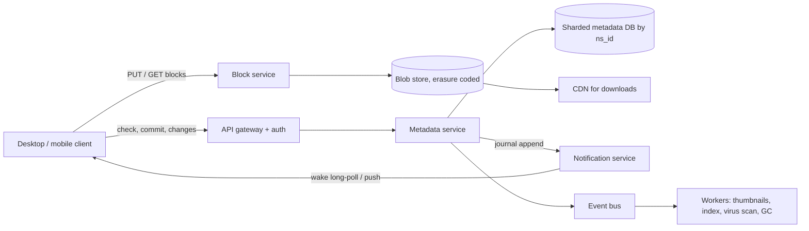

## In one minute
- **Split bytes from metadata.** File contents become immutable, content-addressed blocks in a blob store; the file tree, versions and sharing live in a small, strongly consistent metadata service. Almost every hard problem is in the metadata service.
- **A commit names blocks, it never carries them.** The client hashes its file into blocks, asks which ones the server lacks, uploads only those, then commits a block list. Deduplication and resumable upload fall out of that one protocol.
- **Every change goes into an ordered journal per namespace.** Devices sync by reading the journal after their cursor, and a long-poll or push only says "something changed". Catching up after a week offline is the same code path as a live edit.
- **Concurrent edits are detected, not merged.** A commit states the revision it was based on. If someone else got there first, the loser's bytes are kept as a conflicted copy. Nothing a user saved is ever silently lost.
- **Native documents are a different product.** Google Docs files are edited through operational transformation (see Design Google Docs); the sync engine treats them as opaque pointers.

## Requirements

**Functional**
- Upload, download, rename, move and delete files and folders up to 5 TB each ([Drive help](https://support.google.com/drive/answer/37603)), from web, mobile and a desktop client that mirrors a local folder.
- Sync changes to all of a user's devices within seconds when they are online, and after any length of offline time when they reconnect.
- Keep version history and restore any version or deleted file. Drive may drop an uploaded file's version after 30 days or once 100 newer versions exist, unless the user marks it "Keep forever" ([Drive help](https://support.google.com/drive/answer/2409045)).
- Share a file or folder with users or a link, with viewer, commenter or editor roles; shared folders appear inside each member's tree.
- Enforce a storage quota per account (15 GB free).

**Non-functional**
- Durability of committed data: eleven nines. A committed version must never point at a missing block.
- Sync latency under 5 s p95 from commit on one device to the change being visible to another online device.
- Resumable transfers on flaky mobile links; only changed parts of a large file are re-uploaded.
- Metadata reads (list a folder, stat a file) under 100 ms p99.
- Permissions are checked on every read; a revoked share takes effect within seconds.

**Out of scope:** real-time co-editing of Docs, Sheets and Slides (covered in Design Google Docs), full-text search inside files, malware scanning internals, and the photo product.

## Back-of-envelope
Assumed round numbers, not Google's figures.

- **Users:** 1B accounts, 200M DAU, two linked devices per active user on average, so 400M devices.
- **Commits:** each DAU creates or changes 4 files a day: 200M × 4 = 800M commits a day. 800M / 86,400 ≈ 9.3K commits/s on average; workday peaks run about 3×, so plan for 30K/s.
- **New bytes:** the average changed file is 1 MB, but after block-level dedup and delta upload only 40% of those bytes are new. 800M × 1 MB × 0.4 = 320 TB of new blocks a day.
- **Storage over 5 years:** 320 TB × 365 × 5 ≈ 584 PB logical. Erasure coding at about 1.4× overhead brings that to roughly 820 PB raw, before deletions and version expiry give some back. Plan for an exabyte.
- **Metadata:** 500M active users × 1,000 files = 500B file rows. At about 500 bytes each (path, ids, size, hash list pointer, timestamps) that is 250 TB, replicated 3× to 750 TB. Too big for one database; it must shard.
- **Upload bandwidth:** 320 TB / 86,400 ≈ 3.7 GB/s on average, about 11 GB/s at peak.
- **Download bandwidth:** each change is fetched by about 3 other devices, so about 11 GB/s average and over 30 GB/s at peak.
- **Notifications:** with 40% of devices online, 160M idle long-polls. Each commit wakes about 3: 90K wake-ups/s at peak.

## API

```text
POST /v1/blocks/check        { hashes: ["sha256:9f2c...", ...] }
                          -> { missing: ["sha256:9f2c..."] }
PUT  /v1/blocks/{hash}       body: up to 4 MiB of bytes; server re-hashes and rejects a mismatch
                          -> 201 Created

POST /v1/files/commit        { ns_id, path, base_rev, size, blocks: ["sha256:...", ...], client_mtime }
                          -> { status: "ok", rev: 88412 }
                           | { status: "need_blocks", missing: [...] }
                           | { status: "conflict", path: "plan (laptop conflicted copy).txt", rev: 88413 }
POST /v1/files/delete        { ns_id, path, base_rev } -> { status: "ok" | "stale", rev }
POST /v1/files/move          { ns_id, from, to, base_rev } -> { status, rev }

GET  /v1/changes?ns_id=..&cursor=88400&limit=500
                          -> { entries: [ { seq, path, deleted, rev, blocks } ], cursor: 88412, has_more: false }
GET  /v1/changes/wait?cursor=88412&timeout=90   (long-poll) -> { changed: true | false, backoff: 0 }

GET  /v1/blocks/{hash}       (CDN-fronted, signed URL, supports Range)
POST /v1/shares              { target_id, grantee, role: "viewer" | "commenter" | "editor" } -> { share_id }
```

`commit` is idempotent: replaying the same `(path, base_rev, blocks)` after a timeout returns the revision already created. `base_rev` is 0 for a new file. The changes feed follows the same shape as Google Drive's public Changes API, where a `startPageToken` plays the role of the cursor.

## Data model

**namespaces** `(ns_id) -> owner, kind (user_root | shared_folder), head_seq`. A namespace is a subtree with its own journal. Each user has a root namespace, and each shared folder is a namespace mounted into every member's tree, so sharing costs one mount row per member.

**journal** primary key `(ns_id, seq)`, partitioned by `ns_id`. Columns: `path`, `file_id`, `rev`, `deleted`, `blocks_ref`. `seq` is gap-free and increases by one per commit within a namespace. A device's cursor is simply the last `seq` it applied. Partitioning by namespace keeps each commit a single-shard transaction.

**files** `(ns_id, path) -> file_id, rev, size, blocks_ref, mtime`, in the same shard as the namespace's journal so the file row and the journal row are written in one transaction. A secondary index on `(ns_id, parent_path)` serves folder listings.

**versions** `(file_id, rev) -> blocks_ref, size, author_device, created_at`. History for restore; a retention job deletes versions past the plan's window.

**block_lists** `(blocks_ref) -> [hash, hash, ...]`. Large files have thousands of hashes, so they are stored once and referenced.

**blocks** `(hash) -> size, storage_location, refcount`, partitioned by hash. The hash is uniformly distributed, so this table shards evenly with no hot spots. `refcount` (or a periodic mark-and-sweep) decides when a block can be deleted.

**mounts** `(user_id, ns_id) -> mount_path, role`. Read on login and on every permission check, so it is cached heavily.

## High-level design



**Write path.**
1. The desktop client notices a change through the OS file watcher, waits for the file to stop changing, then splits it into blocks and hashes each with SHA-256.
2. It calls `blocks/check` with the hash list. The block service looks the hashes up and returns the ones it does not have.
3. The client uploads only the missing blocks, several in parallel. The block service re-hashes each one, writes it durably to the blob store, and only then records it in `blocks`.
4. The client calls `commit` with the full block list and its `base_rev`. In one transaction on the namespace's shard, the metadata service checks that every block exists, checks `base_rev` against the file's current `rev`, bumps `head_seq`, and writes the file row, the version row and the journal row.
5. After commit, the metadata service tells the notification service that the namespace advanced, and publishes an event for thumbnails, indexing and scanning.

**Read path.**
1. Each online device holds a long-poll on `changes/wait` with its cursor for each namespace it mounts (or one connection that multiplexes them).
2. When the namespace's `head_seq` passes the cursor, the poll returns `changed: true`. The client calls `changes` to read journal entries after its cursor in pages.
3. For each entry, the client downloads only the blocks missing from its local cache, writes the file to a temp path, `fsync`s and renames it into place.
4. The client advances its cursor only after the files are on disk. A crash replays from the old cursor, and since applying an entry is idempotent, nothing breaks.

## Deep dives

### 1. Chunking and deduplication
The block is the unit of upload, download, resume and dedup, so its size and boundaries matter. Fixed-size blocks are simple: offset divided by 4 MiB gives the block index, and Dropbox has long used 4 MB blocks; its public `content_hash` is still a SHA-256 over the SHA-256 of each 4 MiB block ([Dropbox API](https://docs.dropboxapi.com/dropbox-api/docs/technical-reference/content-hash)). The weakness shows when bytes are inserted near the start of a file: every later boundary shifts, and every block hash changes, so a one-byte insert re-uploads the whole file.

Content-defined chunking fixes that. A rolling hash slides over the bytes, and a boundary is cut wherever the hash's low bits are all zero, subject to a minimum and maximum size. LBFS used Rabin fingerprints this way with about 8 KB average chunks ([LBFS, SOSP 2001](https://pdos.csail.mit.edu/papers/lbfs:sosp01/lbfs.pdf)), and FastCDC uses a cheaper gear hash ([FastCDC, ATC 2016](https://www.usenix.org/conference/atc16/technical-sessions/presentation/xia)). Boundaries now follow content, so an insert changes one or two chunks and the rest re-align. The cost is CPU on the client and many more chunks per file, which means more metadata rows and more hash lookups.

I would pick content-defined chunks with a large average size (around 1 to 4 MB), so a 1 GB file has a few hundred entries, not a hundred thousand.

Dedup across users saves money but leaks information: if uploading a block is instant, an attacker learns that someone already stores that exact content. Dedup only within an account or organisation, or always demand the upload and dedup silently afterwards. This is the duplicates problem shape; git's object store and container image layers solve it with the same content addressing.

### 2. The journal, cursors and notifications
Options: push full change events through a broker, have devices list folders and diff, or keep a durable, ordered journal per namespace read by cursor. Pushed events are lost while a device is offline; diffing costs O(size of tree) per poll. The journal costs O(changes) and works the same after five seconds or five weeks.

Per namespace, not per user, because a shared folder's commit is then written once and read by every member through their mount. A per-user journal needs fan-out on write, which hurts for a folder shared with a 10,000-person company.

Notifications carry no data, only "namespace X is now at seq N", so losing one is harmless. Drive's own `changes.watch` channels work the same way: the push says only that changes exist, and the client then calls `changes.list` ([Drive API](https://developers.google.com/workspace/drive/api/guides/manage-changes)). The notification tier is a stateless fleet of long-poll holders. When the cursor is older than the journal's retention (say 90 days after compaction), the server answers `reset` and the client does a full listing, reconciling by hash so it does not re-download what it already has.

### 3. Conflicts and the commit contract
Two devices edit `plan.txt` while one is offline. Options: last writer wins (simple, silently destroys work), merge (impossible in general for binary formats), or optimistic concurrency with conflicted copies. The commit's `base_rev` is the compare-and-set token. If it does not match the current `rev`, the server does not reject the bytes; it commits them under a new name like `plan (laptop conflicted copy).txt` and returns that path. Both versions exist, and the human decides.

A delete based on a stale revision returns `stale` instead of deleting the newer edit. A move across namespaces (into a shared folder) is a copy then a delete, made safe by idempotent operation ids. Folder renames are the expensive case: renaming a folder with 100,000 files rewrites 100,000 path rows unless paths are stored as parent-pointer trees with `file_id` keys. I would store the tree by id and derive paths, at the cost of a recursive lookup for path-based API calls, which a cache absorbs.

## Down the stack

### Layer 1: The contract
- **Atomic commit.** A commit either creates exactly one new revision whose every block is durably stored, or changes nothing. No reader can observe a revision with a missing block.
- **Ordered journal.** Within a namespace, `seq` values are gap-free and assigned in commit order. Reading from cursor N returns every committed change with `seq > N`, exactly once, in order.
- **Compare-and-set.** A commit with `base_rev` equal to the current revision succeeds as an update; any other `base_rev` produces a conflicted copy, never an overwrite. Replaying an identical commit returns the original result.
- **Eventual visibility.** A change committed on one device is visible to every online device with read access within seconds, and to offline devices on their next sync, as long as the cursor is within retention.

### Layer 2: The mechanism
Dropbox's sync engine, rewritten in Rust and called Nucleus ([Dropbox Tech](https://dropbox.tech/infrastructure/rewriting-the-heart-of-our-sync-engine)), models sync as three trees: the remote tree (what the server says), the local tree (what is on disk) and the synced tree (the last state both agreed on) ([Dropbox Tech](https://dropbox.tech/infrastructure/-testing-our-new-sync-engine)). Comparing local to synced finds local edits to upload; comparing remote to synced finds server edits to apply; a path that changed in both is a conflict. That base tree is the same idea as the merge base in a three-way merge.

On the server, Dropbox keeps metadata in Edgestore over sharded MySQL. Growing Edgestore meant splitting every shard in two, so in 2022 Dropbox put Panda underneath it: a range-sharded, transactional key-value layer that moves ranges of about 100 GB between nodes to add capacity gradually ([Dropbox Tech](https://dropbox.tech/infrastructure/panda-metadata-stack-petabyte-scale-transactional-key-value-store)). Blocks live in Magic Pocket, its own blob store, which groups blocks of up to 4 MB into 1 GB buckets, stores each block in at least two zones, and erasure-codes older data inside cells of about 50 PB ([Dropbox Tech](https://dropbox.tech/infrastructure/inside-the-magic-pocket)). Clients detect local changes through `inotify` on Linux, FSEvents on macOS and `ReadDirectoryChangesW` on Windows, and keep their own state in a local SQLite database.

Google Drive's public API has the same shape: resumable uploads (`uploadType=resumable`) return a session URI that accepts chunks in multiples of 256 KB, answers `308 Resume Incomplete` until the last one, and expires after a week ([Drive API](https://developers.google.com/workspace/drive/api/guides/manage-uploads)), and the Changes API hands out a `startPageToken` cursor, with optional webhook channels as the wake-up signal.

### Layer 3: The machine
- **Hashing.** SHA-256 with the x86 SHA extensions runs at roughly 1.5 to 2 GB/s per core, so hashing a 4 MiB block takes 2 to 3 ms. Re-hashing a 10 GB folder on startup is several seconds of CPU, which is why clients cache `(inode, size, mtime) -> hashes` and re-hash only files whose stat changed.
- **File watching.** `inotify` needs one watch per directory, and the per-user limit (`fs.inotify.max_user_watches`) defaulted to 8,192 from 2005 until Linux 5.11, which scales it with RAM between 8,192 and 1,048,576 ([kernelnewbies](https://kernelnewbies.org/Linux_5.11), [patch](https://lkml.iu.edu/hypermail/linux/kernel/2010.3/01777.html)). Older kernels and small machines still hit it, so a large tree can silently outgrow it. Clients must handle overflow events (`IN_Q_OVERFLOW`) by falling back to a full scan.
- **Safe local writes.** Applying a remote change writes to a temp file, `fsync`s it, `rename`s it over the target and `fsync`s the directory. A plain overwrite risks a torn file after a crash, and the user blames the sync product.
- **Blob store disks.** A hard drive does about 100 to 200 random IOPS but well over 200 MB/s sequentially. Writing each 4 MiB block as its own file would waste seeks and inode space, so blocks are appended into extents of around a gigabyte and located by `(extent, offset)`.

### Why it's built this way
1. Files are large and change in small places, so bytes are split into blocks and only changed blocks move.
2. Blocks are identified by their hash, so the same content is stored once and an upload interrupted at any point resumes by asking what is missing.
3. Blocks can be uploaded in any order, so the moment of truth must be a separate, small metadata commit that only succeeds once every block is durable.
4. Devices are offline for unpredictable lengths of time, so the commit also appends to an ordered journal that any device can replay from its cursor.
5. Offline devices make concurrent edits inevitable, and binary files cannot be merged, so the commit is a compare-and-set that keeps the losing version as a copy.

## Failure modes
- **10x load (a client release that forces a re-scan).** Hundreds of millions of clients call `blocks/check` at once. Return server-driven backoff in `changes/wait` and roll client releases out by cohort.
- **Hot namespace.** A company-wide folder with 50,000 members and a bot writing to it makes one shard hot and wakes 50,000 long-polls per commit. Coalesce wake-ups to one per second per namespace and split very busy namespaces by subtree.
- **Region outage.** Metadata shards replicate synchronously within a region and asynchronously across regions. On failover, the last few seconds of commits may be lost; clients still hold their local state and pending commits, so they re-check blocks and re-commit. Blocks are written to at least two regions before a commit can reference them, so a surviving region never holds a dangling block list.
- **Orphaned blocks.** A client uploads blocks and never commits. A garbage collector deletes unreferenced blocks older than a grace period (say 7 days), which also bounds abuse of the blob store as free storage.
- **Corrupted client state.** A bug leaves a client wrongly believing it is in sync. Clients periodically compare a hash of their synced tree with the server's and reconcile on mismatch (trust but verify).

## In the wild
- **Dropbox, 2014: an OS upgrade script reinstalls live database servers.** A planned upgrade was meant to touch only machines with no active data, but a bug in the script reinstalled a few active ones, including some master and replica database pairs behind features such as photo sharing and camera uploads. The site was back in about three hours, but full recovery from backups took until Sunday afternoon, roughly 47 hours after maintenance began, because large databases restored slowly. File contents were never at risk because those databases held none. Dropbox made machines check their own state and refuse destructive commands, and parallelised binlog replay ([Dropbox Tech](https://dropbox.tech/infrastructure/outage-post-mortem)).
- **Dropbox, 2026: erasure-coded volumes left mostly empty.** A new on-the-fly erasure-coding service in Magic Pocket produced badly under-filled volumes, in the worst cases with under 5% of allocated space holding live data, and the old compaction strategy could not reclaim space fast enough. Dropbox added strategies that pack moderately empty volumes together and re-encode live blocks out of the sparsest ones, cutting compaction overhead by 30 to 50% ([Dropbox Tech](https://dropbox.tech/infrastructure/improving-storage-efficiency-in-magic-pocket-our-immutable-blob-store)).
- **Dropbox, 2015: moving the block store off S3 (engineering write-up).** Dropbox mirrored data between regions in a dark launch from August 2014, served user files from Magic Pocket alone from February 2015, and passed 90% of user data in-house on 7 October 2015, with more than 500 PB stored. The block and metadata split is what made a blob-store swap possible without touching sync clients ([Dropbox Tech](https://dropbox.tech/infrastructure/magic-pocket-infrastructure)).

## Trade-offs

| Option | Strengths | Weaknesses | Choose when |
|---|---|---|---|
| Fixed-size blocks | Simple, fast, easy offset math | Inserts shift every later block | Mostly append-only or whole-file rewrites |
| Content-defined chunks | Inserts change only nearby chunks | More CPU and more metadata | Large files edited in the middle |
| Cross-user dedup | Large storage savings | Leaks existence of content | Public or enterprise-internal data |
| Per-namespace journal | One write per change, shared folders are cheap | Clients track one cursor per mount | Shared folders are common |
| Per-user journal with fan-out | One cursor per device | Write amplification for big shares | Mostly private files |
| Conflicted copies | Never loses data | Users must resolve by hand | Binary and arbitrary files |
| Last writer wins | No user-facing conflicts | Silently drops edits | Never for user files |

## Leadership lens
- **Build first:** the block check, upload and commit protocol with compare-and-set, plus the journal and cursor. Get those right and everything else is features. Thumbnails, search and sharing UI come after the sync contract is boringly reliable.
- **Team ownership:** client sync, metadata (namespaces, journal, permissions), storage (blocks, blob store, GC) and edge (notifications, CDN). The Layer 1 commit contract is the interface between them and deserves a written spec and shared tests.
- **Cost drivers:** raw storage and its replication or erasure-coding overhead, then egress. Version retention and dedup policy move the storage bill more than any compute optimisation.
- **Rollout:** desktop clients live for years. Version the protocol and ship sync engine changes to a randomised cohort with a kill switch; a sync bug that deletes files defines the product's reputation.
- **Review questions:** what proves a revision never points at a missing block; what happens to a cursor older than journal retention; who is paged when the GC deletes something referenced.

## Check yourself
1. Two devices edit `plan.txt` while one is offline. What happens when the second one commits, and why not last writer wins?
   **Answer:** Its `base_rev` no longer matches the current `rev`, so the server keeps the bytes but commits them as a conflicted copy such as `plan (laptop conflicted copy).txt`. Last writer wins would silently destroy work, and binary files cannot be merged in general, so both versions are kept and the human decides.
2. Why prefer content-defined chunking over fixed-size blocks, and what does it cost?
   **Answer:** With fixed blocks, inserting bytes near the start shifts every later boundary and changes every block hash, so the whole file is re-uploaded. A rolling hash cuts boundaries by content, so an insert changes only one or two chunks, at the cost of client CPU and more chunks, which means more metadata rows and hash lookups.
3. Why is the journal kept per namespace rather than per user?
   **Answer:** A commit to a shared folder is then written once and read by every member through their mount. A per-user journal needs fan-out on write, which hurts badly for a folder shared with a 10,000-person company, though it would give each device a single cursor.
4. How much new block storage does the design need over five years, and why does dedup matter to that number?
   **Answer:** 800M commits a day at 1 MB each, with only 40% new bytes after dedup and delta upload, is about 320 TB a day, or roughly 584 PB logical over five years and about 820 PB raw with erasure coding. Without block-level dedup that daily figure would be 2.5 times larger, so dedup and retention policy move the storage bill more than any compute work.

## Practice
**Task:** Build the metadata side of a sync server. `put_block(h)` records that block `h` is durably stored. `commit(path, base_rev, blocks, device)` returns a 4-tuple `(status, path, rev, missing)`. If any block is not stored, return `("need_blocks", path, 0, missing)` with the missing hashes deduplicated in first-appearance order, and change nothing. Otherwise every successful change appends to one namespace journal whose `seq` starts at 1 and grows by one; a file's `rev` is the `seq` of its latest change. If `base_rev` equals the file's current rev (0 when the file does not exist or was deleted), update the file and return `("ok", path, seq, [])`. Otherwise keep the existing file and commit the bytes as a new file named `"<stem> (<device> conflicted copy)<ext>"` in the same folder, adding `" 2"`, `" 3"` and so on after `copy` if that name is already live, and return `("conflict", new_path, seq, [])`; the extension is the part of the last path segment from its last dot, unless that dot is the first character. `delete(path, base_rev)` returns `("ok", seq)` and appends a tombstone, or `("stale", current_rev)` and does nothing if the file is missing or `base_rev` is not current. `changes(cursor, limit)` returns `(entries, next_cursor, has_more)` where each entry is `(seq, path, deleted, blocks)` (empty blocks for a delete).

```python starter
class SyncServer:
    def __init__(self):
        pass

    def put_block(self, h):
        raise NotImplementedError

    def commit(self, path, base_rev, blocks, device):
        # TODO: ("ok" | "need_blocks" | "conflict", path, rev, missing)
        raise NotImplementedError

    def delete(self, path, base_rev):
        # TODO: ("ok", seq) or ("stale", current_rev)
        raise NotImplementedError

    def changes(self, cursor, limit):
        # TODO: (entries, next_cursor, has_more)
        raise NotImplementedError
```

```python tests
def test_missing_blocks_are_reported_once_in_order():
    s = SyncServer()
    s.put_block("b")
    assert s.commit("a.txt", 0, ["c", "b", "a", "c"], "laptop") == ("need_blocks", "a.txt", 0, ["c", "a"])
    assert s.changes(0, 10) == ([], 0, False), "nothing committed"

def test_commit_then_update_and_dedup():
    s = SyncServer()
    for h in ("x", "y", "z"):
        s.put_block(h)
    assert s.commit("docs/a.txt", 0, ["x", "y"], "laptop") == ("ok", "docs/a.txt", 1, [])
    assert s.commit("docs/b.txt", 0, ["x", "y"], "phone") == ("ok", "docs/b.txt", 2, []), "same blocks need no upload"
    assert s.commit("docs/a.txt", 1, ["x", "z"], "laptop") == ("ok", "docs/a.txt", 3, [])

def test_stale_base_creates_conflicted_copy():
    s = SyncServer()
    s.put_block("v1")
    s.put_block("v2")
    s.put_block("v3")
    s.commit("docs/plan.txt", 0, ["v1"], "laptop")
    s.commit("docs/plan.txt", 1, ["v2"], "phone")
    assert s.commit("docs/plan.txt", 1, ["v3"], "laptop") == ("conflict", "docs/plan (laptop conflicted copy).txt", 3, [])
    entries, cur, more = s.changes(0, 10)
    assert entries[-1] == (3, "docs/plan (laptop conflicted copy).txt", False, ["v3"])
    assert entries[1] == (2, "docs/plan.txt", False, ["v2"]), "winner untouched"

def test_conflict_names_are_unique_and_handle_extensions():
    s = SyncServer()
    s.put_block("k")
    s.commit("notes", 0, ["k"], "pc")
    assert s.commit("notes", 0, ["k"], "pc")[1] == "notes (pc conflicted copy)"
    assert s.commit("notes", 0, ["k"], "pc")[1] == "notes (pc conflicted copy 2)"
    s.commit(".bashrc", 0, ["k"], "pc")
    assert s.commit(".bashrc", 0, ["k"], "pc")[1] == ".bashrc (pc conflicted copy)"
    s.commit("a.tar.gz", 0, ["k"], "pc")
    assert s.commit("a.tar.gz", 0, ["k"], "pc")[1] == "a.tar (pc conflicted copy).gz"

def test_delete_with_tombstone_and_recreate():
    s = SyncServer()
    s.put_block("k")
    s.commit("f.md", 0, ["k"], "pc")
    assert s.delete("f.md", 0) == ("stale", 1)
    assert s.delete("f.md", 1) == ("ok", 2)
    assert s.delete("f.md", 2) == ("stale", 0), "already gone"
    assert s.commit("f.md", 0, ["k"], "pc") == ("ok", "f.md", 3, []), "recreate from base 0"
    assert s.changes(1, 1) == ([(2, "f.md", True, [])], 2, True)

def test_changes_pages_by_cursor():
    s = SyncServer()
    s.put_block("k")
    for name in ("a", "b", "c"):
        s.commit(name, 0, ["k"], "pc")
    assert s.changes(0, 2) == ([(1, "a", False, ["k"]), (2, "b", False, ["k"])], 2, True)
    assert s.changes(2, 2) == ([(3, "c", False, ["k"])], 3, False)
    assert s.changes(3, 2) == ([], 3, False)
```

```python solution
class SyncServer:
    def __init__(self):
        self._blocks = set()
        self._files = {}
        self._journal = []

    def put_block(self, h):
        self._blocks.add(h)

    def _append(self, path, deleted, blocks):
        seq = len(self._journal) + 1
        self._journal.append((seq, path, deleted, list(blocks)))
        return seq

    def _conflict_name(self, path, device):
        slash = path.rfind("/")
        folder, name = path[: slash + 1], path[slash + 1 :]
        dot = name.rfind(".")
        if dot > 0:
            stem, ext = name[:dot], name[dot:]
        else:
            stem, ext = name, ""
        n = 1
        while True:
            suffix = "" if n == 1 else " " + str(n)
            cand = folder + stem + " (" + device + " conflicted copy" + suffix + ")" + ext
            if cand not in self._files:
                return cand
            n += 1

    def commit(self, path, base_rev, blocks, device):
        missing = []
        for h in blocks:
            if h not in self._blocks and h not in missing:
                missing.append(h)
        if missing:
            return ("need_blocks", path, 0, missing)
        current = self._files.get(path, 0)
        if base_rev == current:
            seq = self._append(path, False, blocks)
            self._files[path] = seq
            return ("ok", path, seq, [])
        target = self._conflict_name(path, device)
        seq = self._append(target, False, blocks)
        self._files[target] = seq
        return ("conflict", target, seq, [])

    def delete(self, path, base_rev):
        current = self._files.get(path, 0)
        if current == 0 or base_rev != current:
            return ("stale", current)
        seq = self._append(path, True, [])
        del self._files[path]
        return ("ok", seq)

    def changes(self, cursor, limit):
        rest = self._journal[cursor:]
        page = [(s, p, d, list(b)) for s, p, d, b in rest[:limit]]
        nxt = page[-1][0] if page else cursor
        return (page, nxt, len(rest) > limit)
```

```typescript starter
export type CommitResult = [string, string, number, string[]];
export type Change = [number, string, boolean, string[]];

export class SyncServer {
  putBlock(h: string): void {
    throw new Error("TODO");
  }
  commit(path: string, baseRev: number, blocks: string[], device: string): CommitResult {
    throw new Error("TODO");
  }
  delete(path: string, baseRev: number): [string, number] {
    throw new Error("TODO");
  }
  changes(cursor: number, limit: number): [Change[], number, boolean] {
    throw new Error("TODO");
  }
}
```

```typescript tests
test("missing blocks are reported once in order", () => {
  const s = new SyncServer();
  s.putBlock("b");
  assertEqual(s.commit("a.txt", 0, ["c", "b", "a", "c"], "laptop"), ["need_blocks", "a.txt", 0, ["c", "a"]]);
  assertEqual(s.changes(0, 10), [[], 0, false], "nothing committed");
});

test("commit then update and dedup", () => {
  const s = new SyncServer();
  for (const h of ["x", "y", "z"]) s.putBlock(h);
  assertEqual(s.commit("docs/a.txt", 0, ["x", "y"], "laptop"), ["ok", "docs/a.txt", 1, []]);
  assertEqual(s.commit("docs/b.txt", 0, ["x", "y"], "phone"), ["ok", "docs/b.txt", 2, []], "same blocks need no upload");
  assertEqual(s.commit("docs/a.txt", 1, ["x", "z"], "laptop"), ["ok", "docs/a.txt", 3, []]);
});

test("stale base creates conflicted copy", () => {
  const s = new SyncServer();
  for (const h of ["v1", "v2", "v3"]) s.putBlock(h);
  s.commit("docs/plan.txt", 0, ["v1"], "laptop");
  s.commit("docs/plan.txt", 1, ["v2"], "phone");
  assertEqual(s.commit("docs/plan.txt", 1, ["v3"], "laptop"), ["conflict", "docs/plan (laptop conflicted copy).txt", 3, []]);
  const [entries] = s.changes(0, 10);
  assertEqual(entries[2], [3, "docs/plan (laptop conflicted copy).txt", false, ["v3"]]);
  assertEqual(entries[1], [2, "docs/plan.txt", false, ["v2"]], "winner untouched");
});

test("conflict names are unique and handle extensions", () => {
  const s = new SyncServer();
  s.putBlock("k");
  s.commit("notes", 0, ["k"], "pc");
  assertEqual(s.commit("notes", 0, ["k"], "pc")[1], "notes (pc conflicted copy)");
  assertEqual(s.commit("notes", 0, ["k"], "pc")[1], "notes (pc conflicted copy 2)");
  s.commit(".bashrc", 0, ["k"], "pc");
  assertEqual(s.commit(".bashrc", 0, ["k"], "pc")[1], ".bashrc (pc conflicted copy)");
  s.commit("a.tar.gz", 0, ["k"], "pc");
  assertEqual(s.commit("a.tar.gz", 0, ["k"], "pc")[1], "a.tar (pc conflicted copy).gz");
});

test("delete with tombstone and recreate", () => {
  const s = new SyncServer();
  s.putBlock("k");
  s.commit("f.md", 0, ["k"], "pc");
  assertEqual(s.delete("f.md", 0), ["stale", 1]);
  assertEqual(s.delete("f.md", 1), ["ok", 2]);
  assertEqual(s.delete("f.md", 2), ["stale", 0], "already gone");
  assertEqual(s.commit("f.md", 0, ["k"], "pc"), ["ok", "f.md", 3, []], "recreate from base 0");
  assertEqual(s.changes(1, 1), [[[2, "f.md", true, []]], 2, true]);
});

test("changes pages by cursor", () => {
  const s = new SyncServer();
  s.putBlock("k");
  for (const name of ["a", "b", "c"]) s.commit(name, 0, ["k"], "pc");
  assertEqual(s.changes(0, 2), [[[1, "a", false, ["k"]], [2, "b", false, ["k"]]], 2, true]);
  assertEqual(s.changes(2, 2), [[[3, "c", false, ["k"]]], 3, false]);
  assertEqual(s.changes(3, 2), [[], 3, false]);
});
```

```typescript solution
export type CommitResult = [string, string, number, string[]];
export type Change = [number, string, boolean, string[]];

export class SyncServer {
  private blocks = new Set<string>();
  private files = new Map<string, number>();
  private journal: Change[] = [];

  putBlock(h: string): void {
    this.blocks.add(h);
  }

  private append(path: string, deleted: boolean, blocks: string[]): number {
    const seq = this.journal.length + 1;
    this.journal.push([seq, path, deleted, blocks.slice()]);
    return seq;
  }

  private conflictName(path: string, device: string): string {
    const slash = path.lastIndexOf("/");
    const folder = path.slice(0, slash + 1);
    const name = path.slice(slash + 1);
    const dot = name.lastIndexOf(".");
    const stem = dot > 0 ? name.slice(0, dot) : name;
    const ext = dot > 0 ? name.slice(dot) : "";
    for (let n = 1; ; n++) {
      const suffix = n === 1 ? "" : " " + n;
      const cand = folder + stem + " (" + device + " conflicted copy" + suffix + ")" + ext;
      if (!this.files.has(cand)) return cand;
    }
  }

  commit(path: string, baseRev: number, blocks: string[], device: string): CommitResult {
    const missing: string[] = [];
    for (const h of blocks) {
      if (!this.blocks.has(h) && !missing.includes(h)) missing.push(h);
    }
    if (missing.length > 0) return ["need_blocks", path, 0, missing];
    const current = this.files.get(path) ?? 0;
    if (baseRev === current) {
      const seq = this.append(path, false, blocks);
      this.files.set(path, seq);
      return ["ok", path, seq, []];
    }
    const target = this.conflictName(path, device);
    const seq = this.append(target, false, blocks);
    this.files.set(target, seq);
    return ["conflict", target, seq, []];
  }

  delete(path: string, baseRev: number): [string, number] {
    const current = this.files.get(path) ?? 0;
    if (current === 0 || baseRev !== current) return ["stale", current];
    const seq = this.append(path, true, []);
    this.files.delete(path);
    return ["ok", seq];
  }

  changes(cursor: number, limit: number): [Change[], number, boolean] {
    const rest = this.journal.slice(cursor);
    const page: Change[] = rest.slice(0, limit).map((c) => [c[0], c[1], c[2], c[3].slice()]);
    const next = page.length > 0 ? page[page.length - 1][0] : cursor;
    return [page, next, rest.length > limit];
  }
}
```

```go starter
package practice

type CommitResult struct {
	Status  string
	Path    string
	Rev     int
	Missing []string
}

type Change struct {
	Seq     int
	Path    string
	Deleted bool
	Blocks  []string
}

type SyncServer struct{}

func NewSyncServer() *SyncServer { return &SyncServer{} }

func (s *SyncServer) PutBlock(h string) { panic("TODO") }

func (s *SyncServer) Commit(path string, baseRev int, blocks []string, device string) CommitResult {
	panic("TODO")
}

// Delete returns ("ok", seq) or ("stale", currentRev).
func (s *SyncServer) Delete(path string, baseRev int) (string, int) { panic("TODO") }

func (s *SyncServer) Changes(cursor, limit int) ([]Change, int, bool) { panic("TODO") }
```

```go tests
package practice

import (
	"reflect"
	"testing"
)

func res(status, path string, rev int, missing ...string) CommitResult {
	if missing == nil {
		missing = []string{}
	}
	return CommitResult{status, path, rev, missing}
}

func TestMissingBlocksAreReportedOnceInOrder(t *testing.T) {
	s := NewSyncServer()
	s.PutBlock("b")
	got := s.Commit("a.txt", 0, []string{"c", "b", "a", "c"}, "laptop")
	if !reflect.DeepEqual(got, res("need_blocks", "a.txt", 0, "c", "a")) {
		t.Fatalf("got %+v", got)
	}
	entries, cur, more := s.Changes(0, 10)
	if len(entries) != 0 || cur != 0 || more {
		t.Fatal("nothing committed")
	}
}

func TestCommitThenUpdateAndDedup(t *testing.T) {
	s := NewSyncServer()
	for _, h := range []string{"x", "y", "z"} {
		s.PutBlock(h)
	}
	if got := s.Commit("docs/a.txt", 0, []string{"x", "y"}, "laptop"); !reflect.DeepEqual(got, res("ok", "docs/a.txt", 1)) {
		t.Fatalf("got %+v", got)
	}
	if got := s.Commit("docs/b.txt", 0, []string{"x", "y"}, "phone"); !reflect.DeepEqual(got, res("ok", "docs/b.txt", 2)) {
		t.Fatalf("same blocks need no upload, got %+v", got)
	}
	if got := s.Commit("docs/a.txt", 1, []string{"x", "z"}, "laptop"); !reflect.DeepEqual(got, res("ok", "docs/a.txt", 3)) {
		t.Fatalf("got %+v", got)
	}
}

func TestStaleBaseCreatesConflictedCopy(t *testing.T) {
	s := NewSyncServer()
	for _, h := range []string{"v1", "v2", "v3"} {
		s.PutBlock(h)
	}
	s.Commit("docs/plan.txt", 0, []string{"v1"}, "laptop")
	s.Commit("docs/plan.txt", 1, []string{"v2"}, "phone")
	got := s.Commit("docs/plan.txt", 1, []string{"v3"}, "laptop")
	if !reflect.DeepEqual(got, res("conflict", "docs/plan (laptop conflicted copy).txt", 3)) {
		t.Fatalf("got %+v", got)
	}
	entries, _, _ := s.Changes(0, 10)
	if !reflect.DeepEqual(entries[2], Change{3, "docs/plan (laptop conflicted copy).txt", false, []string{"v3"}}) {
		t.Fatalf("got %+v", entries[2])
	}
	if !reflect.DeepEqual(entries[1], Change{2, "docs/plan.txt", false, []string{"v2"}}) {
		t.Fatal("winner untouched")
	}
}

func TestConflictNamesAreUniqueAndHandleExtensions(t *testing.T) {
	s := NewSyncServer()
	s.PutBlock("k")
	k := []string{"k"}
	s.Commit("notes", 0, k, "pc")
	if p := s.Commit("notes", 0, k, "pc").Path; p != "notes (pc conflicted copy)" {
		t.Fatal(p)
	}
	if p := s.Commit("notes", 0, k, "pc").Path; p != "notes (pc conflicted copy 2)" {
		t.Fatal(p)
	}
	s.Commit(".bashrc", 0, k, "pc")
	if p := s.Commit(".bashrc", 0, k, "pc").Path; p != ".bashrc (pc conflicted copy)" {
		t.Fatal(p)
	}
	s.Commit("a.tar.gz", 0, k, "pc")
	if p := s.Commit("a.tar.gz", 0, k, "pc").Path; p != "a.tar (pc conflicted copy).gz" {
		t.Fatal(p)
	}
}

func TestDeleteWithTombstoneAndRecreate(t *testing.T) {
	s := NewSyncServer()
	s.PutBlock("k")
	s.Commit("f.md", 0, []string{"k"}, "pc")
	if st, r := s.Delete("f.md", 0); st != "stale" || r != 1 {
		t.Fatal("stale base must not delete")
	}
	if st, r := s.Delete("f.md", 1); st != "ok" || r != 2 {
		t.Fatal("delete should append seq 2")
	}
	if st, r := s.Delete("f.md", 2); st != "stale" || r != 0 {
		t.Fatal("already gone")
	}
	if got := s.Commit("f.md", 0, []string{"k"}, "pc"); !reflect.DeepEqual(got, res("ok", "f.md", 3)) {
		t.Fatalf("recreate from base 0, got %+v", got)
	}
	entries, cur, more := s.Changes(1, 1)
	if !reflect.DeepEqual(entries, []Change{{2, "f.md", true, []string{}}}) || cur != 2 || !more {
		t.Fatalf("got %+v %d %v", entries, cur, more)
	}
}

func TestChangesPagesByCursor(t *testing.T) {
	s := NewSyncServer()
	s.PutBlock("k")
	for _, n := range []string{"a", "b", "c"} {
		s.Commit(n, 0, []string{"k"}, "pc")
	}
	k := []string{"k"}
	e, cur, more := s.Changes(0, 2)
	if !reflect.DeepEqual(e, []Change{{1, "a", false, k}, {2, "b", false, k}}) || cur != 2 || !more {
		t.Fatalf("page 1 got %+v %d %v", e, cur, more)
	}
	e, cur, more = s.Changes(2, 2)
	if !reflect.DeepEqual(e, []Change{{3, "c", false, k}}) || cur != 3 || more {
		t.Fatalf("page 2 got %+v %d %v", e, cur, more)
	}
	e, cur, more = s.Changes(3, 2)
	if len(e) != 0 || cur != 3 || more {
		t.Fatal("empty page keeps cursor")
	}
}
```

```go solution
package practice

import (
	"strconv"
	"strings"
)

type CommitResult struct {
	Status  string
	Path    string
	Rev     int
	Missing []string
}

type Change struct {
	Seq     int
	Path    string
	Deleted bool
	Blocks  []string
}

type SyncServer struct {
	blocks  map[string]bool
	files   map[string]int
	journal []Change
}

func NewSyncServer() *SyncServer {
	return &SyncServer{blocks: map[string]bool{}, files: map[string]int{}}
}

func (s *SyncServer) PutBlock(h string) { s.blocks[h] = true }

func (s *SyncServer) appendChange(path string, deleted bool, blocks []string) int {
	seq := len(s.journal) + 1
	s.journal = append(s.journal, Change{seq, path, deleted, append([]string{}, blocks...)})
	return seq
}

func (s *SyncServer) conflictName(path, device string) string {
	slash := strings.LastIndex(path, "/")
	folder, name := path[:slash+1], path[slash+1:]
	stem, ext := name, ""
	if dot := strings.LastIndex(name, "."); dot > 0 {
		stem, ext = name[:dot], name[dot:]
	}
	for n := 1; ; n++ {
		suffix := ""
		if n > 1 {
			suffix = " " + strconv.Itoa(n)
		}
		cand := folder + stem + " (" + device + " conflicted copy" + suffix + ")" + ext
		if _, ok := s.files[cand]; !ok {
			return cand
		}
	}
}

func (s *SyncServer) Commit(path string, baseRev int, blocks []string, device string) CommitResult {
	missing := []string{}
	seen := map[string]bool{}
	for _, h := range blocks {
		if !s.blocks[h] && !seen[h] {
			seen[h] = true
			missing = append(missing, h)
		}
	}
	if len(missing) > 0 {
		return CommitResult{"need_blocks", path, 0, missing}
	}
	if baseRev == s.files[path] {
		seq := s.appendChange(path, false, blocks)
		s.files[path] = seq
		return CommitResult{"ok", path, seq, []string{}}
	}
	target := s.conflictName(path, device)
	seq := s.appendChange(target, false, blocks)
	s.files[target] = seq
	return CommitResult{"conflict", target, seq, []string{}}
}

func (s *SyncServer) Delete(path string, baseRev int) (string, int) {
	current := s.files[path]
	if current == 0 || baseRev != current {
		return "stale", current
	}
	seq := s.appendChange(path, true, nil)
	delete(s.files, path)
	return "ok", seq
}

func (s *SyncServer) Changes(cursor, limit int) ([]Change, int, bool) {
	if cursor > len(s.journal) {
		cursor = len(s.journal)
	}
	rest := s.journal[cursor:]
	n := limit
	if n > len(rest) {
		n = len(rest)
	}
	page := make([]Change, 0, n)
	for _, c := range rest[:n] {
		page = append(page, Change{c.Seq, c.Path, c.Deleted, append([]string{}, c.Blocks...)})
	}
	next := cursor
	if n > 0 {
		next = page[n-1].Seq
	}
	return page, next, len(rest) > limit
}
```

## Mock interview
**Prompt:** Design Google Drive (or Dropbox). Assume 200 million daily users, files up to 5 TB, a desktop client that mirrors a local folder, and shared folders. A user edits a 2 GB video project on a laptop on a train with spotty Wi-Fi; walk me through how that change reaches their desktop at home.

- Follow-up: The user inserts ten seconds of footage near the start of the file. How much do you upload, and why?
- Follow-up: The desktop also edited the same file while the laptop was offline. What does each device end up with, and what does the journal look like?
- Follow-up: Why not push full change events to every device through a message broker instead of a journal and cursors?

**A strong answer covers:**
- Separate block storage (content-addressed, immutable) from a strongly consistent metadata service, with the block check, upload and commit protocol.
- Chunking choices: fixed versus content-defined boundaries and their effect on inserts, dedup and metadata size, plus the privacy cost of cross-user dedup.
- A per-namespace ordered journal with cursors and data-free notifications, so offline catch-up and live sync share one path, with a reset path when the cursor is too old.
- Compare-and-set commits on `base_rev` with conflicted copies instead of overwrites, and careful handling of deletes, moves and folder renames.
- Client realities: file watchers and their limits, hash caching, atomic local writes, and staged client rollouts with a kill switch.

## Sources and further study
**Primary**
- [Testing sync at Dropbox (Dropbox Tech)](https://dropbox.tech/infrastructure/-testing-our-new-sync-engine): the remote, local and synced trees, and the CanopyCheck and Trinity randomized test frameworks.
- [Panda: a petabyte-scale transactional key-value store (Dropbox Tech)](https://dropbox.tech/infrastructure/panda-metadata-stack-petabyte-scale-transactional-key-value-store): why sharded MySQL alone stopped scaling for file metadata.

**Systems docs**
- [Dropbox API: content hash](https://docs.dropboxapi.com/dropbox-api/docs/technical-reference/content-hash): the 4 MiB block and SHA-256 scheme a client can compute locally.
- [Google Drive help: version history](https://support.google.com/drive/answer/2409045): the 30-day and 100-version rules and "Keep forever".
- [Linux inotify(7)](https://man7.org/linux/man-pages/man7/inotify.7.html): watch limits, queue limits and the `IN_Q_OVERFLOW` event a sync client must handle.

**Books**
- *System Design Interview, Volume 1*, Alex Xu, chapter 15 "Design Google Drive": block servers, delta sync, metadata and notification service at interview depth.
- *Designing Data-Intensive Applications* (1st edition), Martin Kleppmann, chapter 5 "Replication": multi-leader and offline clients, and the conflict handling a sync engine must choose.

**Other curricula**
- [Azure Architecture Center: Valet Key pattern](https://learn.microsoft.com/en-us/azure/architecture/patterns/valet-key): frames direct client uploads to storage with scoped, expiring tokens, which is how block uploads skip the API tier.
- [donnemartin/system-design-primer](https://github.com/donnemartin/system-design-primer): lists "Design a file sync service like Dropbox" as a question and points to Dropbox's own scaling talk rather than a worked answer.

## Watch
- [Design Dropbox or Google Drive w/ a Ex-Meta Staff Engineer (Hello Interview)](https://www.youtube.com/watch?v=_UZ1ngy-kOI): an interview walkthrough of chunked upload, sync and the metadata model.
- [How We've Scaled Dropbox (Stanford)](https://www.youtube.com/watch?v=PE4gwstWhmc): Kevin Modzelewski on how Dropbox's server side grew from one machine to a large fleet.
- [Dropbox Background on Magic Pocket with James Cowling (Tech Field Day)](https://www.youtube.com/watch?v=1RKLdRI1WKU): why Dropbox built its own block store and how it is organised.

## Free resources
- [Rewriting the heart of our sync engine (Dropbox Tech)](https://dropbox.tech/infrastructure/rewriting-the-heart-of-our-sync-engine): the Nucleus rewrite, the three-tree model and how Dropbox tests sync correctness.
- [Inside the Magic Pocket (Dropbox Tech)](https://dropbox.tech/infrastructure/inside-the-magic-pocket): block storage, extents, erasure coding and cross-zone replication.
- [Retrieve changes (Google Drive API)](https://developers.google.com/workspace/drive/api/guides/manage-changes): the public cursor-based changes feed with page tokens.
- [Upload file data (Google Drive API)](https://developers.google.com/workspace/drive/api/guides/manage-uploads): simple, multipart and resumable upload sessions.
- [FastCDC: a Fast and Efficient Content-Defined Chunking Approach (USENIX ATC 2016)](https://www.usenix.org/conference/atc16/technical-sessions/presentation/xia): the gear-hash chunker and its dedup trade-offs.
- [A Low-bandwidth Network File System (SOSP 2001)](https://pdos.csail.mit.edu/papers/lbfs:sosp01/lbfs.pdf): the original content-defined chunking for file sync, using Rabin fingerprints.
