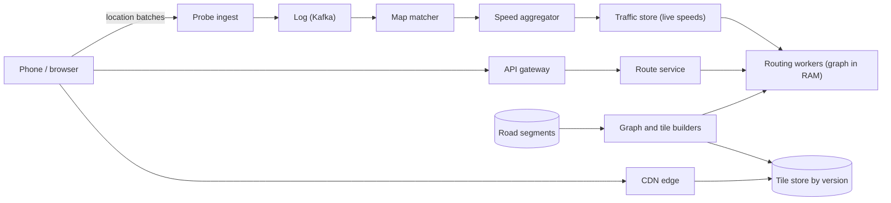

## In one minute
- **Three systems share one map.** Tile serving, routing and live traffic have different read patterns, freshness needs and failure costs. Scale them separately.
- **The road graph is a compiled artifact, not a database.** Routing runs on an in-memory, preprocessed graph, because plain Dijkstra on a continental graph takes seconds while a hierarchy-based query takes under a millisecond.
- **Traffic changes the weights, not the graph.** Pick a routing technique whose expensive phase depends only on topology and whose cheap phase absorbs new speeds every minute.
- **Tiles are immutable files behind a CDN.** Address every tile by `(version, z, x, y)`, build offline, and never edit in place.
- **The phones are the sensors.** Live traffic comes from anonymised location reports; map matching, privacy thresholds and abuse resistance decide whether it is trustworthy.

## Requirements

**Functional**
- Pan and zoom a world map on phone and web, with roads, labels, buildings and points of interest.
- Search for a place or address and show it on the map (search ranking itself is covered in Design Google Search and Elasticsearch).
- Compute driving routes between two points with an ETA, up to three alternatives, and options such as avoiding tolls.
- Turn-by-turn navigation that reroutes when the driver leaves the route or traffic changes.
- Show live traffic colouring on roads and incidents such as closures.

**Non-functional**
- Route response under 300 ms p99 for trips of any length, including continental ones.
- First map paint under 1 second on a mid-range phone on 4G; panning should feel instant.
- ETA error small enough that users trust it: a target such as median absolute error under 10% of trip time.
- Traffic freshness: a new jam visible on the map within about 2 minutes.
- Availability of 99.99% for tiles and routing; navigation must degrade gracefully offline.

**Out of scope:** satellite imagery capture and Street View, transit timetables and multimodal routing, place reviews, and the map editing tools themselves (we consume their output).

## Back-of-envelope
Round assumed numbers, not Google's figures.

- **DAU:** 500M. Each opens the map 4 times a day: 2B sessions/day.
- **Tile requests:** about 50 vector tiles per session that miss the device cache: 2B × 50 = 100B/day, so 100B / 86,400 ≈ 1.16M/s average, about 3.5M/s at a 3x peak. At 20 KB per compressed tile, that is 23 GB/s average egress, served almost entirely by the CDN.
- **Route and ETA queries:** 100M navigated trips a day, plus drive times shown on search results and place cards, plus reroutes. Call it 1B route computations/day: about 11.6K/s average, 35K/s peak.
- **Concurrent navigators:** 100M trips × 25 minutes / 1,440 minutes ≈ 1.7M at once on average, about 5M at peak. If each sends a batched location report every 5 seconds, peak ingest is 1M reports/s; at 60 bytes each, 60 MB/s.
- **Road graph:** assume 500M directed road segments. With 4-byte target and 4-byte weight per edge in compact arrays, the routing core is 4 GB, plus about as much again for hierarchy shortcuts. It fits in RAM on one machine, and that single fact shapes the routing design.
- **Tiles:** zoom 14 has 4^14 ≈ 268M tiles; if 30% are non-empty at 50 KB each, that is about 4 TB, and all lower zooms add a third (1 + 1/4 + 1/16 ...), roughly 5.4 TB per full map version. Higher zooms are drawn by overzooming z14 data on the client, so they cost no storage.
- **Traffic history:** 50M segments × 672 weekly 15-minute slots × 2 bytes = 67 GB, small enough for every routing worker.
- **Location reports over 5 years:** 350K/s average × 60 B × 86,400 ≈ 1.8 TB/day, about 3.3 PB over 5 years if kept raw. Keep raw reports for days and only aggregates after that.

## API

```text
GET  /tiles/v{map_version}/{z}/{x}/{y}.mvt
     -> protobuf vector tile (roads, labels, buildings), Cache-Control: immutable

POST /v1/routes
     { origin: {lat, lng}, destination: {lat, lng}, depart_at?, avoid: ["tolls"], alternatives: 2 }
  -> { routes: [ { eta_s, distance_m, polyline, traffic_spans: [ {from_idx, to_idx, level} ],
                   steps: [ {maneuver, road_name, distance_m} ] } ],
       route_token, map_version }

WS   /v1/navigate?route_token=...
  -> { kind: "position", lat, lng, heading, speed, ts }            (batched every few seconds)
  <- { kind: "eta", eta_s }  |  { kind: "reroute", route }  |  { kind: "incident", ... }

GET  /v1/traffic?tile=z/x/y&v={traffic_epoch}   -> per-segment congestion levels for one tile
POST /v1/probes  { session_pseudonym, points: [ {lat, lng, ts, speed, accuracy_m} ] }
```

`map_version` in the URL makes tiles cacheable forever. `route_token` lets a navigation session resume on another server. Traffic is a separate short-lived overlay, so a speed change never invalidates a base tile.

## Data model

**road_segments** (the editable source of truth): `segment_id`, `from_node`, `to_node`, geometry polyline, `length_m`, `road_class`, `speed_limit`, `oneway`, turn restrictions, toll flag. Partitioned by an S2 cell around level 6 so editors and builds work region by region. Never on the query path.

**routing graph** (compiled, read-only): nodes renumbered so nearby nodes get nearby IDs, edges in compressed sparse row arrays, plus shortcuts and a partition structure. One file per map version, loaded whole by each routing worker.

**traffic_live**: key `(segment_id, direction)` → `speed_kmh`, `confidence`, `sample_count`, `updated_at`. In memory, sharded by S2 cell so one shard owns a metro area, rewritten every 30 to 60 seconds.

**traffic_history**: `(segment_id, day_of_week, slot)` → median and 85th percentile speed. Columnar files rebuilt weekly, used for future departures and as the fallback when live data is thin.

**tiles**: object storage keyed `v{map_version}/{z}/{x}/{y}`. Build output, written once.

**probes**: an append-only log partitioned by time and keyed by a rotating session pseudonym rather than a user ID. Retained for days, not years.

## High-level design



**Write paths.** There are two, on very different clocks. Slow: map edits land in `road_segments`; a periodic build compiles a new routing graph, regenerates only tiles whose cells changed, and publishes a new `map_version`. Fast: navigating phones send batched positions to probe ingest, which appends them to a log; map matchers snap traces to road segments, and the aggregator turns traversals into per-segment speeds every 30 to 60 seconds and publishes a new traffic epoch.

**Read paths.** For the map, the client computes which tiles cover the viewport and fetches them; nearly every request is a CDN hit, and the client renders vectors on the GPU. For a route, a routing worker with the current graph and traffic metric snaps origin and destination to the nearest segments, runs the query, builds alternatives and returns geometry plus ETA. During navigation, the session server compares positions with the route, reroutes on deviation, and refreshes the ETA as traffic epochs change.

## Deep dives

### 1. Fast routes on a continent-sized graph
Plain Dijkstra settles every node closer than the destination: for a 1,000 km trip, millions of nodes, each costing cache misses, so seconds per query. On the standard Western Europe benchmark (18 million vertices, 42.5 million arcs), a random query with Dijkstra scans about 9.3 million vertices and takes about 2.2 seconds ([Bast et al., Table 1](https://arxiv.org/abs/1504.05140)). A* with a straight-line heuristic helps little on roads, and ALT (A* with landmarks) still settles hundreds of thousands of nodes.

Contraction hierarchies (CH) changed the game. Preprocessing orders nodes by importance and contracts them one at a time, adding a shortcut edge whenever removing a node would break a shortest path between its neighbours. A query runs two small Dijkstra searches, forward from the origin and backward from the destination, each only moving to more important nodes, meeting near the top of the hierarchy. On the same benchmark CH scans about 280 vertices and answers in about 110 microseconds after 5 minutes of preprocessing.

The catch is traffic: CH preprocessing bakes in edge weights and takes minutes for a continent, and its performance degrades with realistic turn costs. So I would split the work into a metric-independent phase (partition or order nodes from topology alone, once per map version) and a customisation phase (recompute shortcut weights from new speeds every minute). Customizable Route Planning (CRP) does exactly this: its topology phase takes about an hour, but a new cost function applies in roughly 370 ms on 12 cores, and queries take about 1.65 ms, slower than CH but nearly independent of the metric ([Bast et al.](https://arxiv.org/abs/1504.05140)). OSRM ships both: `osrm-contract` for CH, and `osrm-partition` plus `osrm-customize` for its multi-level Dijkstra (MLD), which its docs recommend when data needs live updates such as traffic ([OSRM wiki](https://github.com/Project-OSRM/osrm-backend/wiki/Running-OSRM)). Customizable contraction hierarchies are a third option on the same principle. Google has not published what it runs, so say what you would build and why. Alternatives come from the same search: keep a few meeting points whose paths differ enough and are not much longer than the best.

### 2. Live traffic from phones
A raw GPS trace has 5 to 20 metres of error and does not say which of two parallel roads the car is on. Map matching uses a hidden Markov model: candidate segments near each point are hidden states, emission probability falls with distance from the point, and transition probability favours pairs whose route distance matches the straight-line distance between points. Viterbi picks the likeliest sequence, giving "segment S traversed in 42 seconds at 14:03". This is the formulation of Newson and Krumm, who tested it on a 1 Hz drive around Seattle and measured how accuracy falls as sampling gets sparser and noisier ([Microsoft Research, 2009](https://www.microsoft.com/en-us/research/publication/hidden-markov-map-matching-noise-sparseness/)).

The aggregator needs enough distinct devices on a segment within a window before publishing a speed, for accuracy and for privacy: one phone on a quiet street identifies a person and says little. Below the threshold, use the historical speed. Trim the start and end of each trip so homes are never revealed, and weight recent samples so a new jam shows within one or two windows.

The ETA is a prediction, not a sum of current speeds: a segment 40 minutes ahead will have changed by the time you reach it. Blend live speeds near the origin with historical patterns further out, and correct with a learned model. Google and DeepMind described graph neural networks over "supersegments" of adjacent roads for this: ETAs were already accurate for over 97% of trips, and the model cut the remaining inaccurate ones by up to about 50% in cities such as Taichung ([DeepMind, 2020](https://deepmind.google/discover/blog/traffic-prediction-with-advanced-graph-neural-networks/)). History also goes stale: when lockdowns cut traffic by up to 50% in early 2020, Google changed its models to weight the last two to four weeks of patterns over older data ([Google, 2020](https://blog.google/products/maps/google-maps-101-how-ai-helps-predict-traffic-and-determine-routes/)). Plan for that knob from the start.

### 3. Tiles: raster or vector, built or rendered on demand
Raster tiles (256 x 256 PNGs) render identically everywhere, but every style, language and screen density needs its own set, and rotation blurs labels. Vector tiles ship geometry in a protobuf and the client draws it: several times smaller, with smooth zoom, tilt, dark mode and local-language labels from the same bytes, and one zoom 14 tile overzooms to cover zooms 15 to 20. I choose vector tiles, keeping raster for static image APIs.

Pre-building every non-empty tile is about 5 TB per version, cheap in object storage, and makes every request a static read. On-demand rendering saves storage but puts CPU on the request path during a cache-cold surge. Build up to zoom 14 ahead of time, rebuild only cells touched by edits, and publish atomically by flipping the version clients receive.

## Down the stack

### Layer 1: The contract
- **Tiles.** A URL with a given `map_version` always returns the same bytes. Clients may cache it forever. A new version may change any tile, and clients learn the current version from a small, short-TTL manifest.
- **Routes.** For a given `map_version` and traffic epoch, the returned path is optimal for the stated metric (time with traffic) within the allowed restrictions, or the response says no route exists. The ETA is a prediction with a stated confidence, not a guarantee.
- **Traffic.** Speeds are at most about two minutes stale; segments without enough samples report historical values and are marked as such.
- **Navigation.** A reroute is offered within a few seconds of deviation. If the network drops, the client keeps guiding on the last route with locally cached tiles.

### Layer 2: The mechanism
The routing graph is in compressed sparse row form: `first_edge` of length nodes + 1 plus parallel `target` and `weight` arrays, so a node's outgoing edges are one contiguous slice. A CH query keeps two binary heaps and two distance arrays reset lazily (a generation stamp per entry instead of clearing millions of slots). It alternates forward and backward steps, records the best `d_forward[v] + d_backward[v]`, and stops when both heap minima exceed it. Unpacking replaces each shortcut with the two edges it stands for, recursively.

Vector tiles follow the Mapbox Vector Tile specification: a protobuf of named layers whose feature geometry is a stream of `MoveTo`, `LineTo` and `ClosePath` commands with zigzag, delta-encoded integer coordinates on a grid whose size each layer must declare as its `extent`, commonly 4,096 units ([MVT spec 2.1](https://github.com/mapbox/vector-tile-spec/tree/master/2.1)). Tile addressing uses Web Mercator: at zoom `z` there are 2^z by 2^z tiles, `x` growing east from longitude -180 and `y` growing south from latitude about 85.0511, the cutoff that makes the projected world square ([OpenStreetMap wiki](https://wiki.openstreetmap.org/wiki/Slippy_map_tilenames)).

### Layer 3: The machine
- **Memory, not CPU, bounds routing.** A DRAM miss costs about 80 to 100 ns. Dijkstra settling about 9M nodes incurs tens of millions of misses: the benchmarked 2.2 seconds. A CH query touches a few thousand edges: around a hundred microseconds. Renumbering nodes along a space-filling curve keeps neighbours on the same 64-byte cache lines, often a 2x to 3x win.
- **Graph per worker.** 4 GB of core arrays plus shortcuts fits a 64 GB host with room for two map versions during a swap. `mmap` a prebuilt file so a new worker starts in seconds instead of parsing.
- **Customisation cost.** Recomputing shortcut weights is a bottom-up pass, parallel within a level; the published CRP figure for Western Europe is about 370 ms on 12 cores, so even with real-world turn tables and several metrics (car, truck, avoid tolls) a continent stays within seconds, which sets the floor on routing freshness.
- **Tile bytes.** A 10 to 50 KB tile needs one to four round trips on a fresh TCP connection (an initial window of `min(10*MSS, max(2*MSS, 14600))` bytes, about 14 KB ([RFC 6928](https://www.rfc-editor.org/rfc/rfc6928))). HTTP/2 or HTTP/3 on one warm CDN connection keeps 50 fetches from paying 50 handshakes.

### Why it's built this way
1. Shortest paths on raw road graphs are dominated by memory latency, so precompute a hierarchy that lets queries touch thousands of nodes instead of millions.
2. Precomputation that bakes in weights cannot keep up with traffic, so separate the topology phase from a fast weight customisation phase.
3. The whole graph fits in one machine's RAM, so replicate it to every worker instead of sharding it, and avoid cross-machine hops on the critical path.
4. Map geometry changes slowly but is read billions of times, so build immutable tiles offline and let CDNs absorb the reads.
5. Speeds change by the minute and only phones see them, so collect probes, match them to roads, and aggregate with privacy thresholds.

## Failure modes
- **10x load (holiday exodus, evacuation).** Routing workers are stateless replicas, so autoscale from a warm pool with the graph already mapped, cache routes for popular cell pairs per traffic epoch, and shed alternatives before primary routes.
- **Region outage.** Each region holds a full copy of graph, tiles and recent traffic. Fail routing over; the failed region's traffic falls back to historical speeds. Navigating clients keep guiding on their cached route.
- **Hot key.** A stadium emptying sends millions to the same tiles and segments. Immutable tiles let CDN request collapsing absorb it; pre-split metro traffic shards so one city cannot overload one aggregator.
- **Bad map data.** An edit that wrongly closes a highway misroutes thousands within minutes. Route a fixed benchmark set on every build and diff against the previous version, canary by region, and keep instant rollback to the previous `map_version`.
- **Spoofed traffic.** In 2020 an artist pulled a wagon of 99 phones through Berlin and produced fake jams ([Simon Weckert](http://www.simonweckert.com/googlemapshacks.html)). Require device diversity, plausible motion and agreement with neighbouring segments, and cap how far a small sample can move a busy road's speed.
- **Traffic pipeline stall.** Publish the epoch timestamp, alert on its age, and switch workers to historical speeds when it is too old.

## In the wild
- **Google Maps, 2020: 99 phones in a handcart.** Artist Simon Weckert pulled 99 second-hand phones, each running Google Maps, through Berlin streets, including past Google's office. Maps read them as slow-moving cars, turned empty streets red, and routed real drivers away. The attack needed no hacking, only many devices agreeing, which is why traffic aggregation needs device-diversity and plausibility checks, not just sample counts ([Simon Weckert](http://www.simonweckert.com/googlemapshacks.html); [The Guardian](https://www.theguardian.com/technology/2020/feb/03/berlin-artist-uses-99-phones-trick-google-maps-traffic-jam-alert)).
- **Google Maps, 2020: lockdowns broke the history.** Historical speed patterns are a core ETA input, and when lockdowns began worldwide traffic fell by up to 50%. Google changed its models to weight the last two to four weeks of patterns automatically and deprioritise older data ([Google](https://blog.google/products/maps/google-maps-101-how-ai-helps-predict-traffic-and-determine-routes/)).
- **Google and DeepMind, 2021: graph neural networks for ETAs in production.** The CIKM 2021 paper describes a GNN over supersegments deployed in Google Maps, which cut negative ETA outcomes significantly against the prior production system, by more than 40% in cities like Sydney ([Derrow-Pinion et al., arXiv 2108.11482](https://arxiv.org/abs/2108.11482)). DeepMind reported that training was unstable because batches mixed two-node graphs with graphs of over 100 nodes, and used MetaGradients to adapt the learning rate so results were reproducible ([DeepMind](https://deepmind.google/discover/blog/traffic-prediction-with-advanced-graph-neural-networks/)).

## Trade-offs

| Option | Strengths | Weaknesses | Choose when |
|---|---|---|---|
| Plain Dijkstra or A* | No preprocessing, any weights instantly | Seconds per long query | Small graphs, city-scale delivery |
| Contraction hierarchies | Sub-millisecond queries, simple query code | Weight change needs re-preprocessing | Static weights, offline routing on device |
| Partition-based customizable routing (CRP, MLD) | Fast queries and seconds-long traffic updates | More complex, somewhat slower queries than CH | Live traffic at continental scale |
| Raster tiles | Simple clients, identical output | Big, one set per style and language, blurry when rotated | Static images, legacy clients |
| Vector tiles | Small, restyle and rotate on device, overzoom | Client rendering cost, harder to debug | Interactive apps on modern devices |
| Pre-built tiles | Static reads, predictable cost | Storage and rebuild time | Most zoom levels |
| On-demand rendering | Only pays for viewed tiles | CPU on the request path, cold surges | Rare custom styles, very high zooms |

## Leadership lens
- **Build first:** tiles from an open dataset behind a CDN, then routing on a static graph with historical speeds. Live traffic and ML ETAs come next because they need probe volume that only exists once people use the app.
- **Team ownership:** map data (source graph, edits, validation), build (graph compilation, tiles), routing (query engine and latency), traffic (probes, matching, ETA models) and clients (rendering, offline). `map_version` and the traffic epoch are the contracts between them.
- **Cost drivers:** CDN egress for tiles dominates; routing workers are memory-heavy but few; probe storage stays moderate with short raw retention.
- **Rollout:** map versions go through benchmark comparison, regional canary, then global, with one-step rollback. ETA models ship behind experiments measured on real trip outcomes.
- **Review questions:** what is our privacy threshold for publishing a segment speed, and who signed off; how long until a closure reported by a city shows up in routes; what does a driver see when the traffic epoch is ten minutes old.

## Check yourself
1. Why is plain contraction hierarchies not enough once live traffic is involved, and what is used instead?
   **Answer:** CH preprocessing bakes in edge weights and takes minutes for a continent, so it cannot absorb new speeds every minute. A customizable approach (CRP or MLD, or customizable CH) does a metric-independent phase from topology once per map version and recomputes shortcut weights from new speeds in seconds, at the cost of more complexity and somewhat slower queries than CH.
2. The traffic pipeline stalls. How should the system detect and handle it?
   **Answer:** Publish the traffic epoch timestamp and alert on its age. When it is too old, routing workers switch to historical speeds, which also serve as the fallback for segments without enough samples.
3. Why can the routing graph be replicated to every worker instead of being sharded?
   **Answer:** About 500M directed segments at 4-byte target and 4-byte weight per edge is a 4 GB core, plus about as much again for shortcuts, which fits in RAM on one machine. Replicating it keeps cross-machine hops off the critical path and lets workers scale as stateless replicas.
4. How does the aggregator protect privacy and resist spoofed traffic such as a wagon of 99 phones?
   **Answer:** It publishes a segment speed only when enough distinct devices traversed it in a window, falling back to historical speed otherwise, and trims trip starts and ends so homes are not revealed. Against spoofing it requires device diversity, plausible motion and agreement with neighbouring segments, and caps how far a small sample can move a busy road's speed.

## Practice
**Task:** Build two core pieces of a maps backend. `tile_for(lat, lon, zoom)` returns the Web Mercator tile `(x, y)` containing a point: clamp latitude to ±85.05112878, compute `n = 2^zoom`, `x = floor((lon + 180) / 360 × n)`, `y = floor((1 − ln(tan(φ) + 1/cos(φ)) / π) / 2 × n)` with φ the latitude in radians, and clamp both to `[0, n − 1]`. `Router` holds a directed road graph: `add_road(u, v, seconds)` adds a one-way road with a free-flow travel time (adding the same road again replaces its time); `set_traffic(u, v, percent)` sets a congestion factor so the effective time is `ceil(seconds × percent / 100)` and returns `False` for an unknown road; `close_road(u, v)` removes it from routing (and returns `False` if unknown). `route(src, dst)` returns `(total_seconds, path)` for the fastest path, `(0, [src])` when `src == dst` and the node exists, and `None` when either node is unknown or no path exists. Use Dijkstra with a heap ordered by `(time, node)`.

```python starter
import math
import heapq


def tile_for(lat, lon, zoom):
    # TODO: Web Mercator tile (x, y) with clamping
    raise NotImplementedError


class Router:
    def __init__(self):
        pass

    def add_road(self, u, v, seconds):
        # TODO
        raise NotImplementedError

    def set_traffic(self, u, v, percent):
        # TODO: return False for unknown road
        raise NotImplementedError

    def close_road(self, u, v):
        # TODO: return False for unknown road
        raise NotImplementedError

    def route(self, src, dst):
        # TODO: (total_seconds, path) or None
        raise NotImplementedError
```

```python tests
def test_tile_for_known_points():
    assert tile_for(51.5074, -0.1278, 10) == (511, 340)
    assert tile_for(0, 0, 0) == (0, 0)
    assert tile_for(0, 0, 1) == (1, 1)
    assert tile_for(-33.8688, 151.2093, 12) == (3768, 2457)
    assert tile_for(37.7749, -122.4194, 15) == (5241, 12665)


def test_tile_for_clamps_edges():
    assert tile_for(89.9, 179.99, 3) == (7, 0)
    assert tile_for(-89, -180, 3) == (0, 7)
    assert tile_for(10, 180, 2) == (3, 1), "longitude 180 stays on the last column"


def build():
    r = Router()
    r.add_road("A", "B", 60)
    r.add_road("B", "D", 60)
    r.add_road("A", "C", 50)
    r.add_road("C", "D", 100)
    return r


def test_fastest_path_free_flow():
    assert build().route("A", "D") == (120, ["A", "B", "D"])


def test_traffic_causes_reroute_and_rounds_up():
    r = build()
    assert r.set_traffic("B", "D", 300)
    assert r.route("A", "D") == (150, ["A", "C", "D"])
    assert r.set_traffic("B", "D", 125)
    assert r.set_traffic("A", "B", 101)
    assert r.route("A", "D") == (136, ["A", "B", "D"]), "61 + 75"


def test_closure_and_unknown_roads():
    r = build()
    assert r.close_road("A", "B")
    assert r.route("A", "D") == (150, ["A", "C", "D"])
    assert r.close_road("A", "C")
    assert r.route("A", "D") is None
    assert r.set_traffic("D", "A", 200) is False
    assert r.close_road("X", "Y") is False


def test_direction_identity_and_unknown_nodes():
    r = build()
    assert r.route("D", "A") is None, "roads are one-way"
    assert r.route("C", "C") == (0, ["C"])
    assert r.route("A", "Z") is None
    assert r.route("Z", "Z") is None


def test_readding_road_replaces_time():
    r = build()
    r.add_road("C", "D", 20)
    assert r.route("A", "D") == (70, ["A", "C", "D"])
```

```python solution
import math
import heapq

MAX_LAT = 85.05112878


def tile_for(lat, lon, zoom):
    lat = max(-MAX_LAT, min(MAX_LAT, lat))
    n = 1 << zoom
    x = int(math.floor((lon + 180.0) / 360.0 * n))
    phi = math.radians(lat)
    y = int(math.floor((1.0 - math.log(math.tan(phi) + 1.0 / math.cos(phi)) / math.pi) / 2.0 * n))
    return (min(max(x, 0), n - 1), min(max(y, 0), n - 1))


class Router:
    def __init__(self):
        self.adj = {}
        self.base = {}
        self.percent = {}
        self.closed = set()

    def add_road(self, u, v, seconds):
        self.adj.setdefault(u, [])
        self.adj.setdefault(v, [])
        if (u, v) not in self.base:
            self.adj[u].append(v)
        self.base[(u, v)] = seconds

    def set_traffic(self, u, v, percent):
        if (u, v) not in self.base:
            return False
        self.percent[(u, v)] = percent
        return True

    def close_road(self, u, v):
        if (u, v) not in self.base:
            return False
        self.closed.add((u, v))
        return True

    def cost(self, u, v):
        p = self.percent.get((u, v), 100)
        return (self.base[(u, v)] * p + 99) // 100

    def route(self, src, dst):
        if src not in self.adj or dst not in self.adj:
            return None
        dist = {src: 0}
        prev = {}
        heap = [(0, src)]
        done = set()
        while heap:
            d, u = heapq.heappop(heap)
            if u in done:
                continue
            done.add(u)
            if u == dst:
                path = [dst]
                while path[-1] != src:
                    path.append(prev[path[-1]])
                path.reverse()
                return (d, path)
            for v in self.adj[u]:
                if (u, v) in self.closed:
                    continue
                nd = d + self.cost(u, v)
                if v not in dist or nd < dist[v]:
                    dist[v] = nd
                    prev[v] = u
                    heapq.heappush(heap, (nd, v))
        return None
```

```typescript starter
export function tileFor(lat: number, lon: number, zoom: number): [number, number] {
  throw new Error("TODO");
}

export class Router {
  addRoad(u: string, v: string, seconds: number): void {
    throw new Error("TODO");
  }
  setTraffic(u: string, v: string, percent: number): boolean {
    throw new Error("TODO");
  }
  closeRoad(u: string, v: string): boolean {
    throw new Error("TODO");
  }
  route(src: string, dst: string): [number, string[]] | null {
    throw new Error("TODO");
  }
}
```

```typescript tests
test("tileFor known points", () => {
  assertEqual(tileFor(51.5074, -0.1278, 10), [511, 340]);
  assertEqual(tileFor(0, 0, 0), [0, 0]);
  assertEqual(tileFor(0, 0, 1), [1, 1]);
  assertEqual(tileFor(-33.8688, 151.2093, 12), [3768, 2457]);
  assertEqual(tileFor(37.7749, -122.4194, 15), [5241, 12665]);
});

test("tileFor clamps edges", () => {
  assertEqual(tileFor(89.9, 179.99, 3), [7, 0]);
  assertEqual(tileFor(-89, -180, 3), [0, 7]);
  assertEqual(tileFor(10, 180, 2), [3, 1], "longitude 180 stays on the last column");
});

function buildGraph(): Router {
  const r = new Router();
  r.addRoad("A", "B", 60);
  r.addRoad("B", "D", 60);
  r.addRoad("A", "C", 50);
  r.addRoad("C", "D", 100);
  return r;
}

test("fastest path free flow", () => {
  assertEqual(buildGraph().route("A", "D"), [120, ["A", "B", "D"]]);
});

test("traffic causes reroute and rounds up", () => {
  const r = buildGraph();
  assert(r.setTraffic("B", "D", 300), "known road");
  assertEqual(r.route("A", "D"), [150, ["A", "C", "D"]]);
  r.setTraffic("B", "D", 125);
  r.setTraffic("A", "B", 101);
  assertEqual(r.route("A", "D"), [136, ["A", "B", "D"]], "61 + 75");
});

test("closure and unknown roads", () => {
  const r = buildGraph();
  assert(r.closeRoad("A", "B"), "known road");
  assertEqual(r.route("A", "D"), [150, ["A", "C", "D"]]);
  r.closeRoad("A", "C");
  assertEqual(r.route("A", "D"), null);
  assertEqual(r.setTraffic("D", "A", 200), false);
  assertEqual(r.closeRoad("X", "Y"), false);
});

test("direction, identity and unknown nodes", () => {
  const r = buildGraph();
  assertEqual(r.route("D", "A"), null, "roads are one-way");
  assertEqual(r.route("C", "C"), [0, ["C"]]);
  assertEqual(r.route("A", "Z"), null);
  assertEqual(r.route("Z", "Z"), null);
});

test("re-adding a road replaces its time", () => {
  const r = buildGraph();
  r.addRoad("C", "D", 20);
  assertEqual(r.route("A", "D"), [70, ["A", "C", "D"]]);
});
```

```typescript solution
const MAX_LAT = 85.05112878;

export function tileFor(lat: number, lon: number, zoom: number): [number, number] {
  const la = Math.max(-MAX_LAT, Math.min(MAX_LAT, lat));
  const n = Math.pow(2, zoom);
  const x = Math.floor(((lon + 180) / 360) * n);
  const phi = (la * Math.PI) / 180;
  const y = Math.floor(((1 - Math.log(Math.tan(phi) + 1 / Math.cos(phi)) / Math.PI) / 2) * n);
  const clamp = (v: number) => Math.min(Math.max(v, 0), n - 1);
  return [clamp(x), clamp(y)];
}

type Entry = [number, string];

function less(a: Entry, b: Entry): boolean {
  return a[0] < b[0] || (a[0] === b[0] && a[1] < b[1]);
}

class MinHeap {
  private items: Entry[] = [];
  get size(): number {
    return this.items.length;
  }
  push(e: Entry): void {
    const a = this.items;
    a.push(e);
    let i = a.length - 1;
    while (i > 0) {
      const p = (i - 1) >> 1;
      if (!less(a[i], a[p])) break;
      [a[i], a[p]] = [a[p], a[i]];
      i = p;
    }
  }
  pop(): Entry {
    const a = this.items;
    const top = a[0];
    const last = a.pop() as Entry;
    if (a.length > 0) {
      a[0] = last;
      let i = 0;
      for (;;) {
        const l = 2 * i + 1;
        const r = l + 1;
        let m = i;
        if (l < a.length && less(a[l], a[m])) m = l;
        if (r < a.length && less(a[r], a[m])) m = r;
        if (m === i) break;
        [a[i], a[m]] = [a[m], a[i]];
        i = m;
      }
    }
    return top;
  }
}

export class Router {
  private adj = new Map<string, string[]>();
  private base = new Map<string, number>();
  private percent = new Map<string, number>();
  private closed = new Set<string>();

  private key(u: string, v: string): string {
    return u + "\u0000" + v;
  }

  addRoad(u: string, v: string, seconds: number): void {
    if (!this.adj.has(u)) this.adj.set(u, []);
    if (!this.adj.has(v)) this.adj.set(v, []);
    const k = this.key(u, v);
    if (!this.base.has(k)) (this.adj.get(u) as string[]).push(v);
    this.base.set(k, seconds);
  }

  setTraffic(u: string, v: string, percent: number): boolean {
    const k = this.key(u, v);
    if (!this.base.has(k)) return false;
    this.percent.set(k, percent);
    return true;
  }

  closeRoad(u: string, v: string): boolean {
    const k = this.key(u, v);
    if (!this.base.has(k)) return false;
    this.closed.add(k);
    return true;
  }

  private cost(k: string): number {
    const p = this.percent.has(k) ? (this.percent.get(k) as number) : 100;
    return Math.floor(((this.base.get(k) as number) * p + 99) / 100);
  }

  route(src: string, dst: string): [number, string[]] | null {
    if (!this.adj.has(src) || !this.adj.has(dst)) return null;
    const dist = new Map<string, number>([[src, 0]]);
    const prev = new Map<string, string>();
    const done = new Set<string>();
    const heap = new MinHeap();
    heap.push([0, src]);
    while (heap.size > 0) {
      const [d, u] = heap.pop();
      if (done.has(u)) continue;
      done.add(u);
      if (u === dst) {
        const path = [dst];
        while (path[path.length - 1] !== src) path.push(prev.get(path[path.length - 1]) as string);
        path.reverse();
        return [d, path];
      }
      for (const v of this.adj.get(u) as string[]) {
        const k = this.key(u, v);
        if (this.closed.has(k)) continue;
        const nd = d + this.cost(k);
        const old = dist.get(v);
        if (old === undefined || nd < old) {
          dist.set(v, nd);
          prev.set(v, u);
          heap.push([nd, v]);
        }
      }
    }
    return null;
  }
}
```

```go starter
package practice

// TileFor returns the Web Mercator tile (x, y) containing the point.
func TileFor(lat, lon float64, zoom int) (int, int) {
	panic("TODO")
}

type Router struct{}

func NewRouter() *Router {
	return &Router{}
}

func (r *Router) AddRoad(u, v string, seconds int) {
	panic("TODO")
}

func (r *Router) SetTraffic(u, v string, percent int) bool {
	panic("TODO")
}

func (r *Router) CloseRoad(u, v string) bool {
	panic("TODO")
}

// Route returns total seconds, the path, and false when there is no route.
func (r *Router) Route(src, dst string) (int, []string, bool) {
	panic("TODO")
}
```

```go tests
package practice

import (
	"reflect"
	"testing"
)

func TestTileForKnownPoints(t *testing.T) {
	cases := []struct {
		lat, lon float64
		z, x, y  int
	}{
		{51.5074, -0.1278, 10, 511, 340},
		{0, 0, 0, 0, 0},
		{0, 0, 1, 1, 1},
		{-33.8688, 151.2093, 12, 3768, 2457},
		{37.7749, -122.4194, 15, 5241, 12665},
	}
	for _, c := range cases {
		x, y := TileFor(c.lat, c.lon, c.z)
		if x != c.x || y != c.y {
			t.Fatalf("TileFor(%v, %v, %d) = %d, %d; want %d, %d", c.lat, c.lon, c.z, x, y, c.x, c.y)
		}
	}
}

func TestTileForClampsEdges(t *testing.T) {
	if x, y := TileFor(89.9, 179.99, 3); x != 7 || y != 0 {
		t.Fatalf("got %d, %d", x, y)
	}
	if x, y := TileFor(-89, -180, 3); x != 0 || y != 7 {
		t.Fatalf("got %d, %d", x, y)
	}
	if x, y := TileFor(10, 180, 2); x != 3 || y != 1 {
		t.Fatalf("longitude 180 stays on the last column, got %d, %d", x, y)
	}
}

func buildGraph() *Router {
	r := NewRouter()
	r.AddRoad("A", "B", 60)
	r.AddRoad("B", "D", 60)
	r.AddRoad("A", "C", 50)
	r.AddRoad("C", "D", 100)
	return r
}

func expectRoute(t *testing.T, r *Router, src, dst string, secs int, path []string) {
	t.Helper()
	got, p, ok := r.Route(src, dst)
	if !ok || got != secs || !reflect.DeepEqual(p, path) {
		t.Fatalf("Route(%s, %s) = %d %v %v; want %d %v", src, dst, got, p, ok, secs, path)
	}
}

func expectNoRoute(t *testing.T, r *Router, src, dst string) {
	t.Helper()
	if _, _, ok := r.Route(src, dst); ok {
		t.Fatalf("Route(%s, %s) should not exist", src, dst)
	}
}

func TestFastestPathFreeFlow(t *testing.T) {
	expectRoute(t, buildGraph(), "A", "D", 120, []string{"A", "B", "D"})
}

func TestTrafficCausesRerouteAndRoundsUp(t *testing.T) {
	r := buildGraph()
	if !r.SetTraffic("B", "D", 300) {
		t.Fatal("known road")
	}
	expectRoute(t, r, "A", "D", 150, []string{"A", "C", "D"})
	r.SetTraffic("B", "D", 125)
	r.SetTraffic("A", "B", 101)
	expectRoute(t, r, "A", "D", 136, []string{"A", "B", "D"})
}

func TestClosureAndUnknownRoads(t *testing.T) {
	r := buildGraph()
	if !r.CloseRoad("A", "B") {
		t.Fatal("known road")
	}
	expectRoute(t, r, "A", "D", 150, []string{"A", "C", "D"})
	r.CloseRoad("A", "C")
	expectNoRoute(t, r, "A", "D")
	if r.SetTraffic("D", "A", 200) || r.CloseRoad("X", "Y") {
		t.Fatal("unknown roads must return false")
	}
}

func TestDirectionIdentityAndUnknownNodes(t *testing.T) {
	r := buildGraph()
	expectNoRoute(t, r, "D", "A")
	expectRoute(t, r, "C", "C", 0, []string{"C"})
	expectNoRoute(t, r, "A", "Z")
	expectNoRoute(t, r, "Z", "Z")
}

func TestReaddingRoadReplacesTime(t *testing.T) {
	r := buildGraph()
	r.AddRoad("C", "D", 20)
	expectRoute(t, r, "A", "D", 70, []string{"A", "C", "D"})
}
```

```go solution
package practice

import (
	"container/heap"
	"math"
)

const maxLat = 85.05112878

// TileFor returns the Web Mercator tile (x, y) containing the point.
func TileFor(lat, lon float64, zoom int) (int, int) {
	lat = math.Max(-maxLat, math.Min(maxLat, lat))
	n := 1 << uint(zoom)
	x := int(math.Floor((lon + 180) / 360 * float64(n)))
	phi := lat * math.Pi / 180
	y := int(math.Floor((1 - math.Log(math.Tan(phi)+1/math.Cos(phi))/math.Pi) / 2 * float64(n)))
	clamp := func(v int) int {
		if v < 0 {
			return 0
		}
		if v > n-1 {
			return n - 1
		}
		return v
	}
	return clamp(x), clamp(y)
}

type edge struct{ u, v string }

type Router struct {
	adj     map[string][]string
	base    map[edge]int
	percent map[edge]int
	closed  map[edge]bool
}

func NewRouter() *Router {
	return &Router{
		adj:     map[string][]string{},
		base:    map[edge]int{},
		percent: map[edge]int{},
		closed:  map[edge]bool{},
	}
}

func (r *Router) AddRoad(u, v string, seconds int) {
	if _, ok := r.adj[u]; !ok {
		r.adj[u] = nil
	}
	if _, ok := r.adj[v]; !ok {
		r.adj[v] = nil
	}
	e := edge{u, v}
	if _, ok := r.base[e]; !ok {
		r.adj[u] = append(r.adj[u], v)
	}
	r.base[e] = seconds
}

func (r *Router) SetTraffic(u, v string, percent int) bool {
	e := edge{u, v}
	if _, ok := r.base[e]; !ok {
		return false
	}
	r.percent[e] = percent
	return true
}

func (r *Router) CloseRoad(u, v string) bool {
	e := edge{u, v}
	if _, ok := r.base[e]; !ok {
		return false
	}
	r.closed[e] = true
	return true
}

func (r *Router) cost(e edge) int {
	p, ok := r.percent[e]
	if !ok {
		p = 100
	}
	return (r.base[e]*p + 99) / 100
}

type item struct {
	dist int
	node string
}

type pq []item

func (h pq) Len() int { return len(h) }
func (h pq) Less(i, j int) bool {
	if h[i].dist != h[j].dist {
		return h[i].dist < h[j].dist
	}
	return h[i].node < h[j].node
}
func (h pq) Swap(i, j int)       { h[i], h[j] = h[j], h[i] }
func (h *pq) Push(x interface{}) { *h = append(*h, x.(item)) }
func (h *pq) Pop() interface{} {
	old := *h
	it := old[len(old)-1]
	*h = old[:len(old)-1]
	return it
}

// Route returns total seconds, the path, and false when there is no route.
func (r *Router) Route(src, dst string) (int, []string, bool) {
	if _, ok := r.adj[src]; !ok {
		return 0, nil, false
	}
	if _, ok := r.adj[dst]; !ok {
		return 0, nil, false
	}
	dist := map[string]int{src: 0}
	prev := map[string]string{}
	done := map[string]bool{}
	h := &pq{{0, src}}
	for h.Len() > 0 {
		cur := heap.Pop(h).(item)
		if done[cur.node] {
			continue
		}
		done[cur.node] = true
		if cur.node == dst {
			path := []string{dst}
			for path[len(path)-1] != src {
				path = append(path, prev[path[len(path)-1]])
			}
			for i, j := 0, len(path)-1; i < j; i, j = i+1, j-1 {
				path[i], path[j] = path[j], path[i]
			}
			return cur.dist, path, true
		}
		for _, v := range r.adj[cur.node] {
			e := edge{cur.node, v}
			if r.closed[e] {
				continue
			}
			nd := cur.dist + r.cost(e)
			if old, ok := dist[v]; !ok || nd < old {
				dist[v] = nd
				prev[v] = cur.node
				heap.Push(h, item{nd, v})
			}
		}
	}
	return 0, nil, false
}
```

## Mock interview
**Prompt:** Design Google Maps for 500 million daily users: a pannable world map, driving directions with live traffic, and turn-by-turn navigation. A route request must answer in under 300 ms even for a 2,000 km trip. Walk me through how the map appears on screen and how a route is computed.

- Follow-up: Your routing uses contraction hierarchies. Traffic changes every minute. What exactly do you recompute, and how long does it take?
- Follow-up: A bad map edit just marked a major bridge as closed. How quickly do you notice, and how do you undo it?
- Follow-up: Why not shard the road graph across machines by region, the way you would shard a database?

**A strong answer covers:**
- Separate tile serving, routing and traffic, with `map_version` and traffic epochs as the contracts between them.
- Immutable, versioned vector tiles addressed by `z/x/y`, pre-built and served by a CDN, with overzoom for high zooms.
- A routing index in RAM on every worker, with preprocessing split into a topology phase and a fast weight customisation phase so live traffic applies in seconds.
- A probe pipeline with batching, HMM map matching, minimum-sample privacy thresholds, historical fallback and spoofing defences.
- ETA as a prediction that blends live and historical speeds, measured against real trip outcomes.
- Validation of new map versions by benchmark routes, canaries and instant rollback.

## Sources and further study
**Primary**
- [Hidden Markov Map Matching Through Noise and Sparseness (Newson and Krumm, 2009)](https://www.microsoft.com/en-us/research/publication/hidden-markov-map-matching-noise-sparseness/): the HMM map-matching paper, with its Seattle test data published for reuse.
- [ETA Prediction with Graph Neural Networks in Google Maps (CIKM 2021)](https://arxiv.org/abs/2108.11482): the production ETA model behind the supersegment approach.
- [RFC 6928: Increasing TCP's Initial Window](https://www.rfc-editor.org/rfc/rfc6928): the 10-segment initial window that decides how many round trips a cold tile fetch takes.

**Systems docs**
- [OSRM: Running OSRM](https://github.com/Project-OSRM/osrm-backend/wiki/Running-OSRM): the CH pipeline (`osrm-contract`) versus the MLD pipeline (`osrm-partition`, `osrm-customize`) for live updates.
- [Mapbox Vector Tile Specification 2.1](https://github.com/mapbox/vector-tile-spec/tree/master/2.1): layers, per-layer `extent`, geometry commands and the `.mvt` media type.

**Books**
- *System Design Interview, Volume 2*, Alex Xu and Sahn Lam, Ch 3 "Google Maps": tiles, routing tiles, location updates and ETA services at interview depth.
- *Designing Data-Intensive Applications* (1st ed.), Martin Kleppmann, Ch 10 "Batch Processing": building derived, immutable outputs (here the routing graph and tiles) offline and swapping them in whole.

**Other curricula**
- [Azure Architecture Center: Static Content Hosting pattern](https://learn.microsoft.com/en-us/azure/architecture/patterns/static-content-hosting): frames pre-built tiles as static assets served from storage and a CDN rather than by compute.
- [Azure Architecture Center: Geode pattern](https://learn.microsoft.com/en-us/azure/architecture/patterns/geodes): frames full per-region copies of graph, tiles and traffic as geodes that each serve any request.

## Watch
- [Google Maps System Design Interview Question (codeKarle)](https://www.youtube.com/watch?v=jk3yvVfNvds): an interview walkthrough covering segments, routing between them and real-time traffic.
- [Design Navigation Systems like Google Maps, Uber & Doordash (Irtiza Hafiz)](https://www.youtube.com/watch?v=HC-3J8ycXFs): navigation design from location updates to route computation.
- [Designing a location database: QuadTrees and Hilbert Curves (Gaurav Sen)](https://www.youtube.com/watch?v=OcUKFIjhKu0): the spatial indexing ideas behind tiles and place lookups.

## Free resources
- [Route Planning in Transportation Networks (Bast et al.)](https://arxiv.org/abs/1504.05140): the survey of Dijkstra speed-ups, including contraction hierarchies and customizable route planning, with measured query times.
- [Contraction hierarchies (Wikipedia)](https://en.wikipedia.org/wiki/Contraction_hierarchies): a clear description of node ordering, shortcuts and the bidirectional query.
- [Google Maps 101: How AI helps predict traffic and determine routes (Google)](https://blog.google/products/maps/google-maps-101-how-ai-helps-predict-traffic-and-determine-routes/): how historical patterns and live data combine into ETAs.
- [Traffic prediction with advanced Graph Neural Networks (Google DeepMind)](https://deepmind.google/discover/blog/traffic-prediction-with-advanced-graph-neural-networks/): the supersegment model used to improve ETA accuracy.
- [Slippy map tilenames (OpenStreetMap wiki)](https://wiki.openstreetmap.org/wiki/Slippy_map_tilenames): the z/x/y tile scheme and conversion formulas in many languages.
- [Mapbox Vector Tile Specification](https://github.com/mapbox/vector-tile-spec): the protobuf layout, command encoding and extent used by vector tiles.
