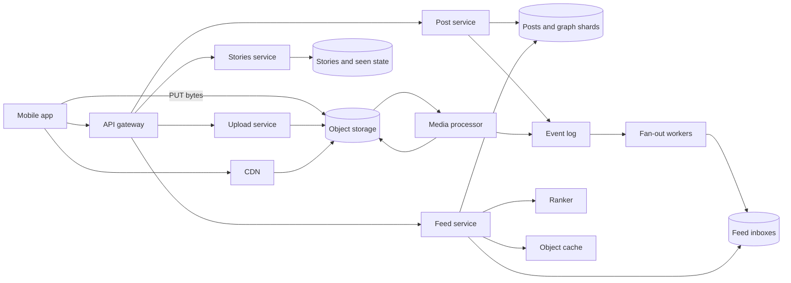

## In one minute
- Bytes and metadata take different roads. Photo bytes go from the phone straight to object storage through a presigned URL and come back to viewers through a CDN; the application tier only ever handles IDs, captions and pointers. Get this wrong and the API fleet becomes a very expensive file server.
- Every post ID is a 64-bit, time-sortable number that also says which shard owns it. One integer gives you ordering for feeds, routing for reads, and cursors for pagination, with no central ID service on the write path.
- The home feed is a hybrid fan-out: push post IDs into follower inboxes for ordinary accounts, pull from a small number of celebrity outboxes at read time, then rank. The fan-out mechanics are covered in the Fanout and Design FB News Feed lessons; here the twist is that most of the cost is images, not rows.
- Stories are a different product with a different shape: content that dies after 24 hours, a per-viewer "tray" ordered by unseen-first, and per-viewer seen state that is written far more often than stories are posted.
- Counters (likes, views) are the hot keys. A celebrity post can take tens of thousands of likes per second, so counts are sharded and approximate while the per-user "did I like this" fact stays exact.

## Requirements
Functional:
- Users upload a photo or a carousel of up to 20 photos or videos with a caption (Instagram raised the limit from 10 in August 2024 ([Social Media Today](https://www.socialmediatoday.com/news/instagram-expands-carousels-to-20-frames/723792/))); the post appears on their profile and in followers' home feeds.
- Users follow and unfollow others; the home feed shows posts from followed accounts, ranked, with infinite scroll.
- Users post Stories that are visible to followers for 24 hours; viewers see a tray of accounts with active stories, unseen first, and their seen state is remembered.
- Users like and comment; posts show like counts.

Non-functional:
- Home feed first page p99 under about 300 ms of server time; first image visible within about 1 s on a decent mobile network.
- A new post visible to most followers within a few seconds; within a minute for very large accounts is fine.
- Uploads must be durable once acknowledged: a photo the user saw as "posted" is never lost.
- High availability for reads (99.95% or better); writes may degrade (queue and retry) during incidents.

Out of scope: Reels and long video (see the Design YouTube and Design TikTok lessons for transcoding and recommendation), direct messages, Explore and search, ads, and content moderation, which I would mention only as an asynchronous hook on the upload pipeline.

## Back-of-envelope
Planning numbers, chosen to be in the right order of magnitude for a two-billion-account product.

Users: 500 million daily actives. Each opens the feed about 20 times a day, so 10 billion feed loads per day, which is about 116,000 per second on average and roughly 350,000 per second at a 3x evening peak.

Posts: 100 million feed posts a day is about 1,160 per second on average, about 3,500 at peak. Stories: 500 million a day, about 5,800 per second, peaking near 17,000.

Fan-out writes: 100 million posts times an average of 200 pushed inboxes is 20 billion inbox inserts a day, about 230,000 per second. That number, not post creation, sizes the feed store.

Photo storage: the client downscales to 1080 pixels and compresses, so an upload is about 1 MB; derived sizes (150, 320 and 640 pixels) add about 0.3 MB. 1.3 MB times 100 million is 130 TB per day, about 240 PB over five years, roughly 330 PB with erasure coding at 1.4x. Stories add about 500 TB a day but leave the serving tier after 24 hours; only archived ones stay, in a colder tier.

Metadata: about 500 bytes per post row is 50 GB a day, about 90 TB over five years, comfortable on a sharded relational fleet.

Bandwidth: a feed load renders about 10 images of about 100 KB, so 116,000 loads per second is about 116 GB/s, close to 1 Tbit/s from the CDN on average and 3 Tbit/s at peak, before Stories. The API tier serves only JSON, about 2.3 GB/s.

## API
```
POST /v1/media/uploads                         -> { upload_id, put_url, expires_at }
PUT  <put_url>  (bytes go directly to object storage, resumable)
POST /v1/posts            Idempotency-Key: <uuid>
  body { upload_ids: [..], caption, location_id? }
  -> 202 { post_id, state: "PROCESSING" }        (state becomes "LIVE")

GET  /v1/feed?cursor=<opaque>&limit=12
  -> { items: [ { post_id, author, caption, media: [ { variants: [ {w, url} ] } ],
                  like_count, viewer_has_liked } ], next_cursor }

POST   /v1/posts/{id}/likes                     -> 204   (idempotent per user)
DELETE /v1/posts/{id}/likes                     -> 204

POST /v1/stories          body { upload_id }    -> 202 { story_id, expires_at }
GET  /v1/stories/tray                           -> { authors: [ { user_id, has_unseen, first_story_id } ] }
POST /v1/stories/seen     body { story_ids: [..] }  -> 204   (batched by the client)
```

## Data model
**users, follows** (relational, sharded by `user_id`): `follows(follower_id, followee_id, created_at)` is stored twice, on the follower's shard (who do I follow) and on the followee's shard (who follows me), because both directions are hot queries.

**posts** (relational, sharded by author `user_id`): `post_id` (64-bit, time plus shard), `author_id`, `caption`, `media` (a small JSON array of media IDs and dimensions), `state`, `created_at`. Placing posts on the author's shard makes the profile grid ("this user's latest 12 posts") a single-shard index scan on `(author_id, post_id desc)`.

**media** (object storage, key `media/{media_id}/{variant}`): immutable objects, never overwritten. Because the key never changes meaning, CDN URLs can carry a one-year cache lifetime.

**feed_inbox** (wide-column store such as Cassandra, partition key `user_id`, clustering `post_id desc`): only `(post_id, author_id)`, about 16 bytes per entry, capped at a few hundred entries with a TTL. Time-sortable IDs make the clustering order chronological for free.

**stories** (wide-column, partition key `author_id`, clustering `story_id`, row TTL of 24 hours plus a margin): the store expires rows itself, so no delete job can fall behind.

**story_seen** (key-value, key `(viewer_id, author_id)`, TTL 24 hours): the newest story ID seen from that author plus a small set for out-of-order views. A high-water mark instead of one row per (viewer, story) cuts writes and space by an order of magnitude.

**like_counts** (sharded counter rows, key `(post_id, shard_n)`) plus **likes** `(post_id, user_id)` for the exact "did I like it" check and for dedup.

## High-level design


Write path: the app asks the upload service for a presigned URL and uploads the downscaled photo directly to object storage, resumably. Then it calls `POST /posts` with the upload IDs and an idempotency key. The post service allocates a post ID on the author's shard, inserts the row in state PROCESSING, and appends a `post_created` event to the log. The media processor (triggered by the object-store notification) validates the file, strips EXIF location if the user opted out, produces variants, and writes them under immutable keys. When every media item is ready, the post flips to LIVE and a `post_live` event goes on the log. Fan-out workers read the author's follower list in pages of a few thousand and append the post ID to each active follower's inbox, unless the author is above the celebrity threshold, in which case nothing is pushed.

Read path: the feed service reads the viewer's inbox (one partition read), adds the latest posts from the handful of followed celebrity accounts, drops anything already served in this session, and sends a few hundred candidates to the ranker. It hydrates the top page from the object cache with one multiget (posts, authors, counts, viewer-has-liked), builds CDN URLs for the variant matching the device width, and returns a page plus an opaque cursor. The app then fetches images from the nearest CDN edge.

## Deep dives

### Media: upload, processing and serving
Upload: proxying bytes through the API servers ties up a thread for the whole upload over a slow mobile link and makes API capacity depend on mobile network quality. Presigned, resumable uploads (see the Handling Large Files lesson) remove that, and the client can retry a chunk without restarting. This is the Valet Key pattern: the API hands out a short-lived, narrowly scoped token for one object and never touches the bytes ([Azure Architecture Center](https://learn.microsoft.com/en-us/azure/architecture/patterns/valet-key)).

Processing: synchronous resize in the request, or asynchronous workers. Asynchronous wins, with one subtlety: the author must see their own post immediately. The app shows the local image optimistically while the server keeps the post PROCESSING until variants exist, so followers never see a broken image. Variant generation costs tens of milliseconds of CPU per photo, so about 4,000 per second at peak needs a few hundred cores in a pool separate from anything user-facing. Video is where this budget explodes: Instagram found that basic video encodings were using more than 80% of its encoding compute, and fixed it by repackaging existing encodings instead of transcoding again ([Engineering at Meta](https://engineering.fb.com/2022/11/04/video-engineering/instagram-video-processing-encoding-reduction/)).

Serving: immutable keys mean the CDN never needs invalidation; a deleted post stops being referenced and its objects are garbage-collected later. The client picks a variant by screen width and pixel density, which is where most egress is saved. Variant choice belongs in the URL, never in a `Vary` header, so every variant is exactly one cache entry.

### IDs that sort, route and paginate
A feed merges inboxes and outboxes by recency, and pages through them with a cursor. If IDs are random UUIDs, you need a separate timestamp column, a secondary index on it, and a lookup to find the owning shard. Instagram described an ID layout in 2012 that solves all three: 41 bits of milliseconds since a custom epoch, 13 bits of logical shard ID, and 10 bits of a per-shard sequence, generated inside the database by a stored function. Each logical shard was a Postgres schema, and thousands of them were mapped onto a few physical servers ([Mike Krieger, SFPUG 2012](https://media.postgresql.org/sfpug/instagram_sfpug.pdf)). Sorting by ID is sorting by time, the shard is `(id >> 10) & 8191`, and a cursor is just "the last ID I showed you".

The alternatives are a central ticket server (a bottleneck and a single point of failure) or Snowflake-style workers (see Generating Unique IDs), which need worker-ID assignment. Generating in the shard's own database ties allocation to the insert transaction, with no extra hop. Thousands of logical shards map onto far fewer physical Postgres servers, so rebalancing moves a logical shard as a unit and never rewrites IDs.

### Stories: ephemeral content and seen state
Stories look like a small feed, but the access pattern is inverted. The product, launched in 2016, is a tray of accounts at the top of the feed whose posts disappear after 24 hours ([Instagram](https://about.instagram.com/blog/announcements/introducing-instagram-stories)). Each viewer opens the tray many times a day, and each tap through a story writes seen state. With 500 million daily actives viewing maybe 50 stories each, that is 25 billion seen events a day, about 290,000 per second, five times the number of feed-post fan-out writes.

Option one: fan out story IDs into a per-viewer tray, like the feed. Option two: build the tray at read time from "who do I follow" and "who has an active story". The second fits better: most followed accounts have no active story at any moment, and the per-author "latest story ID" can sit in a cache keyed by author. The tray read fetches the viewer's followee list (cached), multigets each followee's latest story ID, compares with the viewer's seen high-water mark per author, and orders: unseen authors first (by a closeness score in production, recency in the practice task), then fully seen ones. Playback within an author starts at the oldest unseen story.

Seen state is a high-water mark per (viewer, author) because stories play in order; skipping ahead creates a rare gap, stored as a small exception set. The app batches seen events every few seconds, so 290,000 events per second become perhaps 30,000 writes. Losing a few seconds of seen state on a crash only makes a story show as unseen again, an acceptable failure. Expiry is enforced twice: row TTLs in the store and a `now < created + 24h` check at read time, so lagging compaction never shows a dead story.

### Variant: a short-video app with a recommendation feed
The Instagram feed is built from a graph: you see what the people you chose to follow posted, so the hard part is fan-out. A short-video app such as TikTok flips the premise. The main feed is "For You", a stream the user did not choose, so the hard part becomes ranking, and the follow graph is only one source among several.

The numbers change shape too. With about 1B daily users watching an hour of 30-second clips, views run near 1.4M a second on average, and each view emits several events (impression, progress, finish or skip, like), so the event stream is around 7M events a second. Each feed call returns about ten videos but ranks hundreds to thousands of candidates, so scoring compute, not fan-out, is the bill. Egress is the other bill: tens of millions of concurrent streams at roughly 1.5 Mbit/s is on the order of 60 Tbit/s, with 10 to 20% wasted on unwatched prefetches.

The mechanisms to add:
- **Staged recommendation.** Several candidate sources (embedding nearest-neighbour search, trending, follows, fresh uploads) produce thousands of items, a heavier ranker scores hundreds, and a small deterministic mixer enforces rules the model cannot be trusted with: a cap per source, an exploration slot every few items, no back-to-back videos from one creator or with one sound, and a freshness decay. Dedup runs before ranking and again against a long-lived seen set, because a watched video should not return for weeks.
- **Feedback in seconds.** Watch time, replays and fast skips are the label. Recent interactions go into real-time user features within seconds, and some systems also sync changed embedding rows to the serving models every few minutes (ByteDance's Monolith paper describes this), so the feed adapts within a session rather than the next day.
- **Cold start by budget.** A new video has no engagement, so it gets a small audience matched by content embedding, and it is promoted to larger pools in stages only if completion and like rates beat its cohort. The same stage gates give moderation a place to review before a video reaches a large audience. A new user starts from regional trending plus diverse topic probes and learns from the first dozen swipes.
- **Prefetch.** The client downloads the first segment of the next two or three videos using range requests, so the first frame appears at once on swipe. The feed API therefore returns batches, and prefetch hit rate becomes a cost metric.

## Down the stack

### Layer 1: The contract
A `POST /posts` that returns 202 guarantees the media bytes are durably stored and the post row exists; retries with the same idempotency key return the same `post_id`. The post becomes visible to followers within seconds for ordinary authors, and is never shown in PROCESSING state to anyone except the author. A feed cursor guarantees no duplicates across pages within one session; it does not guarantee that a post published during scrolling appears in a later page. Like counts are eventually consistent within seconds; `viewer_has_liked` is read-your-writes for the viewer. A story is never served at or after `created + 24h`.

### Layer 2: The mechanism
The inbox is a Cassandra partition per user with `post_id` as a descending clustering key. An append is a write to the commit log plus an insert into the memtable; a read of the newest 300 entries is a slice of one partition, usually served from one or two SSTables thanks to time-ordered compaction. Capping uses a TTL plus a periodic trim rather than explicit deletes. Expired TTL cells still become tombstones, so the table uses TimeWindowCompactionStrategy, which groups SSTables by write time and drops a whole SSTable once everything in it has expired, instead of compacting tombstones away one by one ([Cassandra docs](https://cassandra.apache.org/doc/latest/cassandra/managing/operating/compaction/twcs.html)). Hydration goes through a memcache layer with leases, the Facebook technique for avoiding thundering herds when a hot key is invalidated: a server hands out at most one lease token per key every 10 seconds, and other clients wait briefly and retry ([Scaling Memcache at Facebook](https://www.usenix.org/system/files/conference/nsdi13/nsdi13-final170_update.pdf)). The stored ID function on each Postgres shard is a few lines of PL/pgSQL: read `nextval` from the shard's sequence, take `mod 1024`, read the clock in milliseconds, shift and OR. Like counters are N rows per hot post; an increment picks a random row, and a read sums N rows, cached for a second.

### Layer 3: The machine
A feed page read touches one inbox partition of 300 times 16 bytes, about 5 KB, one or two 4 KB pages, about 100 microseconds on NVMe if not in the page cache. The memcache multiget for 12 posts plus authors is one round trip of perhaps 15 KB, around 0.5 ms within a zone. The image dominates. A 100 KB image is about 70 TCP segments of 1,460 bytes; on a fresh connection with an initial congestion window of 10 segments ([RFC 6928](https://www.rfc-editor.org/rfc/rfc6928)), slow start sends 10, 20, then 40 segments, so four round trips plus the TLS handshake, around 300 ms at 60 ms mobile RTT. Hence warm CDN connections, HTTP/2 or QUIC multiplexing, and prefetching the next screen's images. On the phone, decoding a 1080-pixel image allocates about 4.7 MB of RGBA bitmap (1080 by 1080 by 4 bytes), another reason to fetch the variant sized for the screen.

### Why it's built this way
1. Images are a thousand times larger than metadata, so they get a separate path (object store plus CDN) and never touch the API servers.
2. The CDN can only cache well if objects never change, so media keys are immutable and variant choice lives in the URL.
3. Feeds read far more than they are written, so the work is moved to write time with fan-out, but power-law follower counts force the hybrid with pull for celebrities.
4. Fan-out and pagination both need ordering by time without a global coordinator, so the ID itself carries time and shard.
5. Stories expire and are viewed many times, so the system stores little per viewer (a high-water mark) and lets TTLs delete content instead of jobs.

## Failure modes
- **10x feed load** (a global event, New Year's Eve): serve the cached ranked page for repeat loads within a minute, fall back to a cheaper ranking model, and shrink the candidate set. The CDN absorbs image load; watch origin shield hit rate, because a cold variant on a hot post becomes an origin storm.
- **Fan-out backlog** after a burst of posts: inbox writes lag. Prioritize fan-out to recently active followers first, and let the feed service pull directly from the outboxes of authors whose fan-out is still pending (the read path tolerates it because it already merges outboxes).
- **Hot key**: a celebrity post gets 50,000 likes per second. Sharded counters spread writes; the like rows themselves are spread by `(post_id, user_id)` hash. Reads hit a one-second cached sum.
- **Region outage**: fail over leadership per logical shard to a replica region. In-flight uploads resume against another region's bucket because the client holds the upload ID. Inboxes are rebuildable from posts and the graph, so losing one is a performance problem, not data loss.
- **Media processor down**: posts stay PROCESSING and the author sees their local copy; nothing broken is shown to followers. Alert on the age of the oldest PROCESSING post.

## In the wild
- **Instagram, 2018: Cassandra tail latency from garbage collection.** Instagram wanted steadier read latency from its Cassandra fleet and built Rocksandra, a RocksDB-based storage engine for Cassandra. The proposal credits the gain mainly to removing most of the Java garbage that the read, write and compaction paths created, and reports a 3 to 4 times reduction in P99 read latency in general and more than 10 times for some use cases. Inbox and seen-state stores like the ones above are exactly the read-heavy, latency-sensitive workloads it targeted ([CASSANDRA-13474](https://issues.apache.org/jira/browse/CASSANDRA-13474)).
- **Instagram, 2022: 94% less compute for basic video encodings.** Encodings that only had to play everywhere were consuming more than 80% of video processing resources, while the better-compressed advanced encodings covered only 15% of watch time. Instagram produced the basic adaptive-bitrate versions by repackaging frames it had already encoded instead of transcoding again: a 23-second video took 0.36 s of CPU instead of 86 s. The compute it saved went into advanced encodings for more videos ([Engineering at Meta](https://engineering.fb.com/2022/11/04/video-engineering/instagram-video-processing-encoding-reduction/)).
- **ByteDance, 2022: online training measured against batch in production.** In a live A/B test on one of ByteDance's production ads models, Monolith's online training beat batch training on online serving AUC by 14.0% to 18.1% on each of seven days. That is why sparse embedding rows are synced to serving every few minutes while dense weights sync daily; the paper sizes 100,000 updated IDs a minute at 1,024 dimensions as about 400 MB a minute of sync traffic ([Monolith paper](https://arxiv.org/html/2209.07663v2)).

## Trade-offs
| Option | Strengths | Weaknesses | Choose when |
| --- | --- | --- | --- |
| Presigned direct upload | API tier never handles bytes; resumable | Two-step protocol, orphaned uploads to clean | Any media-heavy product |
| Proxy upload through API | Simple, one request | Ties up servers on slow links, costly egress | Tiny files, internal tools |
| Time-plus-shard IDs from the database | Sortable, routable, no extra service | Clock skew can reorder within milliseconds | Sharded relational store |
| Snowflake ID service | Independent of storage | Extra hop, worker-ID management | Many heterogeneous stores |
| Tray built at read time | Little write amplification; easy expiry | More reads per tray open | Short-lived content, few active authors |
| Tray fanned out on write | Single read per tray | Writes for content that expires unseen | Long-lived content, low follow counts |
| Sharded like counters | Absorbs hot posts | Reads must sum shards; counts approximate | Celebrity posts exist |

## Leadership lens
- Build first: the presigned upload plus media pipeline and the ID scheme. They are the hardest to change later; the feed can start as pure pull for a small user base and gain fan-out when reads demand it.
- Ownership: a Media Infrastructure team owns upload, processing, storage and CDN contracts; Feed owns fan-out, inboxes and ranking; Stories is its own team because its storage and expiry model differ. The event log is the contract between them.
- Cost drivers, in order: CDN egress, object storage, ranking inference, then databases. A 10% egress saving from better variant selection usually beats any database optimization.
- Rollout: ship new codecs (for example AVIF next to WebP) as an extra variant behind a client capability flag, measure decode time and bytes per market, then make it the default.
- Review questions: what fraction of fan-out writes go to users who never open the app that day; how long does the oldest PROCESSING post wait; how do we know no expired story was served (sample read logs against creation times).

## Check yourself
1. Why upload photo bytes directly to object storage through a presigned URL instead of proxying them through the API servers?
   **Answer:** Proxying ties up a server thread for the whole upload over a slow mobile link and makes API capacity depend on mobile network quality. Presigned, resumable uploads keep the API tier handling only IDs and pointers, at the cost of a two-step protocol and orphaned uploads to clean up.
2. The media processor goes down. What do authors and followers see?
   **Answer:** Posts stay in PROCESSING, so followers never see a broken image, while the author sees their local copy optimistically. Operators alert on the age of the oldest PROCESSING post.
3. Why is the Stories tray built at read time rather than fanned out on write like the feed?
   **Answer:** Most followed accounts have no active story at any moment, and fanning out would write tray entries for content that often expires unseen. Building it at read time from the cached followee list and per-author latest story IDs adds reads per tray open but keeps write amplification low and expiry easy.
4. How many seen events do Stories generate, and how does the data model keep the write load manageable?
   **Answer:** 500 million daily actives viewing about 50 stories each is 25 billion seen events a day, about 290,000 per second. Storing a high-water mark per (viewer, author) instead of a row per story, and batching seen events on the client, cuts that to perhaps 30,000 writes per second.

## Practice
**Task:** Implement the Stories tray. `StoriesTray(ttl)` stores stories that are active while `now < ts + ttl`. `post(author, story_id, ts)` returns `False` for a duplicate story ID, otherwise `True`. `view(viewer, story_id)` marks a story as seen and returns `True` only the first time that viewer sees that existing story. `tray(viewer, followees, now)` returns `(author, has_unseen)` pairs for each followee with at least one active story: authors with an unseen active story first, each group ordered by the author's newest active story `ts` descending, ties by author name ascending. `next_story(viewer, author, now)` returns the oldest active story the viewer has not seen (by `ts`, ties by story ID), or the oldest active story if all are seen, or `None` if there is none.

```python starter
class StoriesTray:
    def __init__(self, ttl):
        self.ttl = ttl

    def post(self, author, story_id, ts):
        # TODO
        raise NotImplementedError

    def view(self, viewer, story_id):
        raise NotImplementedError

    def tray(self, viewer, followees, now):
        raise NotImplementedError

    def next_story(self, viewer, author, now):
        raise NotImplementedError
```

```python tests
def test_unseen_authors_come_first():
    s = StoriesTray(100)
    assert s.post("ana", "a1", 10)
    assert s.post("bo", "b1", 20)
    assert s.post("cy", "c1", 30)
    assert s.view("me", "c1")
    assert s.tray("me", ["ana", "bo", "cy"], 50) == [("bo", True), ("ana", True), ("cy", False)]

def test_expired_stories_disappear():
    s = StoriesTray(100)
    s.post("ana", "a1", 0)
    s.post("bo", "b1", 50)
    assert s.tray("me", ["ana", "bo"], 99) == [("bo", True), ("ana", True)]
    assert s.tray("me", ["ana", "bo"], 100) == [("bo", True)], "expires at ts + ttl"
    assert s.next_story("me", "ana", 100) is None

def test_only_followees_and_ties_by_name():
    s = StoriesTray(100)
    s.post("zed", "z1", 5)
    s.post("amy", "m1", 5)
    s.post("stranger", "x1", 9)
    assert s.tray("me", ["zed", "amy", "nobody"], 10) == [("amy", True), ("zed", True)]

def test_new_story_makes_author_unseen_again():
    s = StoriesTray(100)
    s.post("ana", "a1", 10)
    s.view("me", "a1")
    assert s.tray("me", ["ana"], 20) == [("ana", False)]
    s.post("ana", "a2", 30)
    assert s.tray("me", ["ana"], 40) == [("ana", True)]
    assert s.next_story("me", "ana", 40) == "a2"

def test_next_story_oldest_unseen_then_oldest():
    s = StoriesTray(1000)
    s.post("ana", "a3", 30)
    s.post("ana", "a1", 10)
    s.post("ana", "a2", 20)
    assert s.next_story("me", "ana", 40) == "a1"
    s.view("me", "a1")
    assert s.next_story("me", "ana", 40) == "a2"
    s.view("me", "a2")
    s.view("me", "a3")
    assert s.next_story("me", "ana", 40) == "a1", "all seen: replay from the oldest"

def test_view_and_post_return_values():
    s = StoriesTray(100)
    assert s.post("ana", "a1", 1)
    assert not s.post("bo", "a1", 2), "duplicate story id"
    assert s.view("me", "a1")
    assert not s.view("me", "a1"), "second view is not new"
    assert not s.view("me", "missing")
    assert s.view("you", "a1"), "seen state is per viewer"
    assert s.tray("me", [], 5) == []
```

```python solution
class StoriesTray:
    def __init__(self, ttl):
        self.ttl = ttl
        self._stories = {}   # story_id -> (author, ts)
        self._by_author = {} # author -> list of (ts, story_id)
        self._seen = {}      # viewer -> set of story_id

    def post(self, author, story_id, ts):
        if story_id in self._stories:
            return False
        self._stories[story_id] = (author, ts)
        self._by_author.setdefault(author, []).append((ts, story_id))
        return True

    def view(self, viewer, story_id):
        if story_id not in self._stories:
            return False
        seen = self._seen.setdefault(viewer, set())
        if story_id in seen:
            return False
        seen.add(story_id)
        return True

    def _active(self, author, now):
        items = [p for p in self._by_author.get(author, []) if now < p[0] + self.ttl]
        return sorted(items)

    def tray(self, viewer, followees, now):
        seen = self._seen.get(viewer, set())
        unseen_group, seen_group = [], []
        for author in set(followees):
            active = self._active(author, now)
            if not active:
                continue
            newest = max(ts for ts, _ in active)
            has_unseen = any(sid not in seen for _, sid in active)
            (unseen_group if has_unseen else seen_group).append((-newest, author, has_unseen))
        out = []
        for group in (unseen_group, seen_group):
            for _, author, flag in sorted(group):
                out.append((author, flag))
        return out

    def next_story(self, viewer, author, now):
        active = self._active(author, now)
        if not active:
            return None
        seen = self._seen.get(viewer, set())
        for _, sid in active:
            if sid not in seen:
                return sid
        return active[0][1]
```

```typescript starter
export type TrayEntry = [string, boolean];

export class StoriesTray {
  constructor(public ttl: number) {}
  post(author: string, storyId: string, ts: number): boolean {
    throw new Error("TODO");
  }
  view(viewer: string, storyId: string): boolean {
    throw new Error("TODO");
  }
  tray(viewer: string, followees: string[], now: number): TrayEntry[] {
    throw new Error("TODO");
  }
  nextStory(viewer: string, author: string, now: number): string | null {
    throw new Error("TODO");
  }
}
```

```typescript tests
test("unseen authors come first", () => {
  const s = new StoriesTray(100);
  assert(s.post("ana", "a1", 10), "post a1");
  assert(s.post("bo", "b1", 20), "post b1");
  assert(s.post("cy", "c1", 30), "post c1");
  assert(s.view("me", "c1"), "view c1");
  assertEqual(s.tray("me", ["ana", "bo", "cy"], 50), [["bo", true], ["ana", true], ["cy", false]], "order");
});

test("expired stories disappear", () => {
  const s = new StoriesTray(100);
  s.post("ana", "a1", 0);
  s.post("bo", "b1", 50);
  assertEqual(s.tray("me", ["ana", "bo"], 99), [["bo", true], ["ana", true]], "both active");
  assertEqual(s.tray("me", ["ana", "bo"], 100), [["bo", true]], "expires at ts + ttl");
  assertEqual(s.nextStory("me", "ana", 100), null, "nothing active");
});

test("only followees and ties by name", () => {
  const s = new StoriesTray(100);
  s.post("zed", "z1", 5);
  s.post("amy", "m1", 5);
  s.post("stranger", "x1", 9);
  assertEqual(s.tray("me", ["zed", "amy", "nobody"], 10), [["amy", true], ["zed", true]], "ties");
});

test("new story makes author unseen again", () => {
  const s = new StoriesTray(100);
  s.post("ana", "a1", 10);
  s.view("me", "a1");
  assertEqual(s.tray("me", ["ana"], 20), [["ana", false]], "seen");
  s.post("ana", "a2", 30);
  assertEqual(s.tray("me", ["ana"], 40), [["ana", true]], "unseen again");
  assertEqual(s.nextStory("me", "ana", 40), "a2", "start at a2");
});

test("next story oldest unseen then oldest", () => {
  const s = new StoriesTray(1000);
  s.post("ana", "a3", 30);
  s.post("ana", "a1", 10);
  s.post("ana", "a2", 20);
  assertEqual(s.nextStory("me", "ana", 40), "a1", "oldest unseen");
  s.view("me", "a1");
  assertEqual(s.nextStory("me", "ana", 40), "a2", "next unseen");
  s.view("me", "a2");
  s.view("me", "a3");
  assertEqual(s.nextStory("me", "ana", 40), "a1", "replay from oldest");
});

test("view and post return values", () => {
  const s = new StoriesTray(100);
  assert(s.post("ana", "a1", 1), "first post");
  assert(!s.post("bo", "a1", 2), "duplicate story id");
  assert(s.view("me", "a1"), "first view");
  assert(!s.view("me", "a1"), "second view");
  assert(!s.view("me", "missing"), "unknown story");
  assert(s.view("you", "a1"), "per viewer");
  assertEqual(s.tray("me", [], 5), [], "no followees");
});
```

```typescript solution
export type TrayEntry = [string, boolean];

type Story = { ts: number; id: string };

export class StoriesTray {
  private stories = new Map<string, string>(); // id -> author
  private byAuthor = new Map<string, Story[]>();
  private seen = new Map<string, Set<string>>();

  constructor(public ttl: number) {}

  post(author: string, storyId: string, ts: number): boolean {
    if (this.stories.has(storyId)) return false;
    this.stories.set(storyId, author);
    const list = this.byAuthor.get(author) ?? [];
    list.push({ ts, id: storyId });
    this.byAuthor.set(author, list);
    return true;
  }

  view(viewer: string, storyId: string): boolean {
    if (!this.stories.has(storyId)) return false;
    let set = this.seen.get(viewer);
    if (!set) {
      set = new Set<string>();
      this.seen.set(viewer, set);
    }
    if (set.has(storyId)) return false;
    set.add(storyId);
    return true;
  }

  private active(author: string, now: number): Story[] {
    return (this.byAuthor.get(author) ?? [])
      .filter((s) => now < s.ts + this.ttl)
      .sort((a, b) => a.ts - b.ts || (a.id < b.id ? -1 : a.id > b.id ? 1 : 0));
  }

  tray(viewer: string, followees: string[], now: number): TrayEntry[] {
    const seen = this.seen.get(viewer) ?? new Set<string>();
    const rows: { author: string; newest: number; unseen: boolean }[] = [];
    for (const author of new Set(followees)) {
      const act = this.active(author, now);
      if (act.length === 0) continue;
      const newest = Math.max(...act.map((s) => s.ts));
      rows.push({ author, newest, unseen: act.some((s) => !seen.has(s.id)) });
    }
    rows.sort((a, b) => {
      if (a.unseen !== b.unseen) return a.unseen ? -1 : 1;
      if (a.newest !== b.newest) return b.newest - a.newest;
      return a.author < b.author ? -1 : a.author > b.author ? 1 : 0;
    });
    return rows.map((r): TrayEntry => [r.author, r.unseen]);
  }

  nextStory(viewer: string, author: string, now: number): string | null {
    const act = this.active(author, now);
    if (act.length === 0) return null;
    const seen = this.seen.get(viewer) ?? new Set<string>();
    const first = act.find((s) => !seen.has(s.id));
    return first ? first.id : act[0].id;
  }
}
```

```go starter
package practice

type TrayEntry struct {
	Author    string
	HasUnseen bool
}

type StoriesTray struct{ ttl int }

func NewStoriesTray(ttl int) *StoriesTray { return &StoriesTray{ttl: ttl} }

func (s *StoriesTray) Post(author, storyID string, ts int) bool { panic("TODO") }

func (s *StoriesTray) View(viewer, storyID string) bool { panic("TODO") }

func (s *StoriesTray) Tray(viewer string, followees []string, now int) []TrayEntry { panic("TODO") }

// NextStory returns the story ID and true, or "" and false when nothing is active.
func (s *StoriesTray) NextStory(viewer, author string, now int) (string, bool) { panic("TODO") }
```

```go tests
package practice

import (
	"reflect"
	"testing"
)

func TestUnseenAuthorsComeFirst(t *testing.T) {
	s := NewStoriesTray(100)
	s.Post("ana", "a1", 10)
	s.Post("bo", "b1", 20)
	s.Post("cy", "c1", 30)
	s.View("me", "c1")
	want := []TrayEntry{{"bo", true}, {"ana", true}, {"cy", false}}
	if got := s.Tray("me", []string{"ana", "bo", "cy"}, 50); !reflect.DeepEqual(got, want) {
		t.Fatalf("got %v", got)
	}
}

func TestExpiredStoriesDisappear(t *testing.T) {
	s := NewStoriesTray(100)
	s.Post("ana", "a1", 0)
	s.Post("bo", "b1", 50)
	if got := s.Tray("me", []string{"ana", "bo"}, 99); !reflect.DeepEqual(got, []TrayEntry{{"bo", true}, {"ana", true}}) {
		t.Fatalf("at 99: %v", got)
	}
	if got := s.Tray("me", []string{"ana", "bo"}, 100); !reflect.DeepEqual(got, []TrayEntry{{"bo", true}}) {
		t.Fatalf("at 100: %v", got)
	}
	if _, ok := s.NextStory("me", "ana", 100); ok {
		t.Fatal("ana has nothing active")
	}
}

func TestOnlyFolloweesAndTiesByName(t *testing.T) {
	s := NewStoriesTray(100)
	s.Post("zed", "z1", 5)
	s.Post("amy", "m1", 5)
	s.Post("stranger", "x1", 9)
	want := []TrayEntry{{"amy", true}, {"zed", true}}
	if got := s.Tray("me", []string{"zed", "amy", "nobody"}, 10); !reflect.DeepEqual(got, want) {
		t.Fatalf("got %v", got)
	}
}

func TestNewStoryMakesAuthorUnseenAgain(t *testing.T) {
	s := NewStoriesTray(100)
	s.Post("ana", "a1", 10)
	s.View("me", "a1")
	if got := s.Tray("me", []string{"ana"}, 20); !reflect.DeepEqual(got, []TrayEntry{{"ana", false}}) {
		t.Fatalf("seen: %v", got)
	}
	s.Post("ana", "a2", 30)
	if got := s.Tray("me", []string{"ana"}, 40); !reflect.DeepEqual(got, []TrayEntry{{"ana", true}}) {
		t.Fatalf("unseen again: %v", got)
	}
	if id, ok := s.NextStory("me", "ana", 40); !ok || id != "a2" {
		t.Fatalf("next = %q", id)
	}
}

func TestNextStoryOldestUnseenThenOldest(t *testing.T) {
	s := NewStoriesTray(1000)
	s.Post("ana", "a3", 30)
	s.Post("ana", "a1", 10)
	s.Post("ana", "a2", 20)
	if id, _ := s.NextStory("me", "ana", 40); id != "a1" {
		t.Fatalf("want a1, got %q", id)
	}
	s.View("me", "a1")
	if id, _ := s.NextStory("me", "ana", 40); id != "a2" {
		t.Fatalf("want a2, got %q", id)
	}
	s.View("me", "a2")
	s.View("me", "a3")
	if id, _ := s.NextStory("me", "ana", 40); id != "a1" {
		t.Fatalf("all seen: want a1, got %q", id)
	}
}

func TestViewAndPostReturnValues(t *testing.T) {
	s := NewStoriesTray(100)
	if !s.Post("ana", "a1", 1) || s.Post("bo", "a1", 2) {
		t.Fatal("duplicate story id must be rejected")
	}
	if !s.View("me", "a1") || s.View("me", "a1") || s.View("me", "missing") {
		t.Fatal("view semantics wrong")
	}
	if !s.View("you", "a1") {
		t.Fatal("seen state is per viewer")
	}
	if got := s.Tray("me", nil, 5); len(got) != 0 {
		t.Fatalf("want empty, got %v", got)
	}
}
```

```go solution
package practice

import "sort"

type TrayEntry struct {
	Author    string
	HasUnseen bool
}

type story struct {
	ts int
	id string
}

type StoriesTray struct {
	ttl      int
	stories  map[string]string // id -> author
	byAuthor map[string][]story
	seen     map[string]map[string]bool
}

func NewStoriesTray(ttl int) *StoriesTray {
	return &StoriesTray{
		ttl:      ttl,
		stories:  map[string]string{},
		byAuthor: map[string][]story{},
		seen:     map[string]map[string]bool{},
	}
}

func (s *StoriesTray) Post(author, storyID string, ts int) bool {
	if _, dup := s.stories[storyID]; dup {
		return false
	}
	s.stories[storyID] = author
	s.byAuthor[author] = append(s.byAuthor[author], story{ts, storyID})
	return true
}

func (s *StoriesTray) View(viewer, storyID string) bool {
	if _, ok := s.stories[storyID]; !ok {
		return false
	}
	set := s.seen[viewer]
	if set == nil {
		set = map[string]bool{}
		s.seen[viewer] = set
	}
	if set[storyID] {
		return false
	}
	set[storyID] = true
	return true
}

func (s *StoriesTray) active(author string, now int) []story {
	var out []story
	for _, st := range s.byAuthor[author] {
		if now < st.ts+s.ttl {
			out = append(out, st)
		}
	}
	sort.Slice(out, func(i, j int) bool {
		if out[i].ts != out[j].ts {
			return out[i].ts < out[j].ts
		}
		return out[i].id < out[j].id
	})
	return out
}

func (s *StoriesTray) Tray(viewer string, followees []string, now int) []TrayEntry {
	type row struct {
		author string
		newest int
		unseen bool
	}
	seen := s.seen[viewer]
	done := map[string]bool{}
	var rows []row
	for _, a := range followees {
		if done[a] {
			continue
		}
		done[a] = true
		act := s.active(a, now)
		if len(act) == 0 {
			continue
		}
		r := row{author: a, newest: act[len(act)-1].ts}
		for _, st := range act {
			if !seen[st.id] {
				r.unseen = true
			}
		}
		rows = append(rows, r)
	}
	sort.Slice(rows, func(i, j int) bool {
		if rows[i].unseen != rows[j].unseen {
			return rows[i].unseen
		}
		if rows[i].newest != rows[j].newest {
			return rows[i].newest > rows[j].newest
		}
		return rows[i].author < rows[j].author
	})
	out := []TrayEntry{}
	for _, r := range rows {
		out = append(out, TrayEntry{r.author, r.unseen})
	}
	return out
}

func (s *StoriesTray) NextStory(viewer, author string, now int) (string, bool) {
	act := s.active(author, now)
	if len(act) == 0 {
		return "", false
	}
	seen := s.seen[viewer]
	for _, st := range act {
		if !seen[st.id] {
			return st.id, true
		}
	}
	return act[0].id, true
}
```

## Mock interview
**Prompt:** Design Instagram for 500 million daily active users: photo posts, a home feed and Stories. Assume about 100 million posts and 500 million stories a day, and that the median user follows a few hundred accounts while the largest accounts have hundreds of millions of followers.

- Follow-up: A user uploads a photo on a train with a flaky connection and taps Share twice. Walk me through what the server sees and why exactly one post appears.
- Follow-up: A celebrity with 300 million followers posts a story and a feed post at the same moment. What load does each create, and where?
- Follow-up: Why not store Stories in the same inbox table as feed posts and just filter by age?

**A strong answer covers:**
- Arithmetic showing images dominate bytes and fan-out writes dominate rows, and a design that separates the media path (presigned upload, async variants, immutable CDN URLs) from the metadata path.
- Idempotent post creation with a client key and a PROCESSING state so followers never see half-processed media.
- Time-sortable, shard-embedding IDs, used for routing, inbox ordering and cursors.
- Hybrid fan-out with a celebrity threshold, inactive-user skipping, and ranking as a separate stage.
- A Stories model built at read time from active authors, with per-viewer high-water-mark seen state, batched seen writes and TTL-based expiry checked again at read time.
- Hot-key handling for likes with sharded counters and approximate display.

## Sources and further study
**Primary**
- [Sharding @ Instagram, Mike Krieger (SFPUG 2012)](https://media.postgresql.org/sfpug/instagram_sfpug.pdf): the ID layout, the PL/pgSQL `next_id` function and schema-based logical shards.
- [RFC 6928: Increasing TCP's Initial Window](https://www.rfc-editor.org/rfc/rfc6928): why the first round trip of an image download carries about 14 KB.
- [TAO: Facebook's Distributed Data Store for the Social Graph (USENIX ATC 2013)](https://www.usenix.org/system/files/conference/atc13/atc13-bronson.pdf): the follow-graph store whose association lists match the `follows` tables here.

**Systems docs**
- [How TikTok recommends videos #ForYou (TikTok)](https://newsroom.tiktok.com/en-us/how-tiktok-recommends-videos-for-you): the signals, their weighting and the diversity rules for a recommendation-first feed.
- [Monolith: Real Time Recommendation System With Collisionless Embedding Table (ByteDance)](https://arxiv.org/html/2209.07663v2): online training with minute-scale sync of sparse embeddings.
- [Cassandra: Time Window Compaction Strategy](https://cassandra.apache.org/doc/latest/cassandra/managing/operating/compaction/twcs.html): how TTL data such as Stories and inboxes is dropped by whole SSTables.
- [CASSANDRA-13474: pluggable RocksDB storage engine](https://issues.apache.org/jira/browse/CASSANDRA-13474): Instagram's proposal and measured latency gains.

**Books**
- *Designing Data-Intensive Applications* (1st ed.), Martin Kleppmann, chapter 6 "Partitioning": key-range versus hash partitioning and rebalancing with many fixed logical partitions, which is the Instagram shard map.
- *System Design Interview, Volume 1*, Alex Xu, chapter 11 "Design A News Feed System": the fan-out half of this design at interview depth.

**Other curricula**
- [Azure Architecture Center: Valet Key pattern](https://learn.microsoft.com/en-us/azure/architecture/patterns/valet-key): frames direct-to-storage upload as a security and scalability pattern, with token scope and expiry as the main decisions.
- [donnemartin/system-design-primer](https://github.com/donnemartin/system-design-primer): covers the pieces (CDN, object store, sharding, cache) but not Instagram itself, so it is useful as a checklist rather than a reference answer.

## Watch
- [Scaling Instagram Infrastructure (InfoQ)](https://www.youtube.com/watch?v=hnpzNAPiC0E): an Instagram engineer on multi-region serving, Cassandra, memcache and capacity work.
- [Instagram + Twitter + Facebook + Reddit (Jordan has no life)](https://www.youtube.com/watch?v=S2y9_XYOZsg): an interview-style walkthrough of social feed designs to compare with your own answer.

## Free resources
- [How Instagram Scaled Its Infrastructure To Support a Billion Users (ByteByteGo)](https://blog.bytebytego.com/p/how-instagram-scaled-its-infrastructure): a summary of Instagram's public engineering history: Postgres sharding, Cassandra and multi-region moves.
- [Introducing Instagram Stories (Instagram)](https://about.instagram.com/blog/announcements/introducing-instagram-stories): the original product definition of 24-hour stories and the tray, which drive the data model.
- [Scaling Memcache at Facebook (USENIX NSDI 2013)](https://www.usenix.org/conference/nsdi13/technical-sessions/presentation/nishtala): leases, regional pools and invalidation, the caching layer behind feed hydration.
- [Snowflake ID (Wikipedia)](https://en.wikipedia.org/wiki/Snowflake_ID): background on time-plus-node 64-bit IDs and their trade-offs.
- [Cassandra Dynamo architecture (Apache Cassandra docs)](https://cassandra.apache.org/doc/latest/cassandra/architecture/dynamo.html): partitioning and replication of the kind used for feed inboxes.
