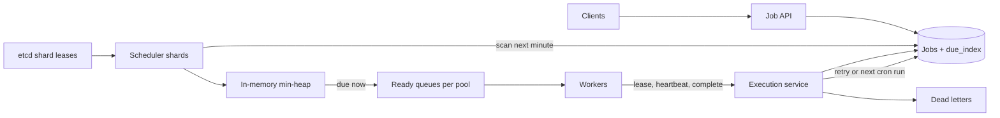

## In one minute
- Separate **when** a job should run from **who** runs it. A scheduler tier turns "due at time T" into "ready now" by pushing into a work queue; a worker tier pulls ready work. They scale and fail independently.
- Find due jobs with a **time-ordered index** partitioned across scheduler shards, each holding the next few minutes in a min-heap. Never scan the whole job table.
- Execution is **at-least-once** with leases. A worker holds a lease with a deadline and heartbeats; an expired lease makes the job runnable again. Duplicate runs are expected, so jobs carry an idempotency key and a fencing token.
- Cron jobs materialise **one future occurrence at a time**: when an occurrence finishes, compute the next fire time and insert it.
- Plan for the top-of-the-hour herd and for tenant fairness, because users schedule work at round numbers.

## Requirements
Functional:
- Submit a one-off job to run at a time, or after a delay; submit a recurring job with a cron expression and time zone.
- Run the job's payload (an HTTP callback or a message to a named worker pool) close to its due time.
- Retry failures with exponential backoff up to a limit, then move the job to a dead-letter state.
- Cancel, pause, and inspect jobs and their execution history.

Non-functional:
- Never lose an accepted job. Durability beats latency.
- Start a job within 2 seconds of its due time at p99 under normal load.
- At-least-once execution; no two workers believe they own the same attempt at once.
- Multi-tenant isolation: one tenant's burst must not delay everyone else.

Out of scope: DAG dependencies between jobs (that is a workflow engine like Airflow or Temporal), running user code in sandboxes (we dispatch to the tenant's own workers or endpoints), and sub-second precision.

## Back-of-envelope
Planning assumptions for a shared internal platform at a large company.

- Active jobs: 20M, of which 2M are recurring. Executions per day: 60M (one-off jobs plus recurring jobs averaging about 20 runs per day).
- Average execution rate: 60M / 86,400 ≈ 700 per second.
- Peak: cron schedules cluster on round minutes. If 10% of a day's recurring runs land on the 24 top-of-the-hour seconds, that is 0.1 × 40M / 24 ≈ 170,000 jobs due in the same second. Even if the real figure is a few times smaller, the scheduler must dispatch tens of thousands per second for a few seconds and spread the rest.
- Storage: a job definition is about 1 KB (payload reference, schedule, retry policy, metadata), so 20M × 1 KB = 20 GB. An execution record is about 300 B, so 60M × 300 B = 18 GB per day, or 18 GB × 365 × 5 ≈ 33 TB over five years. Keep 30 days hot (about 540 GB) and archive the rest to object storage.
- Bandwidth: dispatch messages carry a payload reference of about 1 KB, so 700/s × 1 KB ≈ 0.7 MB/s on average and about 170 MB/s at a top-of-hour spike, briefly.
- Scheduler memory: holding the next 5 minutes of due jobs at peak density, perhaps 2M entries, at about 64 B per heap entry is 128 MB spread over the scheduler shards.

## API
```text
POST /v1/jobs                      Idempotency-Key: <uuid>
  {name, target:{type:"http"|"queue", ref}, payload,
   schedule:{runAt:"2026-10-16T09:00:00Z"} | {cron:"0 9 * * MON-FRI", tz:"Europe/London"},
   retry:{maxAttempts:5, backoffSeconds:10}, timeoutSeconds:300}
  -> 201 {jobId, nextRunAt}

DELETE /v1/jobs/{jobId}            -> 204
POST   /v1/jobs/{jobId}:pause      -> 200
GET    /v1/jobs/{jobId}/executions?cursor=...
  -> [{executionId, scheduledFor, attempt, state, startedAt, finishedAt, error}]

// worker protocol (gRPC)
Lease(pool, workerId, max, leaseSeconds) -> [{executionId, jobId, attempt, payload, leaseUntil}]
Heartbeat(executionId, attempt)          -> {leaseUntil} | LEASE_LOST
Complete(executionId, attempt, result)   -> OK | LEASE_LOST
Fail(executionId, attempt, error)        -> {retryAt} | DEAD
```
The `attempt` number is the fencing token. Every call from a worker includes it, and the server rejects calls whose attempt is no longer current.

## Data model
- **`jobs`**: `job_id PK, tenant_id, schedule, target, payload_ref, retry_policy, state, next_run_at, version`. Partition key `job_id` (hash). Large payloads go to object storage; the row holds a reference.
- **`due_index`**: `(shard_id, due_minute, next_run_at, job_id)` as the primary key. `shard_id = hash(job_id) mod 256`; `due_minute` buckets time so one scheduler shard reads "my jobs due in the next minute" as a single contiguous range scan. This index is what makes finding due work cheap. Rows are deleted when the job is dispatched.
- **`executions`**: `execution_id PK, job_id, scheduled_for, attempt, state, lease_owner, lease_until, started_at, finished_at, error`. Unique on `(job_id, scheduled_for)` so an occurrence is dispatched once, however many times the scheduler retries. Partition by `job_id`, with time-based table partitions so 30-day retention is a cheap partition drop.
- **`shard_leases`** (in etcd or ZooKeeper): which scheduler instance owns which of the 256 shards, with a lease and a revision number used as a fencing token.

A sharded relational store (Postgres, MySQL or a distributed SQL database) works well: the access patterns are point lookups and short range scans, and unique constraints do the deduplication. Cassandra also fits `due_index` well, but would need lightweight transactions for the dedup, which are slow.

## High-level design


Write path. A client submits a job. The API validates the cron expression, computes the first `next_run_at` in the job's time zone, and in one transaction inserts the `jobs` row and its `due_index` row. If the due time is within the current minute, it also notifies the owning scheduler shard directly so short delays are not missed.

Dispatch path. Each scheduler instance owns a set of shards through etcd leases. For each shard, a loader runs every few seconds and reads `due_index` rows for the current and next minute into a min-heap keyed by `next_run_at`. A dispatcher loop peeks at the heap top, sleeps until it is due, then in one transaction inserts the `executions` row (the unique constraint deduplicates) and deletes the `due_index` row, and publishes the execution to the ready queue for the job's worker pool. Workers lease executions from the queue, heartbeat while running, and call complete or fail. Complete on a recurring job computes the next fire time and inserts a new `due_index` row; fail either inserts a retry row at `now + backoff × 2^(attempt-1)` or marks the execution dead.

Read path. Job and execution history reads go to replicas, paginated by time. Operators get per-tenant dashboards of lag (now minus `scheduled_for` at dispatch), failure rate and queue depth.

## Deep dives

### Finding due jobs
Options considered. First, poll the database: `SELECT ... WHERE next_run_at <= now() ORDER BY next_run_at LIMIT 100 FOR UPDATE SKIP LOCKED` from many dispatchers. It is simple and correct, and `SKIP LOCKED` lets dispatchers share a table without blocking each other; Postgres documents it as unsuitable for general queries, since skipped rows give an inconsistent view, but meant for exactly this case of many consumers on a queue-like table ([Postgres docs](https://www.postgresql.org/docs/current/sql-select.html)). It works well up to perhaps a few thousand dispatches per second, then the index's hot head and constant polling dominate. Second, a Redis sorted set scored by due time with `ZRANGEBYSCORE` and a Lua script to claim. It is fast but holds durable state in an asynchronously replicated store. Third, a hierarchical timing wheel in memory, as Kafka uses for its delayed operations: Kafka replaced a `DelayQueue` with O(log n) insert and delete by timing wheels with O(1) cancellation, and in its benchmark the saturation point rose from about 25,000 to about 105,000 requests per second ([Confluent](https://www.confluent.io/blog/apache-kafka-purgatory-hierarchical-timing-wheels/)). It is very cheap per timer, but has to be rebuilt from durable state after a crash.

Choice: durable `due_index` partitioned by shard and minute, plus an in-memory min-heap per shard holding only the next one to two minutes. The database does what it is good at (durable, range-scannable storage) and memory does what it is good at (precise ordering of a small, hot set). If a scheduler dies, another acquires its shards' leases and reloads from `due_index`; anything already dispatched is protected by the unique `(job_id, scheduled_for)` constraint. Dropbox's Async Task Framework is a production version of the same split: tasks sit in a store with a next-trigger time, a consumer polls for due ones every two seconds and pushes them onto per-callback SQS queues, and the target was 95% of tasks starting within five seconds of their scheduled time ([Dropbox](https://dropbox.tech/infrastructure/asynchronous-task-scheduling-at-dropbox)).

### Leases, retries and duplicate execution
Exactly-once execution of side effects is not achievable when workers can stall: a worker pauses for a 40-second GC, its lease expires, the job is re-leased to another worker, and then the first worker wakes and finishes. So the contract is at-least-once, and the design makes duplicates harmless. This is the fencing-token argument: the lease alone cannot stop a paused process, so the resource it writes to must reject stale tokens ([Kleppmann](https://martin.kleppmann.com/2016/02/08/how-to-do-distributed-locking.html)). Each attempt gets an incrementing `attempt` number. Re-leasing bumps it, and complete or heartbeat with an old attempt returns `LEASE_LOST`, so the stale worker's result is discarded. Downstream side effects get an idempotency key of `job_id + scheduled_for`, so a duplicate HTTP callback can be recognised by the receiver. Lease length is a trade-off: short leases recover crashed work quickly but force long jobs to heartbeat often; we default to 30 seconds with heartbeats every 10.

Retries use exponential backoff with jitter, capped at the job's `maxAttempts`, after which the execution moves to dead letters with its last error. A poison job that crashes its worker every time shows up as repeated lease expiries; counting those as attempts keeps it from looping forever.

### Cron, time zones and the top-of-the-hour herd
Only the next occurrence of a recurring job exists in `due_index`. On completion (or on dispatch, for jobs that allow overlap) we compute the next fire time from the cron expression in the job's IANA time zone. Overlap is a per-job policy worth naming, as Kubernetes does with `concurrencyPolicy`: `Allow` (the default), `Forbid` (skip the new run while the old one is still going) or `Replace` (stop the old one); Kubernetes also only made `.spec.timeZone` stable in v1.27 and warns that a CronJob may create two Jobs or none for one slot, so jobs must be idempotent ([Kubernetes docs](https://kubernetes.io/docs/concepts/workloads/controllers/cron-jobs/)). Daylight saving needs explicit rules: a 02:30 job on a spring-forward day has no 02:30, so we run it at the next valid instant; on fall-back day 01:30 happens twice, and we run it once. If the scheduler was down and several occurrences were missed, the default policy is to run once and skip the rest, with an opt-in "catch up" policy. Google's cron service leans the same way: when it cannot tell whether a launch happened, it prefers skipping a run to risking a double launch ([Google SRE book, ch. 24](https://sre.google/sre-book/distributed-periodic-scheduling/)). Kubernetes caps catch-up outright: a CronJob that has missed more than 100 schedules logs an error and does not start the Job.

For the herd, we offer and encourage a jitter window on cron jobs ("run within 5 minutes after 09:00"), hash the job ID into that window (Google added a `?` to its crontab syntax that does this hashing, and EventBridge Scheduler exposes it as a flexible time window ([AWS docs](https://docs.aws.amazon.com/scheduler/latest/UserGuide/managing-schedule-flexible-time-windows.html))), and enforce per-tenant dispatch quotas in the ready queues so one tenant with 500,000 jobs at midnight does not starve others. Ready queues are per worker pool, so a slow pool backs up only its own queue.

## Down the stack

### Layer 1: The contract
An accepted job is durable before the API returns. Each scheduled occurrence is dispatched no earlier than its due time and, under normal load, within 2 seconds after it. Each occurrence executes at least once until it succeeds or exhausts its attempts. At any instant at most one attempt number is current for an execution, and the server accepts heartbeats and results only for the current attempt. Workers whose lease has expired may still be running; the contract makes their results void, not their code stop.

### Layer 2: The mechanism
Shard ownership uses etcd leases: a scheduler creates a lease with `LeaseGrant` and a TTL of, say, 10 seconds, writes `/shards/17 -> instance-b` attached to it, and keeps it alive over the `LeaseKeepAlive` stream. If it stops renewing, etcd deletes every key attached to the lease and another instance's watch fires on the delete event ([etcd API](https://etcd.io/docs/v3.5/learning/api/)). The etcd revision of the ownership key is passed as a fencing value with every dispatch transaction, and the dispatch is rejected if a newer owner exists. Inside a shard, the heap is a binary min-heap ordered by `(next_run_at, sequence)`; push and pop are O(log n), and cancellations use lazy deletion: the heap entry carries a version and is skipped if the job's version has moved on. The dispatcher loop does not poll: it sleeps until the heap top's due time or until a new entry arrives on a channel, whichever comes first.

### Layer 3: The machine
A heap of 1M entries is about 20 levels deep. Each pop walks one root-to-leaf path, roughly 20 comparisons, and most levels miss in L1 and L2 cache, at around 5 to 100 ns per miss, so a pop costs on the order of 1 to 2 microseconds. One core can dispatch hundreds of thousands of heap operations per second; the real limit is the database insert per dispatch. Sleeping until a deadline maps to `epoll_wait` with a timeout or a `timerfd` on Linux, with wakeup precision in the tens of microseconds to low milliseconds depending on load. Clocks across machines are kept within a few milliseconds by NTP, small next to a 2-second target, but leases must not depend on synchronised clocks: etcd lease TTLs are measured on the etcd leader. Loading a minute's bucket is a range scan over adjacent B-tree leaf pages (8 KB in Postgres, 16 KB in InnoDB), so 10,000 due rows of about 60 bytes each read in roughly 75 to 150 pages, mostly sequential.

### Why it's built this way
1. Scanning millions of rows to find the few due now is wasteful, so we keep a time-ordered index and read only the next minute.
2. Durable storage is too slow for per-job timers, and memory is lost on crash, so durable storage holds truth while memory holds a short-horizon heap rebuilt on failover.
3. Workers can stall or die without telling anyone, so ownership must expire on its own: leases with deadlines, and attempt numbers to fence stale workers.
4. Because leases expire while code may still be running, exactly-once is impossible, so we promise at-least-once and push idempotency to the edge.
5. Humans schedule work at round times, so load is spiky by construction; jitter and quotas turn spikes into plateaus.

## Failure modes
- **10x load.** Dispatch lag grows. Add scheduler shards (256 logical shards can move between more instances without re-hashing) and scale worker pools on queue depth. If the database insert rate is the bottleneck, batch dispatch inserts per shard per tick.
- **Scheduler instance dies.** Its etcd leases expire in about 10 seconds; another instance takes the shards, reloads the next minutes from `due_index`, and dispatches anything overdue. The unique execution key prevents double dispatch for jobs the old owner already handled.
- **Region outage.** Run active-passive with the job store replicated to a second region. On failover, jobs due during the gap dispatch late but are not lost, subject to the replication lag at the moment of failure (seconds with asynchronous replication). Critical tenants can opt into synchronous cross-region commit at higher submit latency.
- **Hot key or hot tenant.** A tenant creates a million jobs due at midnight. Per-tenant quotas in ready queues and a submit-time warning when a tenant's due-time histogram is spiky contain it. A single job hammered by updates is rare; version checks keep updates safe.
- **Downstream outage.** A tenant's HTTP endpoint is down, so all its jobs fail and retry. A per-target circuit breaker pauses dispatch to that target instead of burning attempts and filling dead letters.

## In the wild
- **Slack, about 2016: the job queue that could not drain.** Database contention slowed job execution until Slack's Redis-backed job queue hit its memory limit. New jobs were refused, and because dequeuing also needed spare memory to move a job onto an in-flight list, the queue stayed stuck after the database recovered. At the time Slack ran over 1.4 billion jobs on busy days, peaking at 33,000 per second, and the fix put Kafka in front of Redis as a durable buffer ([Slack Engineering](https://slack.engineering/scaling-slacks-job-queue/)).
- **GitHub, 2022: retrying jobs that can never succeed.** Automated accounts created and deleted repositories so fast that many webhook jobs could not build their payloads, because the data was already gone. Workers kept retrying them, which blocked new events for 31 minutes. GitHub changed the workers to stop retrying jobs whose data no longer exists, the same "is this failure retryable?" question a dead-letter policy has to answer ([GitHub availability report](https://github.blog/2022-11-02-github-availability-report-october-2022/)).
- **Datadog, 2023: one schedule, every region at once.** A legacy OS update channel applied a systemd security update in its default 06:00 to 07:00 UTC window. Restarting systemd-networkd deleted the routes Cilium manages, and tens of thousands of nodes in five otherwise isolated regions dropped off the network within an hour; recovery took about two days. A fixed wall-clock window with no per-region spread is exactly the herd this lesson's jitter window prevents ([Datadog](https://www.datadoghq.com/blog/2023-03-08-multiregion-infrastructure-connectivity-issue/)).

## Trade-offs
| Option | Strengths | Weaknesses | Choose when |
|---|---|---|---|
| DB polling with SKIP LOCKED | Simple, one system, transactional | Polling cost, few thousand per second ceiling | Under about 1,000 dispatches per second |
| Redis sorted set | Very fast, easy to build | Durability depends on Redis persistence and failover | Delays are best-effort, loss is tolerable |
| Due index + in-memory heap | Durable, precise, scales by shard | More moving parts: leases, loaders, rebalancing | Large shared platform (our choice) |
| Timing wheel | O(1) per timer, huge timer counts | Coarse granularity, needs rebuild after crash | Millions of short timeouts in one process |
| Queue with delivery delay (SQS-style) | No scheduler to run | SQS caps delay at 15 minutes ([AWS docs](https://docs.aws.amazon.com/AWSSimpleQueueService/latest/SQSDeveloperGuide/sqs-delay-queues.html)), no cron | Short delays, no recurring jobs |

## Leadership lens
- Build first: the execution state machine (leased, succeeded, failed, dead) with attempt fencing, on top of a single Postgres table with `SKIP LOCKED`. That serves the first year for most companies; introduce the sharded heap when measured dispatch lag says so.
- Rollout: migrate existing crontabs tenant by tenant, running old and new side by side with the new one in dry-run mode, comparing fire times, then flipping.
- Ownership: the platform team owns scheduling and dispatch; tenant teams own idempotency of their handlers. Write that split into the onboarding doc, because duplicates will happen.
- Cost drivers: execution history storage (archive aggressively), the database write rate at peaks, and idle worker capacity reserved for midnight spikes.
- Design review question: what does a job owner see when their job runs twice, and how do they find out?

## Check yourself
1. A worker pauses for a 40-second GC, its lease expires, and the job is re-leased to another worker. What stops the first worker's late result from being recorded, and why can't the design promise exactly-once?
   **Answer:** Re-leasing bumps the attempt number, which acts as a fencing token, so the stale worker's complete or heartbeat returns `LEASE_LOST` and its result is discarded. Its code may already have produced side effects, though, so the contract is at-least-once and handlers dedupe with the `job_id + scheduled_for` idempotency key.
2. Why does the design pair a durable `due_index` with a small in-memory min-heap per shard instead of using a Redis sorted set or polling the jobs table with `SKIP LOCKED`?
   **Answer:** Polling hits a ceiling of a few thousand dispatches per second as the hot index head and constant polling dominate, and Redis holds durable state in an asynchronously replicated store. The due index keeps truth durable and range-scannable by shard and minute, while the heap orders only the next minute or two and is rebuilt from the index after failover.
3. Using the lesson's numbers, roughly how many jobs could be due in the same second at the top of the hour, and what does the design do about it?
   **Answer:** If 10% of the 40M daily recurring runs land on the 24 top-of-the-hour seconds, about 0.1 x 40M / 24, or roughly 170,000 jobs are due in one second. The design encourages a cron jitter window with the job ID hashed into it and enforces per-tenant dispatch quotas in per-pool ready queues, turning spikes into plateaus.
4. A scheduler instance dies after dispatching some jobs. How does another instance take over without double-dispatching them?
   **Answer:** Its etcd shard leases expire in about 10 seconds, another instance acquires the shards and reloads upcoming minutes from `due_index`. Dispatch inserts the `executions` row under a unique `(job_id, scheduled_for)` constraint, so any occurrence the old owner already dispatched cannot be inserted again.

## Practice
**Task:** Build an in-memory job queue for delayed and recurring jobs on a min-heap. `Scheduler(clock, backoff)` takes a clock function and a base backoff. `submit(jobId, runAt, maxAttempts, interval)` adds a job (interval 0 means one-off) and returns false for a duplicate ID. `lease(worker, ttl)` returns the due job (`runAt <= now`) with the smallest `runAt`, ties broken by the order it was queued, or nothing; each lease counts one attempt and lasts until `now + ttl`. A lease is expired when `now >= expiry`; an expired lease is treated as a failure at the expiry time. `complete(jobId, worker)` succeeds only for the current, unexpired lease holder: a one-off job becomes `"done"`; a recurring job's attempts reset and it is rescheduled at its last slot plus `interval`, skipping slots at or before now. `fail(jobId, worker)` (same holder rule) retries at `failTime + backoff * 2^(attempts-1)`, or marks the job `"dead"` once attempts reach `maxAttempts`. `status(jobId)` returns `"scheduled"`, `"leased"`, `"done"`, `"dead"` or `"unknown"`.

```python starter
class Scheduler:
    def __init__(self, clock, backoff):
        # TODO
        pass

    def submit(self, job_id, run_at, max_attempts, interval=0):
        raise NotImplementedError

    def lease(self, worker, ttl):
        raise NotImplementedError

    def complete(self, job_id, worker):
        raise NotImplementedError

    def fail(self, job_id, worker):
        raise NotImplementedError

    def status(self, job_id):
        raise NotImplementedError
```

```python tests
class Clock:
    def __init__(self):
        self.t = 0

    def __call__(self):
        return self.t


def test_due_order_and_ties():
    c = Clock()
    s = Scheduler(c, 1)
    s.submit("c", 5, 1)
    s.submit("a", 1, 1)
    s.submit("b", 1, 1)
    assert s.lease("w", 10) is None
    c.t = 5
    assert [s.lease("w", 10) for _ in range(4)] == ["a", "b", "c", None]


def test_duplicate_submit():
    s = Scheduler(Clock(), 1)
    assert s.submit("x", 0, 1)
    assert not s.submit("x", 9, 1)


def test_expired_lease_is_retried_with_backoff():
    c = Clock()
    s = Scheduler(c, 2)
    s.submit("j", 0, 3)
    assert s.lease("w1", 10) == "j"
    assert s.status("j") == "leased"
    c.t = 10
    assert s.lease("w2", 10) is None, "retry waits for backoff"
    assert s.status("j") == "scheduled"
    c.t = 12
    assert s.lease("w2", 10) == "j"
    assert not s.complete("j", "w1"), "stale worker is fenced"
    assert s.complete("j", "w2")
    assert s.status("j") == "done"


def test_fail_backoff_then_dead():
    c = Clock()
    s = Scheduler(c, 5)
    s.submit("j", 0, 3)
    assert s.lease("w", 100) == "j"
    assert s.fail("j", "w")
    c.t = 4
    assert s.lease("w", 100) is None
    c.t = 5
    assert s.lease("w", 100) == "j"
    assert s.fail("j", "w")
    c.t = 14
    assert s.lease("w", 100) is None
    c.t = 15
    assert s.lease("w", 100) == "j"
    assert s.fail("j", "w")
    assert s.status("j") == "dead"
    c.t = 1000
    assert s.lease("w", 100) is None


def test_recurring_job_skips_missed_slots():
    c = Clock()
    s = Scheduler(c, 1)
    s.submit("tick", 10, 2, 60)
    c.t = 10
    assert s.lease("w", 5) == "tick"
    c.t = 12
    assert s.complete("tick", "w")
    assert s.status("tick") == "scheduled"
    c.t = 69
    assert s.lease("w", 5) is None
    c.t = 70
    assert s.lease("w", 500) == "tick"
    c.t = 200
    assert s.complete("tick", "w")
    c.t = 249
    assert s.lease("w", 5) is None
    c.t = 250
    assert s.lease("w", 5) == "tick"


def test_wrong_worker_and_unknown():
    c = Clock()
    s = Scheduler(c, 1)
    s.submit("j", 0, 2)
    assert s.lease("w1", 10) == "j"
    assert not s.fail("j", "w2")
    assert not s.complete("nope", "w1")
    assert s.status("nope") == "unknown"
    assert s.complete("j", "w1")
    assert not s.complete("j", "w1"), "already done"
```

```python solution
import heapq


class Scheduler:
    def __init__(self, clock, backoff):
        self.clock = clock
        self.backoff = backoff
        self.jobs = {}
        self.ready = []    # (run_at, seq, job_id, version)
        self.leases = []   # (expires, seq, job_id, version)
        self.seq = 0

    def _push(self, heap, t, job_id):
        j = self.jobs[job_id]
        j["version"] += 1
        self.seq += 1
        heapq.heappush(heap, (t, self.seq, job_id, j["version"]))

    def _schedule(self, job_id, t):
        j = self.jobs[job_id]
        j["state"] = "scheduled"
        j["run_at"] = t
        self._push(self.ready, t, job_id)

    def _failed(self, job_id, at):
        j = self.jobs[job_id]
        j["worker"] = None
        if j["attempts"] >= j["max"]:
            j["state"] = "dead"
            j["version"] += 1
        else:
            self._schedule(job_id, at + self.backoff * 2 ** (j["attempts"] - 1))

    def _reclaim(self):
        now = self.clock()
        while self.leases and self.leases[0][0] <= now:
            exp, _, jid, ver = heapq.heappop(self.leases)
            if self.jobs[jid]["version"] == ver:
                self._failed(jid, exp)

    def submit(self, job_id, run_at, max_attempts, interval=0):
        if job_id in self.jobs:
            return False
        self.jobs[job_id] = {"max": max_attempts, "interval": interval, "attempts": 0,
                             "slot": run_at, "version": 0, "worker": None}
        self._schedule(job_id, run_at)
        return True

    def lease(self, worker, ttl):
        self._reclaim()
        now = self.clock()
        while self.ready and self.ready[0][0] <= now:
            _, _, jid, ver = heapq.heappop(self.ready)
            j = self.jobs[jid]
            if j["version"] != ver:
                continue
            j["state"] = "leased"
            j["attempts"] += 1
            j["worker"] = worker
            j["expires"] = now + ttl
            self._push(self.leases, now + ttl, jid)
            return jid
        return None

    def _holder(self, job_id, worker):
        self._reclaim()
        j = self.jobs.get(job_id)
        return j is not None and j["state"] == "leased" and j["worker"] == worker

    def complete(self, job_id, worker):
        if not self._holder(job_id, worker):
            return False
        j = self.jobs[job_id]
        j["worker"] = None
        if j["interval"] <= 0:
            j["state"] = "done"
            j["version"] += 1
            return True
        now = self.clock()
        nxt = j["slot"] + j["interval"]
        while nxt <= now:
            nxt += j["interval"]
        j["slot"] = nxt
        j["attempts"] = 0
        self._schedule(job_id, nxt)
        return True

    def fail(self, job_id, worker):
        if not self._holder(job_id, worker):
            return False
        self._failed(job_id, self.clock())
        return True

    def status(self, job_id):
        self._reclaim()
        j = self.jobs.get(job_id)
        return j["state"] if j else "unknown"
```

```typescript starter
export class Scheduler {
  constructor(clock: () => number, backoff: number) {}
  submit(jobId: string, runAt: number, maxAttempts: number, interval: number = 0): boolean {
    throw new Error("TODO");
  }
  lease(worker: string, ttl: number): string | null {
    throw new Error("TODO");
  }
  complete(jobId: string, worker: string): boolean {
    throw new Error("TODO");
  }
  fail(jobId: string, worker: string): boolean {
    throw new Error("TODO");
  }
  status(jobId: string): string {
    throw new Error("TODO");
  }
}
```

```typescript tests
test("due order and ties", () => {
  let now = 0;
  const s = new Scheduler(() => now, 1);
  s.submit("c", 5, 1);
  s.submit("a", 1, 1);
  s.submit("b", 1, 1);
  assertEqual(s.lease("w", 10), null);
  now = 5;
  const got: (string | null)[] = [];
  for (let i = 0; i < 4; i++) got.push(s.lease("w", 10));
  assertEqual(got, ["a", "b", "c", null]);
});

test("duplicate submit", () => {
  const s = new Scheduler(() => 0, 1);
  assert(s.submit("x", 0, 1), "first");
  assert(!s.submit("x", 9, 1), "duplicate");
});

test("expired lease is retried with backoff", () => {
  let now = 0;
  const s = new Scheduler(() => now, 2);
  s.submit("j", 0, 3);
  assertEqual(s.lease("w1", 10), "j");
  assertEqual(s.status("j"), "leased");
  now = 10;
  assertEqual(s.lease("w2", 10), null, "retry waits for backoff");
  assertEqual(s.status("j"), "scheduled");
  now = 12;
  assertEqual(s.lease("w2", 10), "j");
  assert(!s.complete("j", "w1"), "stale worker is fenced");
  assert(s.complete("j", "w2"), "holder completes");
  assertEqual(s.status("j"), "done");
});

test("fail backoff then dead", () => {
  let now = 0;
  const s = new Scheduler(() => now, 5);
  s.submit("j", 0, 3);
  assertEqual(s.lease("w", 100), "j");
  assert(s.fail("j", "w"), "fail 1");
  now = 4;
  assertEqual(s.lease("w", 100), null);
  now = 5;
  assertEqual(s.lease("w", 100), "j");
  assert(s.fail("j", "w"), "fail 2");
  now = 14;
  assertEqual(s.lease("w", 100), null);
  now = 15;
  assertEqual(s.lease("w", 100), "j");
  assert(s.fail("j", "w"), "fail 3");
  assertEqual(s.status("j"), "dead");
  now = 1000;
  assertEqual(s.lease("w", 100), null);
});

test("recurring job skips missed slots", () => {
  let now = 0;
  const s = new Scheduler(() => now, 1);
  s.submit("tick", 10, 2, 60);
  now = 10;
  assertEqual(s.lease("w", 5), "tick");
  now = 12;
  assert(s.complete("tick", "w"), "complete");
  assertEqual(s.status("tick"), "scheduled");
  now = 69;
  assertEqual(s.lease("w", 5), null);
  now = 70;
  assertEqual(s.lease("w", 500), "tick");
  now = 200;
  assert(s.complete("tick", "w"), "late complete");
  now = 249;
  assertEqual(s.lease("w", 5), null);
  now = 250;
  assertEqual(s.lease("w", 5), "tick");
});

test("wrong worker and unknown", () => {
  const s = new Scheduler(() => 0, 1);
  s.submit("j", 0, 2);
  assertEqual(s.lease("w1", 10), "j");
  assert(!s.fail("j", "w2"), "wrong worker");
  assert(!s.complete("nope", "w1"), "unknown");
  assertEqual(s.status("nope"), "unknown");
  assert(s.complete("j", "w1"), "complete");
  assert(!s.complete("j", "w1"), "already done");
});
```

```typescript solution
type Entry = [number, number, string, number];

class MinHeap {
  private a: Entry[] = [];
  private less(x: Entry, y: Entry): boolean {
    return x[0] !== y[0] ? x[0] < y[0] : x[1] < y[1];
  }
  size(): number {
    return this.a.length;
  }
  peek(): Entry {
    return this.a[0];
  }
  push(e: Entry): void {
    const a = this.a;
    a.push(e);
    let i = a.length - 1;
    while (i > 0) {
      const p = (i - 1) >> 1;
      if (!this.less(a[i], a[p])) break;
      [a[i], a[p]] = [a[p], a[i]];
      i = p;
    }
  }
  pop(): Entry {
    const a = this.a;
    const top = a[0];
    const last = a.pop()!;
    if (a.length > 0) {
      a[0] = last;
      let i = 0;
      for (;;) {
        const l = 2 * i + 1, r = l + 1;
        let m = i;
        if (l < a.length && this.less(a[l], a[m])) m = l;
        if (r < a.length && this.less(a[r], a[m])) m = r;
        if (m === i) break;
        [a[i], a[m]] = [a[m], a[i]];
        i = m;
      }
    }
    return top;
  }
}

interface Job {
  max: number;
  interval: number;
  attempts: number;
  slot: number;
  version: number;
  worker: string | null;
  state: string;
}

export class Scheduler {
  private jobs = new Map<string, Job>();
  private ready = new MinHeap();
  private leases = new MinHeap();
  private seq = 0;

  constructor(private clock: () => number, private backoff: number) {}

  private push(h: MinHeap, t: number, id: string): void {
    const j = this.jobs.get(id)!;
    j.version++;
    h.push([t, ++this.seq, id, j.version]);
  }

  private schedule(id: string, t: number): void {
    this.jobs.get(id)!.state = "scheduled";
    this.push(this.ready, t, id);
  }

  private failed(id: string, at: number): void {
    const j = this.jobs.get(id)!;
    j.worker = null;
    if (j.attempts >= j.max) {
      j.state = "dead";
      j.version++;
    } else {
      this.schedule(id, at + this.backoff * Math.pow(2, j.attempts - 1));
    }
  }

  private reclaim(): void {
    const now = this.clock();
    while (this.leases.size() > 0 && this.leases.peek()[0] <= now) {
      const [exp, , id, ver] = this.leases.pop();
      if (this.jobs.get(id)!.version === ver) this.failed(id, exp);
    }
  }

  submit(jobId: string, runAt: number, maxAttempts: number, interval: number = 0): boolean {
    if (this.jobs.has(jobId)) return false;
    this.jobs.set(jobId, { max: maxAttempts, interval, attempts: 0, slot: runAt, version: 0, worker: null, state: "scheduled" });
    this.schedule(jobId, runAt);
    return true;
  }

  lease(worker: string, ttl: number): string | null {
    this.reclaim();
    const now = this.clock();
    while (this.ready.size() > 0 && this.ready.peek()[0] <= now) {
      const [, , id, ver] = this.ready.pop();
      const j = this.jobs.get(id)!;
      if (j.version !== ver) continue;
      j.state = "leased";
      j.attempts++;
      j.worker = worker;
      this.push(this.leases, now + ttl, id);
      return id;
    }
    return null;
  }

  private holder(id: string, worker: string): boolean {
    this.reclaim();
    const j = this.jobs.get(id);
    return j !== undefined && j.state === "leased" && j.worker === worker;
  }

  complete(jobId: string, worker: string): boolean {
    if (!this.holder(jobId, worker)) return false;
    const j = this.jobs.get(jobId)!;
    j.worker = null;
    if (j.interval <= 0) {
      j.state = "done";
      j.version++;
      return true;
    }
    const now = this.clock();
    let next = j.slot + j.interval;
    while (next <= now) next += j.interval;
    j.slot = next;
    j.attempts = 0;
    this.schedule(jobId, next);
    return true;
  }

  fail(jobId: string, worker: string): boolean {
    if (!this.holder(jobId, worker)) return false;
    this.failed(jobId, this.clock());
    return true;
  }

  status(jobId: string): string {
    this.reclaim();
    const j = this.jobs.get(jobId);
    return j ? j.state : "unknown";
  }
}
```

```go starter
package practice

type Scheduler struct{}

func NewScheduler(clock func() int64, backoff int64) *Scheduler {
	return &Scheduler{}
}

// Submit adds a job; interval 0 means one-off.
func (s *Scheduler) Submit(jobID string, runAt int64, maxAttempts int, interval int64) bool {
	panic("TODO")
}

// Lease returns the due job ID and true, or "" and false.
func (s *Scheduler) Lease(worker string, ttl int64) (string, bool) {
	panic("TODO")
}

func (s *Scheduler) Complete(jobID, worker string) bool {
	panic("TODO")
}

func (s *Scheduler) Fail(jobID, worker string) bool {
	panic("TODO")
}

func (s *Scheduler) Status(jobID string) string {
	panic("TODO")
}
```

```go tests
package practice

import "testing"

func leaseID(s *Scheduler, w string, ttl int64) string {
	id, ok := s.Lease(w, ttl)
	if !ok {
		return ""
	}
	return id
}

func TestDueOrderAndTies(t *testing.T) {
	now := int64(0)
	s := NewScheduler(func() int64 { return now }, 1)
	s.Submit("c", 5, 1, 0)
	s.Submit("a", 1, 1, 0)
	s.Submit("b", 1, 1, 0)
	if id := leaseID(s, "w", 10); id != "" {
		t.Fatalf("nothing due yet, got %q", id)
	}
	now = 5
	for _, want := range []string{"a", "b", "c", ""} {
		if got := leaseID(s, "w", 10); got != want {
			t.Fatalf("got %q want %q", got, want)
		}
	}
}

func TestDuplicateSubmit(t *testing.T) {
	s := NewScheduler(func() int64 { return 0 }, 1)
	if !s.Submit("x", 0, 1, 0) || s.Submit("x", 9, 1, 0) {
		t.Fatal("duplicate submit should be rejected")
	}
}

func TestExpiredLeaseIsRetriedWithBackoff(t *testing.T) {
	now := int64(0)
	s := NewScheduler(func() int64 { return now }, 2)
	s.Submit("j", 0, 3, 0)
	if leaseID(s, "w1", 10) != "j" || s.Status("j") != "leased" {
		t.Fatal("first lease")
	}
	now = 10
	if leaseID(s, "w2", 10) != "" {
		t.Fatal("retry waits for backoff")
	}
	if s.Status("j") != "scheduled" {
		t.Fatal("should be scheduled")
	}
	now = 12
	if leaseID(s, "w2", 10) != "j" {
		t.Fatal("re-lease")
	}
	if s.Complete("j", "w1") {
		t.Fatal("stale worker is fenced")
	}
	if !s.Complete("j", "w2") || s.Status("j") != "done" {
		t.Fatal("holder completes")
	}
}

func TestFailBackoffThenDead(t *testing.T) {
	now := int64(0)
	s := NewScheduler(func() int64 { return now }, 5)
	s.Submit("j", 0, 3, 0)
	steps := []struct {
		at   int64
		want string
	}{{0, "j"}, {4, ""}, {5, "j"}, {14, ""}, {15, "j"}}
	for _, st := range steps {
		now = st.at
		got := leaseID(s, "w", 100)
		if got != st.want {
			t.Fatalf("at %d got %q want %q", st.at, got, st.want)
		}
		if got != "" && !s.Fail("j", "w") {
			t.Fatalf("fail at %d", st.at)
		}
	}
	if s.Status("j") != "dead" {
		t.Fatalf("want dead, got %s", s.Status("j"))
	}
	now = 1000
	if leaseID(s, "w", 100) != "" {
		t.Fatal("dead job must not run")
	}
}

func TestRecurringJobSkipsMissedSlots(t *testing.T) {
	now := int64(0)
	s := NewScheduler(func() int64 { return now }, 1)
	s.Submit("tick", 10, 2, 60)
	now = 10
	if leaseID(s, "w", 5) != "tick" {
		t.Fatal("first run")
	}
	now = 12
	if !s.Complete("tick", "w") || s.Status("tick") != "scheduled" {
		t.Fatal("rescheduled")
	}
	now = 69
	if leaseID(s, "w", 5) != "" {
		t.Fatal("too early")
	}
	now = 70
	if leaseID(s, "w", 500) != "tick" {
		t.Fatal("second run")
	}
	now = 200
	if !s.Complete("tick", "w") {
		t.Fatal("late complete")
	}
	now = 249
	if leaseID(s, "w", 5) != "" {
		t.Fatal("missed slots skipped, next is 250")
	}
	now = 250
	if leaseID(s, "w", 5) != "tick" {
		t.Fatal("third run")
	}
}

func TestWrongWorkerAndUnknown(t *testing.T) {
	s := NewScheduler(func() int64 { return 0 }, 1)
	s.Submit("j", 0, 2, 0)
	if leaseID(s, "w1", 10) != "j" {
		t.Fatal("lease")
	}
	if s.Fail("j", "w2") || s.Complete("nope", "w1") || s.Status("nope") != "unknown" {
		t.Fatal("wrong worker or unknown job")
	}
	if !s.Complete("j", "w1") || s.Complete("j", "w1") {
		t.Fatal("complete exactly once")
	}
}
```

```go solution
package practice

import (
	"container/heap"
	"sync"
)

type entry struct {
	t, seq  int64
	id      string
	version int
}

type entryHeap []entry

func (h entryHeap) Len() int { return len(h) }
func (h entryHeap) Less(i, j int) bool {
	if h[i].t != h[j].t {
		return h[i].t < h[j].t
	}
	return h[i].seq < h[j].seq
}
func (h entryHeap) Swap(i, j int)       { h[i], h[j] = h[j], h[i] }
func (h *entryHeap) Push(x interface{}) { *h = append(*h, x.(entry)) }
func (h *entryHeap) Pop() interface{} {
	old := *h
	e := old[len(old)-1]
	*h = old[:len(old)-1]
	return e
}

type job struct {
	max, attempts, version int
	interval, slot         int64
	worker, state          string
}

type Scheduler struct {
	mu      sync.Mutex
	clock   func() int64
	backoff int64
	jobs    map[string]*job
	ready   entryHeap
	leases  entryHeap
	seq     int64
}

func NewScheduler(clock func() int64, backoff int64) *Scheduler {
	return &Scheduler{clock: clock, backoff: backoff, jobs: map[string]*job{}}
}

func (s *Scheduler) push(h *entryHeap, t int64, id string) {
	j := s.jobs[id]
	j.version++
	s.seq++
	heap.Push(h, entry{t: t, seq: s.seq, id: id, version: j.version})
}

func (s *Scheduler) schedule(id string, t int64) {
	s.jobs[id].state = "scheduled"
	s.push(&s.ready, t, id)
}

func (s *Scheduler) failed(id string, at int64) {
	j := s.jobs[id]
	j.worker = ""
	if j.attempts >= j.max {
		j.state = "dead"
		j.version++
		return
	}
	s.schedule(id, at+s.backoff*(int64(1)<<uint(j.attempts-1)))
}

func (s *Scheduler) reclaim() {
	now := s.clock()
	for s.leases.Len() > 0 && s.leases[0].t <= now {
		e := heap.Pop(&s.leases).(entry)
		if s.jobs[e.id].version == e.version {
			s.failed(e.id, e.t)
		}
	}
}

func (s *Scheduler) Submit(jobID string, runAt int64, maxAttempts int, interval int64) bool {
	s.mu.Lock()
	defer s.mu.Unlock()
	if _, ok := s.jobs[jobID]; ok {
		return false
	}
	s.jobs[jobID] = &job{max: maxAttempts, interval: interval, slot: runAt}
	s.schedule(jobID, runAt)
	return true
}

func (s *Scheduler) Lease(worker string, ttl int64) (string, bool) {
	s.mu.Lock()
	defer s.mu.Unlock()
	s.reclaim()
	now := s.clock()
	for s.ready.Len() > 0 && s.ready[0].t <= now {
		e := heap.Pop(&s.ready).(entry)
		j := s.jobs[e.id]
		if j.version != e.version {
			continue
		}
		j.state = "leased"
		j.attempts++
		j.worker = worker
		s.push(&s.leases, now+ttl, e.id)
		return e.id, true
	}
	return "", false
}

func (s *Scheduler) holder(id, worker string) bool {
	s.reclaim()
	j, ok := s.jobs[id]
	return ok && j.state == "leased" && j.worker == worker
}

func (s *Scheduler) Complete(jobID, worker string) bool {
	s.mu.Lock()
	defer s.mu.Unlock()
	if !s.holder(jobID, worker) {
		return false
	}
	j := s.jobs[jobID]
	j.worker = ""
	if j.interval <= 0 {
		j.state = "done"
		j.version++
		return true
	}
	now := s.clock()
	next := j.slot + j.interval
	for next <= now {
		next += j.interval
	}
	j.slot = next
	j.attempts = 0
	s.schedule(jobID, next)
	return true
}

func (s *Scheduler) Fail(jobID, worker string) bool {
	s.mu.Lock()
	defer s.mu.Unlock()
	if !s.holder(jobID, worker) {
		return false
	}
	s.failed(jobID, s.clock())
	return true
}

func (s *Scheduler) Status(jobID string) string {
	s.mu.Lock()
	defer s.mu.Unlock()
	s.reclaim()
	if j, ok := s.jobs[jobID]; ok {
		return j.state
	}
	return "unknown"
}
```

## Mock interview
**Prompt:** Design a distributed job scheduler for a company's internal platform. Teams submit one-off delayed jobs and cron jobs, about 60 million executions a day, and many of them are scheduled for the top of the hour. Jobs must not be lost and should start within a couple of seconds of their due time.

- Follow-up: a worker pauses for 45 seconds in garbage collection, then finishes the job and reports success. What happens, and what did the job's side effects do?
- Follow-up: one scheduler instance is partitioned from the database but still holds its etcd lease for a few seconds. How do you prevent two instances dispatching the same shard?
- Follow-up: why not just use Postgres with `SKIP LOCKED` for everything?

**A strong answer covers:**
- Separation of scheduling from execution, with ready queues per worker pool and per-tenant quotas.
- A durable time-bucketed index for due jobs, a short-horizon in-memory heap per shard, and rebuild on failover.
- Leases with heartbeats, attempt numbers as fencing tokens, and a unique key per occurrence to dedupe dispatch.
- An honest at-least-once contract with idempotency keys passed to job handlers.
- Cron details: next-occurrence materialisation, time zones and DST, missed-run policy, and jitter for the herd.
- Knowing when the simple database queue is enough, and the measurement that would trigger the move away from it.

## Sources and further study
**Primary**
- [Varghese and Lauck, "Hashed and Hierarchical Timing Wheels" (SOSP 1987)](https://www.cs.columbia.edu/~nahum/w6998/papers/sosp87-timing-wheels.pdf): the O(1) start and stop timer structure behind Kafka's purgatory and many kernel timers.
- [Kleppmann, "How to do distributed locking"](https://martin.kleppmann.com/2016/02/08/how-to-do-distributed-locking.html): why leases need fencing tokens checked by the resource, with the GC-pause example.

**Systems docs**
- [Kubernetes CronJob](https://kubernetes.io/docs/concepts/workloads/controllers/cron-jobs/): concurrency policies, starting deadlines, time zones and the idempotency warning.
- [etcd API: leases](https://etcd.io/docs/v3.5/learning/api/): `LeaseGrant`, `LeaseKeepAlive` and key deletion on expiry.
- [Amazon EventBridge Scheduler](https://docs.aws.amazon.com/scheduler/latest/UserGuide/what-is-scheduler.html): a managed one-time and cron scheduler, the service AWS points to beyond SQS's 15-minute delay.

**Books**
- *Designing Data-Intensive Applications* (1st ed.), Martin Kleppmann, Ch 8 "The Trouble with Distributed Systems": process pauses, unreliable clocks, leases and fencing tokens.
- *Designing Data-Intensive Applications* (1st ed.), Martin Kleppmann, Ch 11 "Stream Processing": message brokers, acknowledgments and redelivery.

**Other curricula**
- [Azure Architecture Center: Scheduler Agent Supervisor pattern](https://learn.microsoft.com/en-us/azure/architecture/patterns/scheduler-agent-supervisor): frames scheduling as a durable state store with complete-by deadlines, a periodic supervisor that recovers expired steps, and idempotent agents.
- [donnemartin/system-design-primer: Asynchronism](https://github.com/donnemartin/system-design-primer): treats task queues as background workers with back pressure, returning 503 when the queue is full.

## Watch
- [Distributed Job Scheduler Design Deep Dive with Google SWE! (Jordan has no life)](https://www.youtube.com/watch?v=WTxG5880EH8): requirements, estimates and a detailed design for the same question.
- [Job Scheduler: System Design Interview with a senior FAANG Engineer (interviewing.io)](https://www.youtube.com/watch?v=Bt6mVg5ivyQ): a realistic mock interview with interviewer probes.

## Free resources
- [Distributed periodic scheduling with Cron (Google SRE book)](https://sre.google/sre-book/distributed-periodic-scheduling/): how Google runs cron at scale, including Paxos-backed leaders and handling missed runs.
- [Asynchronous task scheduling at Dropbox (Dropbox Tech)](https://dropbox.tech/infrastructure/asynchronous-task-scheduling-at-dropbox): a production delayed-task system with at-least-once semantics and lease handling.
- [Scaling Slack's job queue (Slack Engineering)](https://slack.engineering/scaling-slacks-job-queue/): moving a Redis-backed job queue behind Kafka to survive spikes.
- [Avoiding insurmountable queue backlogs (AWS Builders' Library)](https://aws.amazon.com/builders-library/avoiding-insurmountable-queue-backlogs/): tenant fairness, backlog recovery and why queues need shedding.
- [SELECT and the locking clause (PostgreSQL docs)](https://www.postgresql.org/docs/current/sql-select.html): the semantics of `FOR UPDATE SKIP LOCKED` for database-backed queues.
