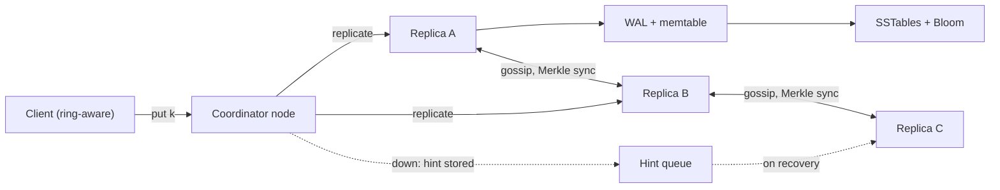

## In one minute
- **Partition with consistent hashing and many virtual nodes.** When a node joins or leaves, only about 1/N of the keys move, and they come from many peers at once. No single node is stuck streaming everything.
- **Replicate each key to N nodes and make R and W tunable per request.** Choosing `R + W > N` makes read and write quorums overlap. `W = 1` gives fast, highly available writes. That tunability is the product.
- **Version every write.** Replicas will diverge during failures, so the store needs a rule for "which value is newer" and for "these two writes were concurrent". Last-writer-wins and vector clocks are the two honest answers. Each loses something.
- **Repair continuously.** Read repair, hinted handoff and Merkle-tree anti-entropy are what make "eventually consistent" actually converge.
- **Each node runs an LSM storage engine.** Writes become sequential appends to a write-ahead log and a memtable. Bloom filters keep reads from touching every SSTable.

## Requirements

**Functional**
- `get(key)`, `put(key, value)` and `delete(key)`. Keys are up to 256 bytes and values up to 1 MB, typically around 1 KB.
- Consistency per request: `ONE`, `QUORUM` or `ALL`, for reads and for writes.
- An optional TTL per key.

**Non-functional**
- p99 under 10 ms for single-key operations within a region.
- Writes stay available while any W replicas of the key are reachable, including during node failures and while membership is changing.
- Add capacity without downtime. Durable once acknowledged, with 3 replicas spread across availability zones.

**Out of scope:** multi-key transactions, secondary indexes, range scans and SQL.

## Back-of-envelope
- **Traffic:** 1M reads/s and 200k writes/s at peak. The averages are 400k and 80k.
- **Data:** 10B keys × about 1 KB = 10 TB raw today. At 300M new keys a day, growth is 300 GB/day, which over 5 years is ≈ 550 TB raw on top of the 10 TB. With N=3 that is about 1.7 PB of replicated data, before compression and before the space amplification compaction causes.
- **Replica work:** most coordinators send each read to all N replicas and wait for R, so replica reads ≈ 1M × 3 = 3M/s. Replica writes = 200k × 3 = 600k/s.
- **Node count by throughput:** if a node with NVMe sustains about 50k mixed operations per second, 3.6M / 50k ≈ 72 nodes. Add 30% headroom for compaction and failures and you get about 100.
- **Node count by storage today:** 30 TB replicated / 100 nodes = 300 GB each. Throughput sets the size of the cluster now. By year 3, storage does, at around 4 TB per node with each disk kept about half full.
- **Network:** 3.6M × about 1 KB ≈ 3.6 GB/s inside the cluster, about 36 MB/s per node. Rebuild streaming is what saturates links, so throttle it.

## API

```protobuf
service KV {
  rpc Get(GetRequest) returns (GetResponse);
  rpc Put(PutRequest) returns (PutResponse);
  rpc Delete(DeleteRequest) returns (PutResponse);
}
message GetRequest  { bytes key = 1; Consistency read = 2; }        // ONE | QUORUM | ALL
message GetResponse { repeated Versioned values = 1; bytes context = 2; } // >1 value = siblings
message PutRequest  { bytes key = 1; bytes value = 2; bytes context = 3;
                      Consistency write = 4; uint32 ttl_s = 5; }
message PutResponse { bytes context = 1; }
message Versioned   { bytes value = 1; bytes version = 2; bool tombstone = 3; }
```

`context` is an opaque version that the client got from a read. When the client passes it back on a put, it says "this write replaces what I read". That is how the store tells an overwrite apart from a concurrent write.

## Data model
- **Partition key:** the key itself. The ring position is `hash(key)` with a 64- or 128-bit hash (Murmur3, xxHash). Data is spread evenly no matter how keys are named.
- **Ring metadata:** a sorted list of `(token, node)` with 16 to 256 virtual nodes per physical node. Cassandra 4.0 and later default to 16 tokens per node, placed by an allocator that balances load for replication factor 3 ([Cassandra config](https://cassandra.apache.org/doc/latest/cassandra/managing/configuration/cass_yaml_file.html)). Each node gossips its tokens, status and load. Every node and every smart client holds the full map, which is 1,600 to 25,600 tokens for 100 nodes and at most a few hundred KB.
- **Record on disk:** `key | version | flags (tombstone) | expires_at | value`. Records are sorted by key inside each SSTable, and the version decides which record wins during compaction.
- **Per node:**
  - a WAL file (append-only)
  - a memtable, which is a skiplist or balanced tree
  - immutable SSTables, each with a block index and a Bloom filter
  - a hinted-handoff queue keyed by target node
  - one Merkle tree per token range for anti-entropy

## High-level design



**Write path.**
1. The client hashes the key and sends the request to a coordinator, usually the first healthy node in the key's preference list.
2. The coordinator stamps a version and sends `Put` to all N replicas.
3. Each replica appends to its WAL, which group commits and then fsyncs. It inserts into the memtable and acknowledges.
4. After W acknowledgements, the coordinator returns success.
5. If a replica is down, the coordinator writes to the next healthy node on the ring instead (a sloppy quorum). That node stores a hint naming the intended owner and hands the data back when the owner recovers.

**Read path.**
1. The coordinator asks all N replicas for the key. It can ask for a full value from one replica and digests from the others, to save bandwidth.
2. It waits for R responses.
3. It returns the newest version, or several siblings if versions are concurrent.
4. Stale replicas get the newest version asynchronously. This is read repair.

**On each replica,** a read checks the memtable first, then SSTables from newest to oldest. A Bloom filter check skips the SSTables that cannot contain the key.

## Deep dives

### 1. Partitioning and rebalancing
**Hash mod N** moves almost every key when N changes, which is unworkable.

**Consistent hashing with one token per node** moves only the keys that neighbour the changed node. But load is uneven, with arcs differing by several times, and a new node takes load from only one neighbour.

**Virtual nodes** give each node many tokens. Its share of the ring is then the sum of many small arcs. With purely random tokens you need about 256 per node for that to average out, which was Cassandra's old default; a token allocator that picks positions to balance load gets there with 16, and Cassandra's docs warn that more tokens raise the chance that a double failure causes an outage ([Cassandra docs](https://cassandra.apache.org/doc/latest/cassandra/architecture/dynamo.html)). A joining node pulls small ranges from many peers in parallel. Heterogeneous hardware is handled by giving bigger machines more tokens.

**Fixed partitions** split the hash space into, say, 4,096 ranges up front and assign ranges to nodes through a metadata service. This makes moving data a clean "move partition p" operation. Dynamo itself ended up here: its paper compares three strategies and moved production to equal-sized partitions with a fixed number per node, because random tokens made bootstrapping and archiving slow ([Dynamo paper](https://www.allthingsdistributed.com/files/amazon-dynamo-sosp2007.pdf)).

**I chose virtual nodes for a Dynamo-style peer system**, and I'd switch to fixed partitions if we already ran a consensus-backed metadata store. Both beat one token per node. The cost of vnodes is that a node participates in many replica groups, which widens the set of keys affected when any two nodes fail together.

### 2. Quorums, sloppy quorums and repair
With N=3, the common settings are below. Dynamo's most common production setting was `(N, R, W) = (3, 2, 2)` ([Dynamo paper](https://www.allthingsdistributed.com/files/amazon-dynamo-sosp2007.pdf)).
- `W=2, R=2`: overlapping quorums, which tolerate one replica down for both reads and writes
- `W=1, R=3`: fast writes
- `W=3, R=1`: fast reads, but writes block when any replica is down

**What overlap does and does not give you.** `R + W > N` guarantees that a read sees at least one replica holding the latest *acknowledged* write. It is still not linearizable:
- a write in flight can be visible to one reader and not the next
- sloppy quorums write to stand-in nodes outside the preference list, which breaks the overlap until the hints are delivered

**Convergence takes three mechanisms:**
- *Read repair* fixes hot keys cheaply.
- *Hinted handoff* covers short outages, minutes to hours.
- *Anti-entropy* covers the rest. Each replica keeps a Merkle tree over each token range. Two replicas compare roots, then walk down only the subtrees that differ, so data that is already in sync costs a few KB of hashes to verify, not a full scan.

**Choice:** `QUORUM/QUORUM` by default, hinted handoff on, and anti-entropy running continuously with a throttle. Know the alternative too: Amazon's managed successor, DynamoDB, dropped leaderless quorums. Each partition is a Multi-Paxos group whose leader holds a lease and takes all writes and strongly consistent reads, and its replicas store data in a B-tree rather than an LSM tree ([DynamoDB paper](https://www.usenix.org/system/files/atc22-elhemali.pdf)).

### 3. Versioning and conflicts
**Last-writer-wins on timestamps** is simple and gives one value per key. But clock skew silently discards writes: a node 50 ms fast beats a later write from a correct node. Hybrid logical clocks reduce the damage but cannot remove it, because two genuinely concurrent writes still have to lose one.

**Vector clocks** (or dotted version vectors) record which coordinator has seen which counter. If one version dominates the other, it wins. If neither does, the store keeps both as siblings and returns both on the next read, and the client merges them and writes back with the context. Nothing is lost. The costs are client complexity and version metadata that grows with the number of coordinators. Dynamo dropped the oldest entry once a clock reached a threshold of about 10 pairs. Conflicts are rarer than this machinery suggests: over 24 hours, 99.94% of requests from Amazon's shopping cart service saw exactly one version ([Dynamo paper](https://www.allthingsdistributed.com/files/amazon-dynamo-sosp2007.pdf)).

**CRDT values** merge automatically, but only for counters, sets and maps.

**Choice:** LWW with hybrid timestamps by default, since most keys are cache-like or single-writer. Siblings with dotted version vectors are an opt-in per table for data where losing a write is a bug, such as shopping carts.

**Deletes** write tombstones that must outlive the longest possible outage plus the repair interval, typically about 10 days (Cassandra's `gc_grace_seconds` default of 864,000 seconds, per the [CQL docs](https://cassandra.apache.org/doc/latest/cassandra/developing/cql/ddl.html)). If a tombstone is purged too early, a replica that missed the delete can bring the value back.

### Variant: distributed cache
A cache in front of a database inverts most of the choices above, because the cache is not the source of truth. The requirement that drives everything is the hit rate: at 95% the database sees 5% of reads, at 80% it sees four times that, which is often an outage ([AWS Builders' Library](https://builder.aws.com/content/3K9TeXp6strMiJ4vhakpRD7BQWO/caching-challenges-and-strategies)). Targets shift accordingly, to sub-millisecond p99 reads, millions of reads per second, and values of 100 B to 10 KB, with durability optional and a restart allowed to lose data.

- **No quorums, no repair.** There is one owner per key and no replicas to reconcile. Losing a node means its keys miss and fall through to the database. Rehashing them onto survivors evicts healthy data, so a small gutter pool with short TTLs can absorb failed-node traffic instead.
- **Routing is a deployment choice.** A sidecar or shared proxy (such as [mcrouter](https://github.com/facebook/mcrouter/wiki)) keeps consistent hashing out of every client library and lets the cache team move pools without application deploys.
- **Staleness replaces conflicts.** The enemy is not concurrent writers but a slow reader setting an old value after a writer's delete. Leases, which reject that late set, plus invalidations derived from the database commit log, with TTLs as a backstop, close it. Version vectors do not apply.
- **Stampedes.** When a popular key expires, every request misses together. Layer in-process coalescing, leases so one caller loads, stale-while-revalidate, and probabilistic early refresh ([Vattani et al., VLDB 2015](https://www.vldb.org/pvldb/vol8/p886-vattani.pdf)). Cache "not found" results briefly too.
- **Hot keys.** Hashing cannot split one key across machines. Detect it in the proxy, then serve it from a short-lived in-process copy or replicate it under several suffixed keys, remembering that a write must delete every copy.
- **Eviction matters.** Memory is bounded, so a policy such as LRU decides what survives. Expired items count as well as evicted ones, since TTLs often limit the working set more than memory does.

Name which of the two systems you are building in the first minute of an interview. A cache that quietly gains replicas and quorums is a slow database, and a store that quietly gains eviction loses data.

## Down the stack

### Layer 1: The contract
- A put acknowledged at `W` is in the WAL of at least W replicas, or of stand-in nodes holding hints for them.
- A get at `R` returns every version that is not dominated by another, among the R replicas that answered.
- With `R + W > N`, no sloppy substitutions and no concurrent writes, a get observes every write acknowledged before it began.
- Without new writes, all N replicas converge within the anti-entropy period, for example 24 hours, and usually within seconds through read repair and hints.
- Latency: p99 under 10 ms at QUORUM within one availability zone set.

### Layer 2: The mechanism
**Messages.** Coordinators send `MutationRequest{key, value, version, ttl}` and replicas answer `MutationAck`. Reads send `ReadRequest{key, digest_only}` and get back either a full value or a hash.

**Failure detection.** Gossip runs every second. Each node exchanges heartbeat generations and versions with a few peers. A phi-accrual failure detector turns heartbeat arrival gaps into a suspicion level instead of making a binary timeout decision. Cassandra works this way ([Cassandra docs](https://cassandra.apache.org/doc/latest/cassandra/architecture/dynamo.html)).

**Storage engine.** Writes append to a WAL segment (Cassandra's commit log uses 32 MiB segments by default, per the [Cassandra config](https://cassandra.apache.org/doc/latest/cassandra/managing/configuration/cass_yaml_file.html)) and go into a memtable. When the memtable fills (say 64 to 256 MB), it is flushed as an SSTable, which holds sorted data blocks of about 4 to 64 KB, a sparse index, a Bloom filter at about 10 bits per key (roughly 1% false positives, per the [RocksDB wiki](https://github.com/facebook/rocksdb/wiki/RocksDB-Bloom-Filter)) and a footer. Compaction merges SSTables, drops overwritten versions and expired tombstones, and keeps the number of files a read must check small.

### Layer 3: The machine
- **Write cost.** The WAL append is a sequential write to the page cache followed by `fsync`. On NVMe with power-loss protection, `fsync` takes about 20 to 100 µs, and group commit shares one flush among many writes. A replica write therefore costs microseconds of device time, and the network round trip (about 200 µs within an AZ, 1 to 2 ms across AZs) dominates the latency of a W=2 write.
- **Read cost.** A read that misses the page cache costs one random 4 KB NVMe read, about 80 to 100 µs. Bloom filters and block indexes held in RAM keep that to about one device read per lookup. On spinning disks the same read would take about 5 to 10 ms, which is why this design assumes SSDs.
- **Compaction.** It rewrites data many times. Write amplification for leveled compaction is often above 10× ([RocksDB wiki](https://github.com/facebook/rocksdb/wiki/Leveled-Compaction)) and 10 to 30× is a fair planning range, so a node absorbing 6k writes/s × 1 KB = 6 MB/s of user data may write 60 to 180 MB/s to disk. That is why compaction is throttled, and why SSD wear is a cost to plan for.
- **Memory.** In JVM-based stores a 200 ms GC pause makes a node look dead to gossip, one reason ScyllaDB rebuilt Cassandra's design in C++.

### Why it's built this way
1. Machines and disks fail daily at 100-node scale, so every key needs N replicas on independent failure domains.
2. Synchronous agreement among all replicas would block writes during failures. Quorums let a majority, or W, proceed instead.
3. Proceeding without everyone means replicas diverge. That makes versions and repair mechanisms mandatory, not optional.
4. Random writes are slow on every device, and LSM trees turn writes into sequential appends. Their cost on reads is paid back with Bloom filters and compaction.
5. Moving data costs network and disk time, so consistent hashing with vnodes keeps movement proportional to the change and spreads it across peers.

## Failure modes
- **Load at 10×.** Compaction falls behind, the number of SSTables per read grows, and read latency climbs. Mitigations:
  - throttle writes using a backpressure signal from pending compactions
  - add nodes early, because bootstrapping a new node adds streaming load before it adds capacity
- **Hot key.** One key's three replicas saturate while 97 nodes sit idle. Mitigations:
  - a cache in front of the store, or replica selection that spreads reads across all N
  - for write-hot keys, split the key in the application, for example `counter#0..15`
- **Losing an availability zone.** With replicas placed across 3 AZs, QUORUM still has 2 of 3 replicas and keeps working. Hints for the missing third pile up, so cap their age at about 3 hours, Cassandra's `max_hint_window` default ([Cassandra config](https://cassandra.apache.org/doc/latest/cassandra/managing/configuration/cass_yaml_file.html)), and rely on anti-entropy after that.
- **Losing a region** in a multi-region deployment. Writes acknowledged locally but not yet replicated asynchronously are at risk. Use LOCAL_QUORUM for latency and accept the RPO, or use EACH_QUORUM for critical tables and pay the cross-region round trip.
- **Network partition with a sloppy quorum.** Both sides accept writes to the same key, which produces concurrent versions. LWW silently drops one of them, while vector clocks surface siblings. Know which behaviour each table has.

## In the wild
- **Monzo, 2019: new Cassandra nodes answered "not found".** Monzo added 6 nodes to a 21-node cluster with `auto_bootstrap=false`, expecting them to stay idle until data was streamed in. They took ownership of token ranges at once and answered quorum reads with empty results, so balances looked wrong and payments failed for about 2 hours; full reconciliation took until 23:00. Changes: corrected settings, scale-up runbooks and alerts on spikes in "row not found" ([Monzo](https://monzo.com/blog/2019/09/08/why-monzo-wasnt-working-on-july-29th)).
- **Discord, 2017: millions of tombstones behind one message.** A user deleted millions of messages, leaving one. Reading that channel scanned millions of tombstones and caused 10-second stop-the-world GC pauses in Cassandra. Discord cut tombstone lifetime from 10 days to 2, which its nightly repairs made safe, and taught the read path to skip empty buckets ([Discord](https://discord.com/blog/how-discord-stores-billions-of-messages)).
- **Jepsen, 2013: last-write-wins in Riak.** With siblings disabled, timestamp resolution lost 1,815 of 1,985 acknowledged writes during a partition, and stricter quorums did not help. With siblings enabled and merged by set union, nothing was lost, which is the case for opt-in siblings on multi-writer data ([Jepsen](https://aphyr.com/posts/285-call-me-maybe-riak)).

## Trade-offs

| Option | Strengths | Weaknesses | Choose when |
|---|---|---|---|
| Leaderless quorum (Dynamo) | Writes available during failures, no failover | Conflicts, repair machinery, not linearizable | Carts, sessions, profiles, high write availability |
| Leader per partition (Raft) | Linearizable, no conflicts | Election pause, writes need a majority | Metadata, money, locks |
| LWW timestamps | Simple, one value | Skew silently loses writes | Cache-like or single-writer data |
| Vector clocks / siblings | No lost writes | Client merge logic, metadata growth | Multi-writer data where loss is a bug |
| vnodes on a ring | Even load, parallel rebuild | More replica sets exposed to double failures | Peer-to-peer membership |
| Fixed partitions + metadata service | Clean moves, simple reasoning | Needs a consistent metadata store | You already run etcd or ZooKeeper |
| LSM engine | Fast writes, compression | Read and space amplification, compaction I/O | Write-heavy workloads |

## Leadership lens
- **Build first:** a single-node LSM engine with WAL and crash-recovery tests. Then a static ring with N-way replication and quorums. Then gossip membership, hints and anti-entropy, in that order. Correctness tests come before scale: Jepsen-style partition tests and a linearizability checker for the modes that claim it.
- **Ownership:** the storage engine, the cluster layer (membership and replication) and the client library are three teams or three clear owners. Operations tooling for bootstrapping, decommissioning and repair needs an owner, or it rots.
- **Cost drivers:** SSD capacity × N × space amplification, cross-AZ traffic charges on every replicated write (often the surprise line on the bill), and compaction CPU.
- **Rollout:** dual-write from the old store, compare reads in the background, then move tables one at a time. Default to QUORUM and require a design review before a table uses ONE.

## Check yourself
1. A deployment uses N=3 with `R=2, W=2`, so `R + W > N`. Why is a read still not guaranteed to be linearizable?
   **Answer:** Overlap only guarantees that a read sees at least one replica holding the latest acknowledged write. A write still in flight can be visible to one reader and not the next, and sloppy quorums write to stand-in nodes outside the preference list, which breaks the overlap until hints are delivered.
2. When would you pick vector clocks with siblings over last-writer-wins, and what does each choice cost?
   **Answer:** LWW is simple and returns one value, but clock skew silently discards writes, so it suits cache-like or single-writer data. Siblings with dotted version vectors lose nothing, which matters for multi-writer data like shopping carts, at the cost of client merge logic and growing version metadata.
3. Why does the lesson estimate about 100 nodes today, and why does storage rather than throughput size the cluster by year 3?
   **Answer:** Replica work is about 3M reads/s plus 600k writes/s, and at roughly 50k operations per node that is about 72 nodes, or about 100 with 30% headroom. Those 100 nodes hold only about 300 GB each today, but with 300 GB/day of new raw data replicated three times, storage reaches around 4 TB per node by year 3 and becomes the binding constraint.
4. What goes wrong if tombstones are purged too early, and how long should they be kept?
   **Answer:** A replica that missed the delete still holds the old value, and once the tombstone is gone repair can bring the deleted value back. Tombstones must outlive the longest possible outage plus the repair interval, typically about 10 days, as with Cassandra's `gc_grace_seconds` default.

## Practice
**Task:** Build a consistent-hash ring with virtual nodes and a small quorum store on top of it.
- **Hashing.** Use FNV-1a 32-bit, then the Murmur3 32-bit finalizer (`h ^= h>>16; h *= 0x85ebca6b; h ^= h>>13; h *= 0xc2b2ae35; h ^= h>>16`). Each node gets `vnodes` tokens, `hash(node + "#" + i)`.
- **Preference list.** The preference list for a key starts at the first token whose hash is `>= hash(key)`, wrapping around the ring, and walks clockwise collecting distinct physical nodes.
- **Writes.** `QuorumStore(ring, n, r, w)` writes to every reachable replica in the key's preference list. It fails if fewer than `w` are reachable. The new version is 1 plus the highest version held by any reachable replica.
- **Reads.** Reads contact the first `r` reachable replicas in preference order, fail if there are fewer than `r`, return the highest-versioned value, and repair any contacted replica that was stale.

```python starter
def h32(s):
    # TODO: FNV-1a 32-bit followed by the Murmur3 fmix32 finalizer
    raise NotImplementedError


class Ring:
    def __init__(self, vnodes):
        pass

    def add_node(self, node):
        raise NotImplementedError

    def remove_node(self, node):
        raise NotImplementedError

    def preference_list(self, key, n):
        raise NotImplementedError


class QuorumError(Exception):
    pass


class QuorumStore:
    def __init__(self, ring, n, r, w):
        pass

    def fail(self, node):
        raise NotImplementedError

    def recover(self, node):
        raise NotImplementedError

    def put(self, key, value):
        # TODO: return the new version or raise QuorumError
        raise NotImplementedError

    def get(self, key):
        # TODO: return (value, version), None if absent, or raise QuorumError
        raise NotImplementedError

    def replica_version(self, node, key):
        raise NotImplementedError
```

```python tests
def make_ring(names, vnodes=100):
    r = Ring(vnodes)
    for n in names:
        r.add_node(n)
    return r

def test_preference_list_distinct_and_deterministic():
    a = make_ring(["n0", "n1", "n2", "n3", "n4"])
    b = make_ring(["n4", "n2", "n0", "n3", "n1"])
    p = a.preference_list("user:42", 3)
    assert len(p) == 3 and len(set(p)) == 3
    assert p == b.preference_list("user:42", 3), "independent of insertion order"
    assert sorted(a.preference_list("x", 10)) == ["n0", "n1", "n2", "n3", "n4"]
    assert Ring(10).preference_list("x", 3) == []

def test_removal_moves_only_removed_nodes_keys():
    r = make_ring(["n0", "n1", "n2", "n3"])
    keys = ["key%d" % i for i in range(1000)]
    before = dict((k, r.preference_list(k, 1)[0]) for k in keys)
    r.remove_node("n2")
    for k in keys:
        after = r.preference_list(k, 1)[0]
        if before[k] != "n2":
            assert after == before[k], k
        else:
            assert after != "n2"

def test_vnodes_balance_load():
    r = make_ring(["n0", "n1", "n2", "n3"])
    counts = {}
    for i in range(4000):
        o = r.preference_list("key%d" % i, 1)[0]
        counts[o] = counts.get(o, 0) + 1
    assert all(600 <= c <= 1400 for c in counts.values()), counts

def test_put_get_versions():
    s = QuorumStore(make_ring(["n0", "n1", "n2", "n3"]), 3, 2, 2)
    assert s.get("k") is None
    assert s.put("k", "a") == 1
    assert s.put("k", "b") == 2
    assert s.get("k") == ("b", 2)

def test_quorum_not_met():
    ring = make_ring(["n0", "n1", "n2", "n3"])
    s = QuorumStore(ring, 3, 2, 2)
    s.put("k", "a")
    pref = ring.preference_list("k", 3)
    s.fail(pref[0])
    s.fail(pref[1])
    for op in (lambda: s.put("k", "b"), lambda: s.get("k")):
        try:
            op()
            assert False, "expected QuorumError"
        except QuorumError:
            pass

def test_overlapping_quorums_and_read_repair():
    ring = make_ring(["n0", "n1", "n2", "n3"])
    s = QuorumStore(ring, 3, 2, 2)
    a, b, c = ring.preference_list("k", 3)
    s.fail(c)
    assert s.put("k", "v1") == 1
    s.recover(c)
    s.fail(a)
    assert s.put("k", "v2") == 2
    s.recover(a)
    assert s.replica_version(a, "k") == 1
    assert s.get("k") == ("v2", 2), "R+W>N overlap finds the newest write"
    assert s.replica_version(a, "k") == 2, "stale replica repaired"
    assert s.replica_version(c, "k") == 2
```

```python solution
import bisect


def h32(s):
    h = 0x811C9DC5
    for b in s.encode("utf-8"):
        h ^= b
        h = (h * 0x01000193) & 0xFFFFFFFF
    h ^= h >> 16
    h = (h * 0x85EBCA6B) & 0xFFFFFFFF
    h ^= h >> 13
    h = (h * 0xC2B2AE35) & 0xFFFFFFFF
    h ^= h >> 16
    return h


class Ring:
    def __init__(self, vnodes):
        self.vnodes = vnodes
        self.tokens = []

    def add_node(self, node):
        for i in range(self.vnodes):
            bisect.insort(self.tokens, (h32("%s#%d" % (node, i)), node))

    def remove_node(self, node):
        self.tokens = [t for t in self.tokens if t[1] != node]

    def preference_list(self, key, n):
        if not self.tokens:
            return []
        start = bisect.bisect_left(self.tokens, (h32(key), ""))
        out = []
        for j in range(len(self.tokens)):
            node = self.tokens[(start + j) % len(self.tokens)][1]
            if node not in out:
                out.append(node)
                if len(out) == n:
                    break
        return out


class QuorumError(Exception):
    pass


class QuorumStore:
    def __init__(self, ring, n, r, w):
        self.ring, self.n, self.r, self.w = ring, n, r, w
        self.data = {}
        self.down = set()

    def fail(self, node):
        self.down.add(node)

    def recover(self, node):
        self.down.discard(node)

    def _up(self, key):
        return [x for x in self.ring.preference_list(key, self.n) if x not in self.down]

    def _read(self, node, key):
        return self.data.get(node, {}).get(key, (0, None))

    def put(self, key, value):
        up = self._up(key)
        if len(up) < self.w:
            raise QuorumError("need %d replicas, have %d" % (self.w, len(up)))
        version = 1 + max(self._read(x, key)[0] for x in up)
        for x in up:
            self.data.setdefault(x, {})[key] = (version, value)
        return version

    def get(self, key):
        up = self._up(key)
        if len(up) < self.r:
            raise QuorumError("need %d replicas, have %d" % (self.r, len(up)))
        contacted = up[: self.r]
        best = max((self._read(x, key) for x in contacted), key=lambda t: t[0])
        if best[0] == 0:
            return None
        for x in contacted:
            if self._read(x, key)[0] < best[0]:
                self.data.setdefault(x, {})[key] = best
        return (best[1], best[0])

    def replica_version(self, node, key):
        return self._read(node, key)[0]
```

```typescript starter
export function h32(s: string): number {
  throw new Error("TODO");
}

export class Ring {
  constructor(vnodes: number) {}
  addNode(node: string): void { throw new Error("TODO"); }
  removeNode(node: string): void { throw new Error("TODO"); }
  preferenceList(key: string, n: number): string[] { throw new Error("TODO"); }
}

export class QuorumStore {
  constructor(ring: Ring, n: number, r: number, w: number) {}
  fail(node: string): void { throw new Error("TODO"); }
  recover(node: string): void { throw new Error("TODO"); }
  put(key: string, value: string): number { throw new Error("TODO"); }
  get(key: string): { value: string; version: number } | null { throw new Error("TODO"); }
  replicaVersion(node: string, key: string): number { throw new Error("TODO"); }
}
```

```typescript tests
function makeRing(names: string[], vnodes = 100): Ring {
  const r = new Ring(vnodes);
  for (const n of names) r.addNode(n);
  return r;
}

function throwsQuorum(fn: () => unknown): boolean {
  try { fn(); return false; } catch (e) { return String(e).indexOf("quorum") >= 0; }
}

test("preference list distinct and deterministic", () => {
  const a = makeRing(["n0", "n1", "n2", "n3", "n4"]);
  const b = makeRing(["n4", "n2", "n0", "n3", "n1"]);
  const p = a.preferenceList("user:42", 3);
  assert(p.length === 3 && new Set(p).size === 3, "3 distinct");
  assertEqual(p, b.preferenceList("user:42", 3), "independent of insertion order");
  assertEqual([...a.preferenceList("x", 10)].sort(), ["n0", "n1", "n2", "n3", "n4"]);
  assertEqual(new Ring(10).preferenceList("x", 3), []);
});

test("removal moves only removed node's keys", () => {
  const r = makeRing(["n0", "n1", "n2", "n3"]);
  const before = new Map<string, string>();
  for (let i = 0; i < 1000; i++) before.set("key" + i, r.preferenceList("key" + i, 1)[0]);
  r.removeNode("n2");
  for (const [k, owner] of before) {
    const after = r.preferenceList(k, 1)[0];
    if (owner !== "n2") assertEqual(after, owner, k);
    else assert(after !== "n2", k);
  }
});

test("vnodes balance load", () => {
  const r = makeRing(["n0", "n1", "n2", "n3"]);
  const counts = new Map<string, number>();
  for (let i = 0; i < 4000; i++) {
    const o = r.preferenceList("key" + i, 1)[0];
    counts.set(o, (counts.get(o) ?? 0) + 1);
  }
  for (const c of counts.values()) assert(c >= 600 && c <= 1400, "balanced: " + c);
});

test("put get versions", () => {
  const s = new QuorumStore(makeRing(["n0", "n1", "n2", "n3"]), 3, 2, 2);
  assertEqual(s.get("k"), null);
  assertEqual(s.put("k", "a"), 1);
  assertEqual(s.put("k", "b"), 2);
  assertEqual(s.get("k"), { value: "b", version: 2 });
});

test("quorum not met", () => {
  const ring = makeRing(["n0", "n1", "n2", "n3"]);
  const s = new QuorumStore(ring, 3, 2, 2);
  s.put("k", "a");
  const pref = ring.preferenceList("k", 3);
  s.fail(pref[0]);
  s.fail(pref[1]);
  assert(throwsQuorum(() => s.put("k", "b")), "put should fail");
  assert(throwsQuorum(() => s.get("k")), "get should fail");
});

test("overlapping quorums and read repair", () => {
  const ring = makeRing(["n0", "n1", "n2", "n3"]);
  const s = new QuorumStore(ring, 3, 2, 2);
  const [a, , c] = ring.preferenceList("k", 3);
  s.fail(c);
  assertEqual(s.put("k", "v1"), 1);
  s.recover(c);
  s.fail(a);
  assertEqual(s.put("k", "v2"), 2);
  s.recover(a);
  assertEqual(s.replicaVersion(a, "k"), 1);
  assertEqual(s.get("k"), { value: "v2", version: 2 }, "overlap finds newest");
  assertEqual(s.replicaVersion(a, "k"), 2, "repaired");
  assertEqual(s.replicaVersion(c, "k"), 2);
});
```

```typescript solution
export function h32(s: string): number {
  let h = 0x811c9dc5;
  for (let i = 0; i < s.length; i++) {
    h ^= s.charCodeAt(i) & 0xff;
    h = Math.imul(h, 0x01000193) >>> 0;
  }
  h ^= h >>> 16;
  h = Math.imul(h, 0x85ebca6b) >>> 0;
  h ^= h >>> 13;
  h = Math.imul(h, 0xc2b2ae35) >>> 0;
  h ^= h >>> 16;
  return h >>> 0;
}

export class Ring {
  private tokens: [number, string][] = [];
  constructor(private vnodes: number) {}

  addNode(node: string): void {
    for (let i = 0; i < this.vnodes; i++) this.tokens.push([h32(node + "#" + i), node]);
    this.tokens.sort((a, b) => (a[0] - b[0]) || (a[1] < b[1] ? -1 : a[1] > b[1] ? 1 : 0));
  }

  removeNode(node: string): void {
    this.tokens = this.tokens.filter((t) => t[1] !== node);
  }

  preferenceList(key: string, n: number): string[] {
    const len = this.tokens.length;
    if (len === 0) return [];
    const target = h32(key);
    let lo = 0, hi = len;
    while (lo < hi) {
      const mid = (lo + hi) >> 1;
      if (this.tokens[mid][0] < target) lo = mid + 1; else hi = mid;
    }
    const out: string[] = [];
    for (let j = 0; j < len && out.length < n; j++) {
      const node = this.tokens[(lo + j) % len][1];
      if (out.indexOf(node) < 0) out.push(node);
    }
    return out;
  }
}

export class QuorumStore {
  private data = new Map<string, Map<string, [number, string]>>();
  private down = new Set<string>();
  constructor(private ring: Ring, private n: number, private r: number, private w: number) {}

  fail(node: string): void { this.down.add(node); }
  recover(node: string): void { this.down.delete(node); }

  private up(key: string): string[] {
    return this.ring.preferenceList(key, this.n).filter((x) => !this.down.has(x));
  }
  private read(node: string, key: string): [number, string] {
    return this.data.get(node)?.get(key) ?? [0, ""];
  }
  private write(node: string, key: string, rec: [number, string]): void {
    let m = this.data.get(node);
    if (!m) { m = new Map(); this.data.set(node, m); }
    m.set(key, rec);
  }

  put(key: string, value: string): number {
    const up = this.up(key);
    if (up.length < this.w) throw new Error("quorum not met for write");
    const version = 1 + Math.max(...up.map((x) => this.read(x, key)[0]));
    for (const x of up) this.write(x, key, [version, value]);
    return version;
  }

  get(key: string): { value: string; version: number } | null {
    const up = this.up(key);
    if (up.length < this.r) throw new Error("quorum not met for read");
    const contacted = up.slice(0, this.r);
    let best = this.read(contacted[0], key);
    for (const x of contacted) if (this.read(x, key)[0] > best[0]) best = this.read(x, key);
    if (best[0] === 0) return null;
    for (const x of contacted) if (this.read(x, key)[0] < best[0]) this.write(x, key, best);
    return { value: best[1], version: best[0] };
  }

  replicaVersion(node: string, key: string): number { return this.read(node, key)[0]; }
}
```

```go starter
package practice

import "errors"

var ErrQuorum = errors.New("quorum not met")

func H32(s string) uint32 { panic("TODO") }

type Ring struct{}

func NewRing(vnodes int) *Ring { return &Ring{} }

func (r *Ring) AddNode(node string)                           { panic("TODO") }
func (r *Ring) RemoveNode(node string)                        { panic("TODO") }
func (r *Ring) PreferenceList(key string, n int) []string     { panic("TODO") }

type QuorumStore struct{}

func NewQuorumStore(ring *Ring, n, r, w int) *QuorumStore { return &QuorumStore{} }

func (s *QuorumStore) Fail(node string)    { panic("TODO") }
func (s *QuorumStore) Recover(node string) { panic("TODO") }

// Put returns the new version or ErrQuorum.
func (s *QuorumStore) Put(key, value string) (int, error) { panic("TODO") }

// Get returns value, version, found, or ErrQuorum.
func (s *QuorumStore) Get(key string) (string, int, bool, error) { panic("TODO") }

func (s *QuorumStore) ReplicaVersion(node, key string) int { panic("TODO") }
```

```go tests
package practice

import (
	"errors"
	"fmt"
	"reflect"
	"sort"
	"testing"
)

func makeRing(names ...string) *Ring {
	r := NewRing(100)
	for _, n := range names {
		r.AddNode(n)
	}
	return r
}

func TestPreferenceListDistinctDeterministic(t *testing.T) {
	a := makeRing("n0", "n1", "n2", "n3", "n4")
	b := makeRing("n4", "n2", "n0", "n3", "n1")
	p := a.PreferenceList("user:42", 3)
	if len(p) != 3 || p[0] == p[1] || p[1] == p[2] || p[0] == p[2] {
		t.Fatalf("not 3 distinct: %v", p)
	}
	if !reflect.DeepEqual(p, b.PreferenceList("user:42", 3)) {
		t.Fatal("depends on insertion order")
	}
	all := a.PreferenceList("x", 10)
	sort.Strings(all)
	if !reflect.DeepEqual(all, []string{"n0", "n1", "n2", "n3", "n4"}) {
		t.Fatalf("got %v", all)
	}
	if len(NewRing(10).PreferenceList("x", 3)) != 0 {
		t.Fatal("empty ring")
	}
}

func TestRemovalMovesOnlyRemovedKeys(t *testing.T) {
	r := makeRing("n0", "n1", "n2", "n3")
	before := map[string]string{}
	for i := 0; i < 1000; i++ {
		k := fmt.Sprintf("key%d", i)
		before[k] = r.PreferenceList(k, 1)[0]
	}
	r.RemoveNode("n2")
	for k, owner := range before {
		after := r.PreferenceList(k, 1)[0]
		if owner != "n2" && after != owner {
			t.Fatalf("%s moved from %s to %s", k, owner, after)
		}
		if owner == "n2" && after == "n2" {
			t.Fatal("removed node still owns keys")
		}
	}
}

func TestVnodesBalance(t *testing.T) {
	r := makeRing("n0", "n1", "n2", "n3")
	counts := map[string]int{}
	for i := 0; i < 4000; i++ {
		counts[r.PreferenceList(fmt.Sprintf("key%d", i), 1)[0]]++
	}
	for n, c := range counts {
		if c < 600 || c > 1400 {
			t.Fatalf("%s has %d", n, c)
		}
	}
}

func TestPutGetVersions(t *testing.T) {
	s := NewQuorumStore(makeRing("n0", "n1", "n2", "n3"), 3, 2, 2)
	if _, _, found, err := s.Get("k"); found || err != nil {
		t.Fatal("expected absent")
	}
	if v, _ := s.Put("k", "a"); v != 1 {
		t.Fatalf("v=%d", v)
	}
	if v, _ := s.Put("k", "b"); v != 2 {
		t.Fatalf("v=%d", v)
	}
	val, ver, found, err := s.Get("k")
	if err != nil || !found || val != "b" || ver != 2 {
		t.Fatalf("got %s %d %v %v", val, ver, found, err)
	}
}

func TestQuorumNotMet(t *testing.T) {
	ring := makeRing("n0", "n1", "n2", "n3")
	s := NewQuorumStore(ring, 3, 2, 2)
	s.Put("k", "a")
	p := ring.PreferenceList("k", 3)
	s.Fail(p[0])
	s.Fail(p[1])
	if _, err := s.Put("k", "b"); !errors.Is(err, ErrQuorum) {
		t.Fatal("put should fail")
	}
	if _, _, _, err := s.Get("k"); !errors.Is(err, ErrQuorum) {
		t.Fatal("get should fail")
	}
}

func TestOverlapAndReadRepair(t *testing.T) {
	ring := makeRing("n0", "n1", "n2", "n3")
	s := NewQuorumStore(ring, 3, 2, 2)
	p := ring.PreferenceList("k", 3)
	a, c := p[0], p[2]
	s.Fail(c)
	if v, _ := s.Put("k", "v1"); v != 1 {
		t.Fatal("v1")
	}
	s.Recover(c)
	s.Fail(a)
	if v, _ := s.Put("k", "v2"); v != 2 {
		t.Fatal("v2")
	}
	s.Recover(a)
	if s.ReplicaVersion(a, "k") != 1 {
		t.Fatal("a should be stale")
	}
	val, ver, _, err := s.Get("k")
	if err != nil || val != "v2" || ver != 2 {
		t.Fatalf("got %s %d", val, ver)
	}
	if s.ReplicaVersion(a, "k") != 2 || s.ReplicaVersion(c, "k") != 2 {
		t.Fatal("read repair missing")
	}
}
```

```go solution
package practice

import (
	"errors"
	"fmt"
	"sort"
	"sync"
)

var ErrQuorum = errors.New("quorum not met")

func H32(s string) uint32 {
	h := uint32(0x811c9dc5)
	for i := 0; i < len(s); i++ {
		h ^= uint32(s[i])
		h *= 0x01000193
	}
	h ^= h >> 16
	h *= 0x85ebca6b
	h ^= h >> 13
	h *= 0xc2b2ae35
	h ^= h >> 16
	return h
}

type token struct {
	hash uint32
	node string
}

type Ring struct {
	vnodes int
	tokens []token
}

func NewRing(vnodes int) *Ring { return &Ring{vnodes: vnodes} }

func (r *Ring) AddNode(node string) {
	for i := 0; i < r.vnodes; i++ {
		r.tokens = append(r.tokens, token{H32(fmt.Sprintf("%s#%d", node, i)), node})
	}
	sort.Slice(r.tokens, func(i, j int) bool {
		if r.tokens[i].hash != r.tokens[j].hash {
			return r.tokens[i].hash < r.tokens[j].hash
		}
		return r.tokens[i].node < r.tokens[j].node
	})
}

func (r *Ring) RemoveNode(node string) {
	kept := r.tokens[:0]
	for _, t := range r.tokens {
		if t.node != node {
			kept = append(kept, t)
		}
	}
	r.tokens = kept
}

func (r *Ring) PreferenceList(key string, n int) []string {
	out := []string{}
	if len(r.tokens) == 0 {
		return out
	}
	target := H32(key)
	start := sort.Search(len(r.tokens), func(i int) bool { return r.tokens[i].hash >= target })
	seen := map[string]bool{}
	for j := 0; j < len(r.tokens) && len(out) < n; j++ {
		node := r.tokens[(start+j)%len(r.tokens)].node
		if !seen[node] {
			seen[node] = true
			out = append(out, node)
		}
	}
	return out
}

type record struct {
	version int
	value   string
}

type QuorumStore struct {
	mu      sync.Mutex
	ring    *Ring
	n, r, w int
	data    map[string]map[string]record
	down    map[string]bool
}

func NewQuorumStore(ring *Ring, n, r, w int) *QuorumStore {
	return &QuorumStore{ring: ring, n: n, r: r, w: w,
		data: map[string]map[string]record{}, down: map[string]bool{}}
}

func (s *QuorumStore) Fail(node string) {
	s.mu.Lock()
	defer s.mu.Unlock()
	s.down[node] = true
}

func (s *QuorumStore) Recover(node string) {
	s.mu.Lock()
	defer s.mu.Unlock()
	delete(s.down, node)
}

func (s *QuorumStore) up(key string) []string {
	var out []string
	for _, x := range s.ring.PreferenceList(key, s.n) {
		if !s.down[x] {
			out = append(out, x)
		}
	}
	return out
}

func (s *QuorumStore) write(node, key string, rec record) {
	if s.data[node] == nil {
		s.data[node] = map[string]record{}
	}
	s.data[node][key] = rec
}

func (s *QuorumStore) Put(key, value string) (int, error) {
	s.mu.Lock()
	defer s.mu.Unlock()
	up := s.up(key)
	if len(up) < s.w {
		return 0, ErrQuorum
	}
	version := 0
	for _, x := range up {
		if v := s.data[x][key].version; v > version {
			version = v
		}
	}
	version++
	for _, x := range up {
		s.write(x, key, record{version, value})
	}
	return version, nil
}

func (s *QuorumStore) Get(key string) (string, int, bool, error) {
	s.mu.Lock()
	defer s.mu.Unlock()
	up := s.up(key)
	if len(up) < s.r {
		return "", 0, false, ErrQuorum
	}
	contacted := up[:s.r]
	var best record
	for _, x := range contacted {
		if rec := s.data[x][key]; rec.version > best.version {
			best = rec
		}
	}
	if best.version == 0 {
		return "", 0, false, nil
	}
	for _, x := range contacted {
		if s.data[x][key].version < best.version {
			s.write(x, key, best)
		}
	}
	return best.value, best.version, true, nil
}

func (s *QuorumStore) ReplicaVersion(node, key string) int {
	s.mu.Lock()
	defer s.mu.Unlock()
	return s.data[node][key].version
}
```

## Mock interview
**Prompt:** Design a distributed key-value store like Dynamo or Cassandra. It holds 10 TB today growing to about 500 TB, serves 1M reads/s and 200k writes/s at peak, keeps writes available through node failures, and needs single-digit-millisecond p99 latency.

- Follow-up: With N=3, R=2, W=2, show me a sequence of events where a read still returns a stale value.
- Follow-up: A node was down for two weeks and comes back. What can go wrong with deletes?
- Follow-up: When would you give up the leaderless design and put a Raft group behind each partition instead?

**A strong answer covers:**
- Consistent hashing with virtual nodes, or fixed partitions, with the reasoning about how much data moves and how evenly load spreads.
- N/R/W quorums with exact semantics, including why sloppy quorums and in-flight writes break the intuition that `R + W > N` means linearizable.
- Versioning (LWW versus vector clocks or siblings), with a clear statement of what each loses.
- The repair stack: read repair, hinted handoff, Merkle anti-entropy, and tombstone grace periods.
- An LSM node engine with WAL fsync, Bloom filters and compaction write amplification, with numbers.

## Sources and further study
**Primary**
- [Cassandra: A Decentralized Structured Storage System (Lakshman and Malik, LADIS 2009)](https://www.cs.cornell.edu/projects/ladis2009/papers/lakshman-ladis2009.pdf): Dynamo's partitioning and replication combined with a Bigtable-style storage engine.
- [The Log-Structured Merge-Tree (O'Neil et al., 1996)](https://www.cs.umb.edu/~poneil/lsmtree.pdf): the original LSM paper behind every node's storage engine.
- [Optimal Probabilistic Cache Stampede Prevention (VLDB 2015)](https://www.vldb.org/pvldb/vol8/p886-vattani.pdf): the XFetch early-refresh rule behind the cache variant.

**Systems docs**
- [cassandra.yaml reference (Apache Cassandra)](https://cassandra.apache.org/doc/latest/cassandra/managing/configuration/cass_yaml_file.html): real defaults for tokens, hint windows and commit log segments.
- [Leveled compaction (RocksDB wiki)](https://github.com/facebook/rocksdb/wiki/Leveled-Compaction): how levels, write amplification and compaction priority work in practice.
- [mcrouter wiki](https://github.com/facebook/mcrouter/wiki): the routing proxy behind Facebook's cache pools, with consistent hashing, replication and failover routes.

**Books**
- *Designing Data-Intensive Applications* (1st ed.), Martin Kleppmann, Ch 5 "Replication" (Leaderless Replication) and Ch 6 "Partitioning" (Rebalancing Partitions).
- *Database Internals*, Alex Petrov, Ch 7 "Log-Structured Storage" and Ch 12 "Anti-Entropy and Dissemination".
- *System Design Interview, Volume 1*, Alex Xu, Ch 6 "Design A Key-value Store".

**Other curricula**
- [System Design Primer (donnemartin)](https://github.com/donnemartin/system-design-primer): frames key-value stores as the NoSQL baseline and walks through consistency and availability patterns.
- [Sharding pattern (Azure Architecture Center)](https://learn.microsoft.com/en-us/azure/architecture/patterns/sharding): compares lookup, range and hash sharding strategies and the rebalancing cost of each.
- [Azure Architecture Center: Cache-Aside pattern](https://learn.microsoft.com/en-us/azure/architecture/patterns/cache-aside): the application-side loading pattern used when this store is run as a cache.

## Watch
- [CSE138 L14: Dynamo, Merkle trees, quorum consistency (Lindsey Kuper)](https://www.youtube.com/watch?v=9KX2wvAgVSo): a university lecture on the Dynamo design and its repair mechanisms.
- [USENIX ATC '22: Amazon DynamoDB (USENIX)](https://www.youtube.com/watch?v=9AkgiEJ_dA4): how the managed successor moved to per-partition leaders and why.
- [Distributed Systems 5.1: Replication (Martin Kleppmann)](https://www.youtube.com/watch?v=mBUCF1WGI_I): quorums, read repair and the consistency problems they create.

## Free resources
- [Dynamo: Amazon's Highly Available Key-value Store (SOSP 2007)](https://www.allthingsdistributed.com/files/amazon-dynamo-sosp2007.pdf): the original paper on vnodes, sloppy quorums, vector clocks and Merkle trees.
- [Amazon DynamoDB: A Scalable, Predictably Performant, and Fully Managed NoSQL Database Service (USENIX ATC 2022)](https://www.usenix.org/conference/atc22/presentation/elhemali): what changed after a decade of operating at scale.
- [Dynamo architecture (Apache Cassandra docs)](https://cassandra.apache.org/doc/latest/cassandra/architecture/dynamo.html): how a production system implements tokens, gossip, hints and tunable consistency.
- [Causal context (Riak KV docs)](https://docs.riak.com/riak/kv/latest/learn/concepts/causal-context/index.html): vector clocks, dotted version vectors and siblings explained with examples.
- [Eventually Consistent (Werner Vogels)](https://www.allthingsdistributed.com/2008/12/eventually_consistent.html): the N/R/W framing and client-side consistency models.
