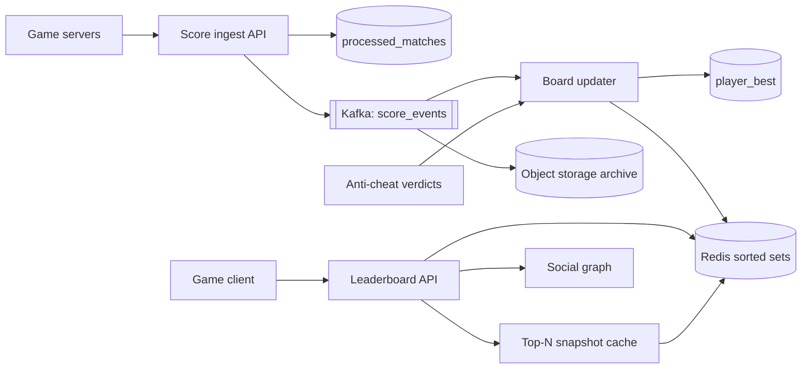

## In one minute
- A leaderboard answers three questions: who is in the top N, what is my rank, and who is near me. The second one is the hard one. "Top 100" is cheap with almost any design; "you are 4,812,331st out of 90 million" needs a structure that counts everything above you in logarithmic time.
- An in-memory ordered set with rank support (a Redis sorted set, which is a skip list whose links carry span counts, plus a hash map) handles one board of about 100 million players on one node. Start there and shard only when one board outgrows one machine's memory or write rate.
- Treat the sorted set as a cache, not as the system of record. Every accepted score goes into a durable log first, keyed by match ID for idempotency, so any board can be rebuilt after a node loss, a cheating rollback or a scoring bug.
- Decide tie-breaking and score windows (daily, weekly, season) up front. Ties need a deterministic rule encoded into the sort key, and windows are separate keys that expire, not a filter applied at read time.
- Exact rank for everyone is optional. Past the first few thousand places, players accept "top 3%", which lets a histogram of score buckets replace a global ordered structure when the board gets too large to hold in one place.

## Requirements
Functional:
- Game servers submit a final score for a player after each match. A player's board entry is their best score in the window (some games use the sum instead; this design supports both).
- Players see the global top 100, their own rank and score, and the 10 players directly above and below them.
- Boards exist per game mode and per window: daily, weekly and per season. Players also see a friends leaderboard.
- Operators can remove a player (cheating) and rebuild a board from history.

Non-functional:
- A submitted score shows in the player's own rank within about 1 second (read-your-writes for the submitter), and in other players' views within a few seconds.
- Rank lookups p99 under 50 ms at the API, top-100 reads under 20 ms.
- No lost or double-counted scores: a retried submission for the same match must not change anything.
- Survive a cache node loss without losing accepted scores. A board may be briefly stale during recovery.

Out of scope: matchmaking, anti-cheat detection models (we consume their verdicts), rewards payout, and the game client.

## Back-of-envelope
Assume a popular mobile game with 50 million daily active users and 120 million players with a season score.

Writes: each active player finishes about 10 matches a day, so 500 million score events per day. 500,000,000 / 86,400 is about 5,800 per second on average. Evening peaks and weekend events run about 5x, so plan for 30,000 per second. Each event updates three windows (daily, weekly, season), so the cache sees about 90,000 sorted-set writes per second at peak. A single Redis process does roughly 100,000 to 200,000 simple commands per second, which is close to the limit, so we will need at least a few shards by mode or window.

Reads: each player opens the leaderboard screen about 5 times a day, and each screen issues one top-100 read, one rank read and one neighbourhood read. 50 million x 5 x 3 is 750 million reads a day, about 8,700 per second on average and 45,000 at peak. Top-100 is the same for everyone, so a 1-second cached snapshot removes a third of that load.

Memory: a sorted-set member costs roughly 100 to 130 bytes (skip list node, hash table entry, a 16-byte player ID string, allocator rounding). 120 million x 120 bytes is about 14 GB for the season board. Daily and weekly boards hold about 50 and 80 million active players, roughly 6 GB and 10 GB. That is about 30 GB per game mode, or 150 GB for five modes before replicas.

Durable log: a score event is about 100 bytes (match ID, player ID, mode, score, timestamp, server signature). 500 million x 100 bytes is 50 GB per day, about 18 TB per year, and 90 TB over five years uncompressed. Columnar compression brings that to perhaps 15 to 20 TB. The current-best table (one row per player, mode and window) is small by comparison: a few hundred million rows of about 60 bytes, tens of GB.

Bandwidth: a top-100 response of about 8 KB at 15,000 per second is 120 MB/s, almost all served from cache. Score submissions are tiny.

## API
```
POST /v1/scores                     (game server only, mTLS + signed payload)
  body { match_id, player_id, mode, score, ended_at }
  -> 202 { accepted: true }          (duplicate match_id returns the same 202)

GET  /v1/boards/{mode}/{window}/top?limit=100
  -> { as_of, entries: [ { rank, player_id, name, score } ] }

GET  /v1/boards/{mode}/{window}/players/{player_id}
  -> { rank, score, percentile, above: [ ... 10 ], below: [ ... 10 ] }

GET  /v1/boards/{mode}/{window}/friends?player_id=...
  -> { entries: [ { rank_among_friends, player_id, score } ] }

DELETE /v1/boards/{mode}/players/{player_id}     (operator; removes from all windows)
POST   /v1/boards/{mode}/{window}/rebuild        (operator; replays the log)
```
`window` is a concrete key such as `daily-2026-10-16`, `weekly-2026-W42` or `season-14`, never "current", so clients and caches agree on which board they are looking at around midnight.

## Data model
**score_events** (append-only log, Kafka topic partitioned by `player_id`, archived to object storage as Parquet): `match_id`, `player_id`, `mode`, `score`, `ended_at`, `server_id`, `signature`. Partitioning by player keeps all of one player's events in order on one partition, so the consumer can apply "keep best" without cross-partition races.

**player_best** (wide-column store such as Cassandra or DynamoDB, partition key `(mode, window, player_id)`): `best_score`, `achieved_at`, `match_id`. This is the durable truth of each board. Updates are conditional (`IF best_score < :new` in Cassandra, or a DynamoDB condition expression such as `best_score < :new` ([DynamoDB docs](https://docs.aws.amazon.com/amazondynamodb/latest/developerguide/Expressions.ConditionExpressions.html))), so replays are harmless. A board rebuild is a full scan of one `(mode, window)` prefix, so in DynamoDB we would add a sharded secondary key `(mode, window, bucket 0..255)` to scan it in parallel.

**processed_matches** (same store, partition key `match_id`, TTL 30 days): makes submission idempotent. Insert-if-absent before producing to the log.

**Redis sorted sets** (key `lb:{mode}:{window}`, member `player_id`, score = encoded sort key): the serving index. Each board is one key, so boards spread across cluster slots independently.

**friends** (owned by the social service): read at query time, at most a few hundred IDs per player.

## High-level design


Write path: the game server, not the client, posts the final score when a match ends. Clients are never trusted to report scores. The ingest API checks the signature, inserts `match_id` into `processed_matches` with insert-if-absent, and on success produces the event to Kafka with `acks=all`. A duplicate returns 202 without producing. The board updater consumes in per-player order, computes the new best for each affected window, writes `player_best` conditionally, and if the condition held, issues `ZADD lb:{mode}:{window} GT <key> <player>` for each window. The `GT` flag, available since Redis 6.2 ([Redis docs](https://redis.io/docs/latest/commands/zadd/)), only raises a member's score, so a late or replayed event can never lower it. Kafka offsets are committed after the Redis writes, so a crash replays a few events, which the conditional writes absorb.

Read path: top-100 comes from a snapshot the API refreshes every second with `ZRANGE lb:... 0 99 REV WITHSCORES`, decorated with display names from a profile cache. "My rank" is one O(log n) command since Redis 7.2: `ZREVRANK lb:... <player> WITHSCORE` returns the rank and the score together ([Redis docs](https://redis.io/docs/latest/commands/zrank/)). On older servers, pipeline `ZREVRANK` with `ZSCORE`, which costs the same round trip but can straddle a write. The neighbourhood is `ZRANGE lb:... (rank-10) (rank+10) REV`. A friends board fetches the friend list and runs a pipelined `ZMSCORE` for those IDs, then sorts at most a few hundred entries in the API process. For read-your-writes, the ingest response returns the new best, and the client shows it locally until the board catches up.

## Deep dives

### Ranking at 100 million players
Option one is a relational table indexed on `score` with `SELECT COUNT(*) WHERE score > :mine`. Ordinary B-trees keep no subtree counts, so the 50-millionth player's query reads 50 million index entries.

Option two is the sorted set. Redis keeps each large sorted set as a hash table ([Redis docs](https://redis.io/docs/latest/develop/data-types/sorted-sets/)) (member to score, for O(1) `ZSCORE`) plus a skip list ordered by `(score, member)`. This is the skip list of [Pugh (1990)](https://15721.courses.cs.cmu.edu/spring2018/papers/08-oltpindexes1/pugh-skiplists-cacm1990.pdf) with one addition: every forward pointer stores a `span`: how many level-0 nodes it jumps over. Walking down from the top level and summing spans gives the rank of any node in O(log n) expected steps. This is an order-statistic structure, and it is why `ZREVRANK` is fast where SQL is not. See [Skip Lists](../sd/skip-lists.md) and [Redis](redis.md) for the internals.

Option three, for boards that outgrow a node, is sharding. By player ID breaks rank, since every lookup must fan out and sum "players above you" across all shards. By score range keeps rank cheap ("players in higher shards plus your rank in your shard"), but skewed, drifting score distributions force rebalancing. Option four drops exactness below the top: exact sorted sets for the top 100,000 and a histogram of counts per score bucket for everyone else, queried through a Fenwick tree in O(log buckets). Counts add, so the histogram shards and merges trivially.

Choice: one sorted set per board while it fits (it does at 14 GB), with the histogram maintained alongside so the API can serve "top 4%" if a board ever has to be split. The practice task builds that histogram index.

### Ties, score encoding and windows
Two players with 9,000 points must not swap places on every refresh. The common rule is that whoever reached the score first ranks higher. A sorted set orders equal scores lexicographically by member string ([Redis docs](https://redis.io/docs/latest/develop/data-types/sorted-sets/)), which is arbitrary for player IDs, so encode the tie-break into the score itself. Redis scores are IEEE 754 doubles, exact for every integer up to 2^53 ([Wikipedia](https://en.wikipedia.org/wiki/Double-precision_floating-point_format)). With game scores below 2^21 (about 2 million) and seconds within a season below 2^31, the key `score * 2^31 + (2^31 - 1 - seconds_since_season_start)` is an exact integer under 2^52, and larger means better on both fields. Decode by integer division when reading. If scores can exceed that, give the tie-break fewer bits (minutes instead of seconds) or move to a store with composite keys.

Windows are separate keys. The updater writes daily, weekly and season keys for each event, and each key gets `EXPIRE` at window end plus a grace period. A sorted set keeps no per-member history, so "this week" cannot be computed at read time from one board. Resets are free: a new key starts empty. A late event goes to the window of `ended_at`, not arrival time, while that key still exists.

### Durability, rebuilds and cheaters
Redis is in memory. With replication and AOF it survives most failures, but the board must be rebuildable from something we trust more: the event log and `player_best`. A rebuild streams `player_best` rows for the `(mode, window)` into a new key `lb:...:v2` with pipelined `ZADD` batches of 1,000, then swaps the key name with `RENAME`, so readers never see a half-built board. At 1 million members per second per pipeline, a 120-million-member board rebuilds in about two minutes, with several parallel loaders writing to the same key.

When anti-cheat flags a player, the updater runs `ZREM` on every window key and marks the player in `player_best`. Ranks are computed, not stored, so everyone below moves up by one with no rewrite. If instead the scoring formula itself was wrong, we replay the archived log through the fixed formula into fresh keys, which is the [event sourcing](../sd/event-sourcing.md) argument applied to a game.

## Down the stack

### Layer 1: The contract
For a key `lb:{mode}:{window}`, after `POST /scores` returns 202 for match M, the board eventually reflects `max(previous best, M.score)` for that player, and no replay of M changes it again. Rank is defined as 1 plus the number of members whose encoded key is strictly greater, so equal raw scores are ordered by who got there first, and the order is total. Reads are consistent per command (one `ZREVRANK` sees one point in time) but a pipelined rank plus neighbourhood read may straddle a write; the API treats that as acceptable. Staleness from submission to board is bounded by consumer lag, with an alert at 2 seconds.

### Layer 2: The mechanism
In Redis's `t_zset.c`, a sorted set with more than 128 members (the default `zset-max-listpack-entries`) or any member longer than 64 bytes is converted from a compact listpack to the `zset` encoding: a `dict` plus a `zskiplist`. Each `zskiplistNode` holds the member SDS, a `double score`, a `backward` pointer and a flexible array of levels, each with a `forward` pointer and an `unsigned long span`. A node's level grows with probability 0.25 per step, capped at 32 (`ZSKIPLIST_P` and `ZSKIPLIST_MAXLEVEL` in [server.h](https://github.com/redis/redis/blob/unstable/src/server.h)), so it averages 1.33 levels. `ZADD ... GT` reads the old score from the dict and, if the new one is larger, moves the node and fixes spans along the update path. `ZREVRANK` descends from the top level summing spans and returns `length - rank`. Replicas receive the command stream in order, and AOF with `appendfsync everysec` fsyncs once per second from a background thread, so a crash can lose about a second of writes ([Redis persistence docs](https://redis.io/docs/latest/operate/oss_and_stack/management/persistence/)).

### Layer 3: The machine
A skip list search over 120 million members descends about 13 levels (log base 4), with a few hops per level: 30 to 50 pointer dereferences, mostly cache misses at 80 to 100 ns each, so 3 to 5 microseconds per rank lookup. Request parsing costs about as much, and the in-zone network round trip of 200 to 500 microseconds dominates what the API sees. The expensive moment is persistence: an RDB snapshot or AOF rewrite calls `fork()` on the main thread, and the kernel copies page tables for 14 GB of resident memory (about 28 MB of entries with 4 KB pages). Redis's own measurements put that at roughly 9 to 13 ms per GB on physical machines and VMware, so about 130 to 180 ms of stalled event loop for this board, and 239 ms per GB on old Xen-based EC2 instances, over 3 seconds ([Redis latency docs](https://redis.io/docs/latest/operate/oss_and_stack/management/optimization/latency/)). The same page says to disable transparent huge pages, which otherwise turn copy-on-write into copying almost the whole process. Copy-on-write then duplicates every page the updater touches, so leave 30 to 50% RAM headroom and snapshot on replicas.

### Why it's built this way
1. Rank queries need "how many above me" in logarithmic time, so we need a structure that stores counts on its internal links; ordinary database indexes do not, so the serving index lives in a specialised in-memory store.
2. Memory is volatile and expensive, so the in-memory board is a derived view, and the durable truth is a compact per-player best table plus an append-only log.
3. Logs and networks deliver duplicates and late events, so every write is idempotent (insert-if-absent on match ID) and monotone (`GT`, conditional best update), which makes replays safe.
4. One process has a finite write rate and RAM, so boards are split by mode and window first (natural, independent keys) and by score only when a single board outgrows a node.
5. Players care about exact rank only near the top, so approximate rank from bucket counts is an acceptable escape hatch that scales by addition.

## Failure modes
- **10x write load** (a weekend event): Kafka absorbs the burst, and the updater batches `ZADD`s per partition with pipelining. Board staleness rises from under a second to tens of seconds, which is acceptable if the submitter's own client shows the new best immediately. Shed daily-board updates before season-board updates if lag passes a threshold.
- **Redis primary loss**: the replica is promoted within seconds. It may miss the last few hundred milliseconds of writes, and AOF may lose up to a second. The updater re-consumes from the last committed offset, which is behind both, so the gap fills in. For a total cluster loss, rebuild from `player_best` in a few minutes and serve the last top-100 snapshot meanwhile.
- **Hot key**: every leaderboard read hits one key on one shard. The 1-second top-100 snapshot handles the hottest read. Rank reads go to read replicas, since a few hundred milliseconds of replica lag is within the staleness budget. If one board's writes exceed one node, split the mode into score-range shards.
- **Region outage**: run the boards in one primary region with a warm standby consuming a mirrored topic. On failover the standby serves; events accepted only in the lost region reappear when it recovers, and conditional writes make the merge safe.
- **Bad scoring release**: quarantine events from the faulty server build, replay the window from the archive into a new key, and `RENAME` it into place.

## In the wild
- **Harmonix, 2015-2016: Rock Band 4 wipes every leaderboard.** Players found score exploits, including drummers deploying Overdrive twice at the end of fills. Because the fixes changed scoring for almost every song, instrument and difficulty, Harmonix wiped all leaderboard high scores with the February 2016 update, kept local Full Combo data, and changed its code so that future song-specific bugs could get targeted wipes instead ([Harmonix, December 2015](https://www.harmonixmusic.com/blog/january-update-blog); [patch notes, February 2016](https://www.harmonixmusic.com/blog/rock-band-4-february-update-patch-notes)).
- **Ubisoft, 2019: rolling back rating changes caused by cheaters.** From Rainbow Six Siege Y4S1, banning a cheater reverses the rating gains and losses of every player in all of that cheater's matches for the whole season, wins and losses alike, but never lifts anyone above their season maximum. A 7-day window was tested and rejected as too inconsistent, and the feature ran silently for a season first ([Ubisoft](https://www.ubisoft.com/en-gb/game/rainbow-six/siege/news-updates/Fhj616gBRK6Ny33KzTtgL)). Recomputing standings like this needs the per-match history, not just the current board.
- **Discord, 2017: a correct Redis failover still became an outage.** A cloud live migration took a Redis primary offline; the cluster failed over correctly, but API instances hit a bug handling the failover, and further failures piled on until a full restart reconnected millions of clients. The outage lasted about 2 hours 51 minutes ([Discord status](https://discordstatus.com/incidents/qk9cdgnqnhcn)). Test the client side of failover, not just the server.

## Trade-offs
| Option | Strengths | Weaknesses | Choose when |
|---|---|---|---|
| SQL table with score index | Simple, durable, transactional | Rank needs a count over all rows above you | Under about a million players, or rank shown only for the top |
| One Redis sorted set per board | O(log n) rank and range, exact, operationally familiar | Bounded by one node's RAM and single-threaded writes; needs a durable source of truth | Boards up to roughly 100 to 200 million members |
| Score-range sharded sorted sets | Exact rank beyond one node | Rebalancing as the distribution shifts; two calls per rank lookup | A single board too big for one node and exact rank is a product requirement |
| Bucket histogram (Fenwick over counts) | Tiny memory, trivially sharded and merged, O(log buckets) | Rank is approximate inside a bucket | Long tail of players, "top 3%" is acceptable |
| Batch ranking in a warehouse | Cheap, handles any formula | Minutes to hours stale | End-of-season final standings and rewards |

## Leadership lens
- Build first: the idempotent ingest, the log, and the `player_best` table, then a single sorted set per board. With the durable source in place, the serving index can be swapped, resharded or rebuilt at any time; without it, every Redis incident is a data loss incident.
- Ownership: the Leaderboard team owns ingest, the updater and the boards. The Game Server team owns signing and the contract that only servers submit scores. Anti-cheat owns verdicts, published as events. Write the score event schema down and version it; it outlives every serving technology.
- Rollout: shadow the new board next to the old one for a season, compare top-1000 and a random sample of ranks daily, then switch reads per game mode behind a flag.
- Cost drivers: RAM for sorted sets (about 150 GB plus replicas and fork headroom, so 400 to 500 GB provisioned), Kafka retention and the archive. The archive is the cheapest insurance in the system. Check licensing too: Redis moved to source-available licences in March 2024, added AGPLv3 as an option with Redis 8 in May 2025, and AWS and Google now maintain their own fork ([Redis](https://redis.io/blog/agplv3/)), so the managed-service choice is also a licence choice.
- Review questions: what is the tie-break rule and is it encoded in the key; can a client ever write a score directly; how long does a full rebuild take; what happens to rewards if a cheater is removed after the season closes.

## Check yourself
1. Why can a Redis sorted set answer "what is my rank" in logarithmic time when `SELECT COUNT(*) WHERE score > :mine` on an indexed SQL table cannot?
   **Answer:** Each forward pointer in the skip list stores a span, the number of level-0 nodes it jumps over, so summing spans on the way down gives the rank in O(log n) steps. Ordinary B-trees keep no subtree counts, so the SQL query has to read every index entry above you, 50 million entries for the 50-millionth player.
2. The Redis primary for a board is lost and the promoted replica missed the last few hundred milliseconds of writes. Why are no accepted scores lost?
   **Answer:** Redis is a derived view; the durable truth is the Kafka log and `player_best`. The updater commits Kafka offsets only after its Redis writes, so it re-consumes from a point behind the lost writes, and conditional best updates plus `ZADD GT` make the replayed events harmless.
3. Using the lesson's estimates, why does one season board fit on a single node, and why do you still expect to need a few Redis shards?
   **Answer:** 120 million members at about 120 bytes each is roughly 14 GB, which fits in one node's memory. But 30,000 score events per second at peak, each updating three windows, is about 90,000 sorted-set writes per second, close to a single Redis process's 100,000 to 200,000 command limit, so boards are split by mode or window.
4. When a single board outgrows one node, what are the trade-offs between sharding by player ID, by score range, and switching to a bucket histogram?
   **Answer:** Sharding by player ID breaks rank, since every lookup must fan out and sum players above you across all shards. Score-range shards keep exact rank cheap but need rebalancing as the score distribution drifts, while a Fenwick tree over score buckets is tiny and merges by addition but gives only approximate rank inside a bucket.

## Practice
**Task:** Build the approximate-rank fallback: a rank index over a bounded integer score range using a Fenwick (binary indexed) tree of counts, the structure you would use for the long tail of a huge board. `RankIndex(max_score)` accepts scores from 0 to `max_score` inclusive. `submit(player, score)` keeps each player's best score and returns true only if the stored best changed (new player or strictly higher score); a score outside the range is an error. `rank(player)` returns 1 plus the number of players with a strictly greater best score, or nothing for an unknown player. `count_at_least(score)` returns how many players have a best of at least `score` (any score is allowed here). `score_at_rank(k)` returns the best score of the player at 1-based position `k` in descending order, or nothing if `k` is out of bounds, found by Fenwick descent rather than a scan. `remove(player)` deletes a player and reports whether they existed, and `size()` returns the player count.

```python starter
class RankIndex:
    def __init__(self, max_score):
        self.max_score = max_score

    def submit(self, player, score):
        # TODO: keep the best score per player in a Fenwick tree of counts
        raise NotImplementedError

    def rank(self, player):
        raise NotImplementedError

    def count_at_least(self, score):
        raise NotImplementedError

    def score_at_rank(self, k):
        raise NotImplementedError

    def remove(self, player):
        raise NotImplementedError

    def size(self):
        raise NotImplementedError
```

```python tests
def _board():
    b = RankIndex(100)
    b.submit("ana", 50)
    b.submit("ben", 80)
    b.submit("cy", 50)
    b.submit("dee", 10)
    return b

def test_competition_ranking():
    b = _board()
    assert b.rank("ben") == 1
    assert b.rank("ana") == 2 and b.rank("cy") == 2, "ties share a rank"
    assert b.rank("dee") == 4, "rank skips past the tie"
    assert b.rank("nobody") is None

def test_keeps_best_score():
    b = RankIndex(100)
    assert b.submit("ana", 50) is True
    assert b.submit("ana", 40) is False
    assert b.submit("ana", 50) is False, "equal score is not an improvement"
    assert b.submit("ana", 70) is True
    assert b.size() == 1
    assert b.score_at_rank(1) == 70

def test_out_of_range_rejected():
    b = RankIndex(100)
    for bad in (-1, 101):
        try:
            b.submit("x", bad)
            assert False, "expected ValueError"
        except ValueError:
            pass
    assert b.size() == 0

def test_count_at_least():
    b = _board()
    assert b.count_at_least(50) == 3
    assert b.count_at_least(11) == 3
    assert b.count_at_least(10) == 4
    assert b.count_at_least(81) == 0
    assert b.count_at_least(-5) == 4
    assert b.count_at_least(500) == 0

def test_score_at_rank():
    b = _board()
    assert [b.score_at_rank(k) for k in range(1, 5)] == [80, 50, 50, 10]
    assert b.score_at_rank(0) is None
    assert b.score_at_rank(5) is None

def test_remove_shifts_ranks():
    b = _board()
    assert b.remove("cy") is True
    assert b.remove("cy") is False
    assert b.rank("dee") == 3
    assert b.score_at_rank(3) == 10
    assert b.size() == 3

def test_range_edges():
    b = RankIndex(7)
    b.submit("lo", 0)
    b.submit("hi", 7)
    assert b.rank("lo") == 2 and b.rank("hi") == 1
    assert b.score_at_rank(2) == 0
    assert b.count_at_least(0) == 2

def test_matches_brute_force():
    b = RankIndex(1000)
    best = {}
    for i in range(400):
        p = "p" + str(i % 150)
        s = (i * 7919) % 1001
        b.submit(p, s)
        best[p] = max(best.get(p, -1), s)
    ordered = sorted(best.values(), reverse=True)
    for p, s in best.items():
        assert b.rank(p) == 1 + sum(1 for v in best.values() if v > s)
    for k in range(1, len(ordered) + 1):
        assert b.score_at_rank(k) == ordered[k - 1]
    assert b.size() == 150
```

```python solution
class RankIndex:
    def __init__(self, max_score):
        if max_score < 0:
            raise ValueError("max_score must be non-negative")
        self.max_score = max_score
        self.n = max_score + 1
        self.tree = [0] * (self.n + 1)
        self.best = {}

    def _idx(self, score):
        # Highest score maps to index 1, so prefix sums count better players.
        return self.max_score - score + 1

    def _add(self, i, delta):
        while i <= self.n:
            self.tree[i] += delta
            i += i & -i

    def _prefix(self, i):
        total = 0
        while i > 0:
            total += self.tree[i]
            i -= i & -i
        return total

    def submit(self, player, score):
        if score < 0 or score > self.max_score:
            raise ValueError("score out of range")
        old = self.best.get(player)
        if old is not None and score <= old:
            return False
        if old is not None:
            self._add(self._idx(old), -1)
        self._add(self._idx(score), 1)
        self.best[player] = score
        return True

    def rank(self, player):
        score = self.best.get(player)
        if score is None:
            return None
        return self._prefix(self._idx(score) - 1) + 1

    def count_at_least(self, score):
        if score > self.max_score:
            return 0
        if score <= 0:
            return len(self.best)
        return self._prefix(self._idx(score))

    def score_at_rank(self, k):
        if k < 1 or k > len(self.best):
            return None
        pos = 0
        step = 1
        while step * 2 <= self.n:
            step *= 2
        remaining = k
        while step > 0:
            nxt = pos + step
            if nxt <= self.n and self.tree[nxt] < remaining:
                pos = nxt
                remaining -= self.tree[nxt]
            step //= 2
        return self.max_score - pos

    def remove(self, player):
        score = self.best.pop(player, None)
        if score is None:
            return False
        self._add(self._idx(score), -1)
        return True

    def size(self):
        return len(self.best)
```

```typescript starter
export class RankIndex {
  constructor(public maxScore: number) {}

  submit(player: string, score: number): boolean {
    throw new Error("TODO");
  }

  rank(player: string): number | null {
    throw new Error("TODO");
  }

  countAtLeast(score: number): number {
    throw new Error("TODO");
  }

  scoreAtRank(k: number): number | null {
    throw new Error("TODO");
  }

  remove(player: string): boolean {
    throw new Error("TODO");
  }

  size(): number {
    throw new Error("TODO");
  }
}
```

```typescript tests
function makeBoard(): RankIndex {
  const b = new RankIndex(100);
  b.submit("ana", 50);
  b.submit("ben", 80);
  b.submit("cy", 50);
  b.submit("dee", 10);
  return b;
}

test("competition ranking", () => {
  const b = makeBoard();
  assertEqual(b.rank("ben"), 1);
  assertEqual([b.rank("ana"), b.rank("cy")], [2, 2], "ties share a rank");
  assertEqual(b.rank("dee"), 4, "rank skips past the tie");
  assertEqual(b.rank("nobody"), null);
});

test("keeps best score", () => {
  const b = new RankIndex(100);
  assertEqual(b.submit("ana", 50), true);
  assertEqual(b.submit("ana", 40), false);
  assertEqual(b.submit("ana", 50), false, "equal score is not an improvement");
  assertEqual(b.submit("ana", 70), true);
  assertEqual(b.size(), 1);
  assertEqual(b.scoreAtRank(1), 70);
});

test("out of range rejected", () => {
  const b = new RankIndex(100);
  for (const bad of [-1, 101]) {
    let threw = false;
    try {
      b.submit("x", bad);
    } catch (e) {
      threw = true;
    }
    assert(threw, "expected an error for " + bad);
  }
  assertEqual(b.size(), 0);
});

test("count at least", () => {
  const b = makeBoard();
  assertEqual(
    [50, 11, 10, 81, -5, 500].map((s) => b.countAtLeast(s)),
    [3, 3, 4, 0, 4, 0]
  );
});

test("score at rank", () => {
  const b = makeBoard();
  assertEqual([1, 2, 3, 4].map((k) => b.scoreAtRank(k)), [80, 50, 50, 10]);
  assertEqual(b.scoreAtRank(0), null);
  assertEqual(b.scoreAtRank(5), null);
});

test("remove shifts ranks", () => {
  const b = makeBoard();
  assertEqual(b.remove("cy"), true);
  assertEqual(b.remove("cy"), false);
  assertEqual(b.rank("dee"), 3);
  assertEqual(b.scoreAtRank(3), 10);
  assertEqual(b.size(), 3);
});

test("range edges", () => {
  const b = new RankIndex(7);
  b.submit("lo", 0);
  b.submit("hi", 7);
  assertEqual([b.rank("lo"), b.rank("hi")], [2, 1]);
  assertEqual(b.scoreAtRank(2), 0);
  assertEqual(b.countAtLeast(0), 2);
});

test("matches brute force", () => {
  const b = new RankIndex(1000);
  const best = new Map<string, number>();
  for (let i = 0; i < 400; i++) {
    const p = "p" + (i % 150);
    const s = (i * 7919) % 1001;
    b.submit(p, s);
    best.set(p, Math.max(best.has(p) ? (best.get(p) as number) : -1, s));
  }
  const values = Array.from(best.values());
  const ordered = values.slice().sort((x, y) => y - x);
  best.forEach((s, p) => {
    assertEqual(b.rank(p), 1 + values.filter((v) => v > s).length, "rank of " + p);
  });
  for (let k = 1; k <= ordered.length; k++) {
    assertEqual(b.scoreAtRank(k), ordered[k - 1], "score at rank " + k);
  }
  assertEqual(b.size(), 150);
});
```

```typescript solution
export class RankIndex {
  private n: number;
  private tree: number[];
  private best = new Map<string, number>();

  constructor(public maxScore: number) {
    if (maxScore < 0) throw new Error("maxScore must be non-negative");
    this.n = maxScore + 1;
    this.tree = new Array(this.n + 1).fill(0);
  }

  private idx(score: number): number {
    return this.maxScore - score + 1;
  }

  private add(i: number, delta: number): void {
    for (; i <= this.n; i += i & -i) this.tree[i] += delta;
  }

  private prefix(i: number): number {
    let total = 0;
    for (; i > 0; i -= i & -i) total += this.tree[i];
    return total;
  }

  submit(player: string, score: number): boolean {
    if (!Number.isInteger(score) || score < 0 || score > this.maxScore) {
      throw new Error("score out of range");
    }
    const old = this.best.get(player);
    if (old !== undefined && score <= old) return false;
    if (old !== undefined) this.add(this.idx(old), -1);
    this.add(this.idx(score), 1);
    this.best.set(player, score);
    return true;
  }

  rank(player: string): number | null {
    const score = this.best.get(player);
    if (score === undefined) return null;
    return this.prefix(this.idx(score) - 1) + 1;
  }

  countAtLeast(score: number): number {
    if (score > this.maxScore) return 0;
    if (score <= 0) return this.best.size;
    return this.prefix(this.idx(score));
  }

  scoreAtRank(k: number): number | null {
    if (k < 1 || k > this.best.size) return null;
    let pos = 0;
    let step = 1;
    while (step * 2 <= this.n) step *= 2;
    let remaining = k;
    for (; step > 0; step = Math.floor(step / 2)) {
      const next = pos + step;
      if (next <= this.n && this.tree[next] < remaining) {
        pos = next;
        remaining -= this.tree[next];
      }
    }
    return this.maxScore - pos;
  }

  remove(player: string): boolean {
    const score = this.best.get(player);
    if (score === undefined) return false;
    this.best.delete(player);
    this.add(this.idx(score), -1);
    return true;
  }

  size(): number {
    return this.best.size;
  }
}
```

```go starter
package practice

// RankIndex counts players per score in a Fenwick tree. Rank and
// ScoreAtRank return -1 when there is no answer.
type RankIndex struct {
	MaxScore int
}

func NewRankIndex(maxScore int) *RankIndex {
	return &RankIndex{MaxScore: maxScore}
}

func (r *RankIndex) Submit(player string, score int) (bool, error) {
	panic("TODO")
}

func (r *RankIndex) Rank(player string) int {
	panic("TODO")
}

func (r *RankIndex) CountAtLeast(score int) int {
	panic("TODO")
}

func (r *RankIndex) ScoreAtRank(k int) int {
	panic("TODO")
}

func (r *RankIndex) Remove(player string) bool {
	panic("TODO")
}

func (r *RankIndex) Size() int {
	panic("TODO")
}
```

```go tests
package practice

import (
	"fmt"
	"sort"
	"testing"
)

func makeBoard() *RankIndex {
	b := NewRankIndex(100)
	b.Submit("ana", 50)
	b.Submit("ben", 80)
	b.Submit("cy", 50)
	b.Submit("dee", 10)
	return b
}

func TestCompetitionRanking(t *testing.T) {
	b := makeBoard()
	if b.Rank("ben") != 1 || b.Rank("ana") != 2 || b.Rank("cy") != 2 || b.Rank("dee") != 4 {
		t.Fatalf("ranks: ben=%d ana=%d cy=%d dee=%d", b.Rank("ben"), b.Rank("ana"), b.Rank("cy"), b.Rank("dee"))
	}
	if b.Rank("nobody") != -1 {
		t.Fatal("unknown player should be -1")
	}
}

func TestKeepsBestScore(t *testing.T) {
	b := NewRankIndex(100)
	steps := []struct {
		score int
		want  bool
	}{{50, true}, {40, false}, {50, false}, {70, true}}
	for _, s := range steps {
		got, err := b.Submit("ana", s.score)
		if err != nil || got != s.want {
			t.Fatalf("submit %d: got %v, %v", s.score, got, err)
		}
	}
	if b.Size() != 1 || b.ScoreAtRank(1) != 70 {
		t.Fatal("best should be 70")
	}
}

func TestOutOfRangeRejected(t *testing.T) {
	b := NewRankIndex(100)
	for _, bad := range []int{-1, 101} {
		if _, err := b.Submit("x", bad); err == nil {
			t.Fatalf("expected error for %d", bad)
		}
	}
	if b.Size() != 0 {
		t.Fatal("nothing should be stored")
	}
}

func TestCountAtLeast(t *testing.T) {
	b := makeBoard()
	cases := map[int]int{50: 3, 11: 3, 10: 4, 81: 0, -5: 4, 500: 0}
	for s, want := range cases {
		if got := b.CountAtLeast(s); got != want {
			t.Fatalf("CountAtLeast(%d) = %d, want %d", s, got, want)
		}
	}
}

func TestScoreAtRank(t *testing.T) {
	b := makeBoard()
	want := []int{-1, 80, 50, 50, 10, -1}
	for k, w := range want {
		if got := b.ScoreAtRank(k); got != w {
			t.Fatalf("ScoreAtRank(%d) = %d, want %d", k, got, w)
		}
	}
}

func TestRemoveShiftsRanks(t *testing.T) {
	b := makeBoard()
	if !b.Remove("cy") || b.Remove("cy") {
		t.Fatal("remove should succeed once")
	}
	if b.Rank("dee") != 3 || b.ScoreAtRank(3) != 10 || b.Size() != 3 {
		t.Fatal("ranks should shift up after removal")
	}
}

func TestRangeEdges(t *testing.T) {
	b := NewRankIndex(7)
	b.Submit("lo", 0)
	b.Submit("hi", 7)
	if b.Rank("lo") != 2 || b.Rank("hi") != 1 || b.ScoreAtRank(2) != 0 || b.CountAtLeast(0) != 2 {
		t.Fatal("edge scores mishandled")
	}
}

func TestMatchesBruteForce(t *testing.T) {
	b := NewRankIndex(1000)
	best := map[string]int{}
	for i := 0; i < 400; i++ {
		p := fmt.Sprintf("p%d", i%150)
		s := (i * 7919) % 1001
		if _, err := b.Submit(p, s); err != nil {
			t.Fatal(err)
		}
		if old, ok := best[p]; !ok || s > old {
			best[p] = s
		}
	}
	ordered := []int{}
	for _, v := range best {
		ordered = append(ordered, v)
	}
	sort.Sort(sort.Reverse(sort.IntSlice(ordered)))
	for p, s := range best {
		want := 1
		for _, v := range best {
			if v > s {
				want++
			}
		}
		if got := b.Rank(p); got != want {
			t.Fatalf("Rank(%s) = %d, want %d", p, got, want)
		}
	}
	for k := 1; k <= len(ordered); k++ {
		if got := b.ScoreAtRank(k); got != ordered[k-1] {
			t.Fatalf("ScoreAtRank(%d) = %d, want %d", k, got, ordered[k-1])
		}
	}
	if b.Size() != 150 {
		t.Fatal("size should be 150")
	}
}
```

```go solution
package practice

import "errors"

// RankIndex counts players per score in a Fenwick tree. Rank and
// ScoreAtRank return -1 when there is no answer.
type RankIndex struct {
	MaxScore int
	n        int
	tree     []int
	best     map[string]int
}

func NewRankIndex(maxScore int) *RankIndex {
	n := maxScore + 1
	return &RankIndex{MaxScore: maxScore, n: n, tree: make([]int, n+1), best: map[string]int{}}
}

// idx maps the highest score to 1, so prefix sums count better players.
func (r *RankIndex) idx(score int) int { return r.MaxScore - score + 1 }

func (r *RankIndex) add(i, delta int) {
	for ; i <= r.n; i += i & -i {
		r.tree[i] += delta
	}
}

func (r *RankIndex) prefix(i int) int {
	total := 0
	for ; i > 0; i -= i & -i {
		total += r.tree[i]
	}
	return total
}

func (r *RankIndex) Submit(player string, score int) (bool, error) {
	if score < 0 || score > r.MaxScore {
		return false, errors.New("score out of range")
	}
	old, ok := r.best[player]
	if ok && score <= old {
		return false, nil
	}
	if ok {
		r.add(r.idx(old), -1)
	}
	r.add(r.idx(score), 1)
	r.best[player] = score
	return true, nil
}

func (r *RankIndex) Rank(player string) int {
	score, ok := r.best[player]
	if !ok {
		return -1
	}
	return r.prefix(r.idx(score)-1) + 1
}

func (r *RankIndex) CountAtLeast(score int) int {
	if score > r.MaxScore {
		return 0
	}
	if score <= 0 {
		return len(r.best)
	}
	return r.prefix(r.idx(score))
}

func (r *RankIndex) ScoreAtRank(k int) int {
	if k < 1 || k > len(r.best) {
		return -1
	}
	pos, step, remaining := 0, 1, k
	for step*2 <= r.n {
		step *= 2
	}
	for ; step > 0; step /= 2 {
		next := pos + step
		if next <= r.n && r.tree[next] < remaining {
			pos = next
			remaining -= r.tree[next]
		}
	}
	return r.MaxScore - pos
}

func (r *RankIndex) Remove(player string) bool {
	score, ok := r.best[player]
	if !ok {
		return false
	}
	delete(r.best, player)
	r.add(r.idx(score), -1)
	return true
}

func (r *RankIndex) Size() int { return len(r.best) }
```

## Mock interview
**Prompt:** Design a real-time leaderboard for a mobile game with 50 million daily players and 120 million ranked players per season. Each player must see the global top 100, their exact rank, and the players around them, updated within a second or two of finishing a match.

- Follow-up: Show me how you compute the rank of the 60-millionth player without counting 60 million rows.
- Follow-up: Your Redis primary dies during a weekend event. What is lost, and how does the board converge?
- Follow-up: The board grows to 2 billion players across all modes. Do you shard by player, by score, or give up exact rank, and why?

**A strong answer covers:**
- Arithmetic for writes (about 30,000 per second at peak, times the number of windows) and memory (about 120 bytes per member), leading to one sorted set per board as the starting point.
- Why rank needs an order-statistic structure (span counts in a skip list, or counts in a Fenwick tree) and why a B-tree count does not scale.
- Server-side score submission with idempotency on match ID, monotone updates (`ZADD GT`, conditional best), and a durable log plus best table from which boards are rebuilt.
- A deterministic tie-break encoded into the score within the 53-bit exact range of a double, and windows as separate expiring keys.
- Hot-key handling with a top-N snapshot and replica reads, and fork and copy-on-write headroom for persistence.
- A clear scaling path: split by mode and window, then score-range shards or bucketed approximate rank for the long tail.

## Sources and further study
**Primary**
- [Redis source: server.h](https://github.com/redis/redis/blob/unstable/src/server.h): the `zskiplistNode` layout with per-level `span`, and the level probability and cap.
- [Redis command spec: zrank.json](https://github.com/redis/redis/blob/unstable/src/commands/zrank.json): the machine-readable command definition whose history records `WITHSCORE` arriving in 7.2.0.

**Systems docs**
- [Redis: diagnosing latency issues](https://redis.io/docs/latest/operate/oss_and_stack/management/optimization/latency/): fork cost per GB by platform, transparent huge pages, and AOF fsync stalls.
- [Redis persistence](https://redis.io/docs/latest/operate/oss_and_stack/management/persistence/): RDB versus AOF, `appendfsync` policies and what each can lose.
- [Amazon DynamoDB: condition expressions](https://docs.aws.amazon.com/amazondynamodb/latest/developerguide/Expressions.ConditionExpressions.html): the conditional write behind a replay-safe best-score table.

**Books**
- *System Design Interview, Volume 2*, Alex Xu and Sahn Lam, chapter 10 "Real-time Gaming Leaderboard": the sorted-set design and its sharding options at interview depth.
- *Designing Data-Intensive Applications*, 2nd edition, Kleppmann and Riccomini, chapter 7 "Sharding": key-range versus hash sharding, the choice behind score-range boards.

**Other curricula**
- [Azure Architecture Center: Sharding pattern](https://learn.microsoft.com/en-us/azure/architecture/patterns/sharding): frames range sharding as easy for range queries but hard to rebalance when activity clusters on adjacent keys, exactly the score-range board problem.
- [Azure Architecture Center: Materialized View pattern](https://learn.microsoft.com/en-us/azure/architecture/patterns/materialized-view): frames the board as a disposable view rebuilt from source and swapped in only after validation.

## Watch
- [Real-time Gaming Leaderboard Design (Last Minute Lecture)](https://www.youtube.com/watch?v=fPz75ALyDvo): a chapter-length walkthrough of the classic interview question, from requirements to Redis sorted sets.
- [System Design: Gaming Leaderboard (System Design Fight Club)](https://www.youtube.com/watch?v=xtgWKUuesSU): a whiteboard session that discusses scaling past a single sorted set.
- [How Redis Sorted Sets Work Internally (Yatharth Verma)](https://www.youtube.com/watch?v=y4VJDC3w2dA): the skip list plus hash table combination behind `ZADD` and `ZRANK`.

## Free resources
- [Redis sorted sets (Redis docs)](https://redis.io/docs/latest/develop/data-types/sorted-sets/): the official guide, with leaderboard examples and command complexity.
- [ZADD (Redis docs)](https://redis.io/docs/latest/commands/zadd/): the `GT`, `LT`, `NX` and `XX` flags that make score updates monotone and safe to replay.
- [t_zset.c (Redis source)](https://github.com/redis/redis/blob/unstable/src/t_zset.c): the skip list with spans, level generation and the listpack conversion thresholds.
- [Skip Lists: A Probabilistic Alternative to Balanced Trees (William Pugh)](https://15721.courses.cs.cmu.edu/spring2018/papers/08-oltpindexes1/pugh-skiplists-cacm1990.pdf): the original paper behind the sorted set.
- [Building a real-time gaming leaderboard with Amazon ElastiCache for Redis (AWS)](https://aws.amazon.com/blogs/database/building-a-real-time-gaming-leaderboard-with-amazon-elasticache-for-redis/): a managed-service version of the same design.
- [Fenwick tree (Wikipedia)](https://en.wikipedia.org/wiki/Fenwick_tree): prefix sums and the descent used in the practice task.
