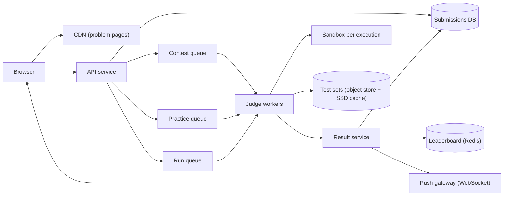

## In one minute
- **Running strangers' code is the product, so isolation is the first design decision.** Every submission is hostile until proven otherwise. It runs in a sandbox with no network, a read-only filesystem, a syscall filter and hard limits on CPU, memory, processes and output.
- **Judging is asynchronous.** The web tier accepts a submission, puts it on a queue and returns an id. A pool of judge workers compiles, runs and grades it, and the client watches for the verdict. Nothing slow or dangerous happens on a request thread.
- **Contests are scheduled spikes, and you know exactly when they start.** Load jumps 20× within minutes of a weekly contest opening. Pre-warm workers before the start, keep contest and practice traffic on separate queues, and rate-limit per user.
- **Verdicts must be fair and repeatable.** The same code against the same tests must get the same verdict on any worker. That means CPU time rather than wall time, pinned and quiet worker hosts, versioned test sets and generous limit margins.
- **The leaderboard is a sorted set with a carefully encoded score.** Rank by points, then by penalised finish time, updated once per accepted submission and read by tens of thousands of people at once.

## Requirements

**Functional**
- Browse about 3,000 problems with statements, examples, tags and difficulty.
- **Run:** execute code in a chosen language against the examples or custom input and show output.
- **Submit:** grade code against the full hidden test set and return a verdict (Accepted, Wrong Answer, Time Limit Exceeded, Memory Limit Exceeded, Runtime Error, Compile Error) with runtime and memory.
- Keep each user's submission history and solved status.
- Run timed contests with a live leaderboard, penalties for wrong attempts and final rankings.

**Non-functional**
- Submit-to-verdict under 5 s at p95 in normal load and under 15 s during a contest peak.
- Untrusted code can never reach the network, other users' data, the host or other submissions.
- A submission is graded exactly once from the user's point of view: retries never double-count a penalty.
- Grading is deterministic within a small runtime tolerance.
- Problem pages stay fast during contests, whatever the judge backlog.

**Out of scope:** the editor itself, discussion forums, premium billing, interview mode, and post-contest plagiarism detection (mentioned briefly).

## Back-of-envelope
Round assumed numbers, not LeetCode's figures.

- **Users:** 2M DAU. 30% submit, averaging 5 Submits and 10 Runs each: 3M Submits and 6M Runs per day.
- **Average load:** 9M executions / 86,400 s ≈ 105/s. Daytime peaks in big time zones are about 3×, so ≈ 300/s.
- **Contest peak:** 50,000 contestants in a 90-minute contest, about 8 Submits and 12 Runs each, so 1M executions. Most arrive in the first 30 minutes on the two easy problems: roughly 600K in 1,800 s ≈ 330/s on top of normal traffic, with bursts above 1,000/s in the first minutes.
- **Judge CPU:** a Submit compiles once (0.5 to 2 s for C++ or Java) and runs about 50 tests averaging 30 ms of CPU: about 2.5 CPU-seconds. A Run is about 1 CPU-second. Average demand: 3M × 2.5 + 6M × 1 ≈ 13.5M CPU-s/day ≈ 160 cores busy. Contest peak: 1,000/s × about 1.7 s average ≈ 1,700 cores, so the judge fleet must scale about 10× for an hour.
- **Submission storage:** about 2 KB of code plus 200 B of metadata: 3M × 2.2 KB ≈ 6.6 GB/day, 2.4 TB/year, 12 TB over 5 years. Runs are kept a day at most.
- **Test data:** 3,000 problems × an average of 20 MB ≈ 60 GB, small enough for every worker to cache all of it on local SSD.
- **Problem reads:** 2M users × 20 page views ≈ 40M/day ≈ 460/s average, all cacheable at the CDN except per-user solved status.
- **Leaderboard reads:** 50,000 contestants refreshing every 30 s ≈ 1,700 reads/s for one contest's top pages.

## API

```text
GET  /api/problems/{slug}               -> { title, statement_html, examples, languages, limits }

POST /api/submissions
     { problem: "two-sum", language: "cpp17", code, mode: "submit" | "run",
       custom_input?, contest_id?, client_token: "uuid" }
     -> 202 { submission_id: "s_8812", status: "queued" }

GET  /api/submissions/{id}              -> { status: "queued" | "running" | "done",
                                             verdict?, passed?, total?, runtime_ms?, memory_kb?,
                                             failing_case? (examples only), compile_log? }
WS   /ws/submissions/{id}               <- { status: "running", case: 12, total: 50 } ... { status: "done", ... }

GET  /api/contests/{id}/ranking?page=1  -> { rows: [ { rank, user, score, finish_s, problems: [...] } ] }
```

`client_token` makes the POST idempotent: a double click or a retry after a timeout returns the same `submission_id`. The verdict comes back over a WebSocket or, as a fallback, by polling with a backoff of 0.5, 1 and 2 s (see [Long Polling](../sd/long-polling.md)). The hidden test that failed is never returned, only its index, so tests cannot be scraped one at a time.

## Data model

**problems**: key `slug`. Statement, limits per language (a time multiplier for slower runtimes), `test_set_version`. Read-mostly and cached at the CDN; changes are rare and editorial.

**test_sets**: key `(problem_id, version)`. Object storage key, SHA-256 of the archive, count of cases and a checker type (exact match, token match, floating-point tolerance or a custom checker program). Versioned so a fixed test never silently changes old verdicts and every worker can verify it has the right bytes.

**submissions**: key `submission_id`, a time-ordered 64-bit id. Columns: `user_id`, `problem_id`, `language`, `code_ref`, `test_set_version`, `status`, `verdict`, `passed`, `runtime_ms`, `memory_kb`, `contest_id`, `created_at`. Partitioned by `user_id`, because the main read is "my history for this problem"; a secondary index on `(contest_id, created_at)` serves contest processing.

**user_problem**: `(user_id, problem_id) -> best_verdict, first_ac_at`. A small table that powers the green check marks on every problem list without scanning history.

**idempotency**: `(user_id, client_token) -> submission_id` with a 24-hour TTL.

**contest standing**: in Redis, a sorted set per contest whose score encodes rank order, plus a hash per contestant holding per-problem attempts and accept times. The durable truth is the submissions table; Redis is a rebuildable view (see [Redis](redis.md)).

## High-level design



**Submit path.** The API authenticates the user, checks the per-user rate limit, deduplicates on `client_token`, writes the code to storage and the submission row as `queued`, and enqueues a small message `(submission_id, problem, version, language)` on the contest, practice or run queue. It returns 202 immediately.

**Judge path.** A worker leases a message, fetches the code, makes sure the test set version is in its local cache (verifying the hash), and starts a sandbox. It compiles once, then runs each test case with limits and compares output with the checker, stopping at the first failure. It reports the verdict to the result service and only then acknowledges the message.

**Result path.** The result service writes the verdict with a conditional update (`status != done`), so a duplicate report from a retried job is ignored. It updates `user_problem`, updates the contest standing if the submission belongs to a contest, and pushes the verdict to the browser.

## Deep dives

### 1. The sandbox
The options form a ladder of isolation strength against start-up cost. A plain process with `setrlimit` and a chroot is fast but one kernel bug away from the host. Containers add namespaces (PID, network, mount, user, IPC), cgroup v2 limits (`memory.max`, `cpu.max`, `pids.max`) and a seccomp-bpf filter allowing only the system calls a compiled program needs. A user-space kernel such as gVisor intercepts system calls before they reach the host kernel; its own docs warn of higher per-syscall overhead and poor performance for syscall-heavy workloads ([gVisor docs](https://gvisor.dev/docs/)). A microVM such as Firecracker gives each execution its own guest kernel and boots in about 125 ms. Seccomp on its own is not the sandbox: the kernel documentation says plainly that syscall filtering only shrinks the kernel's attack surface and must be combined with other isolation ([Linux seccomp docs](https://docs.kernel.org/userspace-api/seccomp_filter.html)).

I would run each submission in a Firecracker microVM (or gVisor) holding a nsjail-style inner sandbox: defence in depth, because this attack surface is the whole internet. Inside, no network interface exists, the root filesystem is read-only, the only writable space is a small tmpfs, stdout is capped (say 64 MB) so an infinite print loop cannot fill the disk, and `pids.max` stops fork bombs: once the limit is reached, `fork()` and `clone()` fail with `EAGAIN` ([kernel pids controller docs](https://docs.kernel.org/admin-guide/cgroup-v1/pids.html)). Tools such as nsjail package exactly this combination of namespaces, cgroups, rlimits and a seccomp policy ([nsjail](https://github.com/google/nsjail)). The judge itself must also treat everything inside the sandbox as hostile: any host-side code that writes into or `chown`s the sandbox directory must refuse to follow symlinks, a lesson Judge0 learned the hard way (see In the wild). Compilation runs in the same sandbox with its own limits, because a compiler fed hostile templates or macros can be made to consume all memory too.

To hide the start-up cost, workers keep a pool of pre-booted, language-specific sandboxes. One sandbox serves exactly one submission and is then destroyed, never reused, so nothing written by one user is visible to the next.

### 2. Queues, fairness and the contest surge
Three queues with separate consumer pools keep the traffic classes apart. Run requests are interactive and small, Submits during a contest decide rankings, and practice Submits can wait a few extra seconds. A contest surge then cannot starve the practice user who is debugging, and a flood of Runs cannot delay contest verdicts. Within a queue, per-user rate limits (for example 1 Submit per 5 s per problem) and a per-user in-flight cap stop one script from filling the fleet.

Because contest start times are known a week ahead, scale ahead rather than react. Twenty minutes before the start, the autoscaler raises the judge fleet to the forecast peak (last contest's peak plus margin), and workers pre-load test sets for the contest's problems, which are hidden until the start. Reactive autoscaling covers the error in the forecast. When the queue still grows, the system degrades on purpose: it shows the queue position, delays practice Submits, and keeps the contest queue's oldest-message age as the alerting signal (see [Absorbing Traffic Spikes](traffic-spikes.md)).

A job that crashes a worker is retried after its lease expires. A job that crashes three workers goes to a dead-letter queue and gets a "System Error" verdict, which carries no penalty. That rule is what makes at-least-once job delivery safe for contestants.

### 3. Fair timing and the leaderboard
Wall-clock time punishes a submission for sharing a host with a noisy neighbour, so the time limit is enforced on CPU time read from the cgroup's `cpu.stat`, with a wall-clock cap of about three times the limit to catch programs blocked on input. Judge hosts run one sandbox per dedicated physical core, with SMT siblings left idle and frequency scaling fixed, so the same program measures within a few percent on any host. Limits are set at two to three times the reference solution's time, and slower languages get a multiplier, so the verdict depends on the algorithm, not on noise.

For contests, ranking is by score descending, then by finish time ascending, where finish time is the time of the last accepted submission plus a fixed penalty for each wrong attempt on problems eventually solved (LeetCode uses a five-minute penalty). Encode both keys into one sorted-set score, for example `score × 10^7 - finish_seconds`, so `ZRANGE ... REV` returns rank order and `ZREVRANK` gives a user's rank in O(log n). (`ZREVRANGE` still works but has been deprecated since Redis 6.2 ([Redis docs](https://redis.io/docs/latest/commands/zrevrange/)).) Two details of the encoding matter. Scores are 64-bit doubles, exact only for integers up to 2^53, so a composite score must stay well inside that range; and members with equal scores are ordered by their bytes, so exact ties fall back to alphabetical user IDs unless you break them deliberately ([Redis ZADD docs](https://redis.io/docs/latest/commands/zadd/)). Only accepted submissions change the set; wrong attempts only touch the contestant's hash. Pages of the top ranks are cached for a few seconds, which turns 1,700 reads/s into a handful of Redis calls. After the contest, the board is recomputed from the submissions table, which is the source of truth, and plagiarism checks run before ratings change.

## Down the stack

### Layer 1: The contract
A 202 means the submission is durably recorded and will receive exactly one final verdict. Given the same code, language and test set version, the verdict is the same on any worker, and runtime varies by no more than about 10%. Hidden test content never leaves the judge. A submission can read only its own input and write only its own output.

### Layer 2: The mechanism
The worker leases a job with a visibility timeout of about 60 s and extends it while running. For each test, the sandbox supervisor creates a child cgroup with `memory.max` set to the limit, `pids.max` at 64 and `cpu.max` restricting it to one core. It forks, applies `setrlimit` limits (`RLIMIT_CPU` as a hard backstop, `RLIMIT_FSIZE` for output), installs the seccomp filter and `execve`s the binary with input on stdin. The supervisor waits with a wall-clock timer. Afterwards it reads `cpu.stat` for `usage_usec` and `memory.peak` for peak usage, and checks `memory.events` for an `oom_kill`, the count of processes in the cgroup killed by any OOM killer ([cgroup v2 docs](https://docs.kernel.org/admin-guide/cgroup-v2.html)). Classification order matters. CPU usage above the limit is TLE even if the process was then killed by a signal. An OOM kill is MLE. A non-zero exit or a fatal signal is a Runtime Error. Only a clean exit gets its output compared, by the problem's checker.

### Layer 3: The machine
`fork` plus `execve` of a static C++ binary costs about 1 ms; a JVM start is 100 to 300 ms and a Python interpreter about 20 ms, which is why language limits differ and why warm interpreters are tempting (they are not allowed here, since a warm process shares state between runs). Firecracker's specification promises 125 ms or less from `InstanceStart` to the guest's init process and under 5 MiB of VMM memory overhead for a small microVM ([Firecracker spec](https://github.com/firecracker-microvm/firecracker/blob/main/SPECIFICATION.md)), which is what makes one VM per submission affordable at 1,000/s across a few hundred hosts. Reading `cpu.stat` gives microsecond accounting from the kernel scheduler, unaffected by the host's load. Test data is read from local NVMe through the page cache, so the second run of a popular problem reads it from RAM. The noisiest effects are cache and memory bandwidth sharing between cores, which is why hosts run fewer sandboxes than they have cores.

### Why it's built this way
1. The code is hostile, and kernels have bugs, so isolate with two layers and destroy the sandbox after one use.
2. Isolation and compilation take seconds, which a request thread cannot hold, so accept, queue and judge asynchronously.
3. Queues deliver at least once and workers die, so verdict writes are conditional and crashes earn a penalty-free System Error.
4. Rankings must be fair, so measure CPU time on quiet, pinned cores with generous margins.
5. Contest load is predictable, so capacity is provisioned before the spike rather than after it.

## Failure modes
- **10x load at contest start.** Pre-scaled workers absorb the forecast; above that, the contest queue gets priority, practice Submits are delayed with a visible queue position, and Runs are limited per user. If the backlog breaks the 15 s target, extend the contest by the length of the incident, a product decision made in advance.
- **Sandbox escape attempt.** Seccomp kills the process on a forbidden syscall (with `SECCOMP_RET_KILL_PROCESS` the exit status shows `SIGSYS`, so the supervisor can tell it apart from an ordinary crash), the user sees Runtime Error, and the event is logged for the security team. Workers run in their own network segment with no route to production data, so even a successful escape reaches only a worker that is destroyed and rebuilt.
- **Region outage.** Submissions and contest state replicate to a second region. Judge workers are stateless and can run anywhere test sets are cached. A contest running in the failed region is paused, and the board is rebuilt from replicated submissions.
- **Hot key: the contest leaderboard and problem one.** Everybody opens problem one in the same second and everybody reads the top of the board. Serve problem pages from the CDN (published at the start, never rendered per request) and cache top-of-board pages for a few seconds.
- **Bad test data.** A wrong expected output marks correct solutions as Wrong Answer. Every test set is validated against two independent reference solutions before publishing. If a fix lands during a contest, affected submissions are rejudged against the new version, which `test_set_version` makes traceable.
- **Noisy host.** One worker reports runtimes 30% above its peers. Each host runs a calibration benchmark between jobs and leaves the pool when it drifts.

## In the wild
- **Judge0, 2024: escaping the judge through its own host-side code.** Judge0 runs submissions inside `isolate`, but its container ran privileged and its Ruby code wrote a `run_script` file into the sandbox directory from outside. A submission that planted a symlink there redirected the write to any file on the host, and a later bypass abused a `chown` that followed symlinks. Three critical CVEs (CVE-2024-28185, CVE-2024-28189, CVE-2024-29021) were fixed in v1.13.1 on 18 April 2024, and the researcher notes the underlying file-write pattern was patched path by path rather than removed ([Tanto Security](https://tantosec.com/blog/judge0/)).
- **runc, 2019: one container breakout for most runtimes.** CVE-2019-5736 let a malicious container overwrite the host's `runc` binary and gain root on the host, affecting Docker, containerd, cri-o and Kubernetes; correctly configured user namespaces blocked it, while default AppArmor did not. It is the clearest argument for not trusting a shared kernel with internet-supplied code ([oss-security](https://seclists.org/oss-sec/2019/q1/119)).
- **Ticketmaster, 2022: a scheduled start meets uninvited load.** For the Eras Tour presale, about 1.5 million fans got codes, but bots and people without codes drove 3.5 billion system requests, four times the previous peak. Ticketmaster slowed and postponed sales to stay up and estimated about 15% of interactions had problems. A contest start is the same shape: a known moment, admission control and per-user limits matter more than raw capacity ([Ticketmaster, archived](https://web.archive.org/web/20230101022610/https://business.ticketmaster.com/business-solutions/taylor-swift-the-eras-tour-onsale-explained/)).

## Trade-offs

| Option | Strengths | Weaknesses | Choose when |
|---|---|---|---|
| Process with rlimits and chroot | Fastest start, simplest | One kernel bug from escape | Trusted code only |
| Container with seccomp and cgroups | Fast, well understood | Shares the host kernel | Low-risk internal judges |
| gVisor | Syscalls handled in user space | Slower for syscall-heavy code | Strong isolation, container tooling |
| Firecracker microVM | Own guest kernel, about 125 ms boot | More hosts to manage, KVM needed | Public judges, untrusted code at scale |
| Synchronous judging | Simple API | Holds connections for seconds, fails under spikes | Prototypes |
| Queue plus workers | Absorbs spikes, retries, priorities | Delivery is at least once, needs idempotent writes | Production |
| WebSocket for verdicts | Instant, live per-case progress | Connection state at the edge | Most users |
| Polling | Works everywhere | Extra requests and latency | Fallback |

## Leadership lens
- **Build first:** the sandbox and its limits, then the queue and an idempotent result writer. A fast judge that leaks the host or double-counts penalties is worse than a slow one. Contests and leaderboards come after practice judging works.
- **Team ownership:** a judge platform team owns sandboxes, workers and fairness calibration; a content team owns problems, test sets and reference solutions; a contest team owns scheduling, ranking and rejudges; security reviews every change to the syscall allow-list.
- **Cost drivers:** judge CPU dominates, and it is spiky, so pre-scheduled scaling and spot capacity for practice queues pay off. Storage is minor.
- **Rollout:** add new languages or sandbox versions in shadow mode, judging real submissions twice and comparing verdicts before switching.
- **Review questions:** what verdict does a worker crash produce and does it cost a penalty; how do we prove two workers time the same code alike; who can rejudge a contest and how is it audited.

## Check yourself
1. A judge job crashes three workers in a row. What happens to it, and why does this rule make at-least-once delivery safe for contestants?
   **Answer:** After its lease expires it is retried, and after crashing three workers it goes to a dead-letter queue with a "System Error" verdict that carries no penalty. Combined with the conditional verdict write (`status != done`), a retried or duplicated job can never double-count a penalty.
2. Why does the lesson wrap a nsjail-style sandbox inside a Firecracker microVM rather than using a container with seccomp and cgroups alone?
   **Answer:** A container shares the host kernel, so it is one kernel bug away from escape, which is unacceptable when the attack surface is the whole internet. A microVM gives each execution its own guest kernel and boots in about 125 ms, which is affordable, and the inner sandbox adds defence in depth.
3. Roughly how much judge CPU is needed on an average day versus a contest peak, and what does that imply for capacity planning?
   **Answer:** About 3M Submits at 2.5 CPU-seconds plus 6M Runs at 1 CPU-second is 13.5M CPU-seconds a day, roughly 160 busy cores, while a contest peak of 1,000 executions per second at about 1.7 s each needs about 1,700 cores. The fleet must scale about 10x for an hour, and because contest start times are known, it is pre-scaled about twenty minutes ahead.
4. Why is the time limit enforced on CPU time from the cgroup rather than wall-clock time, and what else keeps verdicts repeatable across workers?
   **Answer:** Wall-clock time punishes a submission for sharing a host with a noisy neighbour, while `cpu.stat` gives kernel-accounted CPU time unaffected by host load; a wall-clock cap of about three times the limit still catches programs blocked on input. Hosts also run one sandbox per dedicated core with SMT siblings idle and fixed frequency, limits are two to three times the reference solution, and versioned test sets keep inputs identical.

## Practice
**Task:** Build the judge's verdict logic and a contest scoreboard. `judge(compiled, results, time_ms, mem_kb)` returns `("CE", 0)` if `compiled` is false. Otherwise `results` is a list of per-test `(exit_code, cpu_ms, mem_kb, output_ok)` in order. For the first test that fails, return its verdict and the number of tests passed before it, checking in this order: `"TLE"` if `cpu_ms > time_ms`, `"MLE"` if memory exceeds `mem_kb`, `"RE"` if `exit_code != 0`, and `"WA"` if the output is wrong. If all pass, return `("AC", len(results))`. `Scoreboard(points, penalty_s)` takes problem points and a penalty per wrong attempt. `submit(user, problem, t, verdict)` records a submission at `t` seconds after the contest start; anything after the user's first `"AC"` on that problem is ignored, and `"CE"` costs nothing. `ranking()` returns `(user, score, finish)` for every user who submitted, where `score` is the sum of points of solved problems and `finish` is the latest accept time plus `penalty_s` times the wrong attempts on solved problems (0 if nothing is solved), sorted by score descending, finish ascending, then user name.

```python starter
def judge(compiled, results, time_ms, mem_kb):
    # TODO: return (verdict, passed)
    raise NotImplementedError


class Scoreboard:
    def __init__(self, points, penalty_s):
        pass

    def submit(self, user, problem, t, verdict):
        # TODO
        raise NotImplementedError

    def ranking(self):
        # TODO: list of (user, score, finish)
        raise NotImplementedError
```

```python tests
def test_judge_accepts_and_compile_error():
    ok = (0, 10, 1000, True)
    assert judge(True, [ok, ok, ok], 100, 2048) == ("AC", 3)
    assert judge(False, [ok], 100, 2048) == ("CE", 0)
    assert judge(True, [], 100, 2048) == ("AC", 0)

def test_judge_first_failure_and_priority():
    ok = (0, 10, 1000, True)
    assert judge(True, [ok, (0, 10, 1000, False), (1, 10, 1000, True)], 100, 2048) == ("WA", 1)
    assert judge(True, [ok, ok, (137, 150, 1000, False)], 100, 2048) == ("TLE", 2), "time beats signal"
    assert judge(True, [(137, 50, 4096, False)], 100, 2048) == ("MLE", 0)
    assert judge(True, [ok, (139, 5, 900, False)], 100, 2048) == ("RE", 1)
    assert judge(True, [(0, 100, 2048, True)], 100, 2048) == ("AC", 1), "limits are inclusive"

def test_scoreboard_penalty_and_order():
    s = Scoreboard({"A": 3, "B": 5}, 300)
    s.submit("ann", "A", 100, "WA")
    s.submit("ann", "A", 200, "AC")
    s.submit("bob", "A", 400, "AC")
    assert s.ranking() == [("bob", 3, 400), ("ann", 3, 500)]

def test_compile_error_free_and_after_ac_ignored():
    s = Scoreboard({"A": 3}, 300)
    s.submit("cy", "A", 50, "CE")
    s.submit("cy", "A", 60, "AC")
    s.submit("cy", "A", 70, "WA")
    s.submit("cy", "A", 80, "AC")
    assert s.ranking() == [("cy", 3, 60)]

def test_unsolved_wrong_attempts_do_not_count():
    s = Scoreboard({"A": 3, "B": 5}, 300)
    s.submit("dee", "B", 900, "AC")
    s.submit("dee", "A", 950, "WA")
    s.submit("eve", "A", 10, "TLE")
    assert s.ranking() == [("dee", 5, 900), ("eve", 0, 0)]

def test_ties_break_by_name():
    s = Scoreboard({"A": 3}, 60)
    s.submit("zed", "A", 120, "AC")
    s.submit("amy", "A", 60, "WA")
    s.submit("amy", "A", 60, "AC")
    assert s.ranking() == [("amy", 3, 120), ("zed", 3, 120)]
```

```python solution
def judge(compiled, results, time_ms, mem_kb):
    if not compiled:
        return ("CE", 0)
    for i, (exit_code, cpu_ms, mem, output_ok) in enumerate(results):
        if cpu_ms > time_ms:
            return ("TLE", i)
        if mem > mem_kb:
            return ("MLE", i)
        if exit_code != 0:
            return ("RE", i)
        if not output_ok:
            return ("WA", i)
    return ("AC", len(results))


class Scoreboard:
    def __init__(self, points, penalty_s):
        self.points = points
        self.penalty_s = penalty_s
        self.users = {}  # user -> {problem: [wrong, ac_time or None]}

    def submit(self, user, problem, t, verdict):
        probs = self.users.setdefault(user, {})
        st = probs.setdefault(problem, [0, None])
        if st[1] is not None or verdict == "CE":
            return
        if verdict == "AC":
            st[1] = t
        else:
            st[0] += 1

    def ranking(self):
        rows = []
        for user, probs in self.users.items():
            score, last, wrong = 0, 0, 0
            for problem, (w, ac) in probs.items():
                if ac is not None:
                    score += self.points[problem]
                    last = max(last, ac)
                    wrong += w
            finish = last + self.penalty_s * wrong if score > 0 else 0
            rows.append((user, score, finish))
        rows.sort(key=lambda r: (-r[1], r[2], r[0]))
        return rows
```

```typescript starter
export type TestResult = [number, number, number, boolean];
export type Row = [string, number, number];

export function judge(compiled: boolean, results: TestResult[], timeMs: number, memKb: number): [string, number] {
  throw new Error("TODO");
}

export class Scoreboard {
  constructor(points: Record<string, number>, penaltyS: number) {}
  submit(user: string, problem: string, t: number, verdict: string): void {
    throw new Error("TODO");
  }
  ranking(): Row[] {
    throw new Error("TODO");
  }
}
```

```typescript tests
const okCase: TestResult = [0, 10, 1000, true];

test("judge accepts and compile error", () => {
  assertEqual(judge(true, [okCase, okCase, okCase], 100, 2048), ["AC", 3]);
  assertEqual(judge(false, [okCase], 100, 2048), ["CE", 0]);
  assertEqual(judge(true, [], 100, 2048), ["AC", 0]);
});

test("judge first failure and priority", () => {
  assertEqual(judge(true, [okCase, [0, 10, 1000, false], [1, 10, 1000, true]], 100, 2048), ["WA", 1]);
  assertEqual(judge(true, [okCase, okCase, [137, 150, 1000, false]], 100, 2048), ["TLE", 2], "time beats signal");
  assertEqual(judge(true, [[137, 50, 4096, false]], 100, 2048), ["MLE", 0]);
  assertEqual(judge(true, [okCase, [139, 5, 900, false]], 100, 2048), ["RE", 1]);
  assertEqual(judge(true, [[0, 100, 2048, true]], 100, 2048), ["AC", 1], "limits are inclusive");
});

test("scoreboard penalty and order", () => {
  const s = new Scoreboard({ A: 3, B: 5 }, 300);
  s.submit("ann", "A", 100, "WA");
  s.submit("ann", "A", 200, "AC");
  s.submit("bob", "A", 400, "AC");
  assertEqual(s.ranking(), [["bob", 3, 400], ["ann", 3, 500]]);
});

test("compile error free and after AC ignored", () => {
  const s = new Scoreboard({ A: 3 }, 300);
  s.submit("cy", "A", 50, "CE");
  s.submit("cy", "A", 60, "AC");
  s.submit("cy", "A", 70, "WA");
  s.submit("cy", "A", 80, "AC");
  assertEqual(s.ranking(), [["cy", 3, 60]]);
});

test("unsolved wrong attempts do not count", () => {
  const s = new Scoreboard({ A: 3, B: 5 }, 300);
  s.submit("dee", "B", 900, "AC");
  s.submit("dee", "A", 950, "WA");
  s.submit("eve", "A", 10, "TLE");
  assertEqual(s.ranking(), [["dee", 5, 900], ["eve", 0, 0]]);
});

test("ties break by name", () => {
  const s = new Scoreboard({ A: 3 }, 60);
  s.submit("zed", "A", 120, "AC");
  s.submit("amy", "A", 60, "WA");
  s.submit("amy", "A", 60, "AC");
  assertEqual(s.ranking(), [["amy", 3, 120], ["zed", 3, 120]]);
});
```

```typescript solution
export type TestResult = [number, number, number, boolean];
export type Row = [string, number, number];

export function judge(compiled: boolean, results: TestResult[], timeMs: number, memKb: number): [string, number] {
  if (!compiled) return ["CE", 0];
  for (let i = 0; i < results.length; i++) {
    const [exitCode, cpuMs, mem, outputOk] = results[i];
    if (cpuMs > timeMs) return ["TLE", i];
    if (mem > memKb) return ["MLE", i];
    if (exitCode !== 0) return ["RE", i];
    if (!outputOk) return ["WA", i];
  }
  return ["AC", results.length];
}

interface ProblemState {
  wrong: number;
  ac: number | null;
}

export class Scoreboard {
  private users = new Map<string, Map<string, ProblemState>>();
  constructor(private points: Record<string, number>, private penaltyS: number) {}

  submit(user: string, problem: string, t: number, verdict: string): void {
    let probs = this.users.get(user);
    if (!probs) {
      probs = new Map();
      this.users.set(user, probs);
    }
    let st = probs.get(problem);
    if (!st) {
      st = { wrong: 0, ac: null };
      probs.set(problem, st);
    }
    if (st.ac !== null || verdict === "CE") return;
    if (verdict === "AC") st.ac = t;
    else st.wrong++;
  }

  ranking(): Row[] {
    const rows: Row[] = [];
    for (const [user, probs] of this.users) {
      let score = 0, last = 0, wrong = 0;
      for (const [problem, st] of probs) {
        if (st.ac !== null) {
          score += this.points[problem];
          last = Math.max(last, st.ac);
          wrong += st.wrong;
        }
      }
      rows.push([user, score, score > 0 ? last + this.penaltyS * wrong : 0]);
    }
    rows.sort((a, b) => b[1] - a[1] || a[2] - b[2] || (a[0] < b[0] ? -1 : a[0] > b[0] ? 1 : 0));
    return rows;
  }
}
```

```go starter
package practice

type TestResult struct {
	Exit     int
	CPUMs    int
	MemKB    int
	OutputOK bool
}

type Row struct {
	User   string
	Score  int
	Finish int
}

func Judge(compiled bool, results []TestResult, timeMs, memKB int) (string, int) {
	panic("TODO")
}

type Scoreboard struct{}

func NewScoreboard(points map[string]int, penaltyS int) *Scoreboard { return &Scoreboard{} }

func (s *Scoreboard) Submit(user, problem string, t int, verdict string) { panic("TODO") }

func (s *Scoreboard) Ranking() []Row { panic("TODO") }
```

```go tests
package practice

import (
	"reflect"
	"testing"
)

var okCase = TestResult{0, 10, 1000, true}

func check(t *testing.T, gotV string, gotN int, wantV string, wantN int, msg string) {
	t.Helper()
	if gotV != wantV || gotN != wantN {
		t.Fatalf("%s: got (%s, %d) want (%s, %d)", msg, gotV, gotN, wantV, wantN)
	}
}

func TestJudgeAcceptsAndCompileError(t *testing.T) {
	v, n := Judge(true, []TestResult{okCase, okCase, okCase}, 100, 2048)
	check(t, v, n, "AC", 3, "all pass")
	v, n = Judge(false, []TestResult{okCase}, 100, 2048)
	check(t, v, n, "CE", 0, "compile error")
	v, n = Judge(true, nil, 100, 2048)
	check(t, v, n, "AC", 0, "no tests")
}

func TestJudgeFirstFailureAndPriority(t *testing.T) {
	v, n := Judge(true, []TestResult{okCase, {0, 10, 1000, false}, {1, 10, 1000, true}}, 100, 2048)
	check(t, v, n, "WA", 1, "wrong answer")
	v, n = Judge(true, []TestResult{okCase, okCase, {137, 150, 1000, false}}, 100, 2048)
	check(t, v, n, "TLE", 2, "time beats signal")
	v, n = Judge(true, []TestResult{{137, 50, 4096, false}}, 100, 2048)
	check(t, v, n, "MLE", 0, "memory")
	v, n = Judge(true, []TestResult{okCase, {139, 5, 900, false}}, 100, 2048)
	check(t, v, n, "RE", 1, "runtime error")
	v, n = Judge(true, []TestResult{{0, 100, 2048, true}}, 100, 2048)
	check(t, v, n, "AC", 1, "limits are inclusive")
}

func TestScoreboardPenaltyAndOrder(t *testing.T) {
	s := NewScoreboard(map[string]int{"A": 3, "B": 5}, 300)
	s.Submit("ann", "A", 100, "WA")
	s.Submit("ann", "A", 200, "AC")
	s.Submit("bob", "A", 400, "AC")
	want := []Row{{"bob", 3, 400}, {"ann", 3, 500}}
	if got := s.Ranking(); !reflect.DeepEqual(got, want) {
		t.Fatalf("got %v want %v", got, want)
	}
}

func TestCompileErrorFreeAndAfterACIgnored(t *testing.T) {
	s := NewScoreboard(map[string]int{"A": 3}, 300)
	s.Submit("cy", "A", 50, "CE")
	s.Submit("cy", "A", 60, "AC")
	s.Submit("cy", "A", 70, "WA")
	s.Submit("cy", "A", 80, "AC")
	want := []Row{{"cy", 3, 60}}
	if got := s.Ranking(); !reflect.DeepEqual(got, want) {
		t.Fatalf("got %v want %v", got, want)
	}
}

func TestUnsolvedWrongAttemptsDoNotCount(t *testing.T) {
	s := NewScoreboard(map[string]int{"A": 3, "B": 5}, 300)
	s.Submit("dee", "B", 900, "AC")
	s.Submit("dee", "A", 950, "WA")
	s.Submit("eve", "A", 10, "TLE")
	want := []Row{{"dee", 5, 900}, {"eve", 0, 0}}
	if got := s.Ranking(); !reflect.DeepEqual(got, want) {
		t.Fatalf("got %v want %v", got, want)
	}
}

func TestTiesBreakByName(t *testing.T) {
	s := NewScoreboard(map[string]int{"A": 3}, 60)
	s.Submit("zed", "A", 120, "AC")
	s.Submit("amy", "A", 60, "WA")
	s.Submit("amy", "A", 60, "AC")
	want := []Row{{"amy", 3, 120}, {"zed", 3, 120}}
	if got := s.Ranking(); !reflect.DeepEqual(got, want) {
		t.Fatalf("got %v want %v", got, want)
	}
}
```

```go solution
package practice

import "sort"

type TestResult struct {
	Exit     int
	CPUMs    int
	MemKB    int
	OutputOK bool
}

type Row struct {
	User   string
	Score  int
	Finish int
}

func Judge(compiled bool, results []TestResult, timeMs, memKB int) (string, int) {
	if !compiled {
		return "CE", 0
	}
	for i, r := range results {
		switch {
		case r.CPUMs > timeMs:
			return "TLE", i
		case r.MemKB > memKB:
			return "MLE", i
		case r.Exit != 0:
			return "RE", i
		case !r.OutputOK:
			return "WA", i
		}
	}
	return "AC", len(results)
}

type problemState struct {
	wrong int
	ac    int
	done  bool
}

type Scoreboard struct {
	points   map[string]int
	penaltyS int
	users    map[string]map[string]*problemState
}

func NewScoreboard(points map[string]int, penaltyS int) *Scoreboard {
	return &Scoreboard{points: points, penaltyS: penaltyS, users: map[string]map[string]*problemState{}}
}

func (s *Scoreboard) Submit(user, problem string, t int, verdict string) {
	probs, ok := s.users[user]
	if !ok {
		probs = map[string]*problemState{}
		s.users[user] = probs
	}
	st, ok := probs[problem]
	if !ok {
		st = &problemState{}
		probs[problem] = st
	}
	if st.done || verdict == "CE" {
		return
	}
	if verdict == "AC" {
		st.done = true
		st.ac = t
	} else {
		st.wrong++
	}
}

func (s *Scoreboard) Ranking() []Row {
	rows := make([]Row, 0, len(s.users))
	for user, probs := range s.users {
		score, last, wrong := 0, 0, 0
		for problem, st := range probs {
			if st.done {
				score += s.points[problem]
				if st.ac > last {
					last = st.ac
				}
				wrong += st.wrong
			}
		}
		finish := 0
		if score > 0 {
			finish = last + s.penaltyS*wrong
		}
		rows = append(rows, Row{user, score, finish})
	}
	sort.Slice(rows, func(i, j int) bool {
		if rows[i].Score != rows[j].Score {
			return rows[i].Score > rows[j].Score
		}
		if rows[i].Finish != rows[j].Finish {
			return rows[i].Finish < rows[j].Finish
		}
		return rows[i].User < rows[j].User
	})
	return rows
}
```

## Mock interview
**Prompt:** Design LeetCode. Assume 2 million daily users, about 9 million code executions a day across a dozen languages, and a weekly contest where 50,000 people start at the same second. Walk me through what happens from the moment a user clicks Submit until they see "Accepted".

- Follow-up: A contestant submits code that forks in a loop and then tries to open a socket to your database. What stops each step, and at which layer?
- Follow-up: A judge worker dies after running 40 of 50 tests. What does the user see, and does it affect their contest penalty?
- Follow-up: Two identical submissions get 92 ms and 140 ms. Is that a bug, and what would you change?

**A strong answer covers:**
- Asynchronous judging: idempotent submit, queue, stateless workers with leases, conditional verdict writes and verdicts pushed over WebSocket with polling as a fallback.
- Layered isolation: a microVM or user-space kernel around a namespaced, seccomp-filtered, cgroup-limited process with no network, one sandbox per submission.
- Separate queues for Run, practice and contest, per-user rate limits, and pre-scaling for scheduled contests.
- Deterministic grading: CPU time from cgroups, pinned quiet cores, versioned test sets, a fixed classification order for verdicts.
- A leaderboard as a sorted set with a composite score, rebuilt from durable submissions, and penalty-free System Error for infrastructure failures.

## Sources and further study
**Primary**
- [CVE-2019-5736 disclosure on oss-security](https://seclists.org/oss-sec/2019/q1/119): the runc breakout, its blast radius and which mitigations actually held.
- [Tanto Security: Judge0 sandbox escapes](https://tantosec.com/blog/judge0/): a step-by-step case study of how an online judge's host-side code, not its sandbox, became the hole.

**Systems docs**
- [Firecracker specification](https://github.com/firecracker-microvm/firecracker/blob/main/SPECIFICATION.md): the tested boot-time and memory-overhead limits behind one microVM per submission.
- [Redis ZADD](https://redis.io/docs/latest/commands/zadd/): double-precision scores, the 2^53 exact-integer range and lexicographic tie ordering.
- [isolate (ioi)](https://github.com/ioi/isolate): the contest sandbox from the Moe Contest Environment, now used by CMS and inside Judge0.

**Books**
- *Building Secure and Reliable Systems*, Adkins et al. (Google), Ch 8 "Design for Resilience": defence in depth, blast-radius control and failure domains, the reasoning behind a VM around a sandbox ([read free](https://google.github.io/building-secure-and-reliable-systems/raw/ch08.html)).
- *Site Reliability Engineering*, Beyer et al. (Google), Ch 22 "Addressing Cascading Failures": queue management, load shedding and slow startup, the playbook for a contest-start spike ([read free](https://sre.google/sre-book/addressing-cascading-failures/)).

**Other curricula**
- [Azure Architecture Center: Priority Queue pattern](https://learn.microsoft.com/en-us/azure/architecture/patterns/priority-queue): frames contest, practice and run traffic as separate queues with their own consumer pools so low-priority work cannot starve high-priority work.
- [donnemartin/system-design-primer](https://github.com/donnemartin/system-design-primer): has no online-judge chapter; its asynchronism and back-pressure sections cover the submit-queue-worker spine of this design.

## Watch
- [System Design: Online Judge for coding contests (Gaurav Sen)](https://www.youtube.com/watch?v=eg0nlYcbLpo): an interview-style walkthrough of submission queues, judge servers and contest load.
- [Firecracker: Lightweight Virtualization for Serverless Applications (USENIX NSDI '20)](https://www.youtube.com/watch?v=cwruf1ERAKM): why AWS built a minimal VMM so that every untrusted workload can get its own microVM.

## Free resources
- [Firecracker paper (NSDI 2020)](https://www.usenix.org/conference/nsdi20/presentation/agache): the design and boot-time and density numbers behind per-tenant microVMs.
- [gVisor documentation](https://gvisor.dev/docs/): how a user-space kernel intercepts system calls and what that costs.
- [nsjail (Google)](https://github.com/google/nsjail): a process isolation tool combining namespaces, cgroups, rlimits and seccomp, widely used in judging and CTF infrastructure.
- [Control Group v2 (Linux kernel docs)](https://docs.kernel.org/admin-guide/cgroup-v2.html): exact semantics of `memory.max`, `memory.events`, `cpu.max`, `cpu.stat` and `pids.max`.
- [Seccomp BPF (Linux kernel docs)](https://docs.kernel.org/userspace-api/seccomp_filter.html): how syscall filters are written and what actions they can take.
- [Judge0](https://github.com/judge0/judge0): an open-source code execution system to read as a working reference.
