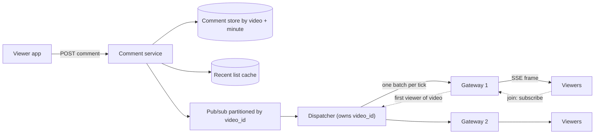

## In one minute
- **Fan out to gateways, not to viewers.** A comment on a stream with 5 million viewers should become a few hundred messages, one per gateway host that holds some of those viewers' sockets. The gateway does the last hop to each connection.
- **Nobody can read 10,000 comments a second.** Beyond about 10 to 20 per second the chat is a blur, so the system selects a ranked sample per viewer per tick and drops the rest from the live view. That cap, not the comment rate, sets delivery cost.
- **Batch by tick.** One frame per viewer per second, carrying up to a dozen comments, costs far less than a dozen frames. Serialize once per video per tick and reuse the bytes for every viewer.
- **Live delivery is best-effort; the store is the truth.** A viewer who drops a frame does not get it back over the socket. Every published comment is durable, keyed by video and video offset, so replay and moderation work from the store.
- **The write path must survive the spike.** A goal in a cup final produces a burst of 50x in two seconds. Accept, persist and publish asynchronously, and rate-limit per user so one script cannot flood a stream.

## Requirements

**Functional**
- Viewers of a live video post short text comments and see other viewers' comments appear within a couple of seconds.
- A viewer joining mid-stream sees the most recent comments immediately.
- After the stream ends, the recording replays comments in sync with the playhead.
- The author and moderators can delete comments; deleted comments disappear from live views and replays.
- A viewer always sees their own comment, and comments from friends or the streamer get priority in the live view.

**Non-functional**
- Post-to-screen latency under 2 seconds p95 for viewers in the same region.
- Scale from a stream with 3 viewers to one with 5 million, with no per-stream provisioning.
- No comment lost once the poster gets a success response, even if it never reached a live viewer.
- Order is roughly by server time; strict global order is not required.
- Availability over consistency: a gateway or region failure degrades the live feed, never the video.

**Out of scope:** the video pipeline itself (see Design YouTube and Media Streaming), reactions and like counters (see Distributed Counting), threaded replies, and the content classifiers behind moderation.

## Back-of-envelope
Round assumed numbers for a large social platform.

- **Concurrent viewers at peak:** 50M across about 1M live videos. The distribution is a power law: most streams have under 50 viewers, and the top stream has 5M.
- **Comment writes:** if a viewer posts once every 10 minutes on average, 50M / 600 ≈ 83k comments/s at peak. Daily average is about a third of peak, so roughly 28k/s, or 28k × 86,400 ≈ 2.4B comments a day.
- **Storage:** about 500 bytes per comment with metadata, so 2.4B × 500 B ≈ 1.2 TB a day, 1.2 TB × 365 × 5 ≈ 2.2 PB over five years before replication. Comments older than 30 days are rarely read, so they move to compressed cold storage.
- **Naive fan-out:** the top stream at 10k comments/s times 5M viewers is 5 × 10^10 deliveries per second. Not possible, and not useful.
- **Capped fan-out:** with one frame per viewer per second, 50M viewers is 50M frames/s. A frame of 10 comments is about 2 KB after JSON and compression, so egress is about 100 GB/s at peak, spread over every gateway.
- **Gateways:** at 250k sockets per host, 50M viewers need 200 hosts; plan 400 so a host can fail or drain without overloading its neighbours.
- **Dispatcher traffic:** the top stream reaches all 400 gateways, so one tick is 400 internal messages. Small streams live on one or two gateways, so internal fan-out stays in the low millions per second.

## API

```text
POST /v1/videos/{video_id}/comments
  { client_comment_id, text, video_offset_ms }
  -> 201 { comment_id, status: "published" | "held" }

GET  /v1/videos/{video_id}/comments/recent?limit=50
  -> { comments: [ { comment_id, author, text, video_offset_ms, server_ts } ], cursor }

GET  /v1/videos/{video_id}/comments/replay?from_ms=600000&to_ms=660000
  -> { comments: [...], next_from_ms }

DELETE /v1/videos/{video_id}/comments/{comment_id}     -> 204

GET  /v1/videos/{video_id}/live         (Server-Sent Events)
  event: batch
  id: 1832
  data: { tick: 1832, comments: [...], dropped: 412 }

  event: delete
  data: { comment_id }
```

`client_comment_id` makes a retried post idempotent. `video_offset_ms` is where the poster's playhead was, which is what replay keys on. The live stream uses SSE because traffic is almost all server to client; posting goes over normal HTTP, which reuses the platform's auth, rate limiting and abuse checks. Serve it over HTTP/2: over HTTP/1.1, browsers allow only 6 connections per domain, so a viewer with several tabs open starves their own page loads, while HTTP/2 multiplexes the streams on one connection ([MDN](https://developer.mozilla.org/en-US/docs/Web/API/Server-sent_events/Using_server-sent_events)). The `dropped` field lets the client show "and 400 more" without receiving them.

## Data model

**comments** lives in a wide-column store (Cassandra or similar). Partition key `(video_id, minute_bucket)`, clustering key `(video_offset_ms, comment_id)`. Columns: `author_id`, `text`, `server_ts`, `status` (published, held, deleted). Partitioning by video alone would put a hot stream's 10k writes/s on one replica set and make the partition unbounded; bucketing by minute of video time caps each partition and spreads a long stream over many. Replay reads one or two buckets at a time in offset order, which is a sequential scan.

**comment_dedupe** holds `(author_id, client_comment_id) -> comment_id` with a 24-hour TTL. A retry after a timeout returns the original id.

**recent_comments** is an in-memory list per video (Redis `LPUSH` plus `LTRIM` to 200, the capped-list idiom the Redis docs recommend ([Redis docs](https://redis.io/docs/latest/commands/ltrim/))). Joining viewers read it instead of hitting the comment store, which turns a "join storm" at stream start into cache reads.

**subscriptions** exist only in memory. Each gateway keeps `video_id -> set of connections`. Each dispatcher keeps `video_id -> {gateway_id: refcount}` for the videos it owns. They are rebuilt from gateways' re-subscribe calls after a restart, so they never need a database.

`comment_id` is a time-ordered 64-bit id (Snowflake-style, see Generating Unique IDs), so ids sort by creation time within a video.

## High-level design



**Write path.**
1. The app shows the comment locally at once (optimistic echo), then posts it.
2. The comment service authenticates, checks the per-user rate limit, deduplicates on `client_comment_id`, and runs a fast synchronous filter (block lists, link spam). Suspicious comments are stored as `held` and never published.
3. It writes the comment to the store with quorum, pushes it onto the recent list, and publishes `{video_id, comment}` to the pub/sub topic. Then it returns 201.
4. The dispatcher that owns this `video_id` (by consistent hashing) adds the comment to the video's pending buffer.

**Read path.**
1. A viewer opens the live page: the app fetches the recent list, then opens the SSE stream to a gateway chosen by the load balancer.
2. The gateway adds the connection to its local set for that video. If this is the gateway's first viewer of the video, it sends `subscribe(video_id, gateway_id)` to the owning dispatcher.
3. Every tick (1 second), the dispatcher picks up to `cap` comments from the pending buffer, ranks them, serializes one batch, and sends it to every subscribed gateway.
4. Each gateway writes the same frame bytes to every local connection watching that video, adding the viewer's own and friends' comments when it has them (see deep dive 2).
5. When the last local viewer leaves, the gateway unsubscribes, and the dispatcher stops sending.

## Deep dives

### 1. Routing comments to the right gateways
Option one is broadcast: every gateway receives every comment, 33M internal messages per second at 83k comments/s and 400 gateways, almost all thrown away. Option two is a pub/sub channel per video that gateways subscribe to directly (Redis pub/sub, for example). It works up to a point, but a broker with a million churning channels becomes the bottleneck, and gateways still receive every raw comment before any sampling.

I choose a dispatcher tier between the bus and the gateways. Slack's real-time stack has the same split: channel servers own channels by consistent hashing on the channel ID and forward each message to the gateway servers subscribed to that channel, which then deliver it to their own WebSocket clients ([Slack Engineering](https://slack.engineering/real-time-messaging/)). Videos are assigned to dispatchers by consistent hashing on `video_id`; the bus is partitioned the same way, so a dispatcher consumes only the partitions for the videos it owns. The dispatcher keeps a refcounted subscription table: gateway G is subscribed to video V while at least one viewer on G watches V. Refcounting matters because viewers join and leave constantly; the dispatcher should see one subscribe when G gets its first viewer of V and one unsubscribe when G loses its last, not a message per viewer. Discord applies the same idea inside its Erlang cluster: its Manifold library groups recipient processes by node and sends once per node, where local workers finish the delivery, after a single guild publish to 30,000 sessions had taken up to 2.1 seconds ([Discord](https://discord.com/blog/how-discord-scaled-elixir-to-5-000-000-concurrent-users)).

Where the subscription table lives is a real choice. I keep it in dispatcher memory and rebuild it from gateways after a failure. LinkedIn's live-video likes system keeps it in a shared key-value store instead, so any dispatcher can serve any video and a dispatcher crash loses nothing; it reports about 100,000 connections per frontend host, about 5,000 events per second per dispatcher, and about 75 ms p90 from dispatcher to client ([LinkedIn, QCon London 2020](https://www.infoq.com/presentations/linkedin-play-akka-distributed-systems/)). The shared store costs a lookup per publish; the in-memory table costs a rebuild storm after a crash.

For the top streams, sending 400 messages a tick is nothing. What can break is the inbound side, where 10k comments/s for one video land on one dispatcher; the fix is in Failure modes below.

### 2. Too many comments: sampling and ranking
At low volume, send everything. Above the cap, choose. Options: random sampling (fair, cheap, but shows spam and noise as often as good comments), first-come (biased to whoever has the lowest latency), or ranking. I rank by a score computed at write time: author reputation, whether the author is the streamer or a moderator, comment length and language match, and a spam probability. Within a tick, the top `cap` by score go out; ties go to the older comment so the feed reads roughly in time order. Comments older than a few seconds when the tick fires are dropped from the live view, since a comment about a goal arriving 15 seconds late is noise.

Personalization happens at the edge, because the dispatcher's batch is shared by millions. A viewer's own comment is echoed locally by the app. A friend's comment also travels over the platform's per-user notification channel to the friend's gateway, which merges it into that viewer's next frame; friend graphs are small next to stream audiences, so this is cheap.

Dropped comments are not lost. They are in the store and show up in replay and in the "all comments" view, which pages through the store instead of the live socket.

### 3. Replay in sync with the recording
During the live stream each comment is stamped with `video_offset_ms` from the poster's playhead. After the stream ends, the player asks for comments in windows of 60 seconds ahead of the playhead, using the `(video_id, minute_bucket)` partitions, and renders each comment when the playhead crosses its offset. Seeking discards the buffer and fetches the new window. Replay traffic is ordinary cacheable reads, so a CDN or read cache in front of the replay endpoint absorbs a recording that goes viral.

The subtle part is skew: viewers watch live with different delays, sometimes 20 seconds apart, so stamping the poster's playhead rather than server time makes replay line up with what the poster was reacting to. Deletes write a tombstone (`status = deleted`) instead of removing the row, which replay filters, and the live path broadcasts a `delete` event so clients remove the comment from screen.

## Down the stack

### Layer 1: The contract
- **Post.** A 201 means the comment is durable on a quorum of replicas and will appear in replay unless deleted. A retry with the same `client_comment_id` returns the same `comment_id`.
- **Live view.** At most one batch per tick per viewer, at most `cap` comments per batch, and no comment older than `max_age` at selection time. Delivery is best-effort: a dropped frame is not resent.
- **Subscriptions.** A gateway receives batches for video V exactly while it has at least one local viewer of V, give or take one tick.
- **Deletes.** A deleted comment is never selected for a later batch, never returned by replay, and is removed from screens that already show it within one tick.

### Layer 2: The mechanism
SSE is plain HTTP: the response has `Content-Type: text/event-stream` and stays open, and each event is lines of `event:`, `id:` and `data:` ended by a blank line. The browser's `EventSource` reconnects automatically and sends the last `id` in a `Last-Event-ID` header; here the server uses it only to avoid re-sending the same tick, not to replay missed ticks. Two more parts of the spec matter at this scale. A `retry:` field sets the client's reconnection delay, so the server can hand each client a randomized delay before a deploy and spread the reconnects. And because some proxies drop idle HTTP connections, the spec suggests sending a comment line (starting with `:`) about every 15 seconds as a keepalive ([WHATWG HTML Standard](https://html.spec.whatwg.org/multipage/server-sent-events.html)).

The bus can be Kafka with `video_id` as the partition key, so all comments for a video land on one partition in order and the owning dispatcher is a consumer of that partition ([Kafka docs](https://kafka.apache.org/intro)). The dispatcher's per-video state is a pending buffer, a subscription map with refcounts, and a min-heap of size `cap` for selection, which is O(n log cap) per tick. Gateways keep a hash map from `video_id` to a list of connection handles.

### Layer 3: The machine
- **Serialize once.** For a video with 25,000 local viewers on one gateway, the gateway builds the frame bytes once, then calls `write` (or `writev`) on 25,000 sockets. Each call is roughly 1 to 3 microseconds of kernel time, so 25k writes cost 25 to 75 ms of CPU per tick, spread over cores.
- **TLS cannot be shared.** Each connection has its own session keys, so the 2 KB frame is encrypted 25,000 times. AES-GCM with AES-NI runs at several GB/s per core, so 50 MB per tick is tens of milliseconds of one core. This, not JSON encoding, is the dominant per-viewer cost.
- **Bytes on the wire.** A 2 KB frame is two TCP segments at a 1,448-byte MSS. On an idle connection the congestion window is large enough to send both at once, so a frame costs one round trip at most.
- **Idle cost.** Each SSE connection holds kernel socket buffers (tunable down to a few KB when idle), TLS state, and the gateway's per-connection object: about 10 to 30 KB, so 250k connections fit in a few GB of RAM. `epoll_wait` lets a handful of threads wait on all of them.
- **Write path.** The comment store is an LSM tree: a write is a commit-log append and a memtable insert, flushed later to immutable SSTables ([Cassandra docs](https://cassandra.apache.org/doc/latest/cassandra/architecture/storage-engine.html)), so 83k writes/s across a cluster is routine.

### Why it's built this way
1. Humans read at most a few comments per second, so the live view is capped and ranked, and delivery cost follows viewers, not comments.
2. Sockets are spread across hundreds of gateways, so routing goes to gateways with viewers, refcounted, instead of to individual viewers.
3. TLS and syscalls cost per frame and per connection, so comments are batched into one frame per tick and serialized once.
4. Sampling and lossy delivery mean the live feed cannot be the record, so every comment is stored durably, keyed for replay.
5. Viewers sit at different points in the stream, so comments are keyed by video offset, not wall clock.

## Failure modes
- **10x burst (a goal, a reveal).** Writes spike in seconds. The comment service accepts and persists, and the dispatcher's cap keeps outbound cost flat. If the store lags, publish to the bus first and write to the store from a consumer, so live delivery does not wait on disk; the 201 then waits only on the bus's replicated append.
- **Hot video on one dispatcher.** Inbound comments for the top stream overwhelm its owner. Split ingest for that video across N dispatchers that each keep a local top-K and merge candidates once per tick (the two-stage shape from Design Top K), triggered automatically above a rate threshold.
- **Gateway restart or deploy.** Its viewers reconnect elsewhere and the new gateways re-subscribe. Drain gradually, have clients reconnect with jittered backoff, and serve joins from the recent-list cache so a reconnect storm does not hit the comment store. Never let the orchestrator remove more gateways at once than the rest can absorb: block scale-down until a node has drained (see In the wild).
- **Dispatcher failure.** Its videos move to the next node on the ring, gateways re-send their subscriptions, and viewers lose a few seconds of live comments, which the contract allows.
- **Region outage.** Viewers fail over with the video to another region. Comments replicate asynchronously across regions, so a few seconds of comments posted in the lost region may be missing from live views elsewhere, but they reappear in replay once the region recovers.
- **Spam raid.** A coordinated group floods a stream. Per-user and per-video rate limits, a slow mode the streamer can switch on (one comment per user per N seconds), and ranking that pushes new accounts down keep the visible feed usable.

## In the wild
- **Discord, 2017: one publish, 30,000 receivers.** Each Discord guild is an Erlang process that sends every event to every connected session. Busy guilds reached about 30,000 concurrent users, each send cost 30 to 70 microseconds, and one publish could take 900 ms to 2.1 s, so guilds fell behind at peak. Manifold groups recipients by node and sends one message per node, where partitioned workers deliver locally, spreading the CPU and cutting traffic between nodes. It is the gateway-level fan-out of this design ([Discord](https://discord.com/blog/how-discord-scaled-elixir-to-5-000-000-concurrent-users)).
- **Discord, 2026: a scale-down sets off a reconnect storm.** On 25 March a change that made session pods larger and fewer led Kubernetes to terminate half of them in one zone before they could hand off, ungracefully ending 17% of sessions. The reconnects hit a start-session rate limit that had not been retuned, gateway nodes ran out of memory, and voice syncer mailboxes backed up until instances dropped out of the hash ring. Voice and video were degraded for 3 hours 17 minutes. Discord added an admission webhook that blocks scale-down until pods drain, and retuned its rate limits ([Discord](https://discord.com/blog/behind-the-scenes-of-the-3-25-26-voice-outage)).
- **Shopify, 2022: a live map moves to SSE.** Shopify's Black Friday live map had pushed data over WebSocket into a store that browsers polled, so trending products could lag by minutes. The 2022 rebuild streamed from Kafka through a Go SSE server behind nginx, data reached clients within milliseconds of becoming available and appeared on the map within 21 seconds of being created, and the map had 100% uptime during the Black Friday to Cyber Monday weekend ([Shopify Engineering](https://shopify.engineering/server-sent-events-data-streaming)).

## Trade-offs

| Option | Strengths | Weaknesses | Choose when |
|---|---|---|---|
| SSE for live delivery | Plain HTTP, auto-reconnect, works through proxies | One direction only; needs HTTP/2 to avoid the 6-connection limit | Comments and other server push |
| WebSocket | Two-way, binary frames | Own reconnect logic, harder through some proxies | Interactive features on the same socket |
| Long polling | Works everywhere | A request per update, high overhead at 1/s | Fallback only |
| Send every comment | Complete, simple | Cost scales with comments × viewers | Streams under the cap |
| Ranked sample per tick | Bounded cost, better feed | Most comments never seen live | Large streams |
| Pub/sub channel per video | Simple, few moving parts | Broker strain with millions of channels | Small or medium scale |
| Dispatcher tier with refcounts | Gateway-level fan-out, scales to hot streams | Another tier to run and rebalance | Millions of concurrent streams |

## Leadership lens
- **Build first:** the durable write path with idempotency, the gateway with SSE, and the dispatcher with refcounted subscriptions, sending every comment with no cap. Add the per-tick cap and ranking when the first large stream needs it, then replay, then friend priority.
- **Team ownership:** a real-time infrastructure team owns gateways and dispatchers and offers them as a platform (the same tier serves typing indicators, live reactions and score updates). A comments team owns the write path, ranking and replay. Trust and safety owns the filters and moderation tools.
- **Cost drivers:** egress and TLS CPU on the gateways scale with viewers × ticks, so the tick interval and cap are the main cost levers. Storage is modest; cold-tier it after 30 days.
- **Rollout:** launch behind a flag on small streams, raise the cap and audience limits stepwise, and load-test with a synthetic 5M-viewer stream before a big event, not after.
- **Review questions:** what is the cap and who chose it; what happens to a held comment that a moderator approves late; how does a viewer find their friend's comment that was sampled out.

## Check yourself
1. Why is naive fan-out impossible for the top stream, and what bounds delivery cost instead?
   **Answer:** 10k comments/s times 5M viewers is 5 x 10^10 deliveries per second, which is neither possible nor useful because nobody can read that fast. Capping each viewer at one frame per tick with a ranked sample of up to `cap` comments makes cost follow viewers, about 50M frames/s and roughly 100 GB/s of egress at peak across all gateways.
2. Why put a dispatcher tier with refcounted subscriptions between the bus and the gateways instead of a pub/sub channel per video that gateways subscribe to directly?
   **Answer:** A broker with a million churning channels becomes the bottleneck, and gateways would still receive every raw comment before sampling. The dispatcher owns videos by consistent hashing, samples once per tick, and sends one batch per subscribed gateway, seeing only a subscribe on a gateway's first viewer and an unsubscribe on its last, at the cost of another tier to run and rebalance.
3. The top stream's inbound comments overwhelm the one dispatcher that owns it. What breaks and how is it fixed?
   **Answer:** All of that video's comments, 10k per second, land on its owning dispatcher. Above a rate threshold, ingest for that video is split across N dispatchers that each keep a local top-K and merge candidates once per tick, the two-stage shape from Design Top K.
4. Why is the comments table partitioned by `(video_id, minute_bucket)` and clustered by `video_offset_ms` rather than partitioned by video and ordered by server time?
   **Answer:** Partitioning by video alone would put a hot stream's 10k writes/s on one replica set and grow an unbounded partition; minute buckets cap each partition and spread a long stream. Keying by the poster's playhead offset lets replay line up with what the poster was reacting to, since live viewers can be 20 seconds apart, and replay reads one or two buckets sequentially.

## Practice
**Task:** Build the dispatcher's per-video relay. `CommentRelay(cap, max_age)` tracks which gateways watch each video and selects the batch for each tick. `join(video, gateway)` increments that gateway's refcount for the video and returns true only when it went from 0 to 1. `leave(video, gateway)` decrements it and returns true only when it reaches 0; leaving with a refcount of 0 does nothing and returns false. `post(video, comment_id, score, ts)` queues a comment and returns true, or returns false and queues nothing if that `comment_id` was ever posted to that video before. `flush(video, now)` returns the batch: `gateways` (subscribed gateways, sorted), `comments` (ids of the pending comments with `now - ts <= max_age`, ranked by score descending, then ts ascending, then id ascending, at most `cap`), and `dropped` (pending count minus comments sent); if no gateway is subscribed, `comments` is empty and everything pending counts as dropped. `flush` always empties that video's pending queue.

```python starter
class CommentRelay:
    def __init__(self, cap, max_age):
        self.cap = cap
        self.max_age = max_age

    def join(self, video, gateway):
        # TODO: refcount; True when it goes 0 -> 1
        raise NotImplementedError

    def leave(self, video, gateway):
        # TODO: True when it reaches 0
        raise NotImplementedError

    def post(self, video, comment_id, score, ts):
        # TODO: dedupe by comment_id per video
        raise NotImplementedError

    def flush(self, video, now):
        # TODO: return {"gateways": [...], "comments": [...], "dropped": n}
        raise NotImplementedError
```

```python tests
def test_refcounted_subscriptions():
    r = CommentRelay(10, 5)
    assert r.join("v", "g1") is True
    assert r.join("v", "g1") is False
    assert r.join("v", "g2") is True
    assert r.leave("v", "g1") is False
    assert r.leave("v", "g1") is True
    assert r.leave("v", "g1") is False, "already at zero"
    assert r.leave("x", "g9") is False

def test_flush_goes_to_sorted_gateways():
    r = CommentRelay(10, 5)
    r.join("v", "gB")
    r.join("v", "gA")
    r.post("v", "c1", 1, 100)
    assert r.flush("v", 100) == {"gateways": ["gA", "gB"], "comments": ["c1"], "dropped": 0}

def test_cap_ranks_by_score_then_ts_then_id():
    r = CommentRelay(2, 100)
    r.join("v", "g")
    r.post("v", "a", 5, 10)
    r.post("v", "b", 9, 11)
    r.post("v", "d", 5, 9)
    r.post("v", "c", 5, 9)
    assert r.flush("v", 12) == {"gateways": ["g"], "comments": ["b", "c"], "dropped": 2}

def test_stale_comments_are_dropped():
    r = CommentRelay(10, 5)
    r.join("v", "g")
    r.post("v", "old", 99, 0)
    r.post("v", "edge", 1, 5)
    r.post("v", "new", 1, 8)
    assert r.flush("v", 10) == {"gateways": ["g"], "comments": ["edge", "new"], "dropped": 1}

def test_duplicates_rejected_even_after_flush():
    r = CommentRelay(10, 5)
    r.join("v", "g")
    assert r.post("v", "c1", 1, 1) is True
    assert r.post("v", "c1", 1, 1) is False
    assert r.flush("v", 2)["comments"] == ["c1"]
    assert r.post("v", "c1", 1, 3) is False
    assert r.post("w", "c1", 1, 3) is True, "dedupe is per video"
    assert r.flush("v", 3) == {"gateways": ["g"], "comments": [], "dropped": 0}

def test_no_gateways_drops_everything():
    r = CommentRelay(10, 5)
    r.post("v", "c1", 1, 1)
    r.post("v", "c2", 1, 1)
    assert r.flush("v", 1) == {"gateways": [], "comments": [], "dropped": 2}

def test_flush_empties_queue_per_video():
    r = CommentRelay(10, 5)
    r.join("v1", "g")
    r.join("v2", "g")
    r.post("v1", "a", 1, 1)
    r.post("v2", "b", 1, 1)
    assert r.flush("v1", 1)["comments"] == ["a"]
    assert r.flush("v1", 1) == {"gateways": ["g"], "comments": [], "dropped": 0}
    assert r.flush("v2", 1)["comments"] == ["b"]
```

```python solution
class CommentRelay:
    def __init__(self, cap, max_age):
        self.cap = cap
        self.max_age = max_age
        self._subs = {}
        self._pending = {}
        self._seen = {}

    def join(self, video, gateway):
        subs = self._subs.setdefault(video, {})
        n = subs.get(gateway, 0)
        subs[gateway] = n + 1
        return n == 0

    def leave(self, video, gateway):
        subs = self._subs.get(video, {})
        n = subs.get(gateway, 0)
        if n == 0:
            return False
        if n == 1:
            del subs[gateway]
            return True
        subs[gateway] = n - 1
        return False

    def post(self, video, comment_id, score, ts):
        seen = self._seen.setdefault(video, set())
        if comment_id in seen:
            return False
        seen.add(comment_id)
        self._pending.setdefault(video, []).append((comment_id, score, ts))
        return True

    def flush(self, video, now):
        gateways = sorted(self._subs.get(video, {}).keys())
        pending = self._pending.pop(video, [])
        chosen = []
        if gateways:
            fresh = [c for c in pending if now - c[2] <= self.max_age]
            fresh.sort(key=lambda c: (-c[1], c[2], c[0]))
            chosen = [c[0] for c in fresh[: self.cap]]
        return {"gateways": gateways, "comments": chosen, "dropped": len(pending) - len(chosen)}
```

```typescript starter
export interface Batch {
  gateways: string[];
  comments: string[];
  dropped: number;
}

export class CommentRelay {
  constructor(public cap: number, public maxAge: number) {}

  join(video: string, gateway: string): boolean {
    throw new Error("TODO");
  }

  leave(video: string, gateway: string): boolean {
    throw new Error("TODO");
  }

  post(video: string, commentId: string, score: number, ts: number): boolean {
    throw new Error("TODO");
  }

  flush(video: string, now: number): Batch {
    throw new Error("TODO");
  }
}
```

```typescript tests
test("refcounted subscriptions", () => {
  const r = new CommentRelay(10, 5);
  assertEqual(r.join("v", "g1"), true);
  assertEqual(r.join("v", "g1"), false);
  assertEqual(r.join("v", "g2"), true);
  assertEqual(r.leave("v", "g1"), false);
  assertEqual(r.leave("v", "g1"), true);
  assertEqual(r.leave("v", "g1"), false, "already at zero");
  assertEqual(r.leave("x", "g9"), false);
});

test("flush goes to sorted gateways", () => {
  const r = new CommentRelay(10, 5);
  r.join("v", "gB");
  r.join("v", "gA");
  r.post("v", "c1", 1, 100);
  assertEqual(r.flush("v", 100), { gateways: ["gA", "gB"], comments: ["c1"], dropped: 0 });
});

test("cap ranks by score then ts then id", () => {
  const r = new CommentRelay(2, 100);
  r.join("v", "g");
  r.post("v", "a", 5, 10);
  r.post("v", "b", 9, 11);
  r.post("v", "d", 5, 9);
  r.post("v", "c", 5, 9);
  assertEqual(r.flush("v", 12), { gateways: ["g"], comments: ["b", "c"], dropped: 2 });
});

test("stale comments are dropped", () => {
  const r = new CommentRelay(10, 5);
  r.join("v", "g");
  r.post("v", "old", 99, 0);
  r.post("v", "edge", 1, 5);
  r.post("v", "new", 1, 8);
  assertEqual(r.flush("v", 10), { gateways: ["g"], comments: ["edge", "new"], dropped: 1 });
});

test("duplicates rejected even after flush", () => {
  const r = new CommentRelay(10, 5);
  r.join("v", "g");
  assertEqual(r.post("v", "c1", 1, 1), true);
  assertEqual(r.post("v", "c1", 1, 1), false);
  assertEqual(r.flush("v", 2).comments, ["c1"]);
  assertEqual(r.post("v", "c1", 1, 3), false);
  assertEqual(r.post("w", "c1", 1, 3), true, "dedupe is per video");
  assertEqual(r.flush("v", 3), { gateways: ["g"], comments: [], dropped: 0 });
});

test("no gateways drops everything", () => {
  const r = new CommentRelay(10, 5);
  r.post("v", "c1", 1, 1);
  r.post("v", "c2", 1, 1);
  assertEqual(r.flush("v", 1), { gateways: [], comments: [], dropped: 2 });
});

test("flush empties queue per video", () => {
  const r = new CommentRelay(10, 5);
  r.join("v1", "g");
  r.join("v2", "g");
  r.post("v1", "a", 1, 1);
  r.post("v2", "b", 1, 1);
  assertEqual(r.flush("v1", 1).comments, ["a"]);
  assertEqual(r.flush("v1", 1), { gateways: ["g"], comments: [], dropped: 0 });
  assertEqual(r.flush("v2", 1).comments, ["b"]);
});
```

```typescript solution
export interface Batch {
  gateways: string[];
  comments: string[];
  dropped: number;
}

interface Pending {
  id: string;
  score: number;
  ts: number;
}

export class CommentRelay {
  private subs = new Map<string, Map<string, number>>();
  private pending = new Map<string, Pending[]>();
  private seen = new Map<string, Set<string>>();

  constructor(public cap: number, public maxAge: number) {}

  join(video: string, gateway: string): boolean {
    let subs = this.subs.get(video);
    if (!subs) {
      subs = new Map();
      this.subs.set(video, subs);
    }
    const n = subs.get(gateway) ?? 0;
    subs.set(gateway, n + 1);
    return n === 0;
  }

  leave(video: string, gateway: string): boolean {
    const subs = this.subs.get(video);
    const n = subs?.get(gateway) ?? 0;
    if (!subs || n === 0) return false;
    if (n === 1) {
      subs.delete(gateway);
      return true;
    }
    subs.set(gateway, n - 1);
    return false;
  }

  post(video: string, commentId: string, score: number, ts: number): boolean {
    let seen = this.seen.get(video);
    if (!seen) {
      seen = new Set();
      this.seen.set(video, seen);
    }
    if (seen.has(commentId)) return false;
    seen.add(commentId);
    const q = this.pending.get(video) ?? [];
    q.push({ id: commentId, score, ts });
    this.pending.set(video, q);
    return true;
  }

  flush(video: string, now: number): Batch {
    const gateways = [...(this.subs.get(video)?.keys() ?? [])].sort();
    const pending = this.pending.get(video) ?? [];
    this.pending.delete(video);
    let comments: string[] = [];
    if (gateways.length > 0) {
      const fresh = pending.filter((c) => now - c.ts <= this.maxAge);
      fresh.sort((x, y) =>
        y.score - x.score || x.ts - y.ts || (x.id < y.id ? -1 : x.id > y.id ? 1 : 0)
      );
      comments = fresh.slice(0, this.cap).map((c) => c.id);
    }
    return { gateways, comments, dropped: pending.length - comments.length };
  }
}
```

```go starter
package practice

type Batch struct {
	Gateways []string
	Comments []string
	Dropped  int
}

type CommentRelay struct {
	Cap    int
	MaxAge int
}

func NewCommentRelay(cap, maxAge int) *CommentRelay {
	return &CommentRelay{Cap: cap, MaxAge: maxAge}
}

func (r *CommentRelay) Join(video, gateway string) bool { panic("TODO") }

func (r *CommentRelay) Leave(video, gateway string) bool { panic("TODO") }

func (r *CommentRelay) Post(video, commentID string, score, ts int) bool { panic("TODO") }

func (r *CommentRelay) Flush(video string, now int) Batch { panic("TODO") }
```

```go tests
package practice

import (
	"reflect"
	"testing"
)

func TestRefcountedSubscriptions(t *testing.T) {
	r := NewCommentRelay(10, 5)
	got := []bool{
		r.Join("v", "g1"), r.Join("v", "g1"), r.Join("v", "g2"),
		r.Leave("v", "g1"), r.Leave("v", "g1"), r.Leave("v", "g1"), r.Leave("x", "g9"),
	}
	want := []bool{true, false, true, false, true, false, false}
	if !reflect.DeepEqual(got, want) {
		t.Fatalf("got %v want %v", got, want)
	}
}

func TestFlushGoesToSortedGateways(t *testing.T) {
	r := NewCommentRelay(10, 5)
	r.Join("v", "gB")
	r.Join("v", "gA")
	r.Post("v", "c1", 1, 100)
	want := Batch{[]string{"gA", "gB"}, []string{"c1"}, 0}
	if got := r.Flush("v", 100); !reflect.DeepEqual(got, want) {
		t.Fatalf("got %v", got)
	}
}

func TestCapRanksByScoreThenTsThenID(t *testing.T) {
	r := NewCommentRelay(2, 100)
	r.Join("v", "g")
	r.Post("v", "a", 5, 10)
	r.Post("v", "b", 9, 11)
	r.Post("v", "d", 5, 9)
	r.Post("v", "c", 5, 9)
	want := Batch{[]string{"g"}, []string{"b", "c"}, 2}
	if got := r.Flush("v", 12); !reflect.DeepEqual(got, want) {
		t.Fatalf("got %v", got)
	}
}

func TestStaleCommentsAreDropped(t *testing.T) {
	r := NewCommentRelay(10, 5)
	r.Join("v", "g")
	r.Post("v", "old", 99, 0)
	r.Post("v", "edge", 1, 5)
	r.Post("v", "new", 1, 8)
	want := Batch{[]string{"g"}, []string{"edge", "new"}, 1}
	if got := r.Flush("v", 10); !reflect.DeepEqual(got, want) {
		t.Fatalf("got %v", got)
	}
}

func TestDuplicatesRejectedEvenAfterFlush(t *testing.T) {
	r := NewCommentRelay(10, 5)
	r.Join("v", "g")
	if !r.Post("v", "c1", 1, 1) || r.Post("v", "c1", 1, 1) {
		t.Fatal("second post should be rejected")
	}
	if got := r.Flush("v", 2).Comments; !reflect.DeepEqual(got, []string{"c1"}) {
		t.Fatalf("got %v", got)
	}
	if r.Post("v", "c1", 1, 3) {
		t.Fatal("still a duplicate after flush")
	}
	if !r.Post("w", "c1", 1, 3) {
		t.Fatal("dedupe is per video")
	}
	want := Batch{[]string{"g"}, []string{}, 0}
	if got := r.Flush("v", 3); !reflect.DeepEqual(got, want) {
		t.Fatalf("got %v", got)
	}
}

func TestNoGatewaysDropsEverything(t *testing.T) {
	r := NewCommentRelay(10, 5)
	r.Post("v", "c1", 1, 1)
	r.Post("v", "c2", 1, 1)
	want := Batch{[]string{}, []string{}, 2}
	if got := r.Flush("v", 1); !reflect.DeepEqual(got, want) {
		t.Fatalf("got %v", got)
	}
}

func TestFlushEmptiesQueuePerVideo(t *testing.T) {
	r := NewCommentRelay(10, 5)
	r.Join("v1", "g")
	r.Join("v2", "g")
	r.Post("v1", "a", 1, 1)
	r.Post("v2", "b", 1, 1)
	if got := r.Flush("v1", 1).Comments; !reflect.DeepEqual(got, []string{"a"}) {
		t.Fatalf("got %v", got)
	}
	want := Batch{[]string{"g"}, []string{}, 0}
	if got := r.Flush("v1", 1); !reflect.DeepEqual(got, want) {
		t.Fatalf("got %v", got)
	}
	if got := r.Flush("v2", 1).Comments; !reflect.DeepEqual(got, []string{"b"}) {
		t.Fatalf("got %v", got)
	}
}
```

```go solution
package practice

import "sort"

type Batch struct {
	Gateways []string
	Comments []string
	Dropped  int
}

type pendingComment struct {
	id    string
	score int
	ts    int
}

type CommentRelay struct {
	Cap     int
	MaxAge  int
	subs    map[string]map[string]int
	pending map[string][]pendingComment
	seen    map[string]map[string]bool
}

func NewCommentRelay(cap, maxAge int) *CommentRelay {
	return &CommentRelay{
		Cap:     cap,
		MaxAge:  maxAge,
		subs:    map[string]map[string]int{},
		pending: map[string][]pendingComment{},
		seen:    map[string]map[string]bool{},
	}
}

func (r *CommentRelay) Join(video, gateway string) bool {
	subs, ok := r.subs[video]
	if !ok {
		subs = map[string]int{}
		r.subs[video] = subs
	}
	n := subs[gateway]
	subs[gateway] = n + 1
	return n == 0
}

func (r *CommentRelay) Leave(video, gateway string) bool {
	subs := r.subs[video]
	n := subs[gateway]
	switch {
	case n == 0:
		return false
	case n == 1:
		delete(subs, gateway)
		return true
	default:
		subs[gateway] = n - 1
		return false
	}
}

func (r *CommentRelay) Post(video, commentID string, score, ts int) bool {
	seen, ok := r.seen[video]
	if !ok {
		seen = map[string]bool{}
		r.seen[video] = seen
	}
	if seen[commentID] {
		return false
	}
	seen[commentID] = true
	r.pending[video] = append(r.pending[video], pendingComment{commentID, score, ts})
	return true
}

func (r *CommentRelay) Flush(video string, now int) Batch {
	gateways := []string{}
	for g := range r.subs[video] {
		gateways = append(gateways, g)
	}
	sort.Strings(gateways)
	pending := r.pending[video]
	delete(r.pending, video)
	comments := []string{}
	if len(gateways) > 0 {
		fresh := []pendingComment{}
		for _, c := range pending {
			if now-c.ts <= r.MaxAge {
				fresh = append(fresh, c)
			}
		}
		sort.Slice(fresh, func(i, j int) bool {
			a, b := fresh[i], fresh[j]
			if a.score != b.score {
				return a.score > b.score
			}
			if a.ts != b.ts {
				return a.ts < b.ts
			}
			return a.id < b.id
		})
		for i := 0; i < len(fresh) && i < r.Cap; i++ {
			comments = append(comments, fresh[i].id)
		}
	}
	return Batch{gateways, comments, len(pending) - len(comments)}
}
```

## Mock interview
**Prompt:** Design live comments for a social platform's live video. Assume 50 million concurrent viewers across a million streams at peak, with the largest stream at 5 million viewers and 10,000 comments a second during its busiest moments. Comments should appear for other viewers within two seconds.

- Follow-up: Walk me through exactly which machines a single comment touches on the biggest stream, and how many messages that produces.
- Follow-up: A gateway holding 250,000 sockets is killed during the cup final. What happens to those viewers and to the dispatcher's state?
- Follow-up: Your product manager wants every viewer to see every comment from their friends, even on the 5-million-viewer stream. How do you add that without breaking the shared batch?

**A strong answer covers:**
- Gateway-level fan-out through a dispatcher keyed by `video_id`, with refcounted subscriptions so viewer churn does not reach the dispatcher.
- A per-tick cap with ranking, one frame per viewer per tick, serialize once and write to many sockets, and the per-connection TLS cost.
- A durable, idempotent write path that is separate from best-effort live delivery, with storage keyed for replay by video offset.
- Hot-stream handling: split ingest with local top-K and merge, plus rate limits and slow mode for spam.
- Reconnect storms after gateway loss: jittered backoff, a recent-comments cache for joins, and subscriptions rebuilt from gateways.

## Sources and further study
**Primary**
- [Server-sent events, WHATWG HTML Standard](https://html.spec.whatwg.org/multipage/server-sent-events.html): the normative event-stream format, `retry`, `Last-Event-ID` and keepalive advice.
- [RFC 9113: HTTP/2](https://www.rfc-editor.org/rfc/rfc9113): stream multiplexing, which is what lifts the per-domain connection limit for SSE.

**Systems docs**
- [Using server-sent events (MDN)](https://developer.mozilla.org/en-US/docs/Web/API/Server-sent_events/Using_server-sent_events): the browser API and the 6-connection limit over HTTP/1.1.
- [Apache Kafka introduction](https://kafka.apache.org/intro): keyed partitions and the per-partition ordering the dispatcher relies on.
- [Cassandra storage engine](https://cassandra.apache.org/doc/latest/cassandra/architecture/storage-engine.html): the commit log, memtable and SSTable write path behind the comment store.

**Books**
- *High Performance Browser Networking*, Ilya Grigorik, chapter 16 "Server-Sent Events (SSE)": the protocol, its overhead and when to choose it over WebSocket ([read free](https://hpbn.co/server-sent-events-sse/)).
- *Site Reliability Engineering*, Beyer et al. (Google), chapter 22 "Addressing Cascading Failures": slow startup, cold caches and retry storms, the failure mode behind reconnect storms.

**Other curricula**
- [Azure Architecture Center: Publisher-Subscriber pattern](https://learn.microsoft.com/en-us/azure/architecture/patterns/publisher-subscriber): frames live fan-out as topics and subscriptions decoupling one sender from many receivers.
- [donnemartin/system-design-primer](https://github.com/donnemartin/system-design-primer): covers the building blocks (asynchronism, caching, consistent hashing) but not live comments, so pair it with the LinkedIn and Slack write-ups.

## Watch
- [System Design Interview: Design Live Comments w/ a Ex-Meta Staff Engineer (Hello Interview)](https://www.youtube.com/watch?v=LjLx0fCd1k8): a full mock interview covering SSE versus WebSockets and how to route comments to the right servers.
- [Design Live Comments Feature: System Design Interview with a Meta Engineer (interviewing.io)](https://www.youtube.com/watch?v=NWRqJFZ0rbY): a recorded mock with interviewer feedback on scaling the fan-out.

## Free resources
- [Streaming a Million Likes/Second: Real-Time Interactions on Live Video (InfoQ)](https://www.infoq.com/presentations/linkedin-play-akka-distributed-systems/): LinkedIn's talk on routing live likes and comments to connected viewers through a subscription-aware dispatcher.
- [Instant Messaging at LinkedIn: Scaling to Hundreds of Thousands of Persistent Connections on One Machine (LinkedIn Engineering)](https://www.linkedin.com/blog/engineering/archive/instant-messaging-at-linkedin-scaling-to-hundreds-of-thousands-): how they hold SSE connections on Play and Akka, with the kernel tuning involved.
- [Server-sent events (WHATWG HTML Standard)](https://html.spec.whatwg.org/multipage/server-sent-events.html): the framing rules, reconnection behaviour and `Last-Event-ID`.
- [Real-time Messaging (Engineering at Slack)](https://slack.engineering/real-time-messaging/): Slack's channel servers and gateway servers, a close cousin of the dispatcher and gateway split here.
- [FB Live Comments breakdown (Hello Interview)](https://www.hellointerview.com/learn/system-design/problem-breakdowns/fb-live-comments): a written walkthrough of the same interview question to compare against.
