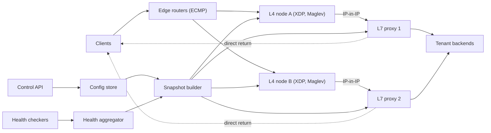

## In one minute
- **Build two tiers, not one.** A thin layer 4 (L4) tier forwards packets to a fleet of layer 7 (L7) proxies, which terminate TLS and route requests. The L4 tier is cheap per packet; the L7 tier is expensive per request. Each scales on its own bottleneck.
- **Make the L4 tier nearly stateless with a shared consistent hash.** Routers spread packets across L4 nodes with ECMP. Every node builds the same Maglev lookup table from the same backend list, so when routers reshuffle flows between L4 nodes, the new node still picks the same backend and the connection survives.
- **Pair the hash with a local connection table.** Each L4 node remembers recent flows so an established connection keeps its backend when the backend set changes; Maglev calls this table its primary protection against backend changes ([Maglev paper](https://www.usenix.org/system/files/conference/nsdi16/nsdi16-paper-eisenbud.pdf)). Losing the table is survivable because the hash is consistent.
- **Health checking is a distributed system of its own.** Centralise active probing, combine it with passive signals, and cap how much of a pool can be ejected. A load balancer that removes every backend during a partial outage turns a brownout into a blackout.
- **Send responses around the balancer.** With direct server return, responses, which are typically much larger than requests, go straight from the proxy to the client, so the L4 tier only carries inbound bytes ([Maglev paper](https://www.usenix.org/system/files/conference/nsdi16/nsdi16-paper-eisenbud.pdf)).

## Requirements

**Functional**
- Tenants create load balancers with a virtual IP (VIP) and listeners for TCP, UDP and HTTPS ports.
- Each listener sends traffic to a target group: a set of backends with weights, an algorithm and a health check.
- Register and deregister targets through an API, with connection draining on removal and slow start on addition.
- L7 listeners route by host and path, terminate TLS with tenant certificates, and add `X-Forwarded-For` headers.
- Per-target health status and metrics visible to tenants.

**Non-functional**
- Data plane availability of 99.99% per VIP. A single L4 node, L7 node or rack failure must not reset more than a small fraction of connections.
- Added latency under 50 µs at L4 and under 1 ms p50 at L7 (excluding TLS handshakes).
- A target change (register, deregister, health flip) takes effect on every node within 5 seconds.
- Long-lived connections (WebSockets, gRPC streams, database sessions) survive scaling of the balancer itself.

**Out of scope**
- Global traffic steering between regions (see DNS Load Balancing and Anycast Routing), a web application firewall, and DDoS scrubbing beyond basic SYN protection.

## Back-of-envelope
Design for one large region. The numbers are planning assumptions, not any provider's figures.

- **Inbound traffic:** 400 Gbit/s at peak. At an average inbound packet of 500 bytes, that is 50 GB/s ÷ 500 B = 100M packets per second through the L4 tier. Outbound traffic, perhaps 2 to 4 Tbit/s, bypasses it with direct server return.
- **L4 nodes:** budget 10M packets per second per node (the Maglev paper measured an upper bound slightly above 15M per machine in 2016, and sized its forwarder for 9.06M at 100-byte packets on a 10 Gbit/s NIC ([Maglev paper](https://www.usenix.org/system/files/conference/nsdi16/nsdi16-paper-eisenbud.pdf))). 100M ÷ 10M = 10 nodes; at 50% target utilisation plus spares, about 24 nodes.
- **Connection tracking:** 100M concurrent flows across the region. Each L4 node sees about 1/24 of them, about 4.2M flows. At roughly 64 bytes per entry that is about 270 MB per node, well within memory.
- **L7 nodes:** 5M HTTPS requests per second at peak. At roughly 4,000 requests per second per core, a 16-core node does about 30,000 at 50% load. 5M ÷ 30,000 ≈ 170 nodes.
- **Lookup tables:** the Maglev paper recommends a prime table size M larger than 100 × N for N backends, which keeps every backend's share within about 1%. A 20-backend pool needs M ≥ 2,003 (8 KB at 4 bytes per entry); a 600-backend pool needs 65,537 (256 KB). With 10,000 VIPs of mixed sizes the tables total a few hundred MB per node.
- **Health checks:** 20,000 backends. If each of 170 L7 nodes probed every backend every 2 seconds, that is 20,000 × 170 ÷ 2 = 1.7M probes per second, and each backend would answer 85 probes per second. Three central checkers per zone cut that to about 1.5 probes per second per backend.

## API
The data plane has no API: it is the VIP. The control plane looks like a cloud load-balancer API.

```
POST /v1/load-balancers
  { "name": "checkout", "listeners": [
      { "port": 443, "protocol": "HTTPS", "cert_id": "c-91", "default_target_group": "tg-7" },
      { "port": 5432, "protocol": "TCP", "default_target_group": "tg-8" } ] }
  -> 201 { "lb_id": "lb-12", "vip": "203.0.113.10", "dns_name": "lb-12.region.lb.example" }

POST /v1/target-groups
  { "protocol": "HTTP", "port": 8080, "algorithm": "p2c_least_request",
    "health_check": { "path": "/healthz", "interval_s": 2, "timeout_ms": 1000,
                      "healthy_threshold": 2, "unhealthy_threshold": 3 },
    "slow_start_s": 30, "deregistration_delay_s": 60 }
  -> 201 { "tg_id": "tg-7" }

PUT    /v1/target-groups/tg-7/targets   { "targets": [{ "ip": "10.1.4.21", "port": 8080, "weight": 100 }] }
DELETE /v1/target-groups/tg-7/targets/10.1.4.21:8080   -> 202 { "state": "draining", "until": "..." }
GET    /v1/target-groups/tg-7/health   -> 200 [{ "target": "10.1.4.21:8080", "state": "healthy", "reason": null }]
```

Deregistration returns 202 because removal is a process: the target stops getting new work immediately and is dropped once its connections finish or the drain deadline passes.

## Data model
- **load_balancers, listeners, target_groups, targets** (a strongly consistent store such as Postgres or etcd). `targets` has primary key `(tg_id, ip, port)` and columns `weight`, `admin_state` (`active`, `draining`, `removed`) and `drain_deadline`. The data is small, changes at hundreds of writes per second during deploys, and needs transactions so a listener can't point at a deleted target group. One store per region, no partitioning.
- **config_versions**: a monotonically increasing version per region with the hash of each compiled snapshot. Nodes report the version they serve, which makes "has my change reached everywhere?" a query.
- **Health state** is deliberately not in the database. It changes constantly and is rebuilt from probes after a restart, so checkers keep it in memory and stream it to an aggregator.
- **Node snapshots** are the data plane's only state: for each VIP, the sorted backend list, weights and health, and the Maglev table built from them. L4 nodes also hold a per-CPU connection table, an LRU hash keyed by the 5-tuple.

## High-level design



**Packet path.** Every L4 node announces each VIP to the edge routers over BGP, so the routers treat the nodes as equal-cost next hops and hash each packet's 5-tuple to pick one. The L4 node looks the flow up in its connection table; on a miss it hashes the 5-tuple into the VIP's Maglev table to choose an L7 proxy and records the choice. It wraps the packet in an outer IP header addressed to that proxy and sends it back out. The proxy, which has the VIP configured on a loopback interface, strips the outer header, terminates TCP and TLS, picks a tenant backend per request with its own algorithm, and sends the response straight to the client with the VIP as the source address.

**Config path.** A deregistration writes `admin_state = draining` and bumps the config version. The snapshot builder rebuilds the Maglev tables of affected VIPs only and streams the delta to every node, which swaps a pointer. Health flips take the same path from the aggregator.

## Deep dives

### 1. Keeping flows on the same backend across a changing fleet
Three things change underneath a live TCP connection: the set of L4 nodes, the set of backends, and the router's ECMP hash. A connection survives only if its packets keep reaching the same backend.

**Option A: shared connection state.** Replicate the flow table across L4 nodes. Exact affinity, but every new flow becomes a cross-node write at millions per second.

**Option B: a consistent hash alone.** If every node computes the backend from the 5-tuple with the same function, an ECMP reshuffle doesn't matter. But a plain `hash mod N` remaps almost every flow when N changes, and a hash ring with virtual nodes (see Consistent Hashing) costs a binary search and pointer-heavy memory per lookup at 10M packets per second.

**Option C: Maglev table plus a local connection table.** This is what Google's Maglev and Facebook's Katran do; Katran's README describes a fixed-size LRU connection table and a modified Maglev hash that supports unequal weights ([Katran](https://github.com/facebookincubator/katran)). Each backend gets a pseudo-random preference order over the M table slots, derived from two hashes of its name (`offset` and `skip`), and backends take turns claiming their next free preferred slot until the table is full. Lookup is one array index. Each backend owns either ⌊M/N⌋ or ⌈M/N⌉ slots, so load is balanced to within one slot. Removing a backend mostly reassigns only that backend's slots; a few others shift because the turn order changes. The connection table covers the rest: a flow already in the table keeps its backend even if the new Maglev table disagrees.

**Choice:** Option C. A connection breaks only when two things happen at once: its packets move to a different L4 node (which has no table entry) and the Maglev entry for its hash changed. Both are rare, and their coincidence is rarer. One detail matters: the table depends on the order in which backends take turns, so every node must sort backends by name before building, or two nodes with the same set build different tables.

**A stateless alternative.** GitHub's GLB Director and Cloudflare's Unimog keep no per-flow table in the balancer at all. Each table bucket names a current and a previous server, and a server that receives a mid-connection packet it has no socket for forwards it to the previous one ([GitHub GLB](https://github.blog/engineering/infrastructure/glb-director-open-source-load-balancer/), [Unimog](https://blog.cloudflare.com/unimog-cloudflares-edge-load-balancer/)). This moves the state to the servers that already hold it, at the cost of an extra hop during changes and a limit of one change per bucket at a time.

### 2. Health checking without self-inflicted outages
The basics (active probes with rise and fall thresholds, passive outlier ejection, draining) are covered in What are Load Balancers?. At this scale the design questions are different.

**Who probes.** If every proxy probes every backend, probes become load (1.7M per second above) and each proxy forms its own opinion, so a backend can be up on half the fleet and down on the other. I'd run a few checkers per zone, mark a backend down when a majority of zones agree, and push one health view to every node. Proxies still apply fast passive ejection locally. AWS makes the same argument: let a central actor decide, so the whole fleet never makes the same wrong decision at once ([AWS Builders' Library](https://builder.aws.com/content/3Ev53O39izHCtWLzp4XU6t8PC1O/implementing-health-checks)). The same arithmetic applies to connections: 170 proxies each holding pools to thousands of backends wastes memory and CPU on both ends, so Google's SRE book has each client connect to a deterministic subset of 20 to 100 backends ([Google SRE book, ch. 20](https://sre.google/sre-book/load-balancing-datacenter/)).

**What a probe means.** A deep check that also calls the backend's database fails on every backend at once when the database is slow, and the balancer ejects the whole pool. Probes should check the process; dependency health belongs in metrics and alerts.

**Failing safe.** Two guards stop the balancer from amplifying an outage. First, cap ejection: Envoy's outlier detection ejects at most 10% of a cluster by default ([Envoy docs](https://www.envoyproxy.io/docs/envoy/latest/api-v3/config/cluster/v3/outlier_detection.proto)). Second, a panic threshold: when fewer than 50% of a pool's backends are healthy (Envoy's default), ignore health entirely and spread traffic across all of them, on the theory that a degraded backend serves some requests and a removed one serves none ([Envoy panic threshold](https://www.envoyproxy.io/docs/envoy/latest/intro/arch_overview/upstream/load_balancing/panic_threshold)). AWS load balancers do the same and call it failing open ([AWS ALB docs](https://docs.aws.amazon.com/elasticloadbalancing/latest/application/edit-target-group-attributes.html)). New backends get slow start, a weight that ramps up over 30 seconds.

### 3. The return path, encapsulation and draining
**Direct server return.** If responses passed back through the L4 tier it would need to carry 2 to 4 Tbit/s instead of 400 Gbit/s. With DSR the proxy replies directly. That requires the L4 node to deliver the packet with the original destination (the VIP) intact, so it encapsulates rather than rewriting addresses: GRE in Maglev, IP-in-IP in Katran. The outer header costs 20 bytes (IP-in-IP) or 24 bytes (GRE), so a 1,500-byte client packet becomes too large for a 1,500-byte data-centre MTU. Either run the data-centre network at a larger MTU (Cloudflare uses jumbo frames for this) or clamp the TCP MSS the proxies advertise, which Katran recommends even with a larger MTU because it cannot forward fragmented packets ([Katran](https://github.com/facebookincubator/katran)).

**Draining.** An L4 node leaves by withdrawing its BGP route and staying up until the routers converge. An L7 proxy leaves by dropping out of the Maglev input (no new flows), sending HTTP/2 `GOAWAY` on open connections, and waiting up to the deregistration delay. Google calls this the lame duck state and suggests 10 to 150 seconds before exit ([Google SRE book, ch. 20](https://sre.google/sre-book/load-balancing-datacenter/)); AWS's default deregistration delay is 300 seconds ([AWS ALB docs](https://docs.aws.amazon.com/elasticloadbalancing/latest/application/edit-target-group-attributes.html)). Without this, every deploy shows up as a burst of resets.

## Down the stack

### Layer 1: The contract
Every packet of a TCP flow reaches the same L7 proxy for the flow's lifetime, as long as that proxy stays in the pool and at most one of {L4 node membership, backend membership} changes at a time. New flows go only to backends the aggregated health view considers up, within 5 seconds of a change, unless the pool is in panic mode. Each backend receives within about 1% of its weighted share of new flows. Packets the L4 tier cannot place (no backends at all) are dropped rather than queued, so clients see a timeout or a reset, never a stall inside the balancer. Added latency is tens of microseconds at L4.

### Layer 2: The mechanism
For each backend name the table builder computes `offset = h1(name) mod M` and `skip = h2(name) mod (M - 1) + 1`, so backend `i`'s preference list is `(offset + j × skip) mod M` for `j = 0, 1, 2, ...`. Because M is prime, every `skip` is coprime with M and each list visits every slot exactly once. The builder loops over backends in sorted order, each claiming its next unclaimed preferred slot, until all M slots are full. The Maglev paper reports building a 65,537-entry table in about 1.8 ms and a 655,373-entry table in 22.9 ms, which is why table size isn't raised without limit ([Maglev paper](https://www.usenix.org/system/files/conference/nsdi16/nsdi16-paper-eisenbud.pdf)). In a Katran-style data plane, the Maglev table (an eBPF array) and the connection table (a per-CPU LRU hash) are kernel maps that a user-space process updates and the XDP program reads per packet.

### Layer 3: The machine
The NIC writes each packet into a receive ring in memory with DMA. In driver-mode XDP, the eBPF program runs on that buffer before the kernel allocates an `sk_buff`, which saves hundreds of nanoseconds per packet. It parses the Ethernet, IP and TCP headers, hashes the 5-tuple, checks the per-CPU LRU map, falls back to the Maglev array, grows the packet headroom with `bpf_xdp_adjust_head` to prepend the outer IP header, and returns `XDP_TX` to send it out the same NIC. At 10M packets per second per core on a 3 GHz CPU, the budget is 300 cycles per packet. One last-level cache miss to DRAM costs around 80 to 100 ns, which is most of that budget, so a 256 KB Maglev table that stays in cache matters as much as the algorithm. Receive-side scaling hashes flows to NIC queues, one per core, so cores never share a flow and per-CPU maps need no locks.

### Why it's built this way
1. Requests are small and responses are large, so the balancer handles only the inbound direction and lets responses return directly.
2. Inbound packets arrive at hundreds of millions per second, so per-packet work must fit in a few hundred cycles, which rules out shared state and favours a precomputed table.
3. Without shared state, nodes must agree by computing the same answer, so the backend choice is a deterministic function of the 5-tuple and a sorted backend list.
4. That function changes when backends change, so a local connection table protects established flows, and the hash is designed to change as little as possible.
5. The balancer itself can turn a partial failure into a total one, so health decisions are aggregated, capped and bypassed in panic mode.

## Failure modes
- **10x load or SYN flood.** A flood fills the connection tables with junk, and the LRU evicts real flows. That is survivable because the Maglev table still sends those flows to the same backend unless the backend set changes during the attack. Proxies use SYN cookies; per-VIP packet rate limits at L4 protect other tenants.
- **L4 node failure.** Its BGP session drops, routers remove it from the ECMP group within seconds (faster with BFD), and its flows rehash onto other nodes. With classic hash-threshold ECMP, removing one next hop moves between a quarter and a half of all flows, not just the dead node's ([RFC 2992](https://www.rfc-editor.org/rfc/rfc2992)). Those nodes have no table entry but compute the same Maglev result, so connections survive.
- **Mass backend failure.** A bad deploy fails health checks on 70% of a pool. Ejection caps and the panic threshold keep traffic spread, and the deploy system, not the balancer, is what should stop the rollout.
- **Hot VIP.** One tenant's VIP under attack or viral load saturates the nodes it shares with everyone. Mitigation: shuffle sharding, where each VIP is announced from a different small subset of L4 nodes, so two tenants rarely share all their nodes. Route 53 assigns each domain 4 of 2,048 virtual name servers, which gives about 730 billion combinations ([AWS Builders' Library](https://builder.aws.com/content/3F06NpJ8YeoIGP8VHTw4n81pFn8/workload-isolation-using-shuffle-sharding)).
- **Control plane outage.** Nodes keep forwarding on the last snapshot; passive ejection on the proxies is the only health signal until it returns.
- **Region outage.** DNS or anycast moves traffic to another region, which must already have headroom.

## In the wild
- **Slack, 2020: the balancer's backend list silently froze.** A database problem slowed requests, so autoscaling grew the web fleet by 75% to a record size, slightly more instances than HAProxy's fixed per-zone server slots could hold. The program that synced HAProxy with Consul tried to add new backends before freeing dead ones, failed every time, and the backend list stopped updating; the alert for that state was broken. Hours later autoscaling removed old instances HAProxy still pointed at, and users got 503s until a rolling restart. Slack moved toward Envoy with xDS ([Slack](https://slack.engineering/a-terrible-horrible-no-good-very-bad-day-at-slack/)).
- **Google Cloud, 2021: a config race makes the global load balancer return 404.** A race added six months earlier to the pipeline that pushes customer configuration to Google's external proxy load balancer corrupted a file after validation had run. Most endpoints returned 404 for about 33 minutes, taking Cloud Run, App Engine, Apigee and Firebase routes with them. Google rolled back to the last good config, fixed the race and added checks just before apply ([Google Cloud incident report](https://status.cloud.google.com/incidents/6PM5mNd43NbMqjCZ5REh)).
- **HubSpot, 2024: health checks eject the routing layer.** Envoy routing pods were packed unevenly onto Kubernetes nodes. At the morning peak many pods on hot nodes failed readiness together, were pulled from service, and pushed their load onto the rest until the layer collapsed; two waves of 5xx errors, roughly 22 and 30 minutes. HubSpot rolled back to Nginx and now limits how many pods can be ejected under load ([HubSpot](https://product.hubspot.com/blog/hubspot-incident-sept25)).

## Trade-offs

| Option | Strengths | Weaknesses | Choose when |
|---|---|---|---|
| Two tiers (L4 then L7) | Each tier scales on its own bottleneck | More moving parts | Large shared platforms |
| Single L7 tier behind DNS | Simple | DNS TTLs slow failover; TLS CPU on every hop | Small deployments |
| Maglev table | O(1) lookup, even load, cache-friendly | Slightly more than minimal disruption; rebuild cost | Packet-rate L4 forwarding |
| Ring hash with virtual nodes | Minimal disruption; easy weights | Larger memory, binary search per lookup | Request-level sharding in proxies |
| Direct server return | L4 tier carries inbound bytes only | Needs encapsulation, MTU care and VIPs on backends | Response-heavy traffic |
| Full proxy (NAT both ways) | Works with any backend, sees both directions | Balancer carries all bytes | Small scale or when L4 must see responses |
| Central health checkers | One consistent view; low probe load | Another service to run | Many proxies and many backends |

## Leadership lens
- **Build first.** The deterministic table builder with sorted inputs and the snapshot pipeline with versions. A fleet that disagrees about where flows go is very hard to debug.
- **Rollout.** Start with one internal VIP in shadow mode, logging where the new tier's decisions disagree with the old balancer. Move VIPs one at a time by changing BGP announcements, which is also the rollback.
- **Ownership.** A network team owns the L4 tier and router configuration, a traffic team owns the L7 proxies and the control plane, and tenant teams own their health check endpoints. Write down who may change panic thresholds and ejection caps, because those settings decide outage size.
- **Cost drivers.** L7 CPU for TLS dominates. DSR keeps the L4 tier small. Cross-zone traffic from proxies to backends is a large hidden bill; prefer zone-local backends when health allows.
- **Design review questions.** What fraction of connections reset when one L4 node dies? What happens when 60% of a pool fails health checks at once? How long does a deregistered target keep receiving new connections?

## Check yourself
1. An L4 node fails and the routers rehash its flows onto other L4 nodes that have no connection-table entry for them. Why do those connections survive, and when would one break?
   **Answer:** Every node builds the same Maglev table from the same sorted backend list, so the new node hashes the 5-tuple to the same proxy. A connection breaks only when its packets move to a node without a table entry and the Maglev entry for its hash changed at the same time, which is rare.
2. Why does the design use a Maglev table plus a local connection table rather than replicating the flow table across L4 nodes or using a ring hash with virtual nodes?
   **Answer:** A shared flow table gives exact affinity but turns every new flow into a cross-node write at millions per second. A ring hash costs a binary search and pointer-heavy memory per lookup, while Maglev is one array index with load balanced to within one slot, at the cost of slightly more than minimal disruption and a rebuild on changes.
3. Why is direct server return worth the encapsulation and MTU trouble, using the lesson's numbers?
   **Answer:** Inbound traffic is about 400 Gbit/s while responses are perhaps 2 to 4 Tbit/s, so routing responses back through the L4 tier would multiply its load several times. With DSR the L4 tier carries only inbound bytes, about 100M packets per second, which roughly 24 nodes handle.
4. A bad deploy fails health checks on 70% of a pool. What stops the balancer from turning that brownout into a blackout?
   **Answer:** Ejection is capped (Envoy ejects at most 10% of a cluster by default), and below 50% healthy the pool enters panic mode and spreads traffic across all backends, since a degraded backend serves some requests and a removed one serves none. Probes also check only the process, not dependencies, so a slow database does not eject every backend at once.

## Practice
**Task:** Build the Maglev table and a connection-tracking L4 balancer on top of it. `fnv1a32(s)` returns the 32-bit FNV-1a hash of the string's UTF-8 bytes (offset basis 2166136261, prime 16777619). `build_table(backends, m)` raises an error if `backends` is empty or has duplicates, if `m` is not prime, or if `m` is smaller than the number of backends. Otherwise it sorts the names, gives each name `offset = fnv1a32("offset:" + name) % m` and `skip = fnv1a32("skip:" + name) % (m - 1) + 1`, lets backends take turns in sorted order claiming slot `(offset + j * skip) % m` for the smallest `j` whose slot is still empty, and returns the full table as a list of `m` names. `L4Balancer(m)` has `set_backends(names)`, which rebuilds the table (an empty list means no backends) and forgets tracked flows whose backend is no longer present, and `route(flow)`, which returns the tracked backend for a known flow, otherwise picks `table[fnv1a32(flow) % m]` and tracks it, or returns none when there are no backends.

```python starter
def fnv1a32(s):
    # TODO: 32-bit FNV-1a over UTF-8 bytes
    raise NotImplementedError


def build_table(backends, m):
    # TODO: Maglev population; ValueError on bad input
    raise NotImplementedError


class L4Balancer:
    def __init__(self, m):
        self.m = m

    def set_backends(self, names):
        # TODO
        raise NotImplementedError

    def route(self, flow):
        # TODO: tracked backend, else table lookup; None with no backends
        raise NotImplementedError
```

```python tests
FIVE = ["10.0.0.1", "10.0.0.2", "10.0.0.3", "10.0.0.4", "10.0.0.5"]


def test_fnv1a32_vectors():
    assert fnv1a32("") == 2166136261
    assert fnv1a32("a") == 3826002220
    assert fnv1a32("offset:a") == 1681857699


def test_small_table_ignores_input_order():
    assert build_table(["c", "a", "b"], 7) == ["c", "c", "b", "a", "a", "b", "a"]
    assert build_table(["a", "b", "c"], 7) == build_table(["b", "c", "a"], 7)


def test_balanced_within_one_slot():
    t = build_table(FIVE, 251)
    assert len(t) == 251
    counts = [t.count(b) for b in FIVE]
    assert max(counts) - min(counts) <= 1, counts


def test_removal_moves_few_other_slots():
    before = build_table(FIVE, 251)
    after = build_table([b for b in FIVE if b != "10.0.0.3"], 251)
    assert "10.0.0.3" not in after
    changed = [i for i in range(251) if before[i] != after[i]]
    others = [i for i in changed if before[i] != "10.0.0.3"]
    assert len(changed) == 53
    assert len(others) == 3, "only a few slots of surviving backends move"


def test_bad_input_rejected():
    for args in (([], 7), (["a", "a"], 7), (["a", "b"], 250), (FIVE, 3)):
        try:
            build_table(*args)
            assert False, args
        except ValueError:
            pass


def test_tracked_flows_survive_backend_changes():
    lb = L4Balancer(251)
    lb.set_backends(FIVE)
    flows = ["flow-%d" % i for i in range(100)]
    first = {f: lb.route(f) for f in flows}
    lb.set_backends(FIVE + ["10.0.0.6"])
    assert all(lb.route(f) == first[f] for f in flows), "existing flows keep their backend"
    fresh = L4Balancer(251)
    fresh.set_backends(FIVE + ["10.0.0.6"])
    moved = [f for f in flows if fresh.route(f) != first[f]]
    assert len(moved) == 20, "a node without the flow table would move these"
    assert any(fresh.route("new-%d" % i) == "10.0.0.6" for i in range(50))


def test_removed_backend_flows_are_rerouted():
    lb = L4Balancer(251)
    lb.set_backends(FIVE)
    flows = ["flow-%d" % i for i in range(100)]
    first = {f: lb.route(f) for f in flows}
    lb.set_backends([b for b in FIVE if b != "10.0.0.2"])
    for f in flows:
        if first[f] == "10.0.0.2":
            assert lb.route(f) != "10.0.0.2"
        else:
            assert lb.route(f) == first[f]
    lb.set_backends([])
    assert lb.route("flow-1") is None
```

```python solution
def fnv1a32(s):
    h = 2166136261
    for b in s.encode("utf-8"):
        h ^= b
        h = (h * 16777619) & 0xFFFFFFFF
    return h


def _is_prime(m):
    if m < 2:
        return False
    i = 2
    while i * i <= m:
        if m % i == 0:
            return False
        i += 1
    return True


def build_table(backends, m):
    if not backends or len(set(backends)) != len(backends):
        raise ValueError("need distinct backends")
    if not _is_prime(m) or m < len(backends):
        raise ValueError("table size must be a prime >= number of backends")
    names = sorted(backends)
    offsets = [fnv1a32("offset:" + b) % m for b in names]
    skips = [fnv1a32("skip:" + b) % (m - 1) + 1 for b in names]
    nxt = [0] * len(names)
    table = [None] * m
    filled = 0
    while True:
        for i in range(len(names)):
            c = (offsets[i] + nxt[i] * skips[i]) % m
            while table[c] is not None:
                nxt[i] += 1
                c = (offsets[i] + nxt[i] * skips[i]) % m
            table[c] = names[i]
            nxt[i] += 1
            filled += 1
            if filled == m:
                return table


class L4Balancer:
    def __init__(self, m):
        self.m = m
        self.table = []
        self.flows = {}

    def set_backends(self, names):
        live = set(names)
        self.table = build_table(names, self.m) if names else []
        self.flows = {f: b for f, b in self.flows.items() if b in live}

    def route(self, flow):
        if not self.table:
            return None
        b = self.flows.get(flow)
        if b is None:
            b = self.table[fnv1a32(flow) % self.m]
            self.flows[flow] = b
        return b
```

```typescript starter
export function fnv1a32(s: string): number {
  throw new Error("TODO");
}

export function buildTable(backends: string[], m: number): string[] {
  throw new Error("TODO");
}

export class L4Balancer {
  constructor(public m: number) {}
  setBackends(names: string[]): void {
    throw new Error("TODO");
  }
  route(flow: string): string | null {
    throw new Error("TODO");
  }
}
```

```typescript tests
const FIVE = ["10.0.0.1", "10.0.0.2", "10.0.0.3", "10.0.0.4", "10.0.0.5"];

function flowNames(prefix: string, n: number): string[] {
  const out: string[] = [];
  for (let i = 0; i < n; i++) out.push(prefix + "-" + i);
  return out;
}

test("fnv1a32 vectors", () => {
  assertEqual(fnv1a32(""), 2166136261);
  assertEqual(fnv1a32("a"), 3826002220);
  assertEqual(fnv1a32("offset:a"), 1681857699);
});

test("small table ignores input order", () => {
  assertEqual(buildTable(["c", "a", "b"], 7), ["c", "c", "b", "a", "a", "b", "a"]);
  assertEqual(buildTable(["a", "b", "c"], 7), buildTable(["b", "c", "a"], 7));
});

test("balanced within one slot", () => {
  const t = buildTable(FIVE, 251);
  assertEqual(t.length, 251);
  const counts = FIVE.map((b) => t.filter((x) => x === b).length);
  assert(Math.max(...counts) - Math.min(...counts) <= 1, JSON.stringify(counts));
});

test("removal moves few other slots", () => {
  const before = buildTable(FIVE, 251);
  const after = buildTable(FIVE.filter((b) => b !== "10.0.0.3"), 251);
  assert(after.indexOf("10.0.0.3") < 0, "removed backend gone");
  let changed = 0;
  let others = 0;
  for (let i = 0; i < 251; i++) {
    if (before[i] !== after[i]) {
      changed++;
      if (before[i] !== "10.0.0.3") others++;
    }
  }
  assertEqual(changed, 53);
  assertEqual(others, 3, "only a few slots of surviving backends move");
});

test("bad input rejected", () => {
  const cases: [string[], number][] = [[[], 7], [["a", "a"], 7], [["a", "b"], 250], [FIVE, 3]];
  for (const [b, m] of cases) {
    let threw = false;
    try {
      buildTable(b, m);
    } catch (e) {
      threw = true;
    }
    assert(threw, JSON.stringify([b, m]));
  }
});

test("tracked flows survive backend changes", () => {
  const lb = new L4Balancer(251);
  lb.setBackends(FIVE);
  const flows = flowNames("flow", 100);
  const first = flows.map((f) => lb.route(f));
  lb.setBackends(FIVE.concat(["10.0.0.6"]));
  assertEqual(flows.map((f) => lb.route(f)), first, "existing flows keep their backend");
  const fresh = new L4Balancer(251);
  fresh.setBackends(FIVE.concat(["10.0.0.6"]));
  const moved = flows.filter((f, i) => fresh.route(f) !== first[i]);
  assertEqual(moved.length, 20);
  assert(flowNames("new", 50).some((f) => fresh.route(f) === "10.0.0.6"), "new backend gets new flows");
});

test("removed backend flows are rerouted", () => {
  const lb = new L4Balancer(251);
  lb.setBackends(FIVE);
  const flows = flowNames("flow", 100);
  const first = flows.map((f) => lb.route(f));
  lb.setBackends(FIVE.filter((b) => b !== "10.0.0.2"));
  flows.forEach((f, i) => {
    if (first[i] === "10.0.0.2") assert(lb.route(f) !== "10.0.0.2", f);
    else assertEqual(lb.route(f), first[i], f);
  });
  lb.setBackends([]);
  assertEqual(lb.route("flow-1"), null);
});
```

```typescript solution
function utf8Bytes(s: string): number[] {
  const out: number[] = [];
  for (const ch of s) {
    const cp = ch.codePointAt(0) as number;
    if (cp < 0x80) out.push(cp);
    else if (cp < 0x800) out.push(0xc0 | (cp >> 6), 0x80 | (cp & 63));
    else if (cp < 0x10000) out.push(0xe0 | (cp >> 12), 0x80 | ((cp >> 6) & 63), 0x80 | (cp & 63));
    else out.push(0xf0 | (cp >> 18), 0x80 | ((cp >> 12) & 63), 0x80 | ((cp >> 6) & 63), 0x80 | (cp & 63));
  }
  return out;
}

export function fnv1a32(s: string): number {
  let h = 2166136261;
  for (const b of utf8Bytes(s)) {
    h ^= b;
    h = Math.imul(h, 16777619) >>> 0;
  }
  return h >>> 0;
}

function isPrime(m: number): boolean {
  if (m < 2) return false;
  for (let i = 2; i * i <= m; i++) if (m % i === 0) return false;
  return true;
}

export function buildTable(backends: string[], m: number): string[] {
  if (backends.length === 0 || new Set(backends).size !== backends.length) {
    throw new Error("need distinct backends");
  }
  if (!isPrime(m) || m < backends.length) throw new Error("table size must be a prime >= backends");
  const names = backends.slice().sort();
  const offsets = names.map((b) => fnv1a32("offset:" + b) % m);
  const skips = names.map((b) => (fnv1a32("skip:" + b) % (m - 1)) + 1);
  const next = names.map(() => 0);
  const table: (string | null)[] = new Array(m).fill(null);
  let filled = 0;
  for (;;) {
    for (let i = 0; i < names.length; i++) {
      let c = (offsets[i] + next[i] * skips[i]) % m;
      while (table[c] !== null) {
        next[i]++;
        c = (offsets[i] + next[i] * skips[i]) % m;
      }
      table[c] = names[i];
      next[i]++;
      filled++;
      if (filled === m) return table as string[];
    }
  }
}

export class L4Balancer {
  private table: string[] = [];
  private flows = new Map<string, string>();

  constructor(public m: number) {}

  setBackends(names: string[]): void {
    const live = new Set(names);
    this.table = names.length > 0 ? buildTable(names, this.m) : [];
    for (const [f, b] of Array.from(this.flows.entries())) {
      if (!live.has(b)) this.flows.delete(f);
    }
  }

  route(flow: string): string | null {
    if (this.table.length === 0) return null;
    let b = this.flows.get(flow);
    if (b === undefined) {
      b = this.table[fnv1a32(flow) % this.m];
      this.flows.set(flow, b);
    }
    return b;
  }
}
```

```go starter
package practice

// Fnv1a32 returns the 32-bit FNV-1a hash of s.
func Fnv1a32(s string) uint32 {
	panic("TODO")
}

// BuildTable returns the Maglev lookup table, or an error for bad input.
func BuildTable(backends []string, m int) ([]string, error) {
	panic("TODO")
}

type L4Balancer struct{}

func NewL4Balancer(m int) *L4Balancer { return &L4Balancer{} }

// SetBackends rebuilds the table; an empty list means no backends.
func (lb *L4Balancer) SetBackends(names []string) error {
	panic("TODO")
}

// Route returns the backend for a flow and false when there are no backends.
func (lb *L4Balancer) Route(flow string) (string, bool) {
	panic("TODO")
}
```

```go tests
package practice

import (
	"fmt"
	"reflect"
	"testing"
)

var five = []string{"10.0.0.1", "10.0.0.2", "10.0.0.3", "10.0.0.4", "10.0.0.5"}

func without(list []string, drop string) []string {
	var out []string
	for _, s := range list {
		if s != drop {
			out = append(out, s)
		}
	}
	return out
}

func mustTable(t *testing.T, b []string, m int) []string {
	t.Helper()
	tb, err := BuildTable(b, m)
	if err != nil {
		t.Fatalf("BuildTable(%v, %d): %v", b, m, err)
	}
	return tb
}

func mustRoute(t *testing.T, lb *L4Balancer, f string) string {
	t.Helper()
	b, ok := lb.Route(f)
	if !ok {
		t.Fatalf("no backend for %s", f)
	}
	return b
}

func TestFnv1a32Vectors(t *testing.T) {
	want := map[string]uint32{"": 2166136261, "a": 3826002220, "offset:a": 1681857699}
	for s, w := range want {
		if got := Fnv1a32(s); got != w {
			t.Fatalf("Fnv1a32(%q) = %d, want %d", s, got, w)
		}
	}
}

func TestSmallTableIgnoresInputOrder(t *testing.T) {
	got := mustTable(t, []string{"c", "a", "b"}, 7)
	if !reflect.DeepEqual(got, []string{"c", "c", "b", "a", "a", "b", "a"}) {
		t.Fatalf("got %v", got)
	}
	if !reflect.DeepEqual(mustTable(t, []string{"a", "b", "c"}, 7), mustTable(t, []string{"b", "c", "a"}, 7)) {
		t.Fatal("table must not depend on input order")
	}
}

func TestBalancedWithinOneSlot(t *testing.T) {
	tb := mustTable(t, five, 251)
	if len(tb) != 251 {
		t.Fatalf("len %d", len(tb))
	}
	counts := map[string]int{}
	for _, b := range tb {
		counts[b]++
	}
	lo, hi := 1<<30, 0
	for _, b := range five {
		if counts[b] < lo {
			lo = counts[b]
		}
		if counts[b] > hi {
			hi = counts[b]
		}
	}
	if hi-lo > 1 {
		t.Fatalf("unbalanced: %v", counts)
	}
}

func TestRemovalMovesFewOtherSlots(t *testing.T) {
	before := mustTable(t, five, 251)
	after := mustTable(t, without(five, "10.0.0.3"), 251)
	changed, others := 0, 0
	for i := range before {
		if after[i] == "10.0.0.3" {
			t.Fatal("removed backend still present")
		}
		if before[i] != after[i] {
			changed++
			if before[i] != "10.0.0.3" {
				others++
			}
		}
	}
	if changed != 53 || others != 3 {
		t.Fatalf("changed=%d others=%d, want 53 and 3", changed, others)
	}
}

func TestBadInputRejected(t *testing.T) {
	cases := []struct {
		b []string
		m int
	}{{nil, 7}, {[]string{"a", "a"}, 7}, {[]string{"a", "b"}, 250}, {five, 3}}
	for _, c := range cases {
		if _, err := BuildTable(c.b, c.m); err == nil {
			t.Fatalf("expected error for %v, %d", c.b, c.m)
		}
	}
}

func TestTrackedFlowsSurviveBackendChanges(t *testing.T) {
	lb := NewL4Balancer(251)
	lb.SetBackends(five)
	first := map[string]string{}
	for i := 0; i < 100; i++ {
		f := fmt.Sprintf("flow-%d", i)
		first[f] = mustRoute(t, lb, f)
	}
	six := append(append([]string{}, five...), "10.0.0.6")
	lb.SetBackends(six)
	for f, b := range first {
		if got := mustRoute(t, lb, f); got != b {
			t.Fatalf("%s moved from %s to %s", f, b, got)
		}
	}
	fresh := NewL4Balancer(251)
	fresh.SetBackends(six)
	moved := 0
	for f, b := range first {
		if mustRoute(t, fresh, f) != b {
			moved++
		}
	}
	if moved != 20 {
		t.Fatalf("moved %d, want 20", moved)
	}
	hit := false
	for i := 0; i < 50; i++ {
		if mustRoute(t, fresh, fmt.Sprintf("new-%d", i)) == "10.0.0.6" {
			hit = true
		}
	}
	if !hit {
		t.Fatal("new backend never chosen")
	}
}

func TestRemovedBackendFlowsAreRerouted(t *testing.T) {
	lb := NewL4Balancer(251)
	lb.SetBackends(five)
	first := map[string]string{}
	for i := 0; i < 100; i++ {
		f := fmt.Sprintf("flow-%d", i)
		first[f] = mustRoute(t, lb, f)
	}
	lb.SetBackends(without(five, "10.0.0.2"))
	for f, b := range first {
		got := mustRoute(t, lb, f)
		if b == "10.0.0.2" && got == "10.0.0.2" {
			t.Fatalf("%s still on removed backend", f)
		}
		if b != "10.0.0.2" && got != b {
			t.Fatalf("%s moved from %s to %s", f, b, got)
		}
	}
	lb.SetBackends(nil)
	if _, ok := lb.Route("flow-1"); ok {
		t.Fatal("expected no backend")
	}
}
```

```go solution
package practice

import (
	"errors"
	"hash/fnv"
	"sort"
)

func Fnv1a32(s string) uint32 {
	h := fnv.New32a()
	h.Write([]byte(s))
	return h.Sum32()
}

func isPrime(m int) bool {
	if m < 2 {
		return false
	}
	for i := 2; i*i <= m; i++ {
		if m%i == 0 {
			return false
		}
	}
	return true
}

func BuildTable(backends []string, m int) ([]string, error) {
	if len(backends) == 0 {
		return nil, errors.New("no backends")
	}
	seen := map[string]bool{}
	for _, b := range backends {
		if seen[b] {
			return nil, errors.New("duplicate backend " + b)
		}
		seen[b] = true
	}
	if !isPrime(m) || m < len(backends) {
		return nil, errors.New("table size must be a prime >= number of backends")
	}
	names := append([]string{}, backends...)
	sort.Strings(names)
	n := len(names)
	offsets := make([]int, n)
	skips := make([]int, n)
	for i, b := range names {
		offsets[i] = int(Fnv1a32("offset:"+b) % uint32(m))
		skips[i] = int(Fnv1a32("skip:"+b)%uint32(m-1)) + 1
	}
	next := make([]int, n)
	table := make([]string, m)
	filled := 0
	for {
		for i := 0; i < n; i++ {
			c := (offsets[i] + next[i]*skips[i]) % m
			for table[c] != "" {
				next[i]++
				c = (offsets[i] + next[i]*skips[i]) % m
			}
			table[c] = names[i]
			next[i]++
			filled++
			if filled == m {
				return table, nil
			}
		}
	}
}

type L4Balancer struct {
	m     int
	table []string
	flows map[string]string
}

func NewL4Balancer(m int) *L4Balancer {
	return &L4Balancer{m: m, flows: map[string]string{}}
}

func (lb *L4Balancer) SetBackends(names []string) error {
	var table []string
	if len(names) > 0 {
		t, err := BuildTable(names, lb.m)
		if err != nil {
			return err
		}
		table = t
	}
	live := map[string]bool{}
	for _, b := range names {
		live[b] = true
	}
	lb.table = table
	for f, b := range lb.flows {
		if !live[b] {
			delete(lb.flows, f)
		}
	}
	return nil
}

func (lb *L4Balancer) Route(flow string) (string, bool) {
	if len(lb.table) == 0 {
		return "", false
	}
	if b, ok := lb.flows[flow]; ok {
		return b, true
	}
	b := lb.table[Fnv1a32(flow)%uint32(lb.m)]
	lb.flows[flow] = b
	return b, true
}
```

## Mock interview
**Prompt:** Design a load balancer service for a cloud region. It must handle 400 Gbit/s of inbound traffic and 100 million concurrent connections, support TCP and HTTPS listeners for thousands of tenants, and keep long-lived connections alive while the balancer fleet itself scales.

- Follow-up: One of your L4 machines loses power. Walk through what happens to the 4 million connections it was forwarding.
- Follow-up: A tenant deploys a bad build and 70% of their backends fail health checks. What does your balancer do, and why?
- Follow-up: Why not keep a replicated connection table across all L4 nodes instead of using consistent hashing?

**A strong answer covers:**
- A two-tier design sized by packets per second (L4) and TLS CPU (L7).
- ECMP plus a Maglev-style table built identically on every node.
- A local connection table, and which combinations of changes still break connections.
- Direct server return with encapsulation, including the MTU consequence.
- Health checking that is aggregated, capped and has a panic mode, plus draining and slow start.
- A data plane that keeps forwarding when the control plane is down.

## Sources and further study
**Primary**
- [RFC 2992: Analysis of an Equal-Cost Multi-Path Algorithm](https://www.rfc-editor.org/rfc/rfc2992): hash-threshold ECMP and why changing one next hop disrupts a quarter to a half of flows.
- [Beamer: Stateless Datacenter Load-balancing (NSDI 2018)](https://www.usenix.org/conference/nsdi18/presentation/olteanu): stateless muxes that forward stray packets server to server instead of tracking every flow.

**Systems docs**
- [GLB Director (GitHub Engineering)](https://github.blog/engineering/infrastructure/glb-director-open-source-load-balancer/): rendezvous hashing into a 65k-row table with a primary and secondary proxy per row.
- [Envoy outlier detection](https://www.envoyproxy.io/docs/envoy/latest/intro/arch_overview/upstream/outlier): consecutive-error ejection, ejection time back-off and the max ejection percentage.
- [AWS ALB target group attributes](https://docs.aws.amazon.com/elasticloadbalancing/latest/application/edit-target-group-attributes.html): deregistration delay, slow start, fail-open thresholds and cross-zone behaviour in a real product.

**Books**
- *Site Reliability Engineering*, Beyer et al. (Google), chapter 19 "Load Balancing at the Frontend" and chapter 20 "Load Balancing in the Datacenter": DNS and VIP balancing, lame ducks, subsetting and weighted round robin.
- *Understanding Distributed Systems*, Roberto Vitillo, chapter "Network load balancing": L4 versus L7, DNS balancing and direct server return explained compactly.

**Other curricula**
- [donnemartin/system-design-primer](https://github.com/donnemartin/system-design-primer): treats the load balancer as a component (active-passive pairs, L4 versus L7, SSL termination) rather than something you build.
- [Azure Architecture Center: Load balancing options](https://learn.microsoft.com/en-us/azure/architecture/guide/technology-choices/load-balancing-overview): frames the choice on two axes, global versus regional and HTTP versus non-HTTP, and maps managed services onto them.
- [AWS Builders' Library: Workload isolation using shuffle-sharding](https://builder.aws.com/content/3F06NpJ8YeoIGP8VHTw4n81pFn8/workload-isolation-using-shuffle-sharding): the isolation technique behind the hot-VIP mitigation, with Route 53's numbers.

## Watch
- [Load balancing in Layer 4 vs Layer 7 with HAPROXY Examples (Hussein Nasser)](https://www.youtube.com/watch?v=aKMLgFVxZYk): what each layer can and can't see, with a real proxy.
- [What is LOAD BALANCING? (Gaurav Sen)](https://www.youtube.com/watch?v=K0Ta65OqQkY): a short introduction to why consistent assignment matters when servers come and go.

## Free resources
- [Maglev: A Fast and Reliable Software Network Load Balancer (NSDI 2016)](https://www.usenix.org/system/files/conference/nsdi16/nsdi16-paper-eisenbud.pdf): the ECMP, connection tracking and lookup-table design this lesson builds on.
- [Open-sourcing Katran, a scalable network load balancer (Meta Engineering)](https://engineering.fb.com/2018/05/22/open-source/open-sourcing-katran-a-scalable-network-load-balancer/): an XDP-based L4 balancer with IP-in-IP encapsulation and direct return.
- [Katran on GitHub](https://github.com/facebookincubator/katran): the README explains its connection table, encapsulation and hashing choices.
- [Unimog, Cloudflare's edge load balancer](https://blog.cloudflare.com/unimog-cloudflares-edge-load-balancer/): a different take where every server is also a balancer.
- [Panic threshold (Envoy)](https://www.envoyproxy.io/docs/envoy/latest/intro/arch_overview/upstream/load_balancing/panic_threshold): how a proxy decides to ignore health checks when too much of a pool is down.
- [Implementing health checks (AWS Builders' Library)](https://aws.amazon.com/builders-library/implementing-health-checks/): shallow versus deep checks and how health checks cause outages.
