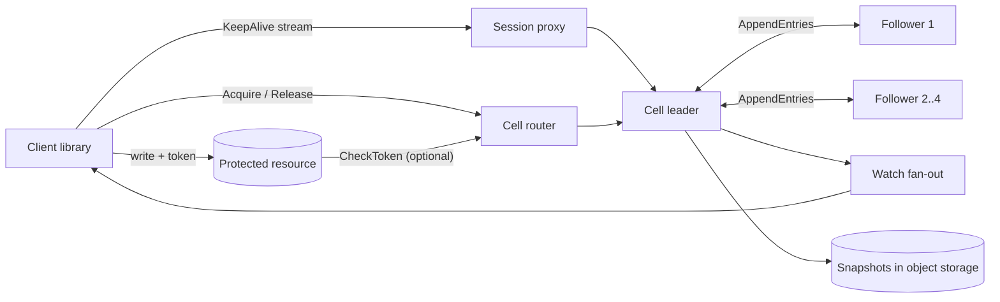

## In one minute
- **The lock table is a replicated state machine.** Every grant, release and expiry is an entry in a consensus log (Raft or Paxos) across five replicas, so the service never shows two exclusive holders, even across leader failover.
- **Locks hang off sessions, not their own timers.** A client process keeps one session alive with heartbeats, and every lock it holds or waits for dies with it. Heartbeats never touch the log.
- **The service cannot stop a paused client, so it hands out fencing tokens.** Every grant carries a number that only grows, and the protected resource rejects writes carrying an older one. Without this, a garbage-collection pause turns one lock into two writers.
- **Waiting is a server-side FIFO queue with push.** The server wakes exactly the next waiter, which avoids a herd of pollers and keeps writers from starving behind readers.
- **Scale by adding cells, not replicas.** A five-node group is bounded by `fsync` and one leader, so throughput comes from splitting the namespace across cells and keeping locks coarse.

## Requirements
**Functional**
- Open a session with a TTL and keep it alive. When a session expires, release everything it holds and cancel everything it waits for.
- Acquire a named lock in exclusive or shared mode, either try-once or wait up to a deadline. Release it explicitly.
- Return a fencing token with every grant, and let resources check whether a token is still current.
- Inspect a lock (holders, mode, waiters) and watch it for changes.
- Retried requests with the same request id must not grant twice or enqueue twice.

**Non-functional**
- Safety first: in the service's own view, an exclusive lock has at most one holder at every log position, and tokens never repeat or go backwards.
- Tolerate two of five replicas failing in a cell with no loss of granted state.
- Acquire latency for an uncontended lock under 15 ms p99 within a region; failover visible to clients for under 5 seconds.
- Support about 200,000 concurrent sessions and 2 million lock names across the fleet.

**Out of scope:** row-level or per-request locks at millions of operations per second (use the database's own row locks), Byzantine clients, and a single lock name that must be writable from every region with local latency.

## Back-of-envelope
Assumed numbers for a large company's internal coordination service.
- **Sessions:** 200,000 client processes. With a 12 s TTL and a heartbeat every 4 s, that is 200,000 / 4 = 50,000 heartbeats/s. They stay in leader memory and never touch disk.
- **Lock writes:** each process acquires and releases about once a minute on average: 200,000 × 2 / 60 ≈ 6,700 log writes/s. A rolling deploy or a cluster restart makes every process reconnect and re-acquire within a minute or two, so plan for 5× peak: about 33,000 writes/s.
- **Cells:** one Raft group with batched `fsync` comfortably handles around 5,000 to 10,000 small writes/s with good tail latency. 33,000 / 5,000 ≈ 7, so run 8 cells and leave headroom.
- **State size:** a lock record (name, mode, holders, token, waiters) is about 200 bytes, so 2,000,000 × 200 B = 400 MB fleet-wide, or about 50 MB per cell. Sessions add 200,000 × 100 B = 20 MB. Everything fits in RAM.
- **Log volume:** 33,000 writes/s × 300 B ≈ 10 MB/s at peak across all cells. Snapshots every 100,000 entries keep the on-disk log to a few hundred MB per cell.
- **Five years:** live state stays flat because it is compacted. An audit trail is 6,700/s × 86,400 ≈ 580M grants a day × 200 B ≈ 116 GB a day; 30 days is about 3.5 TB, kept outside the cells.
- **Bandwidth:** heartbeats at 50,000/s × 150 B ≈ 7.5 MB/s. Negligible.

## API
A gRPC service. Heartbeats run on a long-lived bidirectional stream; everything else is unary.

```text
OpenSession(client_id, ttl_ms)                 -> { session_id, ttl_ms }
KeepAlive(stream { session_id })               -> stream { ttl_ms_remaining }
Acquire(session_id, name, mode: EXCLUSIVE|SHARED,
        wait_ms, request_id)                   -> { status: GRANTED|QUEUED|TIMED_OUT,
                                                    token, holders }
Release(session_id, name, token)               -> { ok }
CheckToken(name, token)                        -> { current: bool, latest_token }
GetLock(name)                                  -> { mode, holders: [{session, token}],
                                                    waiters: [{session, mode}] }
Watch(name, since_revision)                    -> stream { revision, event, lock }
CloseSession(session_id)                       -> { released: [name] }
```

`request_id` makes `Acquire` idempotent: a retry after a timeout returns the original result rather than queueing a second request. `Release` carries the token so a stale client that lost its session and somehow still runs cannot release a lock that now belongs to someone else. `wait_ms = 0` is a try-lock.

## Data model
State lives in memory on every replica, rebuilt from the latest snapshot plus the log tail. It is a small keyed map, not a table in a general database.

**sessions/{session_id}** holds `client_id`, `ttl_ms` and the set of lock names it holds or waits on. The expiry deadline is not stored in the log: only the leader tracks it, on a monotonic clock, and appends an `ExpireSession` entry when it passes. Writing every heartbeat to the log would multiply write volume by ten.

**locks/{name}** holds `mode`, `holders` as a list of `(session_id, token)`, and `waiters` as a FIFO list of `(session_id, mode, request_id, deadline)`. A lock record is deleted when it has no holders and no waiters, so the map size tracks live locks only.

**dedupe/{session_id}/{request_id}** holds the result of the last few requests per session, so retries are answered from state. It is dropped with the session.

**Tokens** are the Raft log index of the entry that granted the lock. The log index is already strictly increasing across leader changes, so there is no extra counter to replicate and no way for a new leader to reuse a number.

**Partition key:** the top-level path segment, such as `/ls/payments/...`, maps to a cell through a small routing table. Placing by team namespace rather than by hash keeps one team's locks and incidents in one cell, and moving a tenant is one routing row.

## High-level design


**Write path (acquire).**
1. The cell router forwards `Acquire` to the cell's current leader.
2. The leader checks the dedupe map, appends an `Acquire` entry and sends `AppendEntries` to the four followers.
3. Once three of five replicas have the entry on disk, it is committed and every replica applies it in log order. If the lock is free and nobody is queued, the entry's index becomes the token; otherwise the request joins the queue.
4. The leader replies `GRANTED` with the token, or holds the call open until a later `Release` or `ExpireSession` entry promotes it. If `wait_ms` runs out first, the leader appends a `CancelWait` entry.

**Read path.**
1. `GetLock` and `CheckToken` must not see stale state, so the leader uses a read index: note the commit index, confirm leadership with one heartbeat round, wait until applied, then read memory. No log write. One catch: a newly elected leader must first commit a blank entry in its own term, or it cannot know which entries are committed, so reads wait for that ([Raft paper](https://raft.github.io/raft.pdf)).
2. Watchers subscribe to the apply stream; each event carries its log index as a revision, so a reconnecting watcher resumes from `since_revision` without gaps.

## Deep dives
### 1. What a lock actually guarantees: leases, pauses and fencing
The tempting promise is "only one client holds the lock at a time". No lock service can deliver that. A holder can stop for 30 seconds in a garbage-collection pause or a VM live migration, then wake up and write as though nothing happened, while the service has already expired its session and granted the lock to someone else.

Options considered: long TTLs (only lowers the odds, and slows recovery from real crashes); lock-delay, which Chubby offers, where a lock whose holder died without releasing cannot be regranted for a while (up to a minute) so stray writes drain ([Chubby paper](https://static.googleusercontent.com/media/research.google.com/en//archive/chubby-osdi06.pdf)); and fencing tokens, where every grant carries a strictly increasing number that the client sends with each write, and the resource rejects any token lower than the highest it has seen ([Kleppmann](https://martin.kleppmann.com/2016/02/08/how-to-do-distributed-locking.html)). With ZooKeeper the `zxid` or znode version serves as the token; etcd's maintainers say its locks cannot protect an external resource by themselves and name the lock key's revision as the token ([etcd docs](https://etcd.io/docs/v3.6/learning/why/)).

I choose fencing as the contract (the [Distributed Locks](../sd/distributed-locks.md) lesson shows why Redis-style leases cannot provide it), with lock-delay as the fallback for resources that cannot check tokens. The Raft log index gives monotonic tokens for free. The resource should check with a conditional write such as `UPDATE ... WHERE fence < :token`; a remote `CheckToken` call is still racy unless check and write are atomic. The client library also keeps a local deadline shorter than the server TTL, measured on a monotonic clock from when the heartbeat was sent, and stops writing once it passes. That covers the common case cheaply; fencing covers the case where the client's own scheduler lies.

### 2. Sessions and heartbeats at 50,000 per second
Options considered: a TTL on each lock (Redis `SET NX PX` style), or a TTL on a session that owns many locks. Per-lock TTLs mean a client holding 500 locks refreshes 500 keys, each a replicated write. Sessions cut that to one heartbeat per process, held in the leader's memory, as etcd leases and ZooKeeper sessions do.

The hard part is failover: heartbeats were never logged, so a new leader does not know when each session last checked in. The safe rule is to give every session a fresh full TTL when a new leader takes over. A session may then live one TTL too long, which delays waiters, but never dies earlier than its owner believes, which would break safety. Chubby adds a client-side grace period (45 s by default against a 12 s lease) during which clients block new operations but keep their locks, so a quick failover is invisible to applications. Under heavy load its master stretches leases toward about 60 s, trading slower expiry for fewer KeepAlives ([Chubby paper](https://static.googleusercontent.com/media/research.google.com/en//archive/chubby-osdi06.pdf)).

For fan-in, session proxies terminate the heartbeat streams and forward one batched heartbeat per second to each cell leader, turning 50,000 small messages into a few hundred larger ones. A proxy holds no truth, so losing one only means its clients reconnect elsewhere.

### 3. Waiting without a herd, and fairness between modes
Option one is client polling with backoff: a lock with 2,000 waiters generates thousands of failed attempts per second, and whoever polls at the right millisecond wins. Option two is the [ZooKeeper](zookeeper.md) recipe, where each waiter watches only the sequential node just below its own, so a release wakes exactly one client ([ZooKeeper recipes](https://zookeeper.apache.org/doc/current/recipes.html)); no herd, but the queue logic lives in every client library. Option three keeps a FIFO queue inside the lock record and has the leader push a grant to the next waiter. I choose option three: the queue becomes replicated state, inspectable and identical for every client language.

Shared and exclusive modes need one more rule. If readers may jump a waiting writer whenever other readers hold the lock, a steady stream of readers starves the writer forever. So the queue is strict FIFO: a shared request is granted only if no exclusive holder exists and nobody is ahead of it. Promotion walks from the head, granting consecutive shared requests together and stopping at the first exclusive request it cannot grant. Cancellation also runs promotion, because a writer leaving the head can unblock the readers behind it at once.

## Down the stack
### Layer 1: The contract
- **Grant.** A `GRANTED` reply with token `t` means the grant is committed on a majority of replicas at log index `t`. At index `t` no other session holds the lock exclusively, and any later grant of the same name has a token greater than `t`.
- **Expiry.** A session that sends no successful heartbeat for its TTL may be expired at any time after that, never before, as measured by the leader's monotonic clock. After a leader change, the earliest expiry moves forward by up to one TTL.
- **Release.** Release with a stale token is a no-op. Release and expiry both promote waiters in FIFO order.
- **Reads.** `GetLock` and `CheckToken` are linearizable: they reflect every grant committed before the call began.
- **Retries.** The same `request_id` in the same session yields the same outcome.

### Layer 2: The mechanism
The core is Raft. The leader appends an entry, sends `AppendEntries(term, prevLogIndex, prevLogTerm, entries, leaderCommit)` to followers, and advances `commitIndex` once a majority acknowledges. Election uses randomized timeouts; etcd's defaults are a 100 ms heartbeat interval and a 1,000 ms election timeout, and its tuning guide asks for an election timeout of at least 10 round trips ([etcd tuning](https://etcd.io/docs/v3.6/tuning/)). That is why clients see roughly one to two seconds of unavailability on leader loss, and why a cell spread across regions needs much longer timeouts. Linearizable reads use Raft's ReadIndex: confirm leadership with a heartbeat round, then read once `lastApplied >= readIndex`.

etcd builds locks from smaller primitives. A lease is created with `LeaseGrant`, kept alive with a `LeaseKeepAlive` stream, and attached to keys. The concurrency `Lock` call creates a key under the lock's prefix bound to the caller's lease, then waits for deletion of the key with the next-lower `create_revision`; that revision works as a fencing token. Chubby's token is a sequencer: lock name, mode and generation number, verified with `CheckSequencer` ([Chubby paper](https://static.googleusercontent.com/media/research.google.com/en//archive/chubby-osdi06.pdf)). Chubby also runs five replicas per cell and needs three of them up, the same shape as this design. Our design puts the queue in the lock record instead, so promotion is one step in the apply function.

That apply function runs on every replica, so it must be deterministic and must never read wall-clock time. Waiter deadlines and session expiry are decided by the leader and enter the log as explicit `CancelWait` and `ExpireSession` entries.

### Layer 3: The machine
- **Commit latency** is one round trip to the second-fastest follower plus one `fsync`. Across three availability zones the round trip is about 0.5 to 2 ms; `fsync` costs tens of microseconds on datacenter NVMe with power-loss protection and about a millisecond on cloud block volumes. An uncontended acquire takes 2 to 5 ms.
- **Group commit.** Entries that arrive while an `fsync` is in flight ride the next one. At 5,000 writes/s and 1 ms per `fsync`, each flush carries about five entries, so throughput grows with load until disk bandwidth or leader CPU runs out.
- **Clocks.** TTLs use `CLOCK_MONOTONIC`, which never jumps when NTP steps the wall clock, but it can still be slewed: Linux clamps the frequency adjustment to ±500 parts per million ([adjtimex(2)](https://man7.org/linux/man-pages/man2/adjtimex.2.html)), which is 6 ms over a 12 s TTL. Amazon's guidance is the same: leases should be measured as local elapsed time, never wall-clock time ([Amazon Builders' Library](https://builder.aws.com/content/3Ev0vH0hfkcUizISUWYTvHibtcp/leader-election-in-distributed-systems)). The client library subtracts a drift margin from its deadline.
- **Pauses.** etcd, written in Go, sees stop-the-world pauses well under a millisecond; a JVM client with a large heap can pause for seconds. A leader pause longer than the election timeout triggers a needless election, so cell replicas run on small, dedicated machines. Applying an entry to 50 MB of in-memory state takes about a microsecond, so disk and network, not CPU, set the ceiling.

### Why it's built this way
1. Machines crash and pause unpredictably, so locks must expire on their own, which makes every lock a lease.
2. Leases need one authority on who holds what, even when nodes fail, so the lock table sits on a consensus log with a majority quorum.
3. A quorum write costs a round trip plus an `fsync`, so only state changes go in the log, and heartbeats stay in memory.
4. Expiry cannot reach into a paused client, so safety moves to the resource, using a token that only grows, and the log index already has that property.
5. One leader and one disk cap a group's write rate, so growth comes from more cells and coarser locks, not from bigger groups.

## Failure modes
- **10x load from a reconnect storm.** A network blip drops 100,000 sessions and they all reopen at once. Rate-limit `OpenSession` per cell, reconnect with exponential backoff and full jitter, and let proxies batch the traffic.
- **Leader failover.** Writes stop for one to two seconds. Retried `Acquire` calls reuse their `request_id`, so nothing is granted twice, and the fresh TTL means no holder loses its lock to the failover itself.
- **Network partition.** The minority side cannot commit. Its clients cannot heartbeat, pass their local deadline and stop writing; their sessions expire on the majority side and waiters are promoted. Fencing stops any client that keeps writing anyway.
- **Region outage.** A cell spread over three zones survives a zone but not its region. For the few locks that must survive a region loss, run cells across three regions and accept 30 to 70 ms per write; match each lock's scope to its resource's scope.
- **Hot lock.** A thousand workers contend on one name. The queue keeps it orderly, but every hand-off is a log write. The real fix is usually [Leader Election](../sd/leader-election.md) once, or a work queue, with the lock guarding only the hand-over.
- **Slow leader disk.** `fsync` climbs to 100 ms and every grant in the cell slows. Alert on WAL `fsync` p99 and move leadership off the degraded replica.

## In the wild
- **Jepsen, 2020: etcd 3.4.3 locks did not exclude.** etcd's key-value operations were strict serializable under every fault tested, but its locks did not give mutual exclusion even on healthy clusters. With 2-second lease TTLs and process pauses, about 18% of acknowledged updates to a lock-guarded set were lost, and a bug skipped re-checking a waiter's lease before granting. The recommendation was fencing with the lock key's revision ([Jepsen](https://jepsen.io/analyses/etcd-3.4.3)).
- **Cloudflare, 2020: a half-failed switch split etcd.** A switch kept LACP and BGP up while dropping data traffic, so etcd members disagreed about the cluster and could not elect a leader. Cluster management read that as failure and promoted Postgres replicas, a bug forced every replica to rebuild, and API success fell to about 75% for 6h33m. Changes included slower automatic promotion ([Cloudflare](https://blog.cloudflare.com/a-byzantine-failure-in-the-real-world/)).
- **Roblox, 2021: one Consul cluster for everything.** Consul's new streaming feature caused contention under heavy load, and a bloated BoltDB freelist slowed every Raft append, pushing KV writes to about 2 seconds. Every backend service and the monitoring depended on that one cluster, so the outage lasted 73 hours. Changes: dedicated Consul clusters and telemetry that no longer depends on Consul, the case for cells ([Roblox](https://about.roblox.com/newsroom/2022/01/roblox-return-to-service-10-28-10-31-2021/)).

## Trade-offs
| Option | Strengths | Weaknesses | Choose when |
|---|---|---|---|
| Consensus-backed lock service (this design) | Correct across failover, fencing tokens, sessions, fair queues | Five replicas per cell, write rate bounded per cell | Locks protect correctness across many teams |
| etcd or ZooKeeper run per team | Mature, well understood | Each team runs its own quorum, no shared queue semantics | A single system needs coordination and has an operator |
| Single Redis key with `SET NX PX` | Sub-millisecond, trivial | Lost on failover with async replication, no fencing by default | Efficiency locks, such as avoiding duplicate cache rebuilds |
| Redlock across independent Redis nodes | No single node failure | Depends on bounded clock drift and pauses; still no fencing | Rarely; prefer one of the rows above |
| Database advisory or row lock | Same transaction as the data, no new system | Tied to one database connection, does not span services | The protected data lives in that database |

## Leadership lens
- **Build first:** one cell with Raft, sessions, exclusive locks, fencing tokens and a client library that enforces a local deadline. Shared mode, watches and proxies can wait; safety cannot.
- **Ownership:** a small platform team owns cells, routing and client libraries. Consuming teams own their namespaces and must show in review where their resource checks the token.
- **Cost drivers:** five replicas per cell on dedicated low-latency disks, cross-zone replication traffic, and on-call expertise, which costs more than the hardware.
- **Rollout:** start with efficiency-only users such as job deduplication, then admit correctness users one namespace at a time, with chaos tests that kill leaders and pause clients.
- **Review questions:** what happens to your writes if your process pauses for 60 seconds while holding the lock; does your resource check fencing tokens, and if not, why is lock-delay enough; can this lock be replaced by a single owner chosen once?

## Check yourself
1. A lock holder pauses for 30 seconds in garbage collection, its session expires, and the lock is granted to another client. What stops the first client's writes from corrupting the resource?
   **Answer:** Every grant carries a fencing token, the Raft log index of the granting entry, which only grows. The resource applies writes with a conditional check such as `UPDATE ... WHERE fence < :token`, so the paused client's older token is rejected; lock-delay is the fallback for resources that cannot check tokens.
2. After a leader failover, why does the new leader give every session a fresh full TTL, and what does that cost?
   **Answer:** Heartbeats were never written to the log, so the new leader does not know when each session last checked in. A fresh TTL means a session may live up to one TTL too long, which delays waiters, but it never expires earlier than its owner believes, which would break safety.
3. Why does the design use session TTLs with heartbeats in leader memory instead of a TTL on each lock?
   **Answer:** Per-lock TTLs mean a client holding 500 locks refreshes 500 keys, each a replicated log write. A session needs one heartbeat per process, kept in memory, so 50,000 heartbeats per second never touch the log, and every lock the session holds or waits for dies with it.
4. Using the lesson's numbers, why does the fleet run 8 cells rather than one bigger Raft group?
   **Answer:** Steady state is about 6,700 log writes per second, but a reconnect storm after a deploy pushes peak to about 33,000, and one Raft group with batched `fsync` handles around 5,000 to 10,000 writes per second. Adding replicas does not help because one leader and one disk cap a group's write rate, so 33,000 / 5,000 is about 7, rounded up to 8 cells for headroom.

## Practice
**Task:** Build the deterministic core of a lock cell. `LockService(ttl)` tracks sessions and named locks with modes `"X"` (exclusive) and `"S"` (shared). `open(sid, now)` creates or renews a session; `keepalive(sid, now)` renews a live session and returns true, or returns false if it is unknown or expired. Every method that takes `now` first runs `expire(now)`, which removes each session with `last_heartbeat + ttl <= now`, releases its holds, cancels its waits, promotes waiters on every lock (in sorted lock-name order) and returns the expired ids sorted. `acquire(sid, name, mode, now)` returns -1 for a dead session, the existing token if `sid` already holds `name`, 0 if `sid` is already waiting or must wait, and otherwise a new token; tokens come from one counter shared by all locks starting at 1, like a log index. Waiters form a strict FIFO queue: promotion grants the head while it is compatible (shared needs no exclusive holder, exclusive needs no holders), keeps going through consecutive shared requests and stops after an exclusive grant. `release(sid, name, now)` drops a hold or cancels a wait and returns the sessions granted as a result, in grant order. `holders(name)` returns sorted holder ids, `token(sid, name)` returns the held token or 0, and `valid(name, token, now)` says whether a current holder of `name` has that token.

```python starter
class LockService:
    def __init__(self, ttl):
        self.ttl = ttl

    def open(self, sid, now):
        raise NotImplementedError

    def keepalive(self, sid, now):
        raise NotImplementedError

    def expire(self, now):
        raise NotImplementedError

    def acquire(self, sid, name, mode, now):
        raise NotImplementedError

    def release(self, sid, name, now):
        raise NotImplementedError

    def holders(self, name):
        raise NotImplementedError

    def token(self, sid, name):
        raise NotImplementedError

    def valid(self, name, token, now):
        raise NotImplementedError
```

```python tests
def _svc(ttl, sids):
    s = LockService(ttl)
    for sid in sids:
        s.open(sid, 0)
    return s

def test_exclusive_grant_and_handoff():
    s = _svc(100, ["a", "b"])
    assert s.acquire("a", "db", "X", 1) == 1
    assert s.acquire("b", "db", "X", 1) == 0
    assert s.holders("db") == ["a"]
    assert s.release("a", "db", 2) == ["b"]
    assert s.token("b", "db") == 2

def test_shared_readers_do_not_starve_writer():
    s = _svc(100, ["a", "b", "c", "d"])
    assert s.acquire("a", "f", "S", 1) == 1
    assert s.acquire("b", "f", "S", 1) == 2
    assert s.acquire("c", "f", "X", 1) == 0
    assert s.acquire("d", "f", "S", 1) == 0, "reader queues behind waiting writer"
    assert s.release("a", "f", 2) == []
    assert s.release("b", "f", 2) == ["c"]
    assert s.release("c", "f", 3) == ["d"]

def test_cancelled_writer_unblocks_readers_behind_it():
    s = _svc(100, ["a", "c", "d", "e"])
    s.acquire("a", "f", "S", 1)
    s.acquire("c", "f", "X", 1)
    s.acquire("d", "f", "S", 1)
    s.acquire("e", "f", "S", 1)
    assert s.release("c", "f", 2) == ["d", "e"]
    assert s.holders("f") == ["a", "d", "e"]

def test_session_expiry_releases_and_promotes():
    s = _svc(10, ["a", "b"])
    assert s.acquire("a", "db", "X", 1) == 1
    assert s.acquire("b", "db", "X", 1) == 0
    assert s.keepalive("b", 8) is True
    assert s.expire(10) == ["a"]
    assert s.holders("db") == ["b"]
    assert s.keepalive("a", 11) is False
    assert s.acquire("a", "db", "X", 11) == -1

def test_fencing_tokens_are_global_and_checked():
    s = _svc(10, ["a", "b"])
    s.acquire("a", "db", "X", 1)
    s.acquire("b", "db", "X", 1)
    assert s.valid("db", 1, 5) is True
    s.keepalive("b", 9)
    assert s.valid("db", 1, 10) is False, "expiry happens before the check"
    assert s.valid("db", 2, 10) is True
    assert s.acquire("b", "other", "X", 10) == 3

def test_retries_are_idempotent():
    s = _svc(100, ["a", "b"])
    assert s.acquire("a", "db", "X", 1) == 1
    assert s.acquire("a", "db", "X", 2) == 1
    assert s.acquire("b", "db", "X", 2) == 0
    assert s.acquire("b", "db", "X", 3) == 0
    assert s.release("a", "db", 4) == ["b"]
    assert s.release("b", "db", 5) == [], "b was queued only once"

def test_release_by_stranger_or_unknown_lock():
    s = _svc(100, ["a", "b"])
    s.acquire("a", "db", "X", 1)
    assert s.release("b", "db", 2) == []
    assert s.release("a", "nope", 2) == []
    assert s.holders("db") == ["a"]
    assert s.token("b", "db") == 0

def test_keepalive_boundary():
    s = _svc(10, ["a"])
    assert s.keepalive("a", 9) is True
    assert s.expire(18) == []
    assert s.expire(19) == ["a"]
```

```python solution
class LockService:
    def __init__(self, ttl):
        self.ttl = ttl
        self.last = {}
        self.locks = {}
        self.next_token = 1

    def open(self, sid, now):
        self.expire(now)
        self.last[sid] = now

    def keepalive(self, sid, now):
        self.expire(now)
        if sid not in self.last:
            return False
        self.last[sid] = now
        return True

    def _promote(self, name):
        lk = self.locks.get(name)
        granted = []
        if lk is None:
            return granted
        while lk["queue"]:
            sid, mode = lk["queue"][0]
            modes = [m for m, _ in lk["holders"].values()]
            if mode == "X" and modes:
                break
            if mode == "S" and "X" in modes:
                break
            lk["queue"].pop(0)
            lk["holders"][sid] = (mode, self.next_token)
            self.next_token += 1
            granted.append(sid)
            if mode == "X":
                break
        return granted

    def expire(self, now):
        dead = sorted(s for s, t in self.last.items() if t + self.ttl <= now)
        if not dead:
            return []
        gone = set(dead)
        for s in dead:
            del self.last[s]
        for name in sorted(self.locks):
            lk = self.locks[name]
            for s in list(lk["holders"]):
                if s in gone:
                    del lk["holders"][s]
            lk["queue"] = [w for w in lk["queue"] if w[0] not in gone]
            self._promote(name)
        return dead

    def acquire(self, sid, name, mode, now):
        self.expire(now)
        if sid not in self.last:
            return -1
        lk = self.locks.setdefault(name, {"holders": {}, "queue": []})
        if sid in lk["holders"]:
            return lk["holders"][sid][1]
        if any(w[0] == sid for w in lk["queue"]):
            return 0
        lk["queue"].append((sid, mode))
        self._promote(name)
        return lk["holders"][sid][1] if sid in lk["holders"] else 0

    def release(self, sid, name, now):
        self.expire(now)
        lk = self.locks.get(name)
        if lk is None:
            return []
        if sid in lk["holders"]:
            del lk["holders"][sid]
        elif any(w[0] == sid for w in lk["queue"]):
            lk["queue"] = [w for w in lk["queue"] if w[0] != sid]
        else:
            return []
        return self._promote(name)

    def holders(self, name):
        lk = self.locks.get(name)
        return sorted(lk["holders"]) if lk else []

    def token(self, sid, name):
        lk = self.locks.get(name)
        if lk is None or sid not in lk["holders"]:
            return 0
        return lk["holders"][sid][1]

    def valid(self, name, token, now):
        self.expire(now)
        lk = self.locks.get(name)
        if lk is None:
            return False
        return any(t == token for _, t in lk["holders"].values())
```

```typescript starter
export class LockService {
  constructor(public ttl: number) {}
  open(sid: string, now: number): void {
    throw new Error("TODO");
  }
  keepalive(sid: string, now: number): boolean {
    throw new Error("TODO");
  }
  expire(now: number): string[] {
    throw new Error("TODO");
  }
  acquire(sid: string, name: string, mode: string, now: number): number {
    throw new Error("TODO");
  }
  release(sid: string, name: string, now: number): string[] {
    throw new Error("TODO");
  }
  holders(name: string): string[] {
    throw new Error("TODO");
  }
  token(sid: string, name: string): number {
    throw new Error("TODO");
  }
  valid(name: string, token: number, now: number): boolean {
    throw new Error("TODO");
  }
}
```

```typescript tests
function mkSvc(ttl: number, sids: string[]): LockService {
  const s = new LockService(ttl);
  for (const sid of sids) s.open(sid, 0);
  return s;
}
test("exclusive grant and handoff", () => {
  const s = mkSvc(100, ["a", "b"]);
  assertEqual(s.acquire("a", "db", "X", 1), 1);
  assertEqual(s.acquire("b", "db", "X", 1), 0);
  assertEqual(s.holders("db"), ["a"]);
  assertEqual(s.release("a", "db", 2), ["b"]);
  assertEqual(s.token("b", "db"), 2);
});
test("shared readers do not starve writer", () => {
  const s = mkSvc(100, ["a", "b", "c", "d"]);
  assertEqual(s.acquire("a", "f", "S", 1), 1);
  assertEqual(s.acquire("b", "f", "S", 1), 2);
  assertEqual(s.acquire("c", "f", "X", 1), 0);
  assertEqual(s.acquire("d", "f", "S", 1), 0, "reader queues behind waiting writer");
  assertEqual(s.release("a", "f", 2), []);
  assertEqual(s.release("b", "f", 2), ["c"]);
  assertEqual(s.release("c", "f", 3), ["d"]);
});
test("cancelled writer unblocks readers behind it", () => {
  const s = mkSvc(100, ["a", "c", "d", "e"]);
  s.acquire("a", "f", "S", 1);
  s.acquire("c", "f", "X", 1);
  s.acquire("d", "f", "S", 1);
  s.acquire("e", "f", "S", 1);
  assertEqual(s.release("c", "f", 2), ["d", "e"]);
  assertEqual(s.holders("f"), ["a", "d", "e"]);
});
test("session expiry releases and promotes", () => {
  const s = mkSvc(10, ["a", "b"]);
  assertEqual(s.acquire("a", "db", "X", 1), 1);
  assertEqual(s.acquire("b", "db", "X", 1), 0);
  assertEqual(s.keepalive("b", 8), true);
  assertEqual(s.expire(10), ["a"]);
  assertEqual(s.holders("db"), ["b"]);
  assertEqual(s.keepalive("a", 11), false);
  assertEqual(s.acquire("a", "db", "X", 11), -1);
});
test("fencing tokens are global and checked", () => {
  const s = mkSvc(10, ["a", "b"]);
  s.acquire("a", "db", "X", 1);
  s.acquire("b", "db", "X", 1);
  assertEqual(s.valid("db", 1, 5), true);
  s.keepalive("b", 9);
  assertEqual(s.valid("db", 1, 10), false, "expiry happens before the check");
  assertEqual(s.valid("db", 2, 10), true);
  assertEqual(s.acquire("b", "other", "X", 10), 3);
});
test("retries are idempotent", () => {
  const s = mkSvc(100, ["a", "b"]);
  assertEqual(s.acquire("a", "db", "X", 1), 1);
  assertEqual(s.acquire("a", "db", "X", 2), 1);
  assertEqual(s.acquire("b", "db", "X", 2), 0);
  assertEqual(s.acquire("b", "db", "X", 3), 0);
  assertEqual(s.release("a", "db", 4), ["b"]);
  assertEqual(s.release("b", "db", 5), [], "b was queued only once");
});
test("release by stranger or unknown lock", () => {
  const s = mkSvc(100, ["a", "b"]);
  s.acquire("a", "db", "X", 1);
  assertEqual(s.release("b", "db", 2), []);
  assertEqual(s.release("a", "nope", 2), []);
  assertEqual(s.holders("db"), ["a"]);
  assertEqual(s.token("b", "db"), 0);
});
test("keepalive boundary", () => {
  const s = mkSvc(10, ["a"]);
  assertEqual(s.keepalive("a", 9), true);
  assertEqual(s.expire(18), []);
  assertEqual(s.expire(19), ["a"]);
});
```

```typescript solution
interface Hold {
  mode: string;
  token: number;
}
interface LockState {
  holders: Map<string, Hold>;
  queue: [string, string][];
}

export class LockService {
  private last = new Map<string, number>();
  private locks = new Map<string, LockState>();
  private nextToken = 1;

  constructor(public ttl: number) {}

  open(sid: string, now: number): void {
    this.expire(now);
    this.last.set(sid, now);
  }

  keepalive(sid: string, now: number): boolean {
    this.expire(now);
    if (!this.last.has(sid)) return false;
    this.last.set(sid, now);
    return true;
  }

  private promote(name: string): string[] {
    const lk = this.locks.get(name);
    const granted: string[] = [];
    if (!lk) return granted;
    while (lk.queue.length > 0) {
      const [sid, mode] = lk.queue[0];
      const modes = Array.from(lk.holders.values()).map((h) => h.mode);
      if (mode === "X" && modes.length > 0) break;
      if (mode === "S" && modes.includes("X")) break;
      lk.queue.shift();
      lk.holders.set(sid, { mode, token: this.nextToken++ });
      granted.push(sid);
      if (mode === "X") break;
    }
    return granted;
  }

  expire(now: number): string[] {
    const dead: string[] = [];
    for (const [s, t] of this.last) if (t + this.ttl <= now) dead.push(s);
    if (dead.length === 0) return [];
    dead.sort();
    const gone = new Set(dead);
    for (const s of dead) this.last.delete(s);
    for (const name of Array.from(this.locks.keys()).sort()) {
      const lk = this.locks.get(name)!;
      for (const s of Array.from(lk.holders.keys())) if (gone.has(s)) lk.holders.delete(s);
      lk.queue = lk.queue.filter((w) => !gone.has(w[0]));
      this.promote(name);
    }
    return dead;
  }

  acquire(sid: string, name: string, mode: string, now: number): number {
    this.expire(now);
    if (!this.last.has(sid)) return -1;
    let lk = this.locks.get(name);
    if (!lk) {
      lk = { holders: new Map(), queue: [] };
      this.locks.set(name, lk);
    }
    const held = lk.holders.get(sid);
    if (held) return held.token;
    if (lk.queue.some((w) => w[0] === sid)) return 0;
    lk.queue.push([sid, mode]);
    this.promote(name);
    const now2 = lk.holders.get(sid);
    return now2 ? now2.token : 0;
  }

  release(sid: string, name: string, now: number): string[] {
    this.expire(now);
    const lk = this.locks.get(name);
    if (!lk) return [];
    if (lk.holders.has(sid)) {
      lk.holders.delete(sid);
    } else if (lk.queue.some((w) => w[0] === sid)) {
      lk.queue = lk.queue.filter((w) => w[0] !== sid);
    } else {
      return [];
    }
    return this.promote(name);
  }

  holders(name: string): string[] {
    const lk = this.locks.get(name);
    return lk ? Array.from(lk.holders.keys()).sort() : [];
  }

  token(sid: string, name: string): number {
    const h = this.locks.get(name)?.holders.get(sid);
    return h ? h.token : 0;
  }

  valid(name: string, token: number, now: number): boolean {
    this.expire(now);
    const lk = this.locks.get(name);
    if (!lk) return false;
    return Array.from(lk.holders.values()).some((h) => h.token === token);
  }
}
```

```go starter
package practice

type LockService struct {
	TTL int64
}

func NewLockService(ttl int64) *LockService {
	return &LockService{TTL: ttl}
}

func (s *LockService) Open(sid string, now int64) {
	panic("TODO")
}

func (s *LockService) KeepAlive(sid string, now int64) bool {
	panic("TODO")
}

func (s *LockService) Expire(now int64) []string {
	panic("TODO")
}

func (s *LockService) Acquire(sid, name, mode string, now int64) int64 {
	panic("TODO")
}

func (s *LockService) Release(sid, name string, now int64) []string {
	panic("TODO")
}

func (s *LockService) Holders(name string) []string {
	panic("TODO")
}

func (s *LockService) Token(sid, name string) int64 {
	panic("TODO")
}

func (s *LockService) Valid(name string, token int64, now int64) bool {
	panic("TODO")
}
```

```go tests
package practice

import "testing"

func mkSvc(ttl int64, sids ...string) *LockService {
	s := NewLockService(ttl)
	for _, sid := range sids {
		s.Open(sid, 0)
	}
	return s
}

func sameList(got []string, want ...string) bool {
	if len(got) != len(want) {
		return false
	}
	for i := range got {
		if got[i] != want[i] {
			return false
		}
	}
	return true
}

func TestExclusiveGrantAndHandoff(t *testing.T) {
	s := mkSvc(100, "a", "b")
	if s.Acquire("a", "db", "X", 1) != 1 || s.Acquire("b", "db", "X", 1) != 0 {
		t.Fatal("wrong grant")
	}
	if !sameList(s.Holders("db"), "a") {
		t.Fatal("holders")
	}
	if got := s.Release("a", "db", 2); !sameList(got, "b") {
		t.Fatalf("release got %v", got)
	}
	if s.Token("b", "db") != 2 {
		t.Fatal("token")
	}
}

func TestSharedReadersDoNotStarveWriter(t *testing.T) {
	s := mkSvc(100, "a", "b", "c", "d")
	if s.Acquire("a", "f", "S", 1) != 1 || s.Acquire("b", "f", "S", 1) != 2 {
		t.Fatal("readers should share")
	}
	if s.Acquire("c", "f", "X", 1) != 0 || s.Acquire("d", "f", "S", 1) != 0 {
		t.Fatal("reader must queue behind waiting writer")
	}
	if !sameList(s.Release("a", "f", 2)) || !sameList(s.Release("b", "f", 2), "c") || !sameList(s.Release("c", "f", 3), "d") {
		t.Fatal("wrong promotion order")
	}
}

func TestCancelledWriterUnblocksReaders(t *testing.T) {
	s := mkSvc(100, "a", "c", "d", "e")
	s.Acquire("a", "f", "S", 1)
	s.Acquire("c", "f", "X", 1)
	s.Acquire("d", "f", "S", 1)
	s.Acquire("e", "f", "S", 1)
	if got := s.Release("c", "f", 2); !sameList(got, "d", "e") {
		t.Fatalf("got %v", got)
	}
	if !sameList(s.Holders("f"), "a", "d", "e") {
		t.Fatal("holders")
	}
}

func TestSessionExpiryReleasesAndPromotes(t *testing.T) {
	s := mkSvc(10, "a", "b")
	s.Acquire("a", "db", "X", 1)
	s.Acquire("b", "db", "X", 1)
	if !s.KeepAlive("b", 8) {
		t.Fatal("b alive")
	}
	if got := s.Expire(10); !sameList(got, "a") {
		t.Fatalf("expired %v", got)
	}
	if !sameList(s.Holders("db"), "b") || s.KeepAlive("a", 11) || s.Acquire("a", "db", "X", 11) != -1 {
		t.Fatal("dead session handling")
	}
}

func TestFencingTokensGlobalAndChecked(t *testing.T) {
	s := mkSvc(10, "a", "b")
	s.Acquire("a", "db", "X", 1)
	s.Acquire("b", "db", "X", 1)
	if !s.Valid("db", 1, 5) {
		t.Fatal("token 1 valid")
	}
	s.KeepAlive("b", 9)
	if s.Valid("db", 1, 10) || !s.Valid("db", 2, 10) {
		t.Fatal("expiry must happen before the check")
	}
	if s.Acquire("b", "other", "X", 10) != 3 {
		t.Fatal("tokens are global")
	}
}

func TestRetriesAreIdempotent(t *testing.T) {
	s := mkSvc(100, "a", "b")
	if s.Acquire("a", "db", "X", 1) != 1 || s.Acquire("a", "db", "X", 2) != 1 {
		t.Fatal("holder retry")
	}
	if s.Acquire("b", "db", "X", 2) != 0 || s.Acquire("b", "db", "X", 3) != 0 {
		t.Fatal("waiter retry")
	}
	if !sameList(s.Release("a", "db", 4), "b") || !sameList(s.Release("b", "db", 5)) {
		t.Fatal("b queued once")
	}
}

func TestReleaseByStrangerOrUnknownLock(t *testing.T) {
	s := mkSvc(100, "a", "b")
	s.Acquire("a", "db", "X", 1)
	if !sameList(s.Release("b", "db", 2)) || !sameList(s.Release("a", "nope", 2)) {
		t.Fatal("no-op releases")
	}
	if !sameList(s.Holders("db"), "a") || s.Token("b", "db") != 0 {
		t.Fatal("state changed")
	}
}

func TestKeepAliveBoundary(t *testing.T) {
	s := mkSvc(10, "a")
	if !s.KeepAlive("a", 9) || !sameList(s.Expire(18)) || !sameList(s.Expire(19), "a") {
		t.Fatal("boundary")
	}
}
```

```go solution
package practice

import "sort"

type hold struct {
	mode  string
	token int64
}

type waiter struct {
	sid, mode string
}

type lockState struct {
	holders map[string]hold
	queue   []waiter
}

type LockService struct {
	TTL       int64
	last      map[string]int64
	locks     map[string]*lockState
	nextToken int64
}

func NewLockService(ttl int64) *LockService {
	return &LockService{TTL: ttl, last: map[string]int64{}, locks: map[string]*lockState{}, nextToken: 1}
}

func (s *LockService) Open(sid string, now int64) {
	s.Expire(now)
	s.last[sid] = now
}

func (s *LockService) KeepAlive(sid string, now int64) bool {
	s.Expire(now)
	if _, ok := s.last[sid]; !ok {
		return false
	}
	s.last[sid] = now
	return true
}

func (s *LockService) promote(name string) []string {
	granted := []string{}
	lk := s.locks[name]
	if lk == nil {
		return granted
	}
	for len(lk.queue) > 0 {
		w := lk.queue[0]
		hasX := false
		for _, h := range lk.holders {
			if h.mode == "X" {
				hasX = true
			}
		}
		if w.mode == "X" && len(lk.holders) > 0 {
			break
		}
		if w.mode == "S" && hasX {
			break
		}
		lk.queue = lk.queue[1:]
		lk.holders[w.sid] = hold{w.mode, s.nextToken}
		s.nextToken++
		granted = append(granted, w.sid)
		if w.mode == "X" {
			break
		}
	}
	return granted
}

func (s *LockService) Expire(now int64) []string {
	dead := []string{}
	for sid, t := range s.last {
		if t+s.TTL <= now {
			dead = append(dead, sid)
		}
	}
	if len(dead) == 0 {
		return dead
	}
	sort.Strings(dead)
	gone := map[string]bool{}
	for _, sid := range dead {
		gone[sid] = true
		delete(s.last, sid)
	}
	names := make([]string, 0, len(s.locks))
	for n := range s.locks {
		names = append(names, n)
	}
	sort.Strings(names)
	for _, n := range names {
		lk := s.locks[n]
		for sid := range lk.holders {
			if gone[sid] {
				delete(lk.holders, sid)
			}
		}
		kept := []waiter{}
		for _, w := range lk.queue {
			if !gone[w.sid] {
				kept = append(kept, w)
			}
		}
		lk.queue = kept
		s.promote(n)
	}
	return dead
}

func (s *LockService) Acquire(sid, name, mode string, now int64) int64 {
	s.Expire(now)
	if _, ok := s.last[sid]; !ok {
		return -1
	}
	lk := s.locks[name]
	if lk == nil {
		lk = &lockState{holders: map[string]hold{}}
		s.locks[name] = lk
	}
	if h, ok := lk.holders[sid]; ok {
		return h.token
	}
	for _, w := range lk.queue {
		if w.sid == sid {
			return 0
		}
	}
	lk.queue = append(lk.queue, waiter{sid, mode})
	s.promote(name)
	if h, ok := lk.holders[sid]; ok {
		return h.token
	}
	return 0
}

func (s *LockService) Release(sid, name string, now int64) []string {
	s.Expire(now)
	lk := s.locks[name]
	if lk == nil {
		return []string{}
	}
	if _, ok := lk.holders[sid]; ok {
		delete(lk.holders, sid)
		return s.promote(name)
	}
	idx := -1
	for i, w := range lk.queue {
		if w.sid == sid {
			idx = i
		}
	}
	if idx < 0 {
		return []string{}
	}
	lk.queue = append(lk.queue[:idx:idx], lk.queue[idx+1:]...)
	return s.promote(name)
}

func (s *LockService) Holders(name string) []string {
	out := []string{}
	if lk := s.locks[name]; lk != nil {
		for sid := range lk.holders {
			out = append(out, sid)
		}
	}
	sort.Strings(out)
	return out
}

func (s *LockService) Token(sid, name string) int64 {
	if lk := s.locks[name]; lk != nil {
		if h, ok := lk.holders[sid]; ok {
			return h.token
		}
	}
	return 0
}

func (s *LockService) Valid(name string, token int64, now int64) bool {
	s.Expire(now)
	lk := s.locks[name]
	if lk == nil {
		return false
	}
	for _, h := range lk.holders {
		if h.token == token {
			return true
		}
	}
	return false
}
```

## Mock interview
**Prompt:** Design a locking service that every team in the company can use to coordinate work across machines. Assume about 200,000 client processes, a few million lock names, and some users who need the lock for correctness, such as making sure only one worker writes a customer's ledger at a time.

- Follow-up: A holder enters a 40-second garbage-collection pause, its session expires, and another worker acquires the lock. Walk me through what each party sees and what stops the first worker's write.
- Follow-up: Your leader dies. What happens to sessions whose heartbeats it was tracking, and can any lock be granted twice during the failover?
- Follow-up: Why not just use Redis with `SET NX PX`, which is far faster and already deployed?

**A strong answer covers:**
- A consensus log (Raft or Paxos) with five replicas per cell, majority commit, and linearizable reads via read index or leader leases.
- Sessions with heartbeats kept out of the log, a conservative TTL reset on leader change, and a client-side deadline shorter than the server TTL.
- Fencing tokens derived from the log index, checked atomically at the resource, with lock-delay for resources that cannot check.
- A server-side FIFO queue with push wakeups, shared and exclusive modes, and starvation-free ordering.
- Scaling through cells and coarse locks, with the honest note that most "hot lock" problems should become leader election or a work queue.

## Sources and further study
**Primary**
- [ZooKeeper: Wait-free coordination for Internet-scale systems (Hunt et al., USENIX ATC 2010)](https://www.usenix.org/legacy/event/atc10/tech/full_papers/Hunt.pdf): sessions, ephemeral nodes and watches as building blocks for locks.
- [Paxos Made Live (Chandra, Griesemer and Redstone, PODC 2007)](https://static.googleusercontent.com/media/research.google.com/en//archive/paxos_made_live.pdf): what it took to run Chubby's consensus layer in production.
- [etcd 3.4.3 (Jepsen, 2020)](https://jepsen.io/analyses/etcd-3.4.3): why lease-based locks fail under pauses and how revisions act as fencing tokens.

**Systems docs**
- [Why etcd: notes on lock and lease usage (etcd docs)](https://etcd.io/docs/v3.6/learning/why/): the maintainers' own statement of what etcd locks do and do not guarantee.
- [ZooKeeper recipes (Apache ZooKeeper)](https://zookeeper.apache.org/doc/current/recipes.html): herd-free exclusive and shared lock recipes built on sequential nodes.
- [Tuning (etcd docs)](https://etcd.io/docs/v3.6/tuning/): heartbeat and election timeout defaults and how to set them from round-trip time.

**Books**
- *Designing Data-Intensive Applications* (1st ed.), Martin Kleppmann, Ch 8 "The Trouble with Distributed Systems" (Knowledge, Truth, and Lies) and Ch 9 "Consistency and Consensus".
- *Database Internals*, Alex Petrov, Ch 14 "Consensus" (Paxos and Raft).
- *Site Reliability Engineering*, Beyer et al., Ch 23 "Managing Critical State: Distributed Consensus for Reliability" ([read free](https://sre.google/sre-book/managing-critical-state/)).

**Other curricula**
- [Leader Election pattern (Azure Architecture Center)](https://learn.microsoft.com/en-us/azure/architecture/patterns/leader-election): frames locks as a way to pick one coordinator, using leases on a shared store.

## Watch
- [Designing for Understandability: the Raft Consensus Algorithm (Diego Ongaro and John Ousterhout)](https://www.youtube.com/watch?v=vYp4LYbnnW8): the log replication and election mechanics that every grant in this design rides on.
- [Lecture 8: Zookeeper (MIT 6.824)](https://www.youtube.com/watch?v=pbmyrNjzdDk): how a coordination service orders writes, serves reads, and builds locks from sessions and watches.
- [UMass CS677 Lecture 14: Leader Election, Distributed Locks (UMass OS)](https://www.youtube.com/watch?v=HzynQENHG7Q): mutual exclusion across machines, from classic algorithms to lock services.

## Free resources
- [The Chubby lock service for loosely-coupled distributed systems (Burrows, OSDI 2006)](https://static.googleusercontent.com/media/research.google.com/en//archive/chubby-osdi06.pdf): the original lock service paper, with sessions, grace periods, sequencers and lock-delay.
- [How to do distributed locking (Martin Kleppmann)](https://martin.kleppmann.com/2016/02/08/how-to-do-distributed-locking.html): the clearest explanation of why pauses break leases and why fencing tokens fix it.
- [etcd concurrency API reference](https://etcd.io/docs/v3.5/dev-guide/api_concurrency_reference_v3/): a production lock and election API built on leases and revisions.
- [In Search of an Understandable Consensus Algorithm (Ongaro and Ousterhout)](https://raft.github.io/raft.pdf): the Raft paper, including the read-index technique for linearizable reads.
- [Leader election in distributed systems (Amazon Builders' Library)](https://aws.amazon.com/builders-library/leader-election-in-distributed-systems/): practical lease-based coordination at AWS and the failure cases to plan for.
