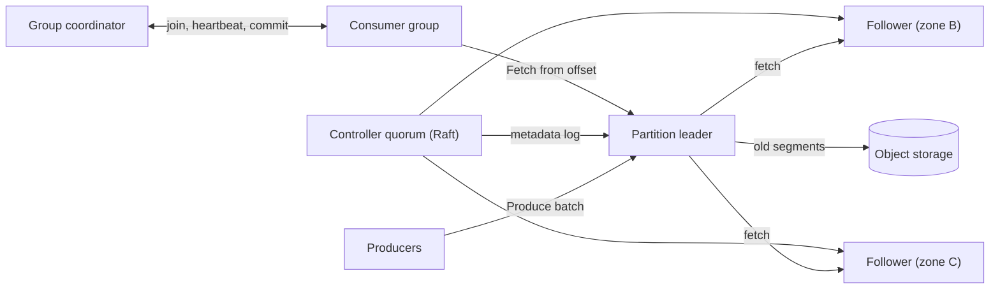

## In one minute
- **Build a replicated, partitioned log, not a shared list.** Each partition is an append-only file with offsets. Consumers keep a cursor into the log instead of deleting messages, so you get replay, many independent readers and sequential disk I/O.
- **The partition is the unit of everything.** Ordering, parallelism, replication and placement all happen per partition. Choosing the partition count and the partition key is the decision that is hardest to undo.
- **Durability comes from replication, not from fsync.** A write is acknowledged once a quorum of replicas holds it in memory. Each broker flushes to disk in the background, so a single machine failure loses nothing, but a whole rack losing power at once can.
- **Consumer groups need fencing.** Every rebalance bumps a generation number. A consumer that was paused and then comes back as a "zombie" is rejected when it commits offsets, so it cannot overwrite progress made by the partition's new owner.
- **Exactly once is a pipeline property.** The broker can deduplicate producer retries and commit offsets atomically with output. Any side effect outside the log still needs an idempotent consumer.

## Requirements
**Functional**
- Create topics with a partition count, a replication factor and a retention policy (by time, by size, or compacted by key).
- Producers publish records with an optional key. Records with the same key go to the same partition and stay in order.
- Consumers read in consumer groups. Each partition is read by exactly one member of a group at a time, and different groups read independently.
- Consumers commit offsets and resume from them after a restart. They can also rewind to an offset or a timestamp to replay.
- Producer retries do not create duplicates.

**Non-functional**
- Once the producer sees an acknowledgement, the record survives the loss of any one broker or availability zone.
- Publish latency under 20 ms at p99 within a region. End-to-end latency for a consumer that is keeping up is under 50 ms at p99.
- Peak ingress of 3 million records per second across the cluster. Adding brokers adds capacity roughly linearly.
- 99.99% availability for publishing. A single broker failure causes at most a few seconds of unavailability for the partitions it led.

**Out of scope:** per-message delays and priorities (see [Design Job Scheduler](design-job-scheduler.md)), routing with exchanges (see [RabbitMQ](rabbitmq.md)), the schema registry, and stream processing on top of the log (see [Flink](flink.md)).

## Back-of-envelope
These are round, assumed numbers for a company-wide platform.

- **Ingress:** 1M records/s on average, with a peak of 3M/s. The average record is 1 KB, so that is 1 GB/s average and 3 GB/s peak before compression.
- **Compression:** with zstd on producer batches, typical JSON payloads shrink about 4x, so the brokers store and send 250 MB/s on average and 750 MB/s at peak.
- **Replication:** with replication factor 3, every byte is written to three brokers. That is 750 MB/s of disk writes on average and 2.25 GB/s at peak, of which two thirds is follower traffic between brokers.
- **Egress:** on average 3 consumer groups read each topic, so 3 × 750 MB/s = 2.25 GB/s of fetches at peak. Most of these reads are of the tail of the log and are served from the page cache.
- **Storage per day:** 250 MB/s × 86,400 s ≈ 21.6 TB of compressed data a day, or 65 TB with three replicas.
- **Retention:** 7 days on local disk means 65 TB × 7 ≈ 455 TB. Over 5 years at constant traffic, local storage stays at that size because old segments are deleted. Keeping 90 days of history in object storage adds 21.6 TB × 90 ≈ 1.9 PB. Object storage makes its own copies, so we upload only one replica.
- **Brokers:** with 25 Gbit/s NICs (about 3 GB/s) kept below 40% and 30 TB of usable disk each, peak network (750 MB/s in, 1.5 GB/s replication, 2.25 GB/s out, about 4.5 GB/s) needs about 4 brokers, but storage needs 455 TB / 30 TB ≈ 16. Disk sets the fleet: 18 brokers across 3 zones. Tiered storage is the lever that shrinks it.

## API
The wire protocol is binary over long-lived TCP connections. The shapes below are shown as pseudo-RPCs.

```text
Produce(topic, partition, acks="all",
        producer_id, producer_epoch, base_sequence,
        batch: [ { key, value, headers, timestamp } ... ])
  -> { base_offset, log_append_time } | error NOT_LEADER | OUT_OF_ORDER_SEQUENCE

Fetch(replica_id or -1, [ { topic, partition, fetch_offset, leader_epoch } ],
      max_wait_ms=500, min_bytes=1, max_bytes=50MB)
  -> [ { partition, high_watermark, log_start_offset, records } ]

Metadata(topics) -> { brokers, [ { topic, partition, leader, replicas, isr } ] }

JoinGroup(group, member_id, session_timeout_ms) -> { generation, leader, members }
SyncGroup(group, generation, member_id, assignments?) -> { my_partitions }
Heartbeat(group, generation, member_id) -> ok | REBALANCE_IN_PROGRESS | UNKNOWN_MEMBER
CommitOffset(group, generation, member_id, [ { topic, partition, offset } ])
  -> ok | ILLEGAL_GENERATION
ListOffsets(topic, partition, timestamp) -> { offset }     (rewind by time)
```

Producers send whole batches, not single records, because batching is what makes the throughput numbers above possible. `Fetch` serves both consumers and follower replicas. Follower fetches are how replication happens, and the offset a follower asks for tells the leader how far that follower has caught up. `max_wait_ms` and `min_bytes` turn polling into long polling, so an idle consumer costs almost nothing.

## Data model
**Partition logs** live on broker disks, one directory per replica (`orders-7/`). Segments are named by their first offset: `00000000000004200000.log` holds record batches, `.index` maps offsets to byte positions every 4 KB (`log.index.interval.bytes` defaults to 4096 ([Kafka broker configs](https://kafka.apache.org/43/configuration/broker-configs/))), and `.timeindex` maps timestamps to offsets. Only the active segment takes appends. Retention deletes whole segments: one `unlink` instead of millions of row deletes.

**Cluster metadata** is itself a log, kept by a 3- or 5-node Raft controller quorum (KRaft). Kafka 4.0 (March 2025) was the first release with no ZooKeeper mode at all, so older designs that put the controller in ZooKeeper are now out of date ([Kafka 4.0 announcement](https://kafka.apache.org/blog/2025/03/18/apache-kafka-4.0.0-release-announcement/)). Records such as `PartitionRecord` (replicas, leader, ISR, leader epoch) are replayed by every broker, so each has a local view of who leads what.

**Committed offsets** live in an internal compacted topic keyed by `(group, topic, partition)`. A group maps to partition `hash(group) mod 50` of that topic, whose leader is the group's coordinator. Compaction keeps only the latest offset per key.

**Producer state** is `producer_id -> (epoch, last 5 batch sequences)` per partition, snapshotted with segments, so a leader recognises retried batches.

User data is partitioned by `murmur2(key) mod partitions`. Keying orders by `order_id` gives per-order ordering; keying by `customer_id` gives per-customer ordering but turns a whale customer into a hot partition.

## High-level design


**Write path.**
1. The producer hashes the key to a partition and adds the record to that partition's batch, sent at 64 KB or when `linger.ms` expires. Kafka changed the `linger.ms` default from 0 to 5 ms in 4.0, because larger batches usually make latency no worse ([Kafka producer configs](https://kafka.apache.org/43/configuration/producer-configs/)).
2. The compressed batch goes to the partition leader with the producer ID, epoch and base sequence.
3. The leader checks the sequence, assigns offsets and appends to the active segment in the page cache.
4. Followers in the in-sync replica set (ISR) are parked in long-poll fetches, so they pull the batch within a millisecond or two.
5. Once every ISR member has fetched past it, the leader advances the high watermark and acknowledges. If the ISR is below `min.insync.replicas` (2 of 3), the leader rejects the write instead.

**Read path.**
1. A consumer joins its group; the coordinator bumps the generation and assigns partitions.
2. The consumer fetches each owned partition from its committed offset.
3. The leader returns batches only up to the high watermark, so consumers never see data a failover could erase. Tail reads come from the page cache via `sendfile`.
4. The consumer processes, then commits the next offset. A crash before committing means the next owner reprocesses: at-least-once delivery.

## Deep dives
### 1. Replication: ISR, quorums and leader epochs
Options: a majority quorum per partition (Raft) needs 2f+1 replicas to survive f failures but ignores one slow node. Kafka's ISR model waits for every in-sync replica and drops one that lags more than `replica.lag.time.max.ms` (30 s by default ([Kafka broker configs](https://kafka.apache.org/43/configuration/broker-configs/))), so f+1 replicas survive f failures, at the price of a strongly consistent controller tracking the ISR. I choose ISR with replication factor 3 and `min.insync.replicas=2`, because copies are the expensive part at petabyte scale.

The subtle part is failover. Say the old leader appended offsets 100 to 105, but only 100 to 102 reached the follower that becomes the new leader, which then writes new data at 103. When the old leader returns, it must discard its own 103 to 105. Leader epochs make this safe: each term has an epoch and a start offset, and a returning replica asks the leader where its epoch ended and truncates to that point before fetching. Unclean leader election (promoting a replica outside the ISR) trades durability for availability; it is off by default, and I allow it only for telemetry topics. Both knobs exist because Jepsen showed in 2013 that a leader alone in its ISR could acknowledge writes that a later election then threw away.

### 2. Consumer groups, ordering and rebalancing
Ordering holds only within a partition, so partitions cap parallelism: 12 consumers on 8 partitions leave 4 idle. I size topics for the parallelism expected in two years, because adding partitions later changes `hash(key) mod n` and breaks per-key ordering during the change.

In the classic eager protocol, every member gives up all partitions on each rebalance, so a 200-member group stalls for seconds whenever a pod restarts. Cooperative incremental rebalancing moves only partitions that change owner, static membership lets a quick restart skip the rebalance, and the server-side protocol from KIP-848 removes the global barrier altogether. It went GA in Kafka 4.0, but clients still opt in with `group.protocol=consumer`; the client default is still `classic` ([Kafka consumer configs](https://kafka.apache.org/43/configuration/consumer-configs/)).

Generation fencing keeps rebalancing safe. A consumer stuck in a 40 s garbage-collection pause loses its session and its partitions. When it wakes and commits with generation 7 while the group is at 8, the coordinator rejects the commit. The Practice task builds exactly this.

For work queues, partitions are too coarse: one slow message blocks its whole partition. Either process by key in parallel inside the consumer, or offer per-message acknowledgement with a lock timeout. Kafka's share groups (KIP-932) do exactly this: more consumers than partitions, records acknowledged one by one, and they were declared production-ready in Kafka 4.2 in February 2026 ([Kafka 4.2 announcement](https://kafka.apache.org/blog/2026/02/17/apache-kafka-4.2.0-release-announcement/)). SQS has the same per-message model with a visibility timeout of 30 s by default, extendable up to 12 hours, and warns that a message can still be delivered twice within it ([SQS docs](https://docs.aws.amazon.com/AWSSimpleQueueService/latest/SQSDeveloperGuide/sqs-visibility-timeout.html)). I would offer both topic types.

### 3. Delivery semantics end to end
Producer retries are the first source of duplicates. With the idempotent producer, each batch carries a producer ID and a per-partition sequence number; the leader appends `n+1`, returns the original offset for a sequence it already has, and rejects a gap with `OUT_OF_ORDER_SEQUENCE`. Remembering the last 5 sequences allows 5 requests in flight while staying ordered, which is why idempotence requires `max.in.flight.requests.per.connection` of 5 or less ([Kafka producer configs](https://kafka.apache.org/43/configuration/producer-configs/)). The producer ID, per-partition sequences, epochs that fence zombie producers, and transactions all come from one design, KIP-98 ([KIP-98](https://cwiki.apache.org/confluence/display/KAFKA/KIP-98+-+Exactly+Once+Delivery+and+Transactional+Messaging)).

Consumers are the second source: a crash between processing and committing means reprocessing. For log-to-log pipelines, transactions write output records and the offset commit atomically, and readers with `isolation.level=read_committed` skip aborted data. For a database or payment API, the consumer must make its effect idempotent, for example an upsert keyed by `(topic, partition, offset)` or a business ID. See [Delivery Semantics](../sd/delivery-semantics.md) and the [Outbox Pattern](../sd/outbox-pattern.md).

## Down the stack
### Layer 1: The contract
- **Acknowledged means replicated.** With `acks=all`, once `Produce` returns `base_offset = n`, every ISR member holds the batch, and there are at least `min.insync.replicas` of them. If the ISR is too small, the write is rejected and not silently accepted.
- **Offsets are stable.** An offset below the high watermark always refers to the same record on every replica, across any number of leader changes.
- **Per-partition order.** Records from one idempotent producer to one partition are stored in send order, without duplicates, even when the producer retries.
- **Consumers see committed data only.** Fetches return records below the high watermark, and with `read_committed`, also below the last stable offset (the first offset of the oldest transaction that is still open).
- **Commits are fenced.** An offset commit with a stale generation fails with `ILLEGAL_GENERATION`.

### Layer 2: The mechanism
The on-disk unit is the record batch (format v2). Its header holds `baseOffset` (int64), `batchLength`, `partitionLeaderEpoch`, `magic` (=2), a CRC-32C, `attributes` (codec, transactional and control flags), `lastOffsetDelta`, `baseTimestamp`, `maxTimestamp`, `producerId` (int64), `producerEpoch` (int16) and `baseSequence`. Records inside store varint deltas from the batch base, so per-record overhead is a few bytes. Brokers store batches exactly as producers compressed them and never recompress on the hot path.

Each replica has a log end offset (LEO); the leader sets the high watermark to the minimum LEO across the ISR and tells followers in fetch responses. Offset lookup is a binary search over segments by base offset, then over the memory-mapped sparse `.index`, then a short scan of `.log`. The group coordinator runs a state machine (Empty, PreparingRebalance, CompletingRebalance, Stable), and each completed rebalance increments the generation.

### Layer 3: The machine
- **Appends are sequential writes.** A `write(2)` into the page cache takes microseconds, with no `fsync` per batch; the kernel flushes dirty pages after about 30 s. NVMe absorbs 2 to 3 GB/s sequentially, so 250 MB/s of appends uses a tenth of a drive.
- **Tail reads are zero copy.** On plaintext connections `sendfile(2)` moves page-cache pages to the socket without a user-space copy. TLS forces a read and encrypt in user space, roughly doubling CPU per byte.
- **Lagging consumers evict the cache.** A consumer reading 3-day-old data pulls cold pages from disk and pushes the hot tail out of the page cache, so tail readers hit disk too. Tiered storage sends cold reads to object storage (20 to 100 ms per request) instead.
- **Replication costs a zone round trip.** Cross-zone RTT is 0.5 to 2 ms, so `acks=all` adds about 2 to 5 ms including the follower's long-poll wake-up.
- **Batches amortise syscalls.** A 64 KB batch of 1 KB records costs one request, one hardware CRC-32C and one append instead of 64.

### Why it's built this way
1. Disks and SSDs are much faster at sequential I/O than random I/O, so the store is an append-only log.
2. An append-only log cannot delete individual messages cheaply, so consumers keep a cursor, and retention removes whole segments.
3. A cursor per consumer makes replay and fan-out free, but ordering a log across many machines is expensive, so the log is split into partitions with ordering only inside each one.
4. Calling `fsync` per write would cap throughput at the device's flush latency (Kafka's design notes put the cost at two to three orders of magnitude), so durability comes from copies on independent machines in different zones, and a replica that lost unflushed data must fully re-sync before rejoining the ISR ([Kafka design](https://kafka.apache.org/43/design/design/)).
5. Copies can diverge after a failover, so leader epochs and a high watermark define which prefix is committed and which tail must be truncated.

## Failure modes
- **10x load.** Per-client byte-rate quotas make brokers delay responses to heavy producers, and producers block when `buffer.memory` fills, so backpressure lands on the noisy client instead of everyone. Add brokers before followers start falling out of the ISR.
- **Broker or zone loss.** Leadership moves to ISR followers within seconds; clients get `NOT_LEADER`, refresh metadata and retry. With replicas in 3 zones and `min.insync.replicas=2`, losing a zone keeps every partition writable.
- **Region outage.** Cross-region copies are asynchronous mirrors, so the recovery point is seconds, and offsets differ between clusters. Failed-over consumers map position by timestamp and expect some reprocessing.
- **Hot partition.** One tenant sends 50x average traffic to one partition and saturates its leader's NIC. Salt the key (`key#0` to `key#7`) if consumers can merge order back, or give that tenant its own topic.
- **Rebalance storm.** A rolling deploy triggers a stop-the-world rebalance per pod. Use static membership and cooperative assignment, and set `max.poll.interval.ms` above worst-case processing time.
- **Poison message.** A record that always crashes the consumer blocks its partition. After N attempts, move it to a dead-letter topic with its original offset in headers, and alert. See [Dead Letter Queues](../sd/dead-letter-queues.md).

## In the wild
- **Jepsen, 2013: Kafka 0.8 loses acknowledged writes.** When the in-sync replica set shrank to just the leader, that leader kept acknowledging writes held only on its own disk; a partition then let a lagging replica win the election, and one run lost 520 of 987 acknowledged writes. The analysis is why Kafka later added `min.insync.replicas` and a switch to disable unclean leader election ([Jepsen](https://aphyr.com/posts/293-call-me-maybe-kafka)).
- **AWS, 2020: Kinesis front ends hit the OS thread limit.** Every front-end server kept a thread per peer, so adding capacity to the fleet pushed every server past the operating system's thread limit at once. Shard-map caches could not be built, requests could not be routed, and Kinesis was impaired for about 17 hours, taking CloudWatch, Cognito and Lambda features with it. AWS moved to fewer, larger servers, a separate cache fleet and alarms on thread use ([AWS](https://aws.amazon.com/message/11201/)).
- **Honeycomb, 2025: unbalanced brokers fill their disks.** An EU Kafka cluster lost redundancy and about a quarter of event partitions had no leader; unbalanced brokers then filled their disks and ingest was switched off with under 5% free. Turning off tiered storage to free space left the damage to internal metadata, in Honeycomb's words, more or less irreversible, and the fix was a rehearsed evacuation to a new cluster, producers first and consumers second ([Honeycomb status](https://status.honeycomb.io/incidents/pjzh0mtqw3vt)).

## Trade-offs
| Option | Strengths | Weaknesses | Choose when |
|---|---|---|---|
| Partitioned log (Kafka, Pulsar) | Replay, many consumer groups, very high throughput | Ordering only per partition, head-of-line blocking, partition count hard to change | Event streams, CDC, analytics pipelines |
| Per-message queue (SQS, RabbitMQ) | Any worker takes any message, per-message retry and delay | No replay, broker tracks state per message, lower peak throughput | Task queues, uneven job durations |
| ISR replication | f+1 copies tolerate f failures | Needs a strongly consistent controller, latency follows the slowest ISR member | Storage cost matters |
| Majority quorum per partition | Ignores one slow replica, no external controller | 2f+1 copies | Latency-sensitive, smaller data |
| Local disks only | Simple, predictable latency | Fleet sized by retention | Short retention |
| Tiered storage | Cheap long retention, faster broker replacement | Cold reads take tens of ms, more moving parts; production-ready only since Kafka 3.9 ([Kafka 3.9 announcement](https://kafka.apache.org/blog/2024/11/06/apache-kafka-3.9.0-release-announcement/)) | Replay over weeks or months |
| Idempotent consumer | Works with any sink | Every team must implement it | Side effects outside the log |
| Log transactions | Exactly once inside the log | Extra latency, only covers log-to-log | Stream processing jobs |

## Leadership lens
- **Build first:** a single-partition log with segments, index and retention; then replication with high watermark and leader epochs; then consumer groups with fenced commits. Idempotent producers before transactions, tiered storage once real retention numbers exist.
- **Platform contract:** ship defaults that cannot lose data (`acks=all`, idempotence, replication factor 3, `min.insync.replicas=2`) and make opting out explicit. Current Kafka clients already default to `acks=all` with idempotence on, but the broker's `min.insync.replicas` still defaults to 1, so `acks=all` alone can mean "acknowledged by the leader only" once followers drop out of the ISR. Most data loss comes from unsafe client settings, not broker bugs.
- **Ownership:** a platform team owns brokers, quotas, topic creation and client libraries. Product teams own partition keys, consumer idempotency and dead letters. Review partition counts over 100 and retention over 30 days, because they drive the bill.
- **Cost drivers:** billed cross-zone replication traffic is often the largest line, then retention disk and TLS CPU. Fetching from a follower in the consumer's own zone cuts cross-zone reads.
- **Questions for design review:** what is the partition key and what does a hot key do to it; what happens to a message that fails 5 times; how does the consumer deduplicate; and what is the replay plan if a bad deploy corrupts a day of output.

## Check yourself
1. The old leader appended offsets 100 to 105, but only 100 to 102 reached the follower that becomes the new leader, which then writes new data at 103. What happens when the old leader returns?
   **Answer:** It asks the new leader where its leader epoch ended and truncates its log to that point, discarding its own 103 to 105, before fetching again. Because consumers only read below the high watermark, which was never past 102 on the ISR, nobody ever saw the discarded records.
2. Why does the design choose ISR replication over a majority quorum per partition, and what does it give up?
   **Answer:** ISR tolerates f failures with f+1 copies instead of 2f+1, which matters because copies are the expensive part at petabyte scale. The price is a strongly consistent controller to track the ISR and latency that follows the slowest in-sync replica until it is dropped.
3. Using the lesson's numbers, why does disk rather than network set the broker count, and what lever shrinks it?
   **Answer:** Peak network is about 4.5 GB/s, which needs only about 4 brokers on 25 Gbit/s NICs kept below 40%. Seven days of retention at 65 TB a day across three replicas is about 455 TB, which at 30 TB per broker needs about 16, so the fleet is 18; tiered storage moves old segments to object storage and shrinks it.
4. A consumer stuck in a 40-second GC pause loses its partitions and then wakes up and tries to commit offsets. What prevents it from overwriting the new owner's progress?
   **Answer:** Every rebalance increments the group's generation, and commits carry the generation. The woken consumer commits with generation 7 while the group is at 8, so the coordinator rejects it with `ILLEGAL_GENERATION`.

## Practice
**Task:** Build the core of a consumer group coordinator with fenced offset commits. `GroupCoordinator(partitions, session_timeout)` manages partitions `0..partitions-1`. `join(member, now)` adds a member and triggers a rebalance that increments the generation (it starts at 0) and returns the new generation; rejoining an existing member only refreshes its heartbeat time and returns the current generation. Assignment is by range: sort members by name, give each `partitions // m` consecutive partitions in order, and give the first `partitions % m` members one extra. `leave(member)` removes the member and rebalances (an unknown member changes nothing); it returns the current generation. `heartbeat(member, generation, now)` returns `"unknown_member"`, or refreshes the member's time and returns `"ok"` if the generation is current and `"rebalance"` if not. `tick(now)` removes every member with `now - last_seen > session_timeout`, rebalances once if any were removed, and returns the removed names sorted. `commit(member, generation, partition, offset)` checks in order: unknown member gives `"unknown_member"`, wrong generation gives `"stale_generation"`, a partition not assigned to the member gives `"not_owner"`, an offset below the current committed one gives `"regression"`; otherwise it stores the offset and returns `"ok"`. `committed(partition)` returns the stored offset or 0. `assignment(member)` returns the member's partitions in ascending order (empty if none).

```python starter
class GroupCoordinator:
    def __init__(self, partitions, session_timeout):
        self.partitions = partitions
        self.session_timeout = session_timeout

    def join(self, member, now):
        # TODO
        raise NotImplementedError

    def leave(self, member):
        # TODO
        raise NotImplementedError

    def assignment(self, member):
        # TODO
        raise NotImplementedError

    def heartbeat(self, member, generation, now):
        # TODO
        raise NotImplementedError

    def tick(self, now):
        # TODO
        raise NotImplementedError

    def commit(self, member, generation, partition, offset):
        # TODO
        raise NotImplementedError

    def committed(self, partition):
        # TODO
        raise NotImplementedError
```

```python tests
def test_range_assignment():
    g = GroupCoordinator(5, 10)
    assert g.join("b", 0) == 1
    assert g.join("a", 0) == 2
    assert g.join("c", 0) == 3
    assert g.assignment("a") == [0, 1]
    assert g.assignment("b") == [2, 3]
    assert g.assignment("c") == [4]
    assert g.assignment("zz") == []

def test_more_members_than_partitions():
    g = GroupCoordinator(2, 10)
    for m in ["a", "b", "c"]:
        g.join(m, 0)
    assert g.assignment("a") == [0]
    assert g.assignment("b") == [1]
    assert g.assignment("c") == [], "extra member sits idle"

def test_rejoin_and_unknown_leave_do_not_rebalance():
    g = GroupCoordinator(4, 10)
    g.join("a", 0)
    g.join("b", 0)
    assert g.join("a", 5) == 2
    assert g.leave("ghost") == 2
    assert g.leave("b") == 3
    assert g.assignment("a") == [0, 1, 2, 3]

def test_heartbeat_reports_rebalance():
    g = GroupCoordinator(4, 10)
    gen_a = g.join("a", 0)
    g.join("b", 1)
    assert g.heartbeat("a", gen_a, 2) == "rebalance"
    assert g.heartbeat("a", 2, 2) == "ok"
    assert g.heartbeat("nobody", 2, 2) == "unknown_member"

def test_tick_expires_silent_members_once():
    g = GroupCoordinator(3, 10)
    g.join("a", 0)
    g.join("b", 0)
    g.join("c", 0)
    assert g.heartbeat("a", 3, 8) == "ok"
    assert g.tick(10) == [], "exactly at the timeout is still alive"
    assert g.tick(11) == ["b", "c"]
    assert g.heartbeat("a", 3, 11) == "rebalance"
    assert g.assignment("a") == [0, 1, 2]
    assert g.tick(11) == []
    assert g.heartbeat("a", 4, 12) == "ok", "one rebalance for both removals"

def test_zombie_commit_is_fenced():
    g = GroupCoordinator(2, 10)
    g.join("a", 0)
    old = g.join("b", 0)
    g.tick(20)
    new = g.join("a", 20)
    assert new == old + 2
    assert g.commit("b", old, 1, 50) == "unknown_member"
    assert g.commit("a", old, 0, 50) == "stale_generation"
    assert g.commit("a", new, 1, 50) == "ok"
    assert g.committed(1) == 50

def test_commit_rules():
    g = GroupCoordinator(4, 10)
    g.join("a", 0)
    gen = g.join("b", 0)
    assert g.commit("a", gen, 2, 10) == "not_owner"
    assert g.commit("a", gen, 9, 10) == "not_owner"
    assert g.commit("b", gen, 2, 10) == "ok"
    assert g.commit("b", gen, 2, 10) == "ok", "same offset is idempotent"
    assert g.commit("b", gen, 2, 7) == "regression"
    assert g.committed(2) == 10
    assert g.committed(0) == 0

def test_offsets_survive_rebalance():
    g = GroupCoordinator(2, 10)
    g.join("a", 0)
    gen = g.join("b", 0)
    assert g.commit("b", gen, 1, 42) == "ok"
    gen = g.leave("b")
    assert g.assignment("a") == [0, 1]
    assert g.committed(1) == 42
    assert g.commit("a", gen, 1, 43) == "ok"
```

```python solution
class GroupCoordinator:
    def __init__(self, partitions, session_timeout):
        self.partitions = partitions
        self.session_timeout = session_timeout
        self.generation = 0
        self.last_seen = {}
        self.owner = {}
        self.offsets = {}

    def _rebalance(self):
        self.generation += 1
        self.owner = {}
        members = sorted(self.last_seen)
        if not members:
            return
        base, extra = divmod(self.partitions, len(members))
        p = 0
        for i, member in enumerate(members):
            count = base + (1 if i < extra else 0)
            for _ in range(count):
                self.owner[p] = member
                p += 1

    def join(self, member, now):
        known = member in self.last_seen
        self.last_seen[member] = now
        if not known:
            self._rebalance()
        return self.generation

    def leave(self, member):
        if member in self.last_seen:
            del self.last_seen[member]
            self._rebalance()
        return self.generation

    def assignment(self, member):
        return [p for p in range(self.partitions) if self.owner.get(p) == member]

    def heartbeat(self, member, generation, now):
        if member not in self.last_seen:
            return "unknown_member"
        self.last_seen[member] = now
        return "ok" if generation == self.generation else "rebalance"

    def tick(self, now):
        dead = sorted(m for m, t in self.last_seen.items() if now - t > self.session_timeout)
        for m in dead:
            del self.last_seen[m]
        if dead:
            self._rebalance()
        return dead

    def commit(self, member, generation, partition, offset):
        if member not in self.last_seen:
            return "unknown_member"
        if generation != self.generation:
            return "stale_generation"
        if self.owner.get(partition) != member:
            return "not_owner"
        if offset < self.offsets.get(partition, 0):
            return "regression"
        self.offsets[partition] = offset
        return "ok"

    def committed(self, partition):
        return self.offsets.get(partition, 0)
```

```typescript starter
export class GroupCoordinator {
  constructor(public partitions: number, public sessionTimeout: number) {}

  join(member: string, now: number): number {
    throw new Error("TODO");
  }

  leave(member: string): number {
    throw new Error("TODO");
  }

  assignment(member: string): number[] {
    throw new Error("TODO");
  }

  heartbeat(member: string, generation: number, now: number): string {
    throw new Error("TODO");
  }

  tick(now: number): string[] {
    throw new Error("TODO");
  }

  commit(member: string, generation: number, partition: number, offset: number): string {
    throw new Error("TODO");
  }

  committed(partition: number): number {
    throw new Error("TODO");
  }
}
```

```typescript tests
test("range assignment", () => {
  const g = new GroupCoordinator(5, 10);
  assertEqual(g.join("b", 0), 1);
  assertEqual(g.join("a", 0), 2);
  assertEqual(g.join("c", 0), 3);
  assertEqual(g.assignment("a"), [0, 1]);
  assertEqual(g.assignment("b"), [2, 3]);
  assertEqual(g.assignment("c"), [4]);
  assertEqual(g.assignment("zz"), []);
});

test("more members than partitions", () => {
  const g = new GroupCoordinator(2, 10);
  for (const m of ["a", "b", "c"]) g.join(m, 0);
  assertEqual(g.assignment("a"), [0]);
  assertEqual(g.assignment("b"), [1]);
  assertEqual(g.assignment("c"), [], "extra member sits idle");
});

test("rejoin and unknown leave do not rebalance", () => {
  const g = new GroupCoordinator(4, 10);
  g.join("a", 0);
  g.join("b", 0);
  assertEqual(g.join("a", 5), 2);
  assertEqual(g.leave("ghost"), 2);
  assertEqual(g.leave("b"), 3);
  assertEqual(g.assignment("a"), [0, 1, 2, 3]);
});

test("heartbeat reports rebalance", () => {
  const g = new GroupCoordinator(4, 10);
  const genA = g.join("a", 0);
  g.join("b", 1);
  assertEqual(g.heartbeat("a", genA, 2), "rebalance");
  assertEqual(g.heartbeat("a", 2, 2), "ok");
  assertEqual(g.heartbeat("nobody", 2, 2), "unknown_member");
});

test("tick expires silent members once", () => {
  const g = new GroupCoordinator(3, 10);
  g.join("a", 0);
  g.join("b", 0);
  g.join("c", 0);
  assertEqual(g.heartbeat("a", 3, 8), "ok");
  assertEqual(g.tick(10), [], "exactly at the timeout is still alive");
  assertEqual(g.tick(11), ["b", "c"]);
  assertEqual(g.heartbeat("a", 3, 11), "rebalance");
  assertEqual(g.assignment("a"), [0, 1, 2]);
  assertEqual(g.tick(11), []);
  assertEqual(g.heartbeat("a", 4, 12), "ok", "one rebalance for both removals");
});

test("zombie commit is fenced", () => {
  const g = new GroupCoordinator(2, 10);
  g.join("a", 0);
  const old = g.join("b", 0);
  g.tick(20);
  const fresh = g.join("a", 20);
  assertEqual(fresh, old + 2);
  assertEqual(g.commit("b", old, 1, 50), "unknown_member");
  assertEqual(g.commit("a", old, 0, 50), "stale_generation");
  assertEqual(g.commit("a", fresh, 1, 50), "ok");
  assertEqual(g.committed(1), 50);
});

test("commit rules", () => {
  const g = new GroupCoordinator(4, 10);
  g.join("a", 0);
  const gen = g.join("b", 0);
  assertEqual(g.commit("a", gen, 2, 10), "not_owner");
  assertEqual(g.commit("a", gen, 9, 10), "not_owner");
  assertEqual(g.commit("b", gen, 2, 10), "ok");
  assertEqual(g.commit("b", gen, 2, 10), "ok", "same offset is idempotent");
  assertEqual(g.commit("b", gen, 2, 7), "regression");
  assertEqual(g.committed(2), 10);
  assertEqual(g.committed(0), 0);
});

test("offsets survive rebalance", () => {
  const g = new GroupCoordinator(2, 10);
  g.join("a", 0);
  let gen = g.join("b", 0);
  assertEqual(g.commit("b", gen, 1, 42), "ok");
  gen = g.leave("b");
  assertEqual(g.assignment("a"), [0, 1]);
  assertEqual(g.committed(1), 42);
  assertEqual(g.commit("a", gen, 1, 43), "ok");
});
```

```typescript solution
export class GroupCoordinator {
  private generation = 0;
  private lastSeen = new Map<string, number>();
  private owner = new Map<number, string>();
  private offsets = new Map<number, number>();

  constructor(public partitions: number, public sessionTimeout: number) {}

  private rebalance(): void {
    this.generation++;
    this.owner.clear();
    const members = [...this.lastSeen.keys()].sort();
    if (members.length === 0) return;
    const base = Math.floor(this.partitions / members.length);
    const extra = this.partitions % members.length;
    let p = 0;
    members.forEach((member, i) => {
      const count = base + (i < extra ? 1 : 0);
      for (let k = 0; k < count; k++) this.owner.set(p++, member);
    });
  }

  join(member: string, now: number): number {
    const known = this.lastSeen.has(member);
    this.lastSeen.set(member, now);
    if (!known) this.rebalance();
    return this.generation;
  }

  leave(member: string): number {
    if (this.lastSeen.delete(member)) this.rebalance();
    return this.generation;
  }

  assignment(member: string): number[] {
    const out: number[] = [];
    for (let p = 0; p < this.partitions; p++) {
      if (this.owner.get(p) === member) out.push(p);
    }
    return out;
  }

  heartbeat(member: string, generation: number, now: number): string {
    if (!this.lastSeen.has(member)) return "unknown_member";
    this.lastSeen.set(member, now);
    return generation === this.generation ? "ok" : "rebalance";
  }

  tick(now: number): string[] {
    const dead = [...this.lastSeen.entries()]
      .filter(([, t]) => now - t > this.sessionTimeout)
      .map(([m]) => m)
      .sort();
    for (const m of dead) this.lastSeen.delete(m);
    if (dead.length > 0) this.rebalance();
    return dead;
  }

  commit(member: string, generation: number, partition: number, offset: number): string {
    if (!this.lastSeen.has(member)) return "unknown_member";
    if (generation !== this.generation) return "stale_generation";
    if (this.owner.get(partition) !== member) return "not_owner";
    if (offset < (this.offsets.get(partition) ?? 0)) return "regression";
    this.offsets.set(partition, offset);
    return "ok";
  }

  committed(partition: number): number {
    return this.offsets.get(partition) ?? 0;
  }
}
```

```go starter
package practice

type GroupCoordinator struct {
	Partitions     int
	SessionTimeout int
}

func NewGroupCoordinator(partitions, sessionTimeout int) *GroupCoordinator {
	return &GroupCoordinator{Partitions: partitions, SessionTimeout: sessionTimeout}
}

func (g *GroupCoordinator) Join(member string, now int) int { panic("TODO") }

func (g *GroupCoordinator) Leave(member string) int { panic("TODO") }

func (g *GroupCoordinator) Assignment(member string) []int { panic("TODO") }

func (g *GroupCoordinator) Heartbeat(member string, generation, now int) string { panic("TODO") }

func (g *GroupCoordinator) Tick(now int) []string { panic("TODO") }

func (g *GroupCoordinator) Commit(member string, generation, partition, offset int) string {
	panic("TODO")
}

func (g *GroupCoordinator) Committed(partition int) int { panic("TODO") }
```

```go tests
package practice

import (
	"reflect"
	"testing"
)

func eqInts(t *testing.T, got, want []int, msg string) {
	t.Helper()
	if len(got) == 0 && len(want) == 0 {
		return
	}
	if !reflect.DeepEqual(got, want) {
		t.Fatalf("%s: got %v want %v", msg, got, want)
	}
}

func eqStrs(t *testing.T, got, want []string, msg string) {
	t.Helper()
	if len(got) == 0 && len(want) == 0 {
		return
	}
	if !reflect.DeepEqual(got, want) {
		t.Fatalf("%s: got %v want %v", msg, got, want)
	}
}

func eq[T comparable](t *testing.T, got, want T, msg string) {
	t.Helper()
	if got != want {
		t.Fatalf("%s: got %v want %v", msg, got, want)
	}
}

func TestRangeAssignment(t *testing.T) {
	g := NewGroupCoordinator(5, 10)
	eq(t, g.Join("b", 0), 1, "gen b")
	eq(t, g.Join("a", 0), 2, "gen a")
	eq(t, g.Join("c", 0), 3, "gen c")
	eqInts(t, g.Assignment("a"), []int{0, 1}, "a")
	eqInts(t, g.Assignment("b"), []int{2, 3}, "b")
	eqInts(t, g.Assignment("c"), []int{4}, "c")
	eqInts(t, g.Assignment("zz"), nil, "unknown")
}

func TestMoreMembersThanPartitions(t *testing.T) {
	g := NewGroupCoordinator(2, 10)
	for _, m := range []string{"a", "b", "c"} {
		g.Join(m, 0)
	}
	eqInts(t, g.Assignment("a"), []int{0}, "a")
	eqInts(t, g.Assignment("b"), []int{1}, "b")
	eqInts(t, g.Assignment("c"), nil, "extra member sits idle")
}

func TestRejoinAndUnknownLeaveDoNotRebalance(t *testing.T) {
	g := NewGroupCoordinator(4, 10)
	g.Join("a", 0)
	g.Join("b", 0)
	eq(t, g.Join("a", 5), 2, "rejoin")
	eq(t, g.Leave("ghost"), 2, "unknown leave")
	eq(t, g.Leave("b"), 3, "leave")
	eqInts(t, g.Assignment("a"), []int{0, 1, 2, 3}, "a takes all")
}

func TestHeartbeatReportsRebalance(t *testing.T) {
	g := NewGroupCoordinator(4, 10)
	genA := g.Join("a", 0)
	g.Join("b", 1)
	eq(t, g.Heartbeat("a", genA, 2), "rebalance", "stale")
	eq(t, g.Heartbeat("a", 2, 2), "ok", "current")
	eq(t, g.Heartbeat("nobody", 2, 2), "unknown_member", "unknown")
}

func TestTickExpiresSilentMembersOnce(t *testing.T) {
	g := NewGroupCoordinator(3, 10)
	g.Join("a", 0)
	g.Join("b", 0)
	g.Join("c", 0)
	eq(t, g.Heartbeat("a", 3, 8), "ok", "hb")
	eqStrs(t, g.Tick(10), nil, "exactly at the timeout is still alive")
	eqStrs(t, g.Tick(11), []string{"b", "c"}, "expired")
	eq(t, g.Heartbeat("a", 3, 11), "rebalance", "after expiry")
	eqInts(t, g.Assignment("a"), []int{0, 1, 2}, "a takes all")
	eqStrs(t, g.Tick(11), nil, "nothing more")
	eq(t, g.Heartbeat("a", 4, 12), "ok", "one rebalance for both removals")
}

func TestZombieCommitIsFenced(t *testing.T) {
	g := NewGroupCoordinator(2, 10)
	g.Join("a", 0)
	old := g.Join("b", 0)
	g.Tick(20)
	fresh := g.Join("a", 20)
	eq(t, fresh, old+2, "generations")
	eq(t, g.Commit("b", old, 1, 50), "unknown_member", "expired member")
	eq(t, g.Commit("a", old, 0, 50), "stale_generation", "stale")
	eq(t, g.Commit("a", fresh, 1, 50), "ok", "fresh")
	eq(t, g.Committed(1), 50, "stored")
}

func TestCommitRules(t *testing.T) {
	g := NewGroupCoordinator(4, 10)
	g.Join("a", 0)
	gen := g.Join("b", 0)
	eq(t, g.Commit("a", gen, 2, 10), "not_owner", "other owner")
	eq(t, g.Commit("a", gen, 9, 10), "not_owner", "out of range")
	eq(t, g.Commit("b", gen, 2, 10), "ok", "first")
	eq(t, g.Commit("b", gen, 2, 10), "ok", "same offset is idempotent")
	eq(t, g.Commit("b", gen, 2, 7), "regression", "backwards")
	eq(t, g.Committed(2), 10, "kept")
	eq(t, g.Committed(0), 0, "default")
}

func TestOffsetsSurviveRebalance(t *testing.T) {
	g := NewGroupCoordinator(2, 10)
	g.Join("a", 0)
	gen := g.Join("b", 0)
	eq(t, g.Commit("b", gen, 1, 42), "ok", "commit")
	gen = g.Leave("b")
	eqInts(t, g.Assignment("a"), []int{0, 1}, "a takes all")
	eq(t, g.Committed(1), 42, "survives")
	eq(t, g.Commit("a", gen, 1, 43), "ok", "new owner")
}
```

```go solution
package practice

import "sort"

type GroupCoordinator struct {
	Partitions     int
	SessionTimeout int
	generation     int
	lastSeen       map[string]int
	owner          map[int]string
	offsets        map[int]int
}

func NewGroupCoordinator(partitions, sessionTimeout int) *GroupCoordinator {
	return &GroupCoordinator{
		Partitions:     partitions,
		SessionTimeout: sessionTimeout,
		lastSeen:       map[string]int{},
		owner:          map[int]string{},
		offsets:        map[int]int{},
	}
}

func (g *GroupCoordinator) rebalance() {
	g.generation++
	g.owner = map[int]string{}
	members := make([]string, 0, len(g.lastSeen))
	for m := range g.lastSeen {
		members = append(members, m)
	}
	if len(members) == 0 {
		return
	}
	sort.Strings(members)
	base, extra := g.Partitions/len(members), g.Partitions%len(members)
	p := 0
	for i, m := range members {
		count := base
		if i < extra {
			count++
		}
		for k := 0; k < count; k++ {
			g.owner[p] = m
			p++
		}
	}
}

func (g *GroupCoordinator) Join(member string, now int) int {
	_, known := g.lastSeen[member]
	g.lastSeen[member] = now
	if !known {
		g.rebalance()
	}
	return g.generation
}

func (g *GroupCoordinator) Leave(member string) int {
	if _, ok := g.lastSeen[member]; ok {
		delete(g.lastSeen, member)
		g.rebalance()
	}
	return g.generation
}

func (g *GroupCoordinator) Assignment(member string) []int {
	out := []int{}
	for p := 0; p < g.Partitions; p++ {
		if g.owner[p] == member {
			out = append(out, p)
		}
	}
	return out
}

func (g *GroupCoordinator) Heartbeat(member string, generation, now int) string {
	if _, ok := g.lastSeen[member]; !ok {
		return "unknown_member"
	}
	g.lastSeen[member] = now
	if generation == g.generation {
		return "ok"
	}
	return "rebalance"
}

func (g *GroupCoordinator) Tick(now int) []string {
	dead := []string{}
	for m, t := range g.lastSeen {
		if now-t > g.SessionTimeout {
			dead = append(dead, m)
		}
	}
	sort.Strings(dead)
	for _, m := range dead {
		delete(g.lastSeen, m)
	}
	if len(dead) > 0 {
		g.rebalance()
	}
	return dead
}

func (g *GroupCoordinator) Commit(member string, generation, partition, offset int) string {
	if _, ok := g.lastSeen[member]; !ok {
		return "unknown_member"
	}
	if generation != g.generation {
		return "stale_generation"
	}
	if owner, ok := g.owner[partition]; !ok || owner != member {
		return "not_owner"
	}
	if offset < g.offsets[partition] {
		return "regression"
	}
	g.offsets[partition] = offset
	return "ok"
}

func (g *GroupCoordinator) Committed(partition int) int {
	return g.offsets[partition]
}
```

## Mock interview
**Prompt:** Design a distributed messaging queue that the whole company will use, from order events to clickstream. Assume 3 million records per second at peak, 1 KB per record, 7 days of retention, and several consumer groups per topic. Walk me through what happens from the moment a producer calls `send` until two different services have processed the record.

- Follow-up: The partition leader acknowledged a write and then died before one follower fetched it. Is the record lost? What exactly happens to the old leader's log when it comes back?
- Follow-up: A consumer pauses for 45 seconds in garbage collection, its partitions move to another member, and then it wakes up and commits. How do you stop it overwriting the new owner's progress?
- Follow-up: The payments team wants any worker to pick up any message, with per-message retries, and no head-of-line blocking. Do you change the design or tell them to use another system?

**A strong answer covers:**
- A partitioned, append-only log with segments, a sparse offset index and time-based retention, with consumers that keep cursors instead of deleting messages.
- Replication with an in-sync replica set, `acks=all` together with `min.insync.replicas`, a high watermark that hides uncommitted data, and leader epochs that truncate divergent tails.
- Partition count and key choice as the main scaling and ordering decision, including how to handle hot keys.
- Consumer groups with generation-fenced commits, plus cooperative or static membership to avoid rebalance storms.
- Idempotent producers, the limits of exactly-once, and idempotent consumers for external side effects.
- Capacity arithmetic showing that retention, not throughput, sizes the fleet, and tiered storage as the fix.

## Sources and further study
**Primary**
- [Kreps, Narkhede and Rao, "Kafka: a Distributed Messaging System for Log Processing" (NetDB 2011)](https://notes.stephenholiday.com/Kafka.pdf): the original case for a pull-based, append-only, partitioned log.
- [KIP-98: Exactly Once Delivery and Transactional Messaging](https://cwiki.apache.org/confluence/display/KAFKA/KIP-98+-+Exactly+Once+Delivery+and+Transactional+Messaging): producer IDs, sequence numbers, epochs and `read_committed`.
- [KIP-405: Kafka Tiered Storage](https://cwiki.apache.org/confluence/display/KAFKA/KIP-405%3A+Kafka+Tiered+Storage): the remote log design behind the storage-bound fleet sizing.

**Systems docs**
- [Apache Kafka 4.3 design](https://kafka.apache.org/43/design/design/): page cache over in-process caching, replication instead of fsync, and share groups.
- [Apache Kafka producer configs](https://kafka.apache.org/43/configuration/producer-configs/): current defaults for `acks`, idempotence and `linger.ms`.
- [Amazon SQS visibility timeout](https://docs.aws.amazon.com/AWSSimpleQueueService/latest/SQSDeveloperGuide/sqs-visibility-timeout.html): the per-message lease model, its 12-hour cap and at-least-once caveats.

**Books**
- *Designing Data-Intensive Applications* (1st ed.), Martin Kleppmann, Ch 11 "Stream Processing": log-based versus AMQP-style brokers, consumer offsets and replay.
- *System Design Interview, Volume 2*, Alex Xu and Sahn Lam, Ch 4 "Distributed Message Queue": the same question at interview depth, with segments, ISR and consumer rebalancing.

**Other curricula**
- [Azure Architecture Center: Queue-Based Load Leveling](https://learn.microsoft.com/en-us/azure/architecture/patterns/queue-based-load-leveling): frames the queue as a buffer that lets a service drain bursts at its own pace.
- [donnemartin/system-design-primer: Asynchronism](https://github.com/donnemartin/system-design-primer): treats message and task queues as background-work buffers and stresses back pressure with 503s when they fill.

## Watch
- [System Design: Why is Kafka fast? (ByteByteGo)](https://www.youtube.com/watch?v=UNUz1-msbOM): sequential I/O, page cache and zero-copy transfer in a few minutes.
- [Message Queues in System Design Interviews w/ Meta Staff Engineer (Hello Interview)](https://www.youtube.com/watch?v=1ISRd0bS714): how queues and logs show up in interview designs and the trade-offs interviewers probe.

## Free resources
- [Apache Kafka documentation: design](https://kafka.apache.org/documentation/#design): the official explanation of the log, replication with the ISR, and delivery semantics.
- [Jepsen: Kafka (Kyle Kingsbury)](https://aphyr.com/posts/293-jepsen-kafka): how an early ISR implementation could lose acknowledged writes, and why `min.insync.replicas` exists.
- [KIP-101: Alter replication protocol to use leader epoch](https://cwiki.apache.org/confluence/display/KAFKA/KIP-101+-+Alter+Replication+Protocol+to+use+Leader+Epoch+rather+than+High+Watermark+for+Truncation): the data-loss scenarios that motivated leader epochs, with diagrams.
- [KIP-848: The next generation of the consumer rebalance protocol](https://cwiki.apache.org/confluence/display/KAFKA/KIP-848%3A+The+Next+Generation+of+the+Consumer+Rebalance+Protocol): why server-side, incremental assignment replaces stop-the-world rebalances.
- [KIP-932: Queues for Kafka](https://cwiki.apache.org/confluence/display/KAFKA/KIP-932%3A+Queues+for+Kafka): share groups that bring per-message acknowledgement to a partitioned log.
- [Avoiding insurmountable queue backlogs (AWS Builders' Library)](https://aws.amazon.com/builders-library/avoiding-insurmountable-queue-backlogs/): how queues fail under overload and the operational fixes.
