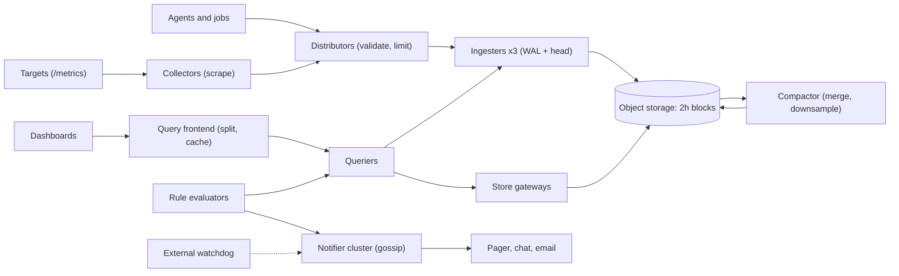

## In one minute
- **Active series count sets the size of the system, not sample count.** Every distinct label set has its own index entry and in-memory chunk, so one `user_id` label can multiply the bill by a million. Cardinality limits are part of the product.
- **Recent data and old data are different problems.** The last two hours live in memory behind a write-ahead log because every alert reads them. Everything older becomes immutable compressed blocks in object storage, downsampled for long retention.
- **An alert is a state machine, not a threshold.** Each series moves through inactive, pending and firing, and the pending timer must survive evaluator restarts.
- **Notification is a separate pipeline built for humans.** Grouping, inhibition, silences and repeat intervals decide whether a 3 a.m. incident produces one page or four hundred. The notifier prefers sending a duplicate to losing a page.
- **The monitoring system must fail independently of what it watches.** It runs in its own failure domain, and something outside it checks that it is alive.

## Requirements

**Functional**
- Collect numeric metrics (counters, gauges, histograms) from about 100,000 targets: hosts, containers and managed services.
- Query with a label-matching language over arbitrary time ranges, for dashboards and ad hoc debugging.
- Let teams define alert rules as queries with a threshold, a `for` duration, labels (severity, team) and annotations (summary, runbook link).
- Route firing alerts to pager, chat and email by label, with grouping, silences and inhibition (suppress "pod not ready" while "node down" fires on the same node).
- Keep raw data for 15 days, 5-minute rollups for 1 year and 1-hour rollups for 5 years.

**Non-functional**
- A sample is queryable within 30 seconds of being scraped.
- A sustained breach pages someone within the rule's `for` duration plus one minute.
- No acknowledged sample is lost when one storage node dies.
- Dashboard queries over the last 6 hours return in under 1 second at p99.
- Overloaded dashboards never slow ingestion or alerting.

**Out of scope:** logs and traces (see [Log Aggregation](../sd/log-aggregation.md) and [Three Pillars of Observability](../sd/three-pillars-observability.md)), anomaly detection with machine learning, on-call scheduling and escalation policy (we hand off to a paging provider), and billing.

## Back-of-envelope
Round assumed numbers for a large company, not anyone's published figures.

- **Users:** about 5,000 engineers. The real traffic is machines.
- **Active series:** 100,000 targets × 1,000 series = 100M active series; with container churn, about 150M distinct series appear per day.
- **Ingest:** one scrape every 15 s gives 100M / 15 ≈ 6.7M samples/s. Load is flat across the day, but fleet-wide deploys create series in bursts, so provision for about 13M/s.
- **Wire:** about 100 bytes per text line, so 6.7M × 100 B ≈ 670 MB/s raw; Snappy-compressed remote write cuts that roughly 5×, to about 130 MB/s.
- **Raw storage:** the Gorilla paper reports about 1.37 bytes per sample, a 12x reduction from 16 raw bytes ([Gorilla, VLDB 2015](https://www.vldb.org/pvldb/vol8/p1816-teller.pdf)); call it 1.5 with index. 6.7M × 86,400 ≈ 580B samples/day × 1.5 B ≈ 870 GB/day, so 15 days raw ≈ 13 TB.
- **Rollups:** 5-minute rollups keep four values per 20 samples (5× smaller): 174 GB/day × 365 ≈ 64 TB for a year. 1-hour rollups keep four values per 240 samples (60× smaller): 14.5 GB/day × 1,825 ≈ 26 TB for five years, versus about 1.6 PB raw.
- **Ingester memory:** at about 4 KB per active series, 100M series need 400 GB; with replication factor 3, 1.2 TB, or about 40 hosts of 64 GB at half occupancy.
- **Queries:** 50,000 rules every 30 s ≈ 1,700 evaluations/s; 1,000 open dashboards × 20 panels every 30 s ≈ 670 queries/s, mostly over the last few hours.

## API

```text
# Collection: targets expose, collectors scrape (pull)
GET  /metrics            -> text exposition
     http_requests_total{service="cart",code="500"} 1027 1729000000000

# Collection: agents and short-lived jobs push (remote write)
POST /api/v1/push        body: snappy(protobuf WriteRequest)
     WriteRequest { timeseries: [ { labels: [{name, value}], samples: [{value, timestamp_ms}] } ] }
     -> 200 | 429 { reason: "per-tenant series limit 5000000 exceeded" }

# Query
GET  /api/v1/query_range?query=sum by (code)(rate(http_requests_total[5m]))&start=..&end=..&step=30s
     -> { resultType: "matrix", result: [ { metric: {code: "500"}, values: [[t, "12.4"], ...] } ] }

# Rules
PUT  /api/v1/rules/{namespace}/{group}
     { interval: "30s", rules: [ { alert: "CartErrors", expr: "...", for: "5m",
       keep_firing_for: "2m", labels: {severity: "page", team: "cart"},
       annotations: {summary: "...", runbook: "https://..."} } ] }
GET  /api/v1/alerts      -> [ { labels, state: "pending"|"firing", activeAt, value } ]

# Notification
POST /api/v2/silences    { matchers: [{name, value, isRegex}], startsAt, endsAt, createdBy, comment }
     -> { silenceID }
```

The `WriteRequest` above is the Remote-Write 1.0 shape. The 2.0 spec, still marked experimental, sends `io.prometheus.write.v2.Request` with every label string interned once in a `symbols` table, and adds native histograms, metadata, exemplars and a start timestamp for counters ([Remote-Write 2.0 spec](https://prometheus.io/docs/specs/prw/remote_write_spec_2_0/)). Remote write returns 429 instead of dropping silently, so a sender knows to back off and an operator can see which tenant hit which limit. Rules are stored per group because a group is the unit of scheduling: all rules in a group run in order, at one interval, on one evaluator.

## Data model

**Series identity.** A series is its sorted label set, including `__name__`, and its fingerprint is a 64-bit hash of that set. Every component routes, deduplicates and merges by fingerprint.

**Inverted index**, per time block: `(label_name, label_value) -> sorted postings list of series IDs`, plus a symbol table storing each string once. A query such as `{service="cart", code=~"5.."}` intersects postings lists, like a search engine over labels.

**Chunks**: `(series_id, chunk_start) -> compressed bytes`, about 120 samples each. The open chunk lives in ingester memory; closed chunks are memory-mapped, then packed into immutable 2-hour blocks in object storage.

**Partitioning.** Writes are spread across ingesters by fingerprint on a consistent-hash ring (see [Consistent Hashing](../sd/consistent-hashing.md)) with replication factor 3. Object storage is partitioned by tenant, then time range, because nearly every query names both.

**Rule groups**: `(tenant, namespace, group) -> versioned rule document`, assigned to evaluators by hashing the group key.

**Alert state**: `(rule_id, series_fingerprint) -> state, active_since, last_value`, written back as a synthetic series (Prometheus calls it `ALERTS_FOR_STATE`) so a restarted evaluator restores pending timers.

**Notification log** `(receiver, group_key) -> hash of alerts sent, sent_at` and **silences** `id -> matchers, starts_at, ends_at, creator, comment` are small and gossiped to every notifier.

## High-level design



**Write path.** Collectors find targets through service discovery, scrape every 15 s and batch samples into remote-write requests. A distributor validates labels, applies per-tenant limits, hashes each series to three ingesters and returns success once two have appended to their write-ahead log. Every two hours each ingester cuts its head into an immutable block and uploads it; the compactor merges replicas' blocks, removes duplicates and writes rollups.

**Read path.** The query frontend splits long ranges into one-day pieces, serves cached pieces and queues the rest per tenant. Queriers fan out to ingesters for recent data and to store gateways for older blocks, merge replicas and evaluate the expression. Queries over months read rollups.

**Alert path.** Each evaluator owns some rule groups. Every 30 s it runs each rule as an instant query, updates and persists per-series state, and sends firing alerts to every notifier instance, which group, silence, inhibit and deliver.

## Deep dives

### 1. Ingestion: pull or push, and the cardinality budget
Pull, where the collector scrapes `/metrics`, gives a free health signal (a failed scrape means the target is down or unreachable), lets the monitoring side control load, and lets an engineer curl the endpoint to see what is exported. Push suits short-lived jobs, serverless functions and devices behind NAT. Google's Monarch began by discovering and pulling from entities and moved to push because it improved robustness and scalability ([Monarch, VLDB 2020](https://www.vldb.org/pvldb/vol13/p3181-adams.pdf)); Prometheus-style fleets scrape locally and push upstream with remote write. I would scrape inside each cluster and push from there to the central distributors, so the hop that crosses the WAN carries batched, compressed, retried data.

The harder decision is cardinality. Samples are cheap; series are expensive, because each carries index entries and an open chunk. A `path` label with unbounded values, or a `pod` label on a deployment that rolls hourly, creates series that live briefly and then sit in the index for the rest of the block. I would enforce limits at three points: per metric name in the collector (drop or relabel before sending), per tenant at the distributor (active series and samples per second, answered with 429s), and per query (series touched and chunk bytes fetched). Hitting any limit raises an alert to the owning team. Cloudflare, running about 4.9 billion series across 916 Prometheus servers, defaults each scrape's `sample_limit` to 200 and patched Prometheus to drop only the excess new series rather than fail the whole scrape ([Cloudflare](https://blog.cloudflare.com/how-cloudflare-runs-prometheus-at-scale/)).

### 2. Storage: head block, blocks, compaction and rollups
Writes arrive for every series at once, in time order; queries read a few series over a range. Writing each sample where it finally belongs would mean millions of tiny random writes per second. Instead the ingester appends every sample to a sequential WAL and keeps per-series chunks in memory. A full chunk (about 120 samples, 30 minutes at 15 s) is written to disk and memory-mapped. Every two hours the head is cut into an immutable block: an index file, chunk files and metadata. This matches Prometheus's own layout: two-hour blocks, a WAL in 128 MB segments, and a reminder that local storage is neither clustered nor replicated, which is why the replicated ingester tier exists ([Prometheus storage docs](https://prometheus.io/docs/prometheus/latest/storage/)).

Immutability makes the rest simple. Blocks go to object storage, are cached anywhere and are compacted in the background without coordinating with writers. The compactor merges them into 12-hour and 24-hour blocks, which shrinks indexes and the number of objects a long query opens, and computes rollups. A rollup keeps min, max, sum and count per window, not an average, so dashboards still show peaks and means across windows stay correct. I considered a wide-column store with one row per series per hour, which pays for compaction and tombstones this data does not need, and columnar Parquet, which is great for scans across many series but weak at "this series, last hour, every 15 seconds".

### 3. Alert evaluation and delivery
A rule is a query plus a state machine per output series. When the expression first returns a series, it becomes pending and records `active_since`. If it is still returned after the `for` duration, it fires. If it disappears while pending, the timer resets silently; if it disappears while firing, it resolves, unless `keep_firing_for` holds it a little longer to stop a flapping metric from paging repeatedly. The practice below implements this.

Three details make alerting trustworthy. Pending timers must survive restarts, or every evaluator deploy resets every five-minute `for`; persisting and restoring `active_since` fixes that. Each rule group must have exactly one evaluator, assigned by consistent hashing, because a missed evaluation is cheaper than two owners racing on state. And evaluation must read data that has arrived: rules run with a small delay so a late sample does not look like a dip. Prometheus exposes this as a per-group `query_offset`, and a per-rule `limit` that discards a rule's output if it would produce too many alerts ([Prometheus rules docs](https://prometheus.io/docs/prometheus/latest/configuration/recording_rules/)).

What to alert on matters as much as how. A fixed threshold with `for: 5m` either pages on every blip or misses slow leaks. The SRE Workbook's answer is multiwindow, multi-burn-rate alerts on an SLO: for a 99.9% target, page when the error budget burns 14.4 times too fast over both the last hour and the last 5 minutes (2% of the monthly budget gone), page at 6x over 6 hours and 30 minutes, and open a ticket at 1x over 3 days. The short window, one twelfth of the long one, makes the alert stop about 5 minutes after errors stop instead of an hour later ([SRE Workbook, ch. 5](https://sre.google/workbook/alerting-on-slos/)).

Delivery groups alerts by labels such as `(cluster, alertname)`. A new group waits `group_wait` (30 s by default in Alertmanager) to collect siblings and sends one message; changes wait `group_interval` (5 minutes), and an unchanged firing group is re-sent every `repeat_interval` (4 hours) ([Alertmanager configuration](https://prometheus.io/docs/alerting/latest/configuration/)). Inhibition suppresses symptom alerts while a cause alert fires, and silences mute matching alerts during maintenance. Notifiers run as a cluster of three with no leader. Every evaluator sends every alert to every notifier, never through a load balancer, which is exactly what Alertmanager's HA mode expects ([Alertmanager README](https://github.com/prometheus/alertmanager/blob/main/README.md)); instance *n* waits *n* × 15 s (the default `--cluster.peer-timeout`), then checks the gossiped notification log to see whether a peer already sent it. A partition can produce a duplicate page but not a lost one, a deliberate choice of availability over consistency.

## Down the stack

### Layer 1: The contract
A remote-write request that returned 200 is on at least two ingester WALs and is queryable within one scrape interval plus a few seconds. Queries are eventually consistent across replicas and merge by fingerprint and timestamp. A rule with `for: 5m` pages no sooner than five minutes after the condition first holds and, when healthy, no later than `for` + evaluation interval + `group_wait`: 5 min + 30 s + 30 s. Delivery is at least once.

### Layer 2: The mechanism
Within a chunk, timestamps are stored as a delta of deltas, so a steady 15 s interval costs one bit per sample. Values are XORed with the previous value and only the meaningful bits are written. Both tricks come from Facebook's Gorilla, which kept 26 hours of data in memory this way ([Gorilla, VLDB 2015](https://www.vldb.org/pvldb/vol8/p1816-teller.pdf)). The WAL is a sequence of 128 MB segments holding series records (labels, written once) and sample records (series reference, timestamp, value); a restarted ingester replays segments since the last checkpoint. A label query intersects sorted postings lists in a linear merge; regex matchers first expand against every value of that label, which is why `path=~".*"` on a high-cardinality label is slow. Notifiers replicate the notification log and silences with a gossip library (memberlist in Alertmanager), so a late joiner converges.

### Layer 3: The machine
At 6.7M samples/s and 16 raw bytes each, the fleet's WALs take about 107 MB/s, under 3 MB/s per ingester across 40 hosts: trivial sequential I/O. The cost is `fsync`, so WAL writes are batched and synced every few milliseconds rather than per request. Memory is the real limit. Each active series holds label strings, postings entries and an open chunk buffer, and the Go garbage collector scans all of it, so a cardinality spike shows up first as longer GC pauses, then as an out-of-memory kill. Memory-mapping closed chunks moves them from the heap to the page cache, which the kernel can evict. Store gateways fetch chunk ranges from object storage with HTTP range requests at 20 to 50 ms each, so they batch ranges and keep index headers on local disk.

### Why it's built this way
1. Every series gets a sample every 15 seconds and disks are slow at small random writes, so append to one sequential log and keep per-series data in memory.
2. Memory is finite and alerts read recent data, so keep only a few hours hot and cut the rest into immutable blocks.
3. Immutable blocks fit cheap object storage, but each read pays network latency, so compact to fewer objects and keep indexes local.
4. Five years at full resolution costs petabytes nobody reads, so downsample, keeping min, max, sum and count.
5. A missed page is worse than a duplicate, so notifiers replicate without consensus.

## Failure modes
- **10x load: cardinality explosion.** A release adds `customer_id` to a request counter and active series head from 100M toward 1B. Per-tenant limits at the distributor reject the new series with 429s, existing series keep flowing, and the owning team is alerted with the metric's name. Without limits, ingesters run out of memory one by one as the ring shifts load to survivors.
- **Ingester crash.** Writes need two of three replicas, so they continue, and queries read the other replicas while the replacement replays its WAL. Replicas are spread across zones so one zone cannot take two copies.
- **Region outage.** Each region writes locally and also ships critical SLO series to a second region. A watchdog alert that always fires goes to an external service, which pages if it stops arriving: a dead man's switch for the monitoring stack itself.
- **Hot key: one expensive query.** A dashboard runs `sum by (path)` over 30 days every 10 seconds. Per-tenant query queues, series and byte limits and the results cache contain it, and rule evaluators use their own querier pool so dashboards never delay alerts.
- **Alert storm.** A partition fires 4,000 alerts in a minute. Grouping by `(cluster, alertname)`, inhibition from a `ClusterUnreachable` cause alert and a per-receiver rate limit turn that into a handful of pages.
- **Late data and clock skew.** Samples too far in the future are rejected; a bounded out-of-order window and evaluation delay keep rates honest when a collector catches up.

## In the wild
- **Slack, 2021: the dashboards were behind the broken network.** On the first workday of 2021, AWS Transit Gateways could not scale fast enough for Slack's traffic and dropped packets; autoscaling then tried to add about 1,200 servers and the provisioning service hit its own limits. Slack's dashboards and alerting reached their databases through the same gateways, so they went dark during the outage. One fix was to put monitoring in the same VPC as its databases, the "fail independently" rule in this lesson ([Slack Engineering](https://slack.engineering/slacks-outage-on-january-4th-2021/)).
- **Cloudflare, 2024: a fail-open default in the log pipeline.** A config bug produced an empty Logpush configuration, and Logfwdr treated "no config" as "forward everything", an old failsafe. Buftee, which keeps one buffer per customer, jumped from about 1 million to 40 million buffers; its overload protections had never been configured, so it stopped responding and about 55% of customer logs were lost over roughly 3.5 hours. Telemetry pipelines need the same per-tenant limits as the services they watch ([Cloudflare](https://blog.cloudflare.com/cloudflare-incident-on-november-14-2024-resulting-in-lost-logs/)).
- **AWS, 2020: the status page depended on the failing service.** When Kinesis was impaired for about 17 hours, CloudWatch metrics and alarms were affected too, and alarms dropped into an insufficient-data state. AWS could not update its Service Health Dashboard early in the event because the posting tool itself used Cognito, which Kinesis had taken down; the backup tool was slower and less familiar. Status and alerting paths must not share dependencies with what they report on ([AWS](https://aws.amazon.com/message/11201/)).

## Trade-offs

| Option | Strengths | Weaknesses | Choose when |
|---|---|---|---|
| Pull (scrape) | Free up/down signal, collector controls load, easy to debug | Needs service discovery and network reach to every target | Long-lived services inside your network |
| Push (remote write, agents) | Works for short jobs and through NAT, batching across the WAN | Sender can overload receiver; no free liveness signal | Batch jobs, serverless, edge devices, cross-region |
| Single Prometheus per cluster | Simple, fast, few moving parts | No global view, retention limited by one disk | Under a few million series |
| Sharded ingesters plus object storage (Mimir, Cortex, Thanos) | Horizontal scale, long retention, global queries | Many components to run and tune | Tens of millions of series and up |
| Raw retention only | Exact answers forever | Storage grows linearly, slow long queries | Short retention or regulatory need |
| Downsampled rollups | Cheap long history, fast year-long graphs | Loses short spikes unless max is kept | Capacity planning and trend dashboards |
| Notifiers with consensus | Exactly one notification | Unavailable during partitions | Rarely; billing-style events |
| Gossip notifiers, at-least-once | Always pages | Occasional duplicate pages | Paging humans |

## Leadership lens
- **Build first:** collectors, distributors and ingesters with a WAL, plus rule evaluation and one notifier path to the pager. Teams can live without long retention for a quarter, not without trustworthy pages. Rollups and query caching come second.
- **Team ownership:** a platform observability team owns the pipeline, limits and SLOs of the monitoring system itself. Service teams own their rules, dashboards and series budgets. The most effective cost control is a weekly cardinality report that names metrics and owners.
- **Cost drivers:** ingester RAM (active series), object storage and request costs for blocks, and query compute for heavy dashboards. Raw sample volume matters much less than it looks.
- **Rollout:** run the new pipeline in parallel by dual-writing from collectors, compare query results and alert firings for weeks, then move rules team by team. Keep the old system able to page until the new one has caught an incident the old one also caught.
- **Review questions:** what pages if this system is down; what is our series limit per team and who approved it; which alerts fired last month without anyone acting on them.

## Check yourself
1. Why does the lesson size ingesters by active series rather than by samples per second, and roughly how much ingester memory do 100M active series need?
   **Answer:** Each series carries index entries, label strings and an open chunk in memory, while samples compress to about 1.5 bytes each and stream to a sequential WAL. At about 4 KB per series, 100M series need 400 GB, or 1.2 TB with replication factor 3.

2. A release adds a `customer_id` label to a request counter. What happens with per-tenant limits in place, and what happens without them?
   **Answer:** The distributor rejects the new series with 429s, existing series keep flowing, and the owning team is alerted with the metric's name. Without limits, ingesters run out of memory one by one as the ring shifts load onto the survivors.

3. Why does the notifier cluster use gossip and at-least-once delivery instead of consensus for exactly-once notifications?
   **Answer:** A missed page is worse than a duplicate one, and a consensus-based notifier would be unavailable during a partition. With gossip, instance n waits n times 15 s and checks the replicated notification log, so a partition can cause a duplicate page but not a lost one.

4. What goes wrong if an evaluator restarts without persisting alert state, and how does the design prevent it?
   **Answer:** Every pending alert's timer resets, so a deploy restarts every five-minute `for` and delays pages. The evaluator writes `active_since` back as a synthetic series (`ALERTS_FOR_STATE`) so a restarted evaluator restores its pending timers.

## Practice
**Task:** Build the alert evaluator and the notifier. `AlertRule(threshold, for_s)` keeps per-series state. `evaluate(now, values)` takes a map from series name to its current value; a series breaches when its value is strictly greater than `threshold`, and a series missing from the map does not breach. A breaching inactive series becomes pending with `since = now` and emits `("pending", s)`, or emits `("firing", s)` immediately if `for_s` is 0. A pending series fires and emits `("firing", s)` once `now - since >= for_s`. A pending series that stops breaching returns to inactive silently, and a firing one emits `("resolved", s)`. Return events sorted by series name. `Notifier(repeat_s)` has `silence(prefix, until)`, which mutes series whose names start with `prefix` while `now < until`, and `tick(now, firing)`, which takes the list of currently firing series and returns sorted `("firing", s)` messages for series not yet notified or last notified at least `repeat_s` ago, and `("resolved", s)` for series that were notified and are no longer firing. Muted series send nothing and are not marked as notified, so a series resolved while muted produces no message.

```python starter
class AlertRule:
    def __init__(self, threshold, for_s):
        pass

    def evaluate(self, now, values):
        # TODO: return sorted list of (event, series)
        raise NotImplementedError


class Notifier:
    def __init__(self, repeat_s):
        pass

    def silence(self, prefix, until):
        # TODO
        raise NotImplementedError

    def tick(self, now, firing):
        # TODO: return sorted list of ("firing" | "resolved", series)
        raise NotImplementedError
```

```python tests
def test_pending_then_firing():
    r = AlertRule(100, 60)
    assert r.evaluate(0, {"api": 150}) == [("pending", "api")]
    assert r.evaluate(30, {"api": 150}) == []
    assert r.evaluate(60, {"api": 150}) == [("firing", "api")]
    assert r.evaluate(90, {"api": 150}) == []

def test_zero_for_fires_immediately_and_threshold_is_strict():
    r = AlertRule(100, 0)
    assert r.evaluate(0, {"a": 100}) == [], "equal is not a breach"
    assert r.evaluate(15, {"a": 101}) == [("firing", "a")]

def test_blip_resets_timer_silently():
    r = AlertRule(10, 60)
    assert r.evaluate(0, {"db": 50}) == [("pending", "db")]
    assert r.evaluate(30, {"db": 5}) == []
    assert r.evaluate(45, {"db": 50}) == [("pending", "db")]
    assert r.evaluate(90, {"db": 50}) == []
    assert r.evaluate(105, {"db": 50}) == [("firing", "db")]

def test_missing_series_resolves_and_events_sorted():
    r = AlertRule(1, 0)
    assert r.evaluate(0, {"b": 5, "a": 5}) == [("firing", "a"), ("firing", "b")]
    assert r.evaluate(15, {"b": 5}) == [("resolved", "a")]
    assert r.evaluate(30, {}) == [("resolved", "b")]
    assert r.evaluate(45, {}) == []

def test_notifier_repeats_and_resolves():
    n = Notifier(100)
    assert n.tick(0, ["x"]) == [("firing", "x")]
    assert n.tick(50, ["x"]) == []
    assert n.tick(100, ["x", "y"]) == [("firing", "x"), ("firing", "y")]
    assert n.tick(120, ["y"]) == [("resolved", "x")]
    assert n.tick(130, []) == [("resolved", "y")]
    assert n.tick(140, []) == []

def test_silence_mutes_and_expires():
    n = Notifier(1000)
    n.silence("db-", 60)
    assert n.tick(0, ["db-1", "web-1"]) == [("firing", "web-1")]
    assert n.tick(30, ["db-1", "web-1"]) == []
    assert n.tick(60, ["db-1", "web-1"]) == [("firing", "db-1")], "silence over"

def test_resolved_while_muted_sends_nothing():
    n = Notifier(1000)
    n.silence("db-", 100)
    assert n.tick(0, ["db-1"]) == []
    assert n.tick(50, []) == []
    assert n.tick(200, []) == []
```

```python solution
class AlertRule:
    def __init__(self, threshold, for_s):
        self.threshold = threshold
        self.for_s = for_s
        self.state = {}  # series -> ("pending", since) or ("firing", since)

    def evaluate(self, now, values):
        events = []
        names = set(self.state) | set(values)
        for s in sorted(names):
            breach = s in values and values[s] > self.threshold
            cur = self.state.get(s)
            if breach:
                if cur is None:
                    if self.for_s == 0:
                        self.state[s] = ("firing", now)
                        events.append(("firing", s))
                    else:
                        self.state[s] = ("pending", now)
                        events.append(("pending", s))
                elif cur[0] == "pending" and now - cur[1] >= self.for_s:
                    self.state[s] = ("firing", cur[1])
                    events.append(("firing", s))
            elif cur is not None:
                del self.state[s]
                if cur[0] == "firing":
                    events.append(("resolved", s))
        return events


class Notifier:
    def __init__(self, repeat_s):
        self.repeat_s = repeat_s
        self.silences = []
        self.sent = {}  # series -> last notified time

    def silence(self, prefix, until):
        self.silences.append((prefix, until))

    def _muted(self, s, now):
        return any(s.startswith(p) and now < u for p, u in self.silences)

    def tick(self, now, firing):
        out = []
        current = set(firing)
        for s in sorted(current | set(self.sent)):
            if s in current:
                if self._muted(s, now):
                    continue
                last = self.sent.get(s)
                if last is None or now - last >= self.repeat_s:
                    self.sent[s] = now
                    out.append(("firing", s))
            else:
                del self.sent[s]
                out.append(("resolved", s))
        return out
```

```typescript starter
export type Event = [string, string];

export class AlertRule {
  constructor(threshold: number, forS: number) {}
  evaluate(now: number, values: Record<string, number>): Event[] {
    throw new Error("TODO");
  }
}

export class Notifier {
  constructor(repeatS: number) {}
  silence(prefix: string, until: number): void {
    throw new Error("TODO");
  }
  tick(now: number, firing: string[]): Event[] {
    throw new Error("TODO");
  }
}
```

```typescript tests
test("pending then firing", () => {
  const r = new AlertRule(100, 60);
  assertEqual(r.evaluate(0, { api: 150 }), [["pending", "api"]]);
  assertEqual(r.evaluate(30, { api: 150 }), []);
  assertEqual(r.evaluate(60, { api: 150 }), [["firing", "api"]]);
  assertEqual(r.evaluate(90, { api: 150 }), []);
});

test("zero for fires immediately and threshold is strict", () => {
  const r = new AlertRule(100, 0);
  assertEqual(r.evaluate(0, { a: 100 }), [], "equal is not a breach");
  assertEqual(r.evaluate(15, { a: 101 }), [["firing", "a"]]);
});

test("blip resets timer silently", () => {
  const r = new AlertRule(10, 60);
  assertEqual(r.evaluate(0, { db: 50 }), [["pending", "db"]]);
  assertEqual(r.evaluate(30, { db: 5 }), []);
  assertEqual(r.evaluate(45, { db: 50 }), [["pending", "db"]]);
  assertEqual(r.evaluate(90, { db: 50 }), []);
  assertEqual(r.evaluate(105, { db: 50 }), [["firing", "db"]]);
});

test("missing series resolves and events sorted", () => {
  const r = new AlertRule(1, 0);
  assertEqual(r.evaluate(0, { b: 5, a: 5 }), [["firing", "a"], ["firing", "b"]]);
  assertEqual(r.evaluate(15, { b: 5 }), [["resolved", "a"]]);
  assertEqual(r.evaluate(30, {}), [["resolved", "b"]]);
  assertEqual(r.evaluate(45, {}), []);
});

test("notifier repeats and resolves", () => {
  const n = new Notifier(100);
  assertEqual(n.tick(0, ["x"]), [["firing", "x"]]);
  assertEqual(n.tick(50, ["x"]), []);
  assertEqual(n.tick(100, ["x", "y"]), [["firing", "x"], ["firing", "y"]]);
  assertEqual(n.tick(120, ["y"]), [["resolved", "x"]]);
  assertEqual(n.tick(130, []), [["resolved", "y"]]);
  assertEqual(n.tick(140, []), []);
});

test("silence mutes and expires", () => {
  const n = new Notifier(1000);
  n.silence("db-", 60);
  assertEqual(n.tick(0, ["db-1", "web-1"]), [["firing", "web-1"]]);
  assertEqual(n.tick(30, ["db-1", "web-1"]), []);
  assertEqual(n.tick(60, ["db-1", "web-1"]), [["firing", "db-1"]], "silence over");
});

test("resolved while muted sends nothing", () => {
  const n = new Notifier(1000);
  n.silence("db-", 100);
  assertEqual(n.tick(0, ["db-1"]), []);
  assertEqual(n.tick(50, []), []);
  assertEqual(n.tick(200, []), []);
});
```

```typescript solution
export type Event = [string, string];

export class AlertRule {
  private state = new Map<string, { kind: string; since: number }>();
  constructor(private threshold: number, private forS: number) {}

  evaluate(now: number, values: Record<string, number>): Event[] {
    const events: Event[] = [];
    const names = new Set<string>([...this.state.keys(), ...Object.keys(values)]);
    for (const s of [...names].sort()) {
      const breach = s in values && values[s] > this.threshold;
      const cur = this.state.get(s);
      if (breach) {
        if (cur === undefined) {
          const kind = this.forS === 0 ? "firing" : "pending";
          this.state.set(s, { kind, since: now });
          events.push([kind, s]);
        } else if (cur.kind === "pending" && now - cur.since >= this.forS) {
          cur.kind = "firing";
          events.push(["firing", s]);
        }
      } else if (cur !== undefined) {
        this.state.delete(s);
        if (cur.kind === "firing") events.push(["resolved", s]);
      }
    }
    return events;
  }
}

export class Notifier {
  private silences: Array<[string, number]> = [];
  private sent = new Map<string, number>();
  constructor(private repeatS: number) {}

  silence(prefix: string, until: number): void {
    this.silences.push([prefix, until]);
  }

  private muted(s: string, now: number): boolean {
    return this.silences.some(([p, u]) => s.startsWith(p) && now < u);
  }

  tick(now: number, firing: string[]): Event[] {
    const out: Event[] = [];
    const current = new Set(firing);
    const names = new Set<string>([...current, ...this.sent.keys()]);
    for (const s of [...names].sort()) {
      if (current.has(s)) {
        if (this.muted(s, now)) continue;
        const last = this.sent.get(s);
        if (last === undefined || now - last >= this.repeatS) {
          this.sent.set(s, now);
          out.push(["firing", s]);
        }
      } else {
        this.sent.delete(s);
        out.push(["resolved", s]);
      }
    }
    return out;
  }
}
```

```go starter
package practice

type Event struct {
	Kind   string
	Series string
}

type AlertRule struct{}

func NewAlertRule(threshold float64, forS int) *AlertRule { return &AlertRule{} }

func (r *AlertRule) Evaluate(now int, values map[string]float64) []Event {
	panic("TODO")
}

type Notifier struct{}

func NewNotifier(repeatS int) *Notifier { return &Notifier{} }

func (n *Notifier) Silence(prefix string, until int) { panic("TODO") }

func (n *Notifier) Tick(now int, firing []string) []Event { panic("TODO") }
```

```go tests
package practice

import "testing"

func same(t *testing.T, got, want []Event, msg string) {
	t.Helper()
	if len(got) != len(want) {
		t.Fatalf("%s: got %v want %v", msg, got, want)
	}
	for i := range got {
		if got[i] != want[i] {
			t.Fatalf("%s: got %v want %v", msg, got, want)
		}
	}
}

func TestPendingThenFiring(t *testing.T) {
	r := NewAlertRule(100, 60)
	same(t, r.Evaluate(0, map[string]float64{"api": 150}), []Event{{"pending", "api"}}, "t0")
	same(t, r.Evaluate(30, map[string]float64{"api": 150}), nil, "t30")
	same(t, r.Evaluate(60, map[string]float64{"api": 150}), []Event{{"firing", "api"}}, "t60")
	same(t, r.Evaluate(90, map[string]float64{"api": 150}), nil, "t90")
}

func TestZeroForAndStrictThreshold(t *testing.T) {
	r := NewAlertRule(100, 0)
	same(t, r.Evaluate(0, map[string]float64{"a": 100}), nil, "equal is not a breach")
	same(t, r.Evaluate(15, map[string]float64{"a": 101}), []Event{{"firing", "a"}}, "fires")
}

func TestBlipResetsTimer(t *testing.T) {
	r := NewAlertRule(10, 60)
	same(t, r.Evaluate(0, map[string]float64{"db": 50}), []Event{{"pending", "db"}}, "t0")
	same(t, r.Evaluate(30, map[string]float64{"db": 5}), nil, "t30")
	same(t, r.Evaluate(45, map[string]float64{"db": 50}), []Event{{"pending", "db"}}, "t45")
	same(t, r.Evaluate(90, map[string]float64{"db": 50}), nil, "t90")
	same(t, r.Evaluate(105, map[string]float64{"db": 50}), []Event{{"firing", "db"}}, "t105")
}

func TestMissingResolvesSorted(t *testing.T) {
	r := NewAlertRule(1, 0)
	same(t, r.Evaluate(0, map[string]float64{"b": 5, "a": 5}), []Event{{"firing", "a"}, {"firing", "b"}}, "t0")
	same(t, r.Evaluate(15, map[string]float64{"b": 5}), []Event{{"resolved", "a"}}, "t15")
	same(t, r.Evaluate(30, map[string]float64{}), []Event{{"resolved", "b"}}, "t30")
	same(t, r.Evaluate(45, map[string]float64{}), nil, "t45")
}

func TestNotifierRepeatsAndResolves(t *testing.T) {
	n := NewNotifier(100)
	same(t, n.Tick(0, []string{"x"}), []Event{{"firing", "x"}}, "t0")
	same(t, n.Tick(50, []string{"x"}), nil, "t50")
	same(t, n.Tick(100, []string{"x", "y"}), []Event{{"firing", "x"}, {"firing", "y"}}, "t100")
	same(t, n.Tick(120, []string{"y"}), []Event{{"resolved", "x"}}, "t120")
	same(t, n.Tick(130, nil), []Event{{"resolved", "y"}}, "t130")
	same(t, n.Tick(140, nil), nil, "t140")
}

func TestSilenceMutesAndExpires(t *testing.T) {
	n := NewNotifier(1000)
	n.Silence("db-", 60)
	same(t, n.Tick(0, []string{"db-1", "web-1"}), []Event{{"firing", "web-1"}}, "t0")
	same(t, n.Tick(30, []string{"db-1", "web-1"}), nil, "t30")
	same(t, n.Tick(60, []string{"db-1", "web-1"}), []Event{{"firing", "db-1"}}, "silence over")
}

func TestResolvedWhileMutedSendsNothing(t *testing.T) {
	n := NewNotifier(1000)
	n.Silence("db-", 100)
	same(t, n.Tick(0, []string{"db-1"}), nil, "t0")
	same(t, n.Tick(50, nil), nil, "t50")
	same(t, n.Tick(200, nil), nil, "t200")
}
```

```go solution
package practice

import (
	"sort"
	"strings"
)

type Event struct {
	Kind   string
	Series string
}

type alertState struct {
	firing bool
	since  int
}

type AlertRule struct {
	threshold float64
	forS      int
	state     map[string]*alertState
}

func NewAlertRule(threshold float64, forS int) *AlertRule {
	return &AlertRule{threshold: threshold, forS: forS, state: map[string]*alertState{}}
}

func (r *AlertRule) Evaluate(now int, values map[string]float64) []Event {
	names := map[string]bool{}
	for s := range r.state {
		names[s] = true
	}
	for s := range values {
		names[s] = true
	}
	keys := make([]string, 0, len(names))
	for s := range names {
		keys = append(keys, s)
	}
	sort.Strings(keys)
	var events []Event
	for _, s := range keys {
		v, ok := values[s]
		breach := ok && v > r.threshold
		cur := r.state[s]
		switch {
		case breach && cur == nil:
			if r.forS == 0 {
				r.state[s] = &alertState{firing: true, since: now}
				events = append(events, Event{"firing", s})
			} else {
				r.state[s] = &alertState{since: now}
				events = append(events, Event{"pending", s})
			}
		case breach && !cur.firing && now-cur.since >= r.forS:
			cur.firing = true
			events = append(events, Event{"firing", s})
		case !breach && cur != nil:
			delete(r.state, s)
			if cur.firing {
				events = append(events, Event{"resolved", s})
			}
		}
	}
	return events
}

type silence struct {
	prefix string
	until  int
}

type Notifier struct {
	repeatS  int
	silences []silence
	sent     map[string]int
}

func NewNotifier(repeatS int) *Notifier {
	return &Notifier{repeatS: repeatS, sent: map[string]int{}}
}

func (n *Notifier) Silence(prefix string, until int) {
	n.silences = append(n.silences, silence{prefix, until})
}

func (n *Notifier) muted(s string, now int) bool {
	for _, x := range n.silences {
		if strings.HasPrefix(s, x.prefix) && now < x.until {
			return true
		}
	}
	return false
}

func (n *Notifier) Tick(now int, firing []string) []Event {
	current := map[string]bool{}
	for _, s := range firing {
		current[s] = true
	}
	names := map[string]bool{}
	for s := range current {
		names[s] = true
	}
	for s := range n.sent {
		names[s] = true
	}
	keys := make([]string, 0, len(names))
	for s := range names {
		keys = append(keys, s)
	}
	sort.Strings(keys)
	var out []Event
	for _, s := range keys {
		if current[s] {
			if n.muted(s, now) {
				continue
			}
			last, ok := n.sent[s]
			if !ok || now-last >= n.repeatS {
				n.sent[s] = now
				out = append(out, Event{"firing", s})
			}
		} else {
			delete(n.sent, s)
			out = append(out, Event{"resolved", s})
		}
	}
	return out
}
```

## Mock interview
**Prompt:** Design a monitoring and alerting system for a company with 100,000 hosts and containers, about 100 million active series, 15-second resolution and five years of history. Engineers write their own alert rules, and a page must reach on-call within a minute of a rule's `for` duration expiring.

- Follow-up: A team ships a release that adds a `user_id` label to their request counter. Walk me through what happens in your system over the next ten minutes, and what you want to happen.
- Follow-up: Your rule evaluator restarts during a deploy while 30 alerts are pending with `for: 10m`. What do on-call engineers experience, and how do you fix it?
- Follow-up: Why not make the notifier cluster use consensus so every alert is sent exactly once?

**A strong answer covers:**
- Active series as the unit of cost, with cardinality limits enforced at the collector, the distributor and the query path, and visible per team.
- A write path of WAL-backed in-memory head blocks replicated three ways with quorum writes, cut into immutable blocks in object storage, compacted and downsampled with min, max, sum and count.
- Rules as per-series state machines with persisted `active_since`, one owner per rule group, and evaluation on a querier pool isolated from dashboards.
- Notification with grouping, inhibition, silences and repeat intervals, replicated by gossip, deliberately at least once.
- Meta-monitoring: a dead man's switch to an external service and cross-region copies of critical SLO series.

## Sources and further study
**Primary**
- [Pelkonen et al., "Gorilla: A Fast, Scalable, In-Memory Time Series Database" (VLDB 2015)](https://www.vldb.org/pvldb/vol8/p1816-teller.pdf): delta-of-delta timestamps and XOR value compression, 1.37 bytes per point.
- [Prometheus Remote-Write 2.0 specification](https://prometheus.io/docs/specs/prw/remote_write_spec_2_0/): the experimental successor to the 1.0 wire format, with string interning and native histograms.

**Systems docs**
- [Prometheus storage](https://prometheus.io/docs/prometheus/latest/storage/): head block, two-hour blocks, WAL segments, retention defaults and the limits of local storage.
- [Alertmanager configuration](https://prometheus.io/docs/alerting/latest/configuration/): routing tree, grouping timers and inhibition rules with their defaults.
- [Prometheus recording and alerting rule groups](https://prometheus.io/docs/prometheus/latest/configuration/recording_rules/): `query_offset`, `limit`, `for` and `keep_firing_for`.

**Books**
- *The Site Reliability Workbook*, Beyer et al. (Google), Ch 5 "Alerting on SLOs": six alerting strategies compared, ending with multiwindow, multi-burn-rate alerts ([read free](https://sre.google/workbook/alerting-on-slos/)).
- *Site Reliability Engineering*, Beyer et al. (Google), Ch 6 "Monitoring Distributed Systems": the four golden signals, symptoms versus causes, and why pages must be actionable ([read free](https://sre.google/sre-book/monitoring-distributed-systems/)).
- *System Design Interview, Volume 2*, Alex Xu and Sahn Lam, Ch 5 "Metrics Monitoring": the same question at interview depth, with pull versus push and time-series storage.

**Other curricula**
- [Azure Architecture Center: Health Endpoint Monitoring pattern](https://learn.microsoft.com/en-us/azure/architecture/patterns/health-endpoint-monitoring): frames monitoring from the outside in, with external probes checking functional endpoints, the same idea as the lesson's external watchdog.
- [AWS Builders' Library: Building dashboards for operational visibility](https://builder.aws.com/content/3Ev2iw3R3ahQOM8BT4OUR0WP51z/building-dashboards-for-operational-visibility): frames alarms as the primary mechanism and dashboards as human-facing triage views, with customer-experience metrics at the top.

## Watch
- [Monarch, Google's Planet-Scale Streaming Monitoring Infrastructure (George Talbot, AI Council)](https://www.youtube.com/watch?v=2mw12B7W7RI): a Google engineer on regional, in-memory, push-based monitoring at global scale.
- [Monarch, Google's Planet Scale Monitoring Infrastructure (Roberto Lupi, Codemotion Milan 2016)](https://www.youtube.com/watch?v=LlvJdK1xsl4): an earlier overview of the data model, query fan-out and design choices.

## Free resources
- [Monarch: Google's Planet-Scale In-Memory Time Series Database (VLDB 2020)](https://www.vldb.org/pvldb/vol13/p3181-adams.pdf): why Google chose availability over consistency for monitoring and how it splits regional and global query paths.
- [Grafana Mimir architecture](https://grafana.com/docs/mimir/latest/references/architecture/): distributors, ingesters, store gateways, compactor and query frontend, as a working reference for the design above.
- [Thanos design](https://thanos.io/tip/thanos/design.md/): how a sidecar ships Prometheus blocks to object storage and how downsampling and deduplication work.
- [Alerting rules (Prometheus docs)](https://prometheus.io/docs/prometheus/latest/configuration/alerting_rules/): exact semantics of `for`, `keep_firing_for`, labels and annotations.
- [Alertmanager](https://prometheus.io/docs/alerting/latest/alertmanager/): grouping, inhibition, silences and high availability.
- [Practical Alerting from Time-Series Data (Google SRE Book)](https://sre.google/sre-book/practical-alerting/): Borgmon's rule evaluation model and the lessons Google took from running it.
