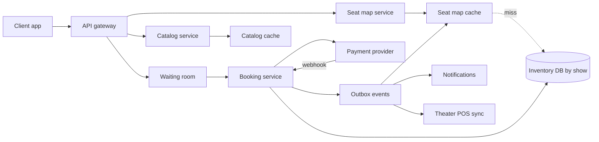

## In one minute
- The core invariant is "one seat, one show, at most one paid booking". Enforce it with a conditional write at a single source of truth per show, not with a cache or a distributed lock.
- Split purchase into **hold** and **confirm**. Payment takes minutes and lives in another company's system, so you cannot keep a database transaction open across it. A hold is a row state with an expiry time.
- Expiry must be **lazy**: a hold is dead the instant `now >= expires_at`, whether or not a cleanup job has run. Every read and every write evaluates that predicate.
- Partition inventory by `show_id`. All contention for a show is local to that show, so a hold for four seats is a single-shard transaction.
- Blockbuster openings are a hot-key problem. A virtual waiting room in front of the hold API protects the database, and seat maps are served from a short-lived cache.

## Requirements
Functional:
- Browse movies by city, then theaters and showtimes for a movie and date.
- View a seat map for a show with live availability.
- Select 1 to 10 seats and hold them for a fixed window (8 minutes here).
- Pay and receive a confirmed booking with a ticket code. Cancel within policy and get refunded.
- Expired or abandoned holds release seats automatically.

Non-functional:
- No double booking, ever. This is the correctness bar, and it outranks availability for the hold and confirm paths.
- Seat map reads p99 under 200 ms; hold p99 under 300 ms.
- Browse and seat-map reads stay up during a database failover, even if slightly stale.
- Survive opening-night spikes of 50 to 100 times normal traffic for a single show.

Out of scope: dynamic pricing, recommendations, food and beverage add-ons, the theater's own point-of-sale integration (we assume a sync API exists), and building a payment processor (we call one).

## Back-of-envelope
Planning numbers for a national aggregator, not measurements.

- Screens: 10,000. Shows per screen per day: 5. Shows per day: 50,000. Average seats per screen: 200. Seat-show inventory: 50,000 × 200 = 10M rows created per day.
- DAU: 5M. Each opens about 8 seat maps: 40M seat-map reads per day, or 40M / 86,400 ≈ 460 per second on average. Evening peak is about 5x: ~2,300/s.
- Bookings: 1M orders per day averaging 2.5 seats. Average order rate: 1M / 86,400 ≈ 12/s. Hold attempts run about 3x orders: ~35/s average, ~200/s at peak.
- Opening night for a franchise film: say 1M people arrive within 10 minutes for 2,000 shows that open together. That is 1,700 arrivals per second, with the hottest shows seeing thousands of hold attempts per second against 200 rows. This, not the average, drives the design.
- Storage: a `show_seats` row is about 60 bytes with overhead, so 10M × 60 B = 600 MB/day. A booking with its seat rows and payment metadata is about 1 KB, so 1 GB/day. Together roughly 1.6 GB/day, and 1.6 GB × 365 × 5 ≈ 2.9 TB over five years before indexes. Past shows are archived, so the hot set (next 14 days) is about 8.4 GB.
- Bandwidth: a compressed seat map is about 6 KB. At 2,300/s that is ~14 MB/s; on opening night at perhaps 30,000/s it is ~180 MB/s, so the map is cached and clients poll a small version number first.

## API
```text
GET  /v1/cities/{city}/movies?date=2026-10-16
GET  /v1/movies/{movieId}/shows?city=blr&date=2026-10-16
  -> [{showId, theaterId, screen, startsAt, priceBands}]

GET  /v1/shows/{showId}/seats
  -> {showId, version: 4182, seats: [{id:"F7", band:"gold", state:"available|held|sold"}]}

POST /v1/shows/{showId}/holds          Idempotency-Key: <uuid>
  {seatIds:["F7","F8"]}
  -> 201 {holdId:"h_9x2", expiresAt:"2026-10-16T19:08:00Z", amount: 640}
  -> 409 {unavailable:["F8"]}

DELETE /v1/holds/{holdId}               -> 204

POST /v1/holds/{holdId}/confirm        Idempotency-Key: <uuid>
  {paymentIntentId:"pi_..."}
  -> 200 {bookingId:"b_71", ticketCode:"QX7-..."}
  -> 410 {reason:"hold_expired", refund:"initiated"}

GET  /v1/users/me/bookings?cursor=...
```
The hold call takes an idempotency key because mobile clients retry on flaky networks; a retry must return the same hold, not create a second one that blocks the user's own seats.

## Data model
- `shows(show_id PK, screen_id, movie_id, starts_at, layout_version, city_id)`. Indexed by `(movie_id, city_id, starts_at)` for the browse query.
- `show_seats(show_id, seat_id, state, hold_id, hold_expires_at, booking_id, PRIMARY KEY (show_id, seat_id))`. **Partition key: `show_id`.** Every seat of a show lives in one shard and in a handful of adjacent pages, so multi-seat holds are single-shard and the seat map is one range scan. `state` is `AVAILABLE`, `HELD` or `SOLD`.
- `holds(hold_id PK, show_id, user_id, seat_ids, expires_at, status, idempotency_key UNIQUE)`. Lets us find what a hold covers and makes hold retries idempotent. Status is `ACTIVE`, `CONFIRMED`, `RELEASED` or `EXPIRED`.
- `bookings(booking_id PK, hold_id UNIQUE, user_id, show_id, amount, payment_intent_id UNIQUE, status, created_at)`. Secondary index on `(user_id, created_at)` for "my bookings". The unique constraint on `hold_id` means a confirmed hold can only ever produce one booking, which makes confirm retries safe.
- `booking_seats(show_id, seat_id, booking_id, UNIQUE (show_id, seat_id))`. A belt-and-braces constraint: even a bug in the hold logic cannot insert two bookings for the same seat.

Postgres or MySQL fits because the critical path needs atomic multi-row conditional updates and unique constraints. Shard by city in practice: a city's shows fit one primary, and every show stays inside one shard.

## High-level design


Write path. The client picks seats and calls create-hold. If the show is flagged hot, the gateway routes the call through the waiting room, which admits users at a rate the database can absorb. The booking service runs one transaction on the show's shard: a conditional update that flips the requested seats from available (or expired-held) to held, checks that the updated row count equals the number of requested seats, and inserts the hold row. If the count is short, it rolls back and returns which seats were taken. On success the client creates a payment intent with the provider, using the hold ID as the provider's idempotency key so a retried request replays the stored result instead of charging twice ([Stripe](https://stripe.com/blog/idempotency)), and the user pays. Confirm runs a second transaction that checks the hold is still the current owner of every seat and unexpired, flips seats to sold, inserts the booking and its seats, and writes an outbox event in the same commit.

Read path. Browse queries are almost entirely served from cache, since showtimes change a few times a day. The seat map service serves `GET /seats` from a cache keyed by `(show_id, version)` with a TTL of one or two seconds. A miss reads the show's 200 rows in one range scan from a replica and treats rows with a past `hold_expires_at` as available. Clients poll a tiny version endpoint every few seconds, or receive a push over server-sent events, and fetch the full map only when the version changes. Server-sent events suit this well: on reconnect the browser sends a `Last-Event-ID` header, so the server can resume from the last version the client saw ([WHATWG HTML spec](https://html.spec.whatwg.org/multipage/server-sent-events.html)).

## Deep dives

### Holding seats without double booking
Options considered. First, pessimistic locking: `SELECT ... FOR UPDATE` on the seats, check them in application code, then update. It is correct but holds locks across an app round trip. Second, a Redis lock per seat with `SET key value NX PX 480000`. It is fast, but Redis replication is asynchronous, so a failover can lose a lock and let a second user hold the same seat, a race the Redis docs themselves spell out ([Redis docs](https://redis.io/docs/latest/develop/clients/patterns/distributed-locks/)); the database still has to arbitrate. Third, one conditional `UPDATE` that makes the check and the write a single statement.

Choice: the conditional update. The statement sets `state='HELD', hold_id=$h, hold_expires_at=now()+interval '8 min'` where `show_id=$s AND seat_id = ANY($seats) AND (state='AVAILABLE' OR (state='HELD' AND hold_expires_at <= now()))`. If the returned row count is less than the number of seats requested, roll back. Because expiry is part of the predicate, an expired hold is reclaimable immediately; a sweeper exists only to tidy `holds.status` and emit cache-invalidation events. Redis can sit in front as an optional fast-fail filter during spikes, never as the authority.

### The payment race
The nastiest bug in this system is a payment that succeeds after the hold expired and someone else took the seat. Three mitigations combine. When the client starts payment, the service moves the hold into a `PAYMENT_PENDING` sub-state and extends it once by a few minutes, so a slow 3-D Secure challenge does not lose the seat. Confirm checks ownership with `hold_id=$h` rather than with time alone: if another hold now owns any seat, confirm fails. And confirm failure after a successful charge triggers an automatic refund through the same idempotent payment intent, plus an apology notification. We prefer authorise-then-capture: authorise when the user pays, capture only after confirm commits. A failed confirm then voids the authorisation, which is cheaper and faster for the user than a refund. An online card authorisation usually stays valid for about 7 days ([Stripe docs](https://docs.stripe.com/payments/place-a-hold-on-a-payment-method)), so the capture never races the authorisation's own expiry; the only clock that matters is the hold's.

Payment webhooks and client confirm calls can both arrive. Both call the same confirm path, and the unique constraint on `bookings.hold_id` turns the second one into a no-op that returns the existing booking.

### Opening night: one show, thousands of clicks
For the hottest shows, 5,000 hold attempts per second land on 200 rows. Conflicts serialise them, and most fail anyway because the seats are gone within a minute. Letting the database absorb it saturates connection pools for every show on the shard, and sharding further is impossible because the hot spot is one show.

Choice: a virtual waiting room keyed by show or by film release. Users get a signed, time-limited admission token in random or arrival order, and the gateway admits perhaps 100 users per second per hot show, matched to measured seat throughput. Production waiting rooms expose exactly these two knobs: Cloudflare's is configured with a cap on total active users and a rate of new users per minute ([Cloudflare](https://blog.cloudflare.com/cloudflare-waiting-room/)). Inside the booking service, requests for one show can also be serialised through a per-show in-memory queue on the shard owner, which turns lock contention into a cheap FIFO. Seat-map reads for hot shows come from the cache with a one-second TTL and request coalescing, so 30,000 viewers cause one database read per second.

## Down the stack

### Layer 1: The contract
A successful hold grants the caller exclusive rights to those seats until `expires_at` as measured by the database clock. No other hold can include those seats before then. A hold is all or nothing: either every requested seat is held or none is. Confirm succeeds only if the hold still owns every seat and has not expired; it is idempotent per hold, so retries return the same booking. Seat-map reads may be up to about two seconds stale; holds and confirms are linearisable per show because they run on its primary.

### Layer 2: The mechanism
In Postgres, the hold `UPDATE` scans the primary key index for the requested `(show_id, seat_id)` pairs, takes a row-level lock on each tuple (recorded in the tuple's `xmax` field), and writes a new tuple version. If another transaction holds a lock on one of those rows, ours waits. Under Read Committed, when the blocker commits, Postgres re-evaluates our `WHERE` clause against the newly committed version (the "EvalPlanQual" recheck) ([PostgreSQL docs](https://www.postgresql.org/docs/current/transaction-iso.html)). If the seat is now `HELD` and unexpired, the row no longer matches, is skipped, and our row count comes up short. That recheck is what makes the single-statement check-and-set safe without Serializable isolation.

Deadlocks are avoided by having every transaction lock rows in one consistent order ([PostgreSQL docs](https://www.postgresql.org/docs/current/explicit-locking.html)). Note that an `UPDATE` locks rows in the order its plan visits them, not in the order of the `seat_ids` array, so sorting the array alone proves nothing. An index scan on the `(show_id, seat_id)` key happens to visit seats in key order; to make the order explicit whatever the planner picks, run `SELECT ... WHERE ... ORDER BY seat_id FOR UPDATE` first, which sorts before it locks ([PostgreSQL docs](https://www.postgresql.org/docs/current/sql-select.html)), then the update. Because `state` and `hold_expires_at` are not indexed, Postgres can usually perform a HOT (heap-only tuple) update that writes no new index entries, but only if the old row's page has room for the new version; a `fillfactor` below 100 on `show_seats` reserves that room ([PostgreSQL docs](https://www.postgresql.org/docs/current/storage-hot.html)).

### Layer 3: The machine
A show's 200 seat rows at about 60 bytes each fit in two 8 KB heap pages. Reads are cheap (two buffer hits in RAM), but every hold on that show briefly takes an exclusive content lock on the same page. Commit cost is dominated by the WAL flush. On NVMe, `fdatasync` of a WAL page takes roughly 50 to 200 microseconds, and group commit batches concurrent transactions into one flush (Postgres's `commit_delay` lets a leader wait briefly so more commits share its sync ([PostgreSQL docs](https://www.postgresql.org/docs/current/wal-configuration.html))). With synchronous replication to a standby in another availability zone, add one network round trip, about 0.5 to 1 ms. A hold transaction therefore costs about 1 to 3 ms end to end on the database. Conflicting holds on the same rows serialise, so one show tops out somewhere in the hundreds to low thousands of holds per second, which is why admission control, not hardware, is the fix for opening night.

### Why it's built this way
1. Humans need minutes to choose and pay, and payment runs in another company's system, so we cannot hold a database transaction open; we model the reservation as data with an expiry.
2. Users abandon holds and processes crash, so release cannot depend on anyone remembering to clean up; expiry is a predicate on time evaluated at every access.
3. Correctness needs one arbiter with atomic conditional writes, so the database row is the truth and caches only accelerate reads.
4. Contention is naturally scoped to a show, so partitioning by show keeps every critical transaction on one shard and lets the rest of the fleet scale out.
5. A single show's rows cannot be split further, so the only lever at the hot spot is admitting fewer concurrent writers.

## Failure modes
- **10x load across the board.** Catalog and seat-map reads scale out via cache and replicas. The booking DB is the limit: watch connection-pool saturation and lock-wait time, and turn on the waiting room for any show whose hold rate crosses a threshold.
- **Region outage.** Inventory for a city lives in one home region with a synchronous standby in a second availability zone. Losing the region means failing over to an asynchronous cross-region replica that may lack the last second of writes. Mitigation: bookings are also durably recorded at the payment provider, so a reconciliation job replays provider-confirmed payments against the new primary and refunds any that now conflict. During failover, holds return 503 rather than risk split-brain.
- **Hot key.** One show, covered above. Also the catalog entry for a premiere film: serve it from CDN with a short TTL so the catalog service sees one request per edge per few seconds.
- **Payment provider slow or down.** Holds expire mid-payment. Extend `PAYMENT_PENDING` holds up to a cap, and pause new holds when the provider error rate crosses a threshold.
- **Clock skew.** All expiry comparisons use the database's `now()`, so there is one clock per show.

## In the wild
- **Ticketmaster, 2022: the Eras Tour presale.** About 3.5 million fans pre-registered for Verified Fan and roughly 1.5 million got codes, but bots and fans without codes drove 3.5 billion total system requests, four times Ticketmaster's previous peak. Ticketmaster slowed or postponed some sales to stabilise, which lengthened queues, and estimated that about 15% of interactions had problems, including passcode errors that dropped tickets already in carts. More than 2 million tickets still sold that day, a single-day record. Admission control held the inventory system up; the cost moved into the queue ([Ticketmaster, archived](https://web.archive.org/web/20230101022610/https://business.ticketmaster.com/business-solutions/taylor-swift-the-eras-tour-onsale-explained/)).
- **Cloudflare, 2021: building a waiting room that agrees with itself.** Cloudflare's Waiting Room, first used for COVID-19 vaccine booking sites, is configured as total active users plus new users per minute. Users are bucketed by arrival minute and the oldest buckets are admitted first. Each data centre's share of new slots is based on its traffic two minutes earlier, coordinated through per-data-centre Durable Objects reporting to one global object; Workers KV was ruled out because it is only eventually consistent. One county site absorbed surges of up to 23,000 users ([Cloudflare](https://blog.cloudflare.com/building-waiting-room-on-workers-and-durable-objects/)).
- **Stripe, 2019: when the failover is the outage.** A database minor version deployed three months earlier carried a latent bug, so when a shard's primary failed the shard could not elect a new one and stopped taking writes; most API requests failed for about 27 minutes. The rollback then interacted with a new configuration setting and caused a second, longer outage. Stripe added monitoring for stalled replication and per-cluster circuit breakers. It is the reason this design returns 503 on holds during a failover instead of guessing ([Stripe](https://stripe.com/rcas/2019-07-10)).

## Trade-offs
| Option | Strengths | Weaknesses | Choose when |
|---|---|---|---|
| Conditional UPDATE in the DB | Single arbiter, atomic, simple to reason about | Hot rows serialise; DB is the bottleneck | Default for seat inventory |
| Redis SET NX holds | Very fast, cheap TTL handling | Async replication can lose locks; needs DB check anyway | Front-line filter for spikes only |
| SELECT FOR UPDATE then update | Familiar, allows complex checks | Longer lock hold time, more deadlock risk | Holds need logic SQL cannot express |
| Waiting room | Protects DB, fair ordering | Extra infra, users wait | Any show with demand far above seats |
| Push seat map (SSE) vs poll | Fresher maps, fewer full fetches | Connection state at scale | Hot shows; poll is fine otherwise |

## Leadership lens
- Build first: `show_seats` plus hold, confirm and release with a property-based test that fires concurrent holds and asserts no seat is ever in two bookings. Everything else is plumbing around that core.
- Rollout: launch city by city behind a flag, reconciling with the theater POS nightly. Run the waiting room in shadow mode first to calibrate admission rates.
- Ownership: an inventory team owns holds and confirm; a payments team owns provider integration, refunds and reconciliation; catalog and seat-map read paths belong to a discovery team. The contract between inventory and payments (hold ID as payment idempotency key) is the most important interface to write down.
- Cost drivers: the booking DB sized for opening-night peaks, payment fees per transaction, and CDN egress for seat maps. Prefer admission control to over-provisioning that DB.

## Check yourself
1. Why does the hold use a single conditional `UPDATE` with a row-count check instead of a Redis `SET NX` lock per seat?
   **Answer:** Redis replication is asynchronous, so a failover can lose a lock and let a second user hold the same seat, which means the database has to arbitrate anyway. The conditional update makes the check and the write one atomic statement at the single source of truth, and a short row count rolls the whole hold back.

2. Why does the design not need a sweeper job to release expired holds for correctness?
   **Answer:** Expiry is part of the write predicate (`state='HELD' AND hold_expires_at <= now()` counts as available), and seat-map reads treat past `hold_expires_at` as available. A hold is dead the instant its time passes, so the sweeper only tidies `holds.status` and emits cache-invalidation events.

3. A card payment succeeds 30 seconds after the hold expired and another user now owns the seat. What does the system do?
   **Answer:** Confirm checks ownership by `hold_id`, sees another hold owns the seat and fails, returning 410. Because the design authorises then captures, the failed confirm voids the authorisation (or refunds through the same idempotent payment intent) and the user gets an apology notification.

4. Using the lesson's numbers, why is opening night a contention problem that more hardware or sharding cannot fix?
   **Answer:** The hottest shows see about 5,000 hold attempts per second against just 200 rows that fit in two 8 KB pages, and conflicting holds serialise, so one show tops out in the hundreds to low thousands of holds per second. A single show cannot be split further, so the only lever is a waiting room that admits about 100 users per second per hot show.

## Practice
**Task:** Build an in-memory seat map for one show with all-or-nothing multi-seat holds. The constructor takes a clock (a function with no arguments that returns the current time as an integer) and a hold TTL. `hold(user, seats)` returns a new hold ID (integers from 1, increasing) if every listed seat is free, or nothing if the list is empty or any seat is sold or under a live hold; a failed hold changes nothing. A hold created at time `t` is expired when `clock() >= t + ttl`, and expired holds no longer block anyone. `confirm(holdId)` marks the hold's seats sold if the hold is live, returns true, and returns true again on a repeat confirm of the same hold; it returns false for unknown, released or expired holds. `release(holdId)` frees a live hold's seats and returns true, otherwise false. `state(seat)` returns `"available"`, `"held"` or `"sold"`.

```python starter
class SeatMap:
    def __init__(self, clock, ttl):
        # TODO: store the clock and ttl, set up seat and hold tables
        pass

    def hold(self, user, seats):
        raise NotImplementedError

    def confirm(self, hold_id):
        raise NotImplementedError

    def release(self, hold_id):
        raise NotImplementedError

    def state(self, seat):
        raise NotImplementedError
```

```python tests
class FakeClock:
    def __init__(self):
        self.t = 0

    def __call__(self):
        return self.t


def test_hold_is_all_or_nothing():
    clk = FakeClock()
    m = SeatMap(clk, 10)
    assert m.hold("ann", ["A1", "A2"]) == 1
    assert m.hold("bob", ["A2", "A3"]) is None
    assert m.state("A3") == "available", "failed hold must not keep A3"
    assert m.state("A2") == "held"


def test_expired_hold_frees_seats():
    clk = FakeClock()
    m = SeatMap(clk, 10)
    h1 = m.hold("ann", ["B1"])
    clk.t = 10
    assert m.state("B1") == "available"
    h2 = m.hold("bob", ["B1"])
    assert h2 == 2
    assert not m.confirm(h1), "expired hold cannot confirm"
    assert m.confirm(h2)
    assert m.state("B1") == "sold"


def test_confirm_at_exact_expiry_fails():
    clk = FakeClock()
    m = SeatMap(clk, 5)
    h = m.hold("ann", ["C1", "C2"])
    clk.t = 5
    assert not m.confirm(h)
    assert m.state("C1") == "available"


def test_confirm_is_idempotent_and_blocks_others():
    clk = FakeClock()
    m = SeatMap(clk, 10)
    h = m.hold("ann", ["D1"])
    clk.t = 9
    assert m.confirm(h)
    clk.t = 500
    assert m.confirm(h), "retry of a confirmed hold still succeeds"
    assert m.hold("bob", ["D1"]) is None
    assert m.state("D1") == "sold"


def test_release_frees_and_is_single_use():
    clk = FakeClock()
    m = SeatMap(clk, 10)
    h = m.hold("ann", ["E1", "E2"])
    assert m.release(h)
    assert not m.release(h)
    assert not m.confirm(h)
    assert m.state("E1") == "available"
    assert m.hold("bob", ["E1", "E2"]) == 2


def test_empty_and_unknown():
    clk = FakeClock()
    m = SeatMap(clk, 10)
    assert m.hold("ann", []) is None
    assert not m.confirm(42)
    assert not m.release(42)
    assert m.state("Z9") == "available"
```

```python solution
class SeatMap:
    def __init__(self, clock, ttl):
        self.clock = clock
        self.ttl = ttl
        self.next_id = 1
        self.sold = {}    # seat -> hold_id that bought it
        self.owner = {}   # seat -> hold_id currently holding it
        self.holds = {}   # hold_id -> {"seats", "expires", "status"}

    def _live(self, hid):
        h = self.holds.get(hid)
        return h is not None and h["status"] == "active" and self.clock() < h["expires"]

    def state(self, seat):
        if seat in self.sold:
            return "sold"
        hid = self.owner.get(seat)
        if hid is not None and self._live(hid):
            return "held"
        return "available"

    def hold(self, user, seats):
        wanted = sorted(set(seats))
        if not wanted:
            return None
        for s in wanted:
            if self.state(s) != "available":
                return None
        hid = self.next_id
        self.next_id += 1
        self.holds[hid] = {"user": user, "seats": wanted,
                           "expires": self.clock() + self.ttl, "status": "active"}
        for s in wanted:
            self.owner[s] = hid
        return hid

    def confirm(self, hold_id):
        h = self.holds.get(hold_id)
        if h is None:
            return False
        if h["status"] == "confirmed":
            return True
        if not self._live(hold_id):
            return False
        h["status"] = "confirmed"
        for s in h["seats"]:
            self.sold[s] = hold_id
            self.owner.pop(s, None)
        return True

    def release(self, hold_id):
        if not self._live(hold_id):
            return False
        h = self.holds[hold_id]
        h["status"] = "released"
        for s in h["seats"]:
            if self.owner.get(s) == hold_id:
                del self.owner[s]
        return True
```

```typescript starter
export class SeatMap {
  constructor(clock: () => number, ttl: number) {}
  hold(user: string, seats: string[]): number | null {
    throw new Error("TODO");
  }
  confirm(holdId: number): boolean {
    throw new Error("TODO");
  }
  release(holdId: number): boolean {
    throw new Error("TODO");
  }
  state(seat: string): string {
    throw new Error("TODO");
  }
}
```

```typescript tests
test("hold is all or nothing", () => {
  let now = 0;
  const m = new SeatMap(() => now, 10);
  assertEqual(m.hold("ann", ["A1", "A2"]), 1);
  assertEqual(m.hold("bob", ["A2", "A3"]), null);
  assertEqual(m.state("A3"), "available", "failed hold must not keep A3");
  assertEqual(m.state("A2"), "held");
});

test("expired hold frees seats", () => {
  let now = 0;
  const m = new SeatMap(() => now, 10);
  const h1 = m.hold("ann", ["B1"])!;
  now = 10;
  assertEqual(m.state("B1"), "available");
  const h2 = m.hold("bob", ["B1"])!;
  assertEqual(h2, 2);
  assert(!m.confirm(h1), "expired hold cannot confirm");
  assert(m.confirm(h2), "live hold confirms");
  assertEqual(m.state("B1"), "sold");
});

test("confirm at exact expiry fails", () => {
  let now = 0;
  const m = new SeatMap(() => now, 5);
  const h = m.hold("ann", ["C1", "C2"])!;
  now = 5;
  assert(!m.confirm(h), "expired at ttl");
  assertEqual(m.state("C1"), "available");
});

test("confirm is idempotent and blocks others", () => {
  let now = 0;
  const m = new SeatMap(() => now, 10);
  const h = m.hold("ann", ["D1"])!;
  now = 9;
  assert(m.confirm(h), "confirm");
  now = 500;
  assert(m.confirm(h), "retry of a confirmed hold still succeeds");
  assertEqual(m.hold("bob", ["D1"]), null);
  assertEqual(m.state("D1"), "sold");
});

test("release frees and is single use", () => {
  let now = 0;
  const m = new SeatMap(() => now, 10);
  const h = m.hold("ann", ["E1", "E2"])!;
  assert(m.release(h), "release");
  assert(!m.release(h), "second release");
  assert(!m.confirm(h), "confirm after release");
  assertEqual(m.state("E1"), "available");
  assertEqual(m.hold("bob", ["E1", "E2"]), 2);
});

test("empty and unknown", () => {
  const m = new SeatMap(() => 0, 10);
  assertEqual(m.hold("ann", []), null);
  assert(!m.confirm(42), "unknown confirm");
  assert(!m.release(42), "unknown release");
  assertEqual(m.state("Z9"), "available");
});
```

```typescript solution
interface Hold {
  user: string;
  seats: string[];
  expires: number;
  status: "active" | "confirmed" | "released";
}

export class SeatMap {
  private nextId = 1;
  private sold = new Map<string, number>();
  private owner = new Map<string, number>();
  private holds = new Map<number, Hold>();

  constructor(private clock: () => number, private ttl: number) {}

  private live(id: number): boolean {
    const h = this.holds.get(id);
    return h !== undefined && h.status === "active" && this.clock() < h.expires;
  }

  state(seat: string): string {
    if (this.sold.has(seat)) return "sold";
    const id = this.owner.get(seat);
    if (id !== undefined && this.live(id)) return "held";
    return "available";
  }

  hold(user: string, seats: string[]): number | null {
    const wanted = Array.from(new Set(seats)).sort();
    if (wanted.length === 0) return null;
    for (const s of wanted) if (this.state(s) !== "available") return null;
    const id = this.nextId++;
    this.holds.set(id, { user, seats: wanted, expires: this.clock() + this.ttl, status: "active" });
    for (const s of wanted) this.owner.set(s, id);
    return id;
  }

  confirm(holdId: number): boolean {
    const h = this.holds.get(holdId);
    if (!h) return false;
    if (h.status === "confirmed") return true;
    if (!this.live(holdId)) return false;
    h.status = "confirmed";
    for (const s of h.seats) {
      this.sold.set(s, holdId);
      this.owner.delete(s);
    }
    return true;
  }

  release(holdId: number): boolean {
    if (!this.live(holdId)) return false;
    const h = this.holds.get(holdId)!;
    h.status = "released";
    for (const s of h.seats) if (this.owner.get(s) === holdId) this.owner.delete(s);
    return true;
  }
}
```

```go starter
package practice

type SeatMap struct{}

func NewSeatMap(clock func() int64, ttl int64) *SeatMap {
	return &SeatMap{}
}

// Hold returns the new hold ID and true, or 0 and false.
func (m *SeatMap) Hold(user string, seats []string) (int, bool) {
	panic("TODO")
}

func (m *SeatMap) Confirm(holdID int) bool {
	panic("TODO")
}

func (m *SeatMap) Release(holdID int) bool {
	panic("TODO")
}

func (m *SeatMap) State(seat string) string {
	panic("TODO")
}
```

```go tests
package practice

import "testing"

func TestHoldIsAllOrNothing(t *testing.T) {
	now := int64(0)
	m := NewSeatMap(func() int64 { return now }, 10)
	if id, ok := m.Hold("ann", []string{"A1", "A2"}); !ok || id != 1 {
		t.Fatalf("first hold: got %d %v", id, ok)
	}
	if _, ok := m.Hold("bob", []string{"A2", "A3"}); ok {
		t.Fatal("overlapping hold should fail")
	}
	if s := m.State("A3"); s != "available" {
		t.Fatalf("failed hold must not keep A3, got %s", s)
	}
	if s := m.State("A2"); s != "held" {
		t.Fatalf("A2 should be held, got %s", s)
	}
}

func TestExpiredHoldFreesSeats(t *testing.T) {
	now := int64(0)
	m := NewSeatMap(func() int64 { return now }, 10)
	h1, _ := m.Hold("ann", []string{"B1"})
	now = 10
	if s := m.State("B1"); s != "available" {
		t.Fatalf("expected available, got %s", s)
	}
	h2, ok := m.Hold("bob", []string{"B1"})
	if !ok || h2 != 2 {
		t.Fatalf("re-hold: got %d %v", h2, ok)
	}
	if m.Confirm(h1) {
		t.Fatal("expired hold cannot confirm")
	}
	if !m.Confirm(h2) || m.State("B1") != "sold" {
		t.Fatal("live hold should confirm")
	}
}

func TestConfirmAtExactExpiryFails(t *testing.T) {
	now := int64(0)
	m := NewSeatMap(func() int64 { return now }, 5)
	h, _ := m.Hold("ann", []string{"C1", "C2"})
	now = 5
	if m.Confirm(h) {
		t.Fatal("expired at ttl")
	}
	if m.State("C1") != "available" {
		t.Fatal("seat should be available")
	}
}

func TestConfirmIsIdempotentAndBlocksOthers(t *testing.T) {
	now := int64(0)
	m := NewSeatMap(func() int64 { return now }, 10)
	h, _ := m.Hold("ann", []string{"D1"})
	now = 9
	if !m.Confirm(h) {
		t.Fatal("confirm")
	}
	now = 500
	if !m.Confirm(h) {
		t.Fatal("retry of a confirmed hold still succeeds")
	}
	if _, ok := m.Hold("bob", []string{"D1"}); ok {
		t.Fatal("sold seat cannot be held")
	}
	if m.State("D1") != "sold" {
		t.Fatal("should be sold")
	}
}

func TestReleaseFreesAndIsSingleUse(t *testing.T) {
	now := int64(0)
	m := NewSeatMap(func() int64 { return now }, 10)
	h, _ := m.Hold("ann", []string{"E1", "E2"})
	if !m.Release(h) || m.Release(h) {
		t.Fatal("release should succeed once")
	}
	if m.Confirm(h) {
		t.Fatal("confirm after release")
	}
	if m.State("E1") != "available" {
		t.Fatal("seat should be free")
	}
	if id, ok := m.Hold("bob", []string{"E1", "E2"}); !ok || id != 2 {
		t.Fatalf("re-hold: got %d %v", id, ok)
	}
}

func TestEmptyAndUnknown(t *testing.T) {
	m := NewSeatMap(func() int64 { return 0 }, 10)
	if _, ok := m.Hold("ann", nil); ok {
		t.Fatal("empty hold should fail")
	}
	if m.Confirm(42) || m.Release(42) {
		t.Fatal("unknown hold")
	}
	if m.State("Z9") != "available" {
		t.Fatal("unknown seat is available")
	}
}
```

```go solution
package practice

import (
	"sort"
	"sync"
)

type hold struct {
	seats   []string
	expires int64
	status  string // active, confirmed, released
}

type SeatMap struct {
	mu     sync.Mutex
	clock  func() int64
	ttl    int64
	nextID int
	sold   map[string]int
	owner  map[string]int
	holds  map[int]*hold
}

func NewSeatMap(clock func() int64, ttl int64) *SeatMap {
	return &SeatMap{clock: clock, ttl: ttl, nextID: 1,
		sold: map[string]int{}, owner: map[string]int{}, holds: map[int]*hold{}}
}

func (m *SeatMap) live(id int) bool {
	h, ok := m.holds[id]
	return ok && h.status == "active" && m.clock() < h.expires
}

func (m *SeatMap) state(seat string) string {
	if _, ok := m.sold[seat]; ok {
		return "sold"
	}
	if id, ok := m.owner[seat]; ok && m.live(id) {
		return "held"
	}
	return "available"
}

func (m *SeatMap) State(seat string) string {
	m.mu.Lock()
	defer m.mu.Unlock()
	return m.state(seat)
}

func (m *SeatMap) Hold(user string, seats []string) (int, bool) {
	m.mu.Lock()
	defer m.mu.Unlock()
	set := map[string]bool{}
	wanted := []string{}
	for _, s := range seats {
		if !set[s] {
			set[s] = true
			wanted = append(wanted, s)
		}
	}
	sort.Strings(wanted)
	if len(wanted) == 0 {
		return 0, false
	}
	for _, s := range wanted {
		if m.state(s) != "available" {
			return 0, false
		}
	}
	id := m.nextID
	m.nextID++
	m.holds[id] = &hold{seats: wanted, expires: m.clock() + m.ttl, status: "active"}
	for _, s := range wanted {
		m.owner[s] = id
	}
	return id, true
}

func (m *SeatMap) Confirm(holdID int) bool {
	m.mu.Lock()
	defer m.mu.Unlock()
	h, ok := m.holds[holdID]
	if !ok {
		return false
	}
	if h.status == "confirmed" {
		return true
	}
	if !m.live(holdID) {
		return false
	}
	h.status = "confirmed"
	for _, s := range h.seats {
		m.sold[s] = holdID
		delete(m.owner, s)
	}
	return true
}

func (m *SeatMap) Release(holdID int) bool {
	m.mu.Lock()
	defer m.mu.Unlock()
	if !m.live(holdID) {
		return false
	}
	h := m.holds[holdID]
	h.status = "released"
	for _, s := range h.seats {
		if m.owner[s] == holdID {
			delete(m.owner, s)
		}
	}
	return true
}
```

## Mock interview
**Prompt:** Design a movie ticket booking platform for a country with about 10,000 screens and 5M daily users. Users pick a show, choose seats on a live map, hold them while paying, and must never be double booked, including on the opening night of a major franchise film.

- Follow-up: walk me through exactly what happens in the database when two users click "hold" on overlapping seats in the same millisecond.
- Follow-up: the card payment succeeds 30 seconds after the hold expired and another user already bought the seat. What does the system do, and what does the user see?
- Follow-up: why not keep holds only in Redis with a TTL?

**A strong answer covers:**
- Hold and confirm as two short transactions, with the hold modelled as data plus an expiry, and the expiry checked in the write predicate so no sweeper is needed for correctness.
- A single conditional update per hold with a row-count check, sorted seat order to avoid deadlocks, and a unique constraint on booked seats as a final guard.
- Partitioning by show (or city) so critical transactions are single-shard, and a clear statement that the hot show is a contention problem solved by admission control.
- The payment race: authorise then capture, hold ID as payment idempotency key, hold extension during payment, and automatic void or refund on a failed confirm.
- Cached seat maps with a short TTL and version polling, with the staleness bound stated.

## Sources and further study
**Primary**
- [A Critique of ANSI SQL Isolation Levels (Berenson, Bernstein, Gray et al., SIGMOD 1995)](https://arxiv.org/abs/cs/0701157): defines the anomalies (lost update, write skew) that a conditional update on a seat row must rule out.
- [Server-sent events (WHATWG HTML Living Standard)](https://html.spec.whatwg.org/multipage/server-sent-events.html): the reconnection and `Last-Event-ID` rules behind pushed seat-map versions.

**Systems docs**
- [Transaction isolation (PostgreSQL docs)](https://www.postgresql.org/docs/current/transaction-iso.html): exactly how Read Committed re-checks a `WHERE` clause after waiting on a row lock.
- [Heap-only tuples (PostgreSQL docs)](https://www.postgresql.org/docs/current/storage-hot.html): when an update skips index writes, and how `fillfactor` helps.
- [Distributed locks with Redis (Redis docs)](https://redis.io/docs/latest/develop/clients/patterns/distributed-locks/): the failover race that makes a Redis-only hold unsafe, stated by Redis itself.
- [Place a hold on a payment method (Stripe docs)](https://docs.stripe.com/payments/place-a-hold-on-a-payment-method): authorise-then-capture, authorisation windows by card network, and cancelling an authorisation.

**Books**
- Designing Data-Intensive Applications (Kleppmann, 1st ed., 2017), Ch 7 "Transactions": lost updates, write skew and the case for atomic conditional writes.
- System Design Interview, Volume 2 (Xu and Lam, 2022), Ch 7 "Hotel Reservation": the same inventory-hold problem with rooms instead of seats.

**Other curricula**
- [Queue-Based Load Leveling (Azure Architecture Center)](https://learn.microsoft.com/en-us/azure/architecture/patterns/queue-based-load-leveling): frames the waiting room as a buffer in front of a service, and warns it does not fit callers that need a synchronous answer.
- [Throttling pattern (Azure Architecture Center)](https://learn.microsoft.com/en-us/azure/architecture/patterns/throttling): frames admission as a control loop and argues for rejecting early and cheaply, with 429 or 503 plus `Retry-After`.

## Watch
- [System Design Interview: Design Ticketmaster w/ a Ex-Meta Staff Engineer (Hello Interview)](https://www.youtube.com/watch?v=fhdPyoO6aXI): a closely related interview walkthrough covering seat reservations and a waiting room for surges.
- ["Transactions: myths, surprises and opportunities" by Martin Kleppmann (Strange Loop Conference)](https://www.youtube.com/watch?v=5ZjhNTM8XU8): what isolation levels really guarantee, which is the foundation of the conditional update.

## Free resources
- [Explicit locking (PostgreSQL docs)](https://www.postgresql.org/docs/current/explicit-locking.html): row lock modes and how deadlocks are detected, relevant to multi-seat holds.
- [Range types and exclusion constraints (PostgreSQL docs)](https://www.postgresql.org/docs/current/rangetypes.html): a database-native way to forbid overlapping reservations when seats become time slots.
- [How to do distributed locking (Martin Kleppmann)](https://martin.kleppmann.com/2016/02/08/how-to-do-distributed-locking.html): why a lease in Redis is not enough for correctness without fencing.
- [Cloudflare Waiting Room (Cloudflare blog)](https://blog.cloudflare.com/cloudflare-waiting-room/): how a production virtual queue admits users at a controlled rate.
- [Making retries safe with idempotent APIs (AWS Builders' Library)](https://aws.amazon.com/builders-library/making-retries-safe-with-idempotent-apis/): the idempotency-token pattern behind safe hold and confirm retries.
