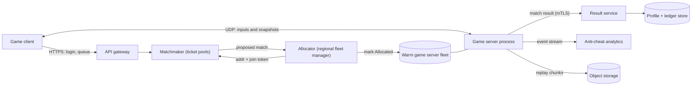

## In one minute
- **The game server is the only authority.** Clients send inputs, never results. One process per match runs a fixed-rate tick loop, owns all state and decides every hit, because any rule a client enforces, a cheater can skip.
- **Real-time state rides on UDP, with your own thin reliability layer.** Snapshots are small, frequent and disposable, so a lost one is replaced by the next. Only the few messages that must arrive (match start, purchases, chat) get acknowledgements and retransmits.
- **Hide latency with prediction, interpolation and rewind.** The client predicts its own movement, renders other players slightly in the past, and the server rewinds the world to what the shooter saw before judging a shot.
- **Matchmaking and server allocation are separate, slow-path systems.** A ticket queue forms matches with widening skill and latency rules, then a fleet manager hands the match a warm server in the right region. Neither is on the per-tick path.
- **Treat cheating as a design input.** Do not send what a player should not see, validate every input against physics limits, and keep the persistent economy (inventory, rank) behind a separate service that the game server can only ask politely.

## Requirements

**Functional**
- Players queue for a mode (for example 5v5) and are matched by skill, party and network latency.
- A match runs on a dedicated authoritative server for its whole length (10 players, about 25 minutes), with movement, shooting and objectives.
- Players can reconnect to a running match, and parties stay together.
- Results update rank, progression and inventory after the match, exactly once.
- Reports, replays and server-side anti-cheat signals feed enforcement.

**Non-functional**
- Round trip to the server under 60 ms for most players, with a tick rate of 64 to 128 Hz for competitive modes and 20 to 30 Hz for casual ones.
- No tick may overrun its time budget. A late tick is a visible stutter for ten people at once.
- Matchmaking median wait under 30 seconds at peak, longer off-peak, with a rule relaxation policy instead of a hard failure.
- A server crash costs one match, not the player's account or items.

**Out of scope**
- Rendering, physics engine internals, voice chat, and the anti-cheat client driver.
- Turn-based and peer-to-peer lockstep games, which have a very different shape ([Gaffer On Games](https://gafferongames.com/post/what_every_programmer_needs_to_know_about_game_networking/) compares the models).

## Back-of-envelope
Assume 20M daily players, 1M peak concurrent players (CCU) and 10-player matches of 25 minutes (1,500 s). All figures are planning assumptions, not measurements.

- **Matches:** 1M CCU / 10 = 100,000 concurrent matches. New matches per second = 100,000 / 1,500 = about 67 on average, so plan for about 200 at peak. Tickets: about 670 per second average, 2,000 at peak.
- **Tick CPU:** at 64 Hz a tick has 15.6 ms. If simulation, hit checks and snapshot building cost 1 ms per tick, one match uses 64 ms of CPU per second (6.4% of a core). At 80% target utilisation that is about 12 matches per core, so 100,000 / 12 = 8,300 cores, or about 260 hosts of 32 cores. Cutting the tick cost to 0.5 ms halves the fleet, which is why server frame time is a first-class metric.
- **Downstream bandwidth:** each player gets a delta-compressed snapshot at 30 Hz of about 400 bytes plus 28 bytes of IP and UDP headers. That is 428 x 30 = 12.8 KB/s, about 103 kbit/s. For 1M players: 103 Gbit/s and 30M packets per second.
- **Upstream:** inputs at 60 Hz of about 60 bytes with headers (88 on the wire) is 5.3 KB/s per player, 42 kbit/s, so 42 Gbit/s and 60M packets per second in total. Packet rate, not bytes, is the real cost on the NIC and the kernel.
- **Persistence:** one profile update per player per match is 670 writes/s on average, 2,000/s at peak. Match history of 1 KB per player per match, with 20M DAU x 3 matches, is 60 GB/day and about 110 TB over 5 years before compression. That is easy for a sharded store because every write is keyed by player.
- **Cost reality:** compute dominates. Bandwidth at 103 Gbit/s is serious money too, so snapshots stay small and idle spectators get a lower send rate.

## API
Gameplay traffic is a custom binary protocol over UDP. Control-plane calls are ordinary gRPC or HTTPS.

```text
# Control plane (HTTPS / gRPC), authenticated with the account token
POST /v1/tickets           {mode, party_ids[], skill{mu,sigma}, region_rtt_ms{"eu-w":28,"us-e":96}}
                           -> 201 {ticket_id, expires_in_s}
GET  /v1/tickets/{id}      -> {state: searching|found|cancelled|timeout,
                               match? {server_addr, port, join_token, expires_at}}
DELETE /v1/tickets/{id}
POST /v1/matches/{id}/result   (server-to-service only, mTLS)
                           {match_id, server_id, players[{id, stats, outcome}], seq}
                           -> 200 {applied: true}      # idempotent on match_id

# Data plane (UDP, one datagram = one message batch)
client -> server  INPUT     {conn_id, seq, ack_snapshot_tick, [ {input_seq, tick, move, aim, buttons} x3 ]}
server -> client  SNAPSHOT  {tick, last_input_seq_processed, baseline_tick, entities_delta[]}
both              RELIABLE  {msg_id, ack_bits, payload}    # chat, buy, round start
client -> server  CONNECT   {join_token, proto_version}     # signed by matchmaker, short TTL
```

Each `INPUT` repeats the last few inputs so one lost packet costs nothing. `last_input_seq_processed` tells the client which predicted inputs it can discard.

## Data model
Two stores with different jobs, and one piece of state that deliberately lives only in memory.

- **Player profile** (key-value or wide-column store, partition key `player_id`): `{player_id, rank{mu,sigma}, level, inventory_version, settings, last_match_id}`. Always read and written by player, so hash partitioning has no hot rows. `last_match_id` is the idempotency guard for result application.
- **Match result log** (append-only, partition key `match_id`, secondary lookup by `player_id`, time): `{match_id, region, server_build, players[], stats, replay_uri}`. Written once by the result service, read by history pages and cheat analysis.
- **Inventory ledger** (partition `player_id`, clustering `entry_id`): purchases and grants as immutable entries, with a materialised balance. Never mutated by a game server.
- **Ticket and session state** (Redis or an in-memory shard, key `ticket_id`, TTL 2 minutes): who is waiting, in which queue bucket. Losing it is fine because clients re-queue.
- **Match state** (server RAM only): the world, input queues and the snapshot history ring. It dies with the match. If it must survive, you snapshot to disk at round boundaries, not every tick.

## High-level design



**Queue to match path.**
1. The client posts a ticket with party, skill and measured round-trip time to each region (it pings a handful of regional endpoints at launch).
2. The matchmaker keeps tickets in pools keyed by mode and region group. A match function scans a pool, picks players whose skill spread and latency fit the current rules, and balances teams.
3. The allocator in the chosen region picks a `Ready` server from the warm fleet, marks it `Allocated`, and returns its address with a signed join token.
4. The clients receive the address and send `CONNECT` over UDP. The server validates the token, and the match starts when all slots have connected or a timer expires.

**In-match path.** Each tick the server drains the input queues, steps the simulation, appends a snapshot to its history ring, builds one delta snapshot per player (filtered by visibility) and sends it. At the end it posts a signed result to the result service, which applies it once and then tells the server to shut down. The fleet manager replaces it with a fresh warm server.

## Deep dives

### 1. Tick loop, state sync and lag compensation
**Tick loop.** The server queues inputs as they arrive and applies them on a fixed schedule, so the cost per match is predictable and does not depend on how fast players click ([Gambetta](https://www.gabrielgambetta.com/entity-interpolation.html)). Simulation steps use a fixed delta, not wall-clock time, so a late tick does not change the physics. If a tick runs long, the loop runs catch-up steps up to a cap and then drops them, rather than spiralling.

**Sync options.** Three designs were considered. *Lockstep* sends only commands and needs every peer to be deterministic and to wait for the slowest, which suits RTS games and fails for 100 ms-sensitive shooters. *Full state broadcast* is simple but wastes bandwidth. *Delta snapshots against an acknowledged baseline* send only what changed since the last snapshot the client confirmed, and quantise values (positions to centimetres, angles to 10 bits); [Gaffer On Games](https://gafferongames.com/post/snapshot_compression/) shows how far this compression can go. The choice is delta snapshots, with a full snapshot as the fallback when the baseline is too old.

**Hiding latency.** The client predicts its own movement immediately and reconciles when the server's answer arrives, replaying unacknowledged inputs on top of the authoritative state ([Gambetta](https://www.gabrielgambetta.com/client-side-prediction-server-reconciliation.html)). Other players are drawn by interpolating between two past snapshots, so everyone else is seen slightly in the past.

**Lag compensation.** That past view makes shots miss. When the client fires it sends its timestamp and aim, and the server reconstructs the world as the shooter saw it, then judges the shot there ([Gambetta](https://www.gabrielgambetta.com/lag-compensation.html)). The server needs a ring buffer of recent positions, which is exactly the Practice below. The price is real: the victim can be hit shortly after reaching cover. Riot describes the other side of the same latency, *peeker's advantage*, and reduces it with 128-tick servers, minimal buffering and nearby servers ([Riot](https://technology.riotgames.com/news/peeking-valorants-netcode)). The rewind cap is a fairness dial: too high and high-ping players hit people who already ducked, too low and they cannot hit anything.

### 2. Matchmaking and session allocation
**Matching.** A ticket pool is scanned by a match function that proposes candidate matches, and a separate step accepts or rejects proposals so one player is not put in two matches. Open Match splits this the same way, with a frontend for tickets, a match function and a director, plus an evaluator to resolve conflicts ([Open Match docs](https://open-match.dev/site/docs/)). FlexMatch expresses the rules declaratively, such as a maximum skill difference and a team structure, in a rule set ([AWS docs](https://docs.aws.amazon.com/gamelift/latest/flexmatchguide/gamelift-match.html)). The design choice is the relaxation schedule: start with a tight skill band and a 40 ms latency cap, widen both every 10 seconds, and put a floor on quality so a 5-minute search ends in cancel and a retry, not a bad match.

**Allocation.** Starting a process takes seconds to tens of seconds (load the map, warm caches), so servers are pre-started and idle. With Agones on Kubernetes, a game server reports `Ready` through its SDK, and a `GameServerAllocation` flips one to `Allocated` so it will not be scaled down or reused ([Agones GameServer](https://agones.dev/site/docs/reference/gameserver/)). Its allocation spec supports label selectors with fallbacks and a `Packed` strategy that fills nodes so empty ones can be removed ([Agones allocation](https://agones.dev/site/docs/reference/gameserverallocation/)). The alternatives are allocating on demand (cold starts, simple, wasteful) or letting the lobby host the match (cheap, but gives up authority and trust).

**Regions.** Pick the region from measured RTT, not from geography. For a mixed group, choose the region that minimises the worst player's RTT within a fairness bound, then check the bound: if one player would be at 180 ms, the matchmaker should keep searching or match that player into a closer pool. Keep warm capacity per region at a multiple of the expected arrival rate times the allocation time, plus a buffer for the daily peak.

### 3. Cheating and persistence
**Authority first.** The server validates every input: speed no higher than the movement rules allow, fire rate within the weapon's limit, and positions that stay inside the map. Out-of-range inputs are clamped or dropped and counted against the account, so a flood of them is a signal rather than a crash.

**Information control.** Authority does not stop a wallhack, because the client already holds enemy positions. The fix is to not send them. Riot's Fog of War marks enemies not relevant and stops replicating them unless line of sight is plausible, and it extends the check by velocity times a look-ahead longer than ping so players do not pop in late ([Riot](https://technology.riotgames.com/news/demolishing-wallhacks-valorants-fog-war)). The cost is CPU, so relevancy checks need their own share of the tick budget.

**Persistence.** A match is a transaction with the outside world, so the server never edits profiles. It posts one signed result keyed by `match_id`. The result service checks the signature, writes the match log entry and updates each profile conditionally on `last_match_id`, so a retry after a timeout is a no-op. Inventory purchases that happen mid-match go through the ledger service synchronously, not via the server. If the server dies before reporting, a watchdog marks the match void and nobody's rank moves, which is a better failure than guessing the winner.

## Down the stack

### Layer 1: The contract
The player-facing promise is a bound on the delay between input and effect. With a fixed tick of 64 Hz, the server applies an input at the next tick boundary (up to 15.6 ms wait) and a snapshot reaches the client one half-RTT later. The contract for the network is weaker: datagrams may be lost, duplicated, reordered or delayed, and the application must tolerate all four ([RFC 8085](https://www.rfc-editor.org/rfc/rfc8085) sets out what a UDP application must do for congestion and checksums). For results the contract is stronger: a match result applies exactly once, even with retries.

### Layer 2: The mechanism
Each connection carries a sequence number and an ack field with a bitmask of the previous 32 received packets, so both sides learn about loss in one round trip without a handshake per message. The reliable channel is built on top: messages are resent until a packet that carried them is acknowledged. Snapshots are never resent; the next one is built from the latest acknowledged baseline, so loss only widens the delta. The server remembers for each client the last acked snapshot tick and builds its delta from that. Inputs are redundant (the last three in every packet), which is cheaper than retransmission timers. Snapshot history is a ring buffer of the last 20 to 64 ticks, enough for rewind and for baselines.

### Layer 3: The machine
A game server reads UDP from a socket with `recvmmsg` and writes with `sendmmsg`, batching many datagrams per syscall because each syscall costs roughly a microsecond or more and 30 snapshots per tick for 10 players is 300 sends per second per match before inputs. The safe payload is bounded by the path MTU: Ethernet gives 1,500 bytes minus 20 (IP) and 8 (UDP), so 1,472, and QUIC pins its minimum usable datagram at 1,200 bytes for the same reason ([RFC 9000](https://www.rfc-editor.org/rfc/rfc9000)). Fragmented datagrams are lost whole if any fragment drops, so snapshots are split at the application layer. Receive buffers (`SO_RCVBUF`, capped by `net.core.rmem_max`) must hold a burst between ticks, and a socket whose buffer overflows silently drops. Per-core, the tick loop wants a pinned thread, no allocation on the hot path (a GC pause of 5 ms is a third of a 64 Hz tick), and cache-friendly entity arrays. Riot reduced its server frame from about 50 ms to under 2 ms by tuning code, hardware and OS settings, against a budget of 2.34 ms per frame derived from the 7.8125 ms 128 Hz tick, 3 games per core and 10% overhead ([Riot](https://technology.riotgames.com/news/valorants-128-tick-servers)). UDP has no connection state at the NIC, so one flooded port becomes a flooded server unless the edge filters it, which is why join tokens are checked on the first packet and cheaply.

### Why it's built this way
1. Light travels at about 200,000 km/s in fibre, so a 6,000 km path costs 30 ms one way. You cannot remove latency, so you hide it with prediction, interpolation and rewind.
2. Latency has to be hidden *by somebody*, and a client that is trusted to judge hits can lie. So the server is the authority, and the client is a prediction engine that is always corrected.
3. TCP delivers in order, so one lost packet stalls newer positions behind it. Old positions are worthless, so we use UDP and add reliability only where needed ([High Performance Browser Networking, ch. 3](https://hpbn.co/building-blocks-of-udp/)).
4. A server at tick rate T costs CPU in proportion to T, and a fleet of 8,000 cores is a business line. So the tick rate is tuned per mode, and every tick is measured.
5. Matches are short-lived and cold starts are slow, so servers are pre-warmed, allocation is a flag flip, and the server is thrown away at the end rather than cleaned.

## Worked example
Two players, Ana (RTT 40 ms) and Bo (RTT 120 ms), in a 64 Hz match with 100 ms of interpolation delay. Bo runs across open ground and Ana fires at the spot where Bo appears on her screen.

1. Ana's screen shows Bo as he was 120 ms before she fires: 20 ms for the snapshot to reach her plus 100 ms of interpolation delay. She fires and sends her aim.
2. Her packet reaches the server 20 ms later. The server computes the rewind as her full RTT plus interpolation, 40 + 100 = 140 ms, below the 200 ms cap, and looks up Bo's position at `now - 140`, interpolated between two ticks 15.6 ms apart.
3. The aim point is 0.2 m from that position and the hit radius is 0.3 m, so it is a hit. Without compensation the server would test against Bo's current position, about 140 ms of running (roughly 1 m at 7 m/s) away, and Ana would have missed a shot that looked perfect.
4. Bo, at 120 ms RTT, may have turned behind a crate 60 ms earlier on his screen. He sees himself die a moment after reaching cover. That is the cost, and it is bounded by the rewind cap.

Server-side the whole check is one array lookup, one interpolation and one distance compare per shot, well under 10 microseconds, which is why rewind is cheap compared with the snapshot build.

## Failure modes
- **10x load at launch or after a promotion.** The allocator runs out of warm servers and the queue grows. Mitigate with over-provisioned warm pools sized to the arrival rate x allocation time, a cap on queue admission that shows an honest wait estimate, and graceful degrade: lower the tick rate in casual modes before refusing players.
- **Tick overrun.** One heavy tick (a grenade chain, a map load) misses the deadline and the ten players see a hitch. Mitigate with per-subsystem frame telemetry, a per-tick budget, a cap on catch-up ticks, and load tests that replay recorded inputs.
- **Region outage.** Allocation fails over to the next-best region within the player's RTT bound, and the matchmaker marks the region unhealthy. Matches in the dead region are lost and voided, with no rank changes.
- **Hot spot: a streamer's lobby or a new event.** Many spectators or a viral mode concentrate on a single match or pool. Spectators read from a relay fed by the server at a lower rate, and the pool is sharded by a salt when it grows beyond the match function's scan budget.
- **Matchmaker double-assign.** Two match functions pick the same ticket. The accept step uses a conditional update per ticket, and the loser re-queues its other players at their original age.
- **Result lost or duplicated.** The server posts a result and the response times out. The idempotent result keyed by `match_id` makes the retry safe, and a watchdog voids matches with no result after a timeout.
- **DDoS on a game port.** A flood of UDP to one server drops the whole match. Mitigate with token-checked first packets, per-source rate limits at the edge, and the ability to move an Allocated match's clients to a fresh address only at the cost of ending the match.

## In the wild
- **Riot Games, 2020: server frames from 50 ms to under 2 ms.** VALORANT wanted free 128-tick servers, which leaves a 7.8125 ms frame. At 3 games per core and 10% overhead the target was 2.34 ms per frame, against a starting 50 ms. The team added subsystem telemetry, then optimised code, hardware and OS settings until frames were under 2 ms, and predicted its launch hardware needs within 1% ([Riot](https://technology.riotgames.com/news/valorants-128-tick-servers)).
- **Riot Games, 2020: Fog of War doubled frame times.** The first version ran ten raycast line-of-sight checks per relevancy calculation, did more than 350 of those calculations per frame in a 10-player game, and doubled frame times, effectively sending 128 tick back to 64. Replacing the raycasts with a precomputed potentially-visible-set lookup recovered the performance, and the look-ahead extension prevented late pop-in ([Riot](https://technology.riotgames.com/news/demolishing-wallhacks-valorants-fog-war)).
- **Niantic and Google Cloud, 2016: Pokemon GO launch.** Within 15 minutes of launching in Australia and New Zealand, traffic passed Niantic's expectations. The team had planned for 1x with a worst case near 5x, and traffic reached 50x the target. Google's reliability engineers provisioned extra capacity, upgraded GKE so the cluster could take more than a thousand additional nodes ahead of the Japan launch, and swapped the network load balancer for the HTTP/S one while the game was live ([Google Cloud](https://cloud.google.com/blog/products/gcp/bringing-pokemon-go-to-life-on-google-cloud)).

## Trade-offs

| Option | Strengths | Weaknesses | Choose when |
|---|---|---|---|
| Dedicated authoritative servers | Cheat resistance, fair hit rules, consistent latency | Fleet cost, allocation latency, regional capacity | Competitive and ranked modes |
| Listen server (a player hosts) | Almost free to run | Host advantage, host can cheat, NAT problems | Casual co-op, small studios |
| Peer-to-peer lockstep | Tiny bandwidth, no server | Waits for slowest peer, needs determinism | RTS with many units |
| 128 tick vs 30 tick | Lower input delay, smaller peeker's advantage | CPU and bandwidth scale with tick rate | Tactical shooters; not needed for slow games |
| Client-side hit detection | Best feel for the shooter | Trivially cheatable | Never for competitive play |
| Server rewind (lag compensation) | Shots land where players aimed | Victims are hit behind cover; needs history memory | Hit-scan weapons |
| Warm pool vs on-demand servers | Instant match start | Idle cost | Steady, predictable demand |
| Strict vs relaxed matchmaking | Fair games vs short waits | Quality or wait time suffers | Tune per mode and population size |

## Leadership lens
- **Build first:** one authoritative server with input queue, tick loop, prediction and interpolation on a single region, then bots to load test it. Matchmaking can be a simple FIFO pool until real numbers exist. Add lag compensation before launch, and fog-of-war style information control before anyone cares about ranked.
- **Ownership:** split into a gameplay-server team (tick, netcode), a platform team (matchmaking, fleet, regions), a live-services team (profile, inventory, economy) and a trust team (anti-cheat, moderation). The result contract between the first and third is the interface that must not break.
- **Cost drivers:** cores per match (tick rate x frame cost), egress bandwidth, idle warm capacity and multi-region duplication. Track games per core and cost per player-hour as top-level metrics, since Riot reached its budget by measurement.
- **Design review questions:** What is the tick budget and who owns it? What happens to a match when the allocator, result service or a region fails? What can a modified client see, and what can it send?
- **Operational reality:** every patch changes tick cost and the protocol version. Roll out by build to a small fleet slice and run old and new servers side by side for a while.

## Check yourself
1. A player reports being killed after they had already reached cover. Is this a bug, and what two numbers control how often it happens?
   **Answer:** It is the designed cost of server rewind. It grows with the shooter's latency plus interpolation delay, and it is bounded by the maximum rewind cap, so lowering the cap trades this complaint for missed shots from high-ping players.
2. Why not send enemy positions to every client and rely on the server to reject cheating inputs?
   **Answer:** Server validation stops fake actions but not reading data the client holds, so a wallhack works with perfectly valid inputs. The server has to withhold information that the player could not legitimately see.
3. At 64 Hz, a match costs 0.8 ms of CPU per tick and you target 75% utilisation. How many matches fit on one core, and what happens at 128 Hz?
   **Answer:** 0.8 ms x 64 = 51 ms per second, so 0.75 / 0.051 = about 14 matches per core. At 128 Hz, if cost per tick stays the same, it halves to 7, and the fleet doubles.
4. A match server posts the result, the network drops the response, and the server retries. How do you prevent double-counting?
   **Answer:** Key the result by `match_id` and update each profile conditionally on `last_match_id`, so the second application is a no-op and returns the same success.

## Practice
**Task:** Build the server-side lag compensator that a hit-scan shot is validated against. `LagCompensator(tick_ms, history, max_rewind_ms, clock)` keeps the last `history` snapshots. `record(tick, positions)` stores a snapshot taken at time `tick * tick_ms`, where `positions` maps a player id to `(x, y)`, and drops the oldest snapshot when more than `history` are held. `position_at(pid, t_ms)` clamps `t_ms` into the stored time range and linearly interpolates between the two surrounding snapshots; it returns `None` if the player is missing from either snapshot it needs. `check_hit(target, aim_x, aim_y, radius, latency_ms, interp_ms)` rewinds by `latency_ms + interp_ms` (negative inputs count as 0), capped at `max_rewind_ms`, so the shot is judged at `clock() - rewind`. It returns `(hit, rewind_ms)`, where a hit means the target's rewound position is within `radius` of the aim point (inclusive). An unknown target is a miss.

```python starter
class LagCompensator:
    def __init__(self, tick_ms, history, max_rewind_ms, clock):
        pass

    def record(self, tick, positions):
        # TODO: store (tick * tick_ms, copy of positions), keep only the last `history`
        raise NotImplementedError

    def position_at(self, pid, t_ms):
        # TODO: clamp t_ms, interpolate between surrounding snapshots, or None
        raise NotImplementedError

    def check_hit(self, target, aim_x, aim_y, radius, latency_ms, interp_ms):
        # TODO: return (hit, rewind_ms)
        raise NotImplementedError
```

```python tests
class FakeClock:
    def __init__(self):
        self.now = 0
    def __call__(self):
        return self.now

def make(history=8, max_rewind=200, now=100):
    c = FakeClock()
    c.now = now
    lc = LagCompensator(50, history, max_rewind, c)
    for tick in range(3):
        lc.record(tick, {"t": (tick * 50, 0)})
    return lc, c

def test_position_interpolates_between_snapshots():
    lc, _ = make()
    assert lc.position_at("t", 25) == (25, 0)
    assert lc.position_at("t", 50) == (50, 0)

def test_position_clamps_to_stored_range():
    lc, _ = make()
    assert lc.position_at("t", -500) == (0, 0)
    assert lc.position_at("t", 9999) == (100, 0)

def test_shot_is_judged_in_the_shooters_past():
    lc, _ = make()
    assert lc.check_hit("t", 50, 0, 5, 50, 0) == (True, 50)
    assert lc.check_hit("t", 50, 0, 5, 0, 0) == (False, 0), "no rewind: target already at x=100"

def test_interpolation_delay_adds_to_rewind():
    lc, _ = make()
    assert lc.check_hit("t", 50, 0, 5, 25, 25) == (True, 50)

def test_rewind_is_capped_so_huge_latency_cannot_hit_old_positions():
    lc, _ = make(max_rewind=60)
    assert lc.check_hit("t", 0, 0, 5, 500, 0) == (False, 60)
    assert lc.check_hit("t", 40, 0, 5, 500, 0) == (True, 60)

def test_oldest_snapshots_are_evicted():
    c = FakeClock()
    c.now = 150
    lc = LagCompensator(50, 2, 1000, c)
    for tick in range(4):
        lc.record(tick, {"t": (tick * 50, 0)})
    assert lc.position_at("t", 0) == (100, 0), "ticks 0 and 1 are gone"

def test_missing_entity_gives_none_and_miss():
    c = FakeClock()
    c.now = 100
    lc = LagCompensator(50, 8, 200, c)
    lc.record(0, {"a": (0, 0)})
    lc.record(1, {"a": (1, 0), "b": (5, 5)})
    lc.record(2, {"a": (2, 0), "b": (6, 5)})
    assert lc.position_at("b", 25) is None
    assert lc.position_at("b", 50) == (5, 5)
    assert lc.check_hit("ghost", 0, 0, 1000, 0, 0) == (False, 0)

def test_negative_latency_counts_as_zero():
    lc, _ = make()
    assert lc.check_hit("t", 100, 0, 5, -80, 0) == (True, 0)
```

```python solution
class LagCompensator:
    def __init__(self, tick_ms, history, max_rewind_ms, clock):
        self.tick_ms = tick_ms
        self.history = history
        self.max_rewind = max_rewind_ms
        self.clock = clock
        self.frames = []

    def record(self, tick, positions):
        self.frames.append((tick * self.tick_ms, dict(positions)))
        while len(self.frames) > self.history:
            self.frames.pop(0)

    def position_at(self, pid, t_ms):
        if not self.frames:
            return None
        t = min(max(t_ms, self.frames[0][0]), self.frames[-1][0])
        for i, (ta, pa) in enumerate(self.frames):
            if t == ta:
                return pa.get(pid)
            if i + 1 < len(self.frames) and t < self.frames[i + 1][0]:
                tb, pb = self.frames[i + 1]
                if pid not in pa or pid not in pb:
                    return None
                f = (t - ta) / (tb - ta)
                (xa, ya), (xb, yb) = pa[pid], pb[pid]
                return (xa + (xb - xa) * f, ya + (yb - ya) * f)
        return None

    def check_hit(self, target, aim_x, aim_y, radius, latency_ms, interp_ms):
        rewind = min(max(latency_ms, 0) + max(interp_ms, 0), self.max_rewind)
        pos = self.position_at(target, self.clock() - rewind)
        if pos is None:
            return (False, rewind)
        dx, dy = pos[0] - aim_x, pos[1] - aim_y
        return (dx * dx + dy * dy <= radius * radius, rewind)
```

The same problem in **TypeScript** and **Go**, with the same behaviour and equivalent tests.

```typescript starter
export type Clock = () => number;
export type Vec = { x: number; y: number };

export class LagCompensator {
  constructor(tickMs: number, history: number, maxRewindMs: number, clock: Clock) {}
  record(tick: number, positions: Record<string, Vec>): void { throw new Error("TODO"); }
  positionAt(pid: string, tMs: number): Vec | null { throw new Error("TODO"); }
  checkHit(target: string, aimX: number, aimY: number, radius: number, latencyMs: number, interpMs: number): [boolean, number] {
    throw new Error("TODO");
  }
}
```

```typescript tests
function make(history = 8, maxRewind = 200, now = 100): { lc: LagCompensator; clock: { now: number } } {
  const clock = { now };
  const lc = new LagCompensator(50, history, maxRewind, () => clock.now);
  for (let tick = 0; tick < 3; tick++) lc.record(tick, { t: { x: tick * 50, y: 0 } });
  return { lc, clock };
}

test("position interpolates between snapshots", () => {
  const { lc } = make();
  assertEqual(lc.positionAt("t", 25), { x: 25, y: 0 });
  assertEqual(lc.positionAt("t", 50), { x: 50, y: 0 });
});

test("position clamps to stored range", () => {
  const { lc } = make();
  assertEqual(lc.positionAt("t", -500), { x: 0, y: 0 });
  assertEqual(lc.positionAt("t", 9999), { x: 100, y: 0 });
});

test("shot is judged in the shooter's past", () => {
  const { lc } = make();
  assertEqual(lc.checkHit("t", 50, 0, 5, 50, 0), [true, 50]);
  assertEqual(lc.checkHit("t", 50, 0, 5, 0, 0), [false, 0], "no rewind: target already at x=100");
});

test("interpolation delay adds to rewind", () => {
  const { lc } = make();
  assertEqual(lc.checkHit("t", 50, 0, 5, 25, 25), [true, 50]);
});

test("rewind is capped", () => {
  const { lc } = make(8, 60);
  assertEqual(lc.checkHit("t", 0, 0, 5, 500, 0), [false, 60]);
  assertEqual(lc.checkHit("t", 40, 0, 5, 500, 0), [true, 60]);
});

test("oldest snapshots are evicted", () => {
  const lc = new LagCompensator(50, 2, 1000, () => 150);
  for (let tick = 0; tick < 4; tick++) lc.record(tick, { t: { x: tick * 50, y: 0 } });
  assertEqual(lc.positionAt("t", 0), { x: 100, y: 0 }, "ticks 0 and 1 are gone");
});

test("missing entity gives null and miss", () => {
  const lc = new LagCompensator(50, 8, 200, () => 100);
  lc.record(0, { a: { x: 0, y: 0 } });
  lc.record(1, { a: { x: 1, y: 0 }, b: { x: 5, y: 5 } });
  lc.record(2, { a: { x: 2, y: 0 }, b: { x: 6, y: 5 } });
  assert(lc.positionAt("b", 25) === null, "b absent from tick 0");
  assertEqual(lc.positionAt("b", 50), { x: 5, y: 5 });
  assertEqual(lc.checkHit("ghost", 0, 0, 1000, 0, 0), [false, 0]);
});

test("negative latency counts as zero", () => {
  const { lc } = make();
  assertEqual(lc.checkHit("t", 100, 0, 5, -80, 0), [true, 0]);
});
```

```typescript solution
export type Clock = () => number;
export type Vec = { x: number; y: number };

export class LagCompensator {
  private frames: { t: number; pos: Record<string, Vec> }[] = [];

  constructor(private tickMs: number, private history: number, private maxRewindMs: number, private clock: Clock) {}

  record(tick: number, positions: Record<string, Vec>): void {
    this.frames.push({ t: tick * this.tickMs, pos: { ...positions } });
    while (this.frames.length > this.history) this.frames.shift();
  }

  positionAt(pid: string, tMs: number): Vec | null {
    const f = this.frames;
    if (f.length === 0) return null;
    const t = Math.min(Math.max(tMs, f[0].t), f[f.length - 1].t);
    for (let i = 0; i < f.length; i++) {
      if (t === f[i].t) return f[i].pos[pid] ?? null;
      if (i + 1 < f.length && t < f[i + 1].t) {
        const a = f[i].pos[pid];
        const b = f[i + 1].pos[pid];
        if (!a || !b) return null;
        const k = (t - f[i].t) / (f[i + 1].t - f[i].t);
        return { x: a.x + (b.x - a.x) * k, y: a.y + (b.y - a.y) * k };
      }
    }
    return null;
  }

  checkHit(target: string, aimX: number, aimY: number, radius: number, latencyMs: number, interpMs: number): [boolean, number] {
    const rewind = Math.min(Math.max(latencyMs, 0) + Math.max(interpMs, 0), this.maxRewindMs);
    const p = this.positionAt(target, this.clock() - rewind);
    if (p === null) return [false, rewind];
    const dx = p.x - aimX;
    const dy = p.y - aimY;
    return [dx * dx + dy * dy <= radius * radius, rewind];
  }
}
```

```go starter
package practice

type Vec struct{ X, Y float64 }

type LagCompensator struct{}

func NewLagCompensator(tickMs float64, history int, maxRewindMs float64, clock func() float64) *LagCompensator {
	return &LagCompensator{}
}

func (l *LagCompensator) Record(tick int, positions map[string]Vec) {
	panic("TODO")
}

func (l *LagCompensator) PositionAt(pid string, tMs float64) (Vec, bool) {
	panic("TODO")
}

func (l *LagCompensator) CheckHit(target string, aimX, aimY, radius, latencyMs, interpMs float64) (bool, float64) {
	panic("TODO")
}
```

```go tests
package practice

import "testing"

func make3(history int, maxRewind, now float64) (*LagCompensator, *float64) {
	n := now
	lc := NewLagCompensator(50, history, maxRewind, func() float64 { return n })
	for tick := 0; tick < 3; tick++ {
		lc.Record(tick, map[string]Vec{"t": {float64(tick * 50), 0}})
	}
	return lc, &n
}

func TestPositionInterpolates(t *testing.T) {
	lc, _ := make3(8, 200, 100)
	if p, ok := lc.PositionAt("t", 25); !ok || p != (Vec{25, 0}) {
		t.Fatalf("got %v %v", p, ok)
	}
	if p, ok := lc.PositionAt("t", 50); !ok || p != (Vec{50, 0}) {
		t.Fatalf("got %v %v", p, ok)
	}
}

func TestPositionClamps(t *testing.T) {
	lc, _ := make3(8, 200, 100)
	if p, _ := lc.PositionAt("t", -500); p != (Vec{0, 0}) {
		t.Fatalf("low clamp: %v", p)
	}
	if p, _ := lc.PositionAt("t", 9999); p != (Vec{100, 0}) {
		t.Fatalf("high clamp: %v", p)
	}
}

func TestShotJudgedInThePast(t *testing.T) {
	lc, _ := make3(8, 200, 100)
	if hit, rw := lc.CheckHit("t", 50, 0, 5, 50, 0); !hit || rw != 50 {
		t.Fatalf("got %v %v", hit, rw)
	}
	if hit, rw := lc.CheckHit("t", 50, 0, 5, 0, 0); hit || rw != 0 {
		t.Fatalf("no rewind should miss, got %v %v", hit, rw)
	}
}

func TestInterpDelayAddsToRewind(t *testing.T) {
	lc, _ := make3(8, 200, 100)
	if hit, rw := lc.CheckHit("t", 50, 0, 5, 25, 25); !hit || rw != 50 {
		t.Fatalf("got %v %v", hit, rw)
	}
}

func TestRewindCapped(t *testing.T) {
	lc, _ := make3(8, 60, 100)
	if hit, rw := lc.CheckHit("t", 0, 0, 5, 500, 0); hit || rw != 60 {
		t.Fatalf("got %v %v", hit, rw)
	}
	if hit, rw := lc.CheckHit("t", 40, 0, 5, 500, 0); !hit || rw != 60 {
		t.Fatalf("got %v %v", hit, rw)
	}
}

func TestEviction(t *testing.T) {
	lc := NewLagCompensator(50, 2, 1000, func() float64 { return 150 })
	for tick := 0; tick < 4; tick++ {
		lc.Record(tick, map[string]Vec{"t": {float64(tick * 50), 0}})
	}
	if p, _ := lc.PositionAt("t", 0); p != (Vec{100, 0}) {
		t.Fatalf("ticks 0 and 1 should be gone, got %v", p)
	}
}

func TestMissingEntity(t *testing.T) {
	lc := NewLagCompensator(50, 8, 200, func() float64 { return 100 })
	lc.Record(0, map[string]Vec{"a": {0, 0}})
	lc.Record(1, map[string]Vec{"a": {1, 0}, "b": {5, 5}})
	lc.Record(2, map[string]Vec{"a": {2, 0}, "b": {6, 5}})
	if _, ok := lc.PositionAt("b", 25); ok {
		t.Fatal("b is absent from tick 0")
	}
	if p, ok := lc.PositionAt("b", 50); !ok || p != (Vec{5, 5}) {
		t.Fatalf("got %v %v", p, ok)
	}
	if hit, rw := lc.CheckHit("ghost", 0, 0, 1000, 0, 0); hit || rw != 0 {
		t.Fatal("unknown target must miss")
	}
}

func TestNegativeLatency(t *testing.T) {
	lc, _ := make3(8, 200, 100)
	if hit, rw := lc.CheckHit("t", 100, 0, 5, -80, 0); !hit || rw != 0 {
		t.Fatalf("got %v %v", hit, rw)
	}
}
```

```go solution
package practice

type Vec struct{ X, Y float64 }

type frame struct {
	t   float64
	pos map[string]Vec
}

type LagCompensator struct {
	tickMs, maxRewind float64
	history           int
	clock             func() float64
	frames            []frame
}

func NewLagCompensator(tickMs float64, history int, maxRewindMs float64, clock func() float64) *LagCompensator {
	return &LagCompensator{tickMs: tickMs, history: history, maxRewind: maxRewindMs, clock: clock}
}

func (l *LagCompensator) Record(tick int, positions map[string]Vec) {
	cp := make(map[string]Vec, len(positions))
	for k, v := range positions {
		cp[k] = v
	}
	l.frames = append(l.frames, frame{float64(tick) * l.tickMs, cp})
	for len(l.frames) > l.history {
		l.frames = l.frames[1:]
	}
}

func (l *LagCompensator) PositionAt(pid string, tMs float64) (Vec, bool) {
	f := l.frames
	if len(f) == 0 {
		return Vec{}, false
	}
	t := tMs
	if t < f[0].t {
		t = f[0].t
	}
	if t > f[len(f)-1].t {
		t = f[len(f)-1].t
	}
	for i := range f {
		if t == f[i].t {
			v, ok := f[i].pos[pid]
			return v, ok
		}
		if i+1 < len(f) && t < f[i+1].t {
			a, okA := f[i].pos[pid]
			b, okB := f[i+1].pos[pid]
			if !okA || !okB {
				return Vec{}, false
			}
			k := (t - f[i].t) / (f[i+1].t - f[i].t)
			return Vec{a.X + (b.X-a.X)*k, a.Y + (b.Y-a.Y)*k}, true
		}
	}
	return Vec{}, false
}

func (l *LagCompensator) CheckHit(target string, aimX, aimY, radius, latencyMs, interpMs float64) (bool, float64) {
	if latencyMs < 0 {
		latencyMs = 0
	}
	if interpMs < 0 {
		interpMs = 0
	}
	rewind := latencyMs + interpMs
	if rewind > l.maxRewind {
		rewind = l.maxRewind
	}
	p, ok := l.PositionAt(target, l.clock()-rewind)
	if !ok {
		return false, rewind
	}
	dx, dy := p.X-aimX, p.Y-aimY
	return dx*dx+dy*dy <= radius*radius, rewind
}
```

## Mock interview
**Prompt:** Design the backend for a 5v5 online shooter with 1M peak concurrent players across 6 regions. Players queue, get matched in under 30 seconds, play a 25-minute match on a server with sub-60 ms latency, and their rank updates afterwards. Cheating must be hard.

- Follow-up: A player at 150 ms RTT shoots a player at 20 ms RTT around a corner. Walk me through exactly what the server does and who gets complaints.
- Follow-up: Your game server host crashes in minute 18 of 1,000 matches at once. What do players see, what happens to their rank, and what do you fix first?
- Follow-up: Product wants 128 tick for every mode. How do you decide, and what would you measure before agreeing?

**A strong answer covers:**
- An authoritative server per match with a fixed-rate tick loop, input queues, and a CPU budget per tick turned into matches per core and a fleet size.
- UDP with sequence numbers and acks, delta snapshots from an acknowledged baseline, redundant inputs, and reliability only for the messages that need it.
- Client prediction with reconciliation, entity interpolation, and server-side rewind with a cap, plus the honest cost to the player who was hit behind cover.
- Matchmaking as ticket pools with a relaxation schedule over skill and latency, separate from allocation of warm servers in the chosen region.
- Cheat resistance by layers: input validation, withholding hidden information (fog of war), signed join tokens, server-side telemetry for analysis.
- Exactly-once result application keyed by match id, a void policy for crashed matches, and the failure modes at launch load and region loss.

## Sources and further study
**Primary**
- [RFC 8085: UDP Usage Guidelines](https://www.rfc-editor.org/rfc/rfc8085): what an application on UDP must handle itself, including congestion control and checksums.
- [RFC 9000: QUIC, transport](https://www.rfc-editor.org/rfc/rfc9000): the 1,200-byte minimum datagram size and a modern take on loss detection and acknowledgement over UDP.

**Systems docs**
- [Agones: GameServer](https://agones.dev/site/docs/reference/gameserver/): the Ready and Allocated lifecycle and the SDK that game servers call.
- [Agones: GameServerAllocation](https://agones.dev/site/docs/reference/gameserverallocation/): selectors, priorities and the Packed and Distributed strategies.
- [Open Match documentation](https://open-match.dev/site/docs/): frontend, match function, director and evaluator for building a matchmaker.
- [Amazon GameLift FlexMatch: how it works](https://docs.aws.amazon.com/gamelift/latest/flexmatchguide/gamelift-match.html): matchmakers, rule sets and game session queues.

**Books**
- *High Performance Browser Networking*, Ilya Grigorik, chapter 3 "Building Blocks of UDP": why UDP is the right base for real-time traffic and what it leaves to you.
- *Site Reliability Engineering*, Beyer et al. (Google), chapter 21 "Handling Overload": load shedding and graceful degradation, which apply to queue admission and warm pool exhaustion.

**Other curricula**
- [Gaffer On Games: Networking for Game Programmers](https://gafferongames.com/post/what_every_programmer_needs_to_know_about_game_networking/): a practitioner's course that walks from lockstep to snapshots, with separate articles on reliability and connection handling.

## Watch
- [Overwatch Gameplay Architecture and Netcode (GDC)](https://www.youtube.com/watch?v=W3aieHjyNvw): how a shipped shooter structures its simulation, prediction and server reconciliation.

## Free resources
- [Fast-Paced Multiplayer (Gabriel Gambetta)](https://www.gabrielgambetta.com/client-server-game-architecture.html): a four-part, diagram-led explanation of authority, prediction, interpolation and lag compensation.
- [Snapshot compression (Gaffer On Games)](https://gafferongames.com/post/snapshot_compression/): quantisation and delta encoding with measured bandwidth savings.
- [State synchronization (Gaffer On Games)](https://gafferongames.com/post/state_synchronization/): how to choose what to send and how to prioritise under a bandwidth budget.
- [Reliable ordered messages (Gaffer On Games)](https://gafferongames.com/post/reliable_ordered_messages/): building a reliable channel on top of UDP packets.
- [Peeking into VALORANT's Netcode (Riot)](https://technology.riotgames.com/news/peeking-valorants-netcode): peeker's advantage, hit registration and the latency budget of a competitive shooter.
- [Demolishing Wallhacks with VALORANT's Fog of War (Riot)](https://technology.riotgames.com/news/demolishing-wallhacks-valorants-fog-war): server-side relevancy as anti-cheat, and its CPU cost.
