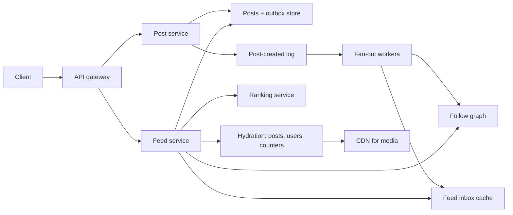

## In one minute
- The feed is a read-heavy merge problem. Reads outnumber posts by roughly 50 to 100 times, so the design pays at write time to make reads cheap, but only up to the point where paying becomes absurd.
- Use a hybrid delivery model. Ordinary authors fan out on write into a per-user feed inbox. Authors above a follower threshold (celebrities, big pages) are pulled at read time and merged in. One threshold decision removes the multi-million-write fan-out storm.
- Store feed inboxes as lists of post IDs only, in a memory-first store, capped at a few hundred entries per user. Post bodies, media and counters live elsewhere and are hydrated in bulk.
- Ranking is a separate stage. Candidate generation (inbox plus pulled posts) produces a few hundred to a few thousand candidates; a ranking service scores them; the API returns a page with an opaque cursor.
- Inactive users do not deserve fan-out. Skip inboxes for users who have not opened the app in weeks and rebuild their feed on demand when they return.

## Requirements
Functional:
- A user publishes a post (text, optional media) visible to friends or followers.
- A user opens the app and sees a ranked feed of posts from people and pages they follow, with infinite scroll.
- New posts from followed accounts appear within a few seconds for active users.
- Likes and comment counts are shown on each post.

Non-functional:
- Feed load p99 under about 300 ms server time for the first page.
- High availability for reads; a slightly stale feed is acceptable, an empty or error feed is not.
- Eventual consistency for delivery, with a target of a few seconds from post to visibility.
- Durability for posts: once acknowledged, a post is never lost.

Out of scope: the ranking model itself (we treat it as a service that scores candidates), ads insertion, media transcoding, messaging, search and privacy-setting edge cases beyond a simple audience check.

## Back-of-envelope
Assume 2 billion monthly users and 1 billion daily active users. These are round planning numbers, not Meta's published figures.

Reads: each DAU opens the feed about 10 times a day and each open fetches about 2 pages. That is 1B x 20 = 20B page requests per day. Divide by 86,400 seconds: about 230,000 requests per second on average. Peak at 3x average gives roughly 700,000 feed reads per second.

Writes: assume 1 in 5 DAUs posts once a day, so 200M posts per day, or about 2,300 per second on average and 7,000 per second at peak.

Fan-out: assume the median author has about 200 followers, but the mean is higher because of the long tail; say 300. If we fanned out every post we would write 200M x 300 = 60B inbox entries per day, about 700,000 per second. That is comparable to the read rate, which is why fan-out on write is affordable for most authors. A single post from an account with 100M followers alone would be 100M writes, which is why it is not affordable for everyone.

Storage for posts: about 1 KB of text and metadata per post, so 200M x 1 KB = 200 GB per day, about 73 TB per year, and about 365 TB over five years before replication. With 3 replicas, call it 1.1 PB. Media is far larger but sits in blob storage and a CDN, sized separately.

Storage for inboxes: each entry is a post ID (8 bytes), author ID (8 bytes), timestamp (8 bytes) and a few flags, so roughly 32 bytes. Capping inboxes at 500 entries for active users gives 1B x 500 x 32 B = 16 TB. Spread across a memory tier with replication, that is a few hundred cache servers with a few hundred GB each, which is expensive but routine at this scale.

Bandwidth: a feed page of 20 posts is about 20 KB of JSON before media. At 700,000 pages per second, that is 14 GB/s, or about 110 Gbit/s of API egress at peak. Images and video come from the CDN.

## API
```
POST /v1/posts
  body: { text, media_ids[], audience: "friends" | "public" }
  headers: Idempotency-Key
  -> 201 { post_id, created_at }

GET /v1/feed?cursor=<opaque>&limit=20
  -> 200 { items: [ { post_id, author{id,name,avatar}, text, media[],
                      like_count, comment_count, viewer_liked } ],
           next_cursor }

POST /v1/follows        body: { followee_id }   -> 204
DELETE /v1/follows/{followee_id}                -> 204
```
The cursor encodes the ranked snapshot ID and an offset, so scrolling does not reshuffle items already seen. The idempotency key stops a retried POST from creating a duplicate post.

## Data model
- **posts**: key `post_id` (64-bit, time-ordered like a Snowflake ID), columns `author_id`, `created_at`, `text`, `media_ids`, `audience`. Partition by `post_id` hash so writes spread evenly. Secondary access by author goes through the outbox below, not a global index.
- **author_outbox**: partition key `author_id`, clustering key `post_id DESC`. Every post is appended here. This is what read-time pull uses for celebrities, and what rebuilds use for inactive users. Partitioning by author keeps "latest N posts by X" a single-partition range scan.
- **follow_graph**: two adjacency lists, `followers(author_id -> follower_id)` and `following(user_id -> followee_id)`, each partitioned by the first column. Facebook's own graph store, TAO, has the same shape: an association list per `(id1, type)`, newest edge first, with the count kept alongside, serving about a billion reads per second from a read-optimized cache over MySQL ([TAO paper](https://www.usenix.org/system/files/conference/atc13/atc13-bronson.pdf)). Fan-out reads the followers list in pages; feed reads use the following list to find celebrities to pull. Store `follower_count` on the user record so the celebrity check is a single read.
- **feed_inbox**: key `user_id`, value a bounded sorted list of `(score_ts, post_id, author_id)`, held in a Redis-like memory store or an in-memory tier backed by a log. Partition by `user_id`. Capped length (for example 500) and trimmed on insert.
- **counters**: `post_id -> like_count, comment_count`, sharded counters with caching, since popular posts are write-hot.

The pattern is that each table is partitioned by the ID the hottest query starts from.

## High-level design


Write path: the client sends the post with an idempotency key. The post service writes the post row and the outbox entry, then appends a `PostCreated` event to a durable log partitioned by author. It acknowledges the client at this point, so post latency does not depend on fan-out. Fan-out workers consume the log, look up the author's follower count, and branch. If the author is below the celebrity threshold, they page through the follower list in chunks of about 1,000, filter out inactive followers, and push the post ID into each follower's inbox with a pipelined batch write. If the author is above the threshold, they do nothing beyond the outbox write already made.

Read path: the feed service loads the viewer's inbox (one key, one round trip). It loads the viewer's following list filtered to celebrities, a set that is usually small and is cached per user, and reads the latest few dozen posts from each celebrity outbox in parallel. It merges the two candidate sets, drops duplicates and posts the viewer has already seen, and sends a few hundred candidates to ranking. The top page is hydrated (post bodies, author profiles, counters, viewer-liked flags) via batched multi-gets and returned with a cursor. The ranked list is cached briefly so page 2 is a cache read.

## Deep dives

### Fan-out on write vs read, and the threshold
Pure push makes reads one key lookup, but a 100M-follower post becomes 100M writes and delays delivery for everyone queued behind it. Pure pull makes writes trivial, but a viewer following 500 accounts triggers 500 outbox reads per feed load, times 700,000 loads per second, which is hundreds of millions of reads per second.

The hybrid takes push for the long tail and pull for the head. The threshold is chosen from the read side: pulled authors add per-read work, so you want the number of pulled authors per viewer to be small (say under 20 to 50). A threshold in the range of tens of thousands to a few hundred thousand followers usually achieves that while removing the worst fan-out jobs. Treat the exact number as a tunable, set from production histograms. Production systems have sat at both ends of this spectrum. Twitter, in 2012, fanned every tweet out into Redis home timelines capped at 800 entries, served about 300K timeline reads per second against about 5K tweets per second, and accepted that a tweet from an account with 31 million followers could take up to 5 minutes to reach everyone ([High Scalability, from Raffi Krikorian's QCon talk](https://highscalability.com/the-architecture-twitter-uses-to-deal-with-150m-active-users/)). Facebook's News Feed went the other way. Its Multifeed system builds the feed at read time: an aggregator takes the request, queries leaf servers that index friends' recent actions in memory, then ranks the results. A tailer streams new actions into the leaves, so there is no per-viewer inbox at all ([Engineering at Meta](https://engineering.fb.com/2015/03/10/production-engineering/serving-facebook-multifeed-efficiency-performance-gains-through-redesign/)). That works because Facebook ranks heavily anyway, so it must touch many candidates per read. Say this in an interview: the hybrid is a sound default, but pull over an in-memory index is a legitimate answer when ranking dominates.

Edge cases to call out: an author crossing the threshold should not double-deliver (dedupe by post ID at merge), and pages run by teams with huge audiences but low posting rates could stay on push, so the decision can also weigh posting frequency. Yahoo's Feeding Frenzy paper made this precise: total cost is minimized by deciding push or pull separately for each producer and consumer pair, by comparing how often the producer posts with how often the consumer views the feed ([Silberstein et al., SIGMOD 2010](https://jeffterrace.com/docs/feeding-frenzy-sigmod10-web.pdf)). A follower threshold is a coarse version of that rule.

### Inactive users and inbox lifecycle
Most fan-out writes go to people who will not look today. Track `last_active_at`, and skip inbox writes for followers inactive for, say, 14 days. When such a user returns, the feed service sees a missing or stale inbox and rebuilds it by pulling from the outboxes of everyone they follow, bounded to the most recent posts, then writes the result as the new inbox. The first load is slower (it may take a second), so show a cached or partial result immediately and fill in. This one policy can cut fan-out volume by a large fraction because daily actives are a minority of total accounts.

### Ranking, pagination and freshness
Ranking needs features (author affinity, post age, engagement so far, content type) and runs a model per candidate. Do it in stages. Meta describes three passes for Facebook: a lightweight model narrows the eligible pool (more than 1,000 posts per user per day on average) to about 500, the main pass scores each of those independently as a weighted sum of predicted actions such as like, comment and share, and a final contextual pass applies rules such as content-type diversity ([Engineering at Meta](https://engineering.fb.com/2021/01/26/core-infra/news-feed-ranking/)). Pagination over a ranked feed cannot use "posts older than timestamp T" because ranked order is not time order. Instead, snapshot the ranked list under a session ID with a short TTL (a few minutes) and page by offset into it. New posts that arrive during scrolling appear on the next pull-to-refresh, which matches user expectations and keeps pages stable.

### Variant: a news aggregation service
A news aggregator looks like a feed but inverts the producer side. In a social feed, authors are your own users and every post arrives through your write API. In an aggregator the content lives on roughly 100k publisher sites you do not control, so you must go and get it, and the unit shown to readers is a story cluster, not a post.

**Ingestion replaces the write path.** Freshness is now a crawling problem. A fixed poll interval is wrong at both ends, so estimate each feed's publish rate with a moving average and set the next poll so about one new item is expected, clamped between 30 seconds and 2 hours, with jitter. Conditional GETs (`ETag`, `If-Modified-Since`, [RFC 9110 section 13](https://www.rfc-editor.org/rfc/rfc9110#section-13)) make an empty poll cost a few hundred bytes. Where publishers support WebSub, the hub pushes instead, but subscriptions carry a lease that must be renewed, so a catch-up poll is still needed. News sitemaps (last two days, at most 1,000 entries, [Google Search Central](https://developers.google.com/search/docs/crawling-indexing/sitemaps/news-sitemap)) cover sites with no usable feed. A per-domain token bucket keeps the crawler polite.

**Deduplication in two tiers.** An exact content hash drops syndicated copies. For lightly edited copies, shingle the text and compute MinHash signatures, then use locality-sensitive hashing so each arrival does a fixed number of bucket lookups instead of comparing against the last three days of articles. With 32 bands of 4 rows, a pair of true similarity 0.5 becomes a candidate about 87% of the time and a pair at 0.15 under 2% ([Lee et al.](https://arxiv.org/abs/2107.06499) show the same pipeline at corpus scale). Candidates are verified before merging.

**Clustering is the data model change.** Different articles about one event are grouped by shared entities plus embedding similarity against stories updated in the last 48 hours. When a bridging article joins two clusters, the older ID survives and the other becomes an alias, which keeps old links working.

**Ranking is per story and mostly precomputed.** Score a cluster by authority-weighted source count on a logarithmic curve (the 40th outlet adds little), a freshness term that decays from the newest article, and a velocity term for sources added recently. Compute a few hundred candidates per region and topic each minute, then rerank per user in memory using a topic-affinity vector. This replaces the per-user inbox: with 50M users but a shared candidate pool, there is nothing to fan out.

**Numbers shift.** Writes are tiny (about 17 new articles a second after dedup, around 90 in a burst) while reads peak near 17k feed loads a second, so the read cache and CDN-served thumbnails dominate cost, not storage writes.

## Down the stack

### Layer 1: The contract
A feed read returns, within about 300 ms, a page of posts the viewer is allowed to see, without duplicates within a session, from a snapshot that is at most a few seconds behind for active users. Posts are durable once acknowledged. Delivery is at-least-once into inboxes, so the merge must be idempotent by post ID. A deleted post must never be shown after hydration, even if its ID is still in inboxes, which means hydration is the authority and inbox entries are hints.

### Layer 2: The mechanism
The `PostCreated` log is partitioned by `author_id`, so a single author's posts are fanned out in order. Each fan-out worker holds a cursor into the follower list (`author_id`, last `follower_id`) and checkpoints it with the log offset, so a crashed worker resumes mid-list and re-sends at most one chunk. Inbox insert is a sorted-set add keyed by post ID (score is time or a first-pass score), followed by a trim to the cap, sent as one pipelined batch per destination shard. In Redis terms the inbox is a sorted set, which is a skip list plus a hash table, so each `ZADD` is O(log N) and reads come back already ordered ([Redis docs](https://redis.io/docs/latest/develop/data-types/sorted-sets/)). The read-time merge is a k-way merge of already-sorted lists (inbox plus N celebrity outboxes) using a heap, which costs O(total log k) and stops after enough candidates.

### Layer 3: The machine
An inbox read is one network round trip to a memory store: about 100 to 300 microseconds inside a data centre, plus serialising about 16 KB (500 entries x 32 bytes), which fits in roughly a dozen 1,460-byte TCP segments. Fan-out writes are batched because the per-command cost of a Redis-style server is dominated by syscalls and parsing, not by the data structure; pipelining 1,000 inserts into one `write` and one `epoll_wait` cycle can raise throughput by an order of magnitude. Hydration is the expensive part of a read: 20 posts times several stores. Batched multi-gets keep it to one round trip per store, issued in parallel, so the tail latency is set by the slowest shard. Ranking models run on CPUs or accelerators with feature vectors fetched from a cache; that step often dominates the 300 ms budget.

### Why it's built this way
- Reads are about 100 times more frequent than writes, so precompute at write time.
- Follower counts follow a power law, so precomputing for the head is unbounded work; pull those instead.
- Memory is expensive, so inboxes hold IDs only, are capped, and are skipped for inactive users.
- IDs in inboxes can go stale (deletes, privacy changes), so hydration re-checks every item and the inbox stays a cache.
- Ranked order is not time order, so pagination uses a snapshot rather than a timestamp cursor.

## Failure modes
- **10x load (a global event):** fan-out lag grows. Shed by priority: deliver to recently active users first, delay inactive ones, and temporarily lower the celebrity threshold so more authors move to pull. Reads degrade by skipping the heavy ranking pass and returning time-ordered candidates.
- **Region outage:** inboxes are a cache and can be rebuilt from outboxes and the graph, so failover only needs posts, outboxes and the graph replicated across regions. The surviving region serves feeds from rebuilt or replicated inboxes, with a short freshness gap. Rebuilds are the danger: a region of cold inboxes turns every feed load into a pull, so admit returning traffic gradually and cap rebuild concurrency, the slow-start and cold-cache problem the SRE book warns about ([Google SRE book](https://sre.google/sre-book/addressing-cascading-failures/)).
- **Hot key (a viral post):** its counters and hydration entry are read millions of times per second. Use local in-process caches with short TTLs, replicated copies of the post object, and sharded counters summed asynchronously. When the hot entry is invalidated, use leases so only one client refills it: Facebook's memcache hands out at most one lease token per key every 10 seconds and makes other clients wait briefly ([Scaling Memcache at Facebook](https://www.usenix.org/system/files/conference/nsdi13/nsdi13-final170_update.pdf)).
- **Fan-out worker stuck on a huge list:** a mid-size author with 500,000 followers posts repeatedly. Split large fan-outs into chunk tasks across many workers and cap per-author fan-out rate.
- **Inbox store shard loss:** feeds for those users fall back to pull-based rebuild until the shard is restored. This is slow but correct.

## In the wild
- **Facebook, 2010: a cache-fixing system takes the site down.** An automated system replaced cached configuration values that looked invalid with the value from the persistent store. When an invalid value reached the persistent store itself, every client saw it as invalid and queried one database cluster at once, and clients also deleted the cache key whenever that query failed, so the load fed itself. Facebook stopped all traffic to the cluster, which meant taking the site offline, and was down or unreachable for many users for about 2.5 hours, its worst outage in over four years. The correction system was switched off ([Engineering at Meta](https://engineering.fb.com/2010/09/23/uncategorized/more-details-on-today-s-outage/)).
- **Meta, 2021: bringing feeds back without a second crash.** On 4 October a backbone maintenance command disconnected every Meta data center, and power use dropped by tens of megawatts. Restoring all traffic at once risked electrical systems and caches, so engineers brought load back in stages, using what they had practised in storm drills that take whole regions offline. Every feed and cache came back cold, the same situation as an inbox shard loss here, but for everyone at once ([Engineering at Meta](https://engineering.fb.com/2021/10/05/networking-traffic/outage-details/)).

## Trade-offs
| Option | Strengths | Weaknesses | Choose when |
|---|---|---|---|
| Fan-out on write | One-key reads, fast feed | Huge writes for big accounts, wasted on inactive users | Most authors have modest audiences |
| Fan-out on read | Cheap writes, always fresh | Many reads per load, high read latency | Small scale, or few follows per user |
| Hybrid with threshold | Bounded work on both sides | Two code paths, dedupe and threshold tuning | Power-law follower graphs at scale |
| Inbox in memory store | Sub-millisecond reads | Cost per GB, needs rebuild path | Hot, latency-critical reads |
| Inbox in LSM store | Cheap, durable | Higher tail latency | Long-retention or archive feeds |

## Leadership lens
- Build first: the post service with outbox, the durable log, and a pull-only feed. It is correct and simple. Add push fan-out and the inbox cache once read load demands it, then the threshold.
- Ownership: one team owns post storage and the log, one owns delivery (fan-out and inboxes), and the ranking team owns candidate scoring behind a stable interface. Freshness and feed-latency SLOs belong to delivery.
- Cost drivers: memory for inboxes, fan-out write throughput, and ranking compute. The inactive-user skip and the inbox cap are the biggest levers on the first two.
- Rollout: shadow the hybrid path, compare its candidates with the pull path for a sample of users, then ramp by percentage with a kill switch that falls back to pull.
- Design review questions: how is the threshold chosen and changed safely, what happens to in-flight fan-out when someone crosses it, and how fast can an inbox shard be rebuilt.

## Check yourself
1. Why does the design use a hybrid of fan-out on write and fan-out on read instead of picking one?
   **Answer:** Pure push turns a 100M-follower post into 100M writes, while pure pull makes a viewer following 500 accounts do 500 outbox reads per load at 700,000 loads per second. Pushing for the long tail and pulling for authors above a follower threshold bounds work on both sides, at the cost of two code paths, dedupe and threshold tuning.
2. An inbox store shard is lost. What happens to the affected users' feeds?
   **Answer:** Inboxes are a cache, so those users fall back to a pull-based rebuild from outboxes and the follow graph until the shard is restored. It is slow but correct, because posts, outboxes and the graph are the durable state.
3. Why can't a ranked feed paginate with "posts older than timestamp T", and what is used instead?
   **Answer:** Ranked order is not time order, so a timestamp cursor would skip or repeat items. The ranked list is snapshotted under a session ID with a short TTL and paged by offset, so scrolling stays stable and new posts appear on the next refresh.
4. How large is the feed inbox tier, and which policies keep it affordable?
   **Answer:** Each entry is about 32 bytes, so 1B users with inboxes capped at 500 entries is about 16 TB in memory. Storing only IDs, capping inbox length and skipping inboxes for users inactive for weeks are the biggest levers on that memory cost.

## Practice
**Task:** Implement a hybrid feed service. `FeedService(celebrity_threshold, inbox_cap)` supports `follow(follower, followee)`, `post(author, post_id, ts)` and `feed(user, limit)`. Every post is appended to the author's outbox. If the author's follower count at post time is below the threshold, the post is also pushed into each current follower's inbox, and `post` returns the number of inboxes written; otherwise it returns 0. Inboxes keep only the newest `inbox_cap` entries. `feed` merges the user's inbox with the outboxes of followees whose follower count is at least the threshold at read time, removes duplicate post IDs, and returns up to `limit` post IDs ordered by timestamp descending, ties broken by post ID descending. Following someone does not backfill their earlier pushed posts.

```python starter
class FeedService:
    def __init__(self, celebrity_threshold, inbox_cap):
        # TODO
        raise NotImplementedError

    def follow(self, follower, followee):
        raise NotImplementedError

    def post(self, author, post_id, ts):
        raise NotImplementedError

    def feed(self, user, limit):
        raise NotImplementedError
```

```python tests
def test_push_for_regular_author():
    s = FeedService(3, 10)
    s.follow("a", "bob")
    s.follow("b", "bob")
    assert s.post("bob", "p1", 1) == 2
    assert s.feed("a", 10) == ["p1"]
    assert s.feed("b", 10) == ["p1"]

def test_celebrity_is_pulled_not_pushed():
    s = FeedService(2, 10)
    s.follow("a", "star")
    s.follow("b", "star")
    assert s.post("star", "s1", 5) == 0, "celebrity posts are not fanned out"
    assert s.feed("a", 10) == ["s1"]

def test_merge_orders_by_time_then_id():
    s = FeedService(2, 10)
    s.follow("a", "star")
    s.follow("b", "star")
    s.follow("a", "bob")
    s.post("bob", "p1", 1)
    s.post("star", "s1", 2)
    s.post("bob", "p3", 3)
    s.post("star", "s2", 3)
    assert s.feed("a", 10) == ["s2", "p3", "s1", "p1"]

def test_inbox_cap_keeps_newest():
    s = FeedService(100, 2)
    s.follow("a", "bob")
    for i in range(1, 5):
        s.post("bob", "p%d" % i, i)
    assert s.feed("a", 10) == ["p4", "p3"]

def test_dedupe_when_author_crosses_threshold():
    s = FeedService(2, 10)
    s.follow("a", "bob")
    s.post("bob", "p1", 1)
    s.follow("b", "bob")
    assert s.feed("a", 10) == ["p1"], "pushed and pulled copy must merge"

def test_limit_and_no_backfill():
    s = FeedService(5, 10)
    s.follow("a", "bob")
    s.post("bob", "p1", 1)
    s.post("bob", "p2", 2)
    s.follow("c", "bob")
    assert s.feed("c", 10) == []
    assert s.feed("a", 1) == ["p2"]
    assert s.feed("nobody", 5) == []
```

```python solution
class FeedService:
    def __init__(self, celebrity_threshold, inbox_cap):
        self.threshold = celebrity_threshold
        self.cap = inbox_cap
        self.followers = {}
        self.following = {}
        self.outbox = {}
        self.inbox = {}

    def follow(self, follower, followee):
        self.followers.setdefault(followee, set()).add(follower)
        self.following.setdefault(follower, set()).add(followee)

    def _count(self, user):
        return len(self.followers.get(user, ()))

    def post(self, author, post_id, ts):
        self.outbox.setdefault(author, []).append((ts, post_id))
        if self._count(author) >= self.threshold:
            return 0
        targets = self.followers.get(author, set())
        for f in targets:
            box = self.inbox.setdefault(f, [])
            box.append((ts, post_id))
            box.sort(reverse=True)
            del box[self.cap:]
        return len(targets)

    def feed(self, user, limit):
        cands = list(self.inbox.get(user, []))
        for f in self.following.get(user, ()):
            if self._count(f) >= self.threshold:
                cands.extend(self.outbox.get(f, []))
        cands.sort(reverse=True)
        out, seen = [], set()
        for _, pid in cands:
            if pid in seen:
                continue
            seen.add(pid)
            out.append(pid)
            if len(out) == limit:
                break
        return out
```

```typescript starter
export class FeedService {
  constructor(celebrityThreshold: number, inboxCap: number) {
    // TODO
  }
  follow(follower: string, followee: string): void {
    throw new Error("TODO");
  }
  post(author: string, postId: string, ts: number): number {
    throw new Error("TODO");
  }
  feed(user: string, limit: number): string[] {
    throw new Error("TODO");
  }
}
```

```typescript tests
test("push for regular author", () => {
  const s = new FeedService(3, 10);
  s.follow("a", "bob");
  s.follow("b", "bob");
  assertEqual(s.post("bob", "p1", 1), 2);
  assertEqual(s.feed("a", 10), ["p1"]);
  assertEqual(s.feed("b", 10), ["p1"]);
});

test("celebrity is pulled not pushed", () => {
  const s = new FeedService(2, 10);
  s.follow("a", "star");
  s.follow("b", "star");
  assertEqual(s.post("star", "s1", 5), 0, "celebrity posts are not fanned out");
  assertEqual(s.feed("a", 10), ["s1"]);
});

test("merge orders by time then id", () => {
  const s = new FeedService(2, 10);
  s.follow("a", "star");
  s.follow("b", "star");
  s.follow("a", "bob");
  s.post("bob", "p1", 1);
  s.post("star", "s1", 2);
  s.post("bob", "p3", 3);
  s.post("star", "s2", 3);
  assertEqual(s.feed("a", 10), ["s2", "p3", "s1", "p1"]);
});

test("inbox cap keeps newest", () => {
  const s = new FeedService(100, 2);
  s.follow("a", "bob");
  for (let i = 1; i <= 4; i++) s.post("bob", "p" + i, i);
  assertEqual(s.feed("a", 10), ["p4", "p3"]);
});

test("dedupe when author crosses threshold", () => {
  const s = new FeedService(2, 10);
  s.follow("a", "bob");
  s.post("bob", "p1", 1);
  s.follow("b", "bob");
  assertEqual(s.feed("a", 10), ["p1"], "pushed and pulled copy must merge");
});

test("limit and no backfill", () => {
  const s = new FeedService(5, 10);
  s.follow("a", "bob");
  s.post("bob", "p1", 1);
  s.post("bob", "p2", 2);
  s.follow("c", "bob");
  assertEqual(s.feed("c", 10), []);
  assertEqual(s.feed("a", 1), ["p2"]);
  assertEqual(s.feed("nobody", 5), []);
});
```

```typescript solution
type Item = [number, string];

function newestFirst(a: Item, b: Item): number {
  if (a[0] !== b[0]) return b[0] - a[0];
  return a[1] < b[1] ? 1 : a[1] > b[1] ? -1 : 0;
}

export class FeedService {
  private followers = new Map<string, Set<string>>();
  private following = new Map<string, Set<string>>();
  private outbox = new Map<string, Item[]>();
  private inbox = new Map<string, Item[]>();
  constructor(private threshold: number, private cap: number) {}

  follow(follower: string, followee: string): void {
    if (!this.followers.has(followee)) this.followers.set(followee, new Set());
    this.followers.get(followee)!.add(follower);
    if (!this.following.has(follower)) this.following.set(follower, new Set());
    this.following.get(follower)!.add(followee);
  }

  private count(user: string): number {
    return this.followers.get(user)?.size ?? 0;
  }

  post(author: string, postId: string, ts: number): number {
    if (!this.outbox.has(author)) this.outbox.set(author, []);
    this.outbox.get(author)!.push([ts, postId]);
    if (this.count(author) >= this.threshold) return 0;
    const targets = this.followers.get(author) ?? new Set<string>();
    for (const f of targets) {
      const box = this.inbox.get(f) ?? [];
      box.push([ts, postId]);
      box.sort(newestFirst);
      this.inbox.set(f, box.slice(0, this.cap));
    }
    return targets.size;
  }

  feed(user: string, limit: number): string[] {
    const cands: Item[] = [...(this.inbox.get(user) ?? [])];
    for (const f of this.following.get(user) ?? new Set<string>()) {
      if (this.count(f) >= this.threshold) cands.push(...(this.outbox.get(f) ?? []));
    }
    cands.sort(newestFirst);
    const out: string[] = [];
    const seen = new Set<string>();
    for (const [, id] of cands) {
      if (seen.has(id)) continue;
      seen.add(id);
      out.push(id);
      if (out.length === limit) break;
    }
    return out;
  }
}
```

```go starter
package practice

type FeedService struct{}

func NewFeedService(celebrityThreshold, inboxCap int) *FeedService {
	return &FeedService{}
}

func (s *FeedService) Follow(follower, followee string) {
	panic("TODO")
}

func (s *FeedService) Post(author, postID string, ts int) int {
	panic("TODO")
}

func (s *FeedService) Feed(user string, limit int) []string {
	panic("TODO")
}
```

```go tests
package practice

import "testing"

func eq(a, b []string) bool {
	if len(a) != len(b) {
		return false
	}
	for i := range a {
		if a[i] != b[i] {
			return false
		}
	}
	return true
}

func TestPushForRegularAuthor(t *testing.T) {
	s := NewFeedService(3, 10)
	s.Follow("a", "bob")
	s.Follow("b", "bob")
	if n := s.Post("bob", "p1", 1); n != 2 {
		t.Fatalf("fanout = %d, want 2", n)
	}
	if got := s.Feed("a", 10); !eq(got, []string{"p1"}) {
		t.Fatalf("got %v", got)
	}
}

func TestCelebrityIsPulledNotPushed(t *testing.T) {
	s := NewFeedService(2, 10)
	s.Follow("a", "star")
	s.Follow("b", "star")
	if n := s.Post("star", "s1", 5); n != 0 {
		t.Fatalf("celebrity posts are not fanned out, got %d", n)
	}
	if got := s.Feed("a", 10); !eq(got, []string{"s1"}) {
		t.Fatalf("got %v", got)
	}
}

func TestMergeOrdersByTimeThenID(t *testing.T) {
	s := NewFeedService(2, 10)
	s.Follow("a", "star")
	s.Follow("b", "star")
	s.Follow("a", "bob")
	s.Post("bob", "p1", 1)
	s.Post("star", "s1", 2)
	s.Post("bob", "p3", 3)
	s.Post("star", "s2", 3)
	if got := s.Feed("a", 10); !eq(got, []string{"s2", "p3", "s1", "p1"}) {
		t.Fatalf("got %v", got)
	}
}

func TestInboxCapKeepsNewest(t *testing.T) {
	s := NewFeedService(100, 2)
	s.Follow("a", "bob")
	s.Post("bob", "p1", 1)
	s.Post("bob", "p2", 2)
	s.Post("bob", "p3", 3)
	s.Post("bob", "p4", 4)
	if got := s.Feed("a", 10); !eq(got, []string{"p4", "p3"}) {
		t.Fatalf("got %v", got)
	}
}

func TestDedupeWhenAuthorCrossesThreshold(t *testing.T) {
	s := NewFeedService(2, 10)
	s.Follow("a", "bob")
	s.Post("bob", "p1", 1)
	s.Follow("b", "bob")
	if got := s.Feed("a", 10); !eq(got, []string{"p1"}) {
		t.Fatalf("pushed and pulled copy must merge, got %v", got)
	}
}

func TestLimitAndNoBackfill(t *testing.T) {
	s := NewFeedService(5, 10)
	s.Follow("a", "bob")
	s.Post("bob", "p1", 1)
	s.Post("bob", "p2", 2)
	s.Follow("c", "bob")
	if got := s.Feed("c", 10); len(got) != 0 {
		t.Fatalf("got %v", got)
	}
	if got := s.Feed("a", 1); !eq(got, []string{"p2"}) {
		t.Fatalf("got %v", got)
	}
	if got := s.Feed("nobody", 5); len(got) != 0 {
		t.Fatalf("got %v", got)
	}
}
```

```go solution
package practice

import "sort"

type item struct {
	ts int
	id string
}

type FeedService struct {
	threshold, cap int
	followers      map[string]map[string]bool
	following      map[string]map[string]bool
	outbox         map[string][]item
	inbox          map[string][]item
}

func NewFeedService(celebrityThreshold, inboxCap int) *FeedService {
	return &FeedService{
		threshold: celebrityThreshold, cap: inboxCap,
		followers: map[string]map[string]bool{},
		following: map[string]map[string]bool{},
		outbox:    map[string][]item{},
		inbox:     map[string][]item{},
	}
}

func sortNewest(xs []item) {
	sort.Slice(xs, func(i, j int) bool {
		if xs[i].ts != xs[j].ts {
			return xs[i].ts > xs[j].ts
		}
		return xs[i].id > xs[j].id
	})
}

func (s *FeedService) Follow(follower, followee string) {
	if s.followers[followee] == nil {
		s.followers[followee] = map[string]bool{}
	}
	s.followers[followee][follower] = true
	if s.following[follower] == nil {
		s.following[follower] = map[string]bool{}
	}
	s.following[follower][followee] = true
}

func (s *FeedService) Post(author, postID string, ts int) int {
	s.outbox[author] = append(s.outbox[author], item{ts, postID})
	if len(s.followers[author]) >= s.threshold {
		return 0
	}
	for f := range s.followers[author] {
		box := append(s.inbox[f], item{ts, postID})
		sortNewest(box)
		if len(box) > s.cap {
			box = box[:s.cap]
		}
		s.inbox[f] = box
	}
	return len(s.followers[author])
}

func (s *FeedService) Feed(user string, limit int) []string {
	cands := append([]item{}, s.inbox[user]...)
	for f := range s.following[user] {
		if len(s.followers[f]) >= s.threshold {
			cands = append(cands, s.outbox[f]...)
		}
	}
	sortNewest(cands)
	out := []string{}
	seen := map[string]bool{}
	for _, c := range cands {
		if seen[c.id] {
			continue
		}
		seen[c.id] = true
		out = append(out, c.id)
		if len(out) == limit {
			break
		}
	}
	return out
}
```

## Mock interview
**Prompt:** Design the Facebook News Feed for about 1 billion daily users who each open the feed around 10 times a day. Posts should reach active followers within a few seconds, and the first page must load in under 300 ms.

- Follow-up: A page with 150 million followers posts during a live event. Walk me through exactly what your system does.
- Follow-up: A fan-out worker crashes halfway through a 400,000-follower list. What do users see, and how do you avoid duplicates or gaps?
- Follow-up: Why not just pull for everyone and cache the result? What would make you switch?

**A strong answer covers:**
- Read/write ratio arithmetic that justifies precomputation, and the power-law argument that bounds it.
- A hybrid push/pull with a threshold chosen from per-read pull cost, plus dedupe by post ID at merge.
- Inboxes as capped ID lists in memory, hydration as the source of truth for deletes and privacy.
- Checkpointed, chunked fan-out from a durable log with at-least-once delivery.
- Inactive-user skip with on-demand rebuild, and snapshot-based pagination for a ranked feed.

## Sources and further study
**Primary**
- [RFC 9110, section 13: Conditional Requests](https://www.rfc-editor.org/rfc/rfc9110#section-13): `ETag`, `If-None-Match` and `304`, which make empty polls cheap.
- [Lee et al., Deduplicating Training Data Makes Language Models Better](https://arxiv.org/abs/2107.06499): a measured MinHash plus LSH pipeline with its parameters.
- [Feeding Frenzy: Selectively Materializing Users' Event Feeds (SIGMOD 2010)](https://jeffterrace.com/docs/feeding-frenzy-sigmod10-web.pdf): the formal argument for per-pair push or pull, tested on Yahoo's PNUTS.
- [Timelines at Scale, Raffi Krikorian (QCon SF 2012, InfoQ)](https://www.infoq.com/presentations/Twitter-Timeline-Scalability/): Twitter's own account of fan-out into Redis timelines.

**Systems docs**
- [Google Search Central: News sitemaps](https://developers.google.com/search/docs/crawling-indexing/sitemaps/news-sitemap): the two-day window, 1,000-entry limit and required publication date.
- [How machine learning powers Facebook's News Feed ranking (Engineering at Meta)](https://engineering.fb.com/2021/01/26/core-infra/news-feed-ranking/): candidate counts, the three ranking passes and how predictions are combined.
- [Redis sorted sets](https://redis.io/docs/latest/develop/data-types/sorted-sets/): the skip list and hash table behind a capped inbox.

**Books**
- *Designing Data-Intensive Applications* (1st ed.), Martin Kleppmann, chapter 1 "Reliable, Scalable, and Maintainable Applications": uses Twitter's home timeline to explain describing load and the push-versus-pull choice.
- *System Design Interview, Volume 1*, Alex Xu, chapter 11 "Design A News Feed System": the feed publishing and feed retrieval flows at interview depth.

**Other curricula**
- [donnemartin/system-design-primer: Design the Twitter timeline](https://github.com/donnemartin/system-design-primer/blob/master/solutions/system_design/twitter/README.md): frames the feed as a fan-out service into a memory cache, skipping fan-out for highly followed users and keeping only active users' timelines.
- [Azure Architecture Center: Publisher-Subscriber pattern](https://learn.microsoft.com/en-us/azure/architecture/patterns/publisher-subscriber): frames fan-out as decoupling one sender from many receivers through a message channel.

## Watch
- [TAO: Facebook's Distributed Data Store for the Social Graph (USENIX ATC '13)](https://www.youtube.com/watch?v=sNIvHttFjdI): the graph store behind follows, likes and object reads that feed hydration depends on.
- [Scaling Instagram Infrastructure (InfoQ)](https://www.youtube.com/watch?v=hnpzNAPiC0E): how a large feed product handles cache misses, celebrity traffic and multi-region serving.
- [Design Scalable News Feed System (Irtiza Hafiz)](https://www.youtube.com/watch?v=Ox-aXX2qekU): an interview-style walkthrough to compare against your own answer.

## Free resources
- [Serving Facebook Multifeed (Engineering at Meta)](https://engineering.fb.com/2015/03/10/production-engineering/serving-facebook-multifeed-efficiency-performance-gains-through-redesign/): how Meta's feed aggregation and leaf tiers were redesigned for efficiency.
- [TAO: The power of the graph (Engineering at Meta)](https://engineering.fb.com/2013/06/25/core-infra/tao-the-power-of-the-graph/): short overview of the read-optimised graph cache.
- [TAO paper (USENIX ATC 2013)](https://www.usenix.org/system/files/conference/atc13/atc13-bronson.pdf): objects, associations, and the caching and consistency model.
- [Scaling Memcache at Facebook (NSDI 2013)](https://www.usenix.org/system/files/conference/nsdi13/nsdi13-final170_update.pdf): leases, regional pools and invalidation, all relevant to inbox and hydration caches.
- [Scaling the Instagram Explore recommendations system (Engineering at Meta)](https://engineering.fb.com/2023/08/09/ml-applications/scaling-instagram-explore-recommendations-system/): multi-stage candidate retrieval and ranking at Meta scale.
