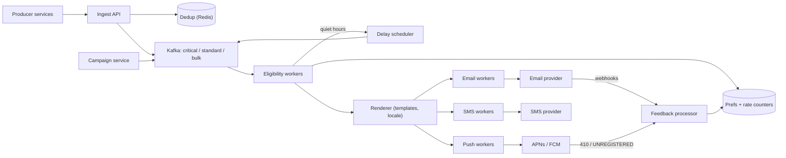

## In one minute
- **Decide before you deliver.** Most of the value is in the eligibility step: user preferences, quiet hours, frequency caps, deduplication and channel choice. Sending is the easy part once the decision is right.
- **Isolate traffic by priority.** A one-time passcode and a marketing blast must never share a queue. Separate topics and worker pools stop a 100-million-user campaign from delaying a login code.
- **Treat delivery as at-least-once and make it look exactly-once.** Producers retry, workers crash and providers time out. Dedup keys at ingest, a per-attempt state record before each send, and collapse IDs at the provider keep users from seeing the same alert twice.
- **Channels have very different costs and limits.** Push is nearly free, email is cheap but reputation-sensitive, SMS costs real money per message. Per-user, per-channel rate limits and an explicit fallback order are cost controls as much as user-experience rules.
- **The providers are the bottleneck you do not own.** APNs, FCM, email and SMS gateways have their own throttles and failure modes. Shape outbound traffic per provider and treat their feedback (dead tokens, bounces, STOP replies) as data you must act on.

## Requirements

**Functional**
- Internal services send a notification for a user (or a segment) by template ID, with variables, a category and an optional dedup key.
- Deliver on push (iOS and Android), email, SMS and an in-app inbox.
- Honour per-category, per-channel user preferences and unsubscribe links, plus quiet hours in the user's time zone.
- Apply frequency caps per user and channel, and fall back to the next allowed channel when the first is unavailable or capped.
- Schedule sends for later, and support campaigns to millions of users.
- Track per-notification status: accepted, suppressed, deferred, sent, delivered, opened, failed.

**Non-functional**
- Critical notifications (passcodes, security alerts) reach the provider within 2 seconds p99.
- No duplicate delivery from retries within a 24-hour dedup window.
- Never lose an accepted request; at-least-once to providers.
- Campaign throughput of at least 50k sends per second without hurting critical latency.
- Availability 99.95% for the ingest API.

**Out of scope:** the content of marketing campaigns, audience segmentation queries, A/B testing of copy, and building our own SMS or email transport.

## Back-of-envelope
Assumed numbers for a large consumer app.

- **Users:** 500M registered, 200M DAU. On average 10 notifications per DAU per day, so 2B a day.
- **QPS:** 2B / 86,400 ≈ 23k/s on average. Transactional traffic peaks at about 3× (70k/s). A campaign to 100M users spread over 30 minutes adds 100M / 1,800 ≈ 55k/s. Plan for about 150k/s through the pipeline.
- **Channel mix:** 85% push, 12% email, 2% in-app, 1% SMS. SMS is 20M a day; at roughly $0.005 to $0.05 per message depending on country, that is $100k to $1M a day. SMS volume is a budget line, which is why caps and fallback order matter.
- **Storage:** a notification record with per-channel status is about 500 bytes. 2B × 500 B = 1 TB a day. Keep 90 days hot (90 TB), then move to compressed columnar storage at about 10× compression: 1 TB × 365 × 5 / 10 ≈ 180 TB over five years.
- **Dedup state:** 2B keys a day × about 64 bytes with overhead ≈ 128 GB for a 24-hour window, which fits in a modest Redis cluster.
- **Provider quotas:** FCM's HTTP v1 API gives each project a default quota of 600k messages per minute, about 10k/s, and returns 429 above it ([FCM throttling and quotas](https://firebase.google.com/docs/cloud-messaging/throttling-and-quotas)). The plan above needs several times that for Android alone, so a quota increase has to be requested and the campaign emitter must be shaped to fit what is granted, not just to what our workers can do.
- **Bandwidth:** APNs caps a payload at 4 KB (5 KB for VoIP) ([Apple](https://developer.apple.com/documentation/usernotifications/sending-notification-requests-to-apns)), and typical payloads are 300 to 800 bytes. 150k/s × about 1 KB with headers ≈ 150 MB/s, or 1.2 Gbps outbound to providers.

## API

```http
POST /v1/notifications
  { "user_id": "U81", "template": "order_shipped", "category": "transactional",
    "priority": "high", "dedup_key": "order-5521-shipped",
    "vars": { "order_id": "5521", "eta": "Friday" }, "send_at": null }
  -> 202 { "notification_id": "N01J9...", "status": "accepted" }
  -> 200 { "notification_id": "N01J8...", "status": "duplicate" }   (same dedup_key within 24h)

POST /v1/campaigns
  { "template": "spring_sale", "segment_id": "S77", "category": "marketing",
    "window": { "start": "2026-04-01T09:00", "end": "2026-04-01T12:00", "local_time": true } }
  -> 202 { "campaign_id": "C12", "estimated_recipients": 41200000 }

GET  /v1/notifications/{id}        -> { status, channels: [ { channel, state, provider_id, updated_at } ] }
PUT  /v1/users/{id}/preferences    { categories: { marketing: ["email"], social: ["push", "email"] },
                                     quiet_hours: { start: "22:00", end: "07:00" }, time_zone: "Europe/Berlin" }
POST /v1/users/{id}/devices        { platform: "ios", token: "...", app_version: "8.4.1" }
POST /v1/providers/{name}/events   (webhooks from email and SMS providers: delivered, bounced, complaint, STOP)
```

Ingest returns 202 because sending is asynchronous. The dedup key is scoped per user, and a repeat returns the original notification ID so a producer's retry is harmless.

## Data model

**notifications** in a wide-column store, partition key `(user_id, month)`, clustering key `notification_id` (time-sortable). Columns: template, category, dedup key, and a map of channel to state. Reads are almost always one user's recent notifications, so partitioning by user keeps them on one node; the month bucket bounds partition size.

**preferences** in a relational or key-value store, keyed by `user_id`: opt-ins per category and channel, quiet hours, IANA time zone name, locale. Read on every send, so cached and invalidated on write.

**device_tokens** keyed by `user_id`: `(token, platform, app_id, app_version, last_seen, invalid)`.

**dedup** in Redis: `dd:{user_id}:{dedup_key} -> notification_id` with a 24-hour TTL, written with `SET NX EX` so the check and the claim are one atomic step.

**rate counters** in Redis keyed `(user_id, channel, window)`; small, short-lived, loss-tolerant.

**suppression list** keyed by address or phone number: hard bounces, spam complaints and SMS STOP replies. Checked before every email or SMS, because sending to these hurts reputation or breaks the law.

**attempts** keyed by `(notification_id, channel)`: `state` (pending, sent, failed), `provider_message_id`, `attempt_count`. This is what makes a worker crash safe to recover from.

## High-level design



**Write path.**
1. A producer calls `POST /notifications`. The API validates the template and runs `SET NX` on the dedup key. A duplicate returns the earlier ID.
2. The request is written to the Kafka topic for its priority, partitioned by `user_id`. The API returns 202 only after Kafka acknowledges with `acks=all`.
3. An eligibility worker loads preferences and checks suppression. If the category is opted out, the notification is recorded as suppressed. If the user is in quiet hours and the category is not critical, it goes to the delay scheduler with a release time.
4. The worker walks the user's channel order for this category and picks the first channel that is enabled, reachable (a valid token or verified address) and under its rate limit.
5. The renderer fills the localised template. The channel worker writes a pending attempt row, calls the provider, then records `sent` with the provider's message ID.
6. Provider feedback (delivery receipts, bounces, dead tokens) arrives asynchronously and updates status, the suppression list and the token table.

**Read path.** The in-app inbox reads `notifications` by `(user_id, month)` with a page cursor, and the unread badge comes from a per-user counter. Status lookups for support tools read the same partition.

## Deep dives

### 1. The eligibility decision
The decision is a pure function of the request, the user's settings, their recent send history and the current time. Keeping it pure (clock injected) makes it testable and replayable, so you can explain why something was or was not sent.

Quiet hours are the trap. Storing a UTC offset is wrong for any region with daylight saving time, because the offset changes twice a year; store the IANA zone name and convert with a tz database. Windows that cross midnight (22:00 to 07:00) need a wrap-around comparison. The release time should be the end of the window plus a random spread of a few minutes, or every deferred notification in a time zone fires at exactly 07:00:00 and you build your own thundering herd. Firebase's own scaling guidance makes the same point from the provider side: ramp traffic gradually and spread requests across each quota window instead of front-loading them ([FCM: sending at scale](https://firebase.google.com/docs/cloud-messaging/scale-fcm)).

Frequency caps use a sliding window per user and channel, for example at most 3 marketing pushes per 24 hours and 2 SMS per hour. When the first channel is capped, the fallback order decides: a security alert might go push, then SMS, then email; a social notification might go push, then in-app only, and never SMS. Fallback is per category, chosen by product and finance together, because the cheapest-first and fastest-first orders differ.

### 2. Priority isolation and campaign fan-out
Option one is a single queue with a priority field. Kafka partitions are FIFO, so a passcode sits behind a million campaign messages already in the partition. Option two is one topic per priority with separate consumer groups and worker pools: critical, standard and bulk. I choose option two, and size the critical pool to stay mostly idle.

Campaigns are a fan-out problem (see the Fanout lesson). The campaign service pages through the segment and emits per-user messages into the bulk topic at a controlled rate, so the 41M-recipient campaign above becomes a steady stream instead of a spike. "Local time" campaigns are emitted per time zone as each zone reaches 09:00. Rate-shaping at the source also means a bad campaign can be paused mid-flight by stopping the emitter, the most valuable control in an incident.

### 3. Duplicates and partial failure
Duplicates come from three places. Producers retry an ingest call that timed out: the dedup key catches that. A worker crashes after calling the provider but before committing its Kafka offset: on restart it reprocesses the message. The attempt row catches most of these; if it says `sent`, skip. If it says `pending`, the worker cannot know whether the provider received the request, because APNs and FCM accept no idempotency key. For push, resend with the same replacement key so the device replaces the earlier notification instead of showing two: `apns-collapse-id` (at most 64 bytes) on iOS, and `android.notification.tag` on Android. FCM's `collapse_key` is a different thing: it only collapses messages that are still queued while the device is offline, at most four keys per device, and FCM ignores it for notification messages ([FCM collapsible messages](https://firebase.google.com/docs/cloud-messaging/customize-messages/collapsible-message-types)). For SMS, where a duplicate costs money and annoys people, prefer to mark it failed and let a reconciliation job check the provider's message log. The third source is upstream: two services both deciding to notify about the same event. A dedup key derived from the event (`order-5521-shipped`) rather than a random UUID handles that.

## Down the stack

### Layer 1: The contract
- **Ingest.** A 202 means the request is durable in Kafka on all in-sync replicas. A repeat with the same `(user_id, dedup_key)` within 24 hours returns the same ID and causes no second send.
- **Decision.** For a given request, settings and time, the eligibility result is deterministic: suppressed, deferred until T, rate-limited, or sent on channel C.
- **Delivery.** At-least-once to the provider for accepted, eligible notifications. Critical notifications reach the provider within 2 s p99. No guarantee that the device displays it; the OS and the user decide that.

### Layer 2: The mechanism
APNs is an HTTP/2 API. Each notification is one `POST /3/device/{token}` stream on a long-lived TLS connection, authenticated by a signed JWT provider token. The JWT must be refreshed no more than once every 20 minutes and no less than once every 60 minutes, so workers share one cached token instead of minting one per request ([Apple](https://developer.apple.com/documentation/usernotifications/establishing-a-token-based-connection-to-apns)). Headers carry `apns-push-type`, `apns-priority` (10 for immediate; 5 and 1 for power-friendly delivery that the device may batch, throttle or drop), `apns-expiration` and `apns-collapse-id`. A 200 response returns an `apns-id`. A 410 means the token is dead and must be deleted; the reason is either `Unregistered` or the newer `ExpiredToken`, so match on the status code, not one reason string ([Apple](https://developer.apple.com/documentation/usernotifications/handling-notification-responses-from-apns)). FCM's HTTP v1 API takes a JSON message with `android.priority`, `android.ttl` and `android.collapse_key` (and `apns` and `webpush` blocks for other platforms) and returns `UNREGISTERED` (HTTP 404) for dead tokens ([FCM error codes](https://firebase.google.com/docs/cloud-messaging/error-codes)). HTTP v1 is now the only option: Google deprecated the legacy HTTP and XMPP APIs in June 2023 and began shutting them down in July 2024, so designs that still mention server keys are out of date.

Email goes through a provider over SMTP or HTTPS. Deliverability depends on SPF, DKIM signatures (RFC 6376) and a DMARC policy, and large senders must offer one-click unsubscribe through the `List-Unsubscribe` and `List-Unsubscribe-Post` headers (RFC 8058). Since February 2024 Gmail enforces this: anyone sending more than 5,000 messages a day to Gmail accounts needs SPF, DKIM and DMARC, one-click unsubscribe on marketing mail, and a reported spam rate below 0.3% ([Google sender guidelines](https://support.google.com/mail/answer/81126?hl=en)). Bounces and complaints come back as provider webhooks and feed the suppression list.

Kafka topics are partitioned by `user_id`, so all of one user's notifications are decided by the same worker in order. That lets the worker keep a hot cache of that user's preferences and lets rate-limit counters be updated without cross-worker races for the same user.

### Layer 3: The machine
- **HTTP/2 multiplexing.** One TLS connection to APNs carries many concurrent streams, up to the limit the server advertises in `SETTINGS_MAX_CONCURRENT_STREAMS`, which RFC 9113 recommends be at least 100 ([RFC 9113](https://www.rfc-editor.org/rfc/rfc9113#section-6.5.2)). HPACK compresses repeated headers to a few bytes each. A push worker with a few dozen connections can sustain thousands of sends per second, bounded by round-trip time: at 50 ms RTT and 500 streams per connection, one connection supports about 10k requests per second.
- **Connection reuse.** A TLS 1.3 handshake adds a round trip and key-exchange CPU, so workers keep pools of warm connections.
- **Redis checks.** `SET NX EX` and `INCR` are single-threaded in-memory operations of a few microseconds; the cost is the network round trip, about 0.2 to 0.5 ms in a datacenter. Pipelining the dedup, rate and preference lookups for a batch of 100 messages turns 300 round trips into one.
- **Kafka.** Producers batch messages (`linger.ms` of 5 to 10 ms; the default changed from 0 to 5 ms in Kafka 4.0 ([KIP-1030](https://cwiki.apache.org/confluence/display/KAFKA/KIP-1030%3A+Change+constraints+and+default+values+for+various+configurations))) so each disk write and replication round trip carries hundreds of records. Brokers append to page-cache log segments and serve consumers with `sendfile`.

### Why it's built this way
1. Sending is irreversible and users punish spam by disabling notifications entirely, so the system invests in a careful, replayable decision before any send.
2. Providers do not support idempotency keys, so exactly-once is impossible at the edge; the system dedups everything it can upstream and uses collapse IDs to hide what remains.
3. Critical and bulk traffic differ by four orders of magnitude in volume and urgency, so they get separate queues and workers.
4. Providers throttle and fail independently, so each channel has its own worker pool, rate shaping and circuit breaker.
5. SMS and email reputation have real costs, so feedback loops (suppression, dead tokens) are part of the core design, not an afterthought.

## Failure modes
- **10x load (a viral event or a mis-sized campaign).** Bulk workers back off first; the campaign emitter has a global rate limit and a kill switch. Critical workers keep reserved capacity. Stale bulk messages past their TTL are dropped rather than sent hours late.
- **Provider outage.** APNs or an SMS vendor returns 5xx or times out. A circuit breaker per provider stops hammering it; critical messages fall back to the next channel in the user's order, while bulk messages wait. For SMS, keep a second vendor and route by country.
- **Region outage.** Ingest runs active-active in two regions with dedup state replicated asynchronously. During failover a retried request may slip past dedup; collapse IDs keep push duplicates invisible. Accept a small risk of duplicate emails rather than losing passcodes.
- **Hot user or hot key.** A buggy producer loops and sends 10,000 notifications to one user in a minute. The per-user rate limit and per-producer quotas at ingest contain it.
- **Token rot.** Uninstalled apps leave dead tokens that waste capacity and make delivery-rate dashboards look like an outage. Delete tokens on 410 or `UNREGISTERED`, and expire tokens your app has not refreshed in a month or two. FCM treats a registration as stale after a month without contact and expires Android registrations after 270 days of inactivity ([FCM token management](https://firebase.google.com/docs/cloud-messaging/manage-tokens)).

## In the wild
- **Hawaii Emergency Management Agency, 2018: a drill sent as a real missile alert.** On 13 January a warning officer sent a live ballistic missile alert to phones (WEA) and broadcasters (EAS) across Hawaii during a no-notice drill. The alert software listed the test and live templates in the same drop-down, behind the same login, and one credentialed person could send either. There was no prepared correction template, so it took 13 minutes for an authoritative social-media retraction and 38 minutes for a correction over the same alert channels. Afterwards the agency required two people for tests and live alerts and wrote correction templates in advance ([FCC report](https://docs.fcc.gov/public/attachments/DOC-350119A1.pdf)).
- **GitHub, 2022: undeliverable webhook jobs block the queue.** On 5 October, automated accounts created and deleted repositories so fast that many webhook jobs could no longer build their payloads, because the data was already gone. The delivery workers kept retrying them, new events queued behind the retries, and delivery stalled for 31 minutes, which also turned GitHub Actions red. GitHub disabled the accounts and changed the workers to stop retrying jobs whose data no longer exists ([GitHub availability report](https://github.blog/2022-11-02-github-availability-report-october-2022/)).

## Trade-offs

| Option | Strengths | Weaknesses | Choose when |
|---|---|---|---|
| One topic per priority | Passcodes never wait behind campaigns | More topics and pools to operate | Mixed transactional and marketing traffic |
| Single queue with priority field | Simple | Head-of-line blocking in FIFO partitions | Low volume, one kind of traffic |
| Dedup at ingest with Redis TTL | Cheap, stops producer retries | Lost on cache failure; window is finite | Almost always, as the first layer |
| Attempt record before send | Survives worker crashes | One extra write per send | Expensive channels such as SMS |
| Collapse IDs at the provider | Hides residual duplicates on device | Push only; replaces rather than prevents | Push notifications |
| Fixed fallback order per category | Predictable cost and behaviour | Not personalised | Most products |
| Learned channel selection | Better engagement | Hard to explain, needs data | Mature products with experimentation |

## Leadership lens
- **Build first:** ingest with dedup, the priority topics, push and email workers, and the preference check. Quiet hours, frequency caps and campaigns come next. Learned send-time optimisation comes last, if ever.
- **Ownership:** a platform team owns the pipeline and the delivery contract; product teams own templates and categories; a growth team owns campaigns and frequency policy; finance and legal sign off on SMS fallback rules and unsubscribe handling.
- **Cost drivers:** SMS spend dominates everything else, followed by email volume and storage of notification history. Put a per-team SMS budget and dashboard in place on day one.
- **Rollout:** migrate producers one category at a time, shadow the new eligibility decision against the old system and diff the outcomes, then cut over with a per-category kill switch.
- **Review questions:** which categories may bypass quiet hours and who approved that list; what happens to a passcode when push and SMS are both down; how do we show a user why they got a notification.

## Check yourself
1. A campaign to 80 million users starts and passcode latency jumps to 40 seconds. What design choice would cause that, and what fixes it?
   **Answer:** A single queue with a priority field, because Kafka partitions are FIFO and a passcode sits behind campaign messages already in the partition. The fix is one topic per priority with separate consumer groups and worker pools, plus a campaign emitter that sends into the bulk topic at a controlled rate.

2. A push worker crashes after calling APNs but before recording success. What happens on recovery, and why can the system not simply guarantee exactly-once?
   **Answer:** The attempt row says `pending`, so the worker cannot know whether APNs received the request, and APNs and FCM accept no idempotency key. It resends with the same `apns-collapse-id` (or `android.notification.tag` on Android), so the device replaces the earlier notification instead of showing two.

3. Using the lesson's numbers, why is SMS treated as a budget line, and what controls follow from that?
   **Answer:** SMS is only 1% of 2B notifications a day, but 20M messages at $0.005 to $0.05 each is $100k to $1M a day. That is why per-user, per-channel rate limits, a per-category fallback order chosen with finance, and per-team SMS budgets exist.

4. Why must quiet hours be stored as an IANA time zone name, and what goes wrong if every deferred notification is released exactly at the window's end?
   **Answer:** A stored UTC offset is wrong in any region with daylight saving time, because the offset changes twice a year. Releasing everything at exactly 07:00:00 creates a thundering herd, so the release time adds a random spread of a few minutes.

## Practice
**Task:** Implement the eligibility core of the dispatcher. `Dispatcher(limits, dedup_ttl_ms)` takes per-channel limits as `channel -> (max_sends, window_ms)`; a channel not in `limits` is unlimited. `set_prefs(user, channels, quiet_start_min, quiet_end_min, tz_offset_min)` stores the user's channel fallback order, quiet hours as minutes after local midnight (equal values mean no quiet hours; start greater than end wraps midnight), and the offset from UTC in minutes. `dispatch(user, dedup_key, critical, now_ms)` returns `(status, channel, at_ms)`: `("duplicate", "", now)` if the same user and key were sent within the TTL (`now - sent_at < ttl`); `("no_channel", "", now)` if the user has no preferences or no channels; `("deferred", "", release)` for a non-critical request in quiet hours, where `release` is the next UTC time at which quiet hours end; otherwise the first channel whose sliding window holds fewer than `max_sends` sends with `now - t < window_ms` is used and the result is `("sent", channel, now)`. If every channel is capped, return `("rate_limited", "", t)` where `t` is the earliest time any of them frees a slot. Only a `sent` result records the dedup key and the send time.

```python starter
class Dispatcher:
    def __init__(self, limits, dedup_ttl_ms):
        pass

    def set_prefs(self, user, channels, quiet_start_min, quiet_end_min, tz_offset_min):
        raise NotImplementedError

    def dispatch(self, user, dedup_key, critical, now_ms):
        # TODO: return (status, channel, at_ms)
        raise NotImplementedError
```

```python tests
H = 3600000
DAY = 24 * H
BASE = 10 * DAY

def make():
    return Dispatcher({"push": (2, 60000), "sms": (1, H)}, DAY)

def test_sends_on_first_channel():
    d = make()
    d.set_prefs("u", ["push", "email"], 0, 0, 0)
    assert d.dispatch("u", "k1", False, BASE) == ("sent", "push", BASE)

def test_duplicate_within_ttl_then_allowed_after():
    d = make()
    d.set_prefs("u", ["email"], 0, 0, 0)
    assert d.dispatch("u", "k", False, BASE)[0] == "sent"
    assert d.dispatch("u", "k", False, BASE + 5) == ("duplicate", "", BASE + 5)
    assert d.dispatch("v", "k", False, BASE)[0] == "no_channel", "dedup is per user"
    assert d.dispatch("u", "k", False, BASE + DAY)[0] == "sent"

def test_quiet_hours_wrap_midnight_with_positive_offset():
    d = make()
    d.set_prefs("u", ["push"], 22 * 60, 7 * 60, 60)
    now = BASE + 22 * H + H // 2
    assert d.dispatch("u", "a", False, now) == ("deferred", "", BASE + 30 * H)
    early = BASE + 5 * H + H // 2
    assert d.dispatch("u", "b", False, early) == ("deferred", "", BASE + 6 * H)
    assert d.dispatch("u", "c", False, BASE + 6 * H) == ("sent", "push", BASE + 6 * H)

def test_negative_offset_and_small_timestamps():
    d = make()
    d.set_prefs("u", ["push"], 0, 6 * 60, -300)
    assert d.dispatch("u", "a", False, H)[0] == "sent", "20:00 local the day before"
    assert d.dispatch("u", "b", False, 6 * H) == ("deferred", "", 11 * H)

def test_critical_bypasses_quiet_hours():
    d = make()
    d.set_prefs("u", ["sms"], 22 * 60, 7 * 60, 0)
    now = BASE + 23 * H
    assert d.dispatch("u", "otp", True, now) == ("sent", "sms", now)

def test_rate_limit_falls_back_then_reports_earliest_free_slot():
    d = make()
    d.set_prefs("u", ["push", "sms"], 0, 0, 0)
    assert d.dispatch("u", "1", False, BASE)[1] == "push"
    assert d.dispatch("u", "2", False, BASE + 10)[1] == "push"
    assert d.dispatch("u", "3", False, BASE + 20) == ("sent", "sms", BASE + 20)
    assert d.dispatch("u", "4", False, BASE + 30) == ("rate_limited", "", BASE + 60000)
    assert d.dispatch("u", "4", False, BASE + 60000) == ("sent", "push", BASE + 60000)

def test_deferred_and_limited_do_not_burn_dedup_key():
    d = Dispatcher({"push": (1, 60000)}, DAY)
    d.set_prefs("u", ["push"], 0, 60, 0)
    assert d.dispatch("u", "k", False, BASE + 30 * 60000)[0] == "deferred"
    assert d.dispatch("u", "x", True, BASE + 60 * 60000)[0] == "sent"
    assert d.dispatch("u", "k", False, BASE + 60 * 60000 + 30000)[0] == "rate_limited"
    assert d.dispatch("u", "k", False, BASE + 61 * 60000)[0] == "sent"

def test_no_channels():
    d = make()
    assert d.dispatch("ghost", "k", True, BASE) == ("no_channel", "", BASE)
    d.set_prefs("u", [], 0, 0, 0)
    assert d.dispatch("u", "k", True, BASE)[0] == "no_channel"
```

```python solution
MINUTE = 60000
DAY_MS = 24 * 60 * MINUTE


class Dispatcher:
    def __init__(self, limits, dedup_ttl_ms):
        self._limits = dict(limits)
        self._ttl = dedup_ttl_ms
        self._prefs = {}
        self._sent_keys = {}
        self._history = {}

    def set_prefs(self, user, channels, quiet_start_min, quiet_end_min, tz_offset_min):
        self._prefs[user] = (list(channels), quiet_start_min, quiet_end_min, tz_offset_min)

    def _quiet_release(self, prefs, now_ms):
        _, start, end, tz = prefs
        if start == end:
            return None
        day_ms = (now_ms + tz * MINUTE) % DAY_MS
        s, e = start * MINUTE, end * MINUTE
        quiet = (s <= day_ms < e) if s < e else (day_ms >= s or day_ms < e)
        if not quiet:
            return None
        return now_ms + (e - day_ms) % DAY_MS

    def dispatch(self, user, dedup_key, critical, now_ms):
        seen = self._sent_keys.get((user, dedup_key))
        if seen is not None and now_ms - seen < self._ttl:
            return ("duplicate", "", now_ms)
        prefs = self._prefs.get(user)
        if prefs is None or not prefs[0]:
            return ("no_channel", "", now_ms)
        if not critical:
            release = self._quiet_release(prefs, now_ms)
            if release is not None:
                return ("deferred", "", release)
        earliest = None
        for ch in prefs[0]:
            limit = self._limits.get(ch)
            hist = self._history.setdefault((user, ch), [])
            if limit is not None:
                max_sends, window = limit
                hist[:] = [t for t in hist if now_ms - t < window]
                if len(hist) >= max_sends:
                    free_at = hist[0] + window
                    if earliest is None or free_at < earliest:
                        earliest = free_at
                    continue
            hist.append(now_ms)
            self._sent_keys[(user, dedup_key)] = now_ms
            return ("sent", ch, now_ms)
        return ("rate_limited", "", earliest)
```

```typescript starter
export type Outcome = [string, string, number];

export class Dispatcher {
  constructor(limits: Record<string, [number, number]>, dedupTtlMs: number) {}

  setPrefs(user: string, channels: string[], quietStartMin: number, quietEndMin: number, tzOffsetMin: number): void {
    throw new Error("TODO");
  }

  dispatch(user: string, dedupKey: string, critical: boolean, nowMs: number): Outcome {
    throw new Error("TODO");
  }
}
```

```typescript tests
const H = 3600000;
const DAY = 24 * H;
const BASE = 10 * DAY;

function makeDispatcher(): Dispatcher {
  return new Dispatcher({ push: [2, 60000], sms: [1, H] }, DAY);
}

test("sends on first channel", () => {
  const d = makeDispatcher();
  d.setPrefs("u", ["push", "email"], 0, 0, 0);
  assertEqual(d.dispatch("u", "k1", false, BASE), ["sent", "push", BASE]);
});

test("duplicate within ttl then allowed after", () => {
  const d = makeDispatcher();
  d.setPrefs("u", ["email"], 0, 0, 0);
  assertEqual(d.dispatch("u", "k", false, BASE)[0], "sent");
  assertEqual(d.dispatch("u", "k", false, BASE + 5), ["duplicate", "", BASE + 5]);
  assertEqual(d.dispatch("v", "k", false, BASE)[0], "no_channel", "dedup is per user");
  assertEqual(d.dispatch("u", "k", false, BASE + DAY)[0], "sent");
});

test("quiet hours wrap midnight with positive offset", () => {
  const d = makeDispatcher();
  d.setPrefs("u", ["push"], 22 * 60, 7 * 60, 60);
  assertEqual(d.dispatch("u", "a", false, BASE + 22 * H + H / 2), ["deferred", "", BASE + 30 * H]);
  assertEqual(d.dispatch("u", "b", false, BASE + 5 * H + H / 2), ["deferred", "", BASE + 6 * H]);
  assertEqual(d.dispatch("u", "c", false, BASE + 6 * H), ["sent", "push", BASE + 6 * H]);
});

test("negative offset and small timestamps", () => {
  const d = makeDispatcher();
  d.setPrefs("u", ["push"], 0, 6 * 60, -300);
  assertEqual(d.dispatch("u", "a", false, H)[0], "sent", "20:00 local the day before");
  assertEqual(d.dispatch("u", "b", false, 6 * H), ["deferred", "", 11 * H]);
});

test("critical bypasses quiet hours", () => {
  const d = makeDispatcher();
  d.setPrefs("u", ["sms"], 22 * 60, 7 * 60, 0);
  assertEqual(d.dispatch("u", "otp", true, BASE + 23 * H), ["sent", "sms", BASE + 23 * H]);
});

test("rate limit falls back then reports earliest free slot", () => {
  const d = makeDispatcher();
  d.setPrefs("u", ["push", "sms"], 0, 0, 0);
  assertEqual(d.dispatch("u", "1", false, BASE)[1], "push");
  assertEqual(d.dispatch("u", "2", false, BASE + 10)[1], "push");
  assertEqual(d.dispatch("u", "3", false, BASE + 20), ["sent", "sms", BASE + 20]);
  assertEqual(d.dispatch("u", "4", false, BASE + 30), ["rate_limited", "", BASE + 60000]);
  assertEqual(d.dispatch("u", "4", false, BASE + 60000), ["sent", "push", BASE + 60000]);
});

test("deferred and limited do not burn dedup key", () => {
  const d = new Dispatcher({ push: [1, 60000] }, DAY);
  d.setPrefs("u", ["push"], 0, 60, 0);
  assertEqual(d.dispatch("u", "k", false, BASE + 30 * 60000)[0], "deferred");
  assertEqual(d.dispatch("u", "x", true, BASE + 60 * 60000)[0], "sent");
  assertEqual(d.dispatch("u", "k", false, BASE + 60 * 60000 + 30000)[0], "rate_limited");
  assertEqual(d.dispatch("u", "k", false, BASE + 61 * 60000)[0], "sent");
});

test("no channels", () => {
  const d = makeDispatcher();
  assertEqual(d.dispatch("ghost", "k", true, BASE), ["no_channel", "", BASE]);
  d.setPrefs("u", [], 0, 0, 0);
  assertEqual(d.dispatch("u", "k", true, BASE)[0], "no_channel");
});
```

```typescript solution
export type Outcome = [string, string, number];

const MINUTE = 60000;
const DAY_MS = 24 * 60 * MINUTE;

interface Prefs {
  channels: string[];
  start: number;
  end: number;
  tz: number;
}

function mod(a: number, m: number): number {
  return ((a % m) + m) % m;
}

export class Dispatcher {
  private limits: Record<string, [number, number]>;
  private ttl: number;
  private prefs = new Map<string, Prefs>();
  private sentKeys = new Map<string, number>();
  private history = new Map<string, number[]>();

  constructor(limits: Record<string, [number, number]>, dedupTtlMs: number) {
    this.limits = { ...limits };
    this.ttl = dedupTtlMs;
  }

  setPrefs(user: string, channels: string[], quietStartMin: number, quietEndMin: number, tzOffsetMin: number): void {
    this.prefs.set(user, { channels: [...channels], start: quietStartMin, end: quietEndMin, tz: tzOffsetMin });
  }

  private quietRelease(p: Prefs, nowMs: number): number | null {
    if (p.start === p.end) return null;
    const dayMs = mod(nowMs + p.tz * MINUTE, DAY_MS);
    const s = p.start * MINUTE;
    const e = p.end * MINUTE;
    const quiet = s < e ? dayMs >= s && dayMs < e : dayMs >= s || dayMs < e;
    if (!quiet) return null;
    return nowMs + mod(e - dayMs, DAY_MS);
  }

  dispatch(user: string, dedupKey: string, critical: boolean, nowMs: number): Outcome {
    const key = user + "\u0000" + dedupKey;
    const seen = this.sentKeys.get(key);
    if (seen !== undefined && nowMs - seen < this.ttl) return ["duplicate", "", nowMs];
    const p = this.prefs.get(user);
    if (!p || p.channels.length === 0) return ["no_channel", "", nowMs];
    if (!critical) {
      const release = this.quietRelease(p, nowMs);
      if (release !== null) return ["deferred", "", release];
    }
    let earliest = -1;
    for (const ch of p.channels) {
      const hkey = user + "\u0000" + ch;
      let hist = this.history.get(hkey) ?? [];
      const limit = this.limits[ch];
      if (limit !== undefined) {
        const [maxSends, windowMs] = limit;
        hist = hist.filter((t) => nowMs - t < windowMs);
        this.history.set(hkey, hist);
        if (hist.length >= maxSends) {
          const freeAt = hist[0] + windowMs;
          if (earliest < 0 || freeAt < earliest) earliest = freeAt;
          continue;
        }
      }
      hist.push(nowMs);
      this.history.set(hkey, hist);
      this.sentKeys.set(key, nowMs);
      return ["sent", ch, nowMs];
    }
    return ["rate_limited", "", earliest];
  }
}
```

```go starter
package practice

type Limit struct {
	MaxSends int
	WindowMs int64
}

type Outcome struct {
	Status  string
	Channel string
	At      int64
}

type Dispatcher struct{}

func NewDispatcher(limits map[string]Limit, dedupTTLMs int64) *Dispatcher { return &Dispatcher{} }

func (d *Dispatcher) SetPrefs(user string, channels []string, quietStartMin, quietEndMin, tzOffsetMin int) {
	panic("TODO")
}

func (d *Dispatcher) Dispatch(user, dedupKey string, critical bool, nowMs int64) Outcome {
	panic("TODO")
}
```

```go tests
package practice

import "testing"

const (
	hr   int64 = 3600000
	day  int64 = 24 * hr
	base int64 = 10 * day
)

func makeDispatcher() *Dispatcher {
	return NewDispatcher(map[string]Limit{"push": {2, 60000}, "sms": {1, hr}}, day)
}

func expect(t *testing.T, got, want Outcome) {
	t.Helper()
	if got != want {
		t.Fatalf("got %+v, want %+v", got, want)
	}
}

func TestSendsOnFirstChannel(t *testing.T) {
	d := makeDispatcher()
	d.SetPrefs("u", []string{"push", "email"}, 0, 0, 0)
	expect(t, d.Dispatch("u", "k1", false, base), Outcome{"sent", "push", base})
}

func TestDuplicateWithinTTLThenAllowedAfter(t *testing.T) {
	d := makeDispatcher()
	d.SetPrefs("u", []string{"email"}, 0, 0, 0)
	if d.Dispatch("u", "k", false, base).Status != "sent" {
		t.Fatal("first should send")
	}
	expect(t, d.Dispatch("u", "k", false, base+5), Outcome{"duplicate", "", base + 5})
	if d.Dispatch("v", "k", false, base).Status != "no_channel" {
		t.Fatal("dedup is per user")
	}
	if d.Dispatch("u", "k", false, base+day).Status != "sent" {
		t.Fatal("allowed after ttl")
	}
}

func TestQuietHoursWrapMidnightWithPositiveOffset(t *testing.T) {
	d := makeDispatcher()
	d.SetPrefs("u", []string{"push"}, 22*60, 7*60, 60)
	expect(t, d.Dispatch("u", "a", false, base+22*hr+hr/2), Outcome{"deferred", "", base + 30*hr})
	expect(t, d.Dispatch("u", "b", false, base+5*hr+hr/2), Outcome{"deferred", "", base + 6*hr})
	expect(t, d.Dispatch("u", "c", false, base+6*hr), Outcome{"sent", "push", base + 6*hr})
}

func TestNegativeOffsetAndSmallTimestamps(t *testing.T) {
	d := makeDispatcher()
	d.SetPrefs("u", []string{"push"}, 0, 6*60, -300)
	if d.Dispatch("u", "a", false, hr).Status != "sent" {
		t.Fatal("20:00 local the day before")
	}
	expect(t, d.Dispatch("u", "b", false, 6*hr), Outcome{"deferred", "", 11 * hr})
}

func TestCriticalBypassesQuietHours(t *testing.T) {
	d := makeDispatcher()
	d.SetPrefs("u", []string{"sms"}, 22*60, 7*60, 0)
	expect(t, d.Dispatch("u", "otp", true, base+23*hr), Outcome{"sent", "sms", base + 23*hr})
}

func TestRateLimitFallsBackThenReportsEarliestFreeSlot(t *testing.T) {
	d := makeDispatcher()
	d.SetPrefs("u", []string{"push", "sms"}, 0, 0, 0)
	if d.Dispatch("u", "1", false, base).Channel != "push" || d.Dispatch("u", "2", false, base+10).Channel != "push" {
		t.Fatal("first two on push")
	}
	expect(t, d.Dispatch("u", "3", false, base+20), Outcome{"sent", "sms", base + 20})
	expect(t, d.Dispatch("u", "4", false, base+30), Outcome{"rate_limited", "", base + 60000})
	expect(t, d.Dispatch("u", "4", false, base+60000), Outcome{"sent", "push", base + 60000})
}

func TestDeferredAndLimitedDoNotBurnDedupKey(t *testing.T) {
	d := NewDispatcher(map[string]Limit{"push": {1, 60000}}, day)
	d.SetPrefs("u", []string{"push"}, 0, 60, 0)
	steps := []struct {
		key      string
		critical bool
		at       int64
		want     string
	}{
		{"k", false, base + 30*60000, "deferred"},
		{"x", true, base + 60*60000, "sent"},
		{"k", false, base + 60*60000 + 30000, "rate_limited"},
		{"k", false, base + 61*60000, "sent"},
	}
	for i, s := range steps {
		if got := d.Dispatch("u", s.key, s.critical, s.at).Status; got != s.want {
			t.Fatalf("step %d: got %s want %s", i, got, s.want)
		}
	}
}

func TestNoChannels(t *testing.T) {
	d := makeDispatcher()
	expect(t, d.Dispatch("ghost", "k", true, base), Outcome{"no_channel", "", base})
	d.SetPrefs("u", []string{}, 0, 0, 0)
	if d.Dispatch("u", "k", true, base).Status != "no_channel" {
		t.Fatal("empty channel list")
	}
}
```

```go solution
package practice

type Limit struct {
	MaxSends int
	WindowMs int64
}

type Outcome struct {
	Status  string
	Channel string
	At      int64
}

const (
	minuteMs int64 = 60000
	dayMs    int64 = 24 * 60 * minuteMs
)

type prefs struct {
	channels   []string
	start, end int64
	tz         int64
}

type pair struct{ a, b string }

type Dispatcher struct {
	limits   map[string]Limit
	ttl      int64
	prefs    map[string]prefs
	sentKeys map[pair]int64
	history  map[pair][]int64
}

func NewDispatcher(limits map[string]Limit, dedupTTLMs int64) *Dispatcher {
	l := map[string]Limit{}
	for k, v := range limits {
		l[k] = v
	}
	return &Dispatcher{
		limits:   l,
		ttl:      dedupTTLMs,
		prefs:    map[string]prefs{},
		sentKeys: map[pair]int64{},
		history:  map[pair][]int64{},
	}
}

func (d *Dispatcher) SetPrefs(user string, channels []string, quietStartMin, quietEndMin, tzOffsetMin int) {
	d.prefs[user] = prefs{
		channels: append([]string{}, channels...),
		start:    int64(quietStartMin),
		end:      int64(quietEndMin),
		tz:       int64(tzOffsetMin),
	}
}

func mod(a, m int64) int64 { return ((a % m) + m) % m }

func quietRelease(p prefs, nowMs int64) (int64, bool) {
	if p.start == p.end {
		return 0, false
	}
	local := mod(nowMs+p.tz*minuteMs, dayMs)
	s, e := p.start*minuteMs, p.end*minuteMs
	var quiet bool
	if s < e {
		quiet = local >= s && local < e
	} else {
		quiet = local >= s || local < e
	}
	if !quiet {
		return 0, false
	}
	return nowMs + mod(e-local, dayMs), true
}

func (d *Dispatcher) Dispatch(user, dedupKey string, critical bool, nowMs int64) Outcome {
	key := pair{user, dedupKey}
	if seen, ok := d.sentKeys[key]; ok && nowMs-seen < d.ttl {
		return Outcome{"duplicate", "", nowMs}
	}
	p, ok := d.prefs[user]
	if !ok || len(p.channels) == 0 {
		return Outcome{"no_channel", "", nowMs}
	}
	if !critical {
		if release, quiet := quietRelease(p, nowMs); quiet {
			return Outcome{"deferred", "", release}
		}
	}
	earliest := int64(-1)
	for _, ch := range p.channels {
		hk := pair{user, ch}
		hist := d.history[hk]
		if lim, limited := d.limits[ch]; limited {
			kept := hist[:0:0]
			for _, t := range hist {
				if nowMs-t < lim.WindowMs {
					kept = append(kept, t)
				}
			}
			hist = kept
			d.history[hk] = hist
			if len(hist) >= lim.MaxSends {
				if free := hist[0] + lim.WindowMs; earliest < 0 || free < earliest {
					earliest = free
				}
				continue
			}
		}
		d.history[hk] = append(hist, nowMs)
		d.sentKeys[key] = nowMs
		return Outcome{"sent", ch, nowMs}
	}
	return Outcome{"rate_limited", "", earliest}
}
```

## Mock interview
**Prompt:** Design a notification service for a consumer app with 200 million daily users. Internal teams send about 2 billion notifications a day across push, email and SMS, including login passcodes and marketing campaigns to tens of millions of users.

- Follow-up: A campaign to 80 million users starts at 09:00 and passcode latency jumps to 40 seconds. What went wrong in your design, and how do you fix it?
- Follow-up: A push worker crashes right after calling APNs and before recording success. What does the user see after recovery, and why?
- Follow-up: Product wants SMS as a fallback for every category when push fails. How do you respond, and what would you build?

**A strong answer covers:**
- Separate topics and worker pools per priority, with campaigns emitted at a controlled rate and a kill switch.
- A replayable eligibility step: preferences, suppression, quiet hours in IANA time zones with jittered release, frequency caps and a per-category fallback order.
- Dedup at ingest with event-derived keys, attempt records before sends, and collapse IDs to hide residual push duplicates.
- Provider-specific mechanics: HTTP/2 connection pools for APNs, dead-token cleanup on 410 or `UNREGISTERED`, bounce and complaint handling for email.
- Cost awareness: SMS as the dominant spend, with budgets and caps.

## Sources and further study
**Primary**
- [RFC 6376: DomainKeys Identified Mail (DKIM) Signatures](https://www.rfc-editor.org/rfc/rfc6376): how email providers verify that a message really came from your domain.
- [RFC 9113: HTTP/2](https://www.rfc-editor.org/rfc/rfc9113): stream multiplexing and `SETTINGS_MAX_CONCURRENT_STREAMS`, the transport APNs requires.

**Systems docs**
- [Establishing a token-based connection to APNs (Apple)](https://developer.apple.com/documentation/usernotifications/establishing-a-token-based-connection-to-apns): JWT provider tokens and the 20 to 60 minute refresh window.
- [FCM throttling and quotas (Firebase)](https://firebase.google.com/docs/cloud-messaging/throttling-and-quotas): the per-project send quota, how to ask for more, and what a 429 means.
- [Manage FCM registration tokens (Firebase)](https://firebase.google.com/docs/cloud-messaging/manage-tokens): stale and expired tokens and how to prune them.
- [Email sender guidelines (Google)](https://support.google.com/mail/answer/81126?hl=en): the authentication, unsubscribe and spam-rate rules for bulk senders.

**Books**
- *System Design Interview, Volume 1*, Alex Xu, chapter 10 "Design A Notification System": the interview-depth baseline of queues per channel, retries and templates.
- *Site Reliability Engineering*, Beyer et al. (Google), chapter 21 "Handling Overload": criticality levels and per-customer limits, the ideas behind separate priority topics and producer quotas.

**Other curricula**
- [Azure Architecture Center: Priority Queue pattern](https://learn.microsoft.com/en-us/azure/architecture/patterns/priority-queue): frames the passcode-versus-campaign problem as separate queues with separate consumer pools.
- [AWS Builders' Library: Workload isolation using shuffle sharding](https://aws.amazon.com/builders-library/workload-isolation-using-shuffle-sharding/): frames noisy-producer isolation as limiting the blast radius of one bad tenant.

## Watch
- [Design A Scalable Notification System (Irtiza Hafiz)](https://www.youtube.com/watch?v=OP-qawt-A3Y): a walkthrough of queues, workers and storage choices for a multi-channel notification system.
- [How to Design a Notification System (Interview Simplified)](https://www.youtube.com/watch?v=0pOYU5-pXWA): an hour-long interview walkthrough covering preferences, retries and channel delivery.

## Free resources
- [Sending notification requests to APNs (Apple)](https://developer.apple.com/documentation/usernotifications/sending-notification-requests-to-apns): the HTTP/2 request format, headers such as `apns-collapse-id`, and priorities.
- [Handling notification responses from APNs (Apple)](https://developer.apple.com/documentation/usernotifications/handling-notification-responses-from-apns): status codes and reasons, including how dead tokens are reported.
- [FCM HTTP v1 message reference (Firebase)](https://firebase.google.com/docs/reference/fcm/rest/v1/projects.messages): message fields for priority, TTL and collapse keys across platforms.
- [RFC 8058: Signaling One-Click Functionality for List Email Headers](https://www.rfc-editor.org/rfc/rfc8058): the one-click unsubscribe mechanism large mailbox providers now expect.
- [Avoiding insurmountable queue backlogs (AWS Builders' Library)](https://aws.amazon.com/builders-library/avoiding-insurmountable-queue-backlogs/): why separate queues, shuffle sharding and dropping stale work keep async systems healthy.
- [Making retries safe with idempotent APIs (AWS Builders' Library)](https://aws.amazon.com/builders-library/making-retries-safe-with-idempotent-APIs/): the client-token pattern behind dedup keys at ingest.
