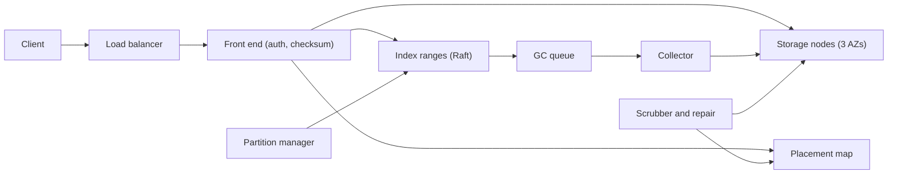

## In one minute
- **Split metadata from data, and treat the index as the hard part.** Bytes are immutable blobs on thousands of disks. The index from `(bucket, key)` to blob is small, but it carries the consistency guarantees and LIST semantics.
- **Write data first, commit metadata last.** A PUT stores its fragments, then flips one index entry in a replicated log. That single commit makes overwrites atomic and read-after-write consistent. Failed and overwritten blobs become orphans that a collector removes after a grace period.
- **Range-partition the index.** LIST needs keys in sorted order, so the index is split into key ranges, each a small consensus group, that split automatically when they grow large or busy.
- **Durability is about correlated failures and repair speed.** Erasure-code across availability zones, checksum every byte end to end, scrub continuously and spread repair across many disks. Real data loss comes from bugs, bad batches and operators, not independent drive failures.
- **Small objects and hot data shape the storage layer.** Pack small objects into large volumes before erasure coding, and spread data so no single drive carries the hot set.

## Requirements

**Functional**
- Buckets with globally unique names. `PUT`, `GET` (with byte ranges), `HEAD` and `DELETE` on very large objects, using multipart upload above about 100 MB. S3 raised its own ceiling from 5 TB to 50 TB in December 2025 ([AWS](https://aws.amazon.com/about-aws/whats-new/2025/12/amazon-s3-maximum-object-size-50-tb/)); that is 10,000 parts of at most 5 GiB each ([S3 multipart limits](https://docs.aws.amazon.com/AmazonS3/latest/userguide/qfacts.html)).
- `LIST` keys by prefix, with a delimiter that rolls deeper keys up into common prefixes, and pagination with a continuation token.
- Conditional writes: create only if absent (`If-None-Match: *`) and replace only if unchanged (`If-Match: <etag>`).
- Optional versioning, lifecycle rules (expire, or move to a colder tier after N days), and pre-signed URLs.

**Non-functional**
- Durability designed for 11 nines per object per year. Availability of 99.99% for reads and writes in a region. S3 states both numbers for its Standard class and stores objects across at least three AZs, so the loss of a whole AZ is survivable ([S3 data protection](https://docs.aws.amazon.com/AmazonS3/latest/userguide/DataDurability.html)).
- Strong consistency: once a PUT or DELETE returns, every later GET and LIST from any client sees it.
- First byte within 100 ms at p99 for small objects. Aggregate throughput scales with the number of keys and clients, not with any single server.
- Cost per stored GB close to raw disk cost, which rules out 3x replication for most data.

**Out of scope**
- Cross-region replication, event notifications, the IAM policy language and billing. They sit on top of the same core.

## Back-of-envelope
Round planning numbers for one large region, not any provider's published figures.

- **Objects and bytes today:** 200 billion objects and 400 PB of logical data, a 2 MB mean. Most objects are under 100 KB; a few huge ones hold most of the bytes.
- **Requests:** 300 billion per day, about 3.5M per second on average and 7M at peak. Assume 70% GET or HEAD, 20% PUT and 10% LIST or DELETE, so about 1.4M PUTs per second at peak.
- **Ingest:** 1 PB of new logical data per day, about 11.6 GB/s or 93 Gbit/s on average. With 1.5x erasure-coding overhead the drives absorb 1.5 PB per day.
- **Growth over 5 years:** 400 PB + 5 × 365 PB ≈ 2.2 EB logical, 3.3 EB raw after encoding. On 20 TB drives filled to 70%, that is about 236,000 drives.
- **Index size:** about 500 bytes per object version (a 100-byte key, size, ETag, timestamps and a layout listing 12 fragment locations). 200 billion × 500 B = 100 TB, or 300 TB with three replicas, on SSD. It grows with object count, not bytes.
- **Disk IOPS:** a 20 TB hard drive delivers about 120 random IOPS ([Warfield, All Things Distributed](https://www.allthingsdistributed.com/2023/07/building-and-operating-a-pretty-big-storage-system.html)), the same as a 2 TB drive a decade ago, which is 6 IOPS per TB. 7M requests per second touching disk would need about 60,000 drives' worth of IOPS, so caching and spreading hot data are required, not optional.

## API

```
PUT /{bucket}/{key}
  Content-Length: 5242880
  x-checksum-crc32c: "yZRlqg=="
  If-None-Match: *                         # optional: create only
  -> 200 ETag: "a1f3..."   412 Precondition Failed   400 BadDigest

GET /{bucket}/{key}
  Range: bytes=0-1048575                   # optional
  -> 206 ETag: "a1f3..."  Content-Range: bytes 0-1048575/5242880

GET /{bucket}?list-type=2&prefix=logs/2026/10/&delimiter=/&max-keys=1000
    &continuation-token=...
  -> 200 { "keys": [{"key": "logs/2026/10/16.gz", "size": 812345, "etag": "..."}],
           "common_prefixes": ["logs/2026/10/archive/"],
           "next_token": "bG9ncy8yMDI2LzEwLzE2Lmd6" }

DELETE /{bucket}/{key}
  If-Match: "a1f3..."                      # optional
  -> 204   412

POST /{bucket}/{key}?uploads               -> { "upload_id": "u-77" }
PUT  /{bucket}/{key}?uploadId=u-77&partNumber=3   -> ETag
POST /{bucket}/{key}?uploadId=u-77  { "parts": [{"n": 1, "etag": "..."}] }
  -> 200 ETag: "9c0e...-12"
```

The front end verifies the client's checksum before committing, so corruption in transit is caught at the door. Multipart rules are covered in the S3 lesson; a completed upload is simply a commit whose layout lists every part.

## Data model
- **buckets** (a small, strongly consistent replicated database): `name` (primary key), `owner`, `region`, `versioning`, `lifecycle_rules`. Names are globally unique, so creation goes through one global registry.
- **object_index** (range-partitioned, each range a Raft group of three replicas on SSD): key `(bucket, object_key, version_id descending)`, value `{etag, size, created_at, storage_class, delete_marker, layout, user_metadata}`. The key is ordered so `LIST` is a range scan and "latest version" is the first row for a key. Ranges are split by size (around 10 GB each) and by load, so a busy bucket spreads over many groups.
- **layout** (inside each index entry): the list of extents, each `(volume_id, offset, length)` for packed small objects or `(stripe_id, fragment_ids)` for large ones, plus the checksum of the whole object.
- **placement_map** (owned by a cluster manager, versioned, cached on every node): `placement_group -> [12 drives across 3 AZs]`. Changing it, for example after a drive dies, creates a new map version.
- **volumes** (on storage nodes): large append-only files of a few GB holding fragments or packed objects, each record with a header and a CRC32C. A per-volume index maps record ID to offset.
- **gc_queue** (a partitioned log): unreferenced blobs and when they became so.

## High-level design



**Write path.** The front end authenticates, rate-limits and streams the body while computing its checksum. A small object (under about 1 MB) is appended to an open volume that is replicated three ways across AZs. A large object is cut into stripes, and each stripe is encoded 8+4 into 12 fragments written in parallel to the 12 drives of a placement group, 4 per AZ. When every fragment is acknowledged and the checksum matches the client's, the front end sends a commit to the index range that owns the key. The range leader checks any condition (`If-None-Match`, `If-Match`), appends the new entry to its Raft log, and replies once a majority has persisted it. Only then does the client get its 200. Any overwritten layout goes to the GC queue.

**Read path.** The front end asks the owning index range for the key; the leader answers under its lease, so the result reflects every acknowledged commit. With the layout in hand, it reads only the extents that cover the requested range, verifies each one's checksum and streams the bytes. If a data fragment is slow or missing, it reads parity fragments instead and decodes. `LIST` is a range scan from the prefix or continuation token, with delimiter roll-up done on the index server.

## Deep dives

### 1. The commit protocol and the index
**Why data first.** If the index entry were written first, a reader could find a key whose bytes don't exist yet, or never will if the writer crashes. Writing fragments first and committing the index entry last means a reader sees the old version or the new one, never a mixture, and the commit is one small write to one consensus group however large the object is. The price is orphans: fragments from crashed uploads, abandoned multipart uploads and overwritten versions. A collector deletes an unreferenced blob only after a grace period of hours, which also protects readers that looked up the old layout just before an overwrite and are still streaming it. Deleting live data is the worst bug an object store can have, so the collector re-checks the index before every delete.

**Index options.** A hash-partitioned key-value store (in the style of DynamoDB) spreads load perfectly but cannot list keys in order without asking every partition. One database per bucket is simple but caps the size of a bucket. Range partitioning with a Raft group per range, as in Spanner, CockroachDB or TiKV, keeps keys sorted, gives linearizable conditional writes per key, and scales by splitting. I'd choose range partitioning. The known weak spot is sequential keys such as timestamps: every new key lands in the rightmost range, so splitting does not help write throughput. S3's documented guidance of at least 3,500 writes and 5,500 reads per second per prefix, scaling gradually beyond that with `503 Slow Down` errors while it does, reflects the same pressure ([S3 performance](https://docs.aws.amazon.com/AmazonS3/latest/userguide/optimizing-performance.html)).

**Strong consistency with caches.** Reads go to the range leader, which uses a lease so it can answer without a round of consensus. Front ends may cache index entries for hot keys, but a cache that cannot tell whether it is stale breaks read-after-write. Each cached entry carries the range's commit index, which the front end checks against the leader's with a tiny request before serving it. AWS described the same idea when it made S3 strongly consistent in 2020: a new "witness" component is told of every object change and acts as a read barrier, so a cached entry is served only if it is not stale ([All Things Distributed](https://www.allthingsdistributed.com/2021/04/s3-strong-consistency.html)).

### 2. Durability: encoding, placement, scrubbing and repair
**Encoding.** Three-way replication costs 3x and survives 2 lost copies. An 8+4 Reed-Solomon code costs 1.5x and survives any 4 lost fragments. With 4 fragments per AZ, losing a whole AZ still leaves 8, enough to read every object. That leaves no margin during an AZ outage, which is acceptable because an AZ outage usually makes fragments unreachable rather than destroying them. A 9+6 code would add margin at 1.67x. Repair cost is the weakness of plain Reed-Solomon, which is why Azure Storage uses Local Reconstruction Codes: extra local parities let a single lost fragment be rebuilt from a small group instead of from 8 others ([Huang et al., USENIX ATC 2012](https://www.usenix.org/conference/atc12/technical-sessions/presentation/huang)). The Erasure Coding lesson covers the maths. New small objects start in 3x-replicated open volumes, and a volume is erasure-coded once it is full and sealed, the same hot-to-warm path Facebook's f4 described ([f4, OSDI 2014](https://www.usenix.org/system/files/conference/osdi14/osdi14-paper-muralidhar.pdf)).

**The nines.** With a 1% annual drive failure rate (Backblaze measured 1.36% across about 344,000 drives in 2025, [Backblaze](https://www.backblaze.com/blog/backblaze-drive-stats-for-2025/)) and 6 hours to repair, a fragment's drive fails within a given repair window with probability 0.01 × 6 / 8,760 ≈ 6.8 × 10^-6. Losing 5 of 12 independently in one window is about 792 × (6.8 × 10^-6)^5 ≈ 10^-23. That number is meaningless, because real risks are correlated: a firmware bug in one drive batch, a bad software release, or an operator deleting the wrong thing. The defences are mixing drive batches within placement groups, staged rollouts of storage software, and keeping deletes reversible for a while.

**Checksums and scrubbing.** Every record carries a CRC32C that is checked on write, on read and by a scrubber that reads every byte on every drive every few weeks. Disks return wrong data silently, and finding it early means repairing while the other 11 fragments are healthy. Checksums should start at the client: AWS-owned S3 clients now compute a checksum on every upload (CRC64NVME by default), and S3 recomputes and compares it before storing the object ([S3 object integrity](https://docs.aws.amazon.com/AmazonS3/latest/userguide/checking-object-integrity.html)).

**Repair speed.** A dead 20 TB drive means rebuilding 20 TB of fragments, and each rebuilt fragment needs reads from 8 others: 160 TB of reads. One replacement drive writing at 250 MB/s would take 22 hours. Placement is therefore declustered: the dead drive's fragments belong to thousands of groups, so a thousand drives each rebuild a slice in parallel and repair takes under an hour.

### 3. Small objects, heat and the storage node
**Small objects.** Erasure-coding a 4 KB object into 12 fragments of a few hundred bytes would multiply IOPS by 12 and waste space on headers. Packing small objects into large volumes, the way Facebook's Haystack stored photos ([Haystack, OSDI 2010](https://www.usenix.org/legacy/event/osdi10/tech/full_papers/Beaver.pdf)), turns many small writes into sequential appends and makes each read one seek. Deletes leave holes, so a compactor rewrites volumes whose live fraction falls below a threshold, and the index entries move to the new location in the same commit protocol.

**Heat.** Drive capacity keeps growing while IOPS per drive stays flat, so the IOPS available per TB shrinks every generation. A freshly uploaded dataset is often read heavily for a day and then rarely touched. If its fragments sat on a handful of drives those drives would saturate, so placement chooses groups at random from the whole fleet, which spreads any one customer's hot data across thousands of spindles. Andy Warfield's FAST '23 talk describes heat management as a central problem at S3's scale. An SSD read cache absorbs most of the remaining hot reads.

**Storage node software.** It is deliberately simple (append, read by offset, verify, report health), because simplicity is a durability feature. AWS used lightweight formal methods to check that ShardStore, its storage node software, behaves like a simple reference model, including after crashes ([SOSP 2021](https://www.amazon.science/publications/using-lightweight-formal-methods-to-validate-a-key-value-storage-node-in-amazon-s3)).

## Down the stack

### Layer 1: The contract
A PUT that returns 200 is durable in fragments on drives in at least two AZs and visible to every later GET, HEAD and LIST in the region. An overwrite is atomic: concurrent readers get the old bytes or the new bytes, never a mix. `If-None-Match` and `If-Match` are evaluated against the latest committed version, so two writers racing to create the same key get one 200 and one 412. The check runs at commit time, so an in-progress multipart upload does not hold the key: S3 documents that the first write to finish wins and a later `CompleteMultipartUpload` with the same condition fails ([S3 conditional writes](https://docs.aws.amazon.com/AmazonS3/latest/userguide/conditional-writes.html)). A GET never returns bytes whose checksum fails; it returns another copy, a reconstruction or an error. Deleted data may remain on disk for the grace period but is never served.

### Layer 2: The mechanism
Each index range is a Raft group whose log entries are `{op, key, expected_etag, new_entry}`. The leader evaluates the condition against its applied state, appends the entry and commits it when a majority has made it durable, then applies it to a local ordered store (an LSM tree in practice). A storage record on disk is a header (magic number, record ID, length, flags), the payload and a CRC32C trailer. Volumes are append-only, so a crash can only leave a torn tail, which the node detects by checksum and truncates. Stripe reads start parity reads when a data fragment misses a p95 deadline.

### Layer 3: The machine
A 7,200 rpm drive spends about 4 ms on rotation and 4 to 8 ms seeking, so a random read costs 8 to 10 ms (about 120 IOPS), while sequential transfer runs near 250 MB/s. That is why volumes are appended sequentially and why one small read should be one seek. Index writes go to NVMe SSDs where an `fsync` of a Raft log entry takes tens of microseconds on drives with power-loss protection, so a majority commit across AZs costs about one inter-AZ round trip (1 to 2 ms). CRC32C runs at several GB/s per core with the SSE4.2 instruction, so verifying every byte is cheap compared to the disk read. A 1 MB fragment read in parallel from 8 drives is dominated by the slowest of the 8 seeks, which is why hedged parity reads pay off.

### Why it's built this way
1. Disks are cheap per TB but slow per random operation, so data is laid out in large sequential volumes and small objects are packed.
2. Full copies are too expensive at exabyte scale, so data is erasure-coded, which makes repairs read many fragments, so placement is declustered to spread repairs across many disks.
3. Large data cannot be updated atomically in place, so atomicity comes from one small metadata commit after the data is safely written.
4. That commit must be consistent and ordered for conditional writes and LIST, so the index is a range-partitioned set of consensus groups.
5. Writing first and committing last leaves orphans, and real data loss comes from correlated faults, so collection is cautious and every byte is checksummed.

## Failure modes
- **10x load on one prefix.** A batch job hammers `logs/2026/10/16/`. The partition manager splits the hot range within minutes, and throttling (`503 Slow Down`, retried with backoff) protects other tenants meanwhile.
- **AZ outage.** Writes go to placement groups that avoid the failed AZ, reads decode from the 8 surviving fragments, and index ranges led from that AZ elect new leaders within seconds. Repair waits until the outage is declared long-lived, or the system would move petabytes for a 30-minute blip.
- **Index range leader failure.** Writes to that key range pause for one election timeout (about 1 to 3 seconds). Other ranges are unaffected, which is the point of having many small groups.
- **Correlated drive failures.** A firmware bug kills drives of one model. Mixing models within placement groups keeps each stripe's losses to one or two fragments, and per-model failure-rate alerts fire before repair falls behind.
- **Collector bug.** A bug marks live blobs as orphans. The grace period, the index re-check before deletion and a quarantine stage (moving, not erasing, for a few days) make it recoverable.
- **Silent corruption.** A bad NIC flips bits in transit. End-to-end checksums from the client's digest through to the disk record catch it, and the write fails instead of storing bad data.

## In the wild
- **AWS, 2017: a typo removes S3's index capacity.** While debugging billing, an engineer ran a capacity-removal command with a mistyped argument and took out servers behind S3's index and placement subsystems in us-east-1. Both needed a full restart, which had not been done at that scale for years, so S3 in the region was down for about four hours and the status dashboard, which depended on S3, could not be updated. AWS made the tool remove capacity slowly with minimum-capacity checks and sped up splitting the index into smaller cells ([AWS](https://aws.amazon.com/message/41926/)).
- **Amazon S3, 2008: one flipped bit in gossip.** A few internal server-state messages had a single bit corrupted, still parseable but wrong. S3 checksummed customer objects but not this gossip traffic, so the bad state spread until servers spent nearly all their time gossiping, and requests failed for about eight hours. AWS added checksums to the state messages and alarms on gossip rate, the same lesson as end-to-end checksums on data ([AWS status archive](https://web.archive.org/web/2008/http://status.aws.amazon.com/s3-20080720.html)).
- **Cloudflare, 2025: an abuse action disables all of R2.** Handling a phishing report, an operator disabled the whole R2 Gateway service instead of one bucket. Every R2 operation failed for 59 minutes, and recovery was slowed because the admin tooling itself depended on R2. No stored data was lost. Cloudflare added Admin API guardrails against disabling services in internal accounts and planned manager approval for ad-hoc disables ([Cloudflare](https://blog.cloudflare.com/cloudflare-incident-on-february-6-2025/)).

## Trade-offs

| Option | Strengths | Weaknesses | Choose when |
|---|---|---|---|
| 3x replication | Fast writes and reads; simple repair | 3x storage cost | Open volumes, index, hot small data |
| Erasure coding 8+4 | 1.5x cost; survives 4 losses | Repair reads 8 fragments; decode cost | Sealed volumes and large objects |
| Range-partitioned index | Ordered LIST; conditional writes | Sequential keys hit one range | Object stores with LIST semantics |
| Hash-partitioned index | Even load | LIST must query every partition | Pure key-value blob stores |
| Packed volumes | Few IOPS per small object | Compaction after deletes | Workloads with many small objects |
| Long GC grace period | Safe for slow readers and bugs | Deleted bytes cost money for longer | Default; hours to days |

## Leadership lens
- **Build first.** The index with conditional commits, replicated storage with checksums, and the collector. Erasure coding is a cost optimisation you can add once the data path is proven correct.
- **Rollout.** Start with internal tenants whose data also lives elsewhere. Enable erasure coding for sealed cold volumes first, measure repair times, then widen. Ship storage software one AZ at a time.
- **Ownership.** Teams for the API, the index and the storage nodes, plus a durability team that owns scrubbing, repair and the collector and can block launches.
- **Cost drivers.** Drives, power and space dominate, so encoding ratio and fill level are the main levers, and lifecycle rules move the long tail to denser, slower media.
- **Durability reviews.** S3 runs a durability review, borrowed from security threat modelling, for any change that could affect durability, and prefers broad guardrails over point fixes. Copy that process before you copy the code.
- **Design review questions.** What is our repair time for one drive and for one rack, and how does it change as drives grow? Which single bug could delete live data, and what stops it?

## Check yourself
1. Why does a PUT write data fragments first and commit the index entry last, and what cost does that ordering create?
   **Answer:** Committing the index first could let a reader find a key whose bytes do not exist yet, or never will if the writer crashes. Data first and one small index commit last makes overwrites atomic, but it leaves orphaned blobs that a cautious collector deletes only after a grace period and an index re-check.

2. Why is the index range-partitioned rather than hash-partitioned, and what is the known weak spot of that choice?
   **Answer:** LIST needs keys in sorted order, and a hash-partitioned index would have to ask every partition. Range partitioning with a Raft group per range keeps keys ordered and gives conditional writes per key, but sequential keys such as timestamps all land in the rightmost range, so splitting does not help their write throughput.

3. Using the lesson's numbers, why does a dead 20 TB drive force declustered placement?
   **Answer:** Rebuilding 20 TB of fragments needs reads from 8 others, about 160 TB, and one replacement drive writing at 250 MB/s would take about 22 hours. Declustering spreads the dead drive's fragments across thousands of placement groups, so a thousand drives each rebuild a slice and repair takes under an hour.

4. The independent-failure math gives data loss odds around 10^-23. Why does the lesson call that meaningless, and what defends against the real risk?
   **Answer:** Real losses come from correlated faults such as a firmware bug in one drive batch, a bad software release or an operator error. The defences are mixing drive models within placement groups, staged rollouts of storage software, and keeping deletes reversible for a while through grace periods and quarantine.

## Practice
**Task:** Build the metadata commit path and orphan collector of an object store. `ObjectIndex(grace)` tracks blobs (already-written data, identified by ID) and keys. `put_blob(blob_id, size, now)` records a new blob, unreferenced since `now`, and returns `False` if the ID is already known. `commit(key, blob_id, now, if_match=None, if_none_match=False)` returns `(status, etag)` and checks, in order: unknown blob gives `("no_blob", None)`; a blob that was ever committed gives `("blob_used", None)` (blobs are single-use); `if_none_match` with an existing key, or `if_match` not equal to the key's current ETag (including a missing key), gives `("precondition_failed", None)`. On success the key points to the blob with a new ETag from a counter shared by the whole index (starting at 1), and the previous blob, if any, becomes unreferenced at `now`. `get(key)` returns `(etag, blob_id)` or none. `delete(key, now, if_match=None)` returns `"ok"`, `"not_found"` or `"precondition_failed"` and unreferences the blob. `list(prefix, start_after, limit)` returns `(keys, next)`: live keys in sorted order that start with `prefix` and sort after `start_after`, at most `limit` of them, with `next` set to the last returned key if more remain, else none. `sweep(now)` removes every unreferenced blob with `since + grace <= now` and returns their IDs sorted; `stored_bytes()` sums the sizes of blobs not yet removed.

```python starter
class ObjectIndex:
    def __init__(self, grace):
        self.grace = grace

    def put_blob(self, blob_id, size, now):
        raise NotImplementedError

    def commit(self, key, blob_id, now, if_match=None, if_none_match=False):
        # TODO: return (status, etag)
        raise NotImplementedError

    def get(self, key):
        raise NotImplementedError

    def delete(self, key, now, if_match=None):
        raise NotImplementedError

    def list(self, prefix, start_after, limit):
        raise NotImplementedError

    def sweep(self, now):
        raise NotImplementedError

    def stored_bytes(self):
        raise NotImplementedError
```

```python tests
def test_commit_and_get():
    ix = ObjectIndex(30)
    assert ix.put_blob("b1", 100, 0) is True
    assert ix.put_blob("b1", 100, 1) is False, "blob IDs are unique"
    assert ix.get("k") is None, "uncommitted data is invisible"
    assert ix.commit("k", "b1", 2) == ("ok", 1)
    assert ix.get("k") == (1, "b1")
    assert ix.stored_bytes() == 100


def test_unknown_and_reused_blobs():
    ix = ObjectIndex(30)
    assert ix.commit("k", "nope", 0) == ("no_blob", None)
    ix.put_blob("b1", 10, 0)
    ix.commit("k", "b1", 0)
    assert ix.commit("other", "b1", 1) == ("blob_used", None)
    ix.delete("k", 2)
    assert ix.commit("k", "b1", 3) == ("blob_used", None), "single use even after delete"


def test_conditional_writes():
    ix = ObjectIndex(30)
    for b in ("b1", "b2", "b3", "b4"):
        ix.put_blob(b, 1, 0)
    assert ix.commit("k", "b1", 1, if_match=1) == ("precondition_failed", None)
    assert ix.commit("k", "b1", 1, if_none_match=True) == ("ok", 1)
    assert ix.commit("k", "b2", 2, if_none_match=True) == ("precondition_failed", None)
    assert ix.commit("k", "b2", 3, if_match=1) == ("ok", 2)
    assert ix.commit("k", "b3", 4, if_match=1) == ("precondition_failed", None), "stale etag"
    assert ix.commit("j", "b3", 5) == ("ok", 3), "etags come from one shared counter"
    assert ix.get("k") == (2, "b2")


def test_overwrite_orphans_old_blob_after_grace():
    ix = ObjectIndex(30)
    ix.put_blob("b1", 100, 0)
    ix.commit("k", "b1", 0)
    ix.put_blob("b2", 50, 5)
    ix.commit("k", "b2", 10)
    assert ix.sweep(39) == [], "b1 is protected until 10 + 30"
    assert ix.sweep(40) == ["b1"]
    assert ix.get("k") == (2, "b2")
    assert ix.stored_bytes() == 50


def test_abandoned_upload_is_swept():
    ix = ObjectIndex(30)
    ix.put_blob("b9", 7, 0)
    ix.put_blob("b3", 7, 0)
    ix.put_blob("live", 7, 0)
    ix.commit("k", "live", 1)
    assert ix.sweep(30) == ["b3", "b9"]
    assert ix.commit("x", "b3", 31) == ("no_blob", None)
    assert ix.stored_bytes() == 7


def test_delete():
    ix = ObjectIndex(10)
    ix.put_blob("b1", 5, 0)
    ix.commit("k", "b1", 0)
    assert ix.delete("k", 1, if_match=9) == "precondition_failed"
    assert ix.delete("k", 2, if_match=1) == "ok"
    assert ix.get("k") is None
    assert ix.delete("k", 3) == "not_found"
    assert ix.sweep(11) == []
    assert ix.sweep(12) == ["b1"]


def test_list_pagination():
    ix = ObjectIndex(10)
    for i, k in enumerate(["logs/c", "img/x", "logs/a", "logs/b", "logs/d"]):
        ix.put_blob("b%d" % i, 1, 0)
        ix.commit(k, "b%d" % i, 0)
    ix.delete("logs/d", 1)
    assert ix.list("logs/", "", 2) == (["logs/a", "logs/b"], "logs/b")
    assert ix.list("logs/", "logs/b", 2) == (["logs/c"], None)
    assert ix.list("", "", 10) == (["img/x", "logs/a", "logs/b", "logs/c"], None)
    assert ix.list("zzz", "", 5) == ([], None)
```

```python solution
class ObjectIndex:
    def __init__(self, grace):
        self.grace = grace
        self.blobs = {}  # blob_id -> [size, used, unreferenced_since or None]
        self.keys = {}  # key -> (etag, blob_id)
        self.counter = 0

    def put_blob(self, blob_id, size, now):
        if blob_id in self.blobs:
            return False
        self.blobs[blob_id] = [size, False, now]
        return True

    def _release(self, key, now):
        old = self.keys.pop(key, None)
        if old is not None:
            self.blobs[old[1]][2] = now

    def commit(self, key, blob_id, now, if_match=None, if_none_match=False):
        blob = self.blobs.get(blob_id)
        if blob is None:
            return ("no_blob", None)
        if blob[1]:
            return ("blob_used", None)
        cur = self.keys.get(key)
        if if_none_match and cur is not None:
            return ("precondition_failed", None)
        if if_match is not None and (cur is None or cur[0] != if_match):
            return ("precondition_failed", None)
        self._release(key, now)
        self.counter += 1
        blob[1] = True
        blob[2] = None
        self.keys[key] = (self.counter, blob_id)
        return ("ok", self.counter)

    def get(self, key):
        return self.keys.get(key)

    def delete(self, key, now, if_match=None):
        cur = self.keys.get(key)
        if cur is None:
            return "not_found"
        if if_match is not None and cur[0] != if_match:
            return "precondition_failed"
        self._release(key, now)
        return "ok"

    def list(self, prefix, start_after, limit):
        match = sorted(k for k in self.keys if k.startswith(prefix) and k > start_after)
        page = match[:limit]
        nxt = page[-1] if len(match) > limit else None
        return (page, nxt)

    def sweep(self, now):
        gone = sorted(b for b, v in self.blobs.items()
                      if v[2] is not None and v[2] + self.grace <= now)
        for b in gone:
            del self.blobs[b]
        return gone

    def stored_bytes(self):
        return sum(v[0] for v in self.blobs.values())
```

```typescript starter
export class ObjectIndex {
  constructor(public grace: number) {}

  putBlob(blobId: string, size: number, now: number): boolean {
    throw new Error("TODO");
  }

  commit(key: string, blobId: string, now: number, ifMatch: number | null = null,
         ifNoneMatch: boolean = false): [string, number | null] {
    throw new Error("TODO");
  }

  get(key: string): [number, string] | null {
    throw new Error("TODO");
  }

  delete(key: string, now: number, ifMatch: number | null = null): string {
    throw new Error("TODO");
  }

  list(prefix: string, startAfter: string, limit: number): [string[], string | null] {
    throw new Error("TODO");
  }

  sweep(now: number): string[] {
    throw new Error("TODO");
  }

  storedBytes(): number {
    throw new Error("TODO");
  }
}
```

```typescript tests
test("commit and get", () => {
  const ix = new ObjectIndex(30);
  assertEqual(ix.putBlob("b1", 100, 0), true);
  assertEqual(ix.putBlob("b1", 100, 1), false, "blob IDs are unique");
  assertEqual(ix.get("k"), null, "uncommitted data is invisible");
  assertEqual(ix.commit("k", "b1", 2), ["ok", 1]);
  assertEqual(ix.get("k"), [1, "b1"]);
  assertEqual(ix.storedBytes(), 100);
});

test("unknown and reused blobs", () => {
  const ix = new ObjectIndex(30);
  assertEqual(ix.commit("k", "nope", 0), ["no_blob", null]);
  ix.putBlob("b1", 10, 0);
  ix.commit("k", "b1", 0);
  assertEqual(ix.commit("other", "b1", 1), ["blob_used", null]);
  ix.delete("k", 2);
  assertEqual(ix.commit("k", "b1", 3), ["blob_used", null], "single use even after delete");
});

test("conditional writes", () => {
  const ix = new ObjectIndex(30);
  for (const b of ["b1", "b2", "b3", "b4"]) ix.putBlob(b, 1, 0);
  assertEqual(ix.commit("k", "b1", 1, 1), ["precondition_failed", null]);
  assertEqual(ix.commit("k", "b1", 1, null, true), ["ok", 1]);
  assertEqual(ix.commit("k", "b2", 2, null, true), ["precondition_failed", null]);
  assertEqual(ix.commit("k", "b2", 3, 1), ["ok", 2]);
  assertEqual(ix.commit("k", "b3", 4, 1), ["precondition_failed", null], "stale etag");
  assertEqual(ix.commit("j", "b3", 5), ["ok", 3], "one shared counter");
  assertEqual(ix.get("k"), [2, "b2"]);
});

test("overwrite orphans old blob after grace", () => {
  const ix = new ObjectIndex(30);
  ix.putBlob("b1", 100, 0);
  ix.commit("k", "b1", 0);
  ix.putBlob("b2", 50, 5);
  ix.commit("k", "b2", 10);
  assertEqual(ix.sweep(39), [], "b1 is protected until 10 + 30");
  assertEqual(ix.sweep(40), ["b1"]);
  assertEqual(ix.get("k"), [2, "b2"]);
  assertEqual(ix.storedBytes(), 50);
});

test("abandoned upload is swept", () => {
  const ix = new ObjectIndex(30);
  ix.putBlob("b9", 7, 0);
  ix.putBlob("b3", 7, 0);
  ix.putBlob("live", 7, 0);
  ix.commit("k", "live", 1);
  assertEqual(ix.sweep(30), ["b3", "b9"]);
  assertEqual(ix.commit("x", "b3", 31), ["no_blob", null]);
  assertEqual(ix.storedBytes(), 7);
});

test("delete", () => {
  const ix = new ObjectIndex(10);
  ix.putBlob("b1", 5, 0);
  ix.commit("k", "b1", 0);
  assertEqual(ix.delete("k", 1, 9), "precondition_failed");
  assertEqual(ix.delete("k", 2, 1), "ok");
  assertEqual(ix.get("k"), null);
  assertEqual(ix.delete("k", 3), "not_found");
  assertEqual(ix.sweep(11), []);
  assertEqual(ix.sweep(12), ["b1"]);
});

test("list pagination", () => {
  const ix = new ObjectIndex(10);
  ["logs/c", "img/x", "logs/a", "logs/b", "logs/d"].forEach((k, i) => {
    ix.putBlob("b" + i, 1, 0);
    ix.commit(k, "b" + i, 0);
  });
  ix.delete("logs/d", 1);
  assertEqual(ix.list("logs/", "", 2), [["logs/a", "logs/b"], "logs/b"]);
  assertEqual(ix.list("logs/", "logs/b", 2), [["logs/c"], null]);
  assertEqual(ix.list("", "", 10), [["img/x", "logs/a", "logs/b", "logs/c"], null]);
  assertEqual(ix.list("zzz", "", 5), [[], null]);
});
```

```typescript solution
interface Blob {
  size: number;
  used: boolean;
  since: number | null;
}

export class ObjectIndex {
  private blobs = new Map<string, Blob>();
  private keys = new Map<string, [number, string]>();
  private counter = 0;

  constructor(public grace: number) {}

  putBlob(blobId: string, size: number, now: number): boolean {
    if (this.blobs.has(blobId)) return false;
    this.blobs.set(blobId, { size, used: false, since: now });
    return true;
  }

  private release(key: string, now: number): void {
    const old = this.keys.get(key);
    if (old !== undefined) {
      this.keys.delete(key);
      (this.blobs.get(old[1]) as Blob).since = now;
    }
  }

  commit(key: string, blobId: string, now: number, ifMatch: number | null = null,
         ifNoneMatch: boolean = false): [string, number | null] {
    const blob = this.blobs.get(blobId);
    if (blob === undefined) return ["no_blob", null];
    if (blob.used) return ["blob_used", null];
    const cur = this.keys.get(key);
    if (ifNoneMatch && cur !== undefined) return ["precondition_failed", null];
    if (ifMatch !== null && (cur === undefined || cur[0] !== ifMatch)) {
      return ["precondition_failed", null];
    }
    this.release(key, now);
    this.counter++;
    blob.used = true;
    blob.since = null;
    this.keys.set(key, [this.counter, blobId]);
    return ["ok", this.counter];
  }

  get(key: string): [number, string] | null {
    const cur = this.keys.get(key);
    return cur === undefined ? null : [cur[0], cur[1]];
  }

  delete(key: string, now: number, ifMatch: number | null = null): string {
    const cur = this.keys.get(key);
    if (cur === undefined) return "not_found";
    if (ifMatch !== null && cur[0] !== ifMatch) return "precondition_failed";
    this.release(key, now);
    return "ok";
  }

  list(prefix: string, startAfter: string, limit: number): [string[], string | null] {
    const match = Array.from(this.keys.keys())
      .filter((k) => k.startsWith(prefix) && k > startAfter)
      .sort();
    const page = match.slice(0, limit);
    return [page, match.length > limit ? page[page.length - 1] : null];
  }

  sweep(now: number): string[] {
    const gone: string[] = [];
    this.blobs.forEach((b, id) => {
      if (b.since !== null && b.since + this.grace <= now) gone.push(id);
    });
    gone.sort();
    for (const id of gone) this.blobs.delete(id);
    return gone;
  }

  storedBytes(): number {
    let total = 0;
    this.blobs.forEach((b) => (total += b.size));
    return total;
  }
}
```

```go starter
package practice

type ObjectIndex struct{}

func NewObjectIndex(grace int64) *ObjectIndex { return &ObjectIndex{} }

func (ix *ObjectIndex) PutBlob(blobID string, size, now int64) bool { panic("TODO") }

// Commit returns (status, etag). ifMatch == 0 means no If-Match condition.
func (ix *ObjectIndex) Commit(key, blobID string, now, ifMatch int64, ifNoneMatch bool) (string, int64) {
	panic("TODO")
}

func (ix *ObjectIndex) Get(key string) (int64, string, bool) { panic("TODO") }

// Delete returns "ok", "not_found" or "precondition_failed". ifMatch == 0 means none.
func (ix *ObjectIndex) Delete(key string, now, ifMatch int64) string { panic("TODO") }

// List returns a page of keys and the next marker ("" when there are no more).
func (ix *ObjectIndex) List(prefix, startAfter string, limit int) ([]string, string) {
	panic("TODO")
}

func (ix *ObjectIndex) Sweep(now int64) []string { panic("TODO") }

func (ix *ObjectIndex) StoredBytes() int64 { panic("TODO") }
```

```go tests
package practice

import (
	"fmt"
	"testing"
)

func expectCommit(t *testing.T, ix *ObjectIndex, key, blob string, now, ifMatch int64, inm bool, status string, etag int64) {
	t.Helper()
	s, e := ix.Commit(key, blob, now, ifMatch, inm)
	if s != status || e != etag {
		t.Fatalf("Commit(%s, %s) = (%s, %d), want (%s, %d)", key, blob, s, e, status, etag)
	}
}

func expectList(t *testing.T, got []string, next string, want string, wantNext string) {
	t.Helper()
	if fmt.Sprint(got) != want || next != wantNext {
		t.Fatalf("list = %v %q, want %s %q", got, next, want, wantNext)
	}
}

func TestCommitAndGet(t *testing.T) {
	ix := NewObjectIndex(30)
	if !ix.PutBlob("b1", 100, 0) || ix.PutBlob("b1", 100, 1) {
		t.Fatal("blob IDs must be unique")
	}
	if _, _, ok := ix.Get("k"); ok {
		t.Fatal("uncommitted data is invisible")
	}
	expectCommit(t, ix, "k", "b1", 2, 0, false, "ok", 1)
	if e, b, ok := ix.Get("k"); !ok || e != 1 || b != "b1" {
		t.Fatalf("get = %d %s %v", e, b, ok)
	}
	if ix.StoredBytes() != 100 {
		t.Fatalf("stored %d", ix.StoredBytes())
	}
}

func TestUnknownAndReusedBlobs(t *testing.T) {
	ix := NewObjectIndex(30)
	expectCommit(t, ix, "k", "nope", 0, 0, false, "no_blob", 0)
	ix.PutBlob("b1", 10, 0)
	ix.Commit("k", "b1", 0, 0, false)
	expectCommit(t, ix, "other", "b1", 1, 0, false, "blob_used", 0)
	ix.Delete("k", 2, 0)
	expectCommit(t, ix, "k", "b1", 3, 0, false, "blob_used", 0)
}

func TestConditionalWrites(t *testing.T) {
	ix := NewObjectIndex(30)
	for _, b := range []string{"b1", "b2", "b3", "b4"} {
		ix.PutBlob(b, 1, 0)
	}
	expectCommit(t, ix, "k", "b1", 1, 1, false, "precondition_failed", 0)
	expectCommit(t, ix, "k", "b1", 1, 0, true, "ok", 1)
	expectCommit(t, ix, "k", "b2", 2, 0, true, "precondition_failed", 0)
	expectCommit(t, ix, "k", "b2", 3, 1, false, "ok", 2)
	expectCommit(t, ix, "k", "b3", 4, 1, false, "precondition_failed", 0)
	expectCommit(t, ix, "j", "b3", 5, 0, false, "ok", 3)
	if e, b, _ := ix.Get("k"); e != 2 || b != "b2" {
		t.Fatalf("get = %d %s", e, b)
	}
}

func TestOverwriteOrphansOldBlobAfterGrace(t *testing.T) {
	ix := NewObjectIndex(30)
	ix.PutBlob("b1", 100, 0)
	ix.Commit("k", "b1", 0, 0, false)
	ix.PutBlob("b2", 50, 5)
	ix.Commit("k", "b2", 10, 0, false)
	if got := ix.Sweep(39); len(got) != 0 {
		t.Fatalf("b1 is protected until 40, swept %v", got)
	}
	if got := fmt.Sprint(ix.Sweep(40)); got != "[b1]" {
		t.Fatalf("sweep = %s", got)
	}
	if e, b, _ := ix.Get("k"); e != 2 || b != "b2" || ix.StoredBytes() != 50 {
		t.Fatalf("get = %d %s, stored %d", e, b, ix.StoredBytes())
	}
}

func TestAbandonedUploadIsSwept(t *testing.T) {
	ix := NewObjectIndex(30)
	ix.PutBlob("b9", 7, 0)
	ix.PutBlob("b3", 7, 0)
	ix.PutBlob("live", 7, 0)
	ix.Commit("k", "live", 1, 0, false)
	if got := fmt.Sprint(ix.Sweep(30)); got != "[b3 b9]" {
		t.Fatalf("sweep = %s", got)
	}
	expectCommit(t, ix, "x", "b3", 31, 0, false, "no_blob", 0)
	if ix.StoredBytes() != 7 {
		t.Fatalf("stored %d", ix.StoredBytes())
	}
}

func TestDelete(t *testing.T) {
	ix := NewObjectIndex(10)
	ix.PutBlob("b1", 5, 0)
	ix.Commit("k", "b1", 0, 0, false)
	if s := ix.Delete("k", 1, 9); s != "precondition_failed" {
		t.Fatalf("got %s", s)
	}
	if s := ix.Delete("k", 2, 1); s != "ok" {
		t.Fatalf("got %s", s)
	}
	if _, _, ok := ix.Get("k"); ok {
		t.Fatal("deleted key must be gone")
	}
	if s := ix.Delete("k", 3, 0); s != "not_found" {
		t.Fatalf("got %s", s)
	}
	if got := ix.Sweep(11); len(got) != 0 {
		t.Fatalf("swept too early: %v", got)
	}
	if got := fmt.Sprint(ix.Sweep(12)); got != "[b1]" {
		t.Fatalf("sweep = %s", got)
	}
}

func TestListPagination(t *testing.T) {
	ix := NewObjectIndex(10)
	for i, k := range []string{"logs/c", "img/x", "logs/a", "logs/b", "logs/d"} {
		b := fmt.Sprintf("b%d", i)
		ix.PutBlob(b, 1, 0)
		ix.Commit(k, b, 0, 0, false)
	}
	ix.Delete("logs/d", 1, 0)
	keys, next := ix.List("logs/", "", 2)
	expectList(t, keys, next, "[logs/a logs/b]", "logs/b")
	keys, next = ix.List("logs/", "logs/b", 2)
	expectList(t, keys, next, "[logs/c]", "")
	keys, next = ix.List("", "", 10)
	expectList(t, keys, next, "[img/x logs/a logs/b logs/c]", "")
	keys, next = ix.List("zzz", "", 5)
	expectList(t, keys, next, "[]", "")
}
```

```go solution
package practice

import (
	"sort"
	"strings"
)

type blob struct {
	size  int64
	used  bool
	since int64
	orph  bool // unreferenced since `since`
}

type ref struct {
	etag int64
	blob string
}

type ObjectIndex struct {
	grace   int64
	blobs   map[string]*blob
	keys    map[string]ref
	counter int64
}

func NewObjectIndex(grace int64) *ObjectIndex {
	return &ObjectIndex{grace: grace, blobs: map[string]*blob{}, keys: map[string]ref{}}
}

func (ix *ObjectIndex) PutBlob(blobID string, size, now int64) bool {
	if _, ok := ix.blobs[blobID]; ok {
		return false
	}
	ix.blobs[blobID] = &blob{size: size, since: now, orph: true}
	return true
}

func (ix *ObjectIndex) release(key string, now int64) {
	if old, ok := ix.keys[key]; ok {
		delete(ix.keys, key)
		b := ix.blobs[old.blob]
		b.orph, b.since = true, now
	}
}

func (ix *ObjectIndex) Commit(key, blobID string, now, ifMatch int64, ifNoneMatch bool) (string, int64) {
	b, ok := ix.blobs[blobID]
	if !ok {
		return "no_blob", 0
	}
	if b.used {
		return "blob_used", 0
	}
	cur, exists := ix.keys[key]
	if ifNoneMatch && exists {
		return "precondition_failed", 0
	}
	if ifMatch != 0 && (!exists || cur.etag != ifMatch) {
		return "precondition_failed", 0
	}
	ix.release(key, now)
	ix.counter++
	b.used, b.orph = true, false
	ix.keys[key] = ref{ix.counter, blobID}
	return "ok", ix.counter
}

func (ix *ObjectIndex) Get(key string) (int64, string, bool) {
	r, ok := ix.keys[key]
	return r.etag, r.blob, ok
}

func (ix *ObjectIndex) Delete(key string, now, ifMatch int64) string {
	cur, ok := ix.keys[key]
	if !ok {
		return "not_found"
	}
	if ifMatch != 0 && cur.etag != ifMatch {
		return "precondition_failed"
	}
	ix.release(key, now)
	return "ok"
}

func (ix *ObjectIndex) List(prefix, startAfter string, limit int) ([]string, string) {
	match := []string{}
	for k := range ix.keys {
		if strings.HasPrefix(k, prefix) && k > startAfter {
			match = append(match, k)
		}
	}
	sort.Strings(match)
	if len(match) <= limit {
		return match, ""
	}
	page := match[:limit]
	return page, page[len(page)-1]
}

func (ix *ObjectIndex) Sweep(now int64) []string {
	gone := []string{}
	for id, b := range ix.blobs {
		if b.orph && b.since+ix.grace <= now {
			gone = append(gone, id)
		}
	}
	sort.Strings(gone)
	for _, id := range gone {
		delete(ix.blobs, id)
	}
	return gone
}

func (ix *ObjectIndex) StoredBytes() int64 {
	var total int64
	for _, b := range ix.blobs {
		total += b.size
	}
	return total
}
```

## Mock interview
**Prompt:** Design an object storage service like Amazon S3 for one region with three availability zones. It stores 400 PB across 200 billion objects today, grows by 1 PB a day, and serves about 7 million requests per second at peak, with strong read-after-write consistency.

- Follow-up: Two clients PUT the same key at the same moment with `If-None-Match: *`. Walk through exactly where the race is decided and what each client sees.
- Follow-up: A firmware bug starts killing 2% of one drive model per day. What happens to durability, and what do you do in the first hour?
- Follow-up: Why not store everything with 3x replication and skip erasure coding? At what scale or workload would you change your answer?

**A strong answer covers:**
- The split between a strongly consistent, range-partitioned index and an immutable, erasure-coded data layer, with the reasons for each.
- Data first and commit last, with conditional checks in the commit and a cautious, grace-period garbage collector for orphans.
- Placement across AZs that survives an AZ loss, plus declustered repair with real repair-time arithmetic.
- End-to-end checksums and scrubbing, and a frank view that correlated failures and bugs, not independent drive failures, set real durability.
- Packing small objects and spreading hot data, because drive IOPS per TB keeps falling.
- Hot-prefix behaviour: load-based splits, throttling with `503 Slow Down`, and client backoff.

## Sources and further study
**Primary**
- [Erasure Coding in Windows Azure Storage (USENIX ATC 2012)](https://www.usenix.org/conference/atc12/technical-sessions/presentation/huang): Local Reconstruction Codes, which cut the fragments read during a repair.
- [Backblaze Drive Stats for 2025](https://www.backblaze.com/blog/backblaze-drive-stats-for-2025/): real annual failure rates by drive model, the input to any durability model.

**Systems docs**
- [Amazon S3: conditional writes](https://docs.aws.amazon.com/AmazonS3/latest/userguide/conditional-writes.html): `If-None-Match`, `If-Match`, the 412 and 409 cases and how multipart uploads interact.
- [Amazon S3: checking object integrity](https://docs.aws.amazon.com/AmazonS3/latest/userguide/checking-object-integrity.html): the supported checksum algorithms and the default CRC64NVME.
- [Amazon S3: performance design patterns](https://docs.aws.amazon.com/AmazonS3/latest/userguide/optimizing-performance.html): per-prefix request rates, `503 Slow Down` and parallelism.

**Books**
- *System Design Interview, Volume 2*, Alex Xu and Sahn Lam, chapter 9 "S3-like Object Storage": the metadata and data split, the data node design and multipart upload at interview depth.
- *Designing Data-Intensive Applications* (1st edition), Martin Kleppmann, chapter 6 "Partitioning": key-range versus hash partitioning, the trade-off behind the index choice.
- *Database Internals*, Alex Petrov, chapter 7 "Log-Structured Storage": the LSM trees used inside each index range and the append-only volume idea.

**Other curricula**
- [Azure Architecture Center: Valet Key pattern](https://learn.microsoft.com/en-us/azure/architecture/patterns/valet-key): frames pre-signed URLs as a way to let clients move bytes straight to storage without passing through your servers.
- [donnemartin/system-design-primer](https://github.com/donnemartin/system-design-primer): treats object stores only as a building block behind CDNs, with no design of the store itself.

## Watch
- [FAST '23: Building and Operating a Pretty Big Storage System (USENIX)](https://www.youtube.com/watch?v=sc3J4McebHE): Andy Warfield on S3's drives, heat management, durability culture and ShardStore.
- [How AWS S3 is built (The Pragmatic Engineer)](https://www.youtube.com/watch?v=5vL6aCvgQXU): an S3 leader on the architecture, the move to strong consistency and how the team works.

## Free resources
- [Diving Deep on S3 Consistency (All Things Distributed)](https://www.allthingsdistributed.com/2021/04/s3-strong-consistency.html): how S3 added strong consistency without giving up performance.
- [Building and operating a pretty big storage system called S3 (All Things Distributed)](https://www.allthingsdistributed.com/2023/07/building-and-operating-a-pretty-big-storage-system.html): drives, heat, durability reviews and the people side of running S3.
- [Using Lightweight Formal Methods to Validate a Key-Value Storage Node in Amazon S3 (SOSP 2021)](https://www.amazon.science/publications/using-lightweight-formal-methods-to-validate-a-key-value-storage-node-in-amazon-s3): how AWS checks ShardStore against a reference model.
- [Finding a Needle in Haystack (OSDI 2010)](https://www.usenix.org/legacy/event/osdi10/tech/full_papers/Beaver.pdf): packing small objects into large volumes with an in-memory index.
- [f4: Facebook's Warm BLOB Storage System (OSDI 2014)](https://www.usenix.org/system/files/conference/osdi14/osdi14-paper-muralidhar.pdf): moving sealed volumes from replication to erasure coding.
- [CRUSH: Controlled, Scalable, Decentralized Placement of Replicated Data](https://ceph.io/assets/pdfs/weil-crush-sc06.pdf): Ceph's placement algorithm across failure domains.
