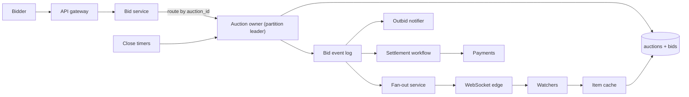

## In one minute
- Each auction is a tiny, strictly ordered state machine. **Serialise all bids for one auction through a single writer** (a partition owner or a row lock) instead of trying to make concurrent bid writes safe.
- Store bidders' **proxy maximums**, not just visible bids. The visible price is derived: the second-highest maximum plus one increment, capped at the highest maximum. This makes most bidding wars resolve in one step.
- **The close is the hardest moment.** Traffic concentrates in the last minute, so use soft close (anti-sniping extension) and make the end time a field the bid engine owns, not a cron job's opinion.
- Separate the **bid path** (small, consistent, latency-sensitive) from the **watch path** (huge fan-out of price updates to viewers). The second can be lossy and eventually consistent; the first cannot.
- Settlement after the close is a workflow: winner notification, payment hold, fallback to the next bidder. It is asynchronous and idempotent.

## Requirements
Functional:
- Sellers list an item with a start price, optional reserve, a bid increment table and an end time.
- Buyers place a bid with a maximum they are willing to pay; the system bids on their behalf up to that maximum.
- Everyone watching an item sees the current price, leader (masked) and time left in near real time.
- Bids in the final few minutes extend the auction so others can respond.
- When the auction ends, the winner is fixed, notified and charged; outbid users are notified throughout.

Non-functional:
- A bid acknowledgement is authoritative: if the user sees "you are the high bidder", that was true at that instant in the auction's total order.
- Bid latency under 200 ms at p99, including during the last-minute rush.
- No lost accepted bids, ever. Price updates to watchers may lag by a second or so.
- Highly available for browsing; bidding on a single auction may pause briefly during failover, but must never fork.

Out of scope: search and recommendation, seller fraud detection, shipping, and sealed-bid or Dutch auctions (mentioned only in trade-offs).

## Back-of-envelope
Assume a marketplace roughly the size of a large regional eBay competitor. These are planning numbers, not measurements.

- 20M DAU, 10M live auctions at any time, average duration 7 days, so about 1.4M auctions end per day.
- Bids: an auction averages perhaps 10 bids, so 14M bids per day. Average 14M / 86,400 ≈ 160 bids/s.
- Peak: bids are back-loaded and auction endings cluster in the evening. Suppose 3,000 auctions end per minute at the evening peak and each receives about 4 bids in its last 5 minutes: 3,000 × 5 × 4 / 300 s ≈ 200 bids/s from closings alone, on top of the background rate. Plan for 2,000 bids/s platform-wide for headroom, and 50 bids/s on a single celebrity item.
- Reads: viewers poll or subscribe far more than they bid. With 20M DAU each viewing 30 item pages a day, that is 600M page views/day ≈ 7,000/s average and maybe 25,000/s peak.
- Storage: a bid row is about 100 B (auction ID, bidder ID, max amount, visible amount, timestamp, sequence). 14M × 100 B = 1.4 GB/day, about 2.6 TB over 5 years. Auction rows (about 2 KB of metadata, images live in object storage) at 1.4M/day add about 2.8 GB/day, about 5 TB over 5 years. Small by modern standards.
- Bandwidth: a price-update push is about 200 B. If a hot auction has 50,000 watchers and its price changes 50 times in the last minute, that is 2.5M messages, or 500 MB in one minute for one item. Fan-out, not bidding, is the bandwidth problem.

## API
```text
POST /v1/auctions
  {title, startPrice, reservePrice?, incrementTable, endsAt, softCloseWindowSec:120, extendBySec:120}
  -> 201 {auctionId}

POST /v1/auctions/{id}/bids          Idempotency-Key: <uuid>
  {maxAmount: 15000}                  // cents
  -> 200 {status: "leading"|"outbid"|"too_low"|"closed",
          currentPrice, minNextBid, endsAt, seq}

GET  /v1/auctions/{id}
  -> {currentPrice, leaderMasked:"j***7", bidCount, endsAt, state, seq}

GET  /v1/auctions/{id}/bids?afterSeq=...      // public history (visible amounts only)

WS   /v1/live?auctions=a1,a2,...
  <- {auctionId, seq, currentPrice, endsAt, bidCount}

// internal
Bid(auctionId, bidderId, maxAmount, idemKey) -> BidResult   // routed to auction owner
CloseAuction(auctionId, closeSeq) -> {winnerId, price}      // fired by timer, idempotent
```
`seq` is a per-auction monotonic sequence. Clients drop pushes with a lower `seq` than they have seen, which makes out-of-order delivery harmless.

## Data model
- **`auctions`**: `auction_id PK, seller_id, start_price, reserve_price, increment_table_id, ends_at, state (scheduled|live|closed|settled), current_price, leader_id, leader_max, seq, version`. Partition key `auction_id`. The current state lives on the auction row so a bid needs one row read and one row write, not an aggregate over all bids.
- **`bids`**: `(auction_id, seq) PK, bidder_id, max_amount, visible_amount, outcome, created_at, idem_key`. Same partition key as the auction so the bid and the auction update commit together. Unique `(auction_id, bidder_id, idem_key)` dedupes retries.
- **`user_bids`**: `(bidder_id, auction_id) PK, last_max, last_status`. A secondary, asynchronously maintained view for "my bids" pages. Partitioned by bidder.
- **`closing_index`**: `(close_bucket_minute, auction_id)`. A timer index so closers can find auctions ending in the next minute without scanning. Updated when an extension moves `ends_at`.

Partitioning by `auction_id` is the key choice: every bid touches exactly one partition, so the critical path never needs a distributed transaction. A relational store (sharded Postgres or a distributed SQL database) fits: rows are small, transactions are single-row or single-partition, and unique constraints give dedup for free.

## High-level design


Write path. A bid hits the bid service, which authenticates the user, checks they are allowed to bid (verified payment method, not the seller) and forwards it to the owner of that auction's partition. The owner runs the bid in one transaction: lock the auction row (`SELECT ... FOR UPDATE`), check `now < ends_at`, apply the proxy rules, maybe extend `ends_at`, insert the bid row with the next `seq`, update the auction row, and append an event to an outbox table. Commit, then reply. A relay publishes outbox events to the bid event log (Kafka, partitioned by `auction_id`). Per-key order in Kafka survives producer retries only with the idempotent producer, which has been the default since Kafka 3.0 along with `acks=all` ([KIP-679](https://cwiki.apache.org/confluence/display/KAFKA/KIP-679%3A+Producer+will+enable+the+strongest+delivery+guarantee+by+default)); it requires `max.in.flight.requests.per.connection` of 5 or less, so a config that raises it silently turns idempotence off ([Kafka docs](https://kafka.apache.org/41/configuration/producer-configs/)).

Read path. Item pages read from a cache keyed by auction ID, refreshed by the event stream with a short TTL backstop. Live viewers hold a WebSocket to an edge node; the fan-out service consumes the bid log and pushes `{seq, price, endsAt}` to every edge node with subscribers for that auction, which forwards to its local sockets. The authoritative answer to "am I winning" is always the bid response, never the push.

## Deep dives

### Ordering concurrent bids on one auction
Two people bid on the same item in the same millisecond. Options considered. First, optimistic concurrency: read the auction row with its `version`, compute, write with `WHERE version = ?`, retry on conflict. This is fine at low contention, but on a hot item in its last ten seconds most attempts conflict and retry, which inflates p99 exactly when it matters. Second, a distributed lock in Redis per auction. It adds a second system whose failure semantics (lock expiry during a GC pause) can let two writers in. Third, a pessimistic row lock (`FOR UPDATE`) inside a single-partition transaction. Waiters queue in the database's lock manager and proceed in order; each holds the lock for a millisecond or two. Fourth, a single-threaded actor per auction (in memory, with the database as write-ahead storage), which removes lock overhead entirely. Whichever wins, the bid endpoint takes a client idempotency key so a retry after a timeout returns the first result instead of placing a second bid ([AWS Builders' Library](https://aws.amazon.com/builders-library/making-retries-safe-with-idempotent-APIs/)).

Choice: row lock in the database for the general case. At 50 bids/s on one item and about 2 ms per transaction, the row is busy 10% of the time, comfortably within budget. If a single item ever needs thousands of bids per second (a charity celebrity auction, say), route it to an actor-style owner that batches bids in memory and commits a group per few milliseconds. The design principle is the same either way: one total order per auction, decided in one place.

### Proxy bidding and increments
Storing only visible bids creates an arms race of tiny increments and huge write amplification. Instead each bidder submits a maximum. The engine keeps the leader's maximum privately and shows a visible price: when a challenger arrives, the visible price becomes the lower of the two maximums plus one increment, capped at the higher maximum. If the maximums are equal, the earlier bidder keeps the lead, because they committed first. Increments come from a table keyed by price band (for example 50 cents under $25, $1 up to $100, $5 above), so the rule is "minimum next bid = price + increment(price)".

Subtle cases. A leader raising their own maximum must not raise the visible price (that would be bidding against yourself). A bid between the current price and the minimum next bid is rejected with the exact minimum returned, so the client can offer a one-tap retry. The reserve price is a hidden threshold: the visible price can jump straight to the reserve once a maximum reaches it, otherwise the auction ends "reserve not met". All amounts are integer cents; floating point has no business here.

### The close: timers, soft close and snipers
A hard close at 20:00:00 rewards snipers whose scripts bid 2 seconds before the end, and it puts the whole bid rush into a window smaller than typical network jitter. There is field evidence for this. Roth and Ockenfels compared eBay, which had a fixed end time, with Amazon's auctions, which ran on until ten minutes passed without a bid, and found significantly more late bidding on eBay; experienced eBay bidders sniped more, experienced Amazon bidders less. They also note that very late bids have a real chance of not getting through at all ([Roth and Ockenfels, NBER](https://www.nber.org/papers/w7729)). Options: hard close with a precise timer; soft close that extends the end when a bid arrives near it; or a sealed final phase. We choose soft close: if a price-changing bid is accepted when less than 2 minutes remain, `ends_at` becomes `now + 2 minutes`. The extension is computed inside the same bid transaction, so it is atomic with the bid that caused it.

Closing itself must be robust to timer slop. Close workers scan `closing_index` for the current minute and call `CloseAuction` on the owner, which checks `now >= ends_at` under the same lock as bids. If an extension moved the end, the close is a no-op and a new timer entry exists. The bid path also rejects bids with `now >= ends_at` on its own clock, so a late close worker never lets a late bid in; the closer only finalises state and emits the "closed" event. "Now" means the owner's clock, a single source of truth per auction, and the user-facing timer is advisory.

## Down the stack

### Layer 1: The contract
For each auction, accepted bids form a total order identified by `seq`. A response of `leading` means that, at that `seq`, the caller's maximum was the highest, with ties broken by earlier `seq`. A bid is accepted only if the owner's clock reads strictly before `ends_at` at commit. Retrying with the same idempotency key returns the original result and does not create a second bid. Pushes to watchers are at-least-once and may be out of order; clients reconcile with `seq`.

### Layer 2: The mechanism
The bid transaction is: `BEGIN; SELECT current_price, leader_id, leader_max, ends_at, seq FROM auctions WHERE auction_id=$1 FOR UPDATE;` compute in the application, then `INSERT INTO bids ...; UPDATE auctions SET ...; INSERT INTO outbox ...; COMMIT`. In Postgres, `FOR UPDATE` takes a row-level lock recorded in the tuple header (`xmax` plus infomask bits), which is why locking a row can cause a disk write and why there is no limit on how many rows can be locked ([PostgreSQL docs](https://www.postgresql.org/docs/current/explicit-locking.html)). A waiter sleeps on the holder's transaction ID lock, and under Read Committed it wakes up holding the newest committed version of the auction row, not the one it first read ([PostgreSQL docs](https://www.postgresql.org/docs/current/transaction-iso.html)). The outbox relay tails the table (or logical replication via `pgoutput`, the built-in logical decoding plugin, which ships each transaction as one Begin-to-Commit unit ([PostgreSQL docs](https://www.postgresql.org/docs/current/protocol-logical-replication.html))) and produces to a Kafka topic keyed by `auction_id`, which keeps per-auction order in one partition. Close timers are a bucketed index read each minute into an in-memory min-heap per close worker.

### Layer 3: The machine
The commit is an fsync of the WAL. On a cloud NVMe volume a flush takes roughly 0.1 to 1 ms; network-attached block storage is closer to 1 to 3 ms. Group commit lets concurrent transactions on different auctions share one flush ([PostgreSQL docs](https://www.postgresql.org/docs/current/wal-configuration.html)). The auction row is about 200 bytes, so it sits in one 8 KB heap page that stays hot in shared buffers; the lock holder never waits on disk for reads. A bid response is under 1 KB, fitting in a single TCP segment. The WebSocket push for 50,000 watchers is 50,000 `write` calls batched by `epoll`-driven event loops; at about 2 to 5 microseconds of kernel time per small write, one core can push perhaps 200,000 messages per second, so a dozen edge nodes absorb a hot item.

### Why it's built this way
1. Correctness depends on a total order of bids per auction, so we keep one auction's state in one partition with one writer.
2. Contention is extreme only for a few items at a few moments, so a row lock is enough for nearly all, with an actor path for outliers.
3. Users act in the final seconds and networks are jittery, so a hard close is unfair; soft close turns a race into an extension.
4. Watchers outnumber bidders by orders of magnitude, so the read fan-out is a separate, lossy, horizontally scaled path.
5. Payments are slow and fallible, so settlement is an asynchronous workflow kicked off by an event, not part of the bid.

## Failure modes
- **10x load at the evening close.** The bid path scales with partitions because auctions are independent; add shards and spread close times by suggesting non-round end times to sellers. The fan-out tier sheds first: coalesce updates per auction to at most a few per second per socket.
- **Hot key: one celebrity item.** Promote it to a dedicated owner with in-memory batching, and give its watchers a coalesced feed. Rate-limit bids per user per auction to blunt scripted bid storms.
- **Partition owner fails mid-transaction.** The transaction either committed (WAL flushed) or not. The client retries with the same idempotency key and gets the original answer or a fresh evaluation. A replica is promoted within seconds; bids on those auctions pause rather than fork. If the pause overlaps an auction's end, extend `ends_at` by the outage length so bidders were not cut off by our failure.
- **Region outage.** Each auction has a home region. Run synchronous replication within the region and asynchronous to a standby region. On failover, extend auctions that were near their close and publish an operator notice. Accept that a few seconds of bids may need replay from client retries.
- **Clock skew.** Only the owner's clock decides acceptance. NTP keeps owners within milliseconds, and a promotion bumps an epoch so a demoted owner's late writes are rejected. That epoch is a fencing token: storage must check it on every write, because a paused old owner cannot know it was replaced ([Martin Kleppmann](https://martin.kleppmann.com/2016/02/08/how-to-do-distributed-locking.html)).

## In the wild
- **eBay and Amazon, 2000: a natural experiment in closing rules.** Roth and Ockenfels compared second-price auctions with a fixed end time (eBay) against otherwise similar auctions that extended until ten minutes passed with no bid (Amazon). eBay showed significantly more last-minute bidding, and its experienced bidders sniped more, while on Amazon experience pushed the other way. The timing of last bids followed a power law. The ending rule, not the item, drives the closing rush this design has to absorb ([NBER](https://www.nber.org/papers/w7729)).
- **Discord, 2017: fan-out to tens of thousands of watchers.** Each Discord guild is one Erlang process that sends every event to every connected session. Busy guilds reached about 30,000 concurrent users, and at 30 to 70 microseconds per send one publish took 900 ms to 2.1 s, so guilds fell behind at peak. Discord's Manifold library groups recipients by remote node and sends one batch per node, which preserves order and spreads the CPU. A hot auction's watcher feed has the same shape ([Discord](https://discord.com/blog/how-discord-scaled-elixir-to-5-000-000-concurrent-users)).
- **GitHub, 2018: a failover that forked the data.** A 43-second network partition led GitHub's Orchestrator to promote West Coast MySQL primaries while the East Coast was still taking writes, so both sides diverged and a clean failback was impossible. Service was degraded for 24 hours 11 minutes, with 954 unreplicated writes on one cluster to reconcile. GitHub stopped cross-region automatic promotion. An auction shard must choose "pause" over "fork" for the same reason ([GitHub](https://github.blog/news-insights/company-news/oct21-post-incident-analysis/)).

## Trade-offs
| Option | Strengths | Weaknesses | Choose when |
|---|---|---|---|
| Row lock per auction | Simple, correct, uses the DB's lock queue | Throughput per item limited by commit latency | Default for almost every auction |
| In-memory actor per auction | Thousands of bids/s per item, batching | Failover and recovery logic to build | A few very hot items |
| Optimistic version check | No lock waits | Retry storms under contention | Low-contention items, read-heavy |
| Hard close | Predictable end time | Rewards sniping, unfair under jitter | Timed sales with fixed schedules |
| Soft close | Fair, ends when bidding stops | Unknown end time, longer tail | Open ascending auctions (our choice) |
| Sealed-bid (Vickrey) | No sniping, one bid per user | Less engagement, harder to explain | Procurement, ad slots |

## Leadership lens
- Build first: the bid engine as a pure function (state, bid, now) to (new state, result), exhaustively tested, then the single-partition transaction around it. Everything else is plumbing.
- Rollout: shadow-run the new engine against live bids, comparing outcomes, before letting it decide; launch soft close on one category first and watch sniper complaints and auction length.
- Ownership: one team owns bid and close (the money-correct core); a platform team owns the real-time fan-out; payments owns settlement behind an event contract.
- Cost drivers: WebSocket connections and fan-out bandwidth dominate, not the database. Coalescing updates is the biggest lever.
- Design review question: what exactly does the user see if their bid commits but the response is lost, and how do they find out they won?

## Check yourself
1. Why does the design serialise bids on one auction with a database row lock rather than optimistic version checks, and when would it switch to an in-memory actor?
   **Answer:** On a hot item in its last seconds most optimistic attempts conflict and retry, inflating p99 exactly when it matters, while a row lock queues waiters in order. At 50 bids/s and about 2 ms per transaction the row is busy only 10% of the time; an item needing thousands of bids per second moves to an actor-style owner that batches bids in memory.

2. Using the lesson's numbers, why is fan-out to watchers, not bidding, the bandwidth problem?
   **Answer:** A hot auction with 50,000 watchers whose price changes 50 times in the last minute produces 2.5M pushes of about 200 B, roughly 500 MB in one minute for one item. Bid rows are about 100 B and 14M a day, so the database load is small by comparison, which is why coalescing updates is the biggest cost lever.

3. Why use soft close instead of a hard close, and how is the extension kept consistent with the bid that triggers it?
   **Answer:** A hard close rewards sniping scripts and squeezes the rush into a window smaller than network jitter. If a price-changing bid is accepted with less than 2 minutes left, `ends_at` becomes now plus 2 minutes, computed inside the same bid transaction so it is atomic with the bid.

4. A shard's primary fails 20 seconds before several auctions on it end. What happens?
   **Answer:** Each transaction either committed or did not, clients retry with the same idempotency key, and a replica is promoted within seconds, so bids pause rather than fork. Because the pause overlaps the auctions' ends, `ends_at` is extended by the outage length so bidders are not cut off by the platform's failure.

## Practice
**Task:** Implement the bid engine for a single auction. `Auction(start_price, increment, end_time, window, extend_by, clock)` uses integer amounts and an injected clock function returning an integer time. `bid(bidder, max_amount)` returns `"closed"` if `now >= end_time`. The first bid must be at least `start_price`; it leads with visible price `start_price`. A challenger must offer at least `price + increment`, else `"too_low"`; if their max beats the leader's max they lead and the price becomes `min(their max, leader max + increment)`, otherwise (ties go to the earlier bidder) the leader keeps the lead, the price becomes `min(leader max, their max + increment)` and the result is `"outbid"`. A leader may only raise their own max (else `"too_low"`); that returns `"leading"` and changes neither price nor end time. Any other accepted bid placed when `end_time - now < window` sets `end_time` to `now + extend_by` if that is later. Expose `price()`, `leader()` (empty string if none), `end_time()` and `closed()`.

```python starter
class Auction:
    def __init__(self, start_price, increment, end_time, window, extend_by, clock):
        # TODO
        pass

    def bid(self, bidder, max_amount):
        raise NotImplementedError

    def price(self):
        raise NotImplementedError

    def leader(self):
        raise NotImplementedError

    def end_time(self):
        raise NotImplementedError

    def closed(self):
        raise NotImplementedError
```

```python tests
class Clock:
    def __init__(self):
        self.t = 0

    def __call__(self):
        return self.t


def make(clock=None):
    return Auction(10, 5, 100, 10, 10, clock or Clock())


def test_first_bid_must_meet_start():
    a = make()
    assert a.bid("a", 9) == "too_low"
    assert a.leader() == ""
    assert a.bid("a", 100) == "leading"
    assert a.price() == 10 and a.leader() == "a"


def test_proxy_outbid_and_takeover():
    a = make()
    a.bid("a", 100)
    assert a.bid("b", 50) == "outbid"
    assert a.price() == 55 and a.leader() == "a"
    assert a.bid("c", 120) == "leading"
    assert a.price() == 105 and a.leader() == "c"


def test_tie_goes_to_earlier_bidder_and_price_capped():
    a = make()
    a.bid("a", 100)
    assert a.bid("b", 98) == "outbid"
    assert a.price() == 100, "capped at leader max"
    a2 = make()
    a2.bid("a", 100)
    assert a2.bid("b", 100) == "outbid"
    assert a2.leader() == "a" and a2.price() == 100


def test_minimum_increment():
    a = make()
    a.bid("a", 100)
    assert a.bid("b", 14) == "too_low"
    assert a.price() == 10
    assert a.bid("b", 15) == "outbid"
    assert a.price() == 20


def test_leader_raises_own_max():
    a = make()
    a.bid("a", 100)
    assert a.bid("a", 90) == "too_low"
    assert a.bid("a", 200) == "leading"
    assert a.price() == 10
    assert a.bid("b", 150) == "outbid"
    assert a.price() == 155


def test_anti_sniping_extension():
    c = Clock()
    a = make(c)
    c.t = 50
    a.bid("a", 100)
    assert a.end_time() == 100, "no extension far from the end"
    c.t = 95
    assert a.bid("b", 50) == "outbid"
    assert a.end_time() == 105
    c.t = 104
    assert a.bid("c", 200) == "leading"
    assert a.end_time() == 114
    c.t = 113
    a.bid("c", 300)
    assert a.end_time() == 114, "leader raising max does not extend"


def test_closed_rejects_bids():
    c = Clock()
    a = make(c)
    a.bid("a", 100)
    c.t = 100
    assert a.closed()
    assert a.bid("b", 500) == "closed"
    assert a.leader() == "a" and a.price() == 10
```

```python solution
class Auction:
    def __init__(self, start_price, increment, end_time, window, extend_by, clock):
        self.start = start_price
        self.inc = increment
        self.end = end_time
        self.window = window
        self.extend_by = extend_by
        self.clock = clock
        self.cur = 0
        self.lead = ""
        self.lead_max = 0

    def _extend(self, now):
        if self.end - now < self.window:
            self.end = max(self.end, now + self.extend_by)

    def bid(self, bidder, max_amount):
        now = self.clock()
        if now >= self.end:
            return "closed"
        if self.lead == "":
            if max_amount < self.start:
                return "too_low"
            self.lead, self.lead_max, self.cur = bidder, max_amount, self.start
            self._extend(now)
            return "leading"
        if bidder == self.lead:
            if max_amount <= self.lead_max:
                return "too_low"
            self.lead_max = max_amount
            return "leading"
        if max_amount < self.cur + self.inc:
            return "too_low"
        self._extend(now)
        if max_amount > self.lead_max:
            self.cur = min(max_amount, self.lead_max + self.inc)
            self.lead, self.lead_max = bidder, max_amount
            return "leading"
        self.cur = min(self.lead_max, max_amount + self.inc)
        return "outbid"

    def price(self):
        return self.cur

    def leader(self):
        return self.lead

    def end_time(self):
        return self.end

    def closed(self):
        return self.clock() >= self.end
```

```typescript starter
export class Auction {
  constructor(startPrice: number, increment: number, endTime: number, window: number, extendBy: number, clock: () => number) {}
  bid(bidder: string, maxAmount: number): string {
    throw new Error("TODO");
  }
  price(): number {
    throw new Error("TODO");
  }
  leader(): string {
    throw new Error("TODO");
  }
  endTime(): number {
    throw new Error("TODO");
  }
  closed(): boolean {
    throw new Error("TODO");
  }
}
```

```typescript tests
function make(clock?: () => number): Auction {
  return new Auction(10, 5, 100, 10, 10, clock || (() => 0));
}

test("first bid must meet start", () => {
  const a = make();
  assertEqual(a.bid("a", 9), "too_low");
  assertEqual(a.leader(), "");
  assertEqual(a.bid("a", 100), "leading");
  assertEqual([a.price(), a.leader()], [10, "a"]);
});

test("proxy outbid and takeover", () => {
  const a = make();
  a.bid("a", 100);
  assertEqual(a.bid("b", 50), "outbid");
  assertEqual([a.price(), a.leader()], [55, "a"]);
  assertEqual(a.bid("c", 120), "leading");
  assertEqual([a.price(), a.leader()], [105, "c"]);
});

test("tie goes to earlier bidder and price capped", () => {
  const a = make();
  a.bid("a", 100);
  assertEqual(a.bid("b", 98), "outbid");
  assertEqual(a.price(), 100, "capped at leader max");
  const a2 = make();
  a2.bid("a", 100);
  assertEqual(a2.bid("b", 100), "outbid");
  assertEqual([a2.leader(), a2.price()], ["a", 100]);
});

test("minimum increment", () => {
  const a = make();
  a.bid("a", 100);
  assertEqual(a.bid("b", 14), "too_low");
  assertEqual(a.price(), 10);
  assertEqual(a.bid("b", 15), "outbid");
  assertEqual(a.price(), 20);
});

test("leader raises own max", () => {
  const a = make();
  a.bid("a", 100);
  assertEqual(a.bid("a", 90), "too_low");
  assertEqual(a.bid("a", 200), "leading");
  assertEqual(a.price(), 10);
  assertEqual(a.bid("b", 150), "outbid");
  assertEqual(a.price(), 155);
});

test("anti-sniping extension", () => {
  let now = 0;
  const a = make(() => now);
  now = 50;
  a.bid("a", 100);
  assertEqual(a.endTime(), 100, "no extension far from the end");
  now = 95;
  assertEqual(a.bid("b", 50), "outbid");
  assertEqual(a.endTime(), 105);
  now = 104;
  assertEqual(a.bid("c", 200), "leading");
  assertEqual(a.endTime(), 114);
  now = 113;
  a.bid("c", 300);
  assertEqual(a.endTime(), 114, "leader raising max does not extend");
});

test("closed rejects bids", () => {
  let now = 0;
  const a = make(() => now);
  a.bid("a", 100);
  now = 100;
  assert(a.closed(), "closed at end time");
  assertEqual(a.bid("b", 500), "closed");
  assertEqual([a.leader(), a.price()], ["a", 10]);
});
```

```typescript solution
export class Auction {
  private cur = 0;
  private lead = "";
  private leadMax = 0;
  constructor(
    private start: number,
    private inc: number,
    private end: number,
    private window: number,
    private extendBy: number,
    private clock: () => number,
  ) {}

  private extend(now: number): void {
    if (this.end - now < this.window) this.end = Math.max(this.end, now + this.extendBy);
  }

  bid(bidder: string, maxAmount: number): string {
    const now = this.clock();
    if (now >= this.end) return "closed";
    if (this.lead === "") {
      if (maxAmount < this.start) return "too_low";
      this.lead = bidder;
      this.leadMax = maxAmount;
      this.cur = this.start;
      this.extend(now);
      return "leading";
    }
    if (bidder === this.lead) {
      if (maxAmount <= this.leadMax) return "too_low";
      this.leadMax = maxAmount;
      return "leading";
    }
    if (maxAmount < this.cur + this.inc) return "too_low";
    this.extend(now);
    if (maxAmount > this.leadMax) {
      this.cur = Math.min(maxAmount, this.leadMax + this.inc);
      this.lead = bidder;
      this.leadMax = maxAmount;
      return "leading";
    }
    this.cur = Math.min(this.leadMax, maxAmount + this.inc);
    return "outbid";
  }
  price(): number {
    return this.cur;
  }
  leader(): string {
    return this.lead;
  }
  endTime(): number {
    return this.end;
  }
  closed(): boolean {
    return this.clock() >= this.end;
  }
}
```

```go starter
package practice

type Auction struct{}

func NewAuction(startPrice, increment, endTime, window, extendBy int, clock func() int) *Auction {
	return &Auction{}
}

func (a *Auction) Bid(bidder string, maxAmount int) string { panic("TODO") }
func (a *Auction) Price() int                              { panic("TODO") }
func (a *Auction) Leader() string                          { panic("TODO") }
func (a *Auction) EndTime() int                            { panic("TODO") }
func (a *Auction) Closed() bool                            { panic("TODO") }
```

```go tests
package practice

import "testing"

func mk(now *int) *Auction {
	return NewAuction(10, 5, 100, 10, 10, func() int { return *now })
}

func TestFirstBidMustMeetStart(t *testing.T) {
	now := 0
	a := mk(&now)
	if r := a.Bid("a", 9); r != "too_low" {
		t.Fatalf("got %s", r)
	}
	if a.Leader() != "" {
		t.Fatal("no leader expected")
	}
	if r := a.Bid("a", 100); r != "leading" || a.Price() != 10 || a.Leader() != "a" {
		t.Fatalf("got %s %d %s", r, a.Price(), a.Leader())
	}
}

func TestProxyOutbidAndTakeover(t *testing.T) {
	now := 0
	a := mk(&now)
	a.Bid("a", 100)
	if r := a.Bid("b", 50); r != "outbid" || a.Price() != 55 || a.Leader() != "a" {
		t.Fatalf("got %s %d %s", r, a.Price(), a.Leader())
	}
	if r := a.Bid("c", 120); r != "leading" || a.Price() != 105 || a.Leader() != "c" {
		t.Fatalf("got %s %d %s", r, a.Price(), a.Leader())
	}
}

func TestTieAndCap(t *testing.T) {
	now := 0
	a := mk(&now)
	a.Bid("a", 100)
	if r := a.Bid("b", 98); r != "outbid" || a.Price() != 100 {
		t.Fatalf("got %s %d", r, a.Price())
	}
	a2 := mk(&now)
	a2.Bid("a", 100)
	if r := a2.Bid("b", 100); r != "outbid" || a2.Leader() != "a" || a2.Price() != 100 {
		t.Fatalf("got %s %s %d", r, a2.Leader(), a2.Price())
	}
}

func TestMinimumIncrement(t *testing.T) {
	now := 0
	a := mk(&now)
	a.Bid("a", 100)
	if r := a.Bid("b", 14); r != "too_low" || a.Price() != 10 {
		t.Fatalf("got %s %d", r, a.Price())
	}
	if r := a.Bid("b", 15); r != "outbid" || a.Price() != 20 {
		t.Fatalf("got %s %d", r, a.Price())
	}
}

func TestLeaderRaisesOwnMax(t *testing.T) {
	now := 0
	a := mk(&now)
	a.Bid("a", 100)
	if r := a.Bid("a", 90); r != "too_low" {
		t.Fatalf("got %s", r)
	}
	if r := a.Bid("a", 200); r != "leading" || a.Price() != 10 {
		t.Fatalf("got %s %d", r, a.Price())
	}
	if r := a.Bid("b", 150); r != "outbid" || a.Price() != 155 {
		t.Fatalf("got %s %d", r, a.Price())
	}
}

func TestAntiSniping(t *testing.T) {
	now := 50
	a := mk(&now)
	a.Bid("a", 100)
	if a.EndTime() != 100 {
		t.Fatalf("end %d", a.EndTime())
	}
	now = 95
	if r := a.Bid("b", 50); r != "outbid" || a.EndTime() != 105 {
		t.Fatalf("got %s %d", r, a.EndTime())
	}
	now = 104
	if r := a.Bid("c", 200); r != "leading" || a.EndTime() != 114 {
		t.Fatalf("got %s %d", r, a.EndTime())
	}
	now = 113
	a.Bid("c", 300)
	if a.EndTime() != 114 {
		t.Fatalf("leader raise extended to %d", a.EndTime())
	}
}

func TestClosedRejectsBids(t *testing.T) {
	now := 0
	a := mk(&now)
	a.Bid("a", 100)
	now = 100
	if !a.Closed() {
		t.Fatal("should be closed")
	}
	if r := a.Bid("b", 500); r != "closed" || a.Leader() != "a" || a.Price() != 10 {
		t.Fatalf("got %s %s %d", r, a.Leader(), a.Price())
	}
}
```

```go solution
package practice

type Auction struct {
	start, inc, end, window, extendBy int
	clock                              func() int
	cur, leadMax                       int
	lead                               string
}

func NewAuction(startPrice, increment, endTime, window, extendBy int, clock func() int) *Auction {
	return &Auction{start: startPrice, inc: increment, end: endTime, window: window, extendBy: extendBy, clock: clock}
}

func (a *Auction) extend(now int) {
	if a.end-now < a.window && now+a.extendBy > a.end {
		a.end = now + a.extendBy
	}
}

func min(x, y int) int {
	if x < y {
		return x
	}
	return y
}

func (a *Auction) Bid(bidder string, maxAmount int) string {
	now := a.clock()
	if now >= a.end {
		return "closed"
	}
	if a.lead == "" {
		if maxAmount < a.start {
			return "too_low"
		}
		a.lead, a.leadMax, a.cur = bidder, maxAmount, a.start
		a.extend(now)
		return "leading"
	}
	if bidder == a.lead {
		if maxAmount <= a.leadMax {
			return "too_low"
		}
		a.leadMax = maxAmount
		return "leading"
	}
	if maxAmount < a.cur+a.inc {
		return "too_low"
	}
	a.extend(now)
	if maxAmount > a.leadMax {
		a.cur = min(maxAmount, a.leadMax+a.inc)
		a.lead, a.leadMax = bidder, maxAmount
		return "leading"
	}
	a.cur = min(a.leadMax, maxAmount+a.inc)
	return "outbid"
}

func (a *Auction) Price() int     { return a.cur }
func (a *Auction) Leader() string { return a.lead }
func (a *Auction) EndTime() int   { return a.end }
func (a *Auction) Closed() bool   { return a.clock() >= a.end }
```

## Mock interview
**Prompt:** Design an online auction site like eBay's auction format. There are about 10 million live auctions, 14 million bids a day, and popular items get tens of thousands of watchers and a burst of bids in their final minute.

- Follow-up: two users submit bids on the same item 3 ms apart, both in the last second. Walk me through exactly how the system decides who wins and what each user sees.
- Follow-up: the database primary for a shard fails 20 seconds before several auctions on it end. What happens to those auctions?
- Follow-up: why not just show every bid as it is placed and skip proxy bidding?

**A strong answer covers:**
- A per-auction total order through single-partition transactions or a single-writer owner, with idempotency keys on bids.
- Proxy maximums stored privately and a derived visible price with increment tables and tie-breaking by arrival order.
- Soft close computed atomically with the bid, and acceptance decided by the owner's clock rather than the client's timer.
- A separate, lossy, sequence-numbered fan-out path for watchers, with coalescing for hot items.
- Failover that pauses rather than forks, and a policy to extend auctions affected by our own outage.
- Settlement as an idempotent workflow with fallback to the next bidder if payment fails.

## Sources and further study
**Primary**
- [Last Minute Bidding and the Rules for Ending Second-Price Auctions (Roth and Ockenfels, NBER 2000; AER 2002)](https://www.nber.org/papers/w7729): the data behind soft close versus hard close.
- [KIP-679: Producer will enable the strongest delivery guarantee by default (Apache Kafka)](https://cwiki.apache.org/confluence/display/KAFKA/KIP-679%3A+Producer+will+enable+the+strongest+delivery+guarantee+by+default): why keyed per-auction order now survives retries by default.

**Systems docs**
- [Producer configs (Apache Kafka docs)](https://kafka.apache.org/41/configuration/producer-configs/): `enable.idempotence`, `acks` and the in-flight limit that ordering depends on.
- [Transaction isolation (PostgreSQL docs)](https://www.postgresql.org/docs/current/transaction-iso.html): what a `SELECT ... FOR UPDATE` waiter sees when the lock holder commits.
- [Logical replication protocol (PostgreSQL docs)](https://www.postgresql.org/docs/current/protocol-logical-replication.html): `pgoutput`, the feed an outbox relay can tail instead of polling.

**Books**
- Designing Data-Intensive Applications (Kleppmann, 1st ed., 2017), Ch 9 "Consistency and Consensus": total order, linearizability and why one writer per auction is the simple answer.
- Designing Data-Intensive Applications (Kleppmann, 1st ed., 2017), Ch 8 "The Trouble with Distributed Systems": process pauses, unreliable clocks and fencing tokens for the owner's epoch.

**Other curricula**
- [Event Sourcing pattern (Azure Architecture Center)](https://learn.microsoft.com/en-us/azure/architecture/patterns/event-sourcing): frames the bid log as an append-only record from which the auction state and watcher views are derived.
- [system-design-primer (Donne Martin)](https://github.com/donnemartin/system-design-primer): no auction walkthrough, but its consistency, message-queue and back-pressure sections map onto the bid path and the watch path.

## Watch
- [OpenAI & Meta Senior/Staff System Design Mock Interview: Design Online Auction (Hello Interview)](https://www.youtube.com/watch?v=o8nSXW-B7Rw): a full mock with requirements, bid consistency and real-time updates.
- [Bidding Platform (eBay) (Jordan has no life)](https://www.youtube.com/watch?v=3aX-lC5_P1M): an alternative design that leans on stream processing for bid ordering.

## Free resources
- [Auction sniping (Wikipedia)](https://en.wikipedia.org/wiki/Auction_sniping): background on sniping and the soft-close and proxy-bid responses to it.
- [Proxy bid (Wikipedia)](https://en.wikipedia.org/wiki/Proxy_bid): how automatic bidding up to a maximum works and why it approximates a second-price auction.
- [Explicit locking (PostgreSQL docs)](https://www.postgresql.org/docs/current/explicit-locking.html): row-level locks, `FOR UPDATE` semantics and how waiters queue.
- [Making retries safe with idempotent APIs (AWS Builders' Library)](https://aws.amazon.com/builders-library/making-retries-safe-with-idempotent-APIs/): how to design the idempotency key on the bid endpoint.
- [Vickrey auction (Wikipedia)](https://en.wikipedia.org/wiki/Vickrey_auction): the sealed second-price alternative and why proxy bidding converges toward it.
