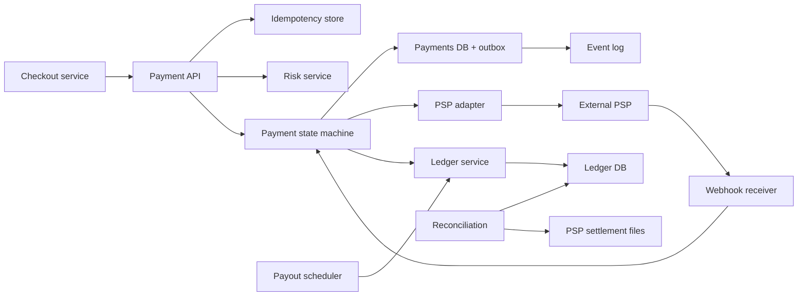

## In one minute
- Correctness beats throughput. The volume is modest compared with a social feed; what matters is that no payment is charged twice, none is lost, and every cent can be explained. Most of the design is about failure handling.
- Every mutating request carries an idempotency key, stored atomically with the result. Retries from clients, from your own workers, and to the payment service provider (PSP) must all be safe.
- Model each payment as an explicit state machine with persisted transitions. A timeout from the PSP is not a failure; it is the "unknown" state, resolved by querying the PSP or waiting for its webhook.
- Record money movement in an append-only double-entry ledger: every transaction is a set of entries that sum to zero. Balances are derived from entries, so the books always balance and can be audited.
- Trust nothing until reconciled. Daily reconciliation against PSP and bank settlement files is the backstop that catches every bug the online path missed.

## Requirements
Functional:
- A checkout service asks the payment system to charge a customer for an order (pay-in), using a card or wallet through an external PSP.
- Support authorize, capture, cancel and refund, with partial captures and refunds.
- Credit merchants or sellers their share minus fees, and pay them out to bank accounts on a schedule (pay-out).
- Expose payment status to callers and emit events (payment succeeded, failed, refunded).

Non-functional:
- Exactly-once effect for every charge and refund, despite retries and crashes.
- Strong consistency for ledger and balances; the ledger is immutable and auditable.
- High availability for accepting payments (lost checkouts are lost revenue), with p99 latency dominated by the PSP (often 300 ms to 2 s).
- Security and compliance: card data never touches our core services (tokenised by the PSP or a vault), PCI scope minimised, full audit trail. The standard to assess against is PCI DSS v4.0.1: v4.0 was retired on 31 December 2024, and the requirements v4 had marked as future-dated became mandatory on 31 March 2025 ([PCI SSC](https://blog.pcisecuritystandards.org/just-published-pci-dss-v4-0-1)).

Out of scope: building a card network or acquirer, fraud model internals (a risk service is called), currency conversion pricing, tax, and subscription billing logic.

## Back-of-envelope
Assume a large marketplace with 50 million payments per day. Treat this as a planning number.

Throughput: 50M / 86,400 is about 580 payments per second on average. Shopping peaks (a sale event) can be 10x, so design for about 6,000 per second at peak. Each payment makes 2 to 3 external calls over its life (authorize, capture, maybe refund) and several internal writes.

Ledger volume: each payment produces about 3 ledger transactions (authorization hold, capture with fee split, later payout) with an average of 3 entries each, so roughly 9 entries per payment, or 450M entries per day. At about 200 bytes per entry including indexes, that is 90 GB per day, 33 TB per year and about 165 TB over five years, before replication. Payments rows: 50M x 2 KB = 100 GB per day, about 180 TB over five years. Both are large but well within a sharded relational database or a purpose-built ledger store.

Idempotency records: 50M per day plus internal retries, about 1 KB each with the stored response, 50 GB per day. Keep them for 24 hours to 7 days; retention, not volume, sets the size (a 7-day window is about 350 GB).

Bandwidth: requests are small (a few KB), so even at 6,000 per second the API carries tens of MB/s. Bandwidth is not a concern; database write latency and PSP latency are.

## API
```
POST /v1/payments
  headers: Idempotency-Key: <uuid>
  body: { order_id, amount_minor: 12999, currency: "USD",
          payment_method_token, merchant_id, capture: "auto" | "manual" }
  -> 201 { payment_id, status: "AUTHORIZED" | "CAPTURED" | "PENDING" | "FAILED" }

POST /v1/payments/{id}/capture   headers: Idempotency-Key  body: { amount_minor }
POST /v1/payments/{id}/refunds   headers: Idempotency-Key  body: { amount_minor, reason }
GET  /v1/payments/{id}           -> { payment_id, status, amount_minor, captured_minor, refunded_minor }

POST /internal/psp-webhooks/{psp}   (signed; idempotent by PSP event id)
```
Amounts are integers in minor units. Floating point is never used for money.

`Idempotency-Key` is a convention, not a standard: the IETF draft for it expired at revision 07 (October 2025) without becoming an RFC ([IETF datatracker](https://datatracker.ietf.org/doc/draft-ietf-httpapi-idempotency-key-header/)), so document your own retention window and conflict responses.

## Data model
- **idempotency_keys**: primary key `(client_id, key)`, columns `request_hash`, `status` (in_progress, done), `response`, `created_at`, `locked_until`. Same shard as the payment it creates, so the key and the payment row commit in one transaction. The request hash detects a reused key with a different body.
- **payments**: primary key `payment_id`, columns `order_id`, `merchant_id`, `amount_minor`, `currency`, `status`, `psp`, `psp_reference`, `version`, timestamps. Unique index on `(merchant_id, order_id)` as a second guard against double charging the same order. Partition by `payment_id` (or by `merchant_id` when merchant-level queries dominate).
- **payment_attempts**: one row per PSP call with the idempotency key we sent to the PSP, request, response and outcome. This is the evidence trail for disputes and the input to recovery.
- **ledger_transactions** and **ledger_entries**: a transaction has `txn_id`, `idempotency_key`, `effective_at`, `description`; each entry has `txn_id`, `account_id`, `amount_minor` (signed), `currency`. Constraint: entries of a transaction sum to zero per currency. Entries are append-only; corrections are new reversing transactions. Partition entries by `account_id` so a balance query is a single-partition scan, and keep a cached `account_balances(account_id, balance, version)` updated in the same transaction.
- **accounts**: `account_id`, `type` (customer_receivable, merchant_payable, platform_fees, psp_clearing, bank_cash), `currency`, `allow_negative`.
- **outbox**: events written in the same database transaction as state changes, relayed to the event log by a separate process.

## High-level design


Write path: checkout calls `POST /payments` with an idempotency key. The API inserts the key row as in progress (a unique constraint makes a concurrent duplicate fail fast and wait or return 409). It calls risk, then creates the payment row in `CREATED` and a `payment_attempt` with a fresh PSP idempotency key derived from the payment ID and attempt number, all in one transaction. It then calls the PSP. On success, it moves the payment to `AUTHORIZED` or `CAPTURED`, posts the matching ledger transaction, writes an outbox event, and stores the response on the idempotency key, all in one local transaction. On a definite decline it moves to `FAILED`. On a timeout or 5xx it moves to `PENDING` and a recovery worker resolves it.

Read path: status reads go to the payments table or a read replica with a version check. Merchant balances come from `account_balances`, and statements are range scans of ledger entries by account.

Asynchronous path: PSP webhooks arrive, are verified by signature, deduplicated by PSP event ID, and applied to the state machine as transitions, which are no-ops if already applied. Nightly, reconciliation matches each settled PSP transaction with our ledger and flags any mismatch.

## Deep dives

### Exactly-once effects with idempotency keys
Networks lose responses, so the same request will arrive twice. Three layers of protection compose. First, the client's idempotency key: the first request inserts it, later requests with the same key and same body return the stored response, and a different body returns an error, which catches client bugs. If the first request is still running, the duplicate gets a 409 or waits. Second, a business-level uniqueness constraint on `(merchant_id, order_id)` stops two different keys from charging the same order. Third, the PSP's own idempotency key on every outbound call, deterministic per attempt, so our retry of a timed-out authorize does not create a second authorization. Keys expire after a window agreed with clients, typically a day: Stripe may prune keys once they are at least 24 hours old, and a key reused after pruning is treated as a new request ([Stripe API docs](https://docs.stripe.com/api/idempotent_requests)). The key insert and the result must be in the same database as the payment so there is no gap where one exists without the other; AWS states the same rule for EC2's client tokens, where recording the token and creating the resources are all or nothing ([AWS Builders' Library](https://aws.amazon.com/builders-library/making-retries-safe-with-idempotent-APIs/)).

Decide precisely what gets stored. Stripe saves the response once the endpoint starts executing, so a retry replays even a saved `500`; a request that failed validation or collided with a concurrent one on the same key saved nothing and may simply be retried. Use time-ordered keys (ULID or UUIDv7) for the key table's primary index: Shopify measured a 50 percent drop in INSERT duration after moving from random UUIDv4 keys to ULIDs, because random keys scatter writes across B-tree pages ([Shopify Engineering](https://shopify.engineering/building-resilient-payment-systems)).

### The unknown outcome and the state machine
A payment moves through `CREATED -> AUTHORIZED -> CAPTURED -> (PARTIALLY_)REFUNDED`, with `FAILED`, `CANCELED` and `PENDING` on the side. `PENDING` means we sent a request and do not know the result. Never mark it failed and let the user retry with a new key, because the first charge may have succeeded. Resolve it by querying the PSP with the same reference, retrying with the same PSP idempotency key, or waiting for the webhook. A recovery worker scans `PENDING` rows older than a few seconds with exponential backoff. Transitions are compare-and-set on `version`, so a webhook and the recovery worker racing on the same payment cannot both apply. If the order is canceled while a payment is pending, schedule a void or refund once it resolves rather than assuming it never happened.

`AUTHORIZED` is not a resting state either, because a hold expires. For online card payments the hold usually lasts 7 days, and Visa merchant-initiated authorizations last only about 4 days 18 hours; an uncaptured authorization then lapses and the funds go back to the customer. A partial capture releases the rest, and most card payments allow only one capture ([Stripe docs](https://docs.stripe.com/payments/place-a-hold-on-a-payment-method)). So the state machine needs an `EXPIRED` transition, and a sweeper must capture or void every authorization before its deadline, which you store on the payment row.

### The double-entry ledger and hot accounts
Single-entry "balance += amount" loses history and allows silent drift. In double-entry, a $100 capture with a $3 fee posts one transaction: debit `psp_clearing` 100, credit `merchant_payable` 97, credit `platform_fees` 3. The entries sum to zero, so the sum over all accounts is always zero; any non-zero total is a bug detected instantly. Corrections are reversing transactions, never updates. The ledger post is idempotent by its own key (the payment ID plus event type), so replaying the event log cannot double-post.

Concurrency is the hard part: a large merchant's payable account receives thousands of credits per second, and updating its balance row serialises on a lock. Options are optimistic version checks with retry (works at low contention), sharding the hot account into N sub-accounts and summing on read, or buffering credits and posting them in batches every second. Debits that must not overdraw (payouts, refunds from merchant balance) still check the aggregate balance, so the usual choice is: credits go to sub-accounts without contention, and debits take a lock on the aggregate or go through a single-writer queue per account.

### Variant: digital wallet (stored value and transfers)
A wallet changes the shape of the problem. The payment system above moves money between a customer's card and a merchant through an outside processor. A wallet holds the money itself: users top up, pay each other and merchants, and withdraw, so the platform's own ledger is the truth and no processor sits in the middle to settle disagreements.

**Requirements and numbers.** Every user is both payer and payee, and a balance must never go below zero (except for system accounts). Planning numbers for a large regional wallet: 60M daily actives making about 2.5 transfers each is 150M a day, roughly 1,700 per second on average and 17,000 to 20,000 at a payday or campaign peak. Balance reads run about ten times higher, so they come from the owning shard's memory or a replica with a version check. Each transfer writes about 700 bytes, roughly 105 GB of ledger a day.

**Cross-shard transfers.** With wallets partitioned by `wallet_id`, the sender and receiver rarely share a database. Two-phase commit would hold row locks on both wallets across a network round trip and leave them locked if the coordinator dies. The fix is a reservation protocol, a saga whose first step is cheap to undo:

1. Reserve: place a hold on the sender, lowering the spendable amount without moving money.
2. Credit: apply the credit to the receiver, which is the point of no return.
3. Capture: turn the hold into a posted debit.

Each step is idempotent on one `transfer_id`, so a crashed coordinator is simply replaced and re-runs the transfer. A sweeper releases holds that expire, but never one whose transfer already reached `credited`. In saga vocabulary the hold is a semantic lock, the credit is the pivot and the capture is a retryable step ([Azure saga pattern](https://learn.microsoft.com/en-us/azure/architecture/patterns/saga)). TigerBeetle models the same idea natively: a pending transfer raises `debits_pending`, and a later transfer posts, voids or times it out exactly once ([TigerBeetle two-phase transfers](https://docs.tigerbeetle.com/coding/two-phase-transfers/)).

**Balance versus ledger.** A stored `balance` column is updated in the same local transaction as the entry. Each entry records `balance_after`, a nightly job re-folds entries per wallet, and a global check confirms posted amounts sum to zero and held totals match pending holds.

**Hot wallets.** One row lock held until durable commit caps a wallet near 1,000 changes a second per millisecond of commit time. A popular merchant takes credits into N sub-wallets chosen by hashing `transfer_id`, summed for display; debits such as refunds and payouts go through a single-writer queue. Unlike the merchant accounts above, here every user is also a payer, so every reserve must check holds on that wallet.

## Down the stack

### Layer 1: The contract
For a given `(client_id, idempotency_key)`, the system performs the effect at most once and returns the same response every time. Every acknowledged state change is durable before the response is sent. Ledger transactions are atomic (all entries or none), balanced to zero per currency, immutable once committed, and accounts flagged non-negative never go below zero. Events are delivered at least once, so consumers dedupe by event ID. External PSP state may diverge from ours temporarily, but reconciliation detects every divergence within one settlement cycle.

### Layer 2: The mechanism
The core is one relational transaction: `INSERT` the idempotency key, `UPDATE payments SET status=..., version=version+1 WHERE payment_id=? AND version=?`, `INSERT` ledger transaction and entries, `UPDATE account_balances ... WHERE balance + delta >= 0` for guarded accounts, `INSERT` into outbox, then `COMMIT`. A unique index on the idempotency key enforces at-most-once; the conditional update enforces state machine order; the check constraint or conditional update enforces non-negative balances. The outbox relay reads committed rows in order and publishes them, recording its position, so events are never published for rolled-back changes. The relay can still crash after publishing and before recording its position, so it republishes on restart and consumers must dedupe ([microservices.io](https://microservices.io/patterns/data/transactional-outbox.html)). Specialised ledgers such as TigerBeetle put the same rules (balanced transfers, idempotent IDs, balance limits) into a purpose-built engine: a `create_transfers` request carries up to 8,189 transfers, which amortises consensus and I/O, and a repeated transfer ID returns `exists` rather than posting twice ([TigerBeetle docs](https://docs.tigerbeetle.com/coding/requests/)).

### Layer 3: The machine
The commit is the latency floor: Postgres or MySQL writes the transaction's records to the write-ahead log and calls `fsync` (or `fdatasync`) before acknowledging. On NVMe with power-loss protection that is roughly 20 to 100 microseconds; on cloud network block storage it is often 0.5 to 2 ms. Synchronous replication to a standby in another zone adds a network round trip of about 1 ms. Group commit amortises one `fsync` over many concurrent transactions, which is why throughput scales while per-transaction latency stays flat. In Postgres this happens even with `commit_delay` at its default of zero, because sessions that arrive during an in-progress flush join the next one ([PostgreSQL docs](https://www.postgresql.org/docs/current/wal-configuration.html)). A hot balance row is a single 8 KB heap page under a row lock; every writer queues on it, so throughput on one account is bounded by roughly one commit latency per update, a few hundred to a few thousand per second. External PSP calls take hundreds of milliseconds over TLS, so they must never run while holding a database transaction or row lock.

### Why it's built this way
- Networks drop responses, so every operation must be safely repeatable; hence idempotency keys at every boundary.
- Remote outcomes can be unknown, so state must be persisted before and after each external call and resolved later.
- Money must be explainable years later, so history is append-only and balances are derived.
- Bugs are inevitable, so a zero-sum invariant and independent reconciliation detect them quickly.
- Durable commits cost an `fsync` and locks serialise, so contention is designed away with sub-accounts and batching rather than bigger machines.

## Failure modes
- **10x load (flash sale):** the PSP rate-limits before we do. Queue captures (authorization is the user-facing step; capture can be deferred minutes or hours, as long as it lands well inside the authorization window), spread traffic across multiple PSPs, and shed non-critical reads. Set tight PSP timeouts (Shopify suggests about 1 s to connect and 5 s to read, not Ruby's 60 s defaults) and key circuit breakers per PSP and country ([Shopify Engineering](https://shopify.engineering/building-resilient-payment-systems)). Hot merchant accounts move to sub-account or batched posting.
- **Region outage:** the payments database is replicated synchronously within a region across zones and asynchronously across regions. Failing over across regions risks losing the last seconds of writes, so the PSP's records and reconciliation are the recovery source for anything in flight. Some teams accept pausing new payments for minutes over risking divergence.
- **Hot key:** one merchant or one platform fee account dominates writes. Split into sub-accounts and aggregate asynchronously.
- **PSP outage or timeouts:** payments pile up in `PENDING`. Circuit-break to a secondary PSP for new payments only; never re-route an in-flight payment, which risks charging twice.
- **Duplicate or out-of-order webhooks:** dedupe by PSP event ID and apply only valid state transitions. Stripe, for example, retries live-mode deliveries with backoff for up to three days, does not guarantee order, and sometimes emits two separate events for one change, so also dedupe on object ID plus event type. Verify the HMAC signature on the raw body, reject stale timestamps (its libraries default to 5 minutes), return `2xx` at once and process from a queue ([Stripe webhooks](https://docs.stripe.com/webhooks)).
- **Reconciliation mismatch:** a payment we think failed was settled by the PSP. Raise a case, refund or fix the ledger with a correcting transaction, and fix the root cause.

## In the wild
- **Twilio, 2013: a read-only balance store turns auto-recharge into repeated charges.** On 18 July a network blip made Redis replicas resync at once, and a restart of the billing master loaded a bad configuration and left it read-only with balances at zero. Usage kept triggering auto-recharge, the charge succeeded but the balance write failed, so cards were charged again; 1.4% of customers were affected. Twilio refunded the charges by the next day with a 10% credit, banned in-place master restarts, and added fail-safes that block charges when a balance is missing or unwritable ([Twilio postmortem](https://www.twilio.com/en-us/blog/company/communications/billing-incident-post-mortem-breakdown-analysis-and-root-cause-html)).
- **Stripe, 2019: a shard that can't elect a primary.** A database version deployed months earlier had a latent failover bug. When a shard's primary failed on 10 July, no new primary was elected, the shard stopped taking writes, and shared resources ran out, so most API requests failed from 16:35 to 17:02 UTC. The rollback of the election change then interacted with a new config setting and caused a second outage from 21:14 to 22:47. Stripe added replication-stall monitoring, per-cluster circuit breakers and limits on client retries ([Stripe RCA](https://stripe.com/rcas/2019-07-10)).
- **Shopify, 2022: payments lessons from running checkout.** Shopify's payments team reports concrete defaults: 1-second connect and 5-second read timeouts instead of 60, circuit breakers per country, ULID idempotency keys that halved INSERT time, and reconciliation that records each mismatch as a typed anomaly and auto-fixes where it can ([Shopify Engineering](https://shopify.engineering/building-resilient-payment-systems)).

## Trade-offs
| Option | Strengths | Weaknesses | Choose when |
|---|---|---|---|
| Synchronous charge in checkout | Simple UX, immediate result | Checkout latency tied to PSP | Card payments with fast PSPs |
| Async with status polling | Resilient to PSP slowness | More complex client and UX | Bank transfers, slow methods |
| Relational ledger tables | Familiar, transactional, flexible | Hot-row contention, manual sharding | Most companies, early stage |
| Purpose-built ledger engine | Very high transfer throughput, built-in invariants | New operational skill set | Very high volume ledgers |
| Single PSP | Simple integration | Single point of failure, weak pricing leverage | Early stage |
| Multiple PSPs with routing | Availability, cost optimisation | Reconciliation across providers | Large volume, global reach |

## Leadership lens
- Build first: idempotency store, payment state machine, a relational double-entry ledger with invariant checks, and reconciliation. Reconciliation is not optional and should exist before launch, not after the first incident.
- Ownership: a payments team owns the state machine and PSP adapters; a ledger team owns accounts, posting rules and reporting for finance; a payouts team owns bank integrations. Finance and compliance are stakeholders in every schema change.
- Cost drivers: PSP fees dominate infrastructure cost by orders of magnitude, so routing and authorization rate optimisation pay for themselves. Engineering cost is dominated by edge cases and audits.
- Rollout: new PSPs and posting rules go behind flags, run in shadow (post to a shadow ledger and compare), then ramp by merchant cohort.
- Ask in review: where can a charge happen without a ledger entry, what is the recovery path for every `PENDING` payment, and how long until reconciliation would catch a bug.

## Check yourself
1. An authorize call to the PSP times out. Why is it wrong to mark the payment `FAILED` and let the customer retry?
   **Answer:** A timeout means the outcome is unknown, and the first charge may have succeeded, so a fresh retry with a new key risks charging twice. The payment goes to `PENDING` and is resolved by querying the PSP, retrying with the same PSP idempotency key, or waiting for the webhook.
2. One merchant's payable account receives thousands of credits per second. What are the options, and what is the usual choice?
   **Answer:** Optimistic version checks with retry (fine at low contention), sharding the account into sub-accounts summed on read, or batching credits every second. The usual choice is to send credits to sub-accounts without contention while debits that must not overdraw take a lock on the aggregate or go through a single-writer queue.
3. Why do idempotency records cost about 350 GB rather than growing without bound, given 50M payments a day?
   **Answer:** At about 1 KB each with the stored response that is roughly 50 GB per day, but keys are kept only for 24 hours to 7 days, so retention sets the size and a 7-day window is about 350 GB.
4. Why must the idempotency key row live in the same database as the payment, and why must PSP calls never run inside a database transaction?
   **Answer:** Committing the key and the payment result in one local transaction leaves no gap where one exists without the other. PSP calls take hundreds of milliseconds, so holding a transaction or row lock across them would serialise writers behind slow external calls.

## Practice
**Task:** Implement an idempotent double-entry ledger. `open_account(account_id, allow_negative)` creates an account with balance 0. `post(idempotency_key, entries)` takes a list of `(account_id, amount)` pairs with signed integer amounts and returns a transaction ID `"t1"`, `"t2"` and so on. Validate in this order: at least two entries and no zero amounts (`invalid`), every account exists (`unknown_account`), amounts sum to zero (`unbalanced`), and no account that disallows negatives would end below zero (`insufficient_funds`). Before validation, if the key was already used successfully with the same entries (ignoring order), return the original transaction ID without reapplying; if it was used with different entries, fail with `idempotency_conflict`. Failed posts change nothing and do not record the key. `balance(account_id)` returns the balance and `check_invariants()` returns whether all balances sum to zero and each equals the sum of its recorded entries. Python raises `LedgerError` with a `code` attribute; TypeScript throws `LedgerError` with a `code` field; Go returns errors with the code as the message.

```python starter
class LedgerError(Exception):
    def __init__(self, code):
        super().__init__(code)
        self.code = code


class Ledger:
    def __init__(self):
        # TODO
        pass

    def open_account(self, account_id, allow_negative=False):
        raise NotImplementedError

    def post(self, idempotency_key, entries):
        raise NotImplementedError

    def balance(self, account_id):
        raise NotImplementedError

    def check_invariants(self):
        raise NotImplementedError
```

```python tests
def _ledger():
    l = Ledger()
    l.open_account("cash", allow_negative=True)
    l.open_account("merchant")
    l.open_account("fees")
    return l

def _code(fn):
    try:
        fn()
    except LedgerError as e:
        return e.code
    return None

def test_balanced_post_updates_balances():
    l = _ledger()
    assert l.post("k1", [("cash", -100), ("merchant", 97), ("fees", 3)]) == "t1"
    assert l.balance("cash") == -100
    assert l.balance("merchant") == 97
    assert l.balance("fees") == 3
    assert l.check_invariants()

def test_retry_same_key_is_noop():
    l = _ledger()
    t = l.post("k1", [("cash", -50), ("merchant", 50)])
    assert l.post("k1", [("merchant", 50), ("cash", -50)]) == t, "order does not matter"
    assert l.balance("merchant") == 50

def test_key_reuse_with_different_body_conflicts():
    l = _ledger()
    l.post("k1", [("cash", -50), ("merchant", 50)])
    assert _code(lambda: l.post("k1", [("cash", -60), ("merchant", 60)])) == "idempotency_conflict"
    assert l.balance("merchant") == 50

def test_validation_errors_change_nothing():
    l = _ledger()
    assert _code(lambda: l.post("a", [("cash", -10)])) == "invalid"
    assert _code(lambda: l.post("b", [("cash", -10), ("merchant", 0), ("fees", 10)])) == "invalid"
    assert _code(lambda: l.post("c", [("cash", -10), ("ghost", 10)])) == "unknown_account"
    assert _code(lambda: l.post("d", [("cash", -10), ("merchant", 9)])) == "unbalanced"
    assert l.balance("cash") == 0 and l.check_invariants()

def test_insufficient_funds_is_atomic():
    l = _ledger()
    l.post("in", [("cash", -30), ("merchant", 30)])
    assert _code(lambda: l.post("out", [("merchant", -40), ("cash", 40)])) == "insufficient_funds"
    assert l.balance("merchant") == 30
    assert l.balance("cash") == -30

def test_failed_key_can_be_retried_after_fix():
    l = _ledger()
    assert _code(lambda: l.post("p", [("merchant", -5), ("fees", 5)])) == "insufficient_funds"
    l.post("fund", [("cash", -5), ("merchant", 5)])
    assert l.post("p", [("merchant", -5), ("fees", 5)]) == "t2"
    assert l.balance("merchant") == 0 and l.balance("fees") == 5
    assert l.check_invariants()
```

```python solution
class LedgerError(Exception):
    def __init__(self, code):
        super().__init__(code)
        self.code = code


class Ledger:
    def __init__(self):
        self.accounts = {}
        self.balances = {}
        self.entries = []
        self.keys = {}
        self.seq = 0

    def open_account(self, account_id, allow_negative=False):
        self.accounts[account_id] = allow_negative
        self.balances.setdefault(account_id, 0)

    def post(self, idempotency_key, entries):
        norm = sorted((a, int(v)) for a, v in entries)
        if idempotency_key in self.keys:
            txn, prev = self.keys[idempotency_key]
            if prev == norm:
                return txn
            raise LedgerError("idempotency_conflict")
        if len(norm) < 2 or any(v == 0 for _, v in norm):
            raise LedgerError("invalid")
        if any(a not in self.accounts for a, _ in norm):
            raise LedgerError("unknown_account")
        if sum(v for _, v in norm) != 0:
            raise LedgerError("unbalanced")
        delta = {}
        for a, v in norm:
            delta[a] = delta.get(a, 0) + v
        for a, d in delta.items():
            if not self.accounts[a] and self.balances[a] + d < 0:
                raise LedgerError("insufficient_funds")
        self.seq += 1
        txn = "t%d" % self.seq
        for a, v in norm:
            self.entries.append((txn, a, v))
        for a, d in delta.items():
            self.balances[a] += d
        self.keys[idempotency_key] = (txn, norm)
        return txn

    def balance(self, account_id):
        return self.balances[account_id]

    def check_invariants(self):
        derived = {a: 0 for a in self.accounts}
        for _, a, v in self.entries:
            derived[a] += v
        return sum(self.balances.values()) == 0 and derived == self.balances
```

```typescript starter
export class LedgerError extends Error {
  constructor(public code: string) {
    super(code);
  }
}

export class Ledger {
  openAccount(accountId: string, allowNegative: boolean = false): void {
    throw new Error("TODO");
  }
  post(idempotencyKey: string, entries: Array<[string, number]>): string {
    throw new Error("TODO");
  }
  balance(accountId: string): number {
    throw new Error("TODO");
  }
  checkInvariants(): boolean {
    throw new Error("TODO");
  }
}
```

```typescript tests
function ledger(): Ledger {
  const l = new Ledger();
  l.openAccount("cash", true);
  l.openAccount("merchant");
  l.openAccount("fees");
  return l;
}

function code(fn: () => unknown): string | null {
  try {
    fn();
  } catch (e) {
    if (e instanceof LedgerError) return e.code;
    throw e;
  }
  return null;
}

test("balanced post updates balances", () => {
  const l = ledger();
  assertEqual(l.post("k1", [["cash", -100], ["merchant", 97], ["fees", 3]]), "t1");
  assertEqual(l.balance("cash"), -100);
  assertEqual(l.balance("merchant"), 97);
  assertEqual(l.balance("fees"), 3);
  assert(l.checkInvariants(), "invariants hold");
});

test("retry same key is noop", () => {
  const l = ledger();
  const t = l.post("k1", [["cash", -50], ["merchant", 50]]);
  assertEqual(l.post("k1", [["merchant", 50], ["cash", -50]]), t, "order does not matter");
  assertEqual(l.balance("merchant"), 50);
});

test("key reuse with different body conflicts", () => {
  const l = ledger();
  l.post("k1", [["cash", -50], ["merchant", 50]]);
  assertEqual(code(() => l.post("k1", [["cash", -60], ["merchant", 60]])), "idempotency_conflict");
  assertEqual(l.balance("merchant"), 50);
});

test("validation errors change nothing", () => {
  const l = ledger();
  assertEqual(code(() => l.post("a", [["cash", -10]])), "invalid");
  assertEqual(code(() => l.post("b", [["cash", -10], ["merchant", 0], ["fees", 10]])), "invalid");
  assertEqual(code(() => l.post("c", [["cash", -10], ["ghost", 10]])), "unknown_account");
  assertEqual(code(() => l.post("d", [["cash", -10], ["merchant", 9]])), "unbalanced");
  assertEqual(l.balance("cash"), 0);
  assert(l.checkInvariants(), "invariants hold");
});

test("insufficient funds is atomic", () => {
  const l = ledger();
  l.post("in", [["cash", -30], ["merchant", 30]]);
  assertEqual(code(() => l.post("out", [["merchant", -40], ["cash", 40]])), "insufficient_funds");
  assertEqual(l.balance("merchant"), 30);
  assertEqual(l.balance("cash"), -30);
});

test("failed key can be retried after fix", () => {
  const l = ledger();
  assertEqual(code(() => l.post("p", [["merchant", -5], ["fees", 5]])), "insufficient_funds");
  l.post("fund", [["cash", -5], ["merchant", 5]]);
  assertEqual(l.post("p", [["merchant", -5], ["fees", 5]]), "t2");
  assertEqual(l.balance("merchant"), 0);
  assertEqual(l.balance("fees"), 5);
  assert(l.checkInvariants(), "invariants hold");
});
```

```typescript solution
export class LedgerError extends Error {
  constructor(public code: string) {
    super(code);
  }
}

type Entry = [string, number];

export class Ledger {
  private allowNeg = new Map<string, boolean>();
  private balances = new Map<string, number>();
  private entries: Array<[string, string, number]> = [];
  private keys = new Map<string, [string, string]>();
  private seq = 0;

  openAccount(accountId: string, allowNegative: boolean = false): void {
    this.allowNeg.set(accountId, allowNegative);
    if (!this.balances.has(accountId)) this.balances.set(accountId, 0);
  }

  post(idempotencyKey: string, entries: Entry[]): string {
    const norm = [...entries].sort((a, b) =>
      a[0] !== b[0] ? (a[0] < b[0] ? -1 : 1) : a[1] - b[1]);
    const sig = JSON.stringify(norm);
    const prev = this.keys.get(idempotencyKey);
    if (prev) {
      if (prev[1] === sig) return prev[0];
      throw new LedgerError("idempotency_conflict");
    }
    if (norm.length < 2 || norm.some((e) => e[1] === 0)) throw new LedgerError("invalid");
    if (norm.some((e) => !this.allowNeg.has(e[0]))) throw new LedgerError("unknown_account");
    if (norm.reduce((s, e) => s + e[1], 0) !== 0) throw new LedgerError("unbalanced");
    const delta = new Map<string, number>();
    for (const [a, v] of norm) delta.set(a, (delta.get(a) ?? 0) + v);
    for (const [a, d] of delta) {
      if (!this.allowNeg.get(a) && this.balances.get(a)! + d < 0) {
        throw new LedgerError("insufficient_funds");
      }
    }
    this.seq += 1;
    const txn = "t" + this.seq;
    for (const [a, v] of norm) this.entries.push([txn, a, v]);
    for (const [a, d] of delta) this.balances.set(a, this.balances.get(a)! + d);
    this.keys.set(idempotencyKey, [txn, sig]);
    return txn;
  }

  balance(accountId: string): number {
    return this.balances.get(accountId) ?? 0;
  }

  checkInvariants(): boolean {
    const derived = new Map<string, number>();
    for (const a of this.balances.keys()) derived.set(a, 0);
    for (const [, a, v] of this.entries) derived.set(a, derived.get(a)! + v);
    let total = 0;
    for (const [a, b] of this.balances) {
      total += b;
      if (derived.get(a) !== b) return false;
    }
    return total === 0;
  }
}
```

```go starter
package practice

type Entry struct {
	Account string
	Amount  int64
}

type Ledger struct{}

func NewLedger() *Ledger {
	return &Ledger{}
}

func (l *Ledger) OpenAccount(accountID string, allowNegative bool) {
	panic("TODO")
}

func (l *Ledger) Post(idempotencyKey string, entries []Entry) (string, error) {
	panic("TODO")
}

func (l *Ledger) Balance(accountID string) int64 {
	panic("TODO")
}

func (l *Ledger) CheckInvariants() bool {
	panic("TODO")
}
```

```go tests
package practice

import "testing"

func newTestLedger() *Ledger {
	l := NewLedger()
	l.OpenAccount("cash", true)
	l.OpenAccount("merchant", false)
	l.OpenAccount("fees", false)
	return l
}

func errCode(err error) string {
	if err == nil {
		return ""
	}
	return err.Error()
}

func TestBalancedPostUpdatesBalances(t *testing.T) {
	l := newTestLedger()
	txn, err := l.Post("k1", []Entry{{"cash", -100}, {"merchant", 97}, {"fees", 3}})
	if err != nil || txn != "t1" {
		t.Fatalf("got %q %v", txn, err)
	}
	if l.Balance("cash") != -100 || l.Balance("merchant") != 97 || l.Balance("fees") != 3 {
		t.Fatal("wrong balances")
	}
	if !l.CheckInvariants() {
		t.Fatal("invariants must hold")
	}
}

func TestRetrySameKeyIsNoop(t *testing.T) {
	l := newTestLedger()
	first, _ := l.Post("k1", []Entry{{"cash", -50}, {"merchant", 50}})
	again, err := l.Post("k1", []Entry{{"merchant", 50}, {"cash", -50}})
	if err != nil || again != first {
		t.Fatalf("order does not matter: got %q %v", again, err)
	}
	if l.Balance("merchant") != 50 {
		t.Fatal("retry must not reapply")
	}
}

func TestKeyReuseWithDifferentBodyConflicts(t *testing.T) {
	l := newTestLedger()
	l.Post("k1", []Entry{{"cash", -50}, {"merchant", 50}})
	_, err := l.Post("k1", []Entry{{"cash", -60}, {"merchant", 60}})
	if errCode(err) != "idempotency_conflict" {
		t.Fatalf("got %v", err)
	}
	if l.Balance("merchant") != 50 {
		t.Fatal("conflict must not apply")
	}
}

func TestValidationErrorsChangeNothing(t *testing.T) {
	l := newTestLedger()
	cases := []struct {
		key  string
		e    []Entry
		want string
	}{
		{"a", []Entry{{"cash", -10}}, "invalid"},
		{"b", []Entry{{"cash", -10}, {"merchant", 0}, {"fees", 10}}, "invalid"},
		{"c", []Entry{{"cash", -10}, {"ghost", 10}}, "unknown_account"},
		{"d", []Entry{{"cash", -10}, {"merchant", 9}}, "unbalanced"},
	}
	for _, c := range cases {
		if _, err := l.Post(c.key, c.e); errCode(err) != c.want {
			t.Fatalf("%s: got %v want %s", c.key, err, c.want)
		}
	}
	if l.Balance("cash") != 0 || !l.CheckInvariants() {
		t.Fatal("failed posts must change nothing")
	}
}

func TestInsufficientFundsIsAtomic(t *testing.T) {
	l := newTestLedger()
	l.Post("in", []Entry{{"cash", -30}, {"merchant", 30}})
	_, err := l.Post("out", []Entry{{"merchant", -40}, {"cash", 40}})
	if errCode(err) != "insufficient_funds" {
		t.Fatalf("got %v", err)
	}
	if l.Balance("merchant") != 30 || l.Balance("cash") != -30 {
		t.Fatal("partial apply")
	}
}

func TestFailedKeyCanBeRetriedAfterFix(t *testing.T) {
	l := newTestLedger()
	if _, err := l.Post("p", []Entry{{"merchant", -5}, {"fees", 5}}); errCode(err) != "insufficient_funds" {
		t.Fatalf("got %v", err)
	}
	l.Post("fund", []Entry{{"cash", -5}, {"merchant", 5}})
	txn, err := l.Post("p", []Entry{{"merchant", -5}, {"fees", 5}})
	if err != nil || txn != "t2" {
		t.Fatalf("got %q %v", txn, err)
	}
	if l.Balance("merchant") != 0 || l.Balance("fees") != 5 || !l.CheckInvariants() {
		t.Fatal("wrong state after retry")
	}
}
```

```go solution
package practice

import (
	"errors"
	"fmt"
	"sort"
	"sync"
)

type Entry struct {
	Account string
	Amount  int64
}

var (
	ErrInvalid             = errors.New("invalid")
	ErrUnknownAccount      = errors.New("unknown_account")
	ErrUnbalanced          = errors.New("unbalanced")
	ErrInsufficientFunds   = errors.New("insufficient_funds")
	ErrIdempotencyConflict = errors.New("idempotency_conflict")
)

type posted struct {
	txn string
	sig string
}

type record struct {
	txn     string
	account string
	amount  int64
}

type Ledger struct {
	mu       sync.Mutex
	allowNeg map[string]bool
	balances map[string]int64
	entries  []record
	keys     map[string]posted
	seq      int
}

func NewLedger() *Ledger {
	return &Ledger{allowNeg: map[string]bool{}, balances: map[string]int64{}, keys: map[string]posted{}}
}

func (l *Ledger) OpenAccount(accountID string, allowNegative bool) {
	l.mu.Lock()
	defer l.mu.Unlock()
	l.allowNeg[accountID] = allowNegative
	if _, ok := l.balances[accountID]; !ok {
		l.balances[accountID] = 0
	}
}

func (l *Ledger) Post(idempotencyKey string, entries []Entry) (string, error) {
	l.mu.Lock()
	defer l.mu.Unlock()
	norm := append([]Entry{}, entries...)
	sort.Slice(norm, func(i, j int) bool {
		if norm[i].Account != norm[j].Account {
			return norm[i].Account < norm[j].Account
		}
		return norm[i].Amount < norm[j].Amount
	})
	sig := fmt.Sprint(norm)
	if prev, ok := l.keys[idempotencyKey]; ok {
		if prev.sig == sig {
			return prev.txn, nil
		}
		return "", ErrIdempotencyConflict
	}
	if len(norm) < 2 {
		return "", ErrInvalid
	}
	var sum int64
	delta := map[string]int64{}
	for _, e := range norm {
		if e.Amount == 0 {
			return "", ErrInvalid
		}
	}
	for _, e := range norm {
		if _, ok := l.allowNeg[e.Account]; !ok {
			return "", ErrUnknownAccount
		}
		sum += e.Amount
		delta[e.Account] += e.Amount
	}
	if sum != 0 {
		return "", ErrUnbalanced
	}
	for a, d := range delta {
		if !l.allowNeg[a] && l.balances[a]+d < 0 {
			return "", ErrInsufficientFunds
		}
	}
	l.seq++
	txn := fmt.Sprintf("t%d", l.seq)
	for _, e := range norm {
		l.entries = append(l.entries, record{txn, e.Account, e.Amount})
	}
	for a, d := range delta {
		l.balances[a] += d
	}
	l.keys[idempotencyKey] = posted{txn, sig}
	return txn, nil
}

func (l *Ledger) Balance(accountID string) int64 {
	l.mu.Lock()
	defer l.mu.Unlock()
	return l.balances[accountID]
}

func (l *Ledger) CheckInvariants() bool {
	l.mu.Lock()
	defer l.mu.Unlock()
	derived := map[string]int64{}
	for _, r := range l.entries {
		derived[r.account] += r.amount
	}
	var total int64
	for a, b := range l.balances {
		total += b
		if derived[a] != b {
			return false
		}
	}
	return total == 0
}
```

## Mock interview
**Prompt:** Design the payment system for a large marketplace processing about 50 million payments a day through external card processors, crediting sellers minus fees and paying them out daily. A customer must never be charged twice and every cent must be accounted for.

- Follow-up: Your authorize call to the PSP times out after 10 seconds. What state is the payment in, what does the customer see, and what happens next?
- Follow-up: One seller's account receives 3,000 credits per second during a sale and the balance row becomes the bottleneck. What do you change?
- Follow-up: Would you use a relational database for the ledger or a specialised ledger engine? What would change your mind?

**A strong answer covers:**
- Idempotency keys at the API, a uniqueness constraint on the order, and deterministic PSP idempotency keys, all committed atomically with state.
- An explicit state machine with a `PENDING` unknown state resolved by query, retry with the same key, or webhook, never by a fresh charge.
- An append-only double-entry ledger with a zero-sum invariant and reversing transactions for corrections.
- Outbox-based event publishing and idempotent consumers.
- Reconciliation against PSP settlement files as the final safety net, plus hot-account mitigation via sub-accounts or batching.

## Sources and further study
**Primary**
- [IETF draft-ietf-httpapi-idempotency-key-header](https://datatracker.ietf.org/doc/draft-ietf-httpapi-idempotency-key-header/): the expired attempt to standardise the `Idempotency-Key` header, useful for its error-case vocabulary.
- [PCI SSC: PCI DSS v4.0.1 published](https://blog.pcisecuritystandards.org/just-published-pci-dss-v4-0-1): which version is in force and when the future-dated requirements started to apply.

**Systems docs**
- [Stripe: place a hold on a payment method](https://docs.stripe.com/payments/place-a-hold-on-a-payment-method): authorization windows per card network, partial capture and expiry.
- [Stripe: receive events in your webhook endpoint](https://docs.stripe.com/webhooks): retries, ordering, duplicate events and signature checks.
- [TigerBeetle: two-phase transfers](https://docs.tigerbeetle.com/coding/two-phase-transfers/): pending, post, void and timeout semantics for holds that resolve exactly once.
- [TigerBeetle: requests](https://docs.tigerbeetle.com/coding/requests/): batch limits and idempotent create semantics in a purpose-built ledger.
- [PostgreSQL: WAL configuration](https://www.postgresql.org/docs/current/wal-configuration.html): how commits flush WAL and how group commit works.

**Books**
- *System Design Interview, Volume 2*, Alex Xu and Sahn Lam, chapter 11 "Payment System": pay-in and pay-out flows, PSP integration, reconciliation and exactly-once delivery.
- *Designing Data-Intensive Applications* (1st edition), Martin Kleppmann, chapter 12 "The Future of Data Systems", section "Aiming for Correctness": end-to-end request IDs and why database transactions alone don't stop duplicate effects.

**Other curricula**
- [Azure Architecture Center: Saga pattern](https://learn.microsoft.com/en-us/azure/architecture/patterns/saga): frames sagas through compensable, pivot and retryable steps, used here for wallet transfers.
- [AWS Builders' Library: Making retries safe with idempotent APIs](https://aws.amazon.com/builders-library/making-retries-safe-with-idempotent-APIs/): frames idempotency as an API contract, including parameter mismatches and late-arriving retries.
- [microservices.io: Transactional outbox](https://microservices.io/patterns/data/transactional-outbox.html): frames event publishing as a dual-write problem solved inside one database transaction.

## Watch
- [Tech Talk: Fix Your Ledger Before It Breaks Your Payments (Modern Treasury)](https://www.youtube.com/watch?v=cu8ZNl_GFdo): ledger design problems that show up as payment bugs.
- [System Design: Payment Gateway (System Design Fight Club)](https://www.youtube.com/watch?v=shipSEFMzHs): an idempotent authorize-and-capture workflow, end to end.
- [Banking Ledger: System Design Interview (interviewing.io)](https://www.youtube.com/watch?v=AfkWaDALUsM): a mock interview on ledger design with interviewer probes.

## Free resources
- [Designing robust and predictable APIs with idempotency (Stripe)](https://stripe.com/blog/idempotency): why idempotency keys exist and how clients should retry.
- [Idempotent requests (Stripe API docs)](https://docs.stripe.com/api/idempotent_requests): the exact semantics of key reuse, expiry and conflicting bodies.
- [Implementing Stripe-like idempotency keys in Postgres (Brandur Leach)](https://brandur.org/idempotency-keys): atomic phases, recovery points and a working schema.
- [Books: an immutable double-entry accounting database service (Square)](https://developer.squareup.com/blog/books-an-immutable-double-entry-accounting-database-service/): how a payments company built its internal ledger.
- [Accounting for developers, part I (Modern Treasury)](https://www.moderntreasury.com/journal/accounting-for-developers-part-i): debits, credits and account types explained for engineers.
- [TigerBeetle documentation](https://docs.tigerbeetle.com/): a purpose-built ledger database with balanced transfers and idempotent IDs.
