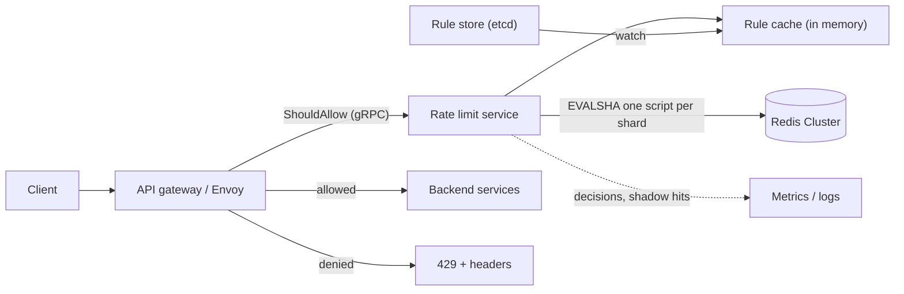

## In one minute
- **Choose the algorithm per rule.** Each algorithm fits different traffic:
  - **token bucket** for API quotas, because it allows short bursts and enforces a steady rate
  - **sliding-window counter** for coarse abuse limits, because it needs only two integers per key
  - **exact log** only for small, high-value limits such as login attempts
- **Make the read-modify-write atomic where the state lives.** A Lua script or a single atomic command in the counter store removes the race in which two API servers both read "9 of 10 used" and both allow the request.
- **Check every tier before you consume any.** A request is checked against per-key, per-user, per-IP, per-endpoint and global limits. A request denied at one tier must not use up budget at the others.
- **Decide what happens when the limiter is down.** Usually you fail open with a local fallback limit. A limiter outage should never turn into an API outage.
- **Spend the latency budget carefully.** The limiter sits on every request, so it gets under 1 ms at p99. That pushes the design toward in-region stores, connection pooling and, at the largest scale, local token leases.

## Requirements

**Functional**
- Limit requests by configurable keys: API key, user, IP, tenant, endpoint and global. Several rules can apply to one request.
- Each rule has a limit, a window or refill rate, a burst size and an algorithm.
- Return `429` with `Retry-After` and remaining-quota headers when a request is limited.
- Rules change without a deploy. A shadow mode logs decisions without enforcing them.

**Non-functional**
- Under 1 ms of added p99 latency. 99.99% availability, which in practice means failing open.
- Accuracy within about 5% of the configured limit within a region. Across regions, a looser bound is acceptable.
- Scale to 1M requests per second at peak and 10M active keys.

**Out of scope:** L3/L4 DDoS scrubbing, billing-grade metering, and adaptive load shedding (related, but a separate mechanism).

## Back-of-envelope
- **Traffic:** 1M req/s at peak and 400k req/s on average. Each request checks about 3 rules, so the counter store sees about 3M operations per second at peak.
- **Store throughput:** one Redis shard runs a short Lua script at roughly 50k to 150k calls per second on one core, depending on script size. 3M / 100k = 30 shards, and doubling for headroom gives about 60 primaries. Each has a replica.
- **Memory, token bucket:** two numbers plus key and overhead is about 100 bytes per key. 10M keys × 3 rules × 100 B ≈ 3 GB. That is small.
- **Memory, sliding log** at 1,000 requests per minute per key: a Redis sorted-set entry costs roughly 50 to 80 bytes. 1,000 × 64 B ≈ 64 KB per key, so 10M keys would need about 640 GB. This arithmetic is why logs are reserved for small limits.
- **Network:** about 300 bytes per check, so 3M × 300 B ≈ 900 MB/s fleet-wide, about 15 MB/s per shard.
- **Latency:** a round trip within one availability zone takes about 100 to 300 µs, and the script runs for about 5 to 20 µs. One pipelined round trip per request fits the 1 ms budget. Crossing regions takes 30 to 100 ms and does not fit.

## API

```protobuf
service RateLimiter {
  rpc ShouldAllow(CheckRequest) returns (CheckResponse);
}
message CheckRequest {
  string domain = 1;                       // "public-api"
  map<string, string> attributes = 2;      // api_key, user_id, ip, route
  uint32 cost = 3;                         // default 1; bulk endpoints cost more
}
message CheckResponse {
  bool allowed = 1;
  string limited_by = 2;                   // rule name, e.g. "per_user_route"
  uint32 remaining = 3;
  uint32 reset_after_ms = 4;
  uint32 retry_after_ms = 5;
}
```

The HTTP response to the client looks like this:

```http
HTTP/1.1 429 Too Many Requests
Retry-After: 2
RateLimit-Policy: "per_user";q=100;w=1
RateLimit: "per_user";r=0;t=2
```

Status `429` comes from [RFC 6585](https://www.rfc-editor.org/rfc/rfc6585#section-4), which makes `Retry-After` optional and leaves how you identify callers and count requests entirely to you. The quota headers follow the IETF [RateLimit fields draft](https://datatracker.ietf.org/doc/draft-ietf-httpapi-ratelimit-headers/): `RateLimit-Policy` names each policy with its quota `q` and window `w`, and `RateLimit` reports remaining units `r` and seconds until reset `t`. Earlier drafts used separate `RateLimit-Limit`, `-Remaining` and `-Reset` fields, and many APIs still send `X-RateLimit-*`, so clients should tolerate both.

The admin API is `PUT /rules/{domain}/{name}` with a body such as `{ fields: ["user_id","route"], algorithm: "token_bucket", capacity: 100, refill_per_sec: 10, mode: "enforce"|"shadow" }`.

## Data model

**Rules** live in a config store (etcd, or a database with a cache in front). They are versioned and pushed to every limiter node, where they are compiled into a matcher indexed by domain.

A rule is `{name, domain, fields[], algorithm, params, mode, priority}`. The number of rules is small, a few thousand at most, so every node keeps all of them in memory.

**Counters** live in a Redis Cluster. The key is `rl:{rule}:{v1|v2}`, for example `rl:per_user_route:{u_42}|POST /charges`. The partition key is the hash slot of the part inside the braces. Redis hashes only that substring, so every counter for one user lands on one shard. That makes a multi-tier check for that user a single script call.

The value depends on the algorithm:
- **Token bucket:** a hash `{tokens, ts_ms}`.
- **Sliding-window counter:** two integer keys, one per window index, `...:w{floor(now/window)}`.
- **Sliding log:** a sorted set scored by timestamp.

Every counter key gets `PEXPIRE` set to about twice its window or refill horizon. Idle keys then vanish on their own, and memory tracks active keys rather than all keys ever seen.

## High-level design



**Request path.**
1. The gateway extracts the attributes and calls `ShouldAllow`. It can also link the limiter in as a library to save a network hop.
2. The service matches the request's attributes against the rule set and builds one key per matching rule.
3. It groups the keys by Redis shard and sends one script call per shard. Each script checks all of its keys and, only if all of them pass, consumes from all of them.
4. The gateway forwards the request or returns 429 with headers.

**Config path.** Rule edits are written to etcd. Limiter nodes watch for changes and swap in a new matcher atomically. A new rule starts in shadow mode, so you can see how many requests it would have rejected before it rejects any.

## Deep dives

### 1. Which algorithm
- **Fixed window counter (`INCR` plus expire).** This is the cheapest option. Its flaw is the window boundary: a client can send the full limit at 0:59 and again at 1:00, which is 2× the limit inside two seconds.
- **Sliding log.** It is exact over any window. Memory and work grow with the limit, though, and a flood of rejected requests can still grow the log unless rejected requests are not recorded.
- **Sliding-window counter.** It estimates the count as `prev × (1 − elapsed/window) + current`. That costs two integers and assumes traffic was spread evenly through the previous window. Cloudflare tested it on 400 million requests from 270,000 sources: only 0.003% of requests were wrongly allowed or limited, and the estimated rate was off by 6% on average ([Cloudflare](https://blog.cloudflare.com/counting-things-a-lot-of-different-things/)). It works well for abuse limits.
- **Token bucket.** It is described by a capacity B and a rate r. It allows bursts up to B and a sustained rate of r, which matches how people describe API quotas ("10 per second, bursts of 100"). The state is two numbers, updated lazily when a request arrives, with no background refill job. GCRA is an equivalent single-timestamp form. AWS API Gateway throttles this way, with the rate as the refill and the burst as the bucket size, and calls its limits best-effort targets rather than guaranteed ceilings ([AWS docs](https://docs.aws.amazon.com/apigateway/latest/developerguide/api-gateway-request-throttling.html)).
- **Leaky bucket.** Requests join a queue that drains at a fixed rate, so output is perfectly smooth but bursts wait instead of passing. NGINX `limit_req` works this way: excess requests are delayed up to `burst`, `nodelay` turns the delay into immediate rejection, and rejections return `503` unless you set `limit_req_status 429` ([NGINX docs](https://nginx.org/en/docs/http/ngx_http_limit_req_module.html)). Choose it to protect a backend that needs an even arrival rate.
- **Concurrency limiter.** It caps requests *in flight* per caller instead of requests per second. A rate limit cannot tell a 5 ms call from a 30 s report export; a cap such as 20 concurrent requests can. Stripe runs one beside its token bucket for expensive endpoints ([Stripe](https://stripe.com/blog/rate-limiters)). It needs a decrement when the request ends, plus a TTL so crashed requests do not leak slots.

**Choice:** token bucket by default, sliding-window counter for per-IP abuse limits, and a log only where limits are tiny and exactness matters, such as 5 password attempts in 15 minutes.

### 2. Atomic and distributed enforcement
**Why GET then SET fails.** Doing `GET`, deciding in the service and then `SET` loses updates under concurrency. Two nodes each read 9 tokens, and both write back 8.

**Ways to make it atomic:**
- a Lua script, which Redis runs to completion while blocking all other server activity, so it is atomic ([Redis docs](https://redis.io/docs/latest/develop/programmability/eval-intro/))
- `INCR` for fixed windows
- a `WATCH`/`MULTI` retry loop, which works but suffers under contention

**Shard placement.** Hash tags keep all of a user's tiers on one shard, so the check-all-then-consume step is one atomic script. The global and per-IP tiers live on other shards. For those, the service checks them in a second call and refunds the first if the second denies. The refund window allows a very small overshoot, and that is acceptable here.

**Very high rates.** At 1M req/s with hot global keys, have each limiter node lease tokens in batches, for example take 50 tokens with one script call and spend them locally. This cuts store calls by about 50×. The cost is that up to `nodes × batch` tokens can be outstanding, so batch size is the knob that trades accuracy against load.

**Multiple regions.** Either split the quota per region in proportion to traffic, or run local limits and reconcile counts asynchronously every second or so. A global synchronous counter puts a cross-region round trip on every request, which fails the latency requirement.

### 3. Multi-tier keys and the order of checks
Rules form a hierarchy:
- API key at 100/s
- user at 300/s across that user's keys
- tenant at 5k/s
- endpoint `POST /charges` at 1k/s globally
- a global safety limit

**Evaluation is check-all-then-consume.** If the per-user tier passes and consumes a token, but the tenant tier then rejects, the user has lost a token for a request that never ran. Under sustained rejection that drains honest budgets. Order the checks from most specific to least, because the specific tiers reject most often, which saves remote work.

**Response headers** report the tier with the lowest remaining fraction. Bulk endpoints charge `cost = 10` instead of needing separate rules. **Tenant overrides** sit at a higher priority on the same rule name, so an enterprise customer's higher limit replaces the default rather than adding to it.

## Down the stack

### Layer 1: The contract
- For a token-bucket rule (B, r) on key k, over any interval of length t within one region, allowed cost is at most B + r·t, plus at most `nodes × lease_batch` when leases are on.
- A denied request does not consume budget at any tier.
- A decision takes at most 1 ms at p99. If the store does not answer within about 5 ms, the service falls back to a per-node local bucket set to `limit / node_count` and records a `fail_open` metric.
- A rule change takes effect within about 5 seconds.

### Layer 2: The mechanism
The token-bucket script receives `KEYS = [k1..kn]` and `ARGV = [now_ms, cost, cap1, rate1, ...]`. It works in two passes:
1. For each key it runs `HMGET k tokens ts`, computes `tokens = min(cap, tokens + (now − ts) × rate / 1000)` and checks `tokens ≥ cost`.
2. If every check passed, it runs `HSET k tokens (tokens−cost) ts now` and `PEXPIRE k horizon` for each key.

It returns either the remaining tokens or the index of the rule that denied.

The service loads the script once with `SCRIPT LOAD` and calls it by SHA (`EVALSHA`), so each call carries 40 bytes of hash instead of the script body. The script cache is not persisted and can be empty after a restart or a replica promotion, so the client must handle `NOSCRIPT` by reloading, and inside a pipeline it should send plain `EVAL` ([Redis docs](https://redis.io/docs/latest/develop/programmability/eval-intro/)). Every script must name its keys in `KEYS`, which is what lets Redis Cluster route it and reject keys that span slots.

Envoy's global rate limiting takes the same descriptor-based shape. The proxy sends a `RateLimitRequest` holding a list of descriptor entries, and a rate limit service answers `OK` or `OVER_LIMIT` for each descriptor. Envoy then returns `429`, gives the call a 20 ms timeout by default, and lets traffic through on errors unless `failure_mode_deny` is set ([Envoy filter docs](https://www.envoyproxy.io/docs/envoy/latest/configuration/http/http_filters/rate_limit_filter), [proto](https://www.envoyproxy.io/docs/envoy/latest/api-v3/extensions/filters/http/ratelimit/v3/rate_limit.proto)). Fail-open is the proxy default, not just a choice in this design.

### Layer 3: The machine
- **Redis execution.** Redis runs commands on one thread. A 3-key script takes about 10 to 20 µs of CPU, which is where the 50k to 150k calls per second per core figure comes from. I/O threads can parse sockets in parallel, but scripts still run one at a time.
- **Network.** In one availability zone a round trip costs about 100 to 300 µs, mostly kernel network stack and NIC interrupt work at each end. Persistent pooled connections avoid a TCP handshake per check. A request and response each fit in one segment, well under the roughly 1,460-byte MSS.
- **Which clock to use.** Use the Redis server's clock (`TIME`), or pass in the caller's clock and accept skew. Within a service, measure elapsed time with `CLOCK_MONOTONIC`. Wall clocks can step backward under NTP, which would mint negative elapsed time. Clamp `now − ts` at 0.

### Why it's built this way
1. Every request pays for the limiter, so it needs a sub-millisecond check. That rules out cross-region coordination and disk-backed stores.
2. A sub-millisecond check needs in-memory state with tiny entries, so the design uses token buckets (two numbers) rather than logs.
3. Many stateless API nodes share each key, so the state must live centrally and be updated atomically. That leads to a single-threaded store and a script.
4. One central store has limits on throughput and availability. That leads to sharding by hash tag, local leases for hot keys, and failing open.
5. Wrong limits hurt customers more than missing ones, which is why shadow mode, override priorities and limit headers exist.

## Failure modes
- **Load at 10×, for example a retry storm from a broken client.** Denials still cost a store call each. Mitigations:
  - Cache "denied until T" locally on each node for the key, so repeat offenders are rejected in memory.
  - Put a per-IP local limiter in front of the remote one.
  - Throttle in your own clients too. Google's SRE book describes clients that track requests and accepts over two minutes and start dropping requests locally once requests exceed about twice the accepts, because even a rejection costs the backend work ([Google SRE book](https://sre.google/sre-book/handling-overload/)).
- **Hot key**, for example the global limit or a large tenant's key. One shard saturates. Mitigations:
  - Split the key into N sub-buckets, each with limit/N, and pick one at random.
  - Or use local leases.
- **Store shard down.** Fail open to local per-node buckets, and alert. If that shard holds limits that protect a fragile dependency, fail closed for that rule only. This is a per-rule setting.
- **Region outage.** Traffic shifts to another region, which suddenly carries double the load. The per-region split quotas must be recomputed from the traffic share, or the other region rejects legitimate users.
- **Bad rule push.** A typo sets the limit to 1/s. Mitigations: new rules go through shadow mode, a rule that would reject more than X% of traffic needs a second approver, and rollback is a version pointer flip.

## In the wild
- **Google Cloud, 2025: the quota checker becomes the outage.** Service Control checks authorization, policy and quota on every Google Cloud API request. On 12 June a policy record with blank fields replicated worldwide in seconds and hit a new quota-check code path that had no error handling and no feature flag, so the binary crash-looped in every region. The kill switch took about 40 minutes to roll out, but us-central1 needed up to 2 hours 40 minutes more because restarting tasks overloaded the backing Spanner table without randomized backoff. Google committed to making Service Control fail open and to feature-flagging such changes ([Google Cloud incident report](https://status.cloud.google.com/incidents/ow5i3PPK96RduMcb1SsW)).
- **Cloudflare, 2017: approximate counting at edge scale.** Cloudflare counts per-client rates in a memcache cluster in each data center using only `GET` and `INCR`, increments asynchronously so requests never wait on the counter, and once a client is over the limit stores a mitigation flag with a known expiry that every server caches locally. The sliding-window estimate was wrong on 0.003% of 400 million test requests ([Cloudflare](https://blog.cloudflare.com/counting-things-a-lot-of-different-things/)).
- **Stripe, 2017: four limiters, not one.** Stripe runs a per-user token bucket in Redis, a concurrent-request limiter, and two load shedders that reserve capacity for critical calls such as creating charges. In one month the token bucket rejected millions of requests while the last-resort worker shedder rejected only about 100. Each limiter was dark-launched first, and every code path fails open on errors ([Stripe](https://stripe.com/blog/rate-limiters)).

## Trade-offs

| Option | Strengths | Weaknesses | Choose when |
|---|---|---|---|
| Token bucket | Bursts plus a steady rate, 2 numbers per key | Burst size is one more knob to explain | Public API quotas |
| Sliding-window counter | 2 integers, smooth, no boundary spike | Approximate if traffic inside the window is uneven | Per-IP abuse, coarse limits |
| Sliding log | Exact over any window | Memory and CPU grow with the limit | Small, security-sensitive limits |
| Fixed window | Simplest, one `INCR` | 2× burst at boundaries | Internal, non-critical limits |
| Central Redis | Accurate, simple | Extra hop, an availability dependency | Most deployments |
| Local leases | Few store calls, survives store blips | Overshoot up to nodes × batch | Very high rate global keys |
| Fail open | API stays up | Limits not enforced while the limiter is down | Quotas and fairness |
| Fail closed | Protects the downstream | Limiter outage becomes an API outage | Guarding a fragile dependency |

## Leadership lens
- **Build first:** the in-process library with token bucket, rule matching, shadow mode and headers, backed by Redis. Add leases and multi-region split quotas when measurements show you need them.
- **Ownership:** the platform or edge team owns the service and its SLO. Product teams own their rules as code with review. Support needs a self-serve view that answers "why was customer X limited".
- **Cost drivers:** Redis memory and CPU, which grow with active keys × rules and with checks per second. The tail-latency budget the limiter consumes is the hidden cost on every endpoint.
- **Rollout:** shadow mode for two weeks per new rule, then enforce for 1% of keys, then everyone. Watch the 429 rate per tenant and support tickets.
- **Design-review questions:** What is each rule's fail mode? Do retries count? Are limits per region or global?

## Check yourself
1. Why is a sliding log reserved for small limits such as login attempts, rather than used for a 1,000 per minute API quota?
   **Answer:** A log stores one sorted-set entry per request at roughly 64 bytes, so 1,000 per minute is about 64 KB per key and about 640 GB for 10M keys. A token bucket needs about 100 bytes per key, roughly 3 GB for 10M keys and 3 rules.
2. Why must a multi-tier check be check-all-then-consume rather than consuming tier by tier?
   **Answer:** If the per-user tier consumes a token and the tenant tier then rejects, the user loses budget for a request that never ran, and sustained rejection drains honest budgets. The script checks every key first and consumes from all of them only if all pass.
3. The Redis shard holding a set of counters goes down. What should the limiter do?
   **Answer:** By default fail open to a per-node local bucket of about `limit / node_count`, record a `fail_open` metric and alert, so a limiter outage does not become an API outage. Rules protecting a fragile dependency can be set to fail closed for that rule only.
4. What do local token leases buy at very high rates, and what do they cost?
   **Answer:** Each node takes a batch of tokens (for example 50) in one script call and spends them locally, cutting store calls by about 50 times. The cost is possible overshoot of up to `nodes × batch` tokens, so batch size trades accuracy against store load.

## Practice
**Task:** Implement two limiters and a tier combiner, all driven by an injected clock that returns milliseconds.
- `SlidingWindowLog(limit, window_ms, clock)` allows a request if fewer than `limit` requests were allowed in `(now − window_ms, now]`.
- `TokenBucket(capacity, refill_per_sec, clock)` starts full, refills continuously and is capped at capacity.
- Both expose `check(key)` (no side effects), `consume(key)` and `allow(key)` (check, then consume).
- `TieredLimiter(rules)` takes `(name, fields, limiter)` rules. For each request it builds the key `name:` followed by the field values joined with `|`, and skips any rule whose fields are missing. It allows the request only if every applicable rule passes, and consumes from all of them only in that case. It returns whether the request was allowed and the name of the first rule that denied it.

```python starter
class SlidingWindowLog:
    def __init__(self, limit, window_ms, clock):
        pass

    def check(self, key):
        raise NotImplementedError

    def consume(self, key):
        raise NotImplementedError

    def allow(self, key):
        # TODO: check then consume
        raise NotImplementedError


class TokenBucket:
    def __init__(self, capacity, refill_per_sec, clock):
        pass

    def tokens(self, key):
        raise NotImplementedError

    def check(self, key):
        raise NotImplementedError

    def consume(self, key):
        raise NotImplementedError

    def allow(self, key):
        raise NotImplementedError


class TieredLimiter:
    def __init__(self, rules):
        pass

    def allow(self, attrs):
        # TODO: return (allowed, denying_rule_name_or_None)
        raise NotImplementedError
```

```python tests
class FakeClock:
    def __init__(self):
        self.now = 0
    def __call__(self):
        return self.now

def test_sliding_log_allows_limit_then_denies():
    c = FakeClock()
    lim = SlidingWindowLog(3, 1000, c)
    assert [lim.allow("k") for _ in range(4)] == [True, True, True, False]

def test_sliding_log_window_boundary():
    c = FakeClock()
    lim = SlidingWindowLog(2, 1000, c)
    assert lim.allow("k")
    c.now = 500
    assert lim.allow("k")
    c.now = 999
    assert not lim.allow("k")
    c.now = 1000
    assert lim.allow("k"), "request at t=0 has left the window"
    c.now = 1001
    assert not lim.allow("k"), "request at t=500 still counts"

def test_keys_are_independent():
    c = FakeClock()
    lim = SlidingWindowLog(1, 1000, c)
    assert lim.allow("a") and lim.allow("b")
    assert not lim.allow("a")

def test_token_bucket_burst():
    c = FakeClock()
    tb = TokenBucket(3, 1, c)
    assert [tb.allow("k") for _ in range(4)] == [True, True, True, False]

def test_token_bucket_refills_and_caps():
    c = FakeClock()
    tb = TokenBucket(3, 1, c)
    for _ in range(3):
        tb.allow("k")
    c.now = 1500
    assert abs(tb.tokens("k") - 1.5) < 1e-9
    assert tb.allow("k")
    assert not tb.allow("k")
    c.now = 60000
    assert abs(tb.tokens("k") - 3) < 1e-9, "capped at capacity"

def test_tiered_denied_request_consumes_nothing():
    c = FakeClock()
    t = TieredLimiter([
        ("user", ["user"], SlidingWindowLog(2, 1000, c)),
        ("global", [], TokenBucket(3, 0, c)),
    ])
    assert t.allow({"user": "u1"}) == (True, None)
    assert t.allow({"user": "u1"}) == (True, None)
    assert t.allow({"user": "u1"}) == (False, "user")
    assert t.allow({"user": "u2"}) == (True, None), "global not spent by the denied request"
    assert t.allow({"user": "u3"}) == (False, "global")
    c.now = 1000
    assert t.allow({"user": "u3"}) == (False, "global")

def test_tiered_skips_rule_with_missing_field():
    c = FakeClock()
    t = TieredLimiter([("ip", ["ip"], SlidingWindowLog(1, 1000, c))])
    assert t.allow({}) == (True, None)
    assert t.allow({}) == (True, None)
    assert t.allow({"ip": "1.2.3.4"}) == (True, None)
    assert t.allow({"ip": "1.2.3.4"}) == (False, "ip")
```

```python solution
from collections import deque


class SlidingWindowLog:
    def __init__(self, limit, window_ms, clock):
        self.limit = limit
        self.window = window_ms
        self.clock = clock
        self.logs = {}

    def _log(self, key):
        log = self.logs.setdefault(key, deque())
        cutoff = self.clock() - self.window
        while log and log[0] <= cutoff:
            log.popleft()
        return log

    def check(self, key):
        return len(self._log(key)) < self.limit

    def consume(self, key):
        self._log(key).append(self.clock())

    def allow(self, key):
        if not self.check(key):
            return False
        self.consume(key)
        return True


class TokenBucket:
    def __init__(self, capacity, refill_per_sec, clock):
        self.capacity = float(capacity)
        self.rate = float(refill_per_sec)
        self.clock = clock
        self.state = {}

    def _refill(self, key):
        now = self.clock()
        tokens, last = self.state.get(key, (self.capacity, now))
        elapsed = max(0, now - last)
        tokens = min(self.capacity, tokens + elapsed * self.rate / 1000.0)
        self.state[key] = (tokens, now)
        return tokens

    def tokens(self, key):
        return self._refill(key)

    def check(self, key):
        return self._refill(key) >= 1

    def consume(self, key):
        tokens = self._refill(key)
        self.state[key] = (tokens - 1, self.clock())

    def allow(self, key):
        if not self.check(key):
            return False
        self.consume(key)
        return True


class TieredLimiter:
    def __init__(self, rules):
        self.rules = rules

    def allow(self, attrs):
        applicable = []
        for name, fields, limiter in self.rules:
            if any(f not in attrs for f in fields):
                continue
            key = name + ":" + "|".join(attrs[f] for f in fields)
            applicable.append((name, key, limiter))
        for name, key, limiter in applicable:
            if not limiter.check(key):
                return (False, name)
        for name, key, limiter in applicable:
            limiter.consume(key)
        return (True, None)
```

```typescript starter
export type Clock = () => number;

export interface Limiter {
  check(key: string): boolean;
  consume(key: string): void;
}

export class SlidingWindowLog implements Limiter {
  constructor(limit: number, windowMs: number, clock: Clock) {}
  check(key: string): boolean { throw new Error("TODO"); }
  consume(key: string): void { throw new Error("TODO"); }
  allow(key: string): boolean { throw new Error("TODO"); }
}

export class TokenBucket implements Limiter {
  constructor(capacity: number, refillPerSec: number, clock: Clock) {}
  tokens(key: string): number { throw new Error("TODO"); }
  check(key: string): boolean { throw new Error("TODO"); }
  consume(key: string): void { throw new Error("TODO"); }
  allow(key: string): boolean { throw new Error("TODO"); }
}

export interface Rule {
  name: string;
  fields: string[];
  limiter: Limiter;
}

export class TieredLimiter {
  constructor(rules: Rule[]) {}
  allow(attrs: Record<string, string>): { allowed: boolean; tier: string | null } {
    throw new Error("TODO");
  }
}
```

```typescript tests
function fakeClock(): { now: number; fn: Clock } {
  const c = { now: 0, fn: (): number => c.now };
  return c;
}

test("sliding log allows limit then denies", () => {
  const c = fakeClock();
  const lim = new SlidingWindowLog(3, 1000, c.fn);
  assertEqual([lim.allow("k"), lim.allow("k"), lim.allow("k"), lim.allow("k")], [true, true, true, false]);
});

test("sliding log window boundary", () => {
  const c = fakeClock();
  const lim = new SlidingWindowLog(2, 1000, c.fn);
  assert(lim.allow("k"), "t=0");
  c.now = 500;
  assert(lim.allow("k"), "t=500");
  c.now = 999;
  assert(!lim.allow("k"), "t=999 full");
  c.now = 1000;
  assert(lim.allow("k"), "t=0 left the window");
  c.now = 1001;
  assert(!lim.allow("k"), "t=500 still counts");
});

test("keys are independent", () => {
  const c = fakeClock();
  const lim = new SlidingWindowLog(1, 1000, c.fn);
  assert(lim.allow("a") && lim.allow("b"), "separate keys");
  assert(!lim.allow("a"), "a exhausted");
});

test("token bucket burst", () => {
  const c = fakeClock();
  const tb = new TokenBucket(3, 1, c.fn);
  assertEqual([tb.allow("k"), tb.allow("k"), tb.allow("k"), tb.allow("k")], [true, true, true, false]);
});

test("token bucket refills and caps", () => {
  const c = fakeClock();
  const tb = new TokenBucket(3, 1, c.fn);
  for (let i = 0; i < 3; i++) tb.allow("k");
  c.now = 1500;
  assert(Math.abs(tb.tokens("k") - 1.5) < 1e-9, "1.5 tokens");
  assert(tb.allow("k"), "one allowed");
  assert(!tb.allow("k"), "then denied");
  c.now = 60000;
  assert(Math.abs(tb.tokens("k") - 3) < 1e-9, "capped");
});

test("tiered denied request consumes nothing", () => {
  const c = fakeClock();
  const t = new TieredLimiter([
    { name: "user", fields: ["user"], limiter: new SlidingWindowLog(2, 1000, c.fn) },
    { name: "global", fields: [], limiter: new TokenBucket(3, 0, c.fn) },
  ]);
  assertEqual(t.allow({ user: "u1" }), { allowed: true, tier: null });
  assertEqual(t.allow({ user: "u1" }), { allowed: true, tier: null });
  assertEqual(t.allow({ user: "u1" }), { allowed: false, tier: "user" });
  assertEqual(t.allow({ user: "u2" }), { allowed: true, tier: null }, "global not spent");
  assertEqual(t.allow({ user: "u3" }), { allowed: false, tier: "global" });
  c.now = 1000;
  assertEqual(t.allow({ user: "u3" }), { allowed: false, tier: "global" });
});

test("tiered skips rule with missing field", () => {
  const c = fakeClock();
  const t = new TieredLimiter([{ name: "ip", fields: ["ip"], limiter: new SlidingWindowLog(1, 1000, c.fn) }]);
  assertEqual(t.allow({}), { allowed: true, tier: null });
  assertEqual(t.allow({}), { allowed: true, tier: null });
  assertEqual(t.allow({ ip: "1.2.3.4" }), { allowed: true, tier: null });
  assertEqual(t.allow({ ip: "1.2.3.4" }), { allowed: false, tier: "ip" });
});
```

```typescript solution
export type Clock = () => number;

export interface Limiter {
  check(key: string): boolean;
  consume(key: string): void;
}

export class SlidingWindowLog implements Limiter {
  private logs = new Map<string, number[]>();
  constructor(private limit: number, private windowMs: number, private clock: Clock) {}

  private log(key: string): number[] {
    const cutoff = this.clock() - this.windowMs;
    const kept = (this.logs.get(key) ?? []).filter((t) => t > cutoff);
    this.logs.set(key, kept);
    return kept;
  }
  check(key: string): boolean { return this.log(key).length < this.limit; }
  consume(key: string): void { this.log(key).push(this.clock()); }
  allow(key: string): boolean {
    if (!this.check(key)) return false;
    this.consume(key);
    return true;
  }
}

export class TokenBucket implements Limiter {
  private state = new Map<string, [number, number]>();
  constructor(private capacity: number, private refillPerSec: number, private clock: Clock) {}

  private refill(key: string): number {
    const now = this.clock();
    const [tokens, last] = this.state.get(key) ?? [this.capacity, now];
    const elapsed = Math.max(0, now - last);
    const next = Math.min(this.capacity, tokens + (elapsed * this.refillPerSec) / 1000);
    this.state.set(key, [next, now]);
    return next;
  }
  tokens(key: string): number { return this.refill(key); }
  check(key: string): boolean { return this.refill(key) >= 1; }
  consume(key: string): void {
    const t = this.refill(key);
    this.state.set(key, [t - 1, this.clock()]);
  }
  allow(key: string): boolean {
    if (!this.check(key)) return false;
    this.consume(key);
    return true;
  }
}

export interface Rule {
  name: string;
  fields: string[];
  limiter: Limiter;
}

export class TieredLimiter {
  constructor(private rules: Rule[]) {}
  allow(attrs: Record<string, string>): { allowed: boolean; tier: string | null } {
    const applicable: [string, string, Limiter][] = [];
    for (const r of this.rules) {
      if (r.fields.some((f) => !(f in attrs))) continue;
      applicable.push([r.name, r.name + ":" + r.fields.map((f) => attrs[f]).join("|"), r.limiter]);
    }
    for (const [name, key, lim] of applicable) {
      if (!lim.check(key)) return { allowed: false, tier: name };
    }
    for (const [, key, lim] of applicable) lim.consume(key);
    return { allowed: true, tier: null };
  }
}
```

```go starter
package practice

type Clock func() int64

type Limiter interface {
	Check(key string) bool
	Consume(key string)
}

type SlidingWindowLog struct{}

func NewSlidingWindowLog(limit int, windowMs int64, clock Clock) *SlidingWindowLog {
	return &SlidingWindowLog{}
}

func (l *SlidingWindowLog) Check(key string) bool { panic("TODO") }
func (l *SlidingWindowLog) Consume(key string)    { panic("TODO") }
func (l *SlidingWindowLog) Allow(key string) bool { panic("TODO") }

type TokenBucket struct{}

func NewTokenBucket(capacity, refillPerSec float64, clock Clock) *TokenBucket {
	return &TokenBucket{}
}

func (b *TokenBucket) Tokens(key string) float64 { panic("TODO") }
func (b *TokenBucket) Check(key string) bool     { panic("TODO") }
func (b *TokenBucket) Consume(key string)        { panic("TODO") }
func (b *TokenBucket) Allow(key string) bool     { panic("TODO") }

type Rule struct {
	Name    string
	Fields  []string
	Limiter Limiter
}

type TieredLimiter struct{}

func NewTieredLimiter(rules []Rule) *TieredLimiter { return &TieredLimiter{} }

// Allow returns whether the request is allowed and, if not, the denying rule's name.
func (t *TieredLimiter) Allow(attrs map[string]string) (bool, string) { panic("TODO") }
```

```go tests
package practice

import (
	"math"
	"testing"
)

type fakeClock struct{ now int64 }

func (c *fakeClock) fn() int64 { return c.now }

func TestSlidingLogLimit(t *testing.T) {
	c := &fakeClock{}
	l := NewSlidingWindowLog(3, 1000, c.fn)
	got := []bool{l.Allow("k"), l.Allow("k"), l.Allow("k"), l.Allow("k")}
	if !got[0] || !got[1] || !got[2] || got[3] {
		t.Fatalf("got %v", got)
	}
}

func TestSlidingLogBoundary(t *testing.T) {
	c := &fakeClock{}
	l := NewSlidingWindowLog(2, 1000, c.fn)
	steps := []struct {
		at   int64
		want bool
	}{{0, true}, {500, true}, {999, false}, {1000, true}, {1001, false}}
	for _, s := range steps {
		c.now = s.at
		if got := l.Allow("k"); got != s.want {
			t.Fatalf("t=%d got %v", s.at, got)
		}
	}
}

func TestKeysIndependent(t *testing.T) {
	c := &fakeClock{}
	l := NewSlidingWindowLog(1, 1000, c.fn)
	if !l.Allow("a") || !l.Allow("b") || l.Allow("a") {
		t.Fatal("keys not independent")
	}
}

func TestTokenBucketBurst(t *testing.T) {
	c := &fakeClock{}
	b := NewTokenBucket(3, 1, c.fn)
	got := []bool{b.Allow("k"), b.Allow("k"), b.Allow("k"), b.Allow("k")}
	if !got[0] || !got[1] || !got[2] || got[3] {
		t.Fatalf("got %v", got)
	}
}

func TestTokenBucketRefillAndCap(t *testing.T) {
	c := &fakeClock{}
	b := NewTokenBucket(3, 1, c.fn)
	for i := 0; i < 3; i++ {
		b.Allow("k")
	}
	c.now = 1500
	if math.Abs(b.Tokens("k")-1.5) > 1e-9 {
		t.Fatalf("tokens %v", b.Tokens("k"))
	}
	if !b.Allow("k") || b.Allow("k") {
		t.Fatal("expected one allow then deny")
	}
	c.now = 60000
	if math.Abs(b.Tokens("k")-3) > 1e-9 {
		t.Fatal("not capped")
	}
}

func TestTieredDeniedConsumesNothing(t *testing.T) {
	c := &fakeClock{}
	tl := NewTieredLimiter([]Rule{
		{"user", []string{"user"}, NewSlidingWindowLog(2, 1000, c.fn)},
		{"global", nil, NewTokenBucket(3, 0, c.fn)},
	})
	check := func(user string, wantOK bool, wantTier string) {
		ok, tier := tl.Allow(map[string]string{"user": user})
		if ok != wantOK || tier != wantTier {
			t.Fatalf("%s: got (%v,%q) want (%v,%q)", user, ok, tier, wantOK, wantTier)
		}
	}
	check("u1", true, "")
	check("u1", true, "")
	check("u1", false, "user")
	check("u2", true, "")
	check("u3", false, "global")
	c.now = 1000
	check("u3", false, "global")
}

func TestTieredSkipsMissingField(t *testing.T) {
	c := &fakeClock{}
	tl := NewTieredLimiter([]Rule{{"ip", []string{"ip"}, NewSlidingWindowLog(1, 1000, c.fn)}})
	if ok, _ := tl.Allow(map[string]string{}); !ok {
		t.Fatal("no ip should skip")
	}
	if ok, _ := tl.Allow(map[string]string{}); !ok {
		t.Fatal("no ip should skip")
	}
	if ok, _ := tl.Allow(map[string]string{"ip": "1.2.3.4"}); !ok {
		t.Fatal("first ip request allowed")
	}
	if ok, tier := tl.Allow(map[string]string{"ip": "1.2.3.4"}); ok || tier != "ip" {
		t.Fatal("second ip request denied by ip")
	}
}
```

```go solution
package practice

import (
	"math"
	"strings"
	"sync"
)

type Clock func() int64

type Limiter interface {
	Check(key string) bool
	Consume(key string)
}

type SlidingWindowLog struct {
	mu       sync.Mutex
	limit    int
	windowMs int64
	clock    Clock
	logs     map[string][]int64
}

func NewSlidingWindowLog(limit int, windowMs int64, clock Clock) *SlidingWindowLog {
	return &SlidingWindowLog{limit: limit, windowMs: windowMs, clock: clock, logs: map[string][]int64{}}
}

func (l *SlidingWindowLog) prune(key string) []int64 {
	cutoff := l.clock() - l.windowMs
	log := l.logs[key]
	i := 0
	for i < len(log) && log[i] <= cutoff {
		i++
	}
	log = log[i:]
	l.logs[key] = log
	return log
}

func (l *SlidingWindowLog) Check(key string) bool {
	l.mu.Lock()
	defer l.mu.Unlock()
	return len(l.prune(key)) < l.limit
}

func (l *SlidingWindowLog) Consume(key string) {
	l.mu.Lock()
	defer l.mu.Unlock()
	l.logs[key] = append(l.prune(key), l.clock())
}

func (l *SlidingWindowLog) Allow(key string) bool {
	if !l.Check(key) {
		return false
	}
	l.Consume(key)
	return true
}

type bucket struct {
	tokens float64
	last   int64
}

type TokenBucket struct {
	mu       sync.Mutex
	capacity float64
	rate     float64
	clock    Clock
	state    map[string]bucket
}

func NewTokenBucket(capacity, refillPerSec float64, clock Clock) *TokenBucket {
	return &TokenBucket{capacity: capacity, rate: refillPerSec, clock: clock, state: map[string]bucket{}}
}

func (b *TokenBucket) refill(key string) float64 {
	now := b.clock()
	s, ok := b.state[key]
	if !ok {
		s = bucket{b.capacity, now}
	}
	elapsed := now - s.last
	if elapsed < 0 {
		elapsed = 0
	}
	s.tokens = math.Min(b.capacity, s.tokens+float64(elapsed)*b.rate/1000)
	s.last = now
	b.state[key] = s
	return s.tokens
}

func (b *TokenBucket) Tokens(key string) float64 {
	b.mu.Lock()
	defer b.mu.Unlock()
	return b.refill(key)
}

func (b *TokenBucket) Check(key string) bool { return b.Tokens(key) >= 1 }

func (b *TokenBucket) Consume(key string) {
	b.mu.Lock()
	defer b.mu.Unlock()
	t := b.refill(key)
	b.state[key] = bucket{t - 1, b.clock()}
}

func (b *TokenBucket) Allow(key string) bool {
	if !b.Check(key) {
		return false
	}
	b.Consume(key)
	return true
}

type Rule struct {
	Name    string
	Fields  []string
	Limiter Limiter
}

type TieredLimiter struct {
	mu    sync.Mutex
	rules []Rule
}

func NewTieredLimiter(rules []Rule) *TieredLimiter { return &TieredLimiter{rules: rules} }

func (t *TieredLimiter) Allow(attrs map[string]string) (bool, string) {
	t.mu.Lock()
	defer t.mu.Unlock()
	type hit struct {
		name, key string
		lim       Limiter
	}
	var hits []hit
	for _, r := range t.rules {
		vals := make([]string, 0, len(r.Fields))
		ok := true
		for _, f := range r.Fields {
			v, present := attrs[f]
			if !present {
				ok = false
				break
			}
			vals = append(vals, v)
		}
		if ok {
			hits = append(hits, hit{r.Name, r.Name + ":" + strings.Join(vals, "|"), r.Limiter})
		}
	}
	for _, h := range hits {
		if !h.lim.Check(h.key) {
			return false, h.name
		}
	}
	for _, h := range hits {
		h.lim.Consume(h.key)
	}
	return true, ""
}
```

## Mock interview
**Prompt:** Design a rate limiter for a public payments API serving 1M requests per second at peak across 3 regions. Limits apply per API key, per user, per IP and per endpoint, and the check must add under a millisecond.

- Follow-up: Walk me through exactly what happens when two API servers process the last token for one key at the same instant.
- Follow-up: Your Redis shard holding the global `POST /charges` limit fails. What does the system do for the next 30 seconds?
- Follow-up: A large customer complains they are rejected at 80% of their contracted limit. How do you debug it, and what in your design could cause it?

**A strong answer covers:**
- An algorithm chosen per rule, with the memory arithmetic that rules out logs at scale.
- An atomic check-and-consume in the store, using a Lua script and hash tags so one user's tiers share a shard.
- Check-all-then-consume across tiers, with refunds for tiers on other shards.
- Explicit fail-open and fail-closed policy per rule, with a local fallback bucket.
- Hot-key handling with sub-buckets or local leases, and the overshoot bound that leases create.
- Multi-region quota splitting, and the honest admission that global exactness costs a cross-region round trip.

## Sources and further study
**Primary**
- [RFC 6585, section 4](https://www.rfc-editor.org/rfc/rfc6585#section-4): defines `429 Too Many Requests` and deliberately leaves the counting method unspecified.
- [IETF draft-ietf-httpapi-ratelimit-headers-11](https://www.ietf.org/archive/id/draft-ietf-httpapi-ratelimit-headers-11.html): the current `RateLimit-Policy` and `RateLimit` field syntax with worked examples.

**Systems docs**
- [Envoy: global rate limit filter](https://www.envoyproxy.io/docs/envoy/latest/configuration/http/http_filters/rate_limit_filter): descriptors, the 429 response and failure-mode behaviour.
- [envoyproxy/ratelimit](https://github.com/envoyproxy/ratelimit): the reference descriptor service, with shadow mode and a local cache of over-limit keys.
- [Redis: Scripting with Lua](https://redis.io/docs/latest/develop/programmability/eval-intro/): atomicity, the volatile script cache and key-declaration rules.
- [AWS API Gateway request throttling](https://docs.aws.amazon.com/apigateway/latest/developerguide/api-gateway-request-throttling.html): token-bucket limits layered from per-client to account to Region.

**Books**
- *Site Reliability Engineering*, Beyer et al. (Google), chapter 21 "Handling Overload": per-customer quotas, request criticality and client-side adaptive throttling.
- *System Design Interview, Volume 1*, Alex Xu, chapter 4 "Design a Rate Limiter": the five classic algorithms and a Redis-backed design at interview depth.

**Other curricula**
- [Azure Architecture Center: Rate Limiting pattern](https://learn.microsoft.com/en-us/azure/architecture/patterns/rate-limiting-pattern): frames rate limiting from the caller's side, pacing outbound work through a queue and leased capacity partitions so you stay under someone else's throttle.
- [donnemartin/system-design-primer](https://github.com/donnemartin/system-design-primer): has no rate limiter chapter of its own and points to Stripe's post as the reference answer.

## Watch
- [Rate Limiting system design: Token Bucket, Leaky Bucket, Sliding Logs (Tech Dummies)](https://www.youtube.com/watch?v=mhUQe4BKZXs): a whiteboard walk through the algorithms and the distributed race.
- [Design a Distributed Rate Limiter (Hello Interview)](https://www.youtube.com/watch?v=MIJFyUPG4Z4): an interview-paced breakdown with Redis, scaling and failure handling.

## Free resources
- [Scaling your API with rate limiters (Stripe)](https://stripe.com/blog/rate-limiters): the four limiter types Stripe runs, including load shedders, and how they roll them out.
- [How we built rate limiting capable of scaling to millions of domains (Cloudflare)](https://blog.cloudflare.com/counting-things-a-lot-of-different-things/): the sliding-window counter approximation and its measured error.
- [An alternative approach to rate limiting (Figma)](https://www.figma.com/blog/an-alternative-approach-to-rate-limiting/): the memory cost of logs and a bucketed-window compromise.
- [Fairness in multi-tenant systems (AWS Builders' Library)](https://aws.amazon.com/builders-library/fairness-in-multi-tenant-systems/): how Amazon layers quotas, admission control and load shedding.
- [Rate limiting, cells, and GCRA (Brandur Leach)](https://brandur.org/rate-limiting): the single-timestamp form of the token bucket explained clearly.
- [RateLimit header fields for HTTP (IETF draft)](https://datatracker.ietf.org/doc/draft-ietf-httpapi-ratelimit-headers/): the emerging standard for communicating quota to clients.
