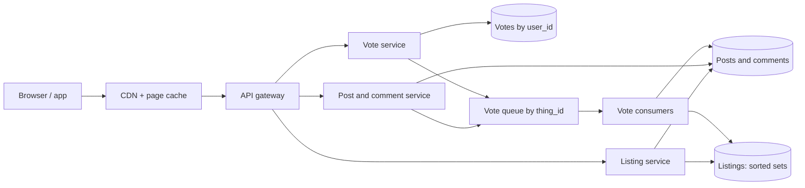

## In one minute
- **Rank per community, not per user.** A subreddit's hot list is the same for every reader, so compute it once and share it. The home feed merges the hot lists of a user's communities at read time.
- **Votes are the write path that matters.** They outnumber posts and comments many times over. Each vote is an idempotent upsert keyed by `(user, thing)`; counting and re-ranking happen behind a queue partitioned by thing.
- **Hot is a closed-form score, not a model.** Reddit's original formula adds the log of the net score to the creation time in units of 12.5 hours, so it changes only when a vote arrives.
- **Comment trees are rendered, not queried.** Precompute the tree shape per post, sort siblings by a confidence score, cut at a depth and count limit, and leave "load more" stubs.
- **Logged-out traffic is a cache problem.** Readers who are not signed in see identical pages, so the CDN absorbs them.

## Requirements

**Functional**
- Users create communities (subreddits), subscribe to them, and submit posts (link, text, image or video).
- Users upvote or downvote posts and comments, and can change or remove their vote.
- Each community shows listings sorted by hot, new, top (hour, day, week, all time) and rising.
- The home feed merges posts from the communities a user subscribes to. Logged-out users see a popular feed.
- Users comment in nested threads and sort comments by best, top, new or controversial.
- Moderators remove posts and comments, and the system hides content from banned or spam accounts.

**Non-functional**
- Listing and post pages render in under 200 ms p99 server time.
- A user always sees their own vote and post immediately. Other readers may see counts a few seconds stale.
- No double counting: one user contributes at most one vote per thing.
- Highly available reads. A stale listing is acceptable; an error page is not.
- Resist vote manipulation. Displayed counts may be approximate.

**Out of scope:** search, chat, ads, notifications, the recommendation models behind the newer personalised feed, and media transcoding (see [Design YouTube](design-youtube.md)).

## Back-of-envelope
Round assumed numbers for planning, not Reddit's published figures.

- **DAU:** 100M. Each opens about 25 pages a day (listings, posts, comment pages): 2.5B page reads a day.
- **Read QPS:** 2.5B / 86,400 ≈ 29k/s average. Traffic is concentrated in US and European waking hours, so peak is about 3× average: roughly 90k page reads/s. Each page fans out into 3 to 10 backend calls, so internal read QPS is about 500k/s at peak.
- **Logged out share:** assume 50% of page reads are logged out and served from the CDN with a 90% hit rate. That removes about 45% of origin load.
- **Posts and comments:** 1.5M posts a day at 1 KB (1.5 GB) and 15M comments at 500 bytes (7.5 GB). Peak is about 50 posts/s and 500 comments/s.
- **Votes:** 20 per DAU per day = 2B votes a day ≈ 23k/s average, about 70k/s at peak. A vote row with index overhead is about 100 bytes: 200 GB a day.
- **Five-year storage:** posts and comments ≈ 9 GB/day × 1,825 ≈ 16 TB. Votes ≈ 200 GB × 1,825 ≈ 365 TB, which is why posts are archived (closed to voting) after about six months and their vote rows moved to cold storage. Media at 300k images a day of 500 KB adds about 270 TB before video.
- **Bandwidth:** 90k pages/s at about 100 KB is 9 GB/s at peak, mostly from the CDN, plus media.

For calibration, Reddit's own figures in 2017 were about a million posts and 75 million votes a day ([Neil Williams, QCon SF 2017](https://www.infoq.com/presentations/reddit-architecture-evolution/)), so the vote volume above is deliberately generous headroom, not a measurement.

The design takeaway: votes are the dominant write, reads dominate overall, and post and comment storage is small.

## API

```text
GET  /r/{sub}/{sort}?t=day&after={cursor}&limit=25
     -> { posts: [ { id, title, author, score, num_comments, created_at, my_vote } ], after }

GET  /home?after={cursor}&limit=25          (subscribed communities, merged)

POST /api/vote        { thing_id: "t3_abc", dir: 1 | 0 | -1 }
     -> 202 { thing_id, dir }                (idempotent upsert; dir 0 removes)

POST /api/submit      { sub, kind, title, body | url, client_token }
     -> 201 { id: "t3_abd" }

POST /api/comment     { parent_id: "t3_abd" | "t1_x9", body, client_token }
     -> 201 { id: "t1_x9z" }

GET  /comments/{post_id}?sort=best&depth=8&limit=200
     -> { post, comments: [ { id, parent_id, depth, score, body, replies_more: 12 } ] }

GET  /api/morechildren?post_id=..&children=t1_a,t1_b,t1_c
```

Every object has a type-prefixed ID (`t3_` for posts, `t1_` for comments), so a vote endpoint and a cache key work the same for both. `client_token` makes submission idempotent if the app retries on a flaky connection. `dir: 0` is the "unvote", so a client can send the final state rather than a delta, which makes retries harmless.

## Data model

**posts**, partitioned by `post_id`: `post_id, sub_id, author_id, title, body_or_url, created_at, ups, downs, num_comments, removed`. Point reads by ID dominate, so ID partitioning spreads load evenly. Counts are denormalised onto the row and updated by the vote consumer, not by the vote request.

**comments**, partitioned by `post_id`, clustered by `comment_id`: `comment_id, post_id, parent_id, author_id, body, created_at, ups, downs`. Every comment of one thread lives in one partition, so loading a thread is one range scan. `parent_id` is either the post or another comment.

**comment_tree**, keyed by `post_id`: a precomputed blob of `parent_id -> [child_id ...]` plus per-comment depth and sort keys. It is rebuilt incrementally by the comment consumer and is what the comment page reads.

**votes**, partitioned by `user_id`, primary key `(user_id, thing_id)`: `dir, voted_at`. Partitioning by user makes "show my votes on this page" one partition read for 25 thing IDs, and makes the uniqueness check local. A second, async copy partitioned by `thing_id` serves audits and recounts.

**listings**, keyed by `(sub_id, sort, window)`: an ordered list of up to 1,000 `(post_id, sort_key)` pairs. Held in a sorted set (Redis) with a durable copy in a wide-column store so a cache loss can be rebuilt without rescanning posts.

**subscriptions**, partitioned by `user_id`: `(user_id, sub_id)`. A few hundred rows per user at most.

## High-level design



**Write path (a vote).**
1. The client sends `dir` for a thing. The vote service upserts `(user_id, thing_id) -> dir` and reads the previous value in the same statement.
2. If the direction changed, it publishes `{thing_id, old_dir, new_dir, user_id}` to the vote queue, partitioned by `thing_id`, and returns 202. The client already shows the new arrow and an adjusted count locally.
3. A vote consumer owns a set of thing partitions. It drops votes flagged by anti-abuse rules, applies the delta to `ups` and `downs`, recomputes hot, top and controversial keys for that post, and updates the post's position in each listing it belongs to.

**Read path (a community listing).**
1. Logged-out requests for `/r/{sub}/hot` are served from the CDN, which keeps the rendered page for about 30 to 60 seconds.
2. For a signed-in reader, the listing service reads the top 25 IDs after the cursor from the sorted set, hydrates them from a post cache in one multi-get, and filters removed posts.
3. It fetches the reader's votes on those 25 IDs from the votes table (one partition) to render the arrows.

**Read path (the home feed).** The listing service loads the reader's subscriptions, reads the top 50 or so entries of each subscribed community's hot list, k-way merges them by hot score, and caches the merged page per user for about a minute.

## Deep dives

### 1. Listings: precompute per community, merge per reader
Option one is a follower-style fan-out on write: push every new post into every subscriber's feed. A large default community has tens of millions of subscribers, so one post would mean tens of millions of inbox writes, and every vote would change the order in all of them. Option two is a SQL `ORDER BY` over the community's posts on every page view, which only works for small communities.

I choose option three: one precomputed sorted list per `(community, sort, window)`, maintained incrementally by vote consumers, capped at about 1,000 entries. Every reader shares it, so cost scales with communities and votes, not readers. Hot only changes on a vote, so order is stable between votes. "New" is an append. "Top of the day" is a sorted set rebuilt from hourly buckets, the same short-bucket trick as [Design Top K](design-top-k.md).

The home feed is a merge. A reader with 200 subscriptions would need 200 list reads, so cap the merge: take the top 50 communities by the reader's activity, read 50 entries from each, merge with a heap and cache the result. This is the pull side of the hybrid in [Design FB News Feed](design-news-feed.md), used for everything because every "author" is a community with a shared ranking.

### 2. Votes: idempotent upsert, async counting
The obvious design increments `ups` on the post row inside the vote request. At 70k votes per second, and with a viral post receiving thousands of votes a second, that single row becomes the hottest lock in the database. It also double counts on retries.

The chosen design splits the vote into a record and a count. The record is an upsert keyed by `(user_id, thing_id)`, which makes the operation idempotent and gives the delta for free: going from `+1` to `-1` is one fewer up and one more down. The count is applied by a consumer that owns the thing's partition, so there is exactly one writer per post and no row contention. For a hot post, the consumer batches: it sums deltas for one second and writes once, turning 3,000 increments into one. See [Distributed Counting](distributed-counting.md) and [Hot Keys](hot-keys.md) for the general shape.

Reddit's early architecture put voting on asynchronous queues for this reason, and it shows fuzzed counts, so the lag is invisible. Anti-abuse sits in the consumer: votes from brand-new accounts or rings that always vote together are recorded (the voter sees their arrow) but not counted, which makes manipulation hard to probe from outside.

### 3. Comment trees at 40,000 comments
Storage options: an adjacency list (`parent_id` per row), a materialised path (`0001.0007.0003`), or a closure table of every ancestor and descendant pair. Adjacency is cheapest to write but needs one query per level. A path gives one-scan subtrees but cannot sort siblings by a changing score. A closure table grows with depth squared.

I store adjacency rows partitioned by `post_id` (so the whole thread is one scan) and keep a precomputed tree blob per post: children lists, depth, and each comment's sort keys. Reddit's open-source code did the same with a stored tree per link. Rendering is then in memory: start at the root, sort each sibling group by the chosen key, walk depth first, stop at a depth limit (about 8) and a total count (about 200). Every cut point becomes a "load more comments" stub that carries the hidden child IDs, which `/api/morechildren` resolves later.

The default "best" sort uses the lower bound of the Wilson score interval on the upvote fraction, at 80% confidence (z = 1.2816) in Reddit's open-source code ([r2 `_sorts.pyx`](https://github.com/reddit-archive/reddit/blob/master/r2/r2/lib/db/_sorts.pyx)). The point, as Evan Miller argues, is to rank by how good a comment probably is given how few votes it has, not by its raw average or net score ([Evan Miller](https://www.evanmiller.org/how-not-to-sort-by-average-rating.html)). A comment at 1 up and 0 down has a lower bound near 0.38 at 80% confidence; one at 100 up and 10 down has a lower bound near 0.87, so the well-tested comment wins. Comment votes reuse the post vote queue and only update the blob's sort keys.

## Down the stack

### Layer 1: The contract
- **Vote.** `vote(user, thing, dir)` is idempotent. After it returns, the user's own reads show `dir`. Within a few seconds, the thing's counts reflect at most one vote per user. Votes on archived things are rejected.
- **Listing.** Each page is read from one listing version. The `after` cursor is the last post ID seen, so paging continues after that post even if scores moved, with occasional repeats that the client drops.
- **Hot.** For two posts with the same net score, the newer one ranks higher. A post needs ten times the net score to match one posted 12.5 hours later.
- **Comment page.** Shows at most N comments and depth D, with every hidden subtree represented by a stub, so no comment is unreachable.

### Layer 2: The mechanism
The open-source r2 code computes hot as `round(sign(s) * log10(max(|s|, 1)) + (t - 1134028003) / 45000, 7)`, where `s = ups - downs` and `t` is the post's creation time in epoch seconds. The constant 1134028003 is a fixed epoch in December 2005 and 45,000 seconds is 12.5 hours. Because the age term uses creation time, not the current time, a post's hot score is a pure function of its votes, which is why listings only need updates on votes.

Historically, Reddit stored objects in Postgres as "things" with a narrow table of core fields and a key-value "data" table of attributes, cached heavily in memcached, and deferred votes and listing updates through RabbitMQ queues. Listings began as cached lists of IDs in memcache; recomputing them with a fresh query was too expensive, so Reddit switched to updating them in place under a lock, storing the sort keys with each ID, and moved them to Cassandra. Its engineers describe the result as a persisted, denormalised index rather than a cache ([Neil Williams, QCon SF 2017](https://www.infoq.com/presentations/reddit-architecture-evolution/)). Today's listing store would be Redis sorted sets: a skip list plus a hash, where `ZADD` updates a member's score in O(log N) ([Redis docs](https://redis.io/docs/latest/develop/data-types/sorted-sets/)) and `ZRANGE key 0 24 REV` reads a page in O(log N + 25). Older material uses `ZREVRANGE`, which has been deprecated since Redis 6.2 in favour of `ZRANGE ... REV` ([Redis docs](https://redis.io/docs/latest/commands/zrevrange/)).

### Layer 3: The machine
- **Sorted set memory.** In Redis, a sorted set of 1,000 entries exceeds the default `zset-max-listpack-entries` threshold of 128 ([redis.conf](https://github.com/redis/redis/blob/unstable/redis.conf)) and becomes a skip list, costing roughly 80 to 100 bytes per member: about 100 KB per listing. A million active `(community, sort, window)` combinations need about 100 GB of RAM, a modest cluster.
- **Vote upsert.** An `INSERT ... ON CONFLICT DO UPDATE ... RETURNING` on Postgres writes one heap tuple and one WAL record of roughly 100 bytes, and is guaranteed atomic even under high concurrency. Returning the previous `dir` in the same statement needs PostgreSQL 18, which added `RETURNING OLD.dir` ([Postgres docs](https://www.postgresql.org/docs/current/sql-insert.html)); on older versions, read the old row first in the same transaction and accept a rare race when one user sends two votes on the same thing at the same moment. Group commit batches many transactions into one `fsync`, so a single NVMe-backed primary can absorb tens of thousands of votes a second; sharding by `user_id` across 8 to 16 primaries gives headroom for 70k/s.
- **Comment rendering.** A 40,000-comment tree blob is about 2 MB (IDs, parents, scores). Deserialising it and sorting 200 visible nodes takes about a millisecond of CPU, much cheaper than 40,000 row fetches at 0.2 ms each.

### Why it's built this way
1. Reads outnumber writes by about 100 to 1 and many readers see the same page, so share computed rankings and cache rendered pages.
2. Sharing rankings means ranking by community, so the home feed must be a read-time merge of shared lists.
3. Votes are the heaviest write and target a few hot rows, so separate the idempotent record from the count and give each post a single writer behind a queue.
4. A single writer adds lag, so show users their own vote locally and fuzz public counts, which also blunts manipulation.
5. Threads are deep and huge, so the tree shape is precomputed once and rendered with cut-offs instead of queried per level.

## Failure modes
- **10x load (a breaking news event).** One community receives most of the traffic. Its listing and post pages are served from CDN for logged-out readers, the comment page uses a cached tree rendered every few seconds, and vote consumers batch harder. Commenting may be rate-limited per user to protect the comment consumer.
- **Hot key.** A single viral post receives thousands of votes per second. One consumer partition owns it and aggregates per second. If one partition is still overloaded, split the post's counter into N sub-counters summed on read.
- **Queue backlog.** A slow consumer means stale counts and listings, not lost votes. Alert on consumer lag in seconds, and let the listing service keep serving the last version. Because vote records are durable in the votes table, counts can be recomputed from scratch for any post.
- **Region outage.** Reads fail over to the other region's replicas and caches, possibly a minute stale. Writes for posts and comments pause or go to a promoted replica; votes can be accepted into a regional queue and replayed later because the upsert is idempotent.

## In the wild
- **Reddit, 2012: more vote consumers made the lag worse.** In mid-2012 the vote queues backed up at peak and scores updated late. Adding processors made it worse, because they all contended for the lock on popular subreddits' cached listings. Reddit split the queue into 10 partitions by subreddit ID, then hit the same wall later that year on the domain listing, which every partition shared. The lasting fix was to split each vote into several messages, each touching only listings in its own partition, and to watch P99 timers rather than averages ([Neil Williams, QCon SF 2017](https://www.infoq.com/presentations/reddit-architecture-evolution/)).
- **Reddit, 2016: automation terminates a third of the servers.** During a ZooKeeper migration the autoscaler was paused by hand, but a Puppet run restarted it while it still pointed at the old cluster. It treated the migrated servers as unhealthy and terminated about a third of them. The site was down for over an hour, and the cold caches kept it from running normally for about three hours. Reddit's lessons were sanity checks on destructive automation and treating stateful services differently from stateless ones ([Neil Williams, QCon SF 2017](https://www.infoq.com/presentations/reddit-architecture-evolution/); [The Register](https://www.theregister.com/2016/08/16/reddit_explains_outage/)).
- **Reddit, 2017: r/place fans out tiny updates to every viewer.** The April Fools canvas stored a 1,000 by 1,000 board as a Redis bitfield of 4-bit colours, because reading a million-column Cassandra row took up to 30 seconds. Pixel updates went to about 80,000 websocket clients, and the websocket fleet passed 4 Gbps. Many small messages to many receivers loaded the shared RabbitMQ broker so heavily that its management interface tipped it over, and the team raised pixel cooldowns on the fly to relieve pressure ([Reddit](https://www.redditinc.com/blog/how-we-built-rplace)).

## Trade-offs

| Option | Strengths | Weaknesses | Choose when |
|---|---|---|---|
| Per-community precomputed listing | Shared by all readers, cheap reads | Needs merging for home feeds | Ranking is public and per community |
| Per-user fan-out on write | Fast personalised reads | Huge writes for big communities | Follower graphs with bounded audiences |
| Synchronous counter update | Exact counts instantly | Row contention, double counting on retry | Low-traffic forums |
| Upsert record, async count | Idempotent, one writer per post | Seconds of lag | High vote volume |
| Adjacency list plus tree blob | Cheap writes, fast render | Blob rebuilds on large threads | Large, deep threads |
| Closure table | Arbitrary subtree queries in SQL | Storage grows with depth | Small trees with complex queries |
| Hot formula | Explainable, cheap, no clock re-rank | Not personalised | Community front pages |

## Leadership lens
- **Build first:** the vote upsert and queue, the hot listing per community, and the comment page with stubs. Everything else (top windows, rising, controversial) reuses the same consumer and sorted-set plumbing.
- **Team ownership:** a content team owns posts and comment trees, a ranking team owns listings and the score functions, a safety team owns vote filtering and moderation signals, and an edge team owns the CDN and page cache. The vote queue's message schema is a contract between all of them.
- **Cost drivers:** CDN egress for media, RAM for sorted sets and caches, and storage for the vote history. Reducing vote retention (archiving after six months) is the single largest storage lever.
- **Rollout:** ship a new ranking formula behind a flag to a small share of readers, compare session length and comment rate, and keep both scores in the sorted-set consumer during the transition.
- **Review questions:** how fast can we recount a post from vote records; what does a reader see when the consumer lags by five minutes; who decides which votes are discarded, and can we audit it.

## Check yourself
1. Why is a per-community precomputed listing chosen over fan-out on write to every subscriber?
   **Answer:** A large community has tens of millions of subscribers, so fan-out would mean tens of millions of inbox writes per post, and every vote would reorder all of them. One shared sorted list per `(community, sort, window)` makes cost scale with communities and votes, not readers, and the home feed becomes a capped read-time merge.
2. Why does incrementing `ups` on the post row inside the vote request break down, and what replaces it?
   **Answer:** At 70k votes per second a viral post's row becomes the hottest lock in the database, and retries double count. The vote is split into an idempotent upsert keyed by `(user_id, thing_id)` and an async count applied by a single consumer per thing partition, which batches deltas for hot posts.
3. Vote consumers fall five minutes behind. What breaks and how do you recover?
   **Answer:** Counts and listings go stale but no votes are lost, because vote records are durable in the votes table. The listing service keeps serving the last version, you alert on consumer lag, and counts can be recomputed from scratch for any post.
4. Why are posts archived after about six months?
   **Answer:** Votes are about 2B a day at 100 bytes, roughly 200 GB a day and 365 TB over five years, while posts and comments total only about 16 TB. Closing old posts to voting and moving their vote rows to cold storage is the largest storage lever.

## Practice
**Task:** Build the vote path and the hot listing. `VoteLedger.vote(user, thing, direction)` records a user's vote where `direction` is `1`, `0` (remove) or `-1`, and returns the thing's `(ups, downs)` after the change. Repeating a vote changes nothing, and switching from up to down moves one count from `ups` to `downs`. Any other direction raises `ValueError` (TypeScript throws, Go returns an error) and changes nothing. `tally(thing)` returns `(ups, downs)`, `(0, 0)` for an unknown thing. `hot(ups, downs, created)` implements the r2 formula above, rounded to 7 decimal places. `top_hot(ledger, posts, k)` takes a list of `(thing, created)` pairs and returns up to `k` thing IDs ordered by hot score descending, breaking ties by thing ID ascending.

```python starter
class VoteLedger:
    def __init__(self):
        pass

    def vote(self, user, thing, direction):
        # TODO: idempotent per (user, thing); return (ups, downs)
        raise NotImplementedError

    def tally(self, thing):
        raise NotImplementedError


def hot(ups, downs, created):
    # TODO: sign * log10(max(|s|, 1)) + (created - 1134028003) / 45000, rounded to 7 places
    raise NotImplementedError


def top_hot(ledger, posts, k):
    # TODO: ids by hot desc, ties by id asc
    raise NotImplementedError
```

```python tests
EPOCH = 1134028003

def test_vote_is_idempotent():
    v = VoteLedger()
    assert v.vote("alice", "p1", 1) == (1, 0)
    assert v.vote("alice", "p1", 1) == (1, 0), "repeat does not double count"
    assert v.vote("bob", "p1", 1) == (2, 0)
    assert v.tally("p1") == (2, 0)
    assert v.tally("nope") == (0, 0)

def test_switch_and_remove():
    v = VoteLedger()
    v.vote("alice", "p1", 1)
    assert v.vote("alice", "p1", -1) == (0, 1)
    assert v.vote("alice", "p1", 0) == (0, 0)
    assert v.vote("alice", "p1", 0) == (0, 0), "removing twice is harmless"

def test_invalid_direction_changes_nothing():
    v = VoteLedger()
    v.vote("alice", "p1", 1)
    try:
        v.vote("alice", "p1", 2)
        assert False, "expected ValueError"
    except ValueError:
        pass
    assert v.tally("p1") == (1, 0)

def test_hot_formula():
    assert hot(1, 0, EPOCH) == 0.0
    assert hot(10, 0, EPOCH) == 1.0
    assert hot(0, 10, EPOCH + 45000) == 0.0
    assert hot(0, 0, EPOCH + 90000) == 2.0
    assert hot(100, 0, EPOCH) == hot(1, 0, EPOCH + 90000), "100x votes equals 25 hours newer"

def test_top_hot_orders_by_score_and_age():
    v = VoteLedger()
    for u in range(10):
        v.vote("u%d" % u, "old", 1)
    v.vote("x", "new", 1)
    posts = [("old", EPOCH), ("new", EPOCH + 90000), ("mid", EPOCH + 45000)]
    assert top_hot(v, posts, 3) == ["new", "mid", "old"]
    assert top_hot(v, posts, 1) == ["new"]

def test_top_hot_ties_and_downvotes():
    v = VoteLedger()
    v.vote("a", "b", -1)
    v.vote("b", "b", -1)
    posts = [("c", EPOCH), ("a", EPOCH), ("b", EPOCH)]
    assert top_hot(v, posts, 5) == ["a", "c", "b"]
    assert top_hot(v, [], 3) == []
```

```python solution
import math


class VoteLedger:
    def __init__(self):
        self._dirs = {}
        self._counts = {}

    def vote(self, user, thing, direction):
        if direction not in (-1, 0, 1):
            raise ValueError("direction must be -1, 0 or 1")
        old = self._dirs.get((user, thing), 0)
        ups, downs = self._counts.get(thing, (0, 0))
        if old == 1:
            ups -= 1
        elif old == -1:
            downs -= 1
        if direction == 1:
            ups += 1
        elif direction == -1:
            downs += 1
        self._dirs[(user, thing)] = direction
        self._counts[thing] = (ups, downs)
        return (ups, downs)

    def tally(self, thing):
        return self._counts.get(thing, (0, 0))


def hot(ups, downs, created):
    s = ups - downs
    order = math.log10(max(abs(s), 1))
    sign = 1 if s > 0 else (-1 if s < 0 else 0)
    return round(sign * order + (created - 1134028003) / 45000, 7)


def top_hot(ledger, posts, k):
    scored = []
    for thing, created in posts:
        ups, downs = ledger.tally(thing)
        scored.append((-hot(ups, downs, created), thing))
    scored.sort()
    return [t for _, t in scored[:k]]
```

```typescript starter
export class VoteLedger {
  vote(user: string, thing: string, direction: number): [number, number] {
    throw new Error("TODO");
  }
  tally(thing: string): [number, number] {
    throw new Error("TODO");
  }
}

export function hot(ups: number, downs: number, created: number): number {
  throw new Error("TODO");
}

export function topHot(ledger: VoteLedger, posts: [string, number][], k: number): string[] {
  throw new Error("TODO");
}
```

```typescript tests
const EPOCH = 1134028003;

test("vote is idempotent", () => {
  const v = new VoteLedger();
  assertEqual(v.vote("alice", "p1", 1), [1, 0]);
  assertEqual(v.vote("alice", "p1", 1), [1, 0], "repeat does not double count");
  assertEqual(v.vote("bob", "p1", 1), [2, 0]);
  assertEqual(v.tally("p1"), [2, 0]);
  assertEqual(v.tally("nope"), [0, 0]);
});

test("switch and remove", () => {
  const v = new VoteLedger();
  v.vote("alice", "p1", 1);
  assertEqual(v.vote("alice", "p1", -1), [0, 1]);
  assertEqual(v.vote("alice", "p1", 0), [0, 0]);
  assertEqual(v.vote("alice", "p1", 0), [0, 0], "removing twice is harmless");
});

test("invalid direction changes nothing", () => {
  const v = new VoteLedger();
  v.vote("alice", "p1", 1);
  let threw = false;
  try {
    v.vote("alice", "p1", 2);
  } catch (e) {
    threw = true;
  }
  assert(threw, "expected an error");
  assertEqual(v.tally("p1"), [1, 0]);
});

test("hot formula", () => {
  assertEqual(hot(1, 0, EPOCH), 0);
  assertEqual(hot(10, 0, EPOCH), 1);
  assertEqual(hot(0, 10, EPOCH + 45000), 0);
  assertEqual(hot(0, 0, EPOCH + 90000), 2);
  assertEqual(hot(100, 0, EPOCH), hot(1, 0, EPOCH + 90000), "100x votes equals 25 hours newer");
});

test("top hot orders by score and age", () => {
  const v = new VoteLedger();
  for (let u = 0; u < 10; u++) v.vote("u" + u, "old", 1);
  v.vote("x", "new", 1);
  const posts: [string, number][] = [["old", EPOCH], ["new", EPOCH + 90000], ["mid", EPOCH + 45000]];
  assertEqual(topHot(v, posts, 3), ["new", "mid", "old"]);
  assertEqual(topHot(v, posts, 1), ["new"]);
});

test("top hot ties and downvotes", () => {
  const v = new VoteLedger();
  v.vote("a", "b", -1);
  v.vote("b", "b", -1);
  const posts: [string, number][] = [["c", EPOCH], ["a", EPOCH], ["b", EPOCH]];
  assertEqual(topHot(v, posts, 5), ["a", "c", "b"]);
  assertEqual(topHot(v, [], 3), []);
});
```

```typescript solution
export class VoteLedger {
  private dirs = new Map<string, number>();
  private counts = new Map<string, [number, number]>();

  vote(user: string, thing: string, direction: number): [number, number] {
    if (direction !== -1 && direction !== 0 && direction !== 1) {
      throw new Error("direction must be -1, 0 or 1");
    }
    const key = user + "\u0000" + thing;
    const old = this.dirs.get(key) ?? 0;
    let [ups, downs] = this.counts.get(thing) ?? [0, 0];
    if (old === 1) ups--;
    else if (old === -1) downs--;
    if (direction === 1) ups++;
    else if (direction === -1) downs++;
    this.dirs.set(key, direction);
    this.counts.set(thing, [ups, downs]);
    return [ups, downs];
  }

  tally(thing: string): [number, number] {
    const c = this.counts.get(thing);
    return c ? [c[0], c[1]] : [0, 0];
  }
}

export function hot(ups: number, downs: number, created: number): number {
  const s = ups - downs;
  const order = Math.log10(Math.max(Math.abs(s), 1));
  const sign = s > 0 ? 1 : s < 0 ? -1 : 0;
  const raw = sign * order + (created - 1134028003) / 45000;
  return Math.round(raw * 1e7) / 1e7;
}

export function topHot(ledger: VoteLedger, posts: [string, number][], k: number): string[] {
  const scored = posts.map(([thing, created]) => {
    const [ups, downs] = ledger.tally(thing);
    return { thing, score: hot(ups, downs, created) };
  });
  scored.sort((a, b) => {
    if (a.score !== b.score) return b.score - a.score;
    return a.thing < b.thing ? -1 : a.thing > b.thing ? 1 : 0;
  });
  return scored.slice(0, k).map((s) => s.thing);
}
```

```go starter
package practice

type Post struct {
	ID      string
	Created int64
}

type VoteLedger struct{}

func NewVoteLedger() *VoteLedger { return &VoteLedger{} }

func (v *VoteLedger) Vote(user, thing string, direction int) (int, int, error) { panic("TODO") }

func (v *VoteLedger) Tally(thing string) (int, int) { panic("TODO") }

func Hot(ups, downs int, created int64) float64 { panic("TODO") }

func TopHot(v *VoteLedger, posts []Post, k int) []string { panic("TODO") }
```

```go tests
package practice

import (
	"fmt"
	"reflect"
	"testing"
)

const epoch int64 = 1134028003

func mustVote(t *testing.T, v *VoteLedger, user, thing string, dir, wantUp, wantDown int) {
	t.Helper()
	u, d, err := v.Vote(user, thing, dir)
	if err != nil || u != wantUp || d != wantDown {
		t.Fatalf("vote(%s,%s,%d) = %d,%d,%v want %d,%d", user, thing, dir, u, d, err, wantUp, wantDown)
	}
}

func TestVoteIsIdempotent(t *testing.T) {
	v := NewVoteLedger()
	mustVote(t, v, "alice", "p1", 1, 1, 0)
	mustVote(t, v, "alice", "p1", 1, 1, 0)
	mustVote(t, v, "bob", "p1", 1, 2, 0)
	if u, d := v.Tally("nope"); u != 0 || d != 0 {
		t.Fatal("unknown thing should be 0,0")
	}
}

func TestSwitchAndRemove(t *testing.T) {
	v := NewVoteLedger()
	mustVote(t, v, "alice", "p1", 1, 1, 0)
	mustVote(t, v, "alice", "p1", -1, 0, 1)
	mustVote(t, v, "alice", "p1", 0, 0, 0)
	mustVote(t, v, "alice", "p1", 0, 0, 0)
}

func TestInvalidDirectionChangesNothing(t *testing.T) {
	v := NewVoteLedger()
	mustVote(t, v, "alice", "p1", 1, 1, 0)
	if _, _, err := v.Vote("alice", "p1", 2); err == nil {
		t.Fatal("expected error")
	}
	if u, d := v.Tally("p1"); u != 1 || d != 0 {
		t.Fatalf("tally changed to %d,%d", u, d)
	}
}

func TestHotFormula(t *testing.T) {
	if Hot(1, 0, epoch) != 0 || Hot(10, 0, epoch) != 1 {
		t.Fatal("bad order term")
	}
	if Hot(0, 10, epoch+45000) != 0 || Hot(0, 0, epoch+90000) != 2 {
		t.Fatal("bad age term")
	}
	if Hot(100, 0, epoch) != Hot(1, 0, epoch+90000) {
		t.Fatal("100x votes should equal 25 hours newer")
	}
}

func TestTopHotOrdersByScoreAndAge(t *testing.T) {
	v := NewVoteLedger()
	for u := 0; u < 10; u++ {
		v.Vote(fmt.Sprintf("u%d", u), "old", 1)
	}
	v.Vote("x", "new", 1)
	posts := []Post{{"old", epoch}, {"new", epoch + 90000}, {"mid", epoch + 45000}}
	if got := TopHot(v, posts, 3); !reflect.DeepEqual(got, []string{"new", "mid", "old"}) {
		t.Fatalf("got %v", got)
	}
	if got := TopHot(v, posts, 1); !reflect.DeepEqual(got, []string{"new"}) {
		t.Fatalf("got %v", got)
	}
}

func TestTopHotTiesAndDownvotes(t *testing.T) {
	v := NewVoteLedger()
	v.Vote("a", "b", -1)
	v.Vote("b", "b", -1)
	posts := []Post{{"c", epoch}, {"a", epoch}, {"b", epoch}}
	if got := TopHot(v, posts, 5); !reflect.DeepEqual(got, []string{"a", "c", "b"}) {
		t.Fatalf("got %v", got)
	}
	if got := TopHot(v, nil, 3); len(got) != 0 {
		t.Fatalf("got %v", got)
	}
}
```

```go solution
package practice

import (
	"errors"
	"math"
	"sort"
)

type Post struct {
	ID      string
	Created int64
}

type voteKey struct{ user, thing string }

type VoteLedger struct {
	dirs   map[voteKey]int
	counts map[string][2]int
}

func NewVoteLedger() *VoteLedger {
	return &VoteLedger{dirs: map[voteKey]int{}, counts: map[string][2]int{}}
}

func (v *VoteLedger) Vote(user, thing string, direction int) (int, int, error) {
	if direction < -1 || direction > 1 {
		return 0, 0, errors.New("direction must be -1, 0 or 1")
	}
	k := voteKey{user, thing}
	old := v.dirs[k]
	c := v.counts[thing]
	switch old {
	case 1:
		c[0]--
	case -1:
		c[1]--
	}
	switch direction {
	case 1:
		c[0]++
	case -1:
		c[1]++
	}
	v.dirs[k] = direction
	v.counts[thing] = c
	return c[0], c[1], nil
}

func (v *VoteLedger) Tally(thing string) (int, int) {
	c := v.counts[thing]
	return c[0], c[1]
}

func Hot(ups, downs int, created int64) float64 {
	s := ups - downs
	abs := s
	if abs < 0 {
		abs = -abs
	}
	if abs < 1 {
		abs = 1
	}
	order := math.Log10(float64(abs))
	sign := 0.0
	if s > 0 {
		sign = 1
	} else if s < 0 {
		sign = -1
	}
	raw := sign*order + float64(created-1134028003)/45000
	return math.Round(raw*1e7) / 1e7
}

func TopHot(v *VoteLedger, posts []Post, k int) []string {
	type scored struct {
		id    string
		score float64
	}
	all := make([]scored, 0, len(posts))
	for _, p := range posts {
		u, d := v.Tally(p.ID)
		all = append(all, scored{p.ID, Hot(u, d, p.Created)})
	}
	sort.Slice(all, func(i, j int) bool {
		if all[i].score != all[j].score {
			return all[i].score > all[j].score
		}
		return all[i].id < all[j].id
	})
	out := []string{}
	for i := 0; i < len(all) && i < k; i++ {
		out = append(out, all[i].id)
	}
	return out
}
```

## Mock interview
**Prompt:** Design Reddit. Assume 100 million daily users, about 2 billion votes a day, and communities ranging from a dozen members to tens of millions. Walk me through what happens when a user upvotes a post on the front page of a large community, and how that changes what the next reader sees.

- Follow-up: A post goes viral and receives 5,000 votes a second. Where does that load land, and how do you keep the database from melting?
- Follow-up: A vote consumer falls 10 minutes behind. What do users see, and how do you recover without double counting?
- Follow-up: Why not push every new post into every subscriber's feed, as you would for a social network?

**A strong answer covers:**
- Idempotent vote upsert keyed by `(user, thing)` that yields the delta, with counting done asynchronously by a single writer per post.
- Per-community precomputed listings in sorted sets, updated only on votes because hot depends on creation time and score, and a read-time merge for the home feed.
- Hot-key handling: per-second aggregation in the consumer, counter splitting if needed, and CDN caching for logged-out readers.
- Comment trees stored as adjacency rows per post plus a precomputed tree, rendered with depth and count limits, "load more" stubs and a Wilson lower bound sort.
- Anti-manipulation that records but does not count suspicious votes, and fuzzed public counts.

## Sources and further study
**Primary**
- [Feeding Frenzy: Selectively Materializing Users' Event Feeds (SIGMOD 2010)](https://jeffterrace.com/docs/feeding-frenzy-sigmod10-web.pdf): names Reddit and Digg as follow applications and shows when to precompute a feed versus build it at read time.
- [Redis `ZRANGE` command](https://redis.io/docs/latest/commands/zrange/): the current range syntax (`REV`, `BYSCORE`, `LIMIT`) for paging a listing.

**Systems docs**
- [Redis sorted sets](https://redis.io/docs/latest/develop/data-types/sorted-sets/): the skip list and hash table behind listings, with complexity notes.
- [PostgreSQL `INSERT ... ON CONFLICT`](https://www.postgresql.org/docs/current/sql-insert.html): upsert atomicity and the `RETURNING OLD` form for reading the previous vote.
- [How We Built r/Place (Reddit)](https://www.redditinc.com/blog/how-we-built-rplace): a full Reddit-built fan-out system with Redis, Cassandra, a CDN and websockets.

**Books**
- *Designing Data-Intensive Applications* (1st ed.), Martin Kleppmann, chapter 11 "Stream Processing": maintaining derived views such as listings and counters from an event stream.
- *System Design Interview, Volume 2*, Alex Xu and Sahn Lam, chapter 10 "Real-time Gaming Leaderboard": Redis sorted sets for ranked lists at scale, the same structure as a hot listing.

**Other curricula**
- [Azure Architecture Center: Queue-Based Load Leveling pattern](https://learn.microsoft.com/en-us/azure/architecture/patterns/queue-based-load-leveling): frames the vote queue as a buffer that lets a fixed-rate consumer absorb bursty writes.
- [donnemartin/system-design-primer](https://github.com/donnemartin/system-design-primer): has no Reddit chapter, but its cache, queue and denormalisation sections cover each building block used here.

## Watch
- [How reddit scales with Jeremy Edberg, Part 1 (Scale Your Code)](https://www.youtube.com/watch?v=NaJv2wlAxL8): Reddit's first paid engineer on caching, queues and the early database layout.
- [Design Reddit: System Design Mock Interview (Exponent)](https://www.youtube.com/watch?v=KYExYE_9nIY): an interview-paced walkthrough of feeds, votes and comments.

## Free resources
- [reddit-archive/reddit: _sorts.pyx](https://github.com/reddit-archive/reddit/blob/master/r2/r2/lib/db/_sorts.pyx): the original hot, controversy and confidence sort functions.
- [How Not To Sort By Average Rating (Evan Miller)](https://www.evanmiller.org/how-not-to-sort-by-average-rating.html): the Wilson lower bound that Reddit's "best" comment sort uses.
- [Reddit: Lessons Learned from Mistakes Made Scaling to 1 Billion Pageviews a Month (High Scalability)](https://highscalability.com/reddit-lessons-learned-from-mistakes-made-scaling-to-1-billi/): caching logged-out traffic, queues and database choices.
- [7 Lessons Learned While Building Reddit to 270 Million Page Views a Month (High Scalability)](https://highscalability.com/7-lessons-learned-while-building-reddit-to-270-million-page/): precompute everything and do work offline.
- [View Counting at Reddit (Reddit Inc.)](https://www.redditinc.com/blog/view-counting-at-reddit): HyperLogLog and Kafka for approximate per-post counts at scale.
- [Reddit architecture evolution (InfoQ)](https://www.infoq.com/presentations/reddit-architecture-evolution/): how the stack moved from a monolith with queues toward services.
