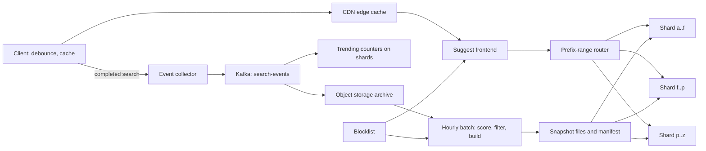

## In one minute
- **Precompute, never search, on a keystroke.** Each prefix's top k completions are computed ahead of time and stored with the prefix, so the request path is a lookup, not a ranking job.
- **Rank by decayed frequency, not raw counts.** Each past search loses half its weight every half-life. Storing a score plus its last-update time keeps updates O(1) while old fads fade on their own.
- **Two layers of freshness.** Hourly immutable snapshots plus a small real-time trending layer, merged at query time.
- **Shard by prefix range, not by hash.** Almost every prefix then lives on one shard; the short prefixes that span several are scatter-gathered and mostly served from cache anyway.
- **Most of the latency is the network and most of the risk is content.** Debounce and cache at the client and edge, and design filtering (abuse, manipulation, takedowns) in from the start.

## Requirements

**Functional**
- As the user types, return up to 10 query completions for the current prefix, in ranked order.
- Rank by how often a phrase was searched, weighted towards recent searches, per locale.
- New trending phrases appear within about 15 minutes; the long tail can lag by a day.
- Filter unsafe, spammy or legally removed phrases, and remove a phrase everywhere within minutes of a takedown. Google's published policy is a useful model: it drops predictions that are sexually explicit, hateful, violent or dangerous, plus spam, piracy-linked terms and valid legal removals ([Google, 2018](https://blog.google/products/search/how-google-autocomplete-works-search/)).
- Blend in a user's own recent searches when they are signed in.

**Non-functional**
- Server time under 10 ms at p99, end to end under 100 ms for most users.
- 99.99% availability, failing open: an empty list is degraded, not an outage, because the search box still works.
- 2x headroom over peak. Suggestions may be minutes stale and need not agree across replicas.

**Out of scope**
- Spelling correction and fuzzy matching, ranking full search results, ads in the suggestion list, and mid-word matching ("phone" matching "iphone").

## Back-of-envelope
- **Traffic.** 300M daily active users, 4 searches each: 1.2B searches per day. With client debounce, about 4 suggestion requests per search reach us: 4.8B requests per day. 4.8 × 10^9 / 86,400 ≈ 56k QPS average. Peak is roughly 2.5x the mean, so about 140k QPS, and the design point with headroom is 300k QPS.
- **Cache offload.** Prefixes of one to three characters are a few hundred thousand keys per locale and account for perhaps 40% of requests. With a 5-minute CDN TTL, origin peak drops to around 85k QPS.
- **Write events.** 1.2B completed searches per day ≈ 14k events per second, around 150 bytes each: 180 GB per day raw, 1.8 × 10^11 × 1,825 ≈ 330 TB over 5 years. Keep 30 days raw (5.4 TB), then only daily aggregates.
- **Corpus.** After dropping phrases seen by fewer than 20 distinct users in 30 days, keep about 100M phrases across locales, averaging 22 bytes: 2.2 GB of text. A naive pointer trie over them has on the order of 1B nodes; at 64 bytes of children plus a 10-entry top-k list of 4-byte phrase IDs, that is over 100 GB. A compact layout (below) brings it to roughly 10 to 15 GB, which we still shard.
- **Bandwidth.** A response is 10 phrases at about 30 bytes plus framing, around 600 bytes compressed to 300. 140k × 300 B ≈ 42 MB/s at peak, trivial; TLS and connection CPU sizes the fleet.

## API

```http
GET /v1/suggest?q=how+to+ma&locale=en-US&k=10
-> 200 {
     "prefix": "how to ma",
     "suggestions": [ {"text": "how to make pancakes"}, {"text": "how to make money"} ],
     "snapshot": "en-US/2026-10-16T09:00Z"
   }
   Cache-Control: public, max-age=300     (only for prefixes of 3 characters or fewer)

POST /v1/search-events
{ "query": "how to make pancakes", "locale": "en-US",
  "session_id": "s-81f2", "typed_prefix": "how to ma", "picked_rank": 1, "ts": 1760605200 }
-> 202

Internal RPC (suggest frontend to shard):
TopK(locale, prefix, k, snapshot) -> [ {phrase_id, score} ]

Admin:
POST /v1/blocklist { "pattern": "exact phrase or rule", "reason": "legal", "ticket": "T-1234" } -> 201
```

Scores stay internal because they change with every build. `picked_rank` in the search event lets the pipeline learn which suggestions people actually click.

## Data model
- **search-events** (Kafka topic): keyed by normalised phrase, so one phrase's events share a partition and can be counted without a shuffle. Retained 7 days and archived hourly to object storage as Parquet.
- **phrase_stats** (batch output in columnar files): `(locale, phrase)` key, `decayed_score`, `score_updated_at`, `distinct_users_30d`, `first_seen`. Rewritten by each batch run; never read by serving traffic.
- **snapshot files** (object storage): one immutable file per `(locale, shard, version)`: the compact trie plus a `phrase_id` to text table. A per-locale **manifest** lists the version, split points and each file's SHA-256. All shards of one version therefore agree on split points.
- **trending counters** (in memory on each shard): `phrase -> (score, last_update)` for phrases seen in the last hour, owned by the shard whose range contains the phrase.
- **blocklist** (Postgres): `rule_id` PK, `pattern`, `match_type` (exact, prefix, regex), `reason`, `created_by`. Small, transactional and audited; pushed to every server as a versioned set and also applied at build time.
- **recent searches** (per-user key-value store): `user_id -> last 20 queries`, partitioned by `user_id`. Read once per session, not per keystroke.

The partition key for serving is `(locale, prefix range)`. Locale comes first because rankings differ completely between `en-US` and `pt-BR`, and a locale is the natural unit to build and roll back.

## High-level design



**Read path.** The client debounces about 50 ms, cancels any in-flight request and checks its own cache; on a miss the CDN answers short prefixes. The frontend normalises the prefix (lowercase, Unicode NFC, collapse spaces), finds the shards owning that prefix in the current manifest (usually one), and calls them in parallel. Each shard walks its compact trie to the prefix node, reads the stored top-k phrase IDs, merges in its trending counters, drops anything on the blocklist, and returns its best k. The frontend merges the lists, deduplicates, takes the top k and returns text.

**Write path.** A completed search becomes an event, validated, normalised and written to Kafka. Each shard's trending consumer updates decayed counters for phrases in its range; an archiver writes hourly files. Every hour, a batch job reads the last 30 days of aggregates plus the new hour, recomputes decayed scores, applies thresholds and the blocklist, chooses split points from traffic, builds one snapshot file per shard, and publishes a new manifest. Shards download the new files, build the in-memory structure off the request path, and swap a pointer.

## Deep dives

### 1. The serving structure
Options: edge n-grams in an existing search cluster, a pointer trie with a top-k list per node (covered in Search and Typeahead), or a compact trie or finite state transducer built offline. Edge n-grams make every prefix an indexed term and every keystroke a scored search, costing milliseconds, not microseconds. Facebook's people typeahead worked this way at scale, with a posting list for every name prefix up to a fixed length, but it ranked by social graph, not by a global top k ([Unicorn, VLDB 2013](https://www.vldb.org/pvldb/vol6/p1150-curtiss.pdf)). A pointer trie wastes memory on a heap object per node and a pointer per child.

I would build a compact trie offline. Nodes are laid out breadth-first in flat arrays: a `first_child` index, a `label` byte per edge, and a `topk_offset` into a shared array of phrase IDs. Single-child chains are collapsed into one edge with a multi-byte label (a radix tree), which removes most nodes in natural language because phrases share long middles. Top-k lists are stored only where they help: at a node whose subtree contains more than k phrases. Below that, the subtree is small enough to enumerate at query time in a few hundred nanoseconds. Lucene's completion suggester makes a similar choice with a weighted FST, and Elasticsearch exposes it as a completion field that is costly to build and held in memory ([Elasticsearch suggesters](https://www.elastic.co/docs/reference/elasticsearch/rest-apis/search-suggesters)). An FST beats a trie on memory because it shares suffixes as well as prefixes: one public build packed 1.6 billion Common Crawl URLs into 27 GB, about a fifth of the sorted input ([Andrew Gallant](https://burntsushi.net/transducers/)). Either way, building offline into an immutable result is what allows the compact layout.

One catch with filtering at query time: if a node stores exactly k phrases and the blocklist removes three of them, the shard can only return seven. Store a margin, say 2k, at each node so filtering still fills the list. Lucene's suggester documents the same hazard, warning that many deletions or a restrictive filter make its pruned top-N search miss results ([Lucene NRTSuggester](https://lucene.apache.org/core/10_3_0/suggest/org/apache/lucene/search/suggest/document/NRTSuggester.html)).

### 2. Freshness and ranking with decayed frequency
Raw 30-day counts rank "world cup schedule" above "election results" on election night. Exponential decay needs two numbers per phrase: `score` and `updated_at`. Reading at time `now` gives `score × 2^(-(now - updated_at) / half_life)`. Recording a search applies the decay and adds 1. Since all scores decay by the same factor, a stored ranking stays valid until new events arrive.

I use two half-lives. The batch layer uses 7 days for durable popularity; the trending layer uses 30 minutes for spikes. The shard blends them, for example `batch + 3 × trending` tuned against click-through, so a new phrase can appear within 15 minutes without a rebuild.

Counting is also the attack surface. Ranking by distinct users rather than raw events, requiring a minimum number of distinct users before a phrase is eligible, and capping one session's contribution stop a script from pushing a phrase into everyone's suggestion list. Recent personal searches are merged on the client, so personalisation never pollutes shared caches.

### 3. Partitioning, routing and merging
Hashing the full phrase spreads load evenly but sends every prefix query to every shard, since completions of "how" are scattered. Hashing the first two characters keeps prefixes together but cannot be rebalanced: "th" and "s" are enormous, "qz" is empty. Prefix ranges, as in Bigtable's tablets, which are contiguous row ranges split as they grow ([Bigtable, OSDI 2006](https://static.googleusercontent.com/media/research.google.com/en//archive/bigtable-osdi06.pdf)), keep neighbours together and can be rebalanced by moving split points. Azure's sharding guidance names the price: range sharding does not balance load on its own, and rebalancing may not help when activity piles up on adjacent keys ([Azure Sharding pattern](https://learn.microsoft.com/en-us/azure/architecture/patterns/sharding)). That is why the split points below follow traffic, not phrase counts.

The batch job picks split points so each shard carries a similar share of expected request traffic, not of phrases. That pushes split points deep in busy areas, such as `[ca, cat)` then `[cat, d)`, so "c" spans several shards. The routing rule is simple because strings with a common prefix are contiguous in sorted order: start at the shard owning the prefix itself, then include one more shard for every split point that begins with the prefix. Multi-shard prefixes are short, and short prefixes are what the caches absorb.

Merging must deduplicate, because during a rebalance a phrase can briefly exist on both the old and the new owner, and each shard must return its own top k (not fewer) so the global top k is guaranteed to be in the union. All shards of one request use the same pinned manifest version.

## Down the stack

### Layer 1: The contract
For a normalised prefix, return up to k phrases starting with it, ordered by blended score from one snapshot version plus trending state, excluding anything blocklisted when the request arrived. The long tail may be one build interval stale, trending a few minutes. If a shard misses its 15 ms budget, the frontend returns a partial answer, marked uncacheable, rather than an error.

### Layer 2: The mechanism
The compact trie is three arrays per shard: edges sorted by label within each node so a child lookup is a binary search over a few bytes, a node array of `(first_edge, edge_count, topk_offset, topk_len)` packed in 16 bytes, and a phrase-ID array. Lucene's equivalent, `CompletionPostingsFormat` (versioned per codec, `Completion101PostingsFormat` in Lucene 10), stores an FST per segment whose outputs carry a weight, surface form and document ID, and `NRTSuggester` runs a top-N search over it ([Lucene NRTSuggester](https://lucene.apache.org/core/10_3_0/suggest/org/apache/lucene/search/suggest/document/NRTSuggester.html)). The trending layer is a hash map plus a min-heap per hot prefix, updated by the Kafka consumer thread and read by request threads through a read-copy-update swap every second, so readers never take a lock. Snapshot loading verifies the SHA-256 from the manifest before swapping.

### Layer 3: The machine
An 8-character prefix touches about 8 nodes. In a pointer trie each is a separate heap object and likely a cache miss at 80 to 100 ns, close to 1 µs per lookup. In the flat layout, root-level nodes stay hot in L1 and L2 and breadth-first order packs siblings into one 64-byte line, so a lookup is well under 1 µs. A 12 GB snapshot is loaded with `mmap`, outside the garbage-collected heap; 12 GB of small heap objects could cost GC pauses of tens of milliseconds, the whole budget. The network still dominates: a mobile round trip is 50 to 150 ms and a fresh TLS 1.3 handshake adds one more ([RFC 8446](https://www.rfc-editor.org/rfc/rfc8446)), so clients keep one HTTP/2 connection open while the box is focused and multiplex keystroke requests over it ([RFC 9113](https://www.rfc-editor.org/rfc/rfc9113)).

### Why it's built this way
1. Users type faster than a search engine can rank, so answers per prefix must be precomputed and looked up.
2. Precomputed answers for a billion prefixes are large, so they are built offline into a compact, immutable layout that the CPU cache likes.
3. Immutable snapshots are stale between builds, so a small, mutable trending layer with fast decay covers the gap.
4. The snapshot no longer fits one machine, so it is split by prefix range, because range splitting keeps one prefix's answer on one shard.
5. Even a microsecond lookup sits behind a 100 ms mobile round trip, so caching at the client and edge saves more than any server optimisation.

## Failure modes
- **10x load.** The CDN absorbs short prefixes; frontends shed by serving a cached shorter prefix's answer (filtered client-side), and clients lengthen debounce on a back-off hint.
- **Region outage.** Serving is stateless apart from snapshots, so other regions absorb the traffic. Trending counters are regional, so trending is briefly less fresh after failover.
- **Hot prefix.** A celebrity's name saturates one shard. Add replicas for that range, edge-cache the prefix regardless of length, and let the next build move split points.
- **Bad snapshot.** A build bug ranks spam first or produces an empty trie. Mitigation: validate against golden prefixes, canary the manifest on one replica group, and roll back by reverting the manifest pointer.
- **Pipeline stall.** Kafka lag or a failed batch means no new snapshot. Shards keep serving the last good version, and an alert fires when snapshot age exceeds two build intervals.
- **Harmful suggestion goes live.** A takedown is added to the blocklist, pushed to frontends within a minute and enforced at query time, so it does not wait for the next build. Build-time classifiers are never complete; Google says its own systems "are not perfect or precise" and that it enforces policy when predictions slip through ([Google, 2020](https://blog.google/products/search/our-latest-investments-information-quality-search-and-news/)).

## In the wild
- **Facebook, 2012: typeahead on a social-graph index.** Facebook replaced its first typeahead backend, which was already serving hundreds of millions of queries a day but was hard to scale past half a billion users, with Unicorn, an in-memory index spread over thousands of servers. Index servers hold a posting list for every name prefix up to a fixed length, so "J", "Jo", "Jon" each map straight to candidate IDs. A plain prefix lookup ignored who your friends are, so Unicorn added a `WeakAnd` operator that reserves part of the result list for friends without requiring every result to be one. By the end of 2012 it served over a billion typeahead queries a day ([Curtiss et al., VLDB 2013](https://www.vldb.org/pvldb/vol6/p1150-curtiss.pdf)).
- **Google, 2020: a policy change enforced in the suggestion layer.** Ahead of the US election, Google said it would remove predictions that could be read as claims for or against a candidate or party, or about the legitimacy of the electoral process: both "you can vote by phone" and "you can't vote by phone" were to disappear, as was "donate to" any party. It also said it had tuned its systems to show no prediction when the query may not lead to reliable content, and that because those systems are imperfect it removes predictions that slip through. Suggestions are an editorial surface, so the takedown path is a core feature ([Google, September 2020](https://blog.google/products/search/our-latest-investments-information-quality-search-and-news/)).

## Trade-offs

| Option | Strengths | Weaknesses | Choose when |
|---|---|---|---|
| Compact trie or FST, offline build | Sub-microsecond lookup, small memory | Stale between builds, build pipeline to run | Large query-log autocomplete |
| Edge n-grams in a search cluster | Reuses existing cluster, flexible filters | Larger index, millisecond queries | Product or entity search at moderate scale |
| Prefix-range sharding | One shard per typical prefix, rebalanceable | Short prefixes scatter, split points to manage | Corpus too big for one node |
| Hash sharding | Even load, no split management | Every query scatters to all shards | Rarely, for autocomplete |
| Decayed score | O(1) update, two numbers per phrase | One fixed half-life per score | Popularity with recency |
| Sliding window counts | Exact "last N hours" semantics | Memory per bucket, slow expiry | Compliance or reporting views |

## Leadership lens
- **Build first.** The offline pipeline with a single, unsharded snapshot per locale and a golden-prefix check. Shard only when the snapshot outgrows one machine.
- **Rollout.** Launch to 1% of traffic, compare suggestion click-through against the old system, then ramp. Ship trending later behind a flag.
- **Ownership.** A search platform team owns serving and the pipeline. A trust and safety team owns the blocklist and its review queue, with a takedown path that needs no platform deploy.
- **Cost drivers.** Memory for snapshots times replicas times regions, CDN requests, and the event pipeline's storage. Raising the distinct-user threshold is the biggest single cost lever, and it improves quality too.
- **Design review questions.** How long from a takedown request to the phrase disappearing everywhere? What do users see when the build has been failing for six hours?

## Check yourself
1. Why shard by prefix range instead of hashing the full phrase or its first two characters?
   **Answer:** Hashing the full phrase sends every prefix query to every shard, and hashing the first two characters keeps prefixes together but cannot be rebalanced because "th" is enormous and "qz" is empty. Prefix ranges keep neighbours together and rebalance by moving split points, so most prefixes hit one shard.
2. Why rank by decayed frequency rather than raw 30-day counts, and what does it cost to store?
   **Answer:** Raw counts let old fads outrank what people are searching for now, such as on election night. Exponential decay needs only `score` and `updated_at` per phrase with an O(1) update, and since all scores decay by the same factor a stored ranking stays valid until new events arrive.
3. A build bug produces a snapshot that ranks spam first. How is the damage limited?
   **Answer:** Snapshots are validated against golden prefixes and the manifest is canaried on one replica group before rollout. If it still gets through, rollback is reverting the manifest pointer to the last good version.
4. How does about 56k QPS average become a much smaller origin load, and why does that matter for sharding?
   **Answer:** Prefixes of one to three characters are perhaps 40% of requests and are cached at the CDN with a 5-minute TTL, cutting origin peak from about 140k to around 85k QPS. Those short prefixes are also the ones that span several shards, so caching absorbs most scatter-gather queries.

## Practice
**Task:** Build the prefix-range router and the shard-side scoring that sit behind the suggest frontend. `Shard(half_life)` records searches with `record(term, now)`: a new term gets score 1; an existing term's score is decayed to `now` by `score × 2^(-(now - last) / half_life)` and then incremented by 1; recording a term at a time earlier than its last update is an error. `top(prefix, k, now)` returns up to k `(term, decayed score at now)` pairs for terms starting with the prefix, ordered by score descending then term ascending. `Router(splits)` takes strictly increasing, non-empty split points: shard 0 owns terms below `splits[0]`, shard i owns `[splits[i-1], splits[i])`, and the last shard owns the rest; it offers `shard_count()`, `shard_of(term)`, and `shards_for(prefix)`, the ascending list of shards that may hold terms starting with the prefix. `merge(lists, k)` combines per-shard lists, keeps the highest score for a duplicated term, and returns the top k terms with the same ordering. `ingest(router, shards, term, now)` records on the owning shard, and `suggest(router, shards, prefix, k, now)` queries only the shards from `shards_for` and merges; both reject a shard list whose length differs from the router's shard count.

```python starter
import bisect


class Shard:
    def __init__(self, half_life):
        self.half_life = half_life

    def record(self, term, now):
        # TODO: decay the existing score to now, then add 1
        raise NotImplementedError

    def top(self, prefix, k, now):
        # TODO: return [(term, score)] sorted by score desc, term asc
        raise NotImplementedError


class Router:
    def __init__(self, splits):
        self.splits = list(splits)

    def shard_count(self):
        raise NotImplementedError

    def shard_of(self, term):
        raise NotImplementedError

    def shards_for(self, prefix):
        # TODO: every shard whose range can hold a term starting with prefix
        raise NotImplementedError


def merge(lists, k):
    raise NotImplementedError


def ingest(router, shards, term, now):
    raise NotImplementedError


def suggest(router, shards, prefix, k, now):
    raise NotImplementedError
```

```python tests
def _raises(fn):
    try:
        fn()
    except ValueError:
        return True
    return False


def test_router_rejects_bad_splits():
    assert _raises(lambda: Router(["b", "a"])), "decreasing"
    assert _raises(lambda: Router(["a", "a"])), "duplicate"
    assert _raises(lambda: Router(["", "m"])), "empty split"


def test_shard_of_uses_half_open_ranges():
    r = Router(["f", "m", "s"])
    assert r.shard_count() == 4
    assert [r.shard_of(t) for t in ["apple", "f", "fig", "m", "zoo"]] == [0, 1, 1, 2, 3]


def test_shards_for_prefix_spanning_splits():
    r = Router(["ca", "cat", "d"])
    assert r.shards_for("c") == [0, 1, 2]
    assert r.shards_for("ca") == [1, 2]
    assert r.shards_for("cat") == [2]
    assert r.shards_for("e") == [3]
    assert r.shards_for("") == [0, 1, 2, 3]


def test_decay_halves_each_half_life():
    s = Shard(10)
    s.record("a", 0)
    s.record("a", 0)
    for _ in range(3):
        s.record("b", 10)
    assert s.top("", 5, 10) == [("b", 3.0), ("a", 1.0)]
    assert s.top("", 5, 20) == [("b", 1.5), ("a", 0.5)]
    assert s.top("a", 5, 20) == [("a", 0.5)]


def test_recent_beats_old_and_time_cannot_go_backwards():
    s = Shard(10)
    for _ in range(4):
        s.record("old", 0)
    for _ in range(3):
        s.record("new", 20)
    assert [t for t, _ in s.top("", 2, 20)] == ["new", "old"]
    assert _raises(lambda: s.record("new", 19))


def test_merge_dedupes_and_breaks_ties():
    lists = [[("b", 2.0), ("a", 2.0)], [("b", 5.0), ("c", 1.0)], []]
    assert merge(lists, 2) == ["b", "a"]
    assert merge(lists, 10) == ["b", "a", "c"]
    assert merge(lists, 0) == []


def test_suggest_queries_only_owning_shards():
    r = Router(["mango"])
    shards = [Shard(60), Shard(60)]
    for term, n in [("lime", 5), ("mad", 1), ("mango", 3), ("map", 2)]:
        for _ in range(n):
            ingest(r, shards, term, 0)
    for _ in range(10):
        shards[1].record("lemon", 0)  # misplaced: shard 1 does not own "l"
    assert r.shards_for("ma") == [0, 1]
    assert suggest(r, shards, "ma", 2, 0) == ["mango", "map"]
    assert suggest(r, shards, "ma", 5, 0) == ["mango", "map", "mad"]
    assert suggest(r, shards, "l", 3, 0) == ["lime"]


def test_shard_count_mismatch_is_rejected():
    r = Router(["m"])
    assert _raises(lambda: suggest(r, [Shard(1)], "a", 3, 0))
    assert _raises(lambda: ingest(r, [Shard(1)], "a", 0))
```

```python solution
import bisect


class Shard:
    def __init__(self, half_life):
        if half_life <= 0:
            raise ValueError("half_life must be positive")
        self.half_life = half_life
        self.entries = {}  # term -> [score, last_update]

    def _decayed(self, score, last, now):
        return score * 2 ** (-(now - last) / self.half_life)

    def record(self, term, now):
        e = self.entries.get(term)
        if e is None:
            self.entries[term] = [1.0, now]
            return
        if now < e[1]:
            raise ValueError("time went backwards for " + term)
        e[0] = self._decayed(e[0], e[1], now) + 1.0
        e[1] = now

    def top(self, prefix, k, now):
        if k <= 0:
            return []
        hits = []
        for term, e in self.entries.items():
            if term.startswith(prefix):
                hits.append((term, self._decayed(e[0], e[1], now)))
        hits.sort(key=lambda p: (-p[1], p[0]))
        return hits[:k]


class Router:
    def __init__(self, splits):
        for i, s in enumerate(splits):
            if s == "":
                raise ValueError("empty split point")
            if i > 0 and splits[i - 1] >= s:
                raise ValueError("split points must be strictly increasing")
        self.splits = list(splits)

    def shard_count(self):
        return len(self.splits) + 1

    def shard_of(self, term):
        return bisect.bisect_right(self.splits, term)

    def shards_for(self, prefix):
        # Terms with this prefix are contiguous in sorted order: they start in the
        # shard owning the prefix and cross every split point that has the prefix.
        lo = bisect.bisect_right(self.splits, prefix)
        hi = lo
        while hi < len(self.splits) and self.splits[hi].startswith(prefix):
            hi += 1
        return list(range(lo, hi + 1))


def merge(lists, k):
    if k <= 0:
        return []
    best = {}
    for lst in lists:
        for term, score in lst:
            if term not in best or score > best[term]:
                best[term] = score
    ranked = sorted(best.items(), key=lambda p: (-p[1], p[0]))
    return [term for term, _ in ranked[:k]]


def _check(router, shards):
    if len(shards) != router.shard_count():
        raise ValueError("shard list does not match router")


def ingest(router, shards, term, now):
    _check(router, shards)
    shards[router.shard_of(term)].record(term, now)


def suggest(router, shards, prefix, k, now):
    _check(router, shards)
    lists = [shards[i].top(prefix, k, now) for i in router.shards_for(prefix)]
    return merge(lists, k)
```

```typescript starter
export type Scored = [string, number];

export class Shard {
  constructor(public halfLife: number) {}
  record(term: string, now: number): void {
    throw new Error("TODO");
  }
  top(prefix: string, k: number, now: number): Scored[] {
    throw new Error("TODO");
  }
}

export class Router {
  splits: string[];
  constructor(splits: string[]) {
    this.splits = splits.slice();
  }
  shardCount(): number {
    throw new Error("TODO");
  }
  shardOf(term: string): number {
    throw new Error("TODO");
  }
  shardsFor(prefix: string): number[] {
    throw new Error("TODO");
  }
}

export function merge(lists: Scored[][], k: number): string[] {
  throw new Error("TODO");
}

export function ingest(router: Router, shards: Shard[], term: string, now: number): void {
  throw new Error("TODO");
}

export function suggest(router: Router, shards: Shard[], prefix: string, k: number, now: number): string[] {
  throw new Error("TODO");
}
```

```typescript tests
function raisesError(fn: () => unknown): boolean {
  try {
    fn();
  } catch (e) {
    return true;
  }
  return false;
}

test("router rejects bad splits", () => {
  assert(raisesError(() => new Router(["b", "a"])), "decreasing");
  assert(raisesError(() => new Router(["a", "a"])), "duplicate");
  assert(raisesError(() => new Router(["", "m"])), "empty split");
});

test("shardOf uses half-open ranges", () => {
  const r = new Router(["f", "m", "s"]);
  assertEqual(r.shardCount(), 4, "count");
  assertEqual(["apple", "f", "fig", "m", "zoo"].map((t) => r.shardOf(t)), [0, 1, 1, 2, 3], "owners");
});

test("shardsFor prefix spanning splits", () => {
  const r = new Router(["ca", "cat", "d"]);
  assertEqual(r.shardsFor("c"), [0, 1, 2], "c");
  assertEqual(r.shardsFor("ca"), [1, 2], "ca");
  assertEqual(r.shardsFor("cat"), [2], "cat");
  assertEqual(r.shardsFor("e"), [3], "e");
  assertEqual(r.shardsFor(""), [0, 1, 2, 3], "empty");
});

test("decay halves each half-life", () => {
  const s = new Shard(10);
  s.record("a", 0);
  s.record("a", 0);
  for (let i = 0; i < 3; i++) s.record("b", 10);
  assertEqual(s.top("", 5, 10), [["b", 3], ["a", 1]], "at 10");
  assertEqual(s.top("", 5, 20), [["b", 1.5], ["a", 0.5]], "at 20");
  assertEqual(s.top("a", 5, 20), [["a", 0.5]], "prefix a");
});

test("recent beats old and time cannot go backwards", () => {
  const s = new Shard(10);
  for (let i = 0; i < 4; i++) s.record("old", 0);
  for (let i = 0; i < 3; i++) s.record("new", 20);
  assertEqual(s.top("", 2, 20).map((p) => p[0]), ["new", "old"], "order");
  assert(raisesError(() => s.record("new", 19)), "backwards");
});

test("merge dedupes and breaks ties", () => {
  const lists: Scored[][] = [[["b", 2], ["a", 2]], [["b", 5], ["c", 1]], []];
  assertEqual(merge(lists, 2), ["b", "a"], "k=2");
  assertEqual(merge(lists, 10), ["b", "a", "c"], "k=10");
  assertEqual(merge(lists, 0), [], "k=0");
});

test("suggest queries only owning shards", () => {
  const r = new Router(["mango"]);
  const shards = [new Shard(60), new Shard(60)];
  const counts: Array<[string, number]> = [["lime", 5], ["mad", 1], ["mango", 3], ["map", 2]];
  for (const [term, n] of counts) for (let i = 0; i < n; i++) ingest(r, shards, term, 0);
  for (let i = 0; i < 10; i++) shards[1].record("lemon", 0);
  assertEqual(r.shardsFor("ma"), [0, 1], "fan-out");
  assertEqual(suggest(r, shards, "ma", 2, 0), ["mango", "map"], "k=2");
  assertEqual(suggest(r, shards, "ma", 5, 0), ["mango", "map", "mad"], "k=5");
  assertEqual(suggest(r, shards, "l", 3, 0), ["lime"], "misplaced ignored");
});

test("shard count mismatch is rejected", () => {
  const r = new Router(["m"]);
  assert(raisesError(() => suggest(r, [new Shard(1)], "a", 3, 0)), "suggest");
  assert(raisesError(() => ingest(r, [new Shard(1)], "a", 0)), "ingest");
});
```

```typescript solution
export type Scored = [string, number];

function byScoreThenTerm(a: Scored, b: Scored): number {
  if (a[1] !== b[1]) return b[1] - a[1];
  return a[0] < b[0] ? -1 : a[0] > b[0] ? 1 : 0;
}

export class Shard {
  private entries = new Map<string, { score: number; last: number }>();

  constructor(public halfLife: number) {
    if (halfLife <= 0) throw new Error("halfLife must be positive");
  }

  private decayed(score: number, last: number, now: number): number {
    return score * Math.pow(2, -(now - last) / this.halfLife);
  }

  record(term: string, now: number): void {
    const e = this.entries.get(term);
    if (!e) {
      this.entries.set(term, { score: 1, last: now });
      return;
    }
    if (now < e.last) throw new Error("time went backwards for " + term);
    e.score = this.decayed(e.score, e.last, now) + 1;
    e.last = now;
  }

  top(prefix: string, k: number, now: number): Scored[] {
    if (k <= 0) return [];
    const hits: Scored[] = [];
    for (const [term, e] of this.entries) {
      if (term.startsWith(prefix)) hits.push([term, this.decayed(e.score, e.last, now)]);
    }
    hits.sort(byScoreThenTerm);
    return hits.slice(0, k);
  }
}

export class Router {
  splits: string[];

  constructor(splits: string[]) {
    splits.forEach((s, i) => {
      if (s === "") throw new Error("empty split point");
      if (i > 0 && splits[i - 1] >= s) throw new Error("split points must be strictly increasing");
    });
    this.splits = splits.slice();
  }

  shardCount(): number {
    return this.splits.length + 1;
  }

  shardOf(term: string): number {
    // bisect right: first split strictly greater than term
    let lo = 0;
    let hi = this.splits.length;
    while (lo < hi) {
      const mid = (lo + hi) >> 1;
      if (this.splits[mid] <= term) lo = mid + 1;
      else hi = mid;
    }
    return lo;
  }

  shardsFor(prefix: string): number[] {
    const lo = this.shardOf(prefix);
    let hi = lo;
    while (hi < this.splits.length && this.splits[hi].startsWith(prefix)) hi++;
    const out: number[] = [];
    for (let i = lo; i <= hi; i++) out.push(i);
    return out;
  }
}

export function merge(lists: Scored[][], k: number): string[] {
  if (k <= 0) return [];
  const best = new Map<string, number>();
  for (const list of lists) {
    for (const [term, score] of list) {
      const prev = best.get(term);
      if (prev === undefined || score > prev) best.set(term, score);
    }
  }
  const ranked: Scored[] = Array.from(best.entries());
  ranked.sort(byScoreThenTerm);
  return ranked.slice(0, k).map((p) => p[0]);
}

function checkShards(router: Router, shards: Shard[]): void {
  if (shards.length !== router.shardCount()) throw new Error("shard list does not match router");
}

export function ingest(router: Router, shards: Shard[], term: string, now: number): void {
  checkShards(router, shards);
  shards[router.shardOf(term)].record(term, now);
}

export function suggest(router: Router, shards: Shard[], prefix: string, k: number, now: number): string[] {
  checkShards(router, shards);
  const lists = router.shardsFor(prefix).map((i) => shards[i].top(prefix, k, now));
  return merge(lists, k);
}
```

```go starter
package practice

type Scored struct {
	Term  string
	Score float64
}

type Shard struct {
	HalfLife float64
}

func NewShard(halfLife float64) (*Shard, error) {
	panic("TODO")
}

func (s *Shard) Record(term string, now float64) error {
	panic("TODO")
}

func (s *Shard) Top(prefix string, k int, now float64) []Scored {
	panic("TODO")
}

type Router struct {
	splits []string
}

func NewRouter(splits []string) (*Router, error) {
	panic("TODO")
}

func (r *Router) ShardCount() int             { panic("TODO") }
func (r *Router) ShardOf(term string) int     { panic("TODO") }
func (r *Router) ShardsFor(prefix string) []int { panic("TODO") }

func Merge(lists [][]Scored, k int) []string {
	panic("TODO")
}

func Ingest(r *Router, shards []*Shard, term string, now float64) error {
	panic("TODO")
}

func Suggest(r *Router, shards []*Shard, prefix string, k int, now float64) ([]string, error) {
	panic("TODO")
}
```

```go tests
package practice

import (
	"reflect"
	"testing"
)

func mustShard(t *testing.T, h float64) *Shard {
	t.Helper()
	s, err := NewShard(h)
	if err != nil {
		t.Fatal(err)
	}
	return s
}

func mustRouter(t *testing.T, splits ...string) *Router {
	t.Helper()
	r, err := NewRouter(splits)
	if err != nil {
		t.Fatal(err)
	}
	return r
}

func sameStrings(a, b []string) bool {
	if len(a) != len(b) {
		return false
	}
	for i := range a {
		if a[i] != b[i] {
			return false
		}
	}
	return true
}

func TestRouterRejectsBadSplits(t *testing.T) {
	for _, bad := range [][]string{{"b", "a"}, {"a", "a"}, {"", "m"}} {
		if _, err := NewRouter(bad); err == nil {
			t.Errorf("expected error for %v", bad)
		}
	}
}

func TestShardOfUsesHalfOpenRanges(t *testing.T) {
	r := mustRouter(t, "f", "m", "s")
	if r.ShardCount() != 4 {
		t.Fatalf("count = %d", r.ShardCount())
	}
	want := []int{0, 1, 1, 2, 3}
	for i, term := range []string{"apple", "f", "fig", "m", "zoo"} {
		if got := r.ShardOf(term); got != want[i] {
			t.Errorf("ShardOf(%q) = %d, want %d", term, got, want[i])
		}
	}
}

func TestShardsForPrefixSpanningSplits(t *testing.T) {
	r := mustRouter(t, "ca", "cat", "d")
	cases := map[string][]int{"c": {0, 1, 2}, "ca": {1, 2}, "cat": {2}, "e": {3}, "": {0, 1, 2, 3}}
	for p, want := range cases {
		if got := r.ShardsFor(p); !reflect.DeepEqual(got, want) {
			t.Errorf("ShardsFor(%q) = %v, want %v", p, got, want)
		}
	}
}

func TestDecayHalvesEachHalfLife(t *testing.T) {
	s := mustShard(t, 10)
	s.Record("a", 0)
	s.Record("a", 0)
	for i := 0; i < 3; i++ {
		s.Record("b", 10)
	}
	if got := s.Top("", 5, 10); !reflect.DeepEqual(got, []Scored{{"b", 3}, {"a", 1}}) {
		t.Errorf("at 10: %v", got)
	}
	if got := s.Top("", 5, 20); !reflect.DeepEqual(got, []Scored{{"b", 1.5}, {"a", 0.5}}) {
		t.Errorf("at 20: %v", got)
	}
	if got := s.Top("a", 5, 20); !reflect.DeepEqual(got, []Scored{{"a", 0.5}}) {
		t.Errorf("prefix a: %v", got)
	}
}

func TestRecentBeatsOldAndTimeCannotGoBackwards(t *testing.T) {
	s := mustShard(t, 10)
	for i := 0; i < 4; i++ {
		s.Record("old", 0)
	}
	for i := 0; i < 3; i++ {
		s.Record("new", 20)
	}
	got := s.Top("", 2, 20)
	if len(got) != 2 || got[0].Term != "new" || got[1].Term != "old" {
		t.Errorf("order: %v", got)
	}
	if err := s.Record("new", 19); err == nil {
		t.Error("expected error when time goes backwards")
	}
}

func TestMergeDedupesAndBreaksTies(t *testing.T) {
	lists := [][]Scored{{{"b", 2}, {"a", 2}}, {{"b", 5}, {"c", 1}}, {}}
	if got := Merge(lists, 2); !sameStrings(got, []string{"b", "a"}) {
		t.Errorf("k=2: %v", got)
	}
	if got := Merge(lists, 10); !sameStrings(got, []string{"b", "a", "c"}) {
		t.Errorf("k=10: %v", got)
	}
	if got := Merge(lists, 0); len(got) != 0 {
		t.Errorf("k=0: %v", got)
	}
}

func TestSuggestQueriesOnlyOwningShards(t *testing.T) {
	r := mustRouter(t, "mango")
	shards := []*Shard{mustShard(t, 60), mustShard(t, 60)}
	counts := []struct {
		term string
		n    int
	}{{"lime", 5}, {"mad", 1}, {"mango", 3}, {"map", 2}}
	for _, c := range counts {
		for i := 0; i < c.n; i++ {
			if err := Ingest(r, shards, c.term, 0); err != nil {
				t.Fatal(err)
			}
		}
	}
	for i := 0; i < 10; i++ {
		shards[1].Record("lemon", 0)
	}
	if got := r.ShardsFor("ma"); !reflect.DeepEqual(got, []int{0, 1}) {
		t.Errorf("fan-out: %v", got)
	}
	check := func(prefix string, k int, want []string) {
		got, err := Suggest(r, shards, prefix, k, 0)
		if err != nil || !sameStrings(got, want) {
			t.Errorf("Suggest(%q, %d) = %v, %v; want %v", prefix, k, got, err, want)
		}
	}
	check("ma", 2, []string{"mango", "map"})
	check("ma", 5, []string{"mango", "map", "mad"})
	check("l", 3, []string{"lime"})
}

func TestShardCountMismatchIsRejected(t *testing.T) {
	r := mustRouter(t, "m")
	if _, err := Suggest(r, []*Shard{mustShard(t, 1)}, "a", 3, 0); err == nil {
		t.Error("Suggest should reject mismatched shards")
	}
	if err := Ingest(r, []*Shard{mustShard(t, 1)}, "a", 0); err == nil {
		t.Error("Ingest should reject mismatched shards")
	}
}
```

```go solution
package practice

import (
	"errors"
	"fmt"
	"math"
	"sort"
	"strings"
)

type Scored struct {
	Term  string
	Score float64
}

type entry struct {
	score, last float64
}

type Shard struct {
	HalfLife float64
	entries  map[string]*entry
}

func NewShard(halfLife float64) (*Shard, error) {
	if halfLife <= 0 {
		return nil, errors.New("half-life must be positive")
	}
	return &Shard{HalfLife: halfLife, entries: map[string]*entry{}}, nil
}

func (s *Shard) decayed(e *entry, now float64) float64 {
	return e.score * math.Pow(2, -(now-e.last)/s.HalfLife)
}

func (s *Shard) Record(term string, now float64) error {
	e, ok := s.entries[term]
	if !ok {
		s.entries[term] = &entry{score: 1, last: now}
		return nil
	}
	if now < e.last {
		return fmt.Errorf("time went backwards for %q", term)
	}
	e.score = s.decayed(e, now) + 1
	e.last = now
	return nil
}

func sortScored(xs []Scored) {
	sort.Slice(xs, func(i, j int) bool {
		if xs[i].Score != xs[j].Score {
			return xs[i].Score > xs[j].Score
		}
		return xs[i].Term < xs[j].Term
	})
}

func (s *Shard) Top(prefix string, k int, now float64) []Scored {
	hits := []Scored{}
	if k <= 0 {
		return hits
	}
	for term, e := range s.entries {
		if strings.HasPrefix(term, prefix) {
			hits = append(hits, Scored{term, s.decayed(e, now)})
		}
	}
	sortScored(hits)
	if len(hits) > k {
		hits = hits[:k]
	}
	return hits
}

type Router struct {
	splits []string
}

func NewRouter(splits []string) (*Router, error) {
	for i, s := range splits {
		if s == "" {
			return nil, errors.New("empty split point")
		}
		if i > 0 && splits[i-1] >= s {
			return nil, errors.New("split points must be strictly increasing")
		}
	}
	return &Router{splits: append([]string(nil), splits...)}, nil
}

func (r *Router) ShardCount() int { return len(r.splits) + 1 }

// ShardOf returns the index of the first split strictly greater than term.
func (r *Router) ShardOf(term string) int {
	return sort.Search(len(r.splits), func(i int) bool { return r.splits[i] > term })
}

// ShardsFor relies on terms sharing a prefix being contiguous in sorted order.
func (r *Router) ShardsFor(prefix string) []int {
	lo := r.ShardOf(prefix)
	hi := lo
	for hi < len(r.splits) && strings.HasPrefix(r.splits[hi], prefix) {
		hi++
	}
	out := make([]int, 0, hi-lo+1)
	for i := lo; i <= hi; i++ {
		out = append(out, i)
	}
	return out
}

func Merge(lists [][]Scored, k int) []string {
	out := []string{}
	if k <= 0 {
		return out
	}
	best := map[string]float64{}
	for _, list := range lists {
		for _, sc := range list {
			if prev, ok := best[sc.Term]; !ok || sc.Score > prev {
				best[sc.Term] = sc.Score
			}
		}
	}
	ranked := make([]Scored, 0, len(best))
	for term, score := range best {
		ranked = append(ranked, Scored{term, score})
	}
	sortScored(ranked)
	for i := 0; i < len(ranked) && i < k; i++ {
		out = append(out, ranked[i].Term)
	}
	return out
}

func checkShards(r *Router, shards []*Shard) error {
	if len(shards) != r.ShardCount() {
		return fmt.Errorf("got %d shards, router has %d", len(shards), r.ShardCount())
	}
	return nil
}

func Ingest(r *Router, shards []*Shard, term string, now float64) error {
	if err := checkShards(r, shards); err != nil {
		return err
	}
	return shards[r.ShardOf(term)].Record(term, now)
}

func Suggest(r *Router, shards []*Shard, prefix string, k int, now float64) ([]string, error) {
	if err := checkShards(r, shards); err != nil {
		return nil, err
	}
	lists := [][]Scored{}
	for _, i := range r.ShardsFor(prefix) {
		lists = append(lists, shards[i].Top(prefix, k, now))
	}
	return Merge(lists, k), nil
}
```

## Mock interview
**Prompt:** Design the autocomplete for a search engine with 300 million daily users. Suggestions must appear as the user types, reflect what is trending within about 15 minutes, and never show phrases that have been taken down.

- Follow-up: The corpus no longer fits on one machine. How do you split it, and what happens to a query for the single letter "s"?
- Follow-up: A coordinated group searches an offensive phrase 50,000 times in an hour. Walk me through what stops it from reaching suggestions, and how fast you can remove it if it does.
- Follow-up: Why not just put an edge n-gram field in the Elasticsearch cluster you already run for search results?

**A strong answer covers:**
- A latency budget that puts the network first, with client debounce, request cancellation, and edge caching of short prefixes.
- Precomputed top k per prefix in a compact, immutable structure built offline, with an estimate of its memory.
- Decayed-frequency scoring stored as score plus timestamp, and a separate fast-decay trending layer merged at query time.
- Prefix-range sharding with traffic-balanced split points, scatter-gather only for short prefixes, and deduplicating merges.
- Abuse resistance (distinct users, thresholds, per-session caps) and a query-time blocklist for takedowns.
- Safe snapshot rollout: golden-prefix validation, canary, and instant rollback via the manifest.

## Sources and further study
**Primary**
- [Curtiss et al., "Unicorn: A System for Searching the Social Graph" (VLDB 2013)](https://www.vldb.org/pvldb/vol6/p1150-curtiss.pdf): prefix posting lists, document-sharded index servers and the `WeakAnd` operator behind Facebook typeahead.
- [Bigtable: A Distributed Storage System for Structured Data (OSDI 2006)](https://static.googleusercontent.com/media/research.google.com/en//archive/bigtable-osdi06.pdf): row-range tablets that split as they grow, the model for prefix-range shards.

**Systems docs**
- [Lucene NRTSuggester](https://lucene.apache.org/core/10_3_0/suggest/org/apache/lucene/search/suggest/document/NRTSuggester.html): the weighted-FST top-N search, with its warning about deletions and filters over-pruning results.
- [Google: our latest investments in information quality (2020)](https://blog.google/products/search/our-latest-investments-information-quality-search-and-news/): first-party description of autocomplete removal rules and enforcement.

**Books**
- *System Design Interview, Volume 1*, Alex Xu, chapter 13 "Design A Search Autocomplete System": the interview-depth version of this design, a trie that caches the top k at each node and is rebuilt offline from query logs.
- *Introduction to Information Retrieval*, Manning, Raghavan and Schütze, chapter 3 "Dictionaries and tolerant retrieval": search trees and tries for prefix lookups, wildcard queries and k-gram indexes ([free online](https://nlp.stanford.edu/IR-book/html/htmledition/dictionaries-and-tolerant-retrieval-1.html)).
- *Designing Data-Intensive Applications* (1st edition), Martin Kleppmann, chapter 6 "Partitioning": key-range versus hash partitioning and rebalancing, the trade-off behind prefix-range shards.

**Other curricula**
- [Azure Architecture Center: Sharding pattern](https://learn.microsoft.com/en-us/azure/architecture/patterns/sharding): compares lookup, range, hash and geographic sharding and warns that range shards drift out of balance, the reason split points here follow traffic.
- [donnemartin/system-design-primer: query cache](https://github.com/donnemartin/system-design-primer/blob/master/solutions/system_design/query_cache/README.md): frames the read side as an LRU memory cache in front of a reverse index, the caching half of this design without the precomputed per-prefix answers.

## Watch
- [System design: Design Autocomplete or Typeahead Suggestions for Google search (Tushar Roy)](https://www.youtube.com/watch?v=us0qySiUsGU): the trie with top-k per node and how to build it offline.

## Free resources
- [Using finite state transducers in Lucene (Mike McCandless)](https://blog.mikemccandless.com/2010/12/using-finite-state-transducers-in.html): the compact structure behind Lucene's term index and its suggesters.
- [Index 1,600,000,000 keys with automata and Rust (Andrew Gallant)](https://blog.burntsushi.net/transducers/): a deep, readable explanation of how FSTs compress sorted keys and answer prefix queries.
- [Completion suggester (Elasticsearch docs)](https://www.elastic.co/docs/reference/elasticsearch/rest-apis/search-suggesters): how a production engine exposes in-memory prefix completion with weights.
- [How Google autocomplete works in Search (Google)](https://blog.google/products/search/how-google-autocomplete-works-search/): a first-party description of predictions, freshness and removal policies.
- [Bigtable: A Distributed Storage System for Structured Data (Google Research)](https://research.google/pubs/bigtable-a-distributed-storage-system-for-structured-data/): the range-partitioned tablet design that prefix-range sharding borrows.
- [Trie (Wikipedia)](https://en.wikipedia.org/wiki/Trie): background on tries, radix trees and their compressed variants.
