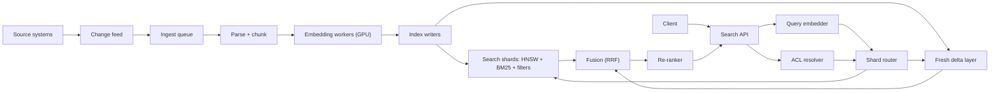

## In one minute
- **Chunking sets the ceiling.** A vector represents one chunk. Too big blurs topics, too small loses context. Store each chunk with a pointer to its document.
- **Embeddings are a versioned dependency.** Vectors from different models are not comparable, so a model change is a full re-index into a new index that is swapped in.
- **ANN is a recall-for-speed trade.** HNSW gives the best latency when the graph fits in RAM. IVF with quantization costs less memory and handles filters more naturally. Tune against measured recall.
- **Hybrid beats pure vector.** Run BM25 and vector retrieval in parallel, fuse the ranks, then re-rank a small candidate set with a costlier model.
- **Filters and freshness break prototypes.** ACLs apply during retrieval, not after. Fresh and deleted documents need a small mutable layer beside the big immutable index.

## Requirements

**Functional**
- Index documents of several types (wiki pages, tickets, PDFs, code docs) and search them with a natural-language query.
- Return ranked passages with the parent document, a snippet and a score, so a caller (a user interface or an LLM prompt builder) can show or quote them.
- Filter by metadata (tenant, source, language, date range) and by per-document access rights. A user must never see a passage they cannot open in the source system.
- Reflect creates, edits and deletes. A deleted or revoked document disappears from results quickly.

**Non-functional**
- Search p99 under 300 ms end to end including query embedding and re-ranking, and p50 under 120 ms.
- 2,000 queries per second at peak, 99.9% availability.
- Freshness: a new or edited document is searchable within 5 minutes. A delete or permission revocation takes effect within 1 minute.
- Recall at 10 of at least 0.95 against exact search for the vector stage, measured offline on a labelled query set.

**Out of scope:** answer generation, model training, web crawling, personalisation.

## Back-of-envelope
All prices and throughputs below are labelled assumptions. Replace them with your vendor's current numbers.

- **Corpus:** 100M documents, about 2,000 words each, about 2,700 tokens. At 300-token chunks with 10% overlap, that is about 10 chunks per document. To keep the arithmetic round, assume 5 chunks per document on average (many documents are short): **500M chunks**.
- **Vector memory:** a 768-dimension float32 vector is 768 × 4 = 3,072 bytes. 500M × 3,072 B ≈ **1.5 TB**. With int8 scalar quantization it is 768 B each, so about **384 GB**. HNSW with M = 16 keeps about 2M = 32 neighbour ids of 4 bytes at the bottom layer, about 130 B per vector with upper layers. That adds about 65 GB.
- **Sharding:** 16 shards of about 31M chunks. Each shard holds 24 GB of int8 vectors plus 4 GB of graph, so a 64 GB node has room for the keyword index and page cache. The float32 originals (96 GB per shard) sit on NVMe for re-scoring.
- **Query load:** 2,000 QPS peak, and every query fans out to all 16 shards, so the vector tier sees 32,000 shard-queries per second. At roughly 1 ms of CPU each (HNSW with a candidate list of 100 over int8 vectors), that is 32 cores busy. With 3 replicas and 50% target utilisation, plan about 200 cores for the vector tier.
- **Ingest:** 1M changed documents a day is 5M chunks, 1.5B tokens, about $30 a day at an assumed $0.02 per million tokens. The 500M-chunk backfill is about $3,000.
- **Re-ranking is the expensive stage.** A cross-encoder scores query and passage together. Re-ranking the top 30 candidates at 300 tokens each is 9,000 tokens per query, against about 20 tokens for the query embedding, a factor of 450. If one GPU scores about 1,500 pairs per second (assumption for a small model), 2,000 QPS × 30 = 60,000 pairs per second needs about 40 GPUs. This is why the candidate count is a budget knob.

## API

```http
POST /v1/search
{
  "tenant": "acme",
  "query": "why does checkout return E1234 after the card step",
  "filters": { "source": ["wiki", "tickets"], "updated_after": "2026-01-01", "lang": "en" },
  "mode": "hybrid",                  // "vector" | "keyword" | "hybrid"
  "k": 10,
  "rerank": true,
  "user": "u_42"                     // used to build the ACL filter server side
}

200 OK
{
  "results": [
    { "chunk_id": "d9f1:0007", "doc_id": "d9f1", "score": 0.83,
      "snippet": "...E1234 is raised when the 3-D Secure step times out...",
      "source": "tickets", "updated_at": "2026-05-02T10:14:00Z" }
  ],
  "index_version": "emb-v3@2026-09-30",
  "stages": { "embed_ms": 14, "retrieve_ms": 38, "rerank_ms": 61 }
}
```

```http
PUT    /v1/documents/{doc_id}     // upsert; body: text or blob ref, metadata, ACL
DELETE /v1/documents/{doc_id}     // tombstone now, physical delete later
POST   /v1/reindex                // admin: build a new index version for a new model
```

The caller never sends the ACL. The service derives the allowed groups from `user` through the identity system, because a client-supplied filter is a client-controlled security boundary. The response reports `index_version` so that an evaluation run can tell which model and snapshot answered.

## Data model

**Chunk record**, the unit that is indexed and returned:

| Field | Purpose |
|---|---|
| `chunk_id` | `doc_id:ordinal`, stable across re-embedding of the same text |
| `doc_id`, `ordinal`, `char_start`, `char_end` | Link back to the source, and neighbour expansion at read time |
| `text` | Stored for snippets, BM25 and re-ranking input |
| `embedding`, `model_id` | The vector and the model version that made it |
| `tenant`, `source`, `lang`, `updated_at` | Filterable metadata, each with an index |
| `acl_groups[]` | Group ids allowed to read, copied from the source system |
| `content_hash` | Hash of chunk text, to skip re-embedding unchanged chunks |
| `deleted` | Tombstone flag until the next merge |

**Partitioning.** Shard by `hash(doc_id)`, so all chunks of a document live together and an edit touches one shard. Tenant is a filter, not the shard key; a very large tenant gets dedicated shards.

**Indexes per shard:** an HNSW graph (or IVF lists) over `embedding`, an inverted index with BM25 statistics over `text`, and secondary indexes on the filter fields. The ACL filter is "chunk groups intersect user groups", a posting-list union.

**Source of truth.** Documents live in object storage; the index is derived and rebuildable.

## High-level design



**Write path.** A change feed (webhooks, polling by `updated_at`, or database change capture) puts a document event on a queue, keyed by `doc_id` so events for one document stay in order. A parser extracts text, a chunker splits it, and each chunk is hashed. Chunks whose hash matches what is already stored keep their vector. The rest go to embedding workers in batches sized for the GPU. Index writers upsert the new chunks and tombstone the old ones for that document in one step per shard. New chunks land in a small in-memory delta index that is searchable immediately and is merged into the main index in the background.

**Read path.** The API embeds the query (with the same model and the same normalisation as the chunks), resolves the user's groups, and fans out to all shards with the filter. Each shard runs vector search and BM25 search under the filter and returns its top candidates. The coordinator fuses the lists with reciprocal rank fusion, passes the top 30 to the re-ranker, and returns the best 10 with snippets. If the re-ranker is slow or down, the fused order is returned, flagged as `rerank: skipped`.

## Deep dives

### Chunking and the embedding pipeline

**Options.** Fixed-size windows by tokens with overlap are simple and predictable. Structure-aware splitting follows headings, paragraphs, code blocks and table boundaries and keeps units whole. Semantic splitting cuts where embedding similarity between adjacent sentences drops. It costs extra embedding calls at ingest and its gain is workload-dependent.

**Choice.** Split on structure first, then pack to a target of about 300 tokens, with 10 to 15% overlap only when a split falls mid-paragraph. Prepend a short breadcrumb (document title and heading path) to the text that is embedded, though not necessarily to the text that is displayed. A chunk that says "the limit is 50" is unfindable alone. Anthropic's write-up on contextual retrieval reports that adding a model-generated situating sentence to each chunk cut top-20 retrieval failures by 35% with embeddings alone and 49% when combined with BM25 ([Anthropic](https://www.anthropic.com/news/contextual-retrieval)). A cheap breadcrumb gets part of that gain without an LLM call per chunk.

**Pipeline details.** Hash chunk text so an edit re-embeds one chunk. Make stages idempotent by `chunk_id` and `content_hash`, and record `model_id` on every chunk. Pick the model with your own labelled queries, not only a leaderboard such as [MTEB](https://arxiv.org/abs/2210.07316).

### ANN index: HNSW or IVF

**HNSW** is a layered proximity graph. A search starts at the top sparse layer, greedily moves toward the query, and drops a layer at a time, ending with a beam search of width `efSearch` on the bottom layer. `M` sets links per node and `efConstruction` sets build-time effort ([Malkov and Yashunin](https://arxiv.org/abs/1603.09320)). pgvector's defaults are `m = 16`, `ef_construction = 64` and a query-time `hnsw.ef_search` of 40 ([pgvector](https://github.com/pgvector/pgvector)). HNSW has excellent recall per millisecond but it wants the graph and vectors in RAM, and inserts are costly.

**IVF** clusters vectors into `nlist` cells by k-means. A query finds the `nprobe` nearest centroids and scans only those cells. With product quantization (IVF-PQ) each vector shrinks to 16 to 64 bytes, at a recall cost ([Faiss](https://arxiv.org/abs/2401.08281)). pgvector suggests starting with `rows / 1000` lists up to 1M rows and `sqrt(rows)` above that, with probes near `sqrt(lists)`.

**Choice.** For a mostly static 31M-chunk shard with RAM available, HNSW over int8 vectors with float32 re-scoring from NVMe. For heavy churn or strong filters, IVF: cell assignment is a cheap filter and an insert touches one list. When RAM cost dominates, disk graphs such as [DiskANN](https://papers.nips.cc/paper/2019/hash/09853c7fb1d3f8ee67a61b6bf4a7f8e6-Abstract.html) fit. Decide by measured recall at fixed latency on your data.

### Hybrid retrieval, filters and re-ranking

**Why hybrid.** Dense embeddings blur rare tokens such as "E1234"; BM25 handles exact terms but not paraphrase. They fail on different queries.

**Fusion.** Raw scores from BM25 and cosine similarity are on different scales and distributions. Reciprocal rank fusion sidesteps that: each list contributes `1 / (k + rank)` per document and the sums decide the order, with `k = 60` from the original paper ([Cormack et al.](https://plg.uwaterloo.ca/~gvcormac/cormacksigir09-rrf.pdf)). 

**Filters.** Approximate indexes often apply a filter after scanning. pgvector's documentation spells out the failure: with a condition matching 10% of rows and the default `ef_search` of 40, only about 4 rows survive on average, and it adds iterative scans to keep going ([pgvector](https://github.com/pgvector/pgvector)). Options: post-filter and over-fetch (simple, unpredictable), pre-filter to an exact scan when the filtered set is small (Elasticsearch documents exact kNN for pre-filtered subsets, [Elastic](https://www.elastic.co/guide/en/elasticsearch/reference/current/knn-search.html)), or an index that is filter-aware, as in Qdrant, where payload indexes are created for the filtered fields ([Qdrant](https://qdrant.tech/documentation/concepts/filtering/)). The planner should pick by estimated selectivity: very selective filters go to brute force over the matching ids, loose filters go to the graph, and in between uses iterative or filter-aware traversal. ACL filters are the dangerous case, because they are applied for every query and often very selective.

**Re-ranking.** A bi-encoder embeds query and passage independently, so it is fast and approximate. A cross-encoder reads them together, which is slower and much more accurate for ordering ([Nogueira and Cho](https://arxiv.org/abs/1901.04085)). Retrieve about 100 candidates cheaply, fuse, re-rank the top 30, and return 10. Anthropic's experiments added a further drop, from 49% to 67% fewer top-20 failures, from re-ranking on top of contextual embeddings and BM25 ([Anthropic](https://www.anthropic.com/news/contextual-retrieval)). Cap the rerank step with a timeout and a fallback.

## Down the stack

### Layer 1: The contract
- **Recall contract.** For the vector stage, recall@10 of at least 0.95 against exact search on a held-out query set, checked in CI and in production through a shadow exact search on 0.1% of traffic. The end-to-end contract is relevance, measured with labelled queries (nDCG@10), which approximate recall does not capture alone.
- **Consistency of versions.** A query is answered entirely from one `index_version`. Mixed-model vectors are never compared.

### Layer 2: The mechanism
- **HNSW search:** a node holds a vector and, per layer, a list of neighbour ids. Entry point is the top-layer node. At each layer, greedy descent: move to the neighbour closest to the query until none is closer. At layer 0, keep a candidate min-heap and a result max-heap of size `efSearch`, expand the closest unvisited candidate, stop when the closest candidate is farther than the worst result. A visited bitmap or hash set prevents revisits.
- **Quantization:** scalar quantization maps each float to an int8 using per-dimension or global min and max. Product quantization splits the vector into sub-vectors and replaces each with the id of its nearest centroid from a small codebook, with distances computed from lookup tables. Both lose accuracy, so keep originals for re-scoring.
- **Delta layer:** a small brute-force index holds recent chunks and tombstones. Queries search both and drop main hits with a newer tombstone.

### Layer 3: The machine
- **Memory-bound traversal.** An HNSW hop reads a neighbour list and then each neighbour's vector from a random address. A DRAM miss costs about 80 to 100 ns. A float32 768-d vector spans 48 cache lines of 64 bytes, an int8 one spans 12, which is the real reason quantization speeds queries up, not only that it saves memory. A search with `efSearch = 100` computes on the order of a thousand to several thousand distances, and with SIMD distance code (AVX2 or AVX-512) each is tens of nanoseconds once in cache.
- **Page cache and `mmap`.** If vectors are memory-mapped from NVMe, a cold page costs a 4 KiB read at about 80 to 100 µs. A query touching 1,000 cold vectors would stall for roughly 100 ms. That is why the hot set must fit in RAM, and why disk-based designs like DiskANN lay out each node's vector and neighbours together so one read fetches both.
- **Fan-out tail.** A query waits for the slowest of 16 shards. If one shard has a p99 of 80 ms, the chance that at least one of 16 shards is slow on a given query is about 1 − 0.99^16 ≈ 15%. Hedged requests to a replica after the p95 cut that tail.

### Why it's built this way
1. Embeddings turn meaning into geometry, but exact nearest neighbour in 768 dimensions is a scan of every vector, 3 KB each. At 500M chunks that is far too slow, so we accept approximate answers and measure how approximate.
2. Graph search is fast only when it follows short random reads, and DRAM is about 1000× faster than NVMe for them, so the design shrinks vectors (quantization) until the working set fits in memory.
3. Dense vectors lose exact tokens and keyword search loses paraphrase, so we run both and fuse by rank, which avoids comparing incompatible scores.
4. Cheap retrieval casts a wide net and expensive models read few candidates, because the cost of a cross-encoder is paid per pair per query.
5. Graphs are expensive to mutate, so freshness comes from a small mutable layer beside a large immutable one, merged in the background, the same idea as a log-structured merge tree.

## Failure modes
- **10x load.** Fan-out multiplies every query by the shard count, so the vector tier saturates first. Shed re-ranking first, then lower `efSearch` and candidate counts, then reject low-priority callers.
- **Embedding API outage or slowdown.** Query embedding is on the critical path. Cache query vectors, run a second provider or a self-hosted fallback of the same model version, and as a last resort answer with keyword search only (`mode: keyword`) and flag the response.
- **Model upgrade.** Re-embedding 500M chunks takes a day or more and costs thousands of dollars. Build a second index version in parallel, replay changes into both during the build, compare offline metrics and shadow traffic, then switch the alias and keep the old index for a week for rollback. Never write new-model vectors into the old index.
- **ACL drift.** A revoked permission that is not propagated is a data leak. Treat the ACL change feed as higher priority than content, enforce at query time from an authoritative group service, and run a periodic audit that samples results and checks them against the source system.

## In the wild
- **Airbnb, 2025: choosing IVF over HNSW for embedding-based retrieval.** Airbnb found that the volume of real-time price and availability updates made an HNSW index's memory footprint grow too large, and that HNSW combined with the geographic filters most searches use gave poor latency. It chose IVF, whose cluster assignments act as an ordinary search filter, accepting slightly lower recall ([Airbnb Tech Blog](https://airbnb.tech/ai-ml/embedding-based-retrieval-for-airbnb-search/)).
- **Instacart, 2025: from Elasticsearch plus FAISS to Postgres with pgvector.** Semantic search ran on FAISS with an HNSW index per retailer, hundreds in all. FAISS could not filter on attributes at retrieval time, so the system over-fetched, and syncing two systems caused inconsistencies. Moving vectors next to the data in Postgres with pgvector cut zero-result searches by 6% in an A/B test ([Instacart](https://company.instacart.com/tech-innovation/how-instacart-built-a-modern-search-infrastructure-on-postgres)).
- **Spotify, 2023: Voyager replaces Annoy.** Spotify's Annoy library had fallen to the middle of ANN benchmarks. Voyager, built on hnswlib, reports over 10x the speed of Annoy at the same recall and up to 4x less memory when using 8-bit floats. It shipped as a new package because changing hnswlib's format would have broken a library with over 700,000 monthly downloads ([Spotify Engineering](https://engineering.atspotify.com/2023/10/introducing-voyager-spotifys-new-nearest-neighbor-search-library)).

## Trade-offs

| Option | Strengths | Weaknesses | Choose when |
|---|---|---|---|
| HNSW (RAM) | Best recall per ms, simple tuning (`efSearch`) | Memory heavy, costly inserts, weak with selective filters | Mostly static corpus, RAM available, loose filters |
| IVF-PQ | Small memory, cheap inserts, cell-level filtering | Lower recall, needs training and re-training | Billions of vectors, high churn, strict cost limits |
| Hybrid with RRF | Robust, no score tuning | Two indexes to run and keep in sync | Mixed query types (default choice) |
| Cross-encoder re-rank | Large relevance gain on the top results | GPU cost per query, added latency | The top 10 positions matter, budget allows |
| Vectors in the main database | One system, transactional with data and ACLs | Lower ceiling on scale and recall tuning | Up to tens of millions of vectors, filters dominate |

## Leadership lens
- **Rollout.** Ship keyword search first if it does not exist, then add vectors as a second retriever behind a flag, then fusion, then re-ranking. Each step needs a before and after number on the labelled query set. Start with one corpus and a few tenants.
- **What to build first.** The evaluation harness: 200 to 500 real queries with graded relevant passages, an nDCG and recall script, and a shadow exact-search check. Without it every later choice is opinion.
- **Cost drivers.** Re-ranker GPUs, then RAM for the vector tier, then re-embedding on model changes.
- **Ask in design review.** What happens to the index when we change the embedding model? Where is the ACL enforced and how stale can it be? What is recall at the filter selectivity our biggest tenant uses? What does the user see when the re-ranker is down?

## Check yourself
1. A tenant filter matches 2% of chunks. Search quality suddenly drops after you move from IVF to HNSW with post-filtering. Why, and what do you change?
   **Answer:** With post-filtering, the graph returns its top `efSearch` candidates (say 100) and only about 2 of them pass the filter, so results are few and poor. Use a filter-aware index or pre-filter to an exact scan when the matching set is small, or raise the scan limit with iterative scanning.
2. Why can the vector scores and BM25 scores not simply be added, and what does RRF do instead?
   **Answer:** They have different scales and distributions, so one would dominate and the weights drift as data changes. RRF uses only the rank in each list, adding `1/(k+rank)`, so documents high in both lists rise without any score calibration.
3. Compute the vector memory for 200M chunks of 1,024 dimensions as float32 and as int8, ignoring the graph.
   **Answer:** Float32 is 1,024 × 4 = 4,096 B, so 200M × 4,096 B ≈ 820 GB. Int8 is 1,024 B, so about 205 GB, a 4x saving before graph overhead.
4. You switch embedding models and quality improves in testing, yet some production queries return nonsense. What likely happened?
   **Answer:** Query vectors from the new model were compared against chunk vectors from the old one, or the index mixes both. Index versions must be built and switched as a unit, with the model id recorded on every chunk and checked at query time.

## Practice
**Task:** Implement the retrieval core of a hybrid search shard. All scores are integers so results are identical in every language.
- `chunk(words, size, overlap)` returns windows of `size` words that start every `size - overlap` words. The last window is the first one that reaches the end of the input. It returns an empty list for empty input, `size <= 0`, `overlap < 0` or `overlap >= size`.
- `rrf(rankings, k, limit)` fuses ranked id lists. Each id scores `1000000 // (k + rank)` per list it appears in (rank starts at 1). Sort by score descending, then id ascending, and return the first `limit` ids.
- `HybridIndex(k)` has `add(id, vec, text, tag)`, `remove(id)` (a tombstone) and `search(qvec, query, tag, limit)`. Candidates are the live entries whose tag equals `tag` (an empty tag means no filter). The vector ranking sorts candidates by integer dot product descending, then id. The keyword ranking counts how many distinct lower-cased query words appear among the lower-cased words of the text, keeps only counts above zero, and sorts by count descending, then id. Fuse the two rankings with `rrf`. Re-adding an id replaces the old entry.

```python starter
def chunk(words, size, overlap):
    # TODO
    raise NotImplementedError


def rrf(rankings, k, limit):
    # TODO
    raise NotImplementedError


class HybridIndex:
    def __init__(self, k=60):
        self.k = k

    def add(self, id, vec, text, tag):
        # TODO
        raise NotImplementedError

    def remove(self, id):
        # TODO
        raise NotImplementedError

    def search(self, qvec, query, tag, limit):
        # TODO
        raise NotImplementedError
```

```python tests
def words(n):
    return ["w%d" % i for i in range(n)]


def test_chunk_overlap_windows():
    got = chunk(words(10), 4, 1)
    assert got == [words(10)[0:4], words(10)[3:7], words(10)[6:10]], got


def test_chunk_short_and_invalid():
    assert chunk(words(3), 5, 1) == [words(3)]
    assert chunk([], 4, 1) == []
    assert chunk(words(10), 4, 4) == []
    assert chunk(words(10), 0, 0) == []


def test_rrf_rewards_agreement():
    assert rrf([["a", "b"], ["c", "b"]], 60, 10) == ["b", "a", "c"]


def test_rrf_limit_and_ties():
    assert rrf([["a", "b", "c"], ["b", "a", "d"]], 60, 3) == ["a", "b", "c"]


def make():
    ix = HybridIndex(60)
    ix.add("d1", [10, 0], "billing overview", "wiki")
    ix.add("d2", [0, 10], "error E1234 timeout", "tickets")
    ix.add("d3", [5, 5], "general notes", "wiki")
    ix.add("d4", [6, 4], "pricing page", "wiki")
    return ix


def test_keyword_rescues_exact_token():
    assert make().search([10, 0], "e1234", "", 4) == ["d2", "d1", "d4", "d3"]


def test_filter_applies_before_ranking():
    assert make().search([0, 10], "e1234", "wiki", 10) == ["d3", "d4", "d1"]


def test_remove_and_replace():
    ix = make()
    ix.remove("d2")
    assert ix.search([10, 0], "e1234", "", 10) == ["d1", "d4", "d3"]
    ix.add("d1", [0, 1], "billing overview", "wiki")
    assert ix.search([10, 0], "", "", 1) == ["d4"]
```

```python solution
def chunk(words, size, overlap):
    if not words or size <= 0 or overlap < 0 or overlap >= size:
        return []
    step = size - overlap
    out = []
    start = 0
    while True:
        out.append(words[start:start + size])
        if start + size >= len(words):
            break
        start += step
    return out


def rrf(rankings, k, limit):
    scores = {}
    for ranking in rankings:
        for i, id in enumerate(ranking):
            scores[id] = scores.get(id, 0) + 1000000 // (k + i + 1)
    ordered = sorted(scores, key=lambda x: (-scores[x], x))
    return ordered[:limit]


class HybridIndex:
    def __init__(self, k=60):
        self.k = k
        self.items = {}

    def add(self, id, vec, text, tag):
        self.items[id] = (list(vec), set(text.lower().split()), tag)

    def remove(self, id):
        self.items.pop(id, None)

    def search(self, qvec, query, tag, limit):
        cands = [i for i, v in self.items.items() if tag == "" or v[2] == tag]
        dots = {}
        for i in cands:
            dots[i] = sum(a * b for a, b in zip(qvec, self.items[i][0]))
        vec_rank = sorted(cands, key=lambda i: (-dots[i], i))
        qw = set(query.lower().split())
        hits = {}
        for i in cands:
            n = len(qw & self.items[i][1])
            if n > 0:
                hits[i] = n
        kw_rank = sorted(hits, key=lambda i: (-hits[i], i))
        return rrf([vec_rank, kw_rank], self.k, limit)
```

The same problem in TypeScript and Go follows.

```typescript starter
export function chunk(words: string[], size: number, overlap: number): string[][] {
  throw new Error("TODO");
}

export function rrf(rankings: string[][], k: number, limit: number): string[] {
  throw new Error("TODO");
}

export class HybridIndex {
  constructor(private k: number = 60) {}
  add(id: string, vec: number[], text: string, tag: string): void {
    throw new Error("TODO");
  }
  remove(id: string): void {
    throw new Error("TODO");
  }
  search(qvec: number[], query: string, tag: string, limit: number): string[] {
    throw new Error("TODO");
  }
}
```

```typescript tests
function words(n: number): string[] {
  const out: string[] = [];
  for (let i = 0; i < n; i++) out.push("w" + i);
  return out;
}

function make(): HybridIndex {
  const ix = new HybridIndex(60);
  ix.add("d1", [10, 0], "billing overview", "wiki");
  ix.add("d2", [0, 10], "error E1234 timeout", "tickets");
  ix.add("d3", [5, 5], "general notes", "wiki");
  ix.add("d4", [6, 4], "pricing page", "wiki");
  return ix;
}

test("chunk overlap windows", () => {
  const w = words(10);
  assertEqual(chunk(w, 4, 1), [w.slice(0, 4), w.slice(3, 7), w.slice(6, 10)]);
});

test("chunk short and invalid", () => {
  assertEqual(chunk(words(3), 5, 1), [words(3)]);
  assertEqual(chunk([], 4, 1), []);
  assertEqual(chunk(words(10), 4, 4), []);
  assertEqual(chunk(words(10), 0, 0), []);
});

test("rrf rewards agreement", () => {
  assertEqual(rrf([["a", "b"], ["c", "b"]], 60, 10), ["b", "a", "c"]);
});

test("rrf limit and ties", () => {
  assertEqual(rrf([["a", "b", "c"], ["b", "a", "d"]], 60, 3), ["a", "b", "c"]);
});

test("keyword rescues exact token", () => {
  assertEqual(make().search([10, 0], "e1234", "", 4), ["d2", "d1", "d4", "d3"]);
});

test("filter applies before ranking", () => {
  assertEqual(make().search([0, 10], "e1234", "wiki", 10), ["d3", "d4", "d1"]);
});

test("remove and replace", () => {
  const ix = make();
  ix.remove("d2");
  assertEqual(ix.search([10, 0], "e1234", "", 10), ["d1", "d4", "d3"]);
  ix.add("d1", [0, 1], "billing overview", "wiki");
  assertEqual(ix.search([10, 0], "", "", 1), ["d4"]);
});
```

```typescript solution
export function chunk(words: string[], size: number, overlap: number): string[][] {
  if (words.length === 0 || size <= 0 || overlap < 0 || overlap >= size) return [];
  const step = size - overlap;
  const out: string[][] = [];
  let start = 0;
  for (;;) {
    out.push(words.slice(start, start + size));
    if (start + size >= words.length) break;
    start += step;
  }
  return out;
}

function byScore(scores: Map<string, number>): (a: string, b: string) => number {
  return (a, b) => {
    const d = (scores.get(b) as number) - (scores.get(a) as number);
    if (d !== 0) return d;
    return a < b ? -1 : a > b ? 1 : 0;
  };
}

export function rrf(rankings: string[][], k: number, limit: number): string[] {
  const scores = new Map<string, number>();
  for (const ranking of rankings) {
    ranking.forEach((id, i) => {
      scores.set(id, (scores.get(id) || 0) + Math.floor(1000000 / (k + i + 1)));
    });
  }
  return Array.from(scores.keys()).sort(byScore(scores)).slice(0, limit);
}

interface Item {
  vec: number[];
  words: Set<string>;
  tag: string;
}

export class HybridIndex {
  private items = new Map<string, Item>();
  constructor(private k: number = 60) {}

  add(id: string, vec: number[], text: string, tag: string): void {
    const ws = text.toLowerCase().split(/\s+/).filter((w) => w !== "");
    this.items.set(id, { vec: vec.slice(), words: new Set(ws), tag });
  }

  remove(id: string): void {
    this.items.delete(id);
  }

  search(qvec: number[], query: string, tag: string, limit: number): string[] {
    const cands: string[] = [];
    this.items.forEach((v, id) => {
      if (tag === "" || v.tag === tag) cands.push(id);
    });
    const dots = new Map<string, number>();
    for (const id of cands) {
      const v = (this.items.get(id) as Item).vec;
      let s = 0;
      for (let i = 0; i < qvec.length; i++) s += qvec[i] * v[i];
      dots.set(id, s);
    }
    const vecRank = cands.slice().sort(byScore(dots));
    const qw = new Set(query.toLowerCase().split(/\s+/).filter((w) => w !== ""));
    const hits = new Map<string, number>();
    for (const id of cands) {
      const ws = (this.items.get(id) as Item).words;
      let n = 0;
      qw.forEach((w) => {
        if (ws.has(w)) n++;
      });
      if (n > 0) hits.set(id, n);
    }
    const kwRank = Array.from(hits.keys()).sort(byScore(hits));
    return rrf([vecRank, kwRank], this.k, limit);
  }
}
```

```go starter
package practice

func Chunk(words []string, size, overlap int) [][]string {
	panic("TODO")
}

func RRF(rankings [][]string, k, limit int) []string {
	panic("TODO")
}

type HybridIndex struct {
	K int
}

func NewHybridIndex(k int) *HybridIndex {
	return &HybridIndex{K: k}
}

func (h *HybridIndex) Add(id string, vec []int, text string, tag string) {
	panic("TODO")
}

func (h *HybridIndex) Remove(id string) {
	panic("TODO")
}

func (h *HybridIndex) Search(qvec []int, query string, tag string, limit int) []string {
	panic("TODO")
}
```

```go tests
package practice

import (
	"reflect"
	"testing"
)

func words(n int) []string {
	out := make([]string, n)
	for i := range out {
		out[i] = "w" + string(rune('a'+i))
	}
	return out
}

func eq(t *testing.T, got, want interface{}) {
	t.Helper()
	if !reflect.DeepEqual(got, want) {
		t.Fatalf("got %v want %v", got, want)
	}
}

func make4() *HybridIndex {
	ix := NewHybridIndex(60)
	ix.Add("d1", []int{10, 0}, "billing overview", "wiki")
	ix.Add("d2", []int{0, 10}, "error E1234 timeout", "tickets")
	ix.Add("d3", []int{5, 5}, "general notes", "wiki")
	ix.Add("d4", []int{6, 4}, "pricing page", "wiki")
	return ix
}

func TestChunkOverlapWindows(t *testing.T) {
	w := words(10)
	eq(t, Chunk(w, 4, 1), [][]string{w[0:4], w[3:7], w[6:10]})
}

func TestChunkShortAndInvalid(t *testing.T) {
	eq(t, Chunk(words(3), 5, 1), [][]string{words(3)})
	eq(t, len(Chunk(nil, 4, 1)), 0)
	eq(t, len(Chunk(words(10), 4, 4)), 0)
	eq(t, len(Chunk(words(10), 0, 0)), 0)
}

func TestRRFRewardsAgreement(t *testing.T) {
	eq(t, RRF([][]string{{"a", "b"}, {"c", "b"}}, 60, 10), []string{"b", "a", "c"})
}

func TestRRFLimitAndTies(t *testing.T) {
	eq(t, RRF([][]string{{"a", "b", "c"}, {"b", "a", "d"}}, 60, 3), []string{"a", "b", "c"})
}

func TestKeywordRescuesExactToken(t *testing.T) {
	eq(t, make4().Search([]int{10, 0}, "e1234", "", 4), []string{"d2", "d1", "d4", "d3"})
}

func TestFilterAppliesBeforeRanking(t *testing.T) {
	eq(t, make4().Search([]int{0, 10}, "e1234", "wiki", 10), []string{"d3", "d4", "d1"})
}

func TestRemoveAndReplace(t *testing.T) {
	ix := make4()
	ix.Remove("d2")
	eq(t, ix.Search([]int{10, 0}, "e1234", "", 10), []string{"d1", "d4", "d3"})
	ix.Add("d1", []int{0, 1}, "billing overview", "wiki")
	eq(t, ix.Search([]int{10, 0}, "", "", 1), []string{"d4"})
}
```

```go solution
package practice

import (
	"sort"
	"strings"
)

func Chunk(words []string, size, overlap int) [][]string {
	out := [][]string{}
	if len(words) == 0 || size <= 0 || overlap < 0 || overlap >= size {
		return out
	}
	step := size - overlap
	for start := 0; ; start += step {
		end := start + size
		if end > len(words) {
			end = len(words)
		}
		out = append(out, words[start:end])
		if start+size >= len(words) {
			break
		}
	}
	return out
}

func sortByScore(ids []string, scores map[string]int) {
	sort.Slice(ids, func(a, b int) bool {
		if scores[ids[a]] != scores[ids[b]] {
			return scores[ids[a]] > scores[ids[b]]
		}
		return ids[a] < ids[b]
	})
}

func RRF(rankings [][]string, k, limit int) []string {
	scores := map[string]int{}
	for _, r := range rankings {
		for i, id := range r {
			scores[id] += 1000000 / (k + i + 1)
		}
	}
	ids := make([]string, 0, len(scores))
	for id := range scores {
		ids = append(ids, id)
	}
	sortByScore(ids, scores)
	if len(ids) > limit {
		ids = ids[:limit]
	}
	return ids
}

type item struct {
	vec   []int
	words map[string]bool
	tag   string
}

type HybridIndex struct {
	K     int
	items map[string]item
}

func NewHybridIndex(k int) *HybridIndex {
	return &HybridIndex{K: k, items: map[string]item{}}
}

func (h *HybridIndex) Add(id string, vec []int, text string, tag string) {
	ws := map[string]bool{}
	for _, w := range strings.Fields(strings.ToLower(text)) {
		ws[w] = true
	}
	h.items[id] = item{vec: append([]int(nil), vec...), words: ws, tag: tag}
}

func (h *HybridIndex) Remove(id string) {
	delete(h.items, id)
}

func (h *HybridIndex) Search(qvec []int, query string, tag string, limit int) []string {
	cands := []string{}
	for id, it := range h.items {
		if tag == "" || it.tag == tag {
			cands = append(cands, id)
		}
	}
	dots := map[string]int{}
	for _, id := range cands {
		s := 0
		for i, q := range qvec {
			s += q * h.items[id].vec[i]
		}
		dots[id] = s
	}
	vecRank := append([]string(nil), cands...)
	sortByScore(vecRank, dots)
	qw := map[string]bool{}
	for _, w := range strings.Fields(strings.ToLower(query)) {
		qw[w] = true
	}
	hits := map[string]int{}
	kwRank := []string{}
	for _, id := range cands {
		n := 0
		for w := range qw {
			if h.items[id].words[w] {
				n++
			}
		}
		if n > 0 {
			hits[id] = n
			kwRank = append(kwRank, id)
		}
	}
	sortByScore(kwRank, hits)
	return RRF([][]string{vecRank, kwRank}, h.K, limit)
}
```

## Mock interview
**Prompt:** Design a semantic search service for a company with 100M internal documents (wiki pages, tickets, PDFs). Users and an LLM assistant send natural-language queries at 2,000 QPS at peak, results must respect each user's permissions, and new documents must be searchable within five minutes. Walk me through ingestion, indexing, query and cost.

- Follow-up: Your recall looks fine offline, but a user searches for an error code and the right ticket is not in the top 10. Why, and what do you change?
- Follow-up: The embedding provider deprecates your model in 90 days. How do you migrate 500M chunks without downtime or a bad cutover?
- Follow-up: A tenant filter matches 1% of the corpus and latency doubles while result counts drop. Explain what is happening and how you would fix it.
- Follow-up: Finance says search costs too much per query. Where does the money go and what do you cut first?

**A strong answer covers:**
- Chunking by structure with a target size, overlap and context breadcrumbs, with content hashes so edits re-embed only changed chunks.
- Embedding as a versioned dependency: `model_id` on every chunk, a parallel index build and an alias swap, never mixed vectors.
- HNSW versus IVF chosen by memory arithmetic, quantization with re-scoring, and recall measured against exact search.
- Hybrid retrieval with BM25 and vectors fused by rank (RRF), and why exact tokens defeat pure embeddings.
- Filters and ACLs applied during retrieval, with a planner choosing brute force, filter-aware traversal or iterative scan by selectivity, and ACL enforced at query time.
- A fresh delta layer with tombstones for the five-minute target, and a cost breakdown naming re-ranking and RAM as the main drivers.

## Sources and further study
**Primary**
- [Malkov and Yashunin, HNSW (arXiv 1603.09320)](https://arxiv.org/abs/1603.09320): the layered graph, insertion heuristic and the `M` and `efConstruction` parameters.
- [Cormack, Clarke and Buettcher, Reciprocal Rank Fusion (SIGIR 2009)](https://plg.uwaterloo.ca/~gvcormac/cormacksigir09-rrf.pdf): the fusion formula and the `k = 60` constant.
- [Douze et al., The Faiss library (arXiv 2401.08281)](https://arxiv.org/abs/2401.08281): IVF, product quantization and how the index types trade memory for recall.
- [Nogueira and Cho, Passage Re-ranking with BERT](https://arxiv.org/abs/1901.04085): the cross-encoder re-ranking approach over a first-stage candidate set.
- [Subramanya et al., DiskANN (NeurIPS 2019)](https://papers.nips.cc/paper/2019/hash/09853c7fb1d3f8ee67a61b6bf4a7f8e6-Abstract.html): billion-point graph search from SSD with a small RAM footprint.

**Systems docs**
- [pgvector README](https://github.com/pgvector/pgvector): HNSW and IVFFlat parameters, `halfvec`, and the documented filtering behaviour with iterative scans.
- [Elasticsearch: kNN search](https://www.elastic.co/guide/en/elasticsearch/reference/current/knn-search.html): `num_candidates`, filtered approximate search and exact kNN for small sets.
- [Qdrant: Filtering](https://qdrant.tech/documentation/concepts/filtering/): payload indexes and filter-aware vector search.
- [Faiss wiki: guidelines to choose an index](https://github.com/facebookresearch/faiss/wiki/Faiss-indexes): the index families and their memory and speed profiles.

**Books**
- *Introduction to Information Retrieval*, Manning, Raghavan and Schütze, chapters 1 (inverted index), 6 (scoring and term weighting) and 8 (evaluation): the keyword half of hybrid search and how to measure it.
- *Designing Data-Intensive Applications*, Kleppmann, chapter 3 "Storage and Retrieval": log-structured segments and merging, the pattern behind the delta layer.

**Other curricula**
- [Stanford IR book online](https://nlp.stanford.edu/IR-book/): the free text of the Manning, Raghavan and Schütze book, which frames search as indexing plus ranking plus evaluation.

## Watch
- [Hierarchical Navigable Small World Graphs (HNSW) (Maham Mukaram)](https://www.youtube.com/watch?v=_pewMGesffk): a walk through the layered graph and greedy search.
- [Vector Database Search, HNSW Explained (DataMListic)](https://www.youtube.com/watch?v=77QH0Y2PYKg): how HNSW speeds up vector search and what the parameters control.

## Free resources
- [Contextual Retrieval (Anthropic)](https://www.anthropic.com/news/contextual-retrieval): measured gains from chunk context, BM25 and re-ranking.
- [MTEB: Massive Text Embedding Benchmark](https://arxiv.org/abs/2210.07316): how embedding models are compared, and why you still need your own test set.
- [Embedding-based retrieval for Airbnb search](https://airbnb.tech/ai-ml/embedding-based-retrieval-for-airbnb-search/): an index choice driven by filters and churn.
- [How Instacart built search on Postgres](https://company.instacart.com/tech-innovation/how-instacart-built-a-modern-search-infrastructure-on-postgres): hybrid and semantic search in one database.
- [Introducing Voyager (Spotify)](https://engineering.atspotify.com/2023/10/introducing-voyager-spotifys-new-nearest-neighbor-search-library): an HNSW-based library and its quantization results.
