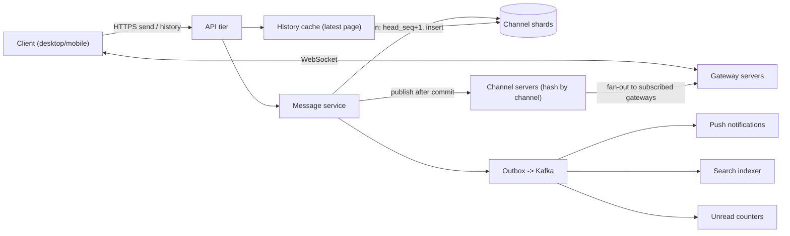

## In one minute
- **The channel is the unit of everything.** Order, storage partitioning, fan-out and permissions all key off `channel_id`. Get that choice right and most of the design follows from it.
- **Give every channel its own sequence numbers.** Each message gets a dense, gap-free `seq` inside its channel, assigned in the same transaction that stores it. Clients then sync by cursor and can see when they missed something.
- **Push is best-effort. The log is the truth.** WebSocket delivery makes the product feel live, but a client that drops a frame repairs itself by fetching `seq > cursor` from the history API. Never design for "push must not lose anything".
- **Fan out to gateways, not to users.** A message in a 50,000-member channel goes to the few hundred gateway hosts that hold those members' sockets. It does not become 50,000 writes.
- **Reconnects decide your peak load, not message sends.** A deploy or a network blip that reconnects millions of clients at once is the load you plan capacity for.

## Requirements

**Functional**
- Send messages to channels and DMs. Messages can be edited, deleted and threaded.
- Receive new messages in real time on every connected device.
- Open a channel and scroll its history. Show unread counts and mentions per channel.
- Start or reconnect a client and catch up on what was missed, without downloading everything.
- Push notifications go to users who are offline or idle.

**Non-functional**
- Send-to-receive latency: p50 under 200 ms and p99 under 1 s within a region.
- Ordering: everyone sees one channel in the same order. There is no order across channels.
- Durability: once the sender sees the message acknowledged, it is never lost.
- Availability: 99.99% for send and read. Losing presence or typing indicators is acceptable.
- Workspaces range from 5 members to more than 100,000, and some channels have tens of thousands of members.

**Out of scope:** huddles, file storage internals, search ranking, enterprise key management and Slack Connect federation.

## Back-of-envelope
These are assumed round numbers, not Slack's published figures.

- **DAU:** 20M. Each user sends 40 messages a day, so 20M × 40 = 800M messages a day.
- **Write QPS:** 800M / 86,400 ≈ 9,300/s on average. Work hours bunch traffic into about a third of the day, so peak is about 3× that, roughly 30k/s.
- **Deliveries:** if each message reaches 30 online recipients on average, that is 9,300 × 30 ≈ 280k deliveries/s on average and about 1M/s at peak.
- **Reads:** each user switches channels or scrolls about 100 times a day, which is 2B history reads a day ≈ 23k/s on average and about 70k/s at peak. Most of these hit a cache of the newest page.
- **Connections:** if 60% of DAU are connected at peak, that is 12M WebSockets. At about 50k sockets per gateway host, you need around 240 hosts plus headroom, so call it 400.
- **Storage:** a message plus metadata and indexes is about 1 KB. 800M × 1 KB = 800 GB a day, and 800 GB × 365 × 5 ≈ 1.5 PB over five years. With 3 replicas that is about 4.4 PB. Files are stored separately in object storage.
- **Bandwidth:** 1M deliveries/s × about 1 KB ≈ 1 GB/s, or 8 Gbps leaving the gateways at peak. That is about 20 Mbps per gateway, so memory per socket is the real limit.

## API

```http
POST /v1/channels/{channel_id}/messages
  { "client_msg_id": "uuid-v4", "text": "ship it", "thread_root_seq": null }
  -> 200 { "channel_id": "C42", "seq": 18231, "message_id": "M9f..", "ts": 1760500000123 }

GET /v1/channels/{channel_id}/messages?after_seq=18200&limit=50
  -> 200 { "messages": [ { "seq": 18201, "author": "U7", "text": "...", "ts": ... } ], "has_more": false }

POST /v1/sync
  { "cursors": { "C42": 18200, "C77": 990 } }
  -> 200 { "channels": { "C42": { "head_seq": 18231, "unread": 31, "mentions": 1 },
                          "C77": { "head_seq": 990,   "unread": 0,  "mentions": 0 } } }

POST /v1/channels/{channel_id}/read   { "seq": 18231 }  -> 204

WS /v1/connect  (after the hello frame, server pushes events)
  <- { "type": "message", "channel_id": "C42", "seq": 18231, "message": { ... } }
  <- { "type": "message_changed", "channel_id": "C42", "seq": 18100, "edit_version": 2 }
  -> { "type": "ping", "id": 17 }
```

`client_msg_id` makes a send idempotent. If a phone retries after a timeout, the server returns the original `seq` and does not create a duplicate.

## Data model

**messages** is partitioned by `channel_id`, with primary key `(channel_id, seq)`.
Columns: `message_id` (globally unique, time-sortable), `client_msg_id`, `author_id`, `ts`, `text`, `thread_root_seq`, `edit_version`, `deleted`.
It has a unique secondary index on `(channel_id, client_msg_id)` so retried sends are deduplicated.
This is the right partition key because history reads are always "one channel, a range of seq". A clustered primary key turns them into one sequential range scan on one shard.

**channels** is partitioned by `channel_id` and lives on the same shard as its messages.
Columns: `workspace_id`, `name`, `kind` (public, private, dm), `head_seq`, `member_count`.
`head_seq` is the per-channel counter. Keeping it on the same shard as the message rows lets one local transaction both increment it and insert the message.

**memberships** holds `(user_id, channel_id) -> last_read_seq, notify_prefs`. It is stored twice:
- partitioned by `user_id`, for the sidebar and sync
- partitioned by `channel_id`, for fan-out and permission checks

Both copies are written through an outbox, so they agree eventually.

**Sharding:** relational shards with Vitess-style routing on `channel_id` give range scans and transactions for the counter (Slack moved to Vitess between 2017 and 2020, partly so it could shard message data by channel instead of keeping a whole workspace on one shard, and by late 2020 Vitess served 99% of its MySQL traffic at 2.3M QPS peak, [Slack](https://slack.engineering/scaling-datastores-at-slack-with-vitess/)). A wide-column store such as Cassandra or ScyllaDB also works with partition key `(channel_id, time_bucket)`, but then `seq` must come from a separate counter service.

## High-level design



**Write path.**
1. The client sends `POST /messages` with a `client_msg_id`.
2. The API tier checks membership against a cached membership set.
3. The message service runs one transaction on the channel's shard. It increments `channels.head_seq`, inserts the row with that `seq`, and writes an outbox row.
4. On commit it returns `seq` to the sender. The sender's client changes the message from "pending" to "sent" and moves it to its final position.
5. The message service publishes the event to the channel server that owns `channel_id`, chosen by consistent hashing.
6. The channel server looks up which gateways have members of this channel connected and sends one frame to each.
7. Each gateway writes the frame to the matching local sockets.
8. Separately, the outbox relay feeds Kafka. Kafka drives push notifications to offline users, search indexing, link unfurls and unread counters.

**Read path.**
- **Opening a channel** calls `GET /messages?after_seq=...` or fetches the newest page. The newest page is served from a cache keyed by `channel_id` that is invalidated on each write, so a hot channel costs one DB read per write rather than one per viewer.
- **Startup or reconnect.** The client calls `/sync` with its cursors. It gets back head sequences and unread counts, which are a few bytes per channel. It loads message bodies only for the channel on screen.

## Deep dives

### 1. Ordering: who assigns the sequence number
Three options were considered.

- **Server timestamps or Snowflake IDs.** These need no coordination, but two API hosts with 5 ms of clock skew can produce IDs that do not match commit order. Clients also cannot tell "no message there" from "a message I missed", because the IDs are sparse. Slack's own public API works this way: a message is identified by its `ts`, which is guaranteed unique only within its channel ([Slack docs](https://docs.slack.dev/messaging/retrieving-messages)), so gap detection needs something more than the ID.
- **A single in-memory sequencer per channel** on the channel server. This is fast, but the sequencer becomes stateful. It needs leases and fencing when it fails over, or two owners will issue the same `seq`.
- **A counter row in the channel's shard, incremented in the same transaction as the insert.** This is what I chose. The row lock on `channels` orders concurrent writers, and commit order matches seq order. The cost is that one row serialises every write to that channel. A row lock with group commit handles roughly 1k to 5k updates per second, and even a very busy channel sees tens. This gives dense, gap-free numbering, which is exactly what client-side gap detection needs.

### 2. Real-time fan-out
The naive design keeps a `user -> socket` map and loops over channel members. For a 50k-member channel that means 50k lookups, most of them for offline users.

Instead, the routing keys on channels. When a client connects, its gateway subscribes to every channel the user belongs to on the owning channel servers. A channel server then holds `channel_id -> set(gateway_id)`. One message becomes one frame per gateway, at most a few hundred. Each gateway keeps its own local `channel_id -> sockets` index. This is how Slack describes its own system: channels map to in-memory channel servers by consistent hashing, about 16 million channels per host at peak, gateways in several regions subscribe to them asynchronously after the client connects, and a message crosses the world in about 500 ms ([Slack](https://slack.engineering/real-time-messaging/)).

The follow-on problem is subscription churn: a user in 300 channels creates 300 subscriptions per connect, so gateways batch them per channel server and stay subscribed while any local socket needs the channel. For announcement channels, also drop typing indicators and coalesce reactions into one update every 1 to 2 seconds.

### 3. Client sync and gap detection
For each channel, the client stores `cursor`, the highest seq it holds contiguously. When a push event arrives:
- If `seq == cursor + 1`, the client applies it and moves the cursor forward. It also drains any buffered events that are now contiguous.
- If `seq > cursor + 1`, the client buffers the event, records the missing range, and asks for `after_seq=cursor`.
- If `seq <= cursor`, the event is a duplicate and the client drops it.

On reconnect the client sends all of its cursors to `/sync`. A user with 300 channels sends about 300 × 16 bytes ≈ 5 KB.

The server answers with heads only. A client whose cursor equals the head has nothing to fetch. One that is behind shows an unread badge and fetches when the user opens the channel. If it is more than a page behind, it jumps to the newest page and fills older messages as the user scrolls, so it never replays thousands of messages.

Edits bump `edit_version` on the original row instead of taking a new `seq`, because they do not change the order of messages.

## Down the stack

### Layer 1: The contract
- **Send.** Once the sender has the `seq`, the message is committed on the shard primary and on at least one replica (semi-synchronous replication). Every reader of the channel will see it at that position. A retry with the same `client_msg_id` returns the same `seq`.
- **Push.** Delivery is at-most-once per socket, with p99 under 1 s while connected. Nothing more is promised.
- **History.** A fetch of `after_seq=k` returns a contiguous run starting at `k+1`. A client that combines push with fetch ends up with every message in seq order and no gaps. You can test this by killing sockets at random and comparing what each client holds against the log.

### Layer 2: The mechanism
In MySQL or InnoDB the send runs:
```sql
UPDATE channels SET head_seq = head_seq + 1 WHERE id = ?
SELECT head_seq
INSERT INTO messages ...
INSERT INTO outbox ...
COMMIT
```
The `UPDATE` takes an exclusive record lock that later writers queue behind. The unique index on `(channel_id, client_msg_id)` makes a retried insert fail with a duplicate key. The service catches that and reads back the existing `seq`.

The commit writes redo log and binlog entries. With semi-sync, the primary waits until at least one replica has written the events to its relay log and flushed it, not applied them. If no replica answers before the timeout, MySQL silently reverts to asynchronous replication until one catches up ([MySQL docs](https://dev.mysql.com/doc/refman/8.4/en/replication-semisync.html)), so alert on that state or the Layer 1 promise quietly weakens.

Gateways speak WebSocket. Each event is one text frame: a 2 to 14 byte header plus a JSON payload; server-to-client frames are unmasked, so they use at most 10 bytes of header ([RFC 6455, section 5.2](https://www.rfc-editor.org/rfc/rfc6455#section-5.2)). Ping and pong frames detect dead peers.

### Layer 3: The machine
- **Commit cost.** A commit forces the InnoDB redo log to disk with `fsync`, which takes about 50 to 200 µs on a datacenter NVMe drive. Group commit lets dozens of transactions share one flush, so a shard sustains thousands of commits per second even though each one waits for durability. The semi-sync acknowledgement adds one round trip within the region, about 0.3 to 1 ms.
- **Gateway memory.** Each socket costs kernel buffers (a few KB idle, more with traffic), TLS session state (roughly 10 to 40 KB depending on the library) and the application's own subscription state. At 50k sockets that is a few GB of RAM. One `epoll_wait` loop per core handles the readiness events.
- **Frame size.** A 1 KB message fits in one TCP segment (MSS about 1,448 bytes), so with `TCP_NODELAY` set it costs one packet and one round trip to reach the client.

### Why it's built this way
1. Ordering has to be exact per channel. A dense counter is the cheapest way to get it, because one row lock serialises writers.
2. A row lock only works on one machine, so the counter and the messages share a shard keyed by channel.
3. Pushing to millions of sockets cannot be made reliable cheaply. Pushes are therefore best-effort, and the durable log with cursors carries correctness.
4. Cursors make catch-up cost proportional to what was missed, not to how much history exists. That keeps a reconnect storm affordable.
5. Per-user fan-out does not scale with channel size, but the number of gateway hosts is bounded. Routing on channel to gateway caps the fan-out work.

## Failure modes
- **Load at 10×, usually a reconnect storm.** A gateway deploy or a regional network event triggers millions of `/sync` calls at once.
  Mitigations:
  - clients reconnect with exponential backoff and full jitter, which spreads retries far better than backoff alone ([AWS Builders' Library](https://aws.amazon.com/builders-library/timeouts-retries-and-backoff-with-jitter/))
  - sync returns only heads, served from a cache of per-channel `head_seq`
  - gateways drain slowly during deploys, about 1% of sockets per second
  - the boot payload is served from an edge cache; Slack's Flannel cut the startup payload 7× on a 1,500-user team and 44× on a 32,000-user team ([Slack](https://slack.engineering/flannel-an-application-level-edge-cache-to-make-slack-scale/))
- **Hot channel.** A 100k-member `#general` announcement causes a burst of reads plus thousands of reactions.
  Mitigations:
  - the newest-page cache absorbs the reads
  - reactions are counted asynchronously and coalesced
  - posting permission is restricted
- **Shard primary failure.** Writes to the channels on that shard stall for the failover window, typically 10 to 30 seconds.
  Mitigations:
  - clients keep a durable outbox of unsent messages keyed by `client_msg_id` and retry, so failover never produces duplicates
  - reads continue from replicas
- **Region outage.** Each workspace has a home region. The secondary region holds asynchronous replicas that may be a few seconds behind, and promoting them can lose those last seconds of acknowledged messages unless replication is synchronous across regions. Most teams accept that small RPO for chat and document it.
- **Channel server crash.** Its channels are reassigned and gateways resubscribe. Slack reports a replacement channel server is ready in under 20 seconds ([Slack](https://slack.engineering/real-time-messaging/)). Clients repair pushes lost in the gap through gap detection or the periodic heartbeat sync.

## In the wild
- **Slack, 2021: the first Monday back is a reconnect storm.** On 4 January 2021, clients returning from the holidays with cold caches pulled more data than usual at the 7 a.m. peak. AWS Transit Gateways did not scale fast enough and dropped packets, autoscaling thrashed while trying to add about 1,200 servers, and Slack's own monitoring sat behind the same gateways. Slack was degraded or down for about 3.5 hours and set itself a reminder to ask AWS for pre-emptive gateway upscaling before the next holiday season ([Slack](https://slack.engineering/slacks-outage-on-january-4th-2021/)).
- **Slack, 2022: a cache miss becomes a query to every shard.** A gradual Consul upgrade emptied memcached nodes. Group DM membership was cached by channel but the Vitess table was sharded by user, so each miss turned into a scatter query across all shards; the database overloaded, could not refill the cache, and client retries piled on, so many users could not boot Slack. The fix moved the query to a channel-sharded table, which is the same partition-key argument this design makes ([Slack](https://slack.engineering/slacks-incident-on-2-22-22/)).
- **Discord, 2017: fan-out to 30,000 sessions.** Each Discord guild is one Erlang process that sends every event to every connected session. In its largest guilds, with up to 30,000 concurrent users, each send cost 30 to 70 µs, so one publish took 900 ms to 2.1 s. Discord's Manifold groups recipients by node and sends one batch per node, the same "fan out to gateways, not users" idea ([Discord](https://discord.com/blog/how-discord-scaled-elixir-to-5-000-000-concurrent-users)).

## Trade-offs

| Option | Strengths | Weaknesses | Choose when |
|---|---|---|---|
| Counter row in the channel shard | Gap-free, matches commit order, simple | Caps writes per channel at a few thousand per second | Chat, comment threads, per-entity logs |
| Snowflake IDs as the order | No coordination, high write rate | Skew breaks order; no gap detection | Feeds where approximate order is fine |
| Relational shards (Vitess) | Transactions, secondary indexes, mature tooling | Resharding is an operation you must run | You need the counter and dedupe in one transaction |
| Wide-column store (Cassandra/Scylla) | Large scale, cheap writes, multi-DC | No multi-row transactions; seq must come from elsewhere | Very large message volume with simpler semantics |
| Fan-out per gateway | Bounded work per message | Subscription state on channel servers | Large channels, many members online |
| Fan-out per user (inbox per user) | Simple reads per user | Writes multiply by channel size | Small group chats and DMs only |

## Leadership lens
- **Build first:** the channel log with `seq`, idempotent send and the `/sync` cursor protocol. A product with polling and correct catch-up beats a fast one that loses messages. Add the gateway and channel-server layer second, with push treated as an optimisation from day one.
- **Team ownership:**
  - the messaging core team owns the message service, shards and the seq contract
  - a real-time infrastructure team owns gateways and channel servers
  - client teams own the cursor and gap-repair logic, with shared test vectors
  - the notifications and search teams consume Kafka
- **Cost drivers:** gateway RAM per connection and how long sockets stay connected, five-year message storage (consider moving cold history to cheaper storage after a year), and cross-region replication traffic.
- **Rollout:** shadow-write the new store, compare per channel, move workspaces in cohorts, and keep a kill switch that falls back to client polling.

## Check yourself
1. Why assign `seq` from a counter row in the channel's shard instead of using Snowflake IDs?
   **Answer:** Snowflake IDs need no coordination, but clock skew between hosts can produce IDs that do not match commit order, and sparse IDs stop clients from telling a gap from a missed message. A counter incremented in the same transaction as the insert gives dense, gap-free numbering in commit order, at the cost of capping writes per channel at a few thousand per second.
2. A gateway drops a push frame. How does the client end up with every message anyway?
   **Answer:** Push is best-effort and the log is the truth. When a later event arrives with `seq > cursor + 1`, the client buffers it, records the missing range and fetches `after_seq=cursor` from the history API, so combining push with fetch yields every message in order.
3. Why is a reconnect storm, not message sends, the load you plan capacity for, and how is it kept affordable?
   **Answer:** A deploy or network blip can trigger millions of `/sync` calls at once. Clients reconnect with exponential backoff and full jitter, sync returns only per-channel heads from a cache (about 5 KB for 300 channels), and gateways drain about 1% of sockets per second during deploys.
4. Why fan out to gateways instead of looping over channel members, and roughly how many gateways are there?
   **Answer:** Looping over a 50k-member channel means 50k lookups, mostly for offline users, while a channel server holding `channel_id -> set(gateway_id)` sends one frame per gateway, at most a few hundred. With about 12M sockets at peak and 50k per host, that is around 240 hosts, provisioned as about 400.

## Practice
**Task:** Build the core of the ordering and catch-up protocol. `ChannelLog` assigns per-channel sequence numbers starting at 1. A repeated `client_msg_id` in the same channel returns the original seq without appending. `fetch(channel, after_seq, limit)` returns up to `limit` entries with `seq > after_seq` in order. `ClientView` receives pushed events that may be out of order or duplicated. It applies only the contiguous prefix, buffers the rest, reports missing ranges as inclusive `(start, end)` pairs, and can `sync` against a log in pages until it reaches the log's head.

```python starter
class ChannelLog:
    def __init__(self):
        pass

    def append(self, channel, client_msg_id, text):
        # TODO: return the per-channel seq (1, 2, 3, ...); idempotent on client_msg_id
        raise NotImplementedError

    def fetch(self, channel, after_seq, limit):
        # TODO: list of (seq, text) with seq > after_seq, ascending, at most limit
        raise NotImplementedError

    def head(self, channel):
        # TODO: latest seq, 0 if empty
        raise NotImplementedError


class ClientView:
    def __init__(self):
        pass

    def receive(self, channel, seq, text):
        # TODO: apply if contiguous, buffer if ahead, ignore duplicates
        raise NotImplementedError

    def cursor(self, channel):
        raise NotImplementedError

    def messages(self, channel):
        raise NotImplementedError

    def gaps(self, channel):
        # TODO: inclusive (start, end) ranges missing below the highest buffered seq
        raise NotImplementedError

    def sync(self, channel, log, page_size):
        # TODO: fetch pages after cursor until caught up; return count newly applied
        raise NotImplementedError
```

```python tests
def test_seq_is_per_channel_and_starts_at_one():
    log = ChannelLog()
    assert log.append("a", "m1", "x") == 1
    assert log.append("a", "m2", "y") == 2
    assert log.append("b", "m3", "z") == 1
    assert log.head("a") == 2 and log.head("c") == 0

def test_append_is_idempotent_on_client_msg_id():
    log = ChannelLog()
    assert log.append("a", "m1", "x") == 1
    assert log.append("a", "m1", "x") == 1, "retry returns original seq"
    assert log.head("a") == 1

def test_fetch_pages_after_seq():
    log = ChannelLog()
    for i in range(5):
        log.append("a", "m%d" % i, "t%d" % i)
    assert log.fetch("a", 1, 2) == [(2, "t1"), (3, "t2")]
    assert log.fetch("a", 5, 10) == []

def test_in_order_receive_advances_cursor():
    v = ClientView()
    v.receive("a", 1, "x")
    v.receive("a", 2, "y")
    assert v.cursor("a") == 2
    assert v.messages("a") == ["x", "y"]
    assert v.gaps("a") == []

def test_out_of_order_creates_gap_then_fills():
    v = ClientView()
    v.receive("a", 1, "x")
    v.receive("a", 4, "w")
    v.receive("a", 6, "u")
    assert v.cursor("a") == 1
    assert v.gaps("a") == [(2, 3), (5, 5)]
    v.receive("a", 3, "z")
    v.receive("a", 2, "y")
    assert v.cursor("a") == 4
    assert v.messages("a") == ["x", "y", "z", "w"]
    assert v.gaps("a") == [(5, 5)]

def test_duplicates_are_ignored():
    v = ClientView()
    v.receive("a", 1, "x")
    v.receive("a", 1, "x")
    v.receive("a", 3, "z")
    v.receive("a", 3, "z")
    assert v.messages("a") == ["x"]
    assert v.gaps("a") == [(2, 2)]

def test_sync_catches_up_in_pages_and_clears_gaps():
    log = ChannelLog()
    for i in range(7):
        log.append("a", "m%d" % i, "t%d" % (i + 1))
    v = ClientView()
    v.receive("a", 1, "t1")
    v.receive("a", 5, "t5")
    applied = v.sync("a", log, 2)
    assert applied == 6
    assert v.cursor("a") == 7
    assert v.gaps("a") == []
    assert v.messages("a") == ["t%d" % i for i in range(1, 8)]

def test_sync_on_empty_channel():
    v = ClientView()
    assert v.sync("a", ChannelLog(), 3) == 0
    assert v.cursor("a") == 0
```

```python solution
class ChannelLog:
    def __init__(self):
        self._msgs = {}
        self._ids = {}

    def append(self, channel, client_msg_id, text):
        ids = self._ids.setdefault(channel, {})
        if client_msg_id in ids:
            return ids[client_msg_id]
        msgs = self._msgs.setdefault(channel, [])
        msgs.append(text)
        seq = len(msgs)
        ids[client_msg_id] = seq
        return seq

    def fetch(self, channel, after_seq, limit):
        msgs = self._msgs.get(channel, [])
        start = max(after_seq, 0)
        out = []
        for i in range(start, min(len(msgs), start + limit)):
            out.append((i + 1, msgs[i]))
        return out

    def head(self, channel):
        return len(self._msgs.get(channel, []))


class ClientView:
    def __init__(self):
        self._applied = {}
        self._buffer = {}

    def receive(self, channel, seq, text):
        applied = self._applied.setdefault(channel, [])
        buf = self._buffer.setdefault(channel, {})
        if seq <= len(applied) or seq in buf:
            return
        buf[seq] = text
        while len(applied) + 1 in buf:
            applied.append(buf.pop(len(applied) + 1))

    def cursor(self, channel):
        return len(self._applied.get(channel, []))

    def messages(self, channel):
        return list(self._applied.get(channel, []))

    def gaps(self, channel):
        buf = self._buffer.get(channel, {})
        out = []
        expected = self.cursor(channel) + 1
        for s in sorted(buf):
            if s > expected:
                out.append((expected, s - 1))
            expected = s + 1
        return out

    def sync(self, channel, log, page_size):
        before = self.cursor(channel)
        while self.cursor(channel) < log.head(channel):
            page = log.fetch(channel, self.cursor(channel), page_size)
            if not page:
                break
            for seq, text in page:
                self.receive(channel, seq, text)
        return self.cursor(channel) - before
```

```typescript starter
export class ChannelLog {
  append(channel: string, clientMsgId: string, text: string): number {
    throw new Error("TODO");
  }
  fetch(channel: string, afterSeq: number, limit: number): [number, string][] {
    throw new Error("TODO");
  }
  head(channel: string): number {
    throw new Error("TODO");
  }
}

export class ClientView {
  receive(channel: string, seq: number, text: string): void {
    throw new Error("TODO");
  }
  cursor(channel: string): number {
    throw new Error("TODO");
  }
  messages(channel: string): string[] {
    throw new Error("TODO");
  }
  gaps(channel: string): [number, number][] {
    throw new Error("TODO");
  }
  sync(channel: string, log: ChannelLog, pageSize: number): number {
    throw new Error("TODO");
  }
}
```

```typescript tests
test("seq is per channel and starts at one", () => {
  const log = new ChannelLog();
  assertEqual(log.append("a", "m1", "x"), 1);
  assertEqual(log.append("a", "m2", "y"), 2);
  assertEqual(log.append("b", "m3", "z"), 1);
  assert(log.head("a") === 2 && log.head("c") === 0, "heads");
});

test("append is idempotent on client msg id", () => {
  const log = new ChannelLog();
  assertEqual(log.append("a", "m1", "x"), 1);
  assertEqual(log.append("a", "m1", "x"), 1, "retry returns original seq");
  assertEqual(log.head("a"), 1);
});

test("fetch pages after seq", () => {
  const log = new ChannelLog();
  for (let i = 0; i < 5; i++) log.append("a", "m" + i, "t" + i);
  assertEqual(log.fetch("a", 1, 2), [[2, "t1"], [3, "t2"]]);
  assertEqual(log.fetch("a", 5, 10), []);
});

test("in order receive advances cursor", () => {
  const v = new ClientView();
  v.receive("a", 1, "x");
  v.receive("a", 2, "y");
  assertEqual(v.cursor("a"), 2);
  assertEqual(v.messages("a"), ["x", "y"]);
  assertEqual(v.gaps("a"), []);
});

test("out of order creates gap then fills", () => {
  const v = new ClientView();
  v.receive("a", 1, "x");
  v.receive("a", 4, "w");
  v.receive("a", 6, "u");
  assertEqual(v.cursor("a"), 1);
  assertEqual(v.gaps("a"), [[2, 3], [5, 5]]);
  v.receive("a", 3, "z");
  v.receive("a", 2, "y");
  assertEqual(v.cursor("a"), 4);
  assertEqual(v.messages("a"), ["x", "y", "z", "w"]);
  assertEqual(v.gaps("a"), [[5, 5]]);
});

test("duplicates are ignored", () => {
  const v = new ClientView();
  v.receive("a", 1, "x");
  v.receive("a", 1, "x");
  v.receive("a", 3, "z");
  v.receive("a", 3, "z");
  assertEqual(v.messages("a"), ["x"]);
  assertEqual(v.gaps("a"), [[2, 2]]);
});

test("sync catches up in pages and clears gaps", () => {
  const log = new ChannelLog();
  for (let i = 0; i < 7; i++) log.append("a", "m" + i, "t" + (i + 1));
  const v = new ClientView();
  v.receive("a", 1, "t1");
  v.receive("a", 5, "t5");
  assertEqual(v.sync("a", log, 2), 6);
  assertEqual(v.cursor("a"), 7);
  assertEqual(v.gaps("a"), []);
  assertEqual(v.messages("a"), ["t1", "t2", "t3", "t4", "t5", "t6", "t7"]);
});

test("sync on empty channel", () => {
  const v = new ClientView();
  assertEqual(v.sync("a", new ChannelLog(), 3), 0);
  assertEqual(v.cursor("a"), 0);
});
```

```typescript solution
export class ChannelLog {
  private msgs = new Map<string, string[]>();
  private ids = new Map<string, Map<string, number>>();

  append(channel: string, clientMsgId: string, text: string): number {
    let ids = this.ids.get(channel);
    if (!ids) { ids = new Map(); this.ids.set(channel, ids); }
    const existing = ids.get(clientMsgId);
    if (existing !== undefined) return existing;
    let msgs = this.msgs.get(channel);
    if (!msgs) { msgs = []; this.msgs.set(channel, msgs); }
    msgs.push(text);
    ids.set(clientMsgId, msgs.length);
    return msgs.length;
  }

  fetch(channel: string, afterSeq: number, limit: number): [number, string][] {
    const msgs = this.msgs.get(channel) ?? [];
    const start = Math.max(afterSeq, 0);
    const out: [number, string][] = [];
    for (let i = start; i < Math.min(msgs.length, start + limit); i++) out.push([i + 1, msgs[i]]);
    return out;
  }

  head(channel: string): number {
    return (this.msgs.get(channel) ?? []).length;
  }
}

export class ClientView {
  private applied = new Map<string, string[]>();
  private buffer = new Map<string, Map<number, string>>();

  private state(channel: string): [string[], Map<number, string>] {
    let a = this.applied.get(channel);
    if (!a) { a = []; this.applied.set(channel, a); }
    let b = this.buffer.get(channel);
    if (!b) { b = new Map(); this.buffer.set(channel, b); }
    return [a, b];
  }

  receive(channel: string, seq: number, text: string): void {
    const [applied, buf] = this.state(channel);
    if (seq <= applied.length || buf.has(seq)) return;
    buf.set(seq, text);
    while (buf.has(applied.length + 1)) {
      const next = applied.length + 1;
      applied.push(buf.get(next) as string);
      buf.delete(next);
    }
  }

  cursor(channel: string): number {
    return (this.applied.get(channel) ?? []).length;
  }

  messages(channel: string): string[] {
    return [...(this.applied.get(channel) ?? [])];
  }

  gaps(channel: string): [number, number][] {
    const buf = this.buffer.get(channel) ?? new Map<number, string>();
    const out: [number, number][] = [];
    let expected = this.cursor(channel) + 1;
    for (const s of [...buf.keys()].sort((x, y) => x - y)) {
      if (s > expected) out.push([expected, s - 1]);
      expected = s + 1;
    }
    return out;
  }

  sync(channel: string, log: ChannelLog, pageSize: number): number {
    const before = this.cursor(channel);
    while (this.cursor(channel) < log.head(channel)) {
      const page = log.fetch(channel, this.cursor(channel), pageSize);
      if (page.length === 0) break;
      for (const [seq, text] of page) this.receive(channel, seq, text);
    }
    return this.cursor(channel) - before;
  }
}
```

```go starter
package practice

type Entry struct {
	Seq  int
	Text string
}

type Gap struct {
	Start, End int
}

type ChannelLog struct{}

func NewChannelLog() *ChannelLog { return &ChannelLog{} }

func (l *ChannelLog) Append(channel, clientMsgID, text string) int { panic("TODO") }

func (l *ChannelLog) Fetch(channel string, afterSeq, limit int) []Entry { panic("TODO") }

func (l *ChannelLog) Head(channel string) int { panic("TODO") }

type ClientView struct{}

func NewClientView() *ClientView { return &ClientView{} }

func (v *ClientView) Receive(channel string, seq int, text string) { panic("TODO") }

func (v *ClientView) Cursor(channel string) int { panic("TODO") }

func (v *ClientView) Messages(channel string) []string { panic("TODO") }

func (v *ClientView) Gaps(channel string) []Gap { panic("TODO") }

func (v *ClientView) Sync(channel string, log *ChannelLog, pageSize int) int { panic("TODO") }
```

```go tests
package practice

import (
	"fmt"
	"reflect"
	"testing"
)

func TestSeqIsPerChannelAndStartsAtOne(t *testing.T) {
	log := NewChannelLog()
	if log.Append("a", "m1", "x") != 1 || log.Append("a", "m2", "y") != 2 || log.Append("b", "m3", "z") != 1 {
		t.Fatal("bad seqs")
	}
	if log.Head("a") != 2 || log.Head("c") != 0 {
		t.Fatal("bad heads")
	}
}

func TestAppendIsIdempotent(t *testing.T) {
	log := NewChannelLog()
	log.Append("a", "m1", "x")
	if got := log.Append("a", "m1", "x"); got != 1 {
		t.Fatalf("retry returned %d", got)
	}
	if log.Head("a") != 1 {
		t.Fatal("duplicate appended")
	}
}

func TestFetchPagesAfterSeq(t *testing.T) {
	log := NewChannelLog()
	for i := 0; i < 5; i++ {
		log.Append("a", fmt.Sprintf("m%d", i), fmt.Sprintf("t%d", i))
	}
	want := []Entry{{2, "t1"}, {3, "t2"}}
	if got := log.Fetch("a", 1, 2); !reflect.DeepEqual(got, want) {
		t.Fatalf("got %v", got)
	}
	if got := log.Fetch("a", 5, 10); len(got) != 0 {
		t.Fatalf("got %v", got)
	}
}

func TestInOrderReceive(t *testing.T) {
	v := NewClientView()
	v.Receive("a", 1, "x")
	v.Receive("a", 2, "y")
	if v.Cursor("a") != 2 || !reflect.DeepEqual(v.Messages("a"), []string{"x", "y"}) || len(v.Gaps("a")) != 0 {
		t.Fatal("in-order receive broken")
	}
}

func TestOutOfOrderGapThenFill(t *testing.T) {
	v := NewClientView()
	v.Receive("a", 1, "x")
	v.Receive("a", 4, "w")
	v.Receive("a", 6, "u")
	if v.Cursor("a") != 1 {
		t.Fatal("cursor moved past gap")
	}
	if got := v.Gaps("a"); !reflect.DeepEqual(got, []Gap{{2, 3}, {5, 5}}) {
		t.Fatalf("gaps %v", got)
	}
	v.Receive("a", 3, "z")
	v.Receive("a", 2, "y")
	if v.Cursor("a") != 4 || !reflect.DeepEqual(v.Messages("a"), []string{"x", "y", "z", "w"}) {
		t.Fatal("fill did not drain buffer")
	}
	if got := v.Gaps("a"); !reflect.DeepEqual(got, []Gap{{5, 5}}) {
		t.Fatalf("gaps %v", got)
	}
}

func TestDuplicatesIgnored(t *testing.T) {
	v := NewClientView()
	v.Receive("a", 1, "x")
	v.Receive("a", 1, "x")
	v.Receive("a", 3, "z")
	v.Receive("a", 3, "z")
	if !reflect.DeepEqual(v.Messages("a"), []string{"x"}) || !reflect.DeepEqual(v.Gaps("a"), []Gap{{2, 2}}) {
		t.Fatal("duplicates not ignored")
	}
}

func TestSyncCatchesUp(t *testing.T) {
	log := NewChannelLog()
	for i := 0; i < 7; i++ {
		log.Append("a", fmt.Sprintf("m%d", i), fmt.Sprintf("t%d", i+1))
	}
	v := NewClientView()
	v.Receive("a", 1, "t1")
	v.Receive("a", 5, "t5")
	if got := v.Sync("a", log, 2); got != 6 {
		t.Fatalf("applied %d", got)
	}
	if v.Cursor("a") != 7 || len(v.Gaps("a")) != 0 {
		t.Fatal("not caught up")
	}
	if !reflect.DeepEqual(v.Messages("a"), []string{"t1", "t2", "t3", "t4", "t5", "t6", "t7"}) {
		t.Fatalf("messages %v", v.Messages("a"))
	}
}

func TestSyncEmpty(t *testing.T) {
	v := NewClientView()
	if v.Sync("a", NewChannelLog(), 3) != 0 || v.Cursor("a") != 0 {
		t.Fatal("empty sync")
	}
}
```

```go solution
package practice

import "sort"

type Entry struct {
	Seq  int
	Text string
}

type Gap struct {
	Start, End int
}

type ChannelLog struct {
	msgs map[string][]string
	ids  map[string]map[string]int
}

func NewChannelLog() *ChannelLog {
	return &ChannelLog{msgs: map[string][]string{}, ids: map[string]map[string]int{}}
}

func (l *ChannelLog) Append(channel, clientMsgID, text string) int {
	ids, ok := l.ids[channel]
	if !ok {
		ids = map[string]int{}
		l.ids[channel] = ids
	}
	if seq, ok := ids[clientMsgID]; ok {
		return seq
	}
	l.msgs[channel] = append(l.msgs[channel], text)
	seq := len(l.msgs[channel])
	ids[clientMsgID] = seq
	return seq
}

func (l *ChannelLog) Fetch(channel string, afterSeq, limit int) []Entry {
	msgs := l.msgs[channel]
	start := afterSeq
	if start < 0 {
		start = 0
	}
	out := []Entry{}
	for i := start; i < len(msgs) && i < start+limit; i++ {
		out = append(out, Entry{Seq: i + 1, Text: msgs[i]})
	}
	return out
}

func (l *ChannelLog) Head(channel string) int { return len(l.msgs[channel]) }

type ClientView struct {
	applied map[string][]string
	buffer  map[string]map[int]string
}

func NewClientView() *ClientView {
	return &ClientView{applied: map[string][]string{}, buffer: map[string]map[int]string{}}
}

func (v *ClientView) Receive(channel string, seq int, text string) {
	buf, ok := v.buffer[channel]
	if !ok {
		buf = map[int]string{}
		v.buffer[channel] = buf
	}
	if seq <= len(v.applied[channel]) {
		return
	}
	if _, dup := buf[seq]; dup {
		return
	}
	buf[seq] = text
	for {
		next := len(v.applied[channel]) + 1
		t, ok := buf[next]
		if !ok {
			break
		}
		v.applied[channel] = append(v.applied[channel], t)
		delete(buf, next)
	}
}

func (v *ClientView) Cursor(channel string) int { return len(v.applied[channel]) }

func (v *ClientView) Messages(channel string) []string {
	return append([]string{}, v.applied[channel]...)
}

func (v *ClientView) Gaps(channel string) []Gap {
	keys := []int{}
	for s := range v.buffer[channel] {
		keys = append(keys, s)
	}
	sort.Ints(keys)
	out := []Gap{}
	expected := v.Cursor(channel) + 1
	for _, s := range keys {
		if s > expected {
			out = append(out, Gap{expected, s - 1})
		}
		expected = s + 1
	}
	return out
}

func (v *ClientView) Sync(channel string, log *ChannelLog, pageSize int) int {
	before := v.Cursor(channel)
	for v.Cursor(channel) < log.Head(channel) {
		page := log.Fetch(channel, v.Cursor(channel), pageSize)
		if len(page) == 0 {
			break
		}
		for _, e := range page {
			v.Receive(channel, e.Seq, e.Text)
		}
	}
	return v.Cursor(channel) - before
}
```

## Mock interview
**Prompt:** Design Slack. Assume 20M daily active users, workspaces of up to 100k members, and an expectation that messages show up on every open device within a second, in the same order for everyone.

- Follow-up: A user's laptop sleeps for three days in 400 channels. What happens, byte by byte, when it wakes?
- Follow-up: A channel server crashes while publishing. Which messages do clients miss, and how do they find out?
- Follow-up: Why not store each user's inbox and fan out on write, as many feed designs do?

**A strong answer covers:**
- Partitioning by `channel_id`, with a per-channel dense `seq` assigned transactionally next to the message rows.
- Idempotent sends through `client_msg_id` and a unique index.
- Best-effort WebSocket push routed channel → gateway, with the log and cursors as the correctness path.
- A sync protocol that exchanges heads, not bodies, and loads history lazily, so reconnect storms stay cheap.
- Failure handling: jittered reconnects, hot channels, shard failover with client-side retry, and the cross-region RPO trade-off.

## Sources and further study
**Primary**
- [RFC 6455: The WebSocket Protocol](https://www.rfc-editor.org/rfc/rfc6455): framing, masking, ping and pong, and close semantics the gateways rely on.
- [Lamport, "Time, Clocks, and the Ordering of Events in a Distributed System" (1978)](https://lamport.azurewebsites.net/pubs/time-clocks.pdf): why wall-clock IDs cannot give an order every reader agrees on.

**Systems docs**
- [MySQL 8.4: Semisynchronous replication](https://dev.mysql.com/doc/refman/8.4/en/replication-semisync.html): what the replica acknowledges and the silent fallback to asynchronous mode.
- [Vitess documentation: Sharding](https://vitess.io/docs/reference/features/sharding/): keyspaces, vindexes and how a sharding key like `channel_id` routes queries.
- [Slack: Retrieving messages](https://docs.slack.dev/messaging/retrieving-messages): the public history API, cursors and the per-channel `ts` message ID.

**Books**
- *System Design Interview, Volume 1*, Alex Xu, chapter 12 "Design A Chat System": per-channel message IDs, sync across devices and stateful chat servers.
- *Designing Data-Intensive Applications*, Martin Kleppmann, chapter 9 "Consistency and Consensus": ordering guarantees, sequence-number ordering and total order broadcast.

**Other curricula**
- [AWS Builders' Library: Timeouts, retries and backoff with jitter](https://aws.amazon.com/builders-library/timeouts-retries-and-backoff-with-jitter/): treats reconnect and retry storms as the load to design for, with jitter as the main defence.
- [Azure Architecture Center: Publisher-Subscriber pattern](https://learn.microsoft.com/en-us/azure/architecture/patterns/publisher-subscriber): frames channel fan-out as pub/sub and lists the ordering and duplicate-message caveats.

## Watch
- [Keith Adams on the Architecture of Slack (InfoQ)](https://www.youtube.com/watch?v=5WZ5F8KtW7k): Slack's chief architect on MySQL sharding, edge caching and the messaging server.
- [Scaling Slack, Keith Adams (GOTO 2018)](https://www.youtube.com/watch?v=o4f5G9q_9O4): how the architecture changed as workspaces and channel sizes grew.

## Free resources
- [Real-time Messaging (Slack Engineering)](https://slack.engineering/real-time-messaging/): Slack's own description of channel servers, gateway servers and how a message reaches clients.
- [Scaling Datastores at Slack with Vitess (Slack Engineering)](https://slack.engineering/scaling-datastores-at-slack-with-vitess/): why Slack moved from workspace sharding to Vitess, and the migration.
- [Flannel: An Application-Level Edge Cache (Slack Engineering)](https://slack.engineering/flannel-an-application-level-edge-cache-to-make-slack-scale/): how lazy loading at the edge made client boot cheap for large workspaces.
- [How Slack Built Shared Channels (Slack Engineering)](https://slack.engineering/how-slack-built-shared-channels/): what changes when one channel spans two organisations' data.
- [How Discord Stores Trillions of Messages (Discord)](https://discord.com/blog/how-discord-stores-trillions-of-messages): a wide-column alternative, with time-bucketed partitions and request coalescing for hot channels.
