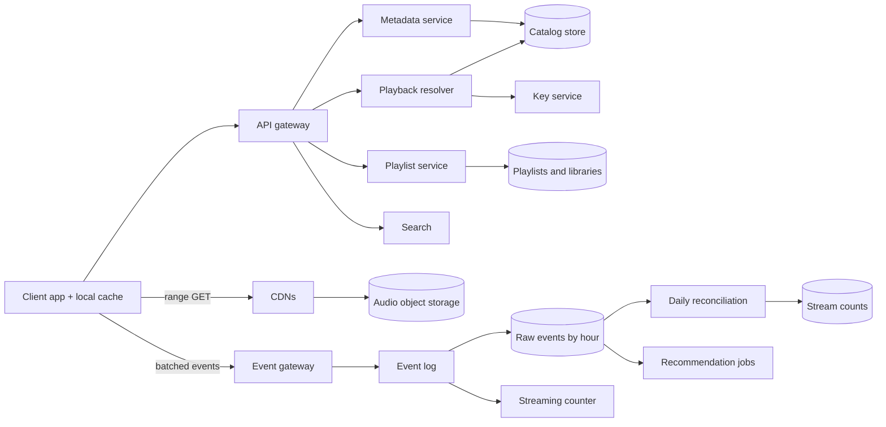

## In one minute
- Time to first sound is the product. A tap on a track should produce audio in well under a second, so the critical path is "resolve the file, fetch the first few seconds" in as few round trips as possible, helped by a large on-device cache and by prefetching the next track before the current one ends.
- Audio is small per file but the catalog is huge and skewed. A three-and-a-half-minute track at 160 kbit/s is about 4 MB; a hundred million tracks in several encodings is petabytes, yet a small head of popular tracks carries most plays. The head lives on CDN edges and in client caches, the tail is fetched from origin object storage.
- A play event is money. Royalties are paid on streams, and the industry convention, which Spotify states publicly, is that a stream counts once 30 seconds have been played ([Spotify for Artists](https://support.spotify.com/us/artists/article/how-your-streams-are-counted/)). The event pipeline is at-least-once, so counting must dedup by play ID and must cope with offline plays that arrive days later.
- Playlists are user-edited ordered lists, sometimes edited by several people at once and followed by tens of millions. Treat them as versioned documents with an operation log, not as rows you overwrite.
- Catalog metadata is read-mostly and can be cached aggressively; search and recommendations read from their own derived indexes, rebuilt from the catalog and listening history.

## Requirements
Functional:
- Search the catalog (tracks, albums, artists, playlists) and play any track on demand, with seek, skip and gapless transitions.
- Create, edit, reorder and follow playlists, including collaborative ones; save tracks to a library.
- Download playlists for offline playback on mobile.
- Show stream counts on tracks and give artists and rights holders accurate per-track, per-day counts for royalties.

Non-functional:
- Playback start p95 under about 500 ms on a warm client, and stutter (rebuffering) in well under 1% of plays.
- Stream counts used for payment must be exact after daily reconciliation; counts shown in the app may lag by a day.
- Playlist edits from one user are immediately visible to that user (read-your-writes) and to collaborators within seconds.
- Playback keeps working through partial outages: a failed recommendation or search service must never stop a song that is already queued.

Out of scope: podcasts and video, the recommendation models themselves (Discover Weekly style batch jobs are mentioned only as consumers of events), ads, payments and subscriptions, lyrics, and device handoff between phone and speaker.

## Back-of-envelope
Planning numbers in the right order of magnitude for a service with several hundred million monthly users. For scale, Spotify reported 777 million monthly active users and 300 million Premium subscribers on 30 June 2026 ([Spotify 6-K](https://www.sec.gov/Archives/edgar/data/0001639920/000162828026052543/spot-20260630x6xk.htm)).

Users: 250 million daily actives listening about 100 minutes a day. With an average track of 3.5 minutes that is about 30 plays per user per day, so 7.5 billion plays a day, about 87,000 play starts per second on average and around 220,000 at peak.

Concurrent streams: 250 million times 100 minutes divided by 1,440 minutes a day is about 17 million listeners at any moment on average, perhaps 35 million at peak.

Bandwidth: at 160 kbit/s, 17 million listeners need about 2.8 Tbit/s on average and about 5.6 Tbit/s at peak. If client caches serve a third of plays (repeat listening is common), the CDN delivers roughly 2 to 4 Tbit/s. The origin sees only CDN misses, a small percentage, mostly long-tail tracks.

Catalog storage: 100 million tracks. One encoding at 160 kbit/s is about 4.2 MB per track. Spotify's app offers about 24, 96, 160 and 320 kbit/s, the web player uses AAC at 128 or 256 kbit/s, and lossless is FLAC at up to 24-bit/44.1 kHz ([Spotify support](https://support.spotify.com/us/article/audio-quality/)). Those six lossy files total about 26 MB and a 24-bit FLAC copy about 35 MB, so about 60 MB per track and about 6 PB in all. New releases of around 100,000 tracks a day add about 6 TB a day, about 11 PB over five years.

Events: perhaps 10 client events per play (start, heartbeats, pause, seek, skip, end) at about 300 bytes is 75 billion events and about 22 TB a day, about 40 PB over five years before compression. That pipeline, not audio storage, is the biggest data-engineering cost.

Metadata API: play resolves plus search, home and playlist reads come to perhaps 300,000 to 500,000 requests per second at peak, mostly cache hits.

## API
```
GET  /v1/tracks/{id}/playback?formats=ogg160,ogg320
  -> { file_id, format, bitrate_kbps, size_bytes,
       urls: [ "https://cdn-a/...", "https://cdn-b/..." ],   # ordered by preference
       key_ticket, expires_at, duration_ms }

GET  /v1/search?q=hello&types=track,artist&limit=20&cursor=...
  -> { tracks: [..], artists: [..], next_cursor }

GET  /v1/playlists/{id}?fields=header,items&from=0&limit=100
  -> { playlist_id, revision, name, items: [ { item_id, track_id, added_by } ] }

POST /v1/playlists/{id}/ops
  body { base_revision: 41, ops: [ { op: "insert", after_item: "i7", track_id },
                                   { op: "move", item: "i3", after_item: "i9" },
                                   { op: "remove", item: "i5" } ] }
  -> 200 { revision: 42 }  |  409 { current_revision: 44, ops_since: [..] }

POST /v1/events          (batched, gzip, sent every few seconds or on app close)
  body { events: [ { play_id, track_id, type: "progress", ms_played: 31250,
                     client_seq, client_ts } ] }
  -> 202
```

## Data model
**tracks** (catalog store, key `track_id`): title, ISRC, album and artist IDs, duration, market availability, and a list of `(file_id, format, bitrate, size)`. Read-mostly and small (a few KB per track), replicated to every region and fronted by caches. Partitioning by `track_id` hash is fine because nothing joins across tracks on the hot path.

**audio files** (object storage, key `file_id`, which is a content hash): immutable, encrypted blobs. Content addressing means re-ingesting the same master produces the same key, and CDN entries never go stale.

**playlists** (wide-column store, partition key `playlist_id`): a header row (owner, name, `revision`, follower count) and an ops log clustered by revision. The current item list is a materialized snapshot rebuilt every N revisions. Partitioning by playlist keeps every edit and read of one playlist on one replica set.

**library** (wide-column, partition key `user_id`, clustering `added_at desc`): saved tracks and followed playlists. One partition read renders "Your Library".

**play events** (log, then object storage partitioned by `event_date/hour`): raw, append-only and never mutated. The log is partitioned by `user_id` hash so one user's events stay ordered.

**stream_counts** (warehouse table `(track_id, day, country) -> streams`, plus a key-value projection keyed by `track_id` for the app): written by the daily reconciliation job; the projection serves the displayed count.

## High-level design


Read path (playing a track): the client checks its local cache; on a hit, playback starts immediately from flash. On a miss, it calls the playback resolver, which returns the best file for the device and network, a short-lived ticket for the decryption key, and CDN URLs in preference order. The client issues an HTTP range request for the first chunk to the first CDN, starts decoding as soon as a few seconds are buffered, then fetches the rest in larger ranges. When the current track nears its end, the client resolves and prefetches the beginning of the next queued track, so the transition is gapless and needs no network on the critical path.

Write path (counting): the client records play progress locally and sends batched events. The event gateway authenticates, stamps server receive time, and appends to the log. A streaming job keeps approximate near-real-time counts for dashboards and trending. A daily job reads the raw events for the day (plus late arrivals for earlier days), groups by `play_id`, applies the 30-second rule and the fraud filters, and writes the authoritative counts that feed royalty reports.

## Deep dives

### Fast start and gapless playback
The options are a smaller first fetch, fewer round trips, or no network at all. Spotify's early desktop client also fetched from peers to cut latency and bandwidth cost; it moved away from peer-to-peer in 2014, as mobile clients, which make poor peers, came to dominate. Its 2010 measurements are still the best public baseline: 55.4% of played data came from the local cache, 35.8% from peers and only 8.8% from servers, and median playback latency was 265 ms. On a tap with nothing cached, the client asked the server for roughly the first 15 seconds of audio over an already-open TCP connection ([Kreitz and Niemelä, IEEE P2P 2010](https://people.cs.umass.edu/~phillipa/CSE390/spotify-p2p10.pdf)). Today the levers are:

1. Client cache. A few GB of encrypted audio on device, evicted by least-recently-played. Because listening is repetitive, this alone removes a large share of network fetches.
2. Prefetch. Fetch the first chunk of the next queued track before the current one ends, and the first chunk of likely taps (the top search result, the first track of an opened album) speculatively. The cost is wasted bytes on wrong guesses, so cap speculative prefetch on cellular. The 2010 client prefetched the next track from the server when 10 seconds remained; when a bug disabled prefetch for a few weeks, median latency rose from 265 to 390 ms and stutter from 1.0% to 1.8% of plays.
3. A small first range. At 160 kbit/s, 5 seconds of audio is 100 KB. Request that first so decoding starts on one round trip, then request large ranges (1 MB or the whole file) so the radio can go idle.
4. Bitrate choice per play, not per chunk. Music players usually pick one encoding at start from the network type and recent throughput, and step down only on sustained stalls. Mid-song quality switches are audible in a way video resolution switches are not. The ABR mechanics are in the Media Streaming lesson.

I would choose all four, with the cache and next-track prefetch as the biggest wins because they remove the network from most transitions.

### Counting streams that pay royalties
Options: count on the client and trust it, increment a counter on the server per "start" event, or derive counts from raw events in a reconciled batch. Trusting the client invites fraud. Incrementing on "start" overcounts skips and double counts retries. So raw events are the source of truth, and counting is a pure function over them.

The rules that function applies: group by `play_id`, which the client generates once per playback; take the maximum `ms_played` across that play's events, because heartbeats are cumulative, may be duplicated by retries, and arrive out of order; count the play once if that maximum reaches 30,000 ms. Use listened time, not position, so seeking to 0:31 does not count. Then apply anti-abuse rules, such as a cap on counted plays per user, track and day, and filters for known bot accounts. Payment rules sit on top of counting: since April 2024 a track needs at least 1,000 streams in the previous 12 months to earn recorded royalties, and Spotify charges labels and distributors per track when it detects flagrant artificial streaming ([Spotify for Artists](https://artists.spotify.com/en/blog/modernizing-our-royalty-system)). So the counter must also keep a rolling 12-month total per track.

Late data is the norm: offline listening uploads its events when the phone reconnects, possibly days later. Spotify counts offline plays when the listener goes online and requires a reconnect at least once every 30 days, which bounds how late an event can be ([Spotify for Artists](https://support.spotify.com/us/artists/article/how-your-streams-are-counted/)). The daily job recomputes a sliding window of recent days and emits corrections, and royalty statements close only after a grace period. The real-time counter serves dashboards and trending and may be slightly wrong. It is the same split as in the Ad Click Aggregator lesson: a fast approximate path, a slow exact path, and the exact path wins. Spotify's real pipeline makes the delivery promises explicit: each event type gets its own Pub/Sub topic and ETL, a batch step deduplicates into hourly buckets, and the SLOs cover timeliness, completeness (audited daily) and skewness, the share of finance-bearing events filed in the wrong hour ([Google SRE Workbook, ch. 13](https://sre.google/workbook/data-processing/)).

### Playlists as versioned documents
A naive model stores a playlist as one row with an array of track IDs, rewritten on every edit. Two collaborators editing at once lose each other's changes, and a 10,000-track playlist rewrites hundreds of KB to add one song.

Instead, every item gets a stable `item_id`, edits are operations (insert after item, move after item, remove item) addressed by item ID rather than index, and each accepted batch bumps `revision`. A client sends ops with its `base_revision`. If the server is at that revision, it applies them. If not, it returns the ops since, and the client rebases: removals of already-removed items become no-ops, inserts after a removed item fall back to that item's predecessor. Because ops reference IDs, not indexes, most concurrent edits commute and rebasing is trivial. This is a lightweight cousin of the operational transformation covered in Design Google Docs, and it is enough because playlists do not need character-level merging.

Popular editorial playlists are a hot-read problem, not a write problem: tens of millions of followers read them, few people edit them. Serve their snapshots from a cache keyed by `(playlist_id, revision)`, which is immutable and so can be cached at the CDN like audio.

## Down the stack

### Layer 1: The contract
`GET /playback` returns URLs and a key ticket valid for a bounded time (minutes); any listed CDN URL serves byte-identical content for the same `file_id`, so the client may switch mid-file using range requests. Range responses are `206 Partial Content` and safe to retry. Event submission is at-least-once: the client keeps events on disk until it gets a 202, so duplicates are expected and the counter must be idempotent per `play_id`. The authoritative stream count for a day is final after the grace period; before that it may change. Playlist ops are applied atomically per batch and produce a strictly increasing revision.

### Layer 2: The mechanism
Lossy tracks are Ogg Vorbis (and AAC on some web clients). An Ogg file is a sequence of pages, each with a 27-byte header carrying the capture pattern `OggS`, a granule position (the sample count at the end of the page) and a CRC. After the three Vorbis header packets at the start of the file, the decoder can resume at any page boundary, so seeking is a bisection over byte offsets using granule positions ([RFC 7845](https://www.rfc-editor.org/rfc/rfc7845)), or a lookup in a small seek table fetched with the first chunk. Spotify chose the second: because Ogg seeks poorly over a network, it adds a custom header to every file to support seeking. Files are encrypted with a per-file key, so the CDN only ever stores ciphertext; the key service releases the key to an authenticated client for a ticket the resolver issued. On the event side, the log is partitioned by user, and each event carries `(play_id, client_seq)`, so dedup is "keep the highest `client_seq` and the maximum `ms_played` per play".

### Layer 3: The machine
At 160 kbit/s, audio needs 20 KB per second. A 100 KB first chunk is about 70 TCP segments of 1,460 bytes. On a warm, kept-alive HTTP/2 connection whose congestion window has already grown, it arrives in one round trip, about 30 to 80 ms on mobile. On a cold connection, DNS, TCP and TLS 1.3 handshakes add two or three round trips, and slow start from an initial window of 10 segments needs about three more. That difference, roughly 100 ms versus 400 ms, is why the client keeps CDN connections open. A warm connection is not enough on its own: RFC 5681 says a sender should shrink its congestion window after an idle period longer than the retransmission timeout, and Linux does this by default (`tcp_slow_start_after_idle=1`, [kernel docs](https://docs.kernel.org/networking/ip-sysctl.html)). Spotify turned it off on its servers and average playback latency fell by about 50 ms. Spotify's engineering blog also reports an A/B test on one CDN where switching server congestion control from CUBIC to BBR cut stutter by about 17% in Asia-Pacific, 12% in Latin America and 3 to 5% in Europe and North America, because loss-based control backs off too far on lossy links ([Spotify](https://engineering.atspotify.com/2018/08/smoother-streaming-with-bbr)). The radio adds its own cost: an idle cellular modem takes tens to hundreds of milliseconds to wake, so downloading the whole track in one burst and letting the radio sleep beats trickling 20 KB per second. Decoding takes a few percent of one mobile core, and cache reads from flash take well under a millisecond.

### Why it's built this way
1. Listeners notice silence after a tap far more than they notice bitrate, so the design spends bytes (prefetch, cache) to save round trips.
2. Round trips are bounded by the speed of light and mobile radio wake-up, so warm connections and nearby CDN edges matter more than server speed.
3. Popularity is skewed and files never change, so immutable, content-addressed files on CDNs and client caches serve most plays without touching origin.
4. Money depends on counts and clients retry, so counting is derived from raw, deduplicable events with a closing period, not from live counters.
5. Collaborative edits conflict, so playlists are versioned op logs addressed by item ID rather than overwritten arrays.

## Failure modes
- **10x load from a major album release**: millions of plays of the same 15 tracks in the first hour. Pre-position the files on every CDN edge before the release time (the release is scheduled, so this is known), cache metadata and the album snapshot, and make the playback resolver's response for those tracks cacheable for minutes.
- **CDN vendor outage**: the resolver returns several CDNs in preference order; clients fail over on errors or slow first bytes, and the resolver reorders the list globally within minutes based on client-reported error rates.
- **Region outage**: catalog and playlist stores are replicated across regions, and the gateway reroutes. Clients keep playing from cache and already-fetched audio. Events buffer on device until the event gateway accepts them, so no plays are lost, only delayed.
- **Event pipeline backlog**: counts and recommendations lag, playback is unaffected because nothing on the playback path depends on the pipeline. Alert on log consumer lag and on the fraction of events arriving more than a day late.
- **Hot playlist**: a viral playlist followed by 30 million people. Serve immutable `(playlist_id, revision)` snapshots from cache; update the follower count with sharded counters.

## In the wild
- **Spotify, 2025: one filter reorder takes down the perimeter.** On 16 April a change to the order of Spotify's custom Envoy filters was judged low risk and applied to all regions at once; it triggered a bug that crashed every Envoy instance at 12:18 UTC. Restarts plus client retries produced a load spike, and because Envoy's max heap was set above the Kubernetes memory limit, new instances were killed and restarted in a loop. Asia-Pacific, quiet at that hour, stayed up; the US was back at 15:10. Spotify fixed the bug and the limits and changed how perimeter config rolls out ([Spotify](https://engineering.atspotify.com/2025/5/incident-report-spotify-outage-on-april-16-2025)).
- **Spotify, 2022: managed service discovery fails everyone at once.** A Google Cloud Traffic Director outage, combined with a gRPC client bug, broke discovery for services that used it, and users worldwide were logged out and could not log back in for about 2 hours 23 minutes. Services on Spotify's DNS-based discovery were unaffected, so Spotify moved the rest back to DNS and added discovery-health monitoring ([Spotify](https://engineering.atspotify.com/2022/03/incident-report-spotify-outage-on-march-8/)).
- **Spotify, 2016: rebuilding event delivery.** The old pipeline tailed log files into Kafka 0.7 and wrote hourly buckets to HDFS; an hour was only complete when every expected file arrived, so one failed machine could stall a bucket until someone intervened, and the ETL step added about 30 minutes. Components were too tightly coupled to fix one at a time, so Spotify rewrote it around Cloud Pub/Sub ([Spotify](https://engineering.atspotify.com/2016/02/spotifys-event-delivery-the-road-to-the-cloud-part-i)).

## Trade-offs
| Option | Strengths | Weaknesses | Choose when |
| --- | --- | --- | --- |
| CDN plus large client cache | Fast starts, low egress for repeats | Device storage, cache encryption and eviction logic | Repetitive listening, mobile clients |
| Peer-to-peer delivery | Low server bandwidth | Poor on mobile, complex, privacy concerns | Desktop-heavy, egress-expensive eras |
| One bitrate per track play | No audible switches | Slower reaction to network drops | Audio, where buffers are cheap |
| Per-chunk ABR | Reacts quickly | Audible quality changes | Video |
| Batch-reconciled stream counts | Exact, auditable, handles late data | Counts final only after days | Payments and royalties |
| Live counters on start events | Instant | Overcounts skips and retries | Trending and dashboards only |
| Op log with item IDs for playlists | Safe concurrent edits, cheap appends | Snapshot and rebase logic | Collaborative or large lists |

## Leadership lens
- Build first: the playback path (resolver, file layout, client cache, CDN contracts) and the raw event schema with `play_id`. Recommendations and search can start simple; an event schema without a stable play ID cannot be fixed retroactively for royalty years already paid.
- Ownership: a Playback team owns client player, resolver and CDN relationships; a Content Platform team owns ingestion, encoding and storage; an Event Delivery team owns the pipeline as a product with an SLA; a Royalties team owns the counting rules, which are part legal contract.
- Cost drivers: CDN egress, then event storage and processing, then audio storage. Raising client cache hit rate by a few points is usually the cheapest egress win; negotiating multiple CDNs keeps prices honest.
- Rollout: change the counting rules only with a parallel run, computing old and new counts for weeks and explaining every difference to rights holders before switching.
- Review questions: what is our time-to-first-sound at p95 by market and network type; what fraction of events arrives after day close; can we recompute any day's counts from raw events alone.

## Check yourself
1. Why are royalty counts derived from raw events in a daily batch instead of incrementing a counter on each "start" event?
   **Answer:** Counting on "start" overcounts skips and double counts retries, and trusting the client invites fraud. The batch groups by `play_id`, takes the maximum `ms_played` (heartbeats are cumulative, duplicated and out of order) and counts once at 30,000 ms, then applies anti-abuse rules.
2. Offline plays upload days later. How does the counting design cope?
   **Answer:** The daily job recomputes a sliding window of recent days and emits corrections, and royalty statements close only after a grace period. The real-time counter serves only dashboards and trending and may be slightly wrong; the exact path wins.
3. Why does the client request a small first range of about 100 KB and then large ranges?
   **Answer:** At 160 kbit/s, 5 seconds of audio is about 100 KB, which arrives in one round trip on a warm connection so decoding starts quickly. Larger follow-up ranges let the cellular radio go idle instead of trickling 20 KB per second.
4. Why are playlist edits operations addressed by `item_id` rather than rewriting an array of track IDs?
   **Answer:** Rewriting the array loses concurrent collaborators' changes and rewrites hundreds of KB for a 10,000-track playlist to add one song. Ops against a `base_revision` that reference stable item IDs mostly commute, so on a conflict the client rebases cheaply.

## Practice
**Task:** Implement the exact stream counter. `PlayCounter(threshold_ms, daily_cap)` receives cumulative progress reports `report(play_id, user, track, played_ms, day)`, which may be duplicated or out of order. The first valid report of a play fixes its user, track and day; later reports with a different user or track, and any report with negative `played_ms`, are ignored and return `False`. A play becomes a stream the first time its highest `played_ms` reaches `threshold_ms`, unless that user already has `daily_cap` streams of that track on that day, in which case the play is marked capped and never counts. `report` returns `True` only for the report that made the play count. `count(track)` returns the track's total streams and `top(k)` returns `(track, count)` pairs sorted by count descending, then track ascending.

```python starter
class PlayCounter:
    def __init__(self, threshold_ms, daily_cap):
        self.threshold_ms = threshold_ms
        self.daily_cap = daily_cap

    def report(self, play_id, user, track, played_ms, day):
        # TODO
        raise NotImplementedError

    def count(self, track):
        raise NotImplementedError

    def top(self, k):
        raise NotImplementedError
```

```python tests
def test_counts_only_at_threshold():
    c = PlayCounter(30000, 10)
    assert not c.report("p1", "u1", "t1", 12000, 1)
    assert not c.report("p1", "u1", "t1", 29999, 1)
    assert c.report("p1", "u1", "t1", 30000, 1), "exactly 30 s counts"
    assert c.count("t1") == 1

def test_duplicates_and_out_of_order():
    c = PlayCounter(30000, 10)
    assert c.report("p1", "u1", "t1", 45000, 1)
    assert not c.report("p1", "u1", "t1", 45000, 1), "retry"
    assert not c.report("p1", "u1", "t1", 10000, 1), "late heartbeat"
    assert not c.report("p1", "u1", "t1", 90000, 1)
    assert c.count("t1") == 1
    assert c.count("never") == 0

def test_daily_cap_per_user_and_track():
    c = PlayCounter(30000, 2)
    assert c.report("p1", "u1", "t1", 31000, 5)
    assert c.report("p2", "u1", "t1", 31000, 5)
    assert not c.report("p3", "u1", "t1", 31000, 5), "over the cap"
    assert c.report("p4", "u2", "t1", 31000, 5), "other users unaffected"
    assert c.report("p5", "u1", "t2", 31000, 5), "other tracks unaffected"
    assert c.report("p6", "u1", "t1", 31000, 6), "a new day"
    assert c.count("t1") == 4

def test_capped_play_never_counts_later():
    c = PlayCounter(30000, 1)
    assert c.report("a", "u1", "t1", 30000, 1)
    assert not c.report("b", "u1", "t1", 30000, 1)
    assert not c.report("b", "u1", "t1", 60000, 1)
    assert c.count("t1") == 1

def test_invalid_reports_ignored():
    c = PlayCounter(30000, 10)
    assert not c.report("p1", "u1", "t1", -5, 1)
    assert not c.report("p1", "u1", "t1", 1000, 1)
    assert not c.report("p1", "u1", "t2", 40000, 1), "track mismatch"
    assert not c.report("p1", "u9", "t1", 40000, 1), "user mismatch"
    assert c.count("t2") == 0
    assert c.report("p1", "u1", "t1", 40000, 1)

def test_top_k_ordering():
    c = PlayCounter(1, 100)
    plays = [("t3", 2), ("t1", 3), ("t2", 3), ("t4", 1)]
    n = 0
    for track, times in plays:
        for _ in range(times):
            n += 1
            c.report("p" + str(n), "u" + str(n), track, 5, 1)
    assert c.top(3) == [("t1", 3), ("t2", 3), ("t3", 2)]
    assert c.top(0) == []
    assert c.top(10) == [("t1", 3), ("t2", 3), ("t3", 2), ("t4", 1)]
```

```python solution
class PlayCounter:
    def __init__(self, threshold_ms, daily_cap):
        self.threshold_ms = threshold_ms
        self.daily_cap = daily_cap
        self._plays = {}    # play_id -> [user, track, day, state]
        self._daily = {}    # (user, track, day) -> streams counted
        self._counts = {}   # track -> streams

    def report(self, play_id, user, track, played_ms, day):
        if played_ms < 0:
            return False
        play = self._plays.get(play_id)
        if play is None:
            play = [user, track, day, "open"]
            self._plays[play_id] = play
        elif play[0] != user or play[1] != track:
            return False
        if play[3] != "open" or played_ms < self.threshold_ms:
            return False
        key = (play[0], play[1], play[2])
        if self._daily.get(key, 0) >= self.daily_cap:
            play[3] = "capped"
            return False
        play[3] = "counted"
        self._daily[key] = self._daily.get(key, 0) + 1
        self._counts[track] = self._counts.get(track, 0) + 1
        return True

    def count(self, track):
        return self._counts.get(track, 0)

    def top(self, k):
        if k <= 0:
            return []
        items = sorted(self._counts.items(), key=lambda kv: (-kv[1], kv[0]))
        return items[:k]
```

```typescript starter
export type TrackCount = [string, number];

export class PlayCounter {
  constructor(public thresholdMs: number, public dailyCap: number) {}
  report(playId: string, user: string, track: string, playedMs: number, day: number): boolean {
    throw new Error("TODO");
  }
  count(track: string): number {
    throw new Error("TODO");
  }
  top(k: number): TrackCount[] {
    throw new Error("TODO");
  }
}
```

```typescript tests
test("counts only at threshold", () => {
  const c = new PlayCounter(30000, 10);
  assert(!c.report("p1", "u1", "t1", 12000, 1), "12 s");
  assert(!c.report("p1", "u1", "t1", 29999, 1), "just under");
  assert(c.report("p1", "u1", "t1", 30000, 1), "exactly 30 s counts");
  assertEqual(c.count("t1"), 1, "one stream");
});

test("duplicates and out of order", () => {
  const c = new PlayCounter(30000, 10);
  assert(c.report("p1", "u1", "t1", 45000, 1), "counts");
  assert(!c.report("p1", "u1", "t1", 45000, 1), "retry");
  assert(!c.report("p1", "u1", "t1", 10000, 1), "late heartbeat");
  assert(!c.report("p1", "u1", "t1", 90000, 1), "more progress");
  assertEqual(c.count("t1"), 1, "once");
  assertEqual(c.count("never"), 0, "unknown track");
});

test("daily cap per user and track", () => {
  const c = new PlayCounter(30000, 2);
  assert(c.report("p1", "u1", "t1", 31000, 5), "first");
  assert(c.report("p2", "u1", "t1", 31000, 5), "second");
  assert(!c.report("p3", "u1", "t1", 31000, 5), "over the cap");
  assert(c.report("p4", "u2", "t1", 31000, 5), "other user");
  assert(c.report("p5", "u1", "t2", 31000, 5), "other track");
  assert(c.report("p6", "u1", "t1", 31000, 6), "new day");
  assertEqual(c.count("t1"), 4, "t1 total");
});

test("capped play never counts later", () => {
  const c = new PlayCounter(30000, 1);
  assert(c.report("a", "u1", "t1", 30000, 1), "a counts");
  assert(!c.report("b", "u1", "t1", 30000, 1), "b capped");
  assert(!c.report("b", "u1", "t1", 60000, 1), "still capped");
  assertEqual(c.count("t1"), 1, "one");
});

test("invalid reports ignored", () => {
  const c = new PlayCounter(30000, 10);
  assert(!c.report("p1", "u1", "t1", -5, 1), "negative");
  assert(!c.report("p1", "u1", "t1", 1000, 1), "registers");
  assert(!c.report("p1", "u1", "t2", 40000, 1), "track mismatch");
  assert(!c.report("p1", "u9", "t1", 40000, 1), "user mismatch");
  assertEqual(c.count("t2"), 0, "nothing for t2");
  assert(c.report("p1", "u1", "t1", 40000, 1), "valid report counts");
});

test("top k ordering", () => {
  const c = new PlayCounter(1, 100);
  const plays: [string, number][] = [["t3", 2], ["t1", 3], ["t2", 3], ["t4", 1]];
  let n = 0;
  for (const [track, times] of plays) {
    for (let i = 0; i < times; i++) {
      n++;
      c.report("p" + n, "u" + n, track, 5, 1);
    }
  }
  assertEqual(c.top(3), [["t1", 3], ["t2", 3], ["t3", 2]], "top 3");
  assertEqual(c.top(0), [], "k = 0");
  assertEqual(c.top(10), [["t1", 3], ["t2", 3], ["t3", 2], ["t4", 1]], "k larger than tracks");
});
```

```typescript solution
export type TrackCount = [string, number];

interface Play { user: string; track: string; day: number; state: "open" | "counted" | "capped"; }

export class PlayCounter {
  private plays = new Map<string, Play>();
  private daily = new Map<string, number>();
  private counts = new Map<string, number>();

  constructor(public thresholdMs: number, public dailyCap: number) {}

  report(playId: string, user: string, track: string, playedMs: number, day: number): boolean {
    if (playedMs < 0) return false;
    let play = this.plays.get(playId);
    if (!play) {
      play = { user, track, day, state: "open" };
      this.plays.set(playId, play);
    } else if (play.user !== user || play.track !== track) {
      return false;
    }
    if (play.state !== "open" || playedMs < this.thresholdMs) return false;
    const key = JSON.stringify([play.user, play.track, play.day]);
    const used = this.daily.get(key) ?? 0;
    if (used >= this.dailyCap) {
      play.state = "capped";
      return false;
    }
    play.state = "counted";
    this.daily.set(key, used + 1);
    this.counts.set(track, (this.counts.get(track) ?? 0) + 1);
    return true;
  }

  count(track: string): number {
    return this.counts.get(track) ?? 0;
  }

  top(k: number): TrackCount[] {
    if (k <= 0) return [];
    const items: TrackCount[] = Array.from(this.counts.entries());
    items.sort((a, b) => b[1] - a[1] || (a[0] < b[0] ? -1 : a[0] > b[0] ? 1 : 0));
    return items.slice(0, k);
  }
}
```

```go starter
package practice

type TrackCount struct {
	Track string
	Count int
}

type PlayCounter struct{}

func NewPlayCounter(thresholdMs, dailyCap int) *PlayCounter { return &PlayCounter{} }

func (c *PlayCounter) Report(playID, user, track string, playedMs, day int) bool { panic("TODO") }

func (c *PlayCounter) Count(track string) int { panic("TODO") }

func (c *PlayCounter) Top(k int) []TrackCount { panic("TODO") }
```

```go tests
package practice

import (
	"fmt"
	"reflect"
	"testing"
)

func TestCountsOnlyAtThreshold(t *testing.T) {
	c := NewPlayCounter(30000, 10)
	if c.Report("p1", "u1", "t1", 12000, 1) || c.Report("p1", "u1", "t1", 29999, 1) {
		t.Fatal("below threshold must not count")
	}
	if !c.Report("p1", "u1", "t1", 30000, 1) {
		t.Fatal("exactly 30 s counts")
	}
	if c.Count("t1") != 1 {
		t.Fatalf("count = %d", c.Count("t1"))
	}
}

func TestDuplicatesAndOutOfOrder(t *testing.T) {
	c := NewPlayCounter(30000, 10)
	if !c.Report("p1", "u1", "t1", 45000, 1) {
		t.Fatal("should count")
	}
	if c.Report("p1", "u1", "t1", 45000, 1) || c.Report("p1", "u1", "t1", 10000, 1) || c.Report("p1", "u1", "t1", 90000, 1) {
		t.Fatal("a play counts once")
	}
	if c.Count("t1") != 1 || c.Count("never") != 0 {
		t.Fatal("wrong counts")
	}
}

func TestDailyCapPerUserAndTrack(t *testing.T) {
	c := NewPlayCounter(30000, 2)
	if !c.Report("p1", "u1", "t1", 31000, 5) || !c.Report("p2", "u1", "t1", 31000, 5) {
		t.Fatal("first two count")
	}
	if c.Report("p3", "u1", "t1", 31000, 5) {
		t.Fatal("over the cap")
	}
	if !c.Report("p4", "u2", "t1", 31000, 5) || !c.Report("p5", "u1", "t2", 31000, 5) || !c.Report("p6", "u1", "t1", 31000, 6) {
		t.Fatal("cap is per user, track and day")
	}
	if c.Count("t1") != 4 {
		t.Fatalf("t1 = %d", c.Count("t1"))
	}
}

func TestCappedPlayNeverCountsLater(t *testing.T) {
	c := NewPlayCounter(30000, 1)
	c.Report("a", "u1", "t1", 30000, 1)
	if c.Report("b", "u1", "t1", 30000, 1) || c.Report("b", "u1", "t1", 60000, 1) {
		t.Fatal("capped play must stay uncounted")
	}
	if c.Count("t1") != 1 {
		t.Fatal("want 1")
	}
}

func TestInvalidReportsIgnored(t *testing.T) {
	c := NewPlayCounter(30000, 10)
	if c.Report("p1", "u1", "t1", -5, 1) || c.Report("p1", "u1", "t1", 1000, 1) {
		t.Fatal("nothing counts yet")
	}
	if c.Report("p1", "u1", "t2", 40000, 1) || c.Report("p1", "u9", "t1", 40000, 1) {
		t.Fatal("mismatched reports must be ignored")
	}
	if c.Count("t2") != 0 || !c.Report("p1", "u1", "t1", 40000, 1) {
		t.Fatal("valid report should count")
	}
}

func TestTopKOrdering(t *testing.T) {
	c := NewPlayCounter(1, 100)
	plays := []TrackCount{{"t3", 2}, {"t1", 3}, {"t2", 3}, {"t4", 1}}
	n := 0
	for _, p := range plays {
		for i := 0; i < p.Count; i++ {
			n++
			c.Report(fmt.Sprintf("p%d", n), fmt.Sprintf("u%d", n), p.Track, 5, 1)
		}
	}
	if got := c.Top(3); !reflect.DeepEqual(got, []TrackCount{{"t1", 3}, {"t2", 3}, {"t3", 2}}) {
		t.Fatalf("top 3 = %v", got)
	}
	if got := c.Top(0); len(got) != 0 {
		t.Fatalf("top 0 = %v", got)
	}
	if got := c.Top(10); len(got) != 4 || got[3] != (TrackCount{"t4", 1}) {
		t.Fatalf("top 10 = %v", got)
	}
}
```

```go solution
package practice

import "sort"

type TrackCount struct {
	Track string
	Count int
}

type play struct {
	user, track string
	day         int
	state       int // 0 open, 1 counted, 2 capped
}

type dayKey struct {
	user, track string
	day         int
}

type PlayCounter struct {
	thresholdMs, dailyCap int
	plays                 map[string]*play
	daily                 map[dayKey]int
	counts                map[string]int
}

func NewPlayCounter(thresholdMs, dailyCap int) *PlayCounter {
	return &PlayCounter{
		thresholdMs: thresholdMs,
		dailyCap:    dailyCap,
		plays:       map[string]*play{},
		daily:       map[dayKey]int{},
		counts:      map[string]int{},
	}
}

func (c *PlayCounter) Report(playID, user, track string, playedMs, day int) bool {
	if playedMs < 0 {
		return false
	}
	p, ok := c.plays[playID]
	if !ok {
		p = &play{user: user, track: track, day: day}
		c.plays[playID] = p
	} else if p.user != user || p.track != track {
		return false
	}
	if p.state != 0 || playedMs < c.thresholdMs {
		return false
	}
	k := dayKey{p.user, p.track, p.day}
	if c.daily[k] >= c.dailyCap {
		p.state = 2
		return false
	}
	p.state = 1
	c.daily[k]++
	c.counts[track]++
	return true
}

func (c *PlayCounter) Count(track string) int { return c.counts[track] }

func (c *PlayCounter) Top(k int) []TrackCount {
	out := []TrackCount{}
	if k <= 0 {
		return out
	}
	for t, n := range c.counts {
		out = append(out, TrackCount{t, n})
	}
	sort.Slice(out, func(i, j int) bool {
		if out[i].Count != out[j].Count {
			return out[i].Count > out[j].Count
		}
		return out[i].Track < out[j].Track
	})
	if len(out) > k {
		out = out[:k]
	}
	return out
}
```

## Mock interview
**Prompt:** Design Spotify for 250 million daily listeners and a catalog of 100 million tracks. Playback should start in under half a second, artists are paid per stream, and users build collaborative playlists.

- Follow-up: A user taps a track they have never played on a phone that just came out of a tunnel. Walk me through every network round trip until sound comes out, and which ones you can remove.
- Follow-up: A user listens offline on a 12-hour flight and reconnects two days later. How do those plays get counted, and what happens to the royalty report for the day they were played?
- Follow-up: Two collaborators reorder the same playlist at the same time, one on a phone with a stale copy. What does each see afterwards?

**A strong answer covers:**
- Arithmetic showing concurrent listeners and egress (Tbit/s), and that CDN egress and the event pipeline, not audio storage, dominate cost.
- A playback path with a resolver, immutable encrypted files on multiple CDNs, a small first range request, warm connections, a client cache and next-track prefetch.
- Stream counting derived from raw at-least-once events: dedup by play ID, maximum cumulative listened time, the 30-second threshold, abuse caps, late-data windows and a closing period.
- Playlists as op logs with stable item IDs and revisions, rebasing on conflict, and immutable cached snapshots for hot playlists.
- Isolation so search, recommendations or the event pipeline failing never stops playback, plus a plan for scheduled release spikes.

## Sources and further study
**Primary**
- [Spotify: Large Scale, Low Latency, P2P Music-on-Demand Streaming (Kreitz and Niemelä, IEEE P2P 2010)](https://people.cs.umass.edu/~phillipa/CSE390/spotify-p2p10.pdf): measured playback latency, cache, peer and server shares, the 15-second first request and prefetch timing.
- [RFC 5681, section 4.1: Restarting Idle Connections](https://www.rfc-editor.org/rfc/rfc5681#section-4.1): why a sender shrinks its congestion window after idle, the behaviour Spotify switched off.

**Systems docs**
- [How your streams are counted (Spotify for Artists)](https://support.spotify.com/us/artists/article/how-your-streams-are-counted/): the 30-second rule and how offline plays are logged on reconnect.
- [Modernizing our royalty system (Spotify for Artists)](https://artists.spotify.com/en/blog/modernizing-our-royalty-system): the 1,000-stream threshold, artificial-streaming charges and noise-track minimum length.
- [Audio quality (Spotify support)](https://support.spotify.com/us/article/audio-quality/): the current bitrate tiers, web-player AAC and lossless FLAC.
- [Linux ip-sysctl documentation](https://docs.kernel.org/networking/ip-sysctl.html): `tcp_slow_start_after_idle` and the other TCP knobs that set time to first byte.

**Books**
- *The Site Reliability Workbook*, Beyer et al. (Google), chapter 13 "Data Processing Pipelines": ends with a Spotify case study on event delivery SLOs.
- *Designing Data-Intensive Applications* (1st ed.), Martin Kleppmann, chapter 11 "Stream Processing": event logs, deduplication and reasoning about time and late events.
- *High Performance Browser Networking*, Ilya Grigorik, chapter 2 "Building Blocks of TCP": slow start, slow-start restart and why warm connections matter ([read free](https://hpbn.co/building-blocks-of-tcp/)).

**Other curricula**
- [Azure Architecture Center: Event Sourcing pattern](https://learn.microsoft.com/en-us/azure/architecture/patterns/event-sourcing): frames state as an append-only log of actions from which views are materialised, the same idea as the playlist op log and raw play events.
- [donnemartin/system-design-primer: CDN](https://github.com/donnemartin/system-design-primer#content-delivery-network): frames static-file delivery as push versus pull CDNs; immutable audio files suit pull with long TTLs.

## Watch
- [Niklas Gustavsson Discusses Spotify's Architecture (Spotify R&D)](https://www.youtube.com/watch?v=lcHEhhM-3sk): Spotify's chief architect on how the backend and its teams are organised at scale.
- [Building Backend Services at Spotify (tretton37)](https://www.youtube.com/watch?v=GkpSJIRtKEU): how Spotify structures and operates its backend services.
- [Design Spotify Like a Senior Engineer (Hayk Simonyan)](https://www.youtube.com/watch?v=H7s1pvuhmTA): an interview-style walkthrough to compare against your own answer.

## Free resources
- [Spotify's Event Delivery: The Road to the Cloud, Part I (Spotify Engineering)](https://engineering.atspotify.com/2016/02/spotifys-event-delivery-the-road-to-the-cloud-part-i): how Spotify moves billions of client events a day and why it rebuilt the pipeline.
- [Smoother Streaming with BBR (Spotify Engineering)](https://engineering.atspotify.com/2018/08/smoother-streaming-with-bbr): an experiment on congestion control and audio stutter.
- [Personalization at Spotify using Cassandra (Spotify Engineering)](https://engineering.atspotify.com/2015/01/personalization-at-spotify-using-cassandra): how per-user data is modelled in a wide-column store.
- [Ogg Encapsulation for the Opus Audio Codec (RFC 7845)](https://www.rfc-editor.org/rfc/rfc7845): a precise description of Ogg pages, granule positions and seeking, the same container used for Vorbis.
- [Spotify (Wikipedia)](https://en.wikipedia.org/wiki/Spotify): background on the service's history, including its early peer-to-peer delivery.
