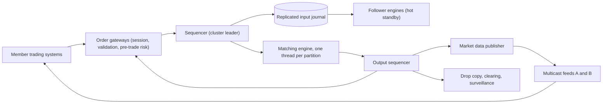

## In one minute
- **One thread owns each order book.** Matching is a strictly sequential function of the order in which messages arrive, so each symbol's book lives on a single thread with no locks. Scale comes from partitioning symbols across engines, not from parallelism inside a book.
- **The sequencer defines reality.** Every inbound message gets a global sequence number before it is matched. The book is a pure function of that sequenced log, so replaying the log rebuilds the exact book, every trade and every outbound message.
- **Replicate the input, not the state.** Hot standbys receive the same sequenced log and run the same deterministic code. Failover means a follower that already has the identical book starts publishing, in milliseconds.
- **Market data is a sequenced broadcast.** Every change to every book goes out on UDP multicast with gapless sequence numbers, so thousands of subscribers get the same bytes at the same moment and recover gaps on their own.
- **Latency is measured in microseconds and fairness is a product feature.** Kernel bypass, pinned cores and pre-allocated memory keep the path short; equal cable lengths and deterministic ordering keep it fair.

## Requirements

**Functional**
- Members submit limit and market orders, cancel them, and reduce or replace them, over authenticated sessions.
- Match by price-time priority: best price first, then earliest arrival at that price. Trades execute at the resting order's price.
- Send each member an acknowledgement, fills and cancels for its own orders (execution reports).
- Publish public market data: every add, execute, cancel and trade (full depth), plus best bid and offer.
- Halt a symbol, enforce price bands, and let a member's risk officer kill all its orders at once.

**Non-functional**
- Gateway-in to acknowledgement-out under 50 µs median and 200 µs at p99.
- An acknowledged order or trade is never lost, even if the matching host dies the next microsecond.
- Deterministic: replaying a day's input reproduces every output byte for byte, which regulators and dispute resolution rely on.
- Fair: no member can see or act on information before others who paid for the same access.
- 99.99% availability during the trading session, which is about 2 seconds of downtime across a 6.5 hour day.

**Out of scope:** clearing and settlement (a central counterparty takes over after the trade; US equities have settled on T+1, one business day after the trade, since 28 May 2024 ([SEC](https://www.sec.gov/newsroom/press-releases/2023-29))), opening and closing auctions in detail, the brokerage apps that retail investors use, and options and futures pricing.

## Back-of-envelope
Planning numbers for a mid-to-large equities exchange.

- **Symbols:** 8,000 listed instruments; the busiest 100 carry about half the traffic.
- **Inbound messages:** 1.5B per day (new orders, cancels, replaces; most orders are cancelled, not filled). A 6.5-hour session is 23,400 s, so the average is 1.5B / 23,400 ≈ 64,000 messages/s. The open and close run at about 20× average, roughly 1.3M/s, and microbursts in the first second are higher still. Size for 3M/s.
- **Trades:** about 2% of messages execute: 30M trades per day.
- **Journal:** binary inbound messages average about 50 bytes; with the sequence number, timestamp and session id the journal record is about 64 bytes. 1.5B × 64 B ≈ 96 GB/day.
- **Market data:** each message produces one or two public events of about 40 bytes, say 2.5B × 40 B ≈ 100 GB/day.
- **Five-year storage:** about 252 trading days a year: (96 + 100) GB × 252 × 5 ≈ 250 TB, kept compressed for regulatory replay.
- **Bandwidth:** peak inbound 3M/s × 64 B ≈ 190 MB/s, about 1.5 Gbit/s across all gateways. Market data at peak, 5M events/s × 40 B ≈ 200 MB/s per feed, fits on 10 GbE with headroom; a second redundant feed doubles it.
- **Book memory:** if a symbol has 5,000 resting orders on average at 64 bytes each, 8,000 symbols need 8,000 × 5,000 × 64 B ≈ 2.6 GB. A busy symbol's book fits in a core's L2 or L3 cache, which is what makes microsecond matching possible.

## API
Members connect over TCP to a gateway using a compact binary protocol (Nasdaq's OUCH is a public example); slower members use FIX through a translating gateway. Field names below are illustrative.

```text
-> EnterOrder   { token: "A17", symbol: "ACME", side: B|S, qty: 500,
                  price: 10125 (in 1/100 cents) | MARKET, tif: DAY|IOC }
<- Accepted     { token: "A17", order_ref: 884201, seq: 73310021, ts_ns }
<- Executed     { token: "A17", qty: 200, price: 10120, match_id: 551903 }
<- Rejected     { token: "A17", reason: "price_band" | "risk_limit" | "halted" | "dup_token" }

-> CancelOrder  { token: "A17", qty_remaining: 0 }
<- Canceled     { token: "A17", qty_canceled: 300 }

-> ReplaceOrder { old_token: "A17", new_token: "A18", qty, price }   (loses time priority
                                                                    unless only qty decreases)
Market data (UDP multicast, gapless seq per channel):
   AddOrder { order_ref, side, qty, symbol, price }    OrderExecuted { order_ref, qty, match_id }
   OrderCancel { order_ref, qty }   OrderDelete { order_ref }   Trade { ... }
Recovery: UDP unicast re-request to a retransmission server { session, from_seq, count }; book snapshots over TCP.
```

The member's `token` is unique per session per day, so a resent order after a disconnect is recognised as a duplicate instead of becoming a second order. Prices are integers in a fixed tick unit; floating point never touches the book. The recovery path mirrors Nasdaq's MoldUDP64, where a listener that sees a gap sends a small request packet (session, first sequence number, message count) to a re-request server and gets the missing packets back by UDP unicast ([MoldUDP64 spec](https://www.nasdaqtrader.com/content/technicalsupport/specifications/dataproducts/moldudp64.pdf)).

## Data model
**In memory, per symbol (the order book).** Two sides. Each side maps price to a level; each level holds a FIFO doubly linked list of resting orders and a running total quantity. Equities trade on a fixed tick grid inside a daily price band, so a level index can be an array indexed by `(price - band_low) / tick`, with best bid and best ask tracked as indexes. A hash map from `order_ref` to the order node makes cancel O(1). An order node is about 64 bytes, one cache line: ref, member, remaining quantity, price, timestamp, and the two list pointers.

**Input journal.** Append-only, one per matching partition, keyed by sequence number. Each record is the message as the sequencer stamped it. This is the system of record; everything else can be rebuilt from it.

**Output journal.** Execution reports and market data events, also sequenced, so a gateway or a market data subscriber can ask for "everything after seq N".

**Session state** per member connection (next expected sequence, tokens seen today, risk counters) lives with the gateway and is rebuilt from the journals on restart.

**Reference data**, loaded before the open: symbol to partition, tick size, price bands, member permissions. Symbol is the partition key because matching never crosses symbols. **Trades** then flow to an ordinary database for clearing and surveillance, off the critical path.

## High-level design



**Write path (an order that trades).**
1. A member sends `EnterOrder` to its gateway. The gateway checks the session, the token, the symbol's state and the price band, and runs pre-trade risk (order size and value limits, open exposure) from counters it keeps in memory.
2. The gateway forwards the message to the sequencer for that symbol's partition, which stamps a sequence number and a timestamp and appends it to the journal. The journal entry is replicated to followers.
3. Once a quorum has the entry, the matching thread processes it: it walks the opposite side from the best price while the order crosses, generating fills at each resting order's price, and rests any remaining quantity at the back of its price level's queue.
4. The engine emits `Accepted`, `Executed` for both sides, and public events (`OrderExecuted`, `AddOrder` for the remainder) into the output sequencer.
5. The gateway delivers execution reports to both members; the publisher multicasts the public events; drop copy and clearing receive the trades.

**Read path (market data).**
1. Subscribers join the A and B multicast groups for their channels and take whichever copy of each packet arrives first.
2. On a gap in sequence numbers, a subscriber requests the missing range from a retransmission server, or, if it is far behind, loads the latest book snapshot and replays from the snapshot's sequence.

## Deep dives

### 1. The matching engine: one thread, one book
Options considered: a database with a row per order and transactions per match, a multithreaded engine with locks per price level, or a single thread per partition.

A database transaction per match costs milliseconds, three orders of magnitude over budget. Locked multithreading fails because every order touches the top of the book, the same few cache lines, so threads serialize anyway and pay for cache-line transfers between cores; worse, results now depend on thread scheduling.

I choose one thread per partition: read the next sequenced message, mutate the book in memory, write outputs, with no locks and no system calls. Martin Fowler's write-up of LMAX describes a single-threaded business logic processor handling about 6 million orders per second on a 2010-era dual-socket server, entirely in memory with no database on the hot path ([Martin Fowler](https://martinfowler.com/articles/lmax.html)). Parallelism comes from partitioning: 8,000 symbols over, say, 32 engine threads, with the busiest symbols on threads of their own.

Inside the thread, the goal is to touch little memory. The best level comes from a tracked index, the level's FIFO gives time priority for free, and a fill against the first resting order touches about four cache lines. A replace that only lowers quantity keeps its queue position; any other change is a cancel plus a new order at the back.

### 2. Sequencing, determinism and failover
The options for high availability are a primary that writes state to a replicated database, active-active engines that each accept orders, or a replicated input log with deterministic replicas.

State replication is too slow for a book that changes millions of times a second, and active-active engines that order messages independently will disagree about who arrived first, which is fatal for an exchange.

I choose the replicated log. The sequencer is the cluster leader; it stamps each message and replicates it to two or more followers with a consensus protocol such as Raft (Aeron Cluster is an open-source Raft implementation that sequences many client connections into one replicated log and lists central limit order books among its typical uses ([Aeron docs](https://aeron.io/docs/aeron-cluster/overview/))). Every follower runs the same engine on the same entries and holds an identical book, provided the engine is deterministic: time comes only from the sequencer's stamp, no unordered hash-map iteration, no floating point, no dependence on thread timing.

Failover is a leader election: a follower with every committed entry takes over with a book that is already correct. Gateways resend unacknowledged orders and the token deduplicates them. Snapshots written by a follower, so the leader never pauses, bound restart to "load snapshot, replay a few minutes of log". Even the coarse version is fast: LMAX snapshotted nightly and reported a full restart, including replaying a day's journal, in under a minute ([Martin Fowler](https://martinfowler.com/articles/lmax.html)).

The sequence number, not any timestamp a member claims, decides who was first. Exchanges also equalize cable lengths from every colocation cage, and IEX went further with a "speed bump" that delays inbound orders and messages by 350 µs while its own view of other venues' prices is not delayed. The coil was famously 38 miles of fiber; after IEX moved its primary data center in 2024 it lengthened the coil to 44 miles to keep the delay at 350 µs ([IEX](https://www.iex.io/technology)). The delay is the product, not the cable.

### 3. Market data and pre-trade risk at speed
Every book change goes to thousands of subscribers. TCP per subscriber would make the publisher's send order an unfair advantage and multiply bandwidth. UDP multicast sends each packet once and lets switches copy it, so every colocated subscriber gets the same bytes at nearly the same time. Reliability is added back by the protocol: gapless sequence numbers per channel (Nasdaq frames ITCH messages in MoldUDP64 packets, and each packet is transmitted once however many listeners there are ([MoldUDP64 spec](https://www.nasdaqtrader.com/content/technicalsupport/specifications/dataproducts/moldudp64.pdf))), two identical feeds on separate paths, and a retransmission server plus snapshots.

Pre-trade risk sits on the gateway so it runs in parallel across members: per-order limits (quantity, notional, price band) and per-member exposure from counters fed by execution reports, with a margin because the counters lag the engine by microseconds. The kill switch makes the gateway reject everything from a member and injects mass-cancels into the sequenced stream, so they are ordered like any other message.

The same problem shape, one ordered log driving identical replicas, appears in [Design Google Docs](design-google-docs.md) with operations on a document and in [Raft](../sd/raft-algorithm.md) itself, which is a replicated log with a deterministic state machine on top.

## Down the stack

### Layer 1: The contract
- **Acknowledged means durable.** `Accepted` or `Executed` is sent only after the input that caused it is on a quorum of journal replicas.
- **Priority.** For any two resting orders on the same side, the one at the better price fills first; at the same price, the one with the lower sequence number fills first.
- **Determinism.** Output for input sequence numbers 1 to n is a pure function of those inputs and the start-of-day reference data.
- **Market data.** Within a channel, events carry consecutive sequence numbers; a subscriber that applies them in order holds the exact public book.
- **Idempotent entry.** A second `EnterOrder` with a token already used that day in that session is rejected as a duplicate, never matched.

### Layer 2: The mechanism
The core is an event loop over a ring buffer, the structure the LMAX Disruptor made famous ([Disruptor paper](https://lmax-exchange.github.io/disruptor/files/Disruptor-1.0.pdf)). The network thread writes sequenced messages into pre-allocated slots of a power-of-two ring; the matching, journal and replication threads each read the slots in order and publish their own sequence counter, which producers check before overwriting a slot. No queue nodes are allocated and no locks are taken.

Per message, the engine validates against book state (halted? order ref known?), matches while crossing, rests or discards the remainder by time-in-force, and emits events. Market data mirrors book operations one to one: ITCH's `A` (add), `E` (executed), `X` (partial cancel), `D` (delete) and `U` (replace) let a subscriber keep a full-depth copy of the book, and every message carries a timestamp in nanoseconds since midnight ([Nasdaq TotalView-ITCH 5.0](https://www.nasdaqtrader.com/content/technicalsupport/specifications/dataproducts/NQTVITCHspecification.pdf)).

### Layer 3: The machine
- **Network.** The kernel network path costs a few microseconds per packet in syscalls, copies and interrupts. Kernel-bypass stacks (DPDK, or Solarflare's OpenOnload and `ef_vi`) poll the NIC's receive ring from user space and cut that to around a microsecond. NIC hardware timestamps synchronized with PTP give nanosecond-resolution audit records.
- **CPU.** The matching thread is pinned to an isolated core (`isolcpus`, interrupts steered elsewhere) and busy-spins, because waking a sleeping thread costs tens of microseconds. An L1 hit is about 1 ns and DRAM about 80 to 100 ns, so order nodes are one 64-byte cache line and hot books stay in cache.
- **Memory.** Order nodes come from pre-allocated pools, so the steady state allocates nothing: no garbage collection pauses on the JVM, no `malloc` contention in C++ or Rust.
- **Storage.** Durability comes from replication into other hosts' memory (10 to 30 µs round trips in a rack), with the journal written to disk in large sequential appends, not an `fsync` per message.
- **Physics.** Light in fiber travels about 5 ns per metre, so 100 m of extra cable costs 0.5 µs.

### Why it's built this way
1. Members compete on who is first, so the exchange must define one total order of events; that order is the sequencer's log.
2. A total order processed by many threads would need locks on the same top-of-book data, so one thread per book is both faster and simpler.
3. One thread per book is a single point of failure, so availability comes from replicas running the same deterministic code on the same log.
4. Replicas only agree if the code is deterministic, which forbids wall clocks, unordered iteration and floating point in the engine.
5. Microsecond budgets make every kernel crossing and cache miss visible, so the machine is tuned around the one hot thread: bypassed network, pinned core, pre-allocated memory.

## Failure modes
- **10× load at the open or on news.** Opening auctions absorb the queued orders in one batch match, but the batch match is itself a hot path to load-test. At the Facebook IPO in 2012, Nasdaq's cross took 20 ms instead of the usual 1 to 2 ms because members had entered over 496,000 orders, and cancels arriving during that window kept failing its validation check, so the cross looped ([SEC](https://www.sec.gov/litigation/admin/2013/34-69655.pdf)). During continuous trading, per-session message throttles and order-to-trade ratio limits protect the engine, and gateways reject with "throttled" rather than queueing, so latency stays flat for everyone else.
- **Engine leader crash.** A follower with all committed entries becomes leader within milliseconds to low seconds. Members resend unacknowledged orders with the same tokens. Market data continues from the next sequence number, so subscribers see a pause, not a gap.
- **Region or site outage.** Exchanges run a primary data center and a disaster-recovery site that receives the journal asynchronously. A site failover is a declared event with a halt, a reconciliation of the last trades with members and clearing, and a reopening; trading does not silently resume elsewhere.
- **Hot symbol.** A meme stock can generate a tenth of all messages. A single book cannot be split, so it gets a dedicated engine thread and core, and the partition map is rebalanced overnight from the previous day's traffic.
- **Runaway algorithm.** A member's bug floods orders or trades through the book. Price bands and per-member limits at the gateway catch most of it; the kill switch stops the rest; market-wide circuit breakers halt trading when prices move too far, too fast, and the halt is itself market data (ITCH carries MWCB decline-level and status messages ([Nasdaq TotalView-ITCH 5.0](https://www.nasdaqtrader.com/content/technicalsupport/specifications/dataproducts/NQTVITCHspecification.pdf))).
- **Market data loss.** A subscriber misses packets on both feeds. It detects the sequence gap immediately, requests retransmission, and marks its book stale until it catches up.

## In the wild
- **Nasdaq, 2012: the Facebook IPO cross that would not finish.** Members entered more than 496,000 orders into the opening cross, against test runs capped at 40,000. The calculation took 20 ms instead of 1 to 2 ms, a cancel arrived during it, the validation check failed and forced a recalculation, more cancels arrived, and the cross looped. Nasdaq completed it by failing over to a copy of the matching engine with the validation code removed, which made the exchange take the other side of the last-moment cancels and violated order-priority rules. The SEC fined Nasdaq $10 million ([SEC](https://www.sec.gov/litigation/admin/2013/34-69655.pdf)).
- **Knight Capital, 2012: a member's runaway algorithm.** A technician deployed new order-routing code to seven of eight servers. On the eighth, a reused flag woke retired "Power Peg" logic that no longer tracked fills, so it kept sending child orders: about 4 million executions in 154 stocks in roughly 45 minutes and a loss of more than $460 million. Removing the new code from the seven good servers made all eight run Power Peg. This is the failure that gateway limits and a member kill switch exist to contain ([SEC](https://www.sec.gov/litigation/admin/2013/34-70694.pdf)).

## Trade-offs

| Option | Strengths | Weaknesses | Choose when |
|---|---|---|---|
| Single thread per book | No locks, deterministic, cache friendly | Hot symbol capped by one core | Matching engines, almost always |
| Locked multithreaded book | Uses more cores per symbol | Contention on top of book, nondeterministic | Rarely, if ever |
| Replicate input log, deterministic replicas | Fast failover, perfect audit replay | Engine must be strictly deterministic | Exchanges and other order-sensitive state machines |
| Replicate state to a database | Familiar tooling | Too slow for millions of changes per second | Post-trade systems, not matching |
| Multicast market data | Fair, one send for all subscribers | Needs gap recovery and redundant feeds | Colocated, latency-sensitive subscribers |
| TCP or WebSocket market data | Reliable, internet friendly | Per-subscriber cost, ordering unfairness | Retail and remote subscribers, via a separate distribution tier |
| Continuous matching | Immediate execution | Rewards raw speed | Most of the trading day |
| Frequent batch auctions | Removes speed races within a batch | Delay, unfamiliar to members | Opens, closes and some alternative venues |

## Leadership lens
- **Build first:** the sequencer and replicated journal, the single-threaded engine with a replay harness that compares outputs byte for byte, and the gateway with token deduplication. Market data and risk features build on these.
- **Team ownership:** a core team owns the sequencer, engine and journal with an exceptionally high bar for change; a connectivity team owns gateways and protocols; a market data team owns feeds and recovery; a market operations group owns halts, kill switches and reference data.
- **Cost drivers:** low-latency hardware and colocation space, redundant network paths, and engineering time spent on latency regressions. Storage is cheap by comparison.
- **Rollout:** run a new engine version as a shadow follower on the production log for weeks, diffing its outputs against the leader's; promote it only on a weekend with a full replay of recent trading days, and keep the previous version as a follower for rollback.
- **Review questions:** what in this change could make two replicas diverge; what is the p99.9 latency at three times today's peak; what does a member see during failover, message by message.

## Check yourself
1. Why use one thread per order book instead of a multithreaded engine with locks per price level?
   **Answer:** Every order touches the top of the book, the same few cache lines, so locked threads serialize anyway, pay for cache-line transfers between cores, and produce results that depend on thread scheduling. One thread per partition needs no locks or system calls and is deterministic; scale comes from partitioning symbols across engines.
2. Why replicate the sequenced input log rather than the book state or run active-active engines?
   **Answer:** State replication is too slow for a book that changes millions of times a second, and active-active engines would disagree about who arrived first. Deterministic followers replaying the same log hold an identical book, so failover is a leader election in milliseconds to low seconds.
3. The engine leader crashes right after receiving an order. Is anything lost or duplicated?
   **Answer:** No acknowledged order is lost, because `Accepted` is sent only after the input is on a quorum of journal replicas. Members resend unacknowledged orders with the same tokens, which deduplicate them, and market data continues from the next sequence number, so subscribers see a pause, not a gap.
4. Why can all order books be held in memory with room to spare, and why does it matter?
   **Answer:** With 8,000 symbols, about 5,000 resting orders each and 64-byte order nodes, the total is about 2.6 GB. A busy symbol's book fits in a core's L2 or L3 cache, which is what makes microsecond matching possible.

## Practice
**Task:** Build a price-time priority limit order book for one symbol with integer prices and quantities. `submit(order_id, side, price, qty)` takes `side` `"buy"` or `"sell"` and a price, where price `0` means a market order. It raises an error (`ValueError` in Python, a thrown `Error` in TypeScript, a returned `error` in Go) if `qty <= 0`, `price < 0`, the side is unknown, or `order_id` was ever submitted before. Otherwise it matches against the opposite side, best price first and then oldest first, while the incoming order's limit crosses (a buy crosses asks at or below its price; a market order crosses anything). Each fill executes at the resting order's price and is returned as `(maker_id, taker_id, price, qty)`, in execution order. A limit order's remainder rests at the back of its price level; a market order's remainder is discarded. `cancel(order_id)` removes a resting order and returns whether it did. `best_bid()` and `best_ask()` return `(price, total_qty)` at the best level or nothing when empty, and `depth(side, levels)` returns up to `levels` `(price, total_qty)` pairs, best first.

```python starter
class OrderBook:
    def __init__(self):
        pass

    def submit(self, order_id, side, price, qty):
        # TODO: return list of (maker_id, taker_id, price, qty)
        raise NotImplementedError

    def cancel(self, order_id):
        raise NotImplementedError

    def best_bid(self):
        # TODO: (price, total_qty) or None
        raise NotImplementedError

    def best_ask(self):
        raise NotImplementedError

    def depth(self, side, levels):
        raise NotImplementedError
```

```python tests
def test_resting_orders_aggregate_by_level():
    b = OrderBook()
    assert b.submit("b1", "buy", 99, 10) == []
    assert b.submit("b2", "buy", 99, 5) == []
    assert b.submit("s1", "sell", 101, 7) == []
    assert b.best_bid() == (99, 15)
    assert b.best_ask() == (101, 7)

def test_price_time_priority_and_maker_price():
    b = OrderBook()
    b.submit("s1", "sell", 100, 5)
    b.submit("s2", "sell", 100, 5)
    b.submit("s0", "sell", 101, 5)
    assert b.submit("t1", "buy", 102, 7) == [("s1", "t1", 100, 5), ("s2", "t1", 100, 2)]
    assert b.best_ask() == (100, 3), "s2 keeps its remaining 3"

def test_sweep_levels_then_rest_remainder():
    b = OrderBook()
    b.submit("s1", "sell", 100, 2)
    b.submit("s2", "sell", 101, 2)
    b.submit("s3", "sell", 103, 2)
    fills = b.submit("t1", "buy", 101, 6)
    assert fills == [("s1", "t1", 100, 2), ("s2", "t1", 101, 2)]
    assert b.best_bid() == (101, 2)
    assert b.best_ask() == (103, 2)

def test_market_order_never_rests():
    b = OrderBook()
    assert b.submit("m0", "sell", 0, 5) == []
    assert b.best_ask() is None
    b.submit("b1", "buy", 98, 3)
    b.submit("b2", "buy", 99, 1)
    assert b.submit("m1", "sell", 0, 10) == [("b2", "m1", 99, 1), ("b1", "m1", 98, 3)]
    assert b.best_bid() is None and b.best_ask() is None

def test_cancel_removes_from_queue():
    b = OrderBook()
    b.submit("s1", "sell", 100, 5)
    b.submit("s2", "sell", 100, 5)
    assert b.cancel("s1") is True
    assert b.cancel("s1") is False
    assert b.cancel("nope") is False
    assert b.submit("t1", "buy", 100, 5) == [("s2", "t1", 100, 5)]
    assert b.best_ask() is None

def test_non_crossing_and_depth():
    b = OrderBook()
    b.submit("s1", "sell", 105, 1)
    b.submit("s2", "sell", 103, 2)
    b.submit("s3", "sell", 104, 3)
    b.submit("s4", "sell", 103, 4)
    assert b.submit("b1", "buy", 102, 9) == []
    assert b.depth("sell", 2) == [(103, 6), (104, 3)]
    assert b.depth("buy", 5) == [(102, 9)]

def test_rejects_invalid_and_duplicate():
    b = OrderBook()
    b.submit("x", "buy", 100, 1)
    for args in [("x", "buy", 100, 1), ("y", "buy", 100, 0), ("z", "buy", -1, 1), ("w", "hold", 100, 1)]:
        try:
            b.submit(*args)
            assert False, "expected error for %r" % (args,)
        except ValueError:
            pass
    b.cancel("x")
    try:
        b.submit("x", "sell", 100, 1)
        assert False, "ids are never reused"
    except ValueError:
        pass
```

```python solution
import bisect
from collections import deque


class OrderBook:
    def __init__(self):
        self.levels = {"buy": {}, "sell": {}}   # price -> deque of [id, qty]
        self.prices = {"buy": [], "sell": []}   # ascending
        self.resting = {}                        # id -> (side, price)
        self.seen = set()

    def _best(self, side):
        p = self.prices[side]
        if not p:
            return None
        return p[-1] if side == "buy" else p[0]

    def _remove_level(self, side, price):
        del self.levels[side][price]
        p = self.prices[side]
        p.pop(bisect.bisect_left(p, price))

    def submit(self, order_id, side, price, qty):
        if side not in ("buy", "sell") or qty <= 0 or price < 0 or order_id in self.seen:
            raise ValueError("invalid order")
        self.seen.add(order_id)
        other = "sell" if side == "buy" else "buy"
        fills = []
        while qty > 0:
            best = self._best(other)
            if best is None:
                break
            if price != 0 and ((side == "buy" and best > price) or (side == "sell" and best < price)):
                break
            queue = self.levels[other][best]
            maker = queue[0]
            take = min(qty, maker[1])
            fills.append((maker[0], order_id, best, take))
            qty -= take
            maker[1] -= take
            if maker[1] == 0:
                queue.popleft()
                del self.resting[maker[0]]
                if not queue:
                    self._remove_level(other, best)
        if qty > 0 and price != 0:
            if price not in self.levels[side]:
                self.levels[side][price] = deque()
                bisect.insort(self.prices[side], price)
            self.levels[side][price].append([order_id, qty])
            self.resting[order_id] = (side, price)
        return fills

    def cancel(self, order_id):
        if order_id not in self.resting:
            return False
        side, price = self.resting.pop(order_id)
        queue = self.levels[side][price]
        for entry in queue:
            if entry[0] == order_id:
                queue.remove(entry)
                break
        if not queue:
            self._remove_level(side, price)
        return True

    def _level(self, side, price):
        return (price, sum(e[1] for e in self.levels[side][price]))

    def best_bid(self):
        b = self._best("buy")
        return None if b is None else self._level("buy", b)

    def best_ask(self):
        a = self._best("sell")
        return None if a is None else self._level("sell", a)

    def depth(self, side, levels):
        p = self.prices[side]
        ordered = list(reversed(p)) if side == "buy" else list(p)
        return [self._level(side, x) for x in ordered[:levels]]
```

```typescript starter
export type Fill = [string, string, number, number];

export class OrderBook {
  submit(orderId: string, side: string, price: number, qty: number): Fill[] {
    throw new Error("TODO");
  }
  cancel(orderId: string): boolean {
    throw new Error("TODO");
  }
  bestBid(): [number, number] | null {
    throw new Error("TODO");
  }
  bestAsk(): [number, number] | null {
    throw new Error("TODO");
  }
  depth(side: string, levels: number): [number, number][] {
    throw new Error("TODO");
  }
}
```

```typescript tests
function throwsOn(fn: () => unknown): boolean {
  try {
    fn();
  } catch (e) {
    return true;
  }
  return false;
}

test("resting orders aggregate by level", () => {
  const b = new OrderBook();
  assertEqual(b.submit("b1", "buy", 99, 10), []);
  assertEqual(b.submit("b2", "buy", 99, 5), []);
  assertEqual(b.submit("s1", "sell", 101, 7), []);
  assertEqual(b.bestBid(), [99, 15]);
  assertEqual(b.bestAsk(), [101, 7]);
});

test("price time priority and maker price", () => {
  const b = new OrderBook();
  b.submit("s1", "sell", 100, 5);
  b.submit("s2", "sell", 100, 5);
  b.submit("s0", "sell", 101, 5);
  assertEqual(b.submit("t1", "buy", 102, 7), [["s1", "t1", 100, 5], ["s2", "t1", 100, 2]]);
  assertEqual(b.bestAsk(), [100, 3], "s2 keeps its remaining 3");
});

test("sweep levels then rest remainder", () => {
  const b = new OrderBook();
  b.submit("s1", "sell", 100, 2);
  b.submit("s2", "sell", 101, 2);
  b.submit("s3", "sell", 103, 2);
  assertEqual(b.submit("t1", "buy", 101, 6), [["s1", "t1", 100, 2], ["s2", "t1", 101, 2]]);
  assertEqual(b.bestBid(), [101, 2]);
  assertEqual(b.bestAsk(), [103, 2]);
});

test("market order never rests", () => {
  const b = new OrderBook();
  assertEqual(b.submit("m0", "sell", 0, 5), []);
  assertEqual(b.bestAsk(), null);
  b.submit("b1", "buy", 98, 3);
  b.submit("b2", "buy", 99, 1);
  assertEqual(b.submit("m1", "sell", 0, 10), [["b2", "m1", 99, 1], ["b1", "m1", 98, 3]]);
  assertEqual([b.bestBid(), b.bestAsk()], [null, null]);
});

test("cancel removes from queue", () => {
  const b = new OrderBook();
  b.submit("s1", "sell", 100, 5);
  b.submit("s2", "sell", 100, 5);
  assertEqual(b.cancel("s1"), true);
  assertEqual(b.cancel("s1"), false);
  assertEqual(b.cancel("nope"), false);
  assertEqual(b.submit("t1", "buy", 100, 5), [["s2", "t1", 100, 5]]);
  assertEqual(b.bestAsk(), null);
});

test("non crossing and depth", () => {
  const b = new OrderBook();
  b.submit("s1", "sell", 105, 1);
  b.submit("s2", "sell", 103, 2);
  b.submit("s3", "sell", 104, 3);
  b.submit("s4", "sell", 103, 4);
  assertEqual(b.submit("b1", "buy", 102, 9), []);
  assertEqual(b.depth("sell", 2), [[103, 6], [104, 3]]);
  assertEqual(b.depth("buy", 5), [[102, 9]]);
});

test("rejects invalid and duplicate", () => {
  const b = new OrderBook();
  b.submit("x", "buy", 100, 1);
  assert(throwsOn(() => b.submit("x", "buy", 100, 1)), "duplicate id");
  assert(throwsOn(() => b.submit("y", "buy", 100, 0)), "zero qty");
  assert(throwsOn(() => b.submit("z", "buy", -1, 1)), "negative price");
  assert(throwsOn(() => b.submit("w", "hold", 100, 1)), "bad side");
  b.cancel("x");
  assert(throwsOn(() => b.submit("x", "sell", 100, 1)), "ids are never reused");
});
```

```typescript solution
export type Fill = [string, string, number, number];

interface Resting {
  id: string;
  qty: number;
}

export class OrderBook {
  private levels: Record<string, Map<number, Resting[]>> = { buy: new Map(), sell: new Map() };
  private prices: Record<string, number[]> = { buy: [], sell: [] }; // ascending
  private resting = new Map<string, [string, number]>();
  private seen = new Set<string>();

  private best(side: string): number | null {
    const p = this.prices[side];
    if (p.length === 0) return null;
    return side === "buy" ? p[p.length - 1] : p[0];
  }

  private removeLevel(side: string, price: number): void {
    this.levels[side].delete(price);
    const p = this.prices[side];
    p.splice(p.indexOf(price), 1);
  }

  submit(orderId: string, side: string, price: number, qty: number): Fill[] {
    if ((side !== "buy" && side !== "sell") || qty <= 0 || price < 0 || this.seen.has(orderId)) {
      throw new Error("invalid order");
    }
    this.seen.add(orderId);
    const other = side === "buy" ? "sell" : "buy";
    const fills: Fill[] = [];
    while (qty > 0) {
      const best = this.best(other);
      if (best === null) break;
      if (price !== 0 && ((side === "buy" && best > price) || (side === "sell" && best < price))) break;
      const queue = this.levels[other].get(best)!;
      const maker = queue[0];
      const take = Math.min(qty, maker.qty);
      fills.push([maker.id, orderId, best, take]);
      qty -= take;
      maker.qty -= take;
      if (maker.qty === 0) {
        queue.shift();
        this.resting.delete(maker.id);
        if (queue.length === 0) this.removeLevel(other, best);
      }
    }
    if (qty > 0 && price !== 0) {
      if (!this.levels[side].has(price)) {
        this.levels[side].set(price, []);
        const p = this.prices[side];
        let i = 0;
        while (i < p.length && p[i] < price) i++;
        p.splice(i, 0, price);
      }
      this.levels[side].get(price)!.push({ id: orderId, qty });
      this.resting.set(orderId, [side, price]);
    }
    return fills;
  }

  cancel(orderId: string): boolean {
    const r = this.resting.get(orderId);
    if (!r) return false;
    this.resting.delete(orderId);
    const [side, price] = r;
    const queue = this.levels[side].get(price)!;
    queue.splice(queue.findIndex((e) => e.id === orderId), 1);
    if (queue.length === 0) this.removeLevel(side, price);
    return true;
  }

  private level(side: string, price: number): [number, number] {
    let total = 0;
    for (const e of this.levels[side].get(price)!) total += e.qty;
    return [price, total];
  }

  bestBid(): [number, number] | null {
    const b = this.best("buy");
    return b === null ? null : this.level("buy", b);
  }

  bestAsk(): [number, number] | null {
    const a = this.best("sell");
    return a === null ? null : this.level("sell", a);
  }

  depth(side: string, levels: number): [number, number][] {
    const p = [...this.prices[side]];
    if (side === "buy") p.reverse();
    return p.slice(0, levels).map((x) => this.level(side, x));
  }
}
```

```go starter
package practice

type Fill struct {
	Maker string
	Taker string
	Price int64
	Qty   int64
}

type Level struct {
	Price int64
	Qty   int64
}

type OrderBook struct{}

func NewOrderBook() *OrderBook { return &OrderBook{} }

func (b *OrderBook) Submit(id, side string, price, qty int64) ([]Fill, error) { panic("TODO") }

func (b *OrderBook) Cancel(id string) bool { panic("TODO") }

func (b *OrderBook) BestBid() (Level, bool) { panic("TODO") }

func (b *OrderBook) BestAsk() (Level, bool) { panic("TODO") }

func (b *OrderBook) Depth(side string, levels int) []Level { panic("TODO") }
```

```go tests
package practice

import (
	"reflect"
	"testing"
)

func mustSubmit(t *testing.T, b *OrderBook, id, side string, price, qty int64) []Fill {
	t.Helper()
	f, err := b.Submit(id, side, price, qty)
	if err != nil {
		t.Fatalf("submit %s: %v", id, err)
	}
	return f
}

func TestRestingOrdersAggregateByLevel(t *testing.T) {
	b := NewOrderBook()
	if len(mustSubmit(t, b, "b1", "buy", 99, 10))+len(mustSubmit(t, b, "b2", "buy", 99, 5))+len(mustSubmit(t, b, "s1", "sell", 101, 7)) != 0 {
		t.Fatal("no fills expected")
	}
	if l, ok := b.BestBid(); !ok || l != (Level{99, 15}) {
		t.Fatalf("bid %v", l)
	}
	if l, ok := b.BestAsk(); !ok || l != (Level{101, 7}) {
		t.Fatalf("ask %v", l)
	}
}

func TestPriceTimePriorityAndMakerPrice(t *testing.T) {
	b := NewOrderBook()
	mustSubmit(t, b, "s1", "sell", 100, 5)
	mustSubmit(t, b, "s2", "sell", 100, 5)
	mustSubmit(t, b, "s0", "sell", 101, 5)
	got := mustSubmit(t, b, "t1", "buy", 102, 7)
	want := []Fill{{"s1", "t1", 100, 5}, {"s2", "t1", 100, 2}}
	if !reflect.DeepEqual(got, want) {
		t.Fatalf("got %v", got)
	}
	if l, _ := b.BestAsk(); l != (Level{100, 3}) {
		t.Fatalf("s2 keeps 3, got %v", l)
	}
}

func TestSweepLevelsThenRestRemainder(t *testing.T) {
	b := NewOrderBook()
	mustSubmit(t, b, "s1", "sell", 100, 2)
	mustSubmit(t, b, "s2", "sell", 101, 2)
	mustSubmit(t, b, "s3", "sell", 103, 2)
	got := mustSubmit(t, b, "t1", "buy", 101, 6)
	if !reflect.DeepEqual(got, []Fill{{"s1", "t1", 100, 2}, {"s2", "t1", 101, 2}}) {
		t.Fatalf("got %v", got)
	}
	if l, _ := b.BestBid(); l != (Level{101, 2}) {
		t.Fatalf("bid %v", l)
	}
	if l, _ := b.BestAsk(); l != (Level{103, 2}) {
		t.Fatalf("ask %v", l)
	}
}

func TestMarketOrderNeverRests(t *testing.T) {
	b := NewOrderBook()
	if len(mustSubmit(t, b, "m0", "sell", 0, 5)) != 0 {
		t.Fatal("empty book, no fills")
	}
	if _, ok := b.BestAsk(); ok {
		t.Fatal("market order must not rest")
	}
	mustSubmit(t, b, "b1", "buy", 98, 3)
	mustSubmit(t, b, "b2", "buy", 99, 1)
	got := mustSubmit(t, b, "m1", "sell", 0, 10)
	if !reflect.DeepEqual(got, []Fill{{"b2", "m1", 99, 1}, {"b1", "m1", 98, 3}}) {
		t.Fatalf("got %v", got)
	}
	_, okB := b.BestBid()
	_, okA := b.BestAsk()
	if okB || okA {
		t.Fatal("book should be empty")
	}
}

func TestCancelRemovesFromQueue(t *testing.T) {
	b := NewOrderBook()
	mustSubmit(t, b, "s1", "sell", 100, 5)
	mustSubmit(t, b, "s2", "sell", 100, 5)
	if !b.Cancel("s1") || b.Cancel("s1") || b.Cancel("nope") {
		t.Fatal("cancel semantics")
	}
	got := mustSubmit(t, b, "t1", "buy", 100, 5)
	if !reflect.DeepEqual(got, []Fill{{"s2", "t1", 100, 5}}) {
		t.Fatalf("got %v", got)
	}
	if _, ok := b.BestAsk(); ok {
		t.Fatal("asks should be empty")
	}
}

func TestNonCrossingAndDepth(t *testing.T) {
	b := NewOrderBook()
	mustSubmit(t, b, "s1", "sell", 105, 1)
	mustSubmit(t, b, "s2", "sell", 103, 2)
	mustSubmit(t, b, "s3", "sell", 104, 3)
	mustSubmit(t, b, "s4", "sell", 103, 4)
	if len(mustSubmit(t, b, "b1", "buy", 102, 9)) != 0 {
		t.Fatal("no cross")
	}
	if got := b.Depth("sell", 2); !reflect.DeepEqual(got, []Level{{103, 6}, {104, 3}}) {
		t.Fatalf("sell depth %v", got)
	}
	if got := b.Depth("buy", 5); !reflect.DeepEqual(got, []Level{{102, 9}}) {
		t.Fatalf("buy depth %v", got)
	}
}

func TestRejectsInvalidAndDuplicate(t *testing.T) {
	b := NewOrderBook()
	mustSubmit(t, b, "x", "buy", 100, 1)
	bad := []struct {
		id, side   string
		price, qty int64
	}{{"x", "buy", 100, 1}, {"y", "buy", 100, 0}, {"z", "buy", -1, 1}, {"w", "hold", 100, 1}}
	for _, c := range bad {
		if _, err := b.Submit(c.id, c.side, c.price, c.qty); err == nil {
			t.Fatalf("expected error for %v", c)
		}
	}
	b.Cancel("x")
	if _, err := b.Submit("x", "sell", 100, 1); err == nil {
		t.Fatal("ids are never reused")
	}
}
```

```go solution
package practice

import (
	"errors"
	"sort"
	"sync"
)

type Fill struct {
	Maker string
	Taker string
	Price int64
	Qty   int64
}

type Level struct {
	Price int64
	Qty   int64
}

type resting struct {
	id  string
	qty int64
}

type location struct {
	side  string
	price int64
}

type OrderBook struct {
	mu      sync.Mutex
	levels  map[string]map[int64][]*resting
	prices  map[string][]int64 // ascending
	resting map[string]location
	seen    map[string]bool
}

func NewOrderBook() *OrderBook {
	return &OrderBook{
		levels:  map[string]map[int64][]*resting{"buy": {}, "sell": {}},
		prices:  map[string][]int64{"buy": nil, "sell": nil},
		resting: map[string]location{},
		seen:    map[string]bool{},
	}
}

var ErrInvalidOrder = errors.New("invalid order")

func (b *OrderBook) best(side string) (int64, bool) {
	p := b.prices[side]
	if len(p) == 0 {
		return 0, false
	}
	if side == "buy" {
		return p[len(p)-1], true
	}
	return p[0], true
}

func (b *OrderBook) removeLevel(side string, price int64) {
	delete(b.levels[side], price)
	p := b.prices[side]
	i := sort.Search(len(p), func(i int) bool { return p[i] >= price })
	b.prices[side] = append(p[:i], p[i+1:]...)
}

func (b *OrderBook) Submit(id, side string, price, qty int64) ([]Fill, error) {
	b.mu.Lock()
	defer b.mu.Unlock()
	if (side != "buy" && side != "sell") || qty <= 0 || price < 0 || b.seen[id] {
		return nil, ErrInvalidOrder
	}
	b.seen[id] = true
	other := "sell"
	if side == "sell" {
		other = "buy"
	}
	fills := []Fill{}
	for qty > 0 {
		best, ok := b.best(other)
		if !ok {
			break
		}
		if price != 0 && ((side == "buy" && best > price) || (side == "sell" && best < price)) {
			break
		}
		queue := b.levels[other][best]
		maker := queue[0]
		take := qty
		if maker.qty < take {
			take = maker.qty
		}
		fills = append(fills, Fill{maker.id, id, best, take})
		qty -= take
		maker.qty -= take
		if maker.qty == 0 {
			queue = queue[1:]
			b.levels[other][best] = queue
			delete(b.resting, maker.id)
			if len(queue) == 0 {
				b.removeLevel(other, best)
			}
		}
	}
	if qty > 0 && price != 0 {
		if _, ok := b.levels[side][price]; !ok {
			p := b.prices[side]
			i := sort.Search(len(p), func(i int) bool { return p[i] >= price })
			p = append(p, 0)
			copy(p[i+1:], p[i:])
			p[i] = price
			b.prices[side] = p
		}
		b.levels[side][price] = append(b.levels[side][price], &resting{id, qty})
		b.resting[id] = location{side, price}
	}
	return fills, nil
}

func (b *OrderBook) Cancel(id string) bool {
	b.mu.Lock()
	defer b.mu.Unlock()
	loc, ok := b.resting[id]
	if !ok {
		return false
	}
	delete(b.resting, id)
	queue := b.levels[loc.side][loc.price]
	for i, e := range queue {
		if e.id == id {
			queue = append(queue[:i], queue[i+1:]...)
			break
		}
	}
	b.levels[loc.side][loc.price] = queue
	if len(queue) == 0 {
		b.removeLevel(loc.side, loc.price)
	}
	return true
}

func (b *OrderBook) level(side string, price int64) Level {
	var total int64
	for _, e := range b.levels[side][price] {
		total += e.qty
	}
	return Level{price, total}
}

func (b *OrderBook) BestBid() (Level, bool) {
	b.mu.Lock()
	defer b.mu.Unlock()
	p, ok := b.best("buy")
	if !ok {
		return Level{}, false
	}
	return b.level("buy", p), true
}

func (b *OrderBook) BestAsk() (Level, bool) {
	b.mu.Lock()
	defer b.mu.Unlock()
	p, ok := b.best("sell")
	if !ok {
		return Level{}, false
	}
	return b.level("sell", p), true
}

func (b *OrderBook) Depth(side string, levels int) []Level {
	b.mu.Lock()
	defer b.mu.Unlock()
	p := b.prices[side]
	out := []Level{}
	for i := 0; i < len(p) && len(out) < levels; i++ {
		idx := i
		if side == "buy" {
			idx = len(p) - 1 - i
		}
		out = append(out, b.level(side, p[idx]))
	}
	return out
}
```

## Mock interview
**Prompt:** Design a stock exchange's trading system for 8,000 symbols, peaks of about a million order messages per second, and a target of 50 µs from order in to acknowledgement out. Walk me through what happens when a buy order arrives that partially fills against two resting sells.

- Follow-up: The matching host loses power one microsecond after sending the fill. What does each member see, and how do you guarantee the replacement agrees on the book?
- Follow-up: One meme stock suddenly accounts for a tenth of all messages. What breaks, and what do you do today and tonight?
- Follow-up: Why not run the order book in a strongly consistent distributed database and scale it horizontally?

**A strong answer covers:**
- Price-time priority with integer prices, fills at the maker's price, and a book of FIFO price levels plus an order-id map for O(1) cancel.
- A sequencer that defines one total order, a replicated input journal, and acknowledgements only after a quorum has the input.
- Deterministic single-threaded engines per symbol partition, with followers replaying the same log for millisecond failover and byte-for-byte audit.
- Market data as gapless sequenced multicast with A/B feeds, retransmission and snapshots.
- Pre-trade risk and kill switches at the gateway, plus price bands and circuit breakers.
- Microsecond engineering: kernel bypass, pinned busy-spinning cores, pre-allocated memory, cache-line-sized nodes, and fairness through equal cable lengths.

## Sources and further study
**Primary**
- [OUCH 5.0 order entry specification (Nasdaq)](https://www.nasdaqtrader.com/content/technicalsupport/specifications/TradingProducts/Ouch5.0.pdf): a real binary order-entry protocol with tokens, replaces and cancels.
- [SEC order on Nasdaq and the Facebook IPO (Release 34-69655, 2013)](https://www.sec.gov/litigation/admin/2013/34-69655.pdf): a regulator's minute-by-minute account of an auction, a failover and the rule violations that followed.

**Systems docs**
- [IEX technology: the speed bump (IEX)](https://www.iex.io/technology): how a fixed inbound delay is built and why its length changed in 2024.
- [Aeron Cluster overview (Aeron)](https://aeron.io/docs/aeron-cluster/overview/): Raft-sequenced replicated log with snapshots, used for order books.
- [Shortening the securities settlement cycle (SEC press release, 2023)](https://www.sec.gov/newsroom/press-releases/2023-29): the T+1 rule and its 28 May 2024 compliance date.

**Books**
- System Design Interview, Volume 2 (Xu and Lam, 2022), Ch 13 "Stock Exchange": sequencer, order book, market data and event-sourced recovery at interview depth.
- Designing Data-Intensive Applications (Kleppmann, 1st ed., 2017), Ch 9 "Consistency and Consensus": total order broadcast and state machine replication, the theory under the sequencer.
- Systems Performance (Gregg, 2nd ed., 2020), Ch 6 "CPUs", Ch 7 "Memory" and Ch 10 "Network": the analysis behind pinned cores, cache-line-sized nodes and kernel bypass in Layer 3.

**Other curricula**
- [Event Sourcing pattern (Azure Architecture Center)](https://learn.microsoft.com/en-us/azure/architecture/patterns/event-sourcing): frames the input journal as the system of record and the book as a rebuildable projection with snapshots.
- [Reliability and constant work (AWS Builders' Library)](https://builder.aws.com/content/3F05oqNtNUWxHJ5r6L6I2HrH4rI/reliability-constant-work-and-a-good-cup-of-coffee): frames systems that do the same work regardless of load, the property a busy-spinning, pre-allocated engine aims for.

## Watch
- [How to Build an Exchange (Jane Street)](https://www.youtube.com/watch?v=b1e4t2k2KJY): Brian Nigito on sequencers, deterministic state machines, multicast market data and failover in real exchanges.

## Free resources
- [The LMAX Architecture (Martin Fowler)](https://martinfowler.com/articles/lmax.html): a single-threaded, in-memory business logic processor fed by an event-sourced input log, with replay for recovery.
- [LMAX Disruptor technical paper](https://lmax-exchange.github.io/disruptor/files/Disruptor-1.0.pdf): the ring buffer and sequence-counter design behind lock-free handoff between threads.
- [Nasdaq TotalView-ITCH 5.0 specification](https://www.nasdaqtrader.com/content/technicalsupport/specifications/dataproducts/NQTVITCHspecification.pdf): the real message types for a full-depth order book feed.
- [MoldUDP64 protocol specification (Nasdaq)](https://www.nasdaqtrader.com/content/technicalsupport/specifications/dataproducts/moldudp64.pdf): how sequenced multicast packets and retransmission requests work.
- [Aeron Cluster overview](https://aeron.io/docs/aeron-cluster/overview/): an open-source Raft-based replicated log for deterministic services such as matching engines.
- [Order book (Wikipedia)](https://en.wikipedia.org/wiki/Order_book): background on bids, asks, depth and matching rules.
