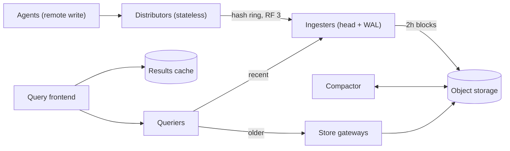

## In one minute
- **Series, not samples, are the unit of cost.** Every distinct label set is a series that holds memory in the write tier and entries in the index. A hundred million active series is a harder problem than ten million samples per second.
- **Shard writes by series hash and replicate in memory.** Stateless distributors hash each series onto a ring of ingesters, write to 3 of them, and acknowledge after 2. Ingesters keep the last two hours in a compressed in-memory head with a write-ahead log.
- **Immutable blocks in object storage hold history.** Every two hours each ingester cuts a block (chunks plus an inverted index), uploads it, and a compactor merges the three replica copies into one and builds larger blocks. Object storage makes retention cheap and the fleet stateless beyond the head.
- **Queries are split, cached and pushed down.** A query frontend cuts long ranges into day-sized pieces, serves repeated pieces from a results cache, and sends recent data to ingesters and older data to store gateways.
- **Downsampling and limits keep it affordable.** Dashboards over a year read 5-minute or 1-hour rollups, and per-tenant series limits stop one bad label from taking the cluster down.

## Requirements
**Functional**
- Ingest samples `(labels, timestamp_ms, float64)` pushed by agents or Prometheus servers using remote write.
- Query with label matchers and range functions (`rate`, `sum by`, quantiles over histograms) over any window up to 5 years.
- List series, label names and label values for autocompletion in dashboards.
- Multi-tenant: each team or customer gets isolated data, limits and billing.
- Retention per tenant: raw data for 13 months, rollups for 5 years.

**Non-functional**
- Ingest 100 million active series at a 15 s interval, with peaks at twice the average sample rate.
- A sample becomes queryable within 10 seconds of being accepted. Accepted samples survive the loss of one ingester or one zone.
- p99 under 1 s for queries over the last 6 hours touching up to 10,000 series, and under 10 s for a 30-day query.
- Write availability of 99.9%. Monitoring must keep working during the incidents it is there to observe, so writes are favoured over strict consistency.

**Out of scope:** the alert manager and notification routing, log and trace storage, and the agents that scrape targets. See [Prometheus](prometheus.md) for the single-node engine this design scales out.

## Back-of-envelope
Round, assumed numbers for a large company's shared metrics platform.

- **Sample rate:** 100M active series ÷ 15 s ≈ 6.7M samples/s on average. Deploys churn pod labels and agents replay backlogs after network blips, so plan for 15M/s at peak.
- **Write bandwidth:** Remote Write 1.0 resends labels with every batch. The 2.0 spec interns every string in a per-request symbols table, but it is still an experimental release candidate ([Remote-Write 2.0 spec](https://prometheus.io/docs/specs/prw/remote_write_spec_2_0/)), so plan with 1.0 numbers. Assume about 15 bytes per sample on the wire after snappy compression: 6.7M × 15 B ≈ 100 MB/s on average and 225 MB/s at peak. Replicating to 3 ingesters triples the internal traffic to about 675 MB/s at peak.
- **Ingester memory:** an active series costs roughly 4 KB in the head (labels, index entries, the open chunk). 100M × 4 KB × 3 replicas ≈ 1.2 TB of RAM. With 64 GB ingesters kept at half memory, that is 1.2 TB ÷ 32 GB ≈ 38 ingesters; run 45 across 3 zones.
- **Storage per day:** Gorilla-style chunks cost about 1.3 bytes per sample. Facebook's Gorilla paper measured 1.37 bytes per point, a 12x reduction ([Gorilla paper](https://www.vldb.org/pvldb/vol8/p1816-teller.pdf)), and Prometheus quotes 1 to 2 bytes ([Prometheus docs](https://prometheus.io/docs/prometheus/latest/storage/)). 6.7M × 86,400 × 1.3 B ≈ 750 GB a day, about 0.8 TB with the index, after the compactor removes the replica copies.
- **Retention:** 13 months of raw data is 395 × 0.8 TB ≈ 316 TB. Keeping raw data for 5 years would be 1,826 × 0.8 TB ≈ 1.46 PB. Instead, 5-minute rollups store 5 aggregates per 5 minutes in place of 20 raw samples; assume they take 40% of the raw bytes because aggregates compress worse. That gives 0.32 TB × 1,826 ≈ 585 TB, so about 900 TB in object storage in total. Treat the 40% as optimistic: Thanos warns that its 5-minute blocks are often only slightly smaller than raw ones, because downsampling exists for query speed, not space ([Thanos docs](https://thanos.io/tip/components/compact.md/)). If that happens, keep only 1-hour rollups past 13 months, which hold 5 values per 240 raw samples and fit the budget easily. At about $0.023 per GB-month that is around $21,000 a month, which is cheap compared with the RAM in the write tier.
- **Query load:** 4,000 open dashboards with 20 panels refreshing every 30 s is about 2,700 queries/s. 300,000 alerting and recording rules evaluated every 60 s add 5,000 queries/s. Nearly all of them read only the last hour.

## API
```text
POST /api/v1/push                      (protobuf, snappy; header X-Scope-OrgID: tenant)
  body: { timeseries: [ { labels: [ {name, value} ... ],
                          samples: [ {timestamp_ms, value} ... ] } ... ] }
  -> 200 | 400 { out_of_order | too_old | invalid_labels } | 429 { series_limit | rate_limit }

GET /api/v1/query_range?query=sum by (code)(rate(http_requests_total{job="api"}[5m]))
                       &start=1760572800&end=1760594400&step=60
  -> { resultType: "matrix", result: [ { metric: {code: "500"}, values: [ [t, "v"] ... ] } ] }

GET /api/v1/series?match[]={job="api"}&start=..&end=..   -> [ {labels} ... ]
GET /api/v1/label/{name}/values?start=..&end=..          -> [ "value" ... ]
```

The write API is a batch of series, each with a few samples, because agents buffer 5 to 10 seconds of scrapes. A 400 response tells the agent to drop the batch, because retrying an out-of-order sample will never succeed. A 429 tells it to back off and retry. Queries are evaluated at fixed `step` intervals, which is what makes their results cacheable.

## Data model
**Series identity.** A series is its sorted label set, for example `{__name__="http_requests_total", job="api", code="500"}`. Its ID is a 64-bit hash of the sorted labels. The distributor uses `hash(tenant, labels)` to place it on the ingester ring, so all samples of one series land on the same 3 ingesters in order.

**Head (per ingester, per tenant).** A map from series ID to `memSeries` (labels, last timestamp, chunks of up to 120 samples), plus postings from each `(name, value)` pair to a sorted list of series IDs, backed by a WAL on local SSD. It covers about 2 to 3 hours, because samples are cut into two-hour blocks ([Prometheus docs](https://prometheus.io/docs/prometheus/latest/storage/)).

**Block (in object storage).** `tenant/01J9Z.../`, named by a time-sortable ULID, holds `chunks/000001` (compressed chunks), `index` (symbol table, series entries with chunk references, postings and a postings offset table) and `meta.json` (time range, compaction level, sources, downsampling resolution). Blocks are immutable; compaction writes new ones and marks old ones for deletion. A small per-tenant bucket index lists blocks and their time ranges so queriers never list the bucket.

**Limits.** A per-tenant table of maximum active series, samples per second, label length, series per query and retention, reloaded without restart.

Partitioning by series hash rather than metric name matters: a popular metric like `http_requests_total` might have 5M series by itself, and hashing by name would put them all on one ingester.

## High-level design


**Write path.**
1. A distributor validates the batch, checks the tenant's rate and series limits, and drops samples from the non-elected replica of each high-availability Prometheus pair.
2. It hashes each series' label set onto the ring and sends the samples to the 3 owning ingesters, one per zone. Mimir's classic architecture works this way, with a replication factor of 3 and zone-aware placement ([Mimir ingester docs](https://grafana.com/docs/mimir/latest/references/architecture/components/ingester/)).
3. Each ingester appends to its WAL and to the series' open chunk, creating the series and its postings if new.
4. When 2 of 3 succeed, the distributor returns 200.
5. Every 2 hours each ingester cuts its head into a block, uploads it and truncates the WAL. The compactor later merges the 3 replica blocks into one.

**Read path.**
1. The query frontend aligns the range to the step, splits a 7-day query into 7 one-day pieces, and serves cached days.
2. For each missing piece, a querier intersects postings to find series and fetches chunks: the last 12 hours or so from ingesters, older data from store gateways reading object storage.
3. The querier merges overlapping replica samples by timestamp, runs PromQL functions per series, then aggregates. The frontend stitches and caches complete days.

## Deep dives
### 1. Sharding and replicating the write path
Options: shard by tenant (simple, but one big tenant overflows a node), shard by metric name (a hot metric overflows a node), or shard by series hash (load spreads evenly, but every query fans out to many ingesters). I shard by series hash, because writes are continuous and must never hot-spot, while queries can afford the fan-out.

Replication uses a write quorum of 2 out of 3, without consensus. Monitoring data tolerates a little divergence: a sample that reached 2 ingesters but not the third leaves a gap that the merge on read fills in. Running Raft per series would cost a consensus round per batch, and it would block writes during elections in exactly the outage you need to watch. Ring membership is stored in a gossip-based or key-value store. When an ingester leaves, its series move to the next token owners, and the departing ingester flushes its head to object storage so nothing is lost.

A newer option puts a log in front of the ingesters. Mimir 3.0 calls its Kafka-based ingest storage the preferred architecture: distributors write each series to one Kafka partition and acknowledge once Kafka has replicated and persisted it, and each zone runs one ingester per partition that consumes from it. Reads are slightly stale by default, typically under a second, and a query can ask for read-after-write by sending `X-Read-Consistency: strong` ([Mimir docs](https://grafana.com/docs/mimir/latest/get-started/about-grafana-mimir-architecture/about-ingest-storage-architecture/)). I'd choose it when a Kafka platform team already exists, because it lets ingesters crash or scale without failing writes.

Late samples are the subtle problem. A TSDB with Gorilla compression wants samples in order within each series, because the chunk is an append-only bitstream. Agents that buffer during a network partition send old samples late. I reject samples older than the head's lower bound, or older than the series' last timestamp, with `out_of_order`. For tenants that need it, I enable a small out-of-order window that keeps late samples in a separate uncompressed buffer, which is merged when the block is cut. Prometheus exposes this as `out_of_order_time_window`, which defaults to 0, so it is off unless you set it ([Prometheus config](https://prometheus.io/docs/prometheus/latest/configuration/configuration/)).

### 2. Cardinality and limits
A developer adds `user_id` to a request counter, and 5M new series appear within an hour. Each costs about 4 KB on 3 ingesters, so this one change adds 60 GB of RAM and a block index that grows with every query. Options: limit globally (one tenant hurts all the others), limit per tenant at the distributor (fair and cheap), or drop labels on ingest (fast to stop the damage, but it silently changes the data).

I enforce per-tenant limits on active series and on series per metric at the distributor, and return 429 with a clear reason. A cardinality API shows each tenant its top metrics and top label values, so teams can fix the cause. Series churn, where short-lived pods create new series every deploy, is the other half of the problem. A series created and abandoned within an hour still costs a full index entry in every block that covers that hour, so I alert on churn rate, not just on active count.

### 3. Fast queries over long ranges
A 30-day query over 10,000 series at 15 s resolution touches 1.7 billion samples. The design reduces that in three ways:
- **Step-aligned splitting and caching.** Splitting by day turns one long query into 30 short ones; 24 hours is Mimir's default split interval ([Mimir query-frontend](https://grafana.com/docs/mimir/latest/references/architecture/components/query-frontend/)). Yesterday's results never change, so a dashboard refresh recomputes only today.
- **Query sharding.** For an aggregate like `sum by (code)`, the frontend rewrites the query into 16 shards that each select `hash(series) mod 16 = i`, runs them in parallel, and sums the partial results.
- **Downsampling.** For steps of 5 minutes or more, the querier reads rollup blocks that store count, sum, min, max and the counter value per 5-minute bucket. That is 20 times fewer points, and `rate` can still be computed correctly from the counter values.

Store gateways keep only the header of each block index (symbols and the postings offset table) on local disk, and by default load it into memory only when a query first needs that block ([Mimir store-gateway](https://grafana.com/docs/mimir/latest/references/architecture/components/store-gateway/); [Mimir configuration reference](https://grafana.com/docs/mimir/latest/configure/configuration-parameters/)). They fetch postings and chunks with HTTP range reads, and cache them in a shared memory cache, so a cold 30-day query costs a few hundred object-storage GETs instead of downloading whole blocks.

## Down the stack
### Layer 1: The contract
- **Accepted means replicated.** A 200 from `push` means every sample in the batch is in the WAL of at least 2 ingesters in different zones.
- **In order per series.** Samples for a series must have strictly increasing timestamps, except within a configured out-of-order window. Rejected samples are reported per batch with a reason and are never partially applied to a series.
- **Read after write within seconds.** A sample is visible to queries as soon as one ingester holds it. Queries merge replicas, so a sample missing from one replica still appears.
- **Staleness.** When a scrape stops returning a series, the series is marked stale and drops out of results at once. A series that simply goes quiet is looked up at most 5 minutes back, the default lookback, so it never repeats its last value forever ([Prometheus docs](https://prometheus.io/docs/prometheus/latest/querying/basics/)).
- **Limits are explicit.** A write over a limit fails with 429 and the limit's name. It is never silently dropped.

### Layer 2: The mechanism
WAL records are `Series` (ID and labels, once per new series), `Samples` (ID, timestamp, value) and `Tombstones`, written in 32 KB pages inside 128 MB segments ([Prometheus docs](https://prometheus.io/docs/prometheus/latest/storage/)) and checkpointed when the head is truncated. Replaying them is why ingester restarts take minutes at high cardinality, and why closed head chunks are memory-mapped rather than rebuilt.

Chunks use delta-of-delta timestamps and XOR values, as in [Time Series Databases](../sd/time-series-databases.md). Postings are sorted arrays of series IDs; N matchers intersect N lists in linear time, starting from the shortest. A negative matcher subtracts a list, and a regex expands to the matching values from the sorted value list.

Compaction is a k-way merge: the compactor walks the 3 replica blocks for the same 2 hours in sorted label order, merges samples by timestamp dropping duplicates, and writes one block, then merges 2-hour blocks into 12- and 24-hour ones so long queries open fewer indexes.

### Layer 3: The machine
- **Memory per series.** Label strings are interned, but each series still needs a struct with labels, chunk references and a lock (a few hundred bytes), an open chunk buffer, and 4 to 8 bytes of postings per label. Go's garbage collector scans all of it, so heap size drives CPU too.
- **WAL writes.** The WAL calls `fsync` per segment or on an interval, not per sample. A crash can lose about the last second on one replica, which the other two cover.
- **Decode speed.** Gorilla decoding is bit-serial and branchy; a core manages on the order of 100 million samples per second at best, so the 1.7 billion samples in deep dive 3 cost seconds of CPU. Sharding, caching and rollups remove that.
- **Object storage latency.** First byte takes 20 to 100 ms, so store gateways merge nearby chunk ranges into one range read and run hundreds of reads in parallel.
- **Cache lines.** Intersecting sorted 4-byte IDs streams through memory and suits the prefetcher, which is why postings are arrays rather than trees.

### Why it's built this way
1. Monitoring data arrives continuously from everywhere and must keep flowing during outages, so writes use a sloppy 2-of-3 quorum without consensus.
2. Recent data is read far more than old data and must be fresh, so it stays in memory in ingesters, and old data goes to immutable blocks.
3. Immutable blocks fit object storage, which is the cheapest durable store per byte, so the stateful tier is only a few hours deep.
4. Queries over long ranges would otherwise scan billions of points, so they are split, cached and run against rollups.
5. Every series costs memory on three machines, so cardinality is limited per tenant at the front door.

## Failure modes
- **10x load.** A reconnect wave replays buffered samples. Distributors return 429 past per-tenant rate limits, agents retry with backoff from their local WAL, and ingesters near their memory limit refuse new series while still accepting samples for existing ones.
- **Ingester crash.** Its series stay readable on the other two replicas, and it replays its WAL on restart. If it is gone for good, unflushed head data survives on those replicas.
- **Zone outage.** Writes still reach 2 of 3 replicas and keep succeeding. A small cluster in another region monitors the monitoring system so this outage is visible.
- **Hot tenant or cardinality bomb.** A deploy adds an unbounded label. The tenant hits its series limit and gets 429s on new series only, and a cardinality report points to the label. Other tenants are not affected.
- **Expensive query.** A query like `{__name__=~".+"}` over 30 days would read everything. Cap the series and chunk bytes per query, enforce timeouts in the frontend, and run queries in per-tenant fair queues so one heavy user cannot starve alert evaluation.
- **Compactor lag.** If the compactor falls behind, queries over recent days open 3 times as many blocks with duplicated data. Alert on the age of the oldest uncompacted block and scale compactors horizontally by tenant.

## In the wild
- **Grafana Labs, 2019: ingesters preempted one after another.** A new Cortex cluster went out without the new pod priority classes, so its ingesters got the default "medium" priority, higher than production ingesters, which had none. Each new pod preempted a production ingester, whose replacement preempted another, until writes could not reach enough replicas. The outage lasted about 26 minutes and lost no data, because customers' Prometheus servers buffered remote write in their WAL and replayed it. Changes: ingesters got high priority, and cluster-wide config changes now need a design document ([Grafana Labs](https://grafana.com/blog/2019/07/24/how-a-production-outage-was-caused-using-kubernetes-pod-priorities/)).
- **Cloudflare, 2023: guarding 916 Prometheus servers against cardinality.** Cloudflare runs about 4.9 billion series. A metric that suddenly gains a high-cardinality label can exhaust memory, so it sets `sample_limit` to 200 per scrape by default, patched Prometheus to drop only the excess new series instead of failing the scrape, and added a hard cap on total series per server ([Cloudflare](https://blog.cloudflare.com/how-cloudflare-runs-prometheus-at-scale/)).
- **Roblox, 2021: monitoring shared fate with the outage.** During a 73-hour outage caused by Consul contention, Roblox's telemetry also depended on that Consul cluster, a circular dependency that the postmortem says severely hampered triage. Afterwards it made telemetry independent of Consul, the same reason this design monitors the monitoring from another region ([Roblox](https://about.roblox.com/newsroom/2022/01/roblox-return-to-service-10-28-10-31-2021/)).

## Trade-offs
| Option | Strengths | Weaknesses | Choose when |
|---|---|---|---|
| Shard by series hash | Even write load, no hot nodes | Every query fans out to many ingesters | High cardinality, continuous writes |
| Shard by metric or tenant | Queries hit one node | Hot metrics and big tenants overflow | Small scale |
| 2-of-3 quorum without consensus | Writes survive failures, low latency | Replicas can briefly differ | Metrics and other loss-tolerant data |
| Consensus per shard | Exactly one history | Election stalls, more latency | Financial or audit data |
| Object storage for blocks | Cheap, durable, stateless queriers | 20 to 100 ms first byte, needs caches | Retention longer than days |
| Local disks only | Fast, simple | Scaling and recovery move terabytes | Single cluster, short retention |
| Raw data only | Exact answers | Year-long queries scan billions of points | Short retention |
| Downsampled rollups | 20x fewer points for long ranges | Loses detail, must keep counter semantics | Dashboards over months or years |

## Leadership lens
- **Build first:** ingestion with series-hash sharding and quorum writes, the head with WAL, and block upload. Long-range query speedups come after real users exist. Per-tenant limits ship on day one, because the first cardinality incident always comes sooner than expected.
- **Ownership:** an observability platform team runs the TSDB and its limits. Service teams own their instrumentation and their cardinality budget, and they see it on a dashboard that shows their cost.
- **Cost drivers:** ingester RAM grows with active series, and that is the dominant cost; object storage is small by comparison. Charging tenants back by active series changes behaviour faster than any guideline.
- **Rollout:** run the new system in parallel by dual-writing from agents, compare query results for a few weeks, move dashboards first and alerts last.
- **Questions for design review:** what happens to alerting when this cluster is down; who approves raising a tenant's series limit; how far back must a query reach to explain an incident, and does that data exist at the needed resolution.

## Check yourself
1. Why does the design shard writes by a hash of the series label set rather than by metric name or tenant?
   **Answer:** Writes are continuous and must never hot-spot, and a popular metric like `http_requests_total` can have 5M series that would all land on one ingester if hashed by name. Series-hash sharding spreads load evenly, at the cost of every query fanning out to many ingesters.
2. A developer adds `user_id` to a request counter and 5M new series appear within an hour. What does that cost, and how does the design contain it?
   **Answer:** At about 4 KB per series on 3 ingesters, it adds roughly 60 GB of RAM plus a growing block index. Per-tenant series limits at the distributor return 429 on new series only, and a cardinality report points the team to the offending label while other tenants are unaffected.
3. Why are writes acknowledged after 2 of 3 ingesters with no consensus protocol, and when would you choose consensus instead?
   **Answer:** Monitoring must keep working during the outages it observes, and a gap on one replica is filled by merging replicas on read, whereas Raft would add a consensus round per batch and stall writes during elections. Consensus per shard fits financial or audit data that needs exactly one history.
4. Roughly how much ingester RAM does 100M active series need, and why is that the dominant cost rather than object storage?
   **Answer:** About 100M x 4 KB x 3 replicas, or 1.2 TB, which is around 45 ingesters of 64 GB kept at half memory across 3 zones. All 900 TB of object storage costs only around $21,000 a month, so active series in RAM drive the bill.

## Practice
**Task:** Build the in-memory head of a TSDB: series identity, a postings index, append rules and selection by label matchers. `Head(window)` holds series keyed by their canonical label string, built by sorting labels by name and joining `name=value` pairs with commas (for example `job=api,path=/x`). `append(labels, t, v)` returns `"empty"` for an empty label set, `"too_old"` if `t < max_t - window` where `max_t` is the largest timestamp accepted so far (no check before the first sample), `"out_of_order"` if the series exists and `t` is not greater than its last timestamp, and otherwise stores the sample (creating the series and adding it to the postings for each label pair) and returns `"ok"`. `select(matchers, mint, maxt)` takes `(name, op, value)` triples with op `"="` or `"!="`, where a missing label counts as the empty string; it raises an error unless at least one matcher is `"="` with a non-empty value. It returns `(key, samples)` pairs sorted by key, where `samples` is the list of `(t, v)` with `mint <= t <= maxt`, and leaves out series with no sample in that range. `truncate(mint)` drops samples with `t < mint`, removes series left empty from the series map and the postings, and returns how many series were removed. `label_values(name)` returns the sorted distinct values of that label across the stored series.

```python starter
class Head:
    def __init__(self, window):
        self.window = window

    def append(self, labels, t, v):
        # TODO
        raise NotImplementedError

    def select(self, matchers, mint, maxt):
        # TODO
        raise NotImplementedError

    def truncate(self, mint):
        # TODO
        raise NotImplementedError

    def label_values(self, name):
        # TODO
        raise NotImplementedError
```

```python tests
def test_append_and_select():
    h = Head(1000)
    assert h.append({"job": "api", "code": "200"}, 10, 1.0) == "ok"
    assert h.append({"job": "api", "code": "500"}, 10, 2.0) == "ok"
    assert h.append({"job": "db"}, 10, 3.0) == "ok"
    assert h.append({"code": "500", "job": "api"}, 20, 4.0) == "ok"
    got = h.select([("job", "=", "api")], 0, 100)
    assert got == [("code=200,job=api", [(10, 1.0)]),
                   ("code=500,job=api", [(10, 2.0), (20, 4.0)])]

def test_rejections():
    h = Head(100)
    assert h.append({}, 5, 1.0) == "empty"
    assert h.append({"a": "1"}, 1000, 1.0) == "ok"
    assert h.append({"a": "1"}, 1000, 2.0) == "out_of_order", "duplicate timestamp"
    assert h.append({"a": "1"}, 999, 2.0) == "out_of_order"
    assert h.append({"b": "1"}, 899, 1.0) == "too_old"
    assert h.append({"b": "1"}, 900, 1.0) == "ok", "exactly at the window edge"
    assert h.select([("a", "=", "1")], 0, 2000) == [("a=1", [(1000, 1.0)])]
    assert h.label_values("b") == ["1"]

def test_rejected_new_series_is_not_indexed():
    h = Head(10)
    h.append({"a": "1"}, 100, 1.0)
    assert h.append({"a": "2"}, 50, 1.0) == "too_old"
    assert h.label_values("a") == ["1"]

def test_negative_matchers_and_missing_labels():
    h = Head(1000)
    h.append({"job": "api", "code": "200"}, 1, 1.0)
    h.append({"job": "api", "code": "500"}, 1, 1.0)
    h.append({"job": "api"}, 1, 1.0)
    keys = [k for k, _ in h.select([("job", "=", "api"), ("code", "!=", "200")], 0, 10)]
    assert keys == ["code=500,job=api", "job=api"], "missing label counts as empty"
    keys = [k for k, _ in h.select([("job", "=", "api"), ("code", "=", "")], 0, 10)]
    assert keys == ["job=api"]
    assert h.select([("job", "=", "nope")], 0, 10) == []

def test_needs_positive_matcher():
    h = Head(1000)
    h.append({"job": "api"}, 1, 1.0)
    for bad in ([], [("job", "!=", "x")], [("job", "=", "")]):
        try:
            h.select(bad, 0, 10)
            assert False, "expected an error"
        except ValueError:
            pass

def test_time_range_filters_samples_and_series():
    h = Head(1000)
    h.append({"s": "a"}, 10, 1.0)
    h.append({"s": "a"}, 20, 2.0)
    h.append({"s": "a"}, 30, 3.0)
    h.append({"s": "b"}, 5, 9.0)
    h.append({"t": "x", "s": "c"}, 25, 4.0)
    assert h.select([("s", "!=", "z"), ("s", "=", "a")], 20, 30) == [("s=a", [(20, 2.0), (30, 3.0)])]
    got = h.select([("t", "=", "x")], 0, 24)
    assert got == []

def test_truncate_cleans_postings():
    h = Head(1000)
    h.append({"job": "api", "pod": "p1"}, 10, 1.0)
    h.append({"job": "api", "pod": "p2"}, 10, 1.0)
    h.append({"job": "api", "pod": "p2"}, 50, 2.0)
    assert h.truncate(20) == 1
    assert h.label_values("pod") == ["p2"]
    assert h.select([("job", "=", "api")], 0, 100) == [("job=api,pod=p2", [(50, 2.0)])]
    assert h.truncate(20) == 0
    assert h.label_values("nothing") == []
```

```python solution
class Head:
    def __init__(self, window):
        self.window = window
        self.max_t = None
        self.series = {}
        self.labels = {}
        self.postings = {}

    @staticmethod
    def _key(labels):
        return ",".join(n + "=" + labels[n] for n in sorted(labels))

    def append(self, labels, t, v):
        if not labels:
            return "empty"
        if self.max_t is not None and t < self.max_t - self.window:
            return "too_old"
        key = self._key(labels)
        samples = self.series.get(key)
        if samples is not None and t <= samples[-1][0]:
            return "out_of_order"
        if samples is None:
            samples = []
            self.series[key] = samples
            self.labels[key] = dict(labels)
            for n, val in labels.items():
                self.postings.setdefault((n, val), set()).add(key)
        samples.append((t, v))
        if self.max_t is None or t > self.max_t:
            self.max_t = t
        return "ok"

    def select(self, matchers, mint, maxt):
        positive = [m for m in matchers if m[1] == "=" and m[2] != ""]
        if not positive:
            raise ValueError("need at least one non-empty equality matcher")
        candidates = None
        for n, _, val in positive:
            ids = self.postings.get((n, val), set())
            candidates = set(ids) if candidates is None else candidates & ids
        out = []
        for key in sorted(candidates):
            lab = self.labels[key]
            ok = True
            for n, op, val in matchers:
                have = lab.get(n, "")
                if (op == "=" and have != val) or (op == "!=" and have == val):
                    ok = False
                    break
            if not ok:
                continue
            pts = [(t, v) for t, v in self.series[key] if mint <= t <= maxt]
            if pts:
                out.append((key, pts))
        return out

    def truncate(self, mint):
        removed = 0
        for key in list(self.series):
            kept = [p for p in self.series[key] if p[0] >= mint]
            if kept:
                self.series[key] = kept
                continue
            removed += 1
            del self.series[key]
            for pair in self.labels.pop(key).items():
                ids = self.postings[pair]
                ids.discard(key)
                if not ids:
                    del self.postings[pair]
        return removed

    def label_values(self, name):
        return sorted(val for n, val in self.postings if n == name)
```

```typescript starter
export type Matcher = [string, string, string];
export type Point = [number, number];

export class Head {
  constructor(public window: number) {}

  append(labels: Record<string, string>, t: number, v: number): string {
    throw new Error("TODO");
  }

  select(matchers: Matcher[], mint: number, maxt: number): [string, Point[]][] {
    throw new Error("TODO");
  }

  truncate(mint: number): number {
    throw new Error("TODO");
  }

  labelValues(name: string): string[] {
    throw new Error("TODO");
  }
}
```

```typescript tests
test("append and select", () => {
  const h = new Head(1000);
  assertEqual(h.append({ job: "api", code: "200" }, 10, 1.0), "ok");
  assertEqual(h.append({ job: "api", code: "500" }, 10, 2.0), "ok");
  assertEqual(h.append({ job: "db" }, 10, 3.0), "ok");
  assertEqual(h.append({ code: "500", job: "api" }, 20, 4.0), "ok");
  assertEqual(h.select([["job", "=", "api"]], 0, 100), [
    ["code=200,job=api", [[10, 1.0]]],
    ["code=500,job=api", [[10, 2.0], [20, 4.0]]],
  ]);
});

test("rejections", () => {
  const h = new Head(100);
  assertEqual(h.append({}, 5, 1.0), "empty");
  assertEqual(h.append({ a: "1" }, 1000, 1.0), "ok");
  assertEqual(h.append({ a: "1" }, 1000, 2.0), "out_of_order", "duplicate timestamp");
  assertEqual(h.append({ a: "1" }, 999, 2.0), "out_of_order");
  assertEqual(h.append({ b: "1" }, 899, 1.0), "too_old");
  assertEqual(h.append({ b: "1" }, 900, 1.0), "ok", "exactly at the window edge");
  assertEqual(h.select([["a", "=", "1"]], 0, 2000), [["a=1", [[1000, 1.0]]]]);
  assertEqual(h.labelValues("b"), ["1"]);
});

test("rejected new series is not indexed", () => {
  const h = new Head(10);
  h.append({ a: "1" }, 100, 1.0);
  assertEqual(h.append({ a: "2" }, 50, 1.0), "too_old");
  assertEqual(h.labelValues("a"), ["1"]);
});

test("negative matchers and missing labels", () => {
  const h = new Head(1000);
  h.append({ job: "api", code: "200" }, 1, 1.0);
  h.append({ job: "api", code: "500" }, 1, 1.0);
  h.append({ job: "api" }, 1, 1.0);
  let keys = h.select([["job", "=", "api"], ["code", "!=", "200"]], 0, 10).map((r) => r[0]);
  assertEqual(keys, ["code=500,job=api", "job=api"], "missing label counts as empty");
  keys = h.select([["job", "=", "api"], ["code", "=", ""]], 0, 10).map((r) => r[0]);
  assertEqual(keys, ["job=api"]);
  assertEqual(h.select([["job", "=", "nope"]], 0, 10), []);
});

test("needs positive matcher", () => {
  const h = new Head(1000);
  h.append({ job: "api" }, 1, 1.0);
  const bads: Matcher[][] = [[], [["job", "!=", "x"]], [["job", "=", ""]]];
  for (const bad of bads) {
    let threw = false;
    try {
      h.select(bad, 0, 10);
    } catch (e) {
      threw = true;
    }
    assert(threw, "expected an error");
  }
});

test("time range filters samples and series", () => {
  const h = new Head(1000);
  h.append({ s: "a" }, 10, 1.0);
  h.append({ s: "a" }, 20, 2.0);
  h.append({ s: "a" }, 30, 3.0);
  h.append({ s: "b" }, 5, 9.0);
  h.append({ t: "x", s: "c" }, 25, 4.0);
  assertEqual(h.select([["s", "!=", "z"], ["s", "=", "a"]], 20, 30), [["s=a", [[20, 2.0], [30, 3.0]]]]);
  assertEqual(h.select([["t", "=", "x"]], 0, 24), []);
});

test("truncate cleans postings", () => {
  const h = new Head(1000);
  h.append({ job: "api", pod: "p1" }, 10, 1.0);
  h.append({ job: "api", pod: "p2" }, 10, 1.0);
  h.append({ job: "api", pod: "p2" }, 50, 2.0);
  assertEqual(h.truncate(20), 1);
  assertEqual(h.labelValues("pod"), ["p2"]);
  assertEqual(h.select([["job", "=", "api"]], 0, 100), [["job=api,pod=p2", [[50, 2.0]]]]);
  assertEqual(h.truncate(20), 0);
  assertEqual(h.labelValues("nothing"), []);
});
```

```typescript solution
export type Matcher = [string, string, string];
export type Point = [number, number];

export class Head {
  private maxT: number | null = null;
  private series = new Map<string, Point[]>();
  private labels = new Map<string, Record<string, string>>();
  private postings = new Map<string, Set<string>>();

  constructor(public window: number) {}

  private static key(labels: Record<string, string>): string {
    return Object.keys(labels)
      .sort()
      .map((n) => n + "=" + labels[n])
      .join(",");
  }

  private static pair(name: string, value: string): string {
    return name + "\u0000" + value;
  }

  append(labels: Record<string, string>, t: number, v: number): string {
    if (Object.keys(labels).length === 0) return "empty";
    if (this.maxT !== null && t < this.maxT - this.window) return "too_old";
    const key = Head.key(labels);
    let samples = this.series.get(key);
    if (samples !== undefined && t <= samples[samples.length - 1][0]) return "out_of_order";
    if (samples === undefined) {
      samples = [];
      this.series.set(key, samples);
      this.labels.set(key, { ...labels });
      for (const n of Object.keys(labels)) {
        const p = Head.pair(n, labels[n]);
        let ids = this.postings.get(p);
        if (!ids) {
          ids = new Set();
          this.postings.set(p, ids);
        }
        ids.add(key);
      }
    }
    samples.push([t, v]);
    if (this.maxT === null || t > this.maxT) this.maxT = t;
    return "ok";
  }

  select(matchers: Matcher[], mint: number, maxt: number): [string, Point[]][] {
    const positive = matchers.filter((m) => m[1] === "=" && m[2] !== "");
    if (positive.length === 0) throw new Error("need at least one non-empty equality matcher");
    const lists = positive.map(([n, , val]) => this.postings.get(Head.pair(n, val)) ?? new Set<string>());
    const candidates = [...lists[0]].filter((k) => lists.every((ids) => ids.has(k)));
    const out: [string, Point[]][] = [];
    for (const key of candidates.sort()) {
      const lab = this.labels.get(key)!;
      const ok = matchers.every(([n, op, val]) => {
        const have = lab[n] ?? "";
        return op === "=" ? have === val : have !== val;
      });
      if (!ok) continue;
      const pts = this.series.get(key)!.filter(([t]) => mint <= t && t <= maxt);
      if (pts.length > 0) out.push([key, pts]);
    }
    return out;
  }

  truncate(mint: number): number {
    let removed = 0;
    for (const [key, samples] of [...this.series.entries()]) {
      const kept = samples.filter(([t]) => t >= mint);
      if (kept.length > 0) {
        this.series.set(key, kept);
        continue;
      }
      removed++;
      this.series.delete(key);
      const lab = this.labels.get(key)!;
      this.labels.delete(key);
      for (const n of Object.keys(lab)) {
        const p = Head.pair(n, lab[n]);
        const ids = this.postings.get(p)!;
        ids.delete(key);
        if (ids.size === 0) this.postings.delete(p);
      }
    }
    return removed;
  }

  labelValues(name: string): string[] {
    const out: string[] = [];
    for (const p of this.postings.keys()) {
      const i = p.indexOf("\u0000");
      if (p.slice(0, i) === name) out.push(p.slice(i + 1));
    }
    return out.sort();
  }
}
```

```go starter
package practice

import "errors"

type Matcher struct {
	Name, Op, Value string
}

type Point struct {
	T int64
	V float64
}

type Series struct {
	Key     string
	Samples []Point
}

var ErrNoPositiveMatcher = errors.New("need at least one non-empty equality matcher")

type Head struct {
	Window int64
}

func NewHead(window int64) *Head { return &Head{Window: window} }

func (h *Head) Append(labels map[string]string, t int64, v float64) string { panic("TODO") }

func (h *Head) Select(matchers []Matcher, mint, maxt int64) ([]Series, error) { panic("TODO") }

func (h *Head) Truncate(mint int64) int { panic("TODO") }

func (h *Head) LabelValues(name string) []string { panic("TODO") }
```

```go tests
package practice

import (
	"reflect"
	"testing"
)

func keysOf(rs []Series) []string {
	out := []string{}
	for _, r := range rs {
		out = append(out, r.Key)
	}
	return out
}

func mustSelect(t *testing.T, h *Head, ms []Matcher, mint, maxt int64) []Series {
	t.Helper()
	rs, err := h.Select(ms, mint, maxt)
	if err != nil {
		t.Fatalf("unexpected error: %v", err)
	}
	return rs
}

func same(t *testing.T, got, want interface{}, msg string) {
	t.Helper()
	if !reflect.DeepEqual(got, want) {
		t.Fatalf("%s: got %v want %v", msg, got, want)
	}
}

func TestAppendAndSelect(t *testing.T) {
	h := NewHead(1000)
	same(t, h.Append(map[string]string{"job": "api", "code": "200"}, 10, 1), "ok", "a1")
	same(t, h.Append(map[string]string{"job": "api", "code": "500"}, 10, 2), "ok", "a2")
	same(t, h.Append(map[string]string{"job": "db"}, 10, 3), "ok", "a3")
	same(t, h.Append(map[string]string{"code": "500", "job": "api"}, 20, 4), "ok", "a4")
	got := mustSelect(t, h, []Matcher{{"job", "=", "api"}}, 0, 100)
	want := []Series{
		{"code=200,job=api", []Point{{10, 1}}},
		{"code=500,job=api", []Point{{10, 2}, {20, 4}}},
	}
	same(t, got, want, "select")
}

func TestRejections(t *testing.T) {
	h := NewHead(100)
	same(t, h.Append(map[string]string{}, 5, 1), "empty", "empty")
	same(t, h.Append(map[string]string{"a": "1"}, 1000, 1), "ok", "first")
	same(t, h.Append(map[string]string{"a": "1"}, 1000, 2), "out_of_order", "duplicate timestamp")
	same(t, h.Append(map[string]string{"a": "1"}, 999, 2), "out_of_order", "older")
	same(t, h.Append(map[string]string{"b": "1"}, 899, 1), "too_old", "too old")
	same(t, h.Append(map[string]string{"b": "1"}, 900, 1), "ok", "exactly at the window edge")
	same(t, mustSelect(t, h, []Matcher{{"a", "=", "1"}}, 0, 2000), []Series{{"a=1", []Point{{1000, 1}}}}, "kept first")
	same(t, h.LabelValues("b"), []string{"1"}, "values")
}

func TestRejectedNewSeriesIsNotIndexed(t *testing.T) {
	h := NewHead(10)
	h.Append(map[string]string{"a": "1"}, 100, 1)
	same(t, h.Append(map[string]string{"a": "2"}, 50, 1), "too_old", "too old")
	same(t, h.LabelValues("a"), []string{"1"}, "not indexed")
}

func TestNegativeMatchersAndMissingLabels(t *testing.T) {
	h := NewHead(1000)
	h.Append(map[string]string{"job": "api", "code": "200"}, 1, 1)
	h.Append(map[string]string{"job": "api", "code": "500"}, 1, 1)
	h.Append(map[string]string{"job": "api"}, 1, 1)
	got := keysOf(mustSelect(t, h, []Matcher{{"job", "=", "api"}, {"code", "!=", "200"}}, 0, 10))
	same(t, got, []string{"code=500,job=api", "job=api"}, "missing label counts as empty")
	got = keysOf(mustSelect(t, h, []Matcher{{"job", "=", "api"}, {"code", "=", ""}}, 0, 10))
	same(t, got, []string{"job=api"}, "empty equality")
	same(t, len(mustSelect(t, h, []Matcher{{"job", "=", "nope"}}, 0, 10)), 0, "no match")
}

func TestNeedsPositiveMatcher(t *testing.T) {
	h := NewHead(1000)
	h.Append(map[string]string{"job": "api"}, 1, 1)
	for _, bad := range [][]Matcher{{}, {{"job", "!=", "x"}}, {{"job", "=", ""}}} {
		if _, err := h.Select(bad, 0, 10); err == nil {
			t.Fatalf("expected an error for %v", bad)
		}
	}
}

func TestTimeRangeFiltersSamplesAndSeries(t *testing.T) {
	h := NewHead(1000)
	h.Append(map[string]string{"s": "a"}, 10, 1)
	h.Append(map[string]string{"s": "a"}, 20, 2)
	h.Append(map[string]string{"s": "a"}, 30, 3)
	h.Append(map[string]string{"s": "b"}, 5, 9)
	h.Append(map[string]string{"t": "x", "s": "c"}, 25, 4)
	got := mustSelect(t, h, []Matcher{{"s", "!=", "z"}, {"s", "=", "a"}}, 20, 30)
	same(t, got, []Series{{"s=a", []Point{{20, 2}, {30, 3}}}}, "range")
	same(t, len(mustSelect(t, h, []Matcher{{"t", "=", "x"}}, 0, 24)), 0, "out of range")
}

func TestTruncateCleansPostings(t *testing.T) {
	h := NewHead(1000)
	h.Append(map[string]string{"job": "api", "pod": "p1"}, 10, 1)
	h.Append(map[string]string{"job": "api", "pod": "p2"}, 10, 1)
	h.Append(map[string]string{"job": "api", "pod": "p2"}, 50, 2)
	same(t, h.Truncate(20), 1, "removed")
	same(t, h.LabelValues("pod"), []string{"p2"}, "postings cleaned")
	same(t, mustSelect(t, h, []Matcher{{"job", "=", "api"}}, 0, 100), []Series{{"job=api,pod=p2", []Point{{50, 2}}}}, "left")
	same(t, h.Truncate(20), 0, "nothing more")
	same(t, len(h.LabelValues("nothing")), 0, "unknown label")
}
```

```go solution
package practice

import (
	"errors"
	"sort"
	"strings"
)

type Matcher struct {
	Name, Op, Value string
}

type Point struct {
	T int64
	V float64
}

type Series struct {
	Key     string
	Samples []Point
}

var ErrNoPositiveMatcher = errors.New("need at least one non-empty equality matcher")

type pair struct{ name, value string }

type Head struct {
	Window   int64
	hasMax   bool
	maxT     int64
	series   map[string][]Point
	labels   map[string]map[string]string
	postings map[pair]map[string]bool
}

func NewHead(window int64) *Head {
	return &Head{
		Window:   window,
		series:   map[string][]Point{},
		labels:   map[string]map[string]string{},
		postings: map[pair]map[string]bool{},
	}
}

func canonical(labels map[string]string) string {
	names := make([]string, 0, len(labels))
	for n := range labels {
		names = append(names, n)
	}
	sort.Strings(names)
	parts := make([]string, len(names))
	for i, n := range names {
		parts[i] = n + "=" + labels[n]
	}
	return strings.Join(parts, ",")
}

func (h *Head) Append(labels map[string]string, t int64, v float64) string {
	if len(labels) == 0 {
		return "empty"
	}
	if h.hasMax && t < h.maxT-h.Window {
		return "too_old"
	}
	key := canonical(labels)
	samples, exists := h.series[key]
	if exists && t <= samples[len(samples)-1].T {
		return "out_of_order"
	}
	if !exists {
		copied := map[string]string{}
		for n, val := range labels {
			copied[n] = val
			p := pair{n, val}
			if h.postings[p] == nil {
				h.postings[p] = map[string]bool{}
			}
			h.postings[p][key] = true
		}
		h.labels[key] = copied
	}
	h.series[key] = append(samples, Point{t, v})
	if !h.hasMax || t > h.maxT {
		h.hasMax, h.maxT = true, t
	}
	return "ok"
}

func (h *Head) Select(matchers []Matcher, mint, maxt int64) ([]Series, error) {
	var candidates map[string]bool
	for _, m := range matchers {
		if m.Op != "=" || m.Value == "" {
			continue
		}
		ids := h.postings[pair{m.Name, m.Value}]
		next := map[string]bool{}
		for k := range ids {
			if candidates == nil || candidates[k] {
				next[k] = true
			}
		}
		candidates = next
	}
	if candidates == nil {
		return nil, ErrNoPositiveMatcher
	}
	keys := make([]string, 0, len(candidates))
	for k := range candidates {
		keys = append(keys, k)
	}
	sort.Strings(keys)
	out := []Series{}
	for _, key := range keys {
		lab := h.labels[key]
		ok := true
		for _, m := range matchers {
			have := lab[m.Name]
			if (m.Op == "=" && have != m.Value) || (m.Op == "!=" && have == m.Value) {
				ok = false
				break
			}
		}
		if !ok {
			continue
		}
		var pts []Point
		for _, p := range h.series[key] {
			if mint <= p.T && p.T <= maxt {
				pts = append(pts, p)
			}
		}
		if len(pts) > 0 {
			out = append(out, Series{key, pts})
		}
	}
	return out, nil
}

func (h *Head) Truncate(mint int64) int {
	removed := 0
	for key, samples := range h.series {
		var kept []Point
		for _, p := range samples {
			if p.T >= mint {
				kept = append(kept, p)
			}
		}
		if len(kept) > 0 {
			h.series[key] = kept
			continue
		}
		removed++
		delete(h.series, key)
		for n, val := range h.labels[key] {
			p := pair{n, val}
			delete(h.postings[p], key)
			if len(h.postings[p]) == 0 {
				delete(h.postings, p)
			}
		}
		delete(h.labels, key)
	}
	return removed
}

func (h *Head) LabelValues(name string) []string {
	out := []string{}
	for p := range h.postings {
		if p.name == name {
			out = append(out, p.value)
		}
	}
	sort.Strings(out)
	return out
}
```

## Mock interview
**Prompt:** Design a time series database for company-wide metrics: 100 million active series scraped every 15 seconds, 13 months of raw retention, and dashboards and alerts that must stay fast. Walk me through how a sample travels from an agent to a stored block, and how a 30-day dashboard query is answered.

- Follow-up: One of the three ingesters for a series was down for 10 minutes. What do queries return for that window, and what does the compactor do with the three copies?
- Follow-up: A team adds `request_id` as a label and their series count goes from 50,000 to 40 million in an hour. What happens to the cluster, and what should have stopped it?
- Follow-up: Why not store metrics in a wide-column store such as Cassandra, with a row per series and a column per timestamp?

**A strong answer covers:**
- Sharding by a hash of the full label set, a 2-of-3 write quorum without consensus, and merging replicas on read.
- An in-memory head with WAL, chunks of about 120 samples with delta-of-delta and XOR compression, and 2-hour immutable blocks in object storage.
- An inverted index of sorted postings, intersected per query, with negative matchers applied by subtraction.
- Cardinality as the main cost, with per-tenant series limits, churn alerts and chargeback by active series.
- Long-range query speedups: step-aligned splitting, a results cache, query sharding and downsampled rollups that keep counter semantics.
- Capacity arithmetic showing that ingester RAM, not disk, dominates cost.

## Sources and further study
**Primary**
- [Prometheus Remote-Write 2.0 specification](https://prometheus.io/docs/specs/prw/remote_write_spec_2_0/): the wire protocol agents push with, including string interning and native histograms.
- [Prometheus TSDB index format](https://github.com/prometheus/prometheus/blob/main/tsdb/docs/format/index.md): the exact on-disk layout of symbols, series and postings.

**Systems docs**
- [About ingest storage architecture (Grafana Mimir)](https://grafana.com/docs/mimir/latest/get-started/about-grafana-mimir-architecture/about-ingest-storage-architecture/): the Kafka-based write path and its consistency options.
- [Compactor and downsampling (Thanos)](https://thanos.io/tip/components/compact.md/): how 5-minute and 1-hour rollups are built and why they cost space.
- [Store-gateway (Grafana Mimir)](https://grafana.com/docs/mimir/latest/references/architecture/components/store-gateway/): index-headers, the bucket index and the caches that make object storage fast enough.

**Books**
- *System Design Interview, Volume 2*, Alex Xu and Sahn Lam, Ch 5 "Metrics Monitoring".
- *Designing Data-Intensive Applications* (1st ed.), Martin Kleppmann, Ch 3 "Storage and Retrieval" (LSM trees and column-oriented storage).

**Other curricula**
- [Practical Alerting from Time-Series Data (Google SRE book, Ch 10)](https://sre.google/sre-book/practical-alerting/): frames the TSDB as the core of monitoring, through Borgmon, which the chapter notes Prometheus closely resembles.

## Watch
- [PromCon 2017: Storing 16 Bytes at Scale (Fabian Reinartz)](https://www.youtube.com/watch?v=b_pEevMAC3I): the design of the Prometheus 2 storage engine, blocks, postings and compaction, from its author.
- [Lifecycle of a Sample in the Prometheus TSDB (Ganesh Vernekar, FOSSASIA)](https://www.youtube.com/watch?v=35TAaAESLcc): a sample's path through the head, WAL, memory-mapped chunks and blocks.

## Free resources
- [Monarch: Google's Planet-Scale In-Memory Time Series Database (VLDB 2020)](https://www.vldb.org/pvldb/vol13/p3181-adams.pdf): a different global design, with in-memory regional zones and push-down query evaluation.
- [Gorilla: A Fast, Scalable, In-Memory Time Series Database (VLDB 2015)](https://www.vldb.org/pvldb/vol8/p1816-teller.pdf): the compression scheme and the argument for keeping recent data in memory.
- [Grafana Mimir architecture](https://grafana.com/docs/mimir/latest/references/architecture/): distributors, ingesters, store gateways, compactor and query frontend in a real horizontally scaled TSDB.
- [Grafana Mimir: configure high-availability deduplication](https://grafana.com/docs/mimir/latest/configure/configure-high-availability-deduplication/): how samples from redundant Prometheus pairs are deduplicated at ingest.
- [Prometheus TSDB: The Head Block (Ganesh Vernekar)](https://ganeshvernekar.com/blog/prometheus-tsdb-the-head-block/): how the head, WAL and memory-mapped chunks fit together.
- [Prometheus storage documentation](https://prometheus.io/docs/prometheus/latest/storage/): block layout, retention and the out-of-order window in the official docs.
