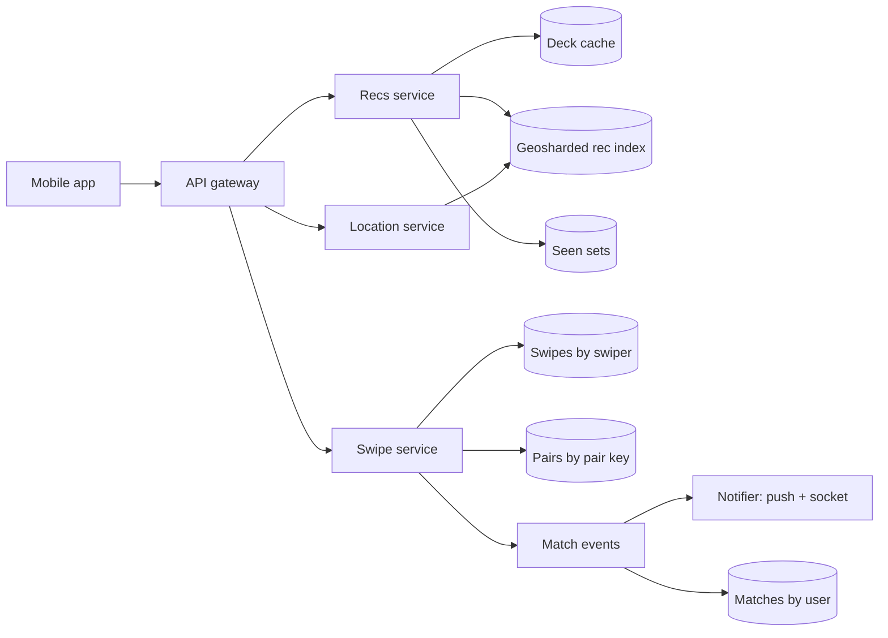

## In one minute
- **Recommendations are a filtered geo query, sharded by place.** Partition the candidate index by population-balanced S2 cells and query only the few shards your radius touches.
- **Never show the same face twice.** Keep a compact per-user "seen" set (a Roaring bitmap or Bloom filter) and push it into the index as an exclusion filter.
- **Swipes are the firehose; matches are rare and must be exact.** Swipes go to an append-friendly store, but a match must be created exactly once, even if both people swipe at the same instant.
- **Key the match decision on the pair, not on either person.** Store both directions of a pair in one record keyed by `(min(a, b), max(a, b))` and set your side with a conditional write. Whoever completes the pair creates the match, with no lock.
- **Serve the deck in batches.** Fetch 50 to 100 ranked candidates at once and refill in the background, so swiping never waits on the index.

## Requirements

**Functional**
- Users create a profile with photos, age, gender, and preferences (age range, genders shown, maximum distance).
- The app shows a stack of nearby profiles that match the user's preferences. The user swipes right (like) or left (pass).
- When two users like each other, both are told immediately and a chat opens between them.
- Users can unmatch, block and report. A blocked or unmatched user never appears again.
- Free users have a daily like limit; paid users do not.

**Non-functional**
- Swipe acknowledgement under 100 ms p99. The next card is already on the device.
- A match is created exactly once and both users are notified at least once.
- A swiped profile is not shown again for a long time (we will say 90 days for passes, never for likes).
- Location is private: other users see only a rounded distance, never coordinates.
- Highly available swiping; recommendations may be minutes stale.

**Out of scope:** chat internals (see [Design WhatsApp](design-whatsapp.md)), payments, photo moderation models, and the ranking model itself (treated as a scoring function).

## Back-of-envelope
Round assumed numbers for planning, not Tinder's published figures.

- **DAU:** 50M. Each swipes about 60 times a day: 3B swipes a day.
- **Swipe QPS:** 3B / 86,400 ≈ 35k/s average. Usage peaks in local evenings, so peak is about 3× average: roughly 100k swipes/s.
- **Matches:** if 40% of swipes are likes and about 2% of likes are reciprocated, that is 3B × 0.4 × 0.02 = 24M matches a day ≈ 280/s. Matches are four orders of magnitude rarer than swipes.
- **Deck requests:** a deck of 50 cards lasts about one session. At 60 swipes a day that is about 2 refills per user per day: 100M queries a day ≈ 1.2k/s average, 4k/s at peak. Each query touches a handful of index shards.
- **Swipe storage:** a swipe row (two 8-byte IDs, direction, timestamp) is about 30 bytes, about 60 bytes with index overhead: 3B × 60 B = 180 GB a day. Passes expire after 90 days (16 TB resident); likes are kept, 1.2B a day × 60 B × 1,825 ≈ 130 TB over five years.
- **Profiles:** 100M stored profiles at 2 KB of metadata is 200 GB, small enough to keep fully in a search index with replicas. Photos: 6 per profile at 300 KB in several sizes is about 2 MB per profile, 200 TB total, served from a CDN.
- **Bandwidth:** each swipe preloads about 150 KB of photos: 100k/s × 150 KB = 15 GB/s at peak, all from CDN edges.

## API

```text
GET  /v1/recs?limit=50
     -> { cards: [ { user_id, name, age, distance_km: 4, photos: [url...], rec_token } ] }

POST /v1/swipe   { target_id, direction: "like" | "pass", rec_token, client_swipe_id }
     -> 200 { result: "recorded" | "match", match_id?: "m_81c2" }
     -> 429 { result: "limit", resets_at }

PUT  /v1/location   { lat, lng, accuracy_m }          (throttled on the client)
     -> 204

GET  /v1/matches?after={cursor}
     -> { matches: [ { match_id, user_id, matched_at, last_message } ], after }

DELETE /v1/matches/{match_id}                         (unmatch)
POST   /v1/block    { target_id, reason }
```

`rec_token` is a signed token issued with each card. The swipe service checks it, so a script cannot like arbitrary user IDs that were never shown to it. `client_swipe_id` makes a retried swipe idempotent. Distance is rounded server-side; coordinates never leave the backend.

## Data model

**profiles**, partitioned by `user_id`: identity, bio, photos, birth date, gender, preferences, `last_active_at`. The source of truth for profile edits.

**rec_index**, a search index (Elasticsearch at Tinder) split into geoshards. Each document is a projection of a profile: `user_id, location (geo_point), s2_cell, age, gender, interested_in, max_distance, activity_score, quality_score`. The geoshard is chosen from the user's S2 cell, so a radius query only hits shards that intersect the circle.

**swipes**, partitioned by `swiper_id`, clustered by `target_id`: `direction, swiped_at`, with a 90-day TTL on passes. This is the history that builds the "seen" set and answers "did I already swipe this person".

**pairs**, partitioned by `pair_key = min(a, b) + ":" + max(a, b)`: `a_likes_b, b_likes_a, match_id, matched_at, state`. Both directions live in one row so the match decision is a single-row atomic operation.

**matches_by_user**, partitioned by `user_id`, clustered by `matched_at desc`: `match_id, other_user_id`. The match list screen is one partition read. Written by the match consumer for both users.

**seen_sets**, keyed by `user_id`: a compressed bitmap of user IDs swiped in the retention window, rebuilt from `swipes` if lost.

**blocks**, partitioned by `user_id` in both directions, so both sides can filter each other forever.

## High-level design



**Write path (a swipe).**
1. The app shows the next card instantly from its local deck and sends the swipe in the background.
2. The swipe service verifies the `rec_token`, checks the daily like counter, and writes the swipe row (idempotent on `client_swipe_id`). It adds the target to the user's seen set.
3. For a like, it performs a conditional update on the pair row that sets the caller's flag. If the update result shows both flags set and no `match_id` yet, it assigns one in the same conditional write and returns `match`.
4. A match event goes to a queue. Consumers write `matches_by_user` for both users, create the chat channel, and notify both: a socket message if they are online, a push notification otherwise.

**Read path (a deck).**
1. The app asks for recs when its local deck drops below about 10 cards.
2. The recs service returns cached candidates if a fresh deck exists. Otherwise it computes the S2 cells covering the user's radius, maps them to geoshards, and sends one filtered, scored query to each shard in parallel with the user's seen set as an exclusion filter.
3. It merges the results by score, removes blocked users, interleaves a few profiles who already liked this user, and caches 50 to 100 cards with a short TTL.

## Deep dives

### 1. Geosharded recommendations
Option one is a single search index with a `geo_distance` filter. Every query then visits every shard though 99% of users are far away. Option two is a geohash grid with fixed-size cells as shard keys. Fixed cells are unbalanced: one over central Tokyo holds millions of users, the same size in rural Montana holds hundreds.

I choose geoshards built from S2 cells, the approach Tinder has described publicly. S2 projects the sphere onto a cube and numbers cells along a Hilbert curve, so cells at one level have similar areas and nearby cells have nearby IDs. Group contiguous runs of cells into shards balanced by active-user count: sparse regions get one large shard per region, dense cities get several shards covering smaller areas. A query computes an S2 cell covering for the user's circle (say 50 km), maps those cells to the two to five shards that own them, and runs the same query on each. Tinder sized this by load-testing a "load score" per cell and found 40 to 100 geoshards worldwide balanced p50, p90 and p99 latency against fan-out; the sharded index handled 20 times the computation of its old single index with five shards ([Tinder Tech Blog, 2019](https://medium.com/tinder/geosharded-recommendations-part-1-sharding-approach-d5d54e0ec77a)). Elastic reports the same change cut CPU use by a factor of four ([Elastic customer story](https://www.elastic.co/customers/tinder)). See [S2 and H3](../sd/s2-h3.md) and [Finding and Tracking Locations](handling-location-data.md) for the indexing basics.

Users move. A location update only matters when the user crosses a shard boundary or moves more than a kilometre or so, so the location service rate-limits updates and re-indexes asynchronously. A user who crosses a boundary is briefly in both shards and deduplicated on merge; that is cheaper than a two-phase move. Tinder notes that these moves are not atomic, so every extra boundary crossing is another chance for inconsistency, which is one reason not to make shards too small.

### 2. The mutual like, exactly once
The naive design checks "has the target already liked me?" and then writes "I like the target". If Alice and Bob swipe right on each other within the same few milliseconds, both checks can run before either write lands. Both see no prior like, both write, and the match is never created. A distributed lock fixes it but puts a lock service on the hottest write path.

The chosen design makes the pair the unit of consistency. The row keyed by `min(a, b):max(a, b)` holds both flags. A like is one conditional update on that row, for example a DynamoDB `UpdateItem` that sets `a_likes_b = true` and returns the new image (a failed condition rejects the whole write rather than applying part of it ([DynamoDB docs](https://docs.aws.amazon.com/amazondynamodb/latest/developerguide/Expressions.ConditionExpressions.html))), or a Redis Lua script that does the same atomically. Because one partition serialises all writes to one pair, exactly one of the two concurrent updates observes both flags set, and that one sets `match_id` with a condition `attribute_not_exists(match_id)`. A retry finds `match_id` already set and returns it, so the operation is idempotent.

Notification is at least once: the match event is written to a queue in the same step (or via an outbox, see [Outbox Pattern](../sd/outbox-pattern.md)), and consumers dedupe on `match_id`. Decide on one row, then propagate: the same shape as the last seat in [Design Movie Booking System](design-movie-booking-system.md).

### 3. Never showing the same face twice
A typical Tinder user has acted on about 10,000 profiles and the heaviest on up to 70,000 ([Elastic customer story](https://www.elastic.co/customers/tinder)); take a heavy user at 20,000. Sending 20,000 IDs as a `must_not` terms clause to every shard on every deck refill costs about 160 KB per request and a large boolean query. Options considered: filter after retrieval (wasteful: in a small town most results are already seen, so you fetch 10 times what you need), a Bloom filter per user (compact, but a false positive hides a profile the user never saw), or a compressed exact set.

I keep a Roaring bitmap of seen IDs per user and pass it to the index through a custom plugin that applies it as a filter during scoring; Elastic's customer story on Tinder credits such a Roaring bitmap exclusion filter with a 60% filtering improvement. Roaring splits 32-bit IDs into 65,536-value chunks and stores each chunk as a sorted array, a bitset or run lengths, whichever is smallest ([RoaringBitmap](https://roaringbitmap.org/about/)). If memory gets tight, a Bloom filter with a 1% false positive rate is an acceptable fallback here: hiding one unseen profile in a hundred is invisible to the user, unlike showing a repeat.

Passes expire after 90 days so people who changed their photos can resurface. Blocks and unmatches are permanent and live in a separate set that is checked again on the final merge, because a stale seen set must never resurrect a blocked person.

## Down the stack

### Layer 1: The contract
- **Swipe.** Idempotent on `client_swipe_id`. Once acknowledged, the swipe is durable and the target will not appear in this user's future decks within the retention window.
- **Match.** For any pair, a match exists if and only if both users liked each other and neither has unmatched or blocked. It is created exactly once, regardless of timing or retries. Both users receive at least one notification.
- **Deck.** Every card satisfies both users' hard preferences (age, gender, distance) at the time of the query. Blocked users are never returned. Distance is reported rounded to the nearest kilometre or coarser.

### Layer 2: The mechanism
S2 assigns every cell a 64-bit ID: 3 bits for the cube face, then 2 bits per level down to level 30, then a trailing marker bit, so the level can be read from the lowest set bit ([S2 cell hierarchy](http://s2geometry.io/devguide/s2cell_hierarchy.html)). A level 7 cell averages about 5,200 km² and a level 8 cell about 1,300 km², which brackets a city; areas at one level vary by about 2x between the smallest and largest cells ([S2 cell statistics](http://s2geometry.io/resources/s2cell_statistics.html)). Store the shard map with S2's string tokens rather than raw 64-bit integers: Tinder found that its Node, Java and Go libraries produced different integer forms for the same cell, while the tokens agreed. `RegionCoverer` turns a circle into a small set of cells at mixed levels, and because the IDs follow a Hilbert curve, each shard owns a few contiguous ID ranges, so the cell-to-shard lookup is a binary search over range starts.

Inside a shard, Elasticsearch indexes `geo_point` fields in Lucene's BKD tree, which answers distance and bounding box filters by pruning whole blocks of points. The query is a `bool` with `filter` clauses for distance, age range and gender (cached as bitsets, no scoring cost), the seen-set exclusion, and a `function_score` or plugin script for ranking. Tinder has written that over 90% of its recommendations come from a single Elasticsearch cluster with geo-sharded indices and an in-house Java scoring plugin, and that geosharding brought CPU use to 12% against 50% for one index. Its move from Elasticsearch 6 to 8 forced a rework of ranking because version 8 rejects negative scores ([Life at Tinder](https://lifeattinder.com/blog/tinders-migration-to-elasticsearch-8)), a reminder to keep custom scores non-negative from the start.

The pair row's conditional write is a compare-and-set on one partition: in DynamoDB, a `ConditionExpression` evaluated by the partition's leader replica; in Cassandra, a lightweight transaction (`UPDATE ... IF`) that runs Paxos among replicas for that partition and carries a real performance cost ([Cassandra CQL docs](https://cassandra.apache.org/doc/latest/cassandra/developing/cql/dml.html)).

### Layer 3: The machine
- **Seen set size.** With 100M user IDs (27 bits), there are about 1,500 Roaring chunks. 20,000 seen IDs spread across them is about 13 per chunk, stored as 2-byte array entries: roughly 40 KB plus container headers, versus 160 KB as a list of 8-byte IDs. Intersecting it with a shard's candidate bitset is a few microseconds of SIMD work.
- **Index memory.** A profile projection is about 300 bytes in the index plus doc values. 100M profiles with one replica is about 60 GB of index, small enough to keep entirely in the page cache across a modest cluster, so geo filters never touch disk.
- **Swipe write.** A 60-byte swipe row in an LSM store lands in the commit log (sequential append, group-committed `fsync` every few ms) and a memtable. At 100k/s cluster-wide, that is 6 MB/s of log writes, trivial for NVMe; the cost is replication and compaction, not raw I/O.
- **Pair write.** A conditional update needs a read and a write on the leader, about 1 to 3 ms within a zone. A Cassandra LWT costs four round trips per write under the legacy `paxos_variant: v1`, which is still the default, and two under the newer `v2`, which the docs recommend ([cassandra.yaml reference](https://cassandra.apache.org/doc/latest/cassandra/managing/configuration/cass_yaml_file.html)). That is roughly 2 to 10 ms in one zone, which is why the pair update only runs for likes (40% of swipes) and never for passes.

### Why it's built this way
1. Candidates must be near the user, and density varies wildly, so shard the index by population-balanced geographic cells rather than by user ID.
2. Every query must exclude what the user has seen, and that set grows forever, so represent it compactly and apply it inside the index rather than after retrieval.
3. Swipes are huge in volume but individually unimportant, so write them to a cheap append-friendly store; matches are rare but must be exact, so decide them on one row per pair with a conditional write.
4. Users swipe faster than any backend round trip, so the deck is fetched in batches and preloaded on the device.

## Failure modes
- **10x load (Sunday evening, or a launch in a new country).** Deck refills spike first. Serve cached decks longer, lower the deck size, and shed the expensive personalisation step before the geo query. Swipes keep flowing because they only need the swipe store and, for likes, one pair write.
- **Hot shard.** A festival puts 200,000 active users in a few square kilometres. Their shard sees concentrated queries and documents. Split the S2 range for that shard into smaller cells and rebalance, add replicas for read load, and cap query radius in the event area.
- **Region outage.** Users are served from the nearest healthy region. Pairs are partitioned by pair key with cross-region replication; if two people in different regions like each other during a partition, the conditional writes may land in different regions. Route pair writes to the pair's home region, and if that region is down, queue likes durably and evaluate them when it recovers. A match a few minutes late is fine; a duplicate match or a missed one is not.
- **Notification failure.** Push providers drop notifications. The match list is the source of truth, so the app reconciles on open.
- **Location abuse.** Researchers have shown that precise distances let an attacker trilaterate a user ([Include Security, 2014](https://blog.includesecurity.com/2014/02/how-i-was-able-to-track-the-location-of-any-tinder-user/)). Rounding the output distance is not enough on its own: an attacker can move a fake position until the rounded value flips and so recover exact distances ([The Register](https://www.theregister.com/2021/08/26/bumble_location_leak/)). Snap both users' coordinates to a coarse grid before computing distance, never send coordinates or unrounded distances to clients, and rate-limit location changes so a fake GPS cannot probe positions.

## In the wild
- **Tinder, 2019: geosharding Elasticsearch by load.** Tinder had run recommendations for years on one Elasticsearch index with the default five shards, adding replicas and bigger nodes as shards grew. It scored the load of each S2 cell, packed cells in Hilbert order into 40 to 100 geoshards of roughly equal load, and moved users between indices as they crossed boundaries. Production measurements showed the geosharded index handling 20 times the computation of the single index ([Tinder Tech Blog](https://medium.com/tinder/geosharded-recommendations-part-1-sharding-approach-d5d54e0ec77a)).
- **Tinder, 2013–2014: distance leaks location.** After an earlier bug sent matches' exact coordinates to the app, Tinder switched to sending distances, but the `distance_mi` field was a 64-bit double with 15 decimal places. Include Security trilaterated users to within about 100 feet from three vantage points, reported it on 23 October 2013, and saw high-precision values stop by 1 January 2014. The researchers recommended computing locations server-side and returning only coarse values ([Include Security](https://blog.includesecurity.com/2014/02/how-i-was-able-to-track-the-location-of-any-tinder-user/)).
- **Bumble, 2021: rounded distances still leak.** Bumble rounded distances to whole miles, but with a floor function, so a researcher moved a spoofed position until the reported mile flipped, found three such points to about 0.001 miles, and trilaterated a target in about 10 seconds. Reported on 15 June 2021, it was fixed on 18 June; the researcher had proposed rounding coordinates before computing distance ([The Register](https://www.theregister.com/2021/08/26/bumble_location_leak/)).

## Trade-offs

| Option | Strengths | Weaknesses | Choose when |
|---|---|---|---|
| One global geo index | Simple, one query | Visits every shard on every query | Small user base |
| Fixed geohash grid shards | Easy mapping | Unbalanced by population | Uniform density |
| S2 geoshards balanced by load | Few shards per query, balanced | Rebalancing logic, boundary moves | Global scale with dense cities |
| Check-then-write for likes | Simple code | Misses matches under races | Never at scale |
| Pair row with conditional write | Exactly-once match, no locks | Two partitions to read for match lists | Mutual relationships |
| Roaring bitmap seen set | Exact, compact, fast intersects | Needs a custom index filter | Large seen histories |
| Bloom filter seen set | Smallest, constant size | False positives hide unseen profiles | Memory is the limit |

## Leadership lens
- **Build first:** the swipe store, the pair-row match logic with idempotent notifications, and a simple single-region geo query. Geosharding and the custom exclusion plugin come when the index outgrows one cluster's query budget.
- **Team ownership:** a recommendations team owns the index, sharding and ranking; a core platform team owns swipes, pairs and matches; a trust and safety team owns blocks, reports, `rec_token` validation and location privacy; a messaging team owns chat after the match.
- **Cost drivers:** photo storage and CDN egress dominate, followed by the search cluster's RAM. Swipe storage is cheap if passes expire.
- **Rollout:** introduce geosharding one region at a time with dual reads (old index and new shards) and compare result sets before cutting over. Ranking A/B tests must watch both sides of the market: helping swipers can starve the people being swiped on.
- **Review questions:** what happens when two people like each other within one millisecond; how long can a deck be stale before users see someone who blocked them; how is a lost seen set rebuilt.

## Check yourself
1. Alice and Bob swipe right on each other within the same few milliseconds. Why can a check-then-write design miss the match, and how does the pair row fix it?
   **Answer:** Both checks can run before either write lands, so each sees no prior like and the match is never created. Keying one row by `min(a, b):max(a, b)` with both flags makes the like a single conditional update on one partition, so exactly one update observes both flags and sets `match_id`.
2. Why shard the recommendation index by population-balanced S2 cells instead of a fixed geohash grid or one global index?
   **Answer:** A global index visits every shard on every query, and fixed cells are unbalanced, with central Tokyo holding millions and rural Montana hundreds. S2 cells grouped by active-user count keep shards balanced and let a 50 km query touch only two to five shards.
3. Why is a Bloom filter an acceptable fallback for the seen set when memory is tight, even though it has false positives?
   **Answer:** A false positive only hides a profile the user never saw, which at 1% is invisible to the user, while the failure that matters is showing a repeat. Blocks are kept in a separate permanent set checked at the final merge, so a stale or approximate seen set never resurrects a blocked person.
4. With 50M DAU swiping about 60 times a day, how rare are matches compared with swipes, and how does that shape storage choices?
   **Answer:** That is 3B swipes a day (about 100k/s at peak) but only about 24M matches a day, roughly 280/s, four orders of magnitude rarer. Swipes go to a cheap append-friendly store, while the more expensive conditional pair write runs only for likes, never for passes.

## Practice
**Task:** Build the swipe and match core plus the deck filter. `MatchBook(daily_likes)` keeps per-user swipe history and matches. `swipe(user, target, like, day)` returns `"invalid"` if `user == target`; `"duplicate"` if `user` already swiped `target` in either direction (nothing changes); `"limit"` if `like` is true and `user` already used `daily_likes` likes on that `day` (nothing is recorded, passes are never limited); otherwise it records the swipe and returns `"match"` if it is a like and `target` had already liked `user`, else `"liked"` or `"passed"`. `matches(user)` returns the user's current matches sorted ascending. `unmatch(user, other)` removes a match for both and returns whether one existed; the swipes stay, so neither can swipe the other again. `deck(user, candidates, max_km, k)` takes `(id, km, score)` triples and returns up to `k` IDs, excluding the user, anyone the user already swiped, and anyone farther than `max_km`, ordered by score descending, then distance ascending, then ID ascending.

```python starter
class MatchBook:
    def __init__(self, daily_likes):
        pass

    def swipe(self, user, target, like, day):
        # TODO: "invalid", "duplicate", "limit", "match", "liked" or "passed"
        raise NotImplementedError

    def matches(self, user):
        raise NotImplementedError

    def unmatch(self, user, other):
        raise NotImplementedError

    def deck(self, user, candidates, max_km, k):
        # TODO: exclude self, swiped, too far; sort score desc, km asc, id asc
        raise NotImplementedError
```

```python tests
def test_mutual_like_matches_once():
    b = MatchBook(10)
    assert b.swipe("ann", "bob", True, 1) == "liked"
    assert b.swipe("bob", "ann", True, 1) == "match"
    assert b.matches("ann") == ["bob"]
    assert b.matches("bob") == ["ann"]
    assert b.swipe("bob", "ann", True, 1) == "duplicate"
    assert b.matches("bob") == ["ann"], "retry does not duplicate the match"

def test_pass_blocks_the_match():
    b = MatchBook(10)
    assert b.swipe("ann", "bob", False, 1) == "passed"
    assert b.swipe("bob", "ann", True, 1) == "liked"
    assert b.matches("bob") == []
    assert b.swipe("ann", "bob", True, 1) == "duplicate", "cannot change a pass"

def test_invalid_and_limit():
    b = MatchBook(2)
    assert b.swipe("ann", "ann", True, 1) == "invalid"
    assert b.swipe("ann", "b1", True, 1) == "liked"
    assert b.swipe("ann", "b2", True, 1) == "liked"
    assert b.swipe("ann", "b3", True, 1) == "limit"
    assert b.swipe("ann", "b3", False, 1) == "passed", "passes are not limited"
    assert b.swipe("ann", "b4", True, 2) == "liked", "limit resets on a new day"

def test_limit_does_not_record():
    b = MatchBook(1)
    b.swipe("ann", "b1", True, 1)
    assert b.swipe("ann", "bob", True, 1) == "limit"
    assert b.swipe("bob", "ann", True, 1) == "liked", "ann's limited like was not stored"
    assert b.swipe("ann", "bob", True, 2) == "match"

def test_unmatch():
    b = MatchBook(10)
    b.swipe("ann", "bob", True, 1)
    b.swipe("bob", "ann", True, 1)
    b.swipe("ann", "cat", True, 1)
    b.swipe("cat", "ann", True, 1)
    assert b.matches("ann") == ["bob", "cat"]
    assert b.unmatch("bob", "ann") is True
    assert b.unmatch("bob", "ann") is False
    assert b.matches("ann") == ["cat"]
    assert b.matches("bob") == []
    assert b.swipe("ann", "bob", True, 2) == "duplicate"

def test_deck_filters_and_orders():
    b = MatchBook(10)
    b.swipe("ann", "dan", False, 1)
    cands = [("eve", 3, 0.9), ("dan", 1, 0.99), ("ann", 0, 1.0), ("fay", 2, 0.9),
             ("gus", 80, 0.95), ("hal", 2, 0.9), ("ivy", 5, 0.5)]
    assert b.deck("ann", cands, 50, 10) == ["fay", "hal", "eve", "ivy"]
    assert b.deck("ann", cands, 50, 2) == ["fay", "hal"]
    assert b.deck("ann", [], 50, 3) == []
```

```python solution
class MatchBook:
    def __init__(self, daily_likes):
        self.daily_likes = daily_likes
        self._swiped = {}
        self._likes_on = {}
        self._matches = {}

    def swipe(self, user, target, like, day):
        if user == target:
            return "invalid"
        mine = self._swiped.setdefault(user, {})
        if target in mine:
            return "duplicate"
        if like:
            used = self._likes_on.get((user, day), 0)
            if used >= self.daily_likes:
                return "limit"
            self._likes_on[(user, day)] = used + 1
        mine[target] = like
        if like and self._swiped.get(target, {}).get(user) is True:
            self._matches.setdefault(user, set()).add(target)
            self._matches.setdefault(target, set()).add(user)
            return "match"
        return "liked" if like else "passed"

    def matches(self, user):
        return sorted(self._matches.get(user, set()))

    def unmatch(self, user, other):
        mine = self._matches.get(user, set())
        if other not in mine:
            return False
        mine.discard(other)
        self._matches.get(other, set()).discard(user)
        return True

    def deck(self, user, candidates, max_km, k):
        seen = self._swiped.get(user, {})
        keep = [c for c in candidates
                if c[0] != user and c[0] not in seen and c[1] <= max_km]
        keep.sort(key=lambda c: (-c[2], c[1], c[0]))
        return [c[0] for c in keep[:k]]
```

```typescript starter
export type Candidate = [string, number, number];

export class MatchBook {
  constructor(dailyLikes: number) {}

  swipe(user: string, target: string, like: boolean, day: number): string {
    throw new Error("TODO");
  }
  matches(user: string): string[] {
    throw new Error("TODO");
  }
  unmatch(user: string, other: string): boolean {
    throw new Error("TODO");
  }
  deck(user: string, candidates: Candidate[], maxKm: number, k: number): string[] {
    throw new Error("TODO");
  }
}
```

```typescript tests
test("mutual like matches once", () => {
  const b = new MatchBook(10);
  assertEqual(b.swipe("ann", "bob", true, 1), "liked");
  assertEqual(b.swipe("bob", "ann", true, 1), "match");
  assertEqual(b.matches("ann"), ["bob"]);
  assertEqual(b.matches("bob"), ["ann"]);
  assertEqual(b.swipe("bob", "ann", true, 1), "duplicate");
  assertEqual(b.matches("bob"), ["ann"], "retry does not duplicate the match");
});

test("pass blocks the match", () => {
  const b = new MatchBook(10);
  assertEqual(b.swipe("ann", "bob", false, 1), "passed");
  assertEqual(b.swipe("bob", "ann", true, 1), "liked");
  assertEqual(b.matches("bob"), []);
  assertEqual(b.swipe("ann", "bob", true, 1), "duplicate", "cannot change a pass");
});

test("invalid and limit", () => {
  const b = new MatchBook(2);
  assertEqual(b.swipe("ann", "ann", true, 1), "invalid");
  assertEqual(b.swipe("ann", "b1", true, 1), "liked");
  assertEqual(b.swipe("ann", "b2", true, 1), "liked");
  assertEqual(b.swipe("ann", "b3", true, 1), "limit");
  assertEqual(b.swipe("ann", "b3", false, 1), "passed", "passes are not limited");
  assertEqual(b.swipe("ann", "b4", true, 2), "liked", "limit resets on a new day");
});

test("limit does not record", () => {
  const b = new MatchBook(1);
  b.swipe("ann", "b1", true, 1);
  assertEqual(b.swipe("ann", "bob", true, 1), "limit");
  assertEqual(b.swipe("bob", "ann", true, 1), "liked", "ann's limited like was not stored");
  assertEqual(b.swipe("ann", "bob", true, 2), "match");
});

test("unmatch", () => {
  const b = new MatchBook(10);
  b.swipe("ann", "bob", true, 1);
  b.swipe("bob", "ann", true, 1);
  b.swipe("ann", "cat", true, 1);
  b.swipe("cat", "ann", true, 1);
  assertEqual(b.matches("ann"), ["bob", "cat"]);
  assertEqual(b.unmatch("bob", "ann"), true);
  assertEqual(b.unmatch("bob", "ann"), false);
  assertEqual(b.matches("ann"), ["cat"]);
  assertEqual(b.matches("bob"), []);
  assertEqual(b.swipe("ann", "bob", true, 2), "duplicate");
});

test("deck filters and orders", () => {
  const b = new MatchBook(10);
  b.swipe("ann", "dan", false, 1);
  const cands: Candidate[] = [["eve", 3, 0.9], ["dan", 1, 0.99], ["ann", 0, 1.0], ["fay", 2, 0.9],
    ["gus", 80, 0.95], ["hal", 2, 0.9], ["ivy", 5, 0.5]];
  assertEqual(b.deck("ann", cands, 50, 10), ["fay", "hal", "eve", "ivy"]);
  assertEqual(b.deck("ann", cands, 50, 2), ["fay", "hal"]);
  assertEqual(b.deck("ann", [], 50, 3), []);
});
```

```typescript solution
export type Candidate = [string, number, number];

export class MatchBook {
  private swiped = new Map<string, Map<string, boolean>>();
  private likesOn = new Map<string, number>();
  private matched = new Map<string, Set<string>>();

  constructor(private dailyLikes: number) {}

  swipe(user: string, target: string, like: boolean, day: number): string {
    if (user === target) return "invalid";
    let mine = this.swiped.get(user);
    if (!mine) {
      mine = new Map();
      this.swiped.set(user, mine);
    }
    if (mine.has(target)) return "duplicate";
    if (like) {
      const key = user + "\u0000" + day;
      const used = this.likesOn.get(key) ?? 0;
      if (used >= this.dailyLikes) return "limit";
      this.likesOn.set(key, used + 1);
    }
    mine.set(target, like);
    if (like && this.swiped.get(target)?.get(user) === true) {
      this.link(user, target);
      this.link(target, user);
      return "match";
    }
    return like ? "liked" : "passed";
  }

  private link(a: string, b: string): void {
    const s = this.matched.get(a) ?? new Set<string>();
    s.add(b);
    this.matched.set(a, s);
  }

  matches(user: string): string[] {
    return [...(this.matched.get(user) ?? [])].sort();
  }

  unmatch(user: string, other: string): boolean {
    const mine = this.matched.get(user);
    if (!mine || !mine.has(other)) return false;
    mine.delete(other);
    this.matched.get(other)?.delete(user);
    return true;
  }

  deck(user: string, candidates: Candidate[], maxKm: number, k: number): string[] {
    const seen = this.swiped.get(user) ?? new Map<string, boolean>();
    const keep = candidates.filter((c) => c[0] !== user && !seen.has(c[0]) && c[1] <= maxKm);
    keep.sort((a, b) => {
      if (a[2] !== b[2]) return b[2] - a[2];
      if (a[1] !== b[1]) return a[1] - b[1];
      return a[0] < b[0] ? -1 : a[0] > b[0] ? 1 : 0;
    });
    return keep.slice(0, k).map((c) => c[0]);
  }
}
```

```go starter
package practice

type Candidate struct {
	ID    string
	Km    float64
	Score float64
}

type MatchBook struct{}

func NewMatchBook(dailyLikes int) *MatchBook { return &MatchBook{} }

func (b *MatchBook) Swipe(user, target string, like bool, day int) string { panic("TODO") }

func (b *MatchBook) Matches(user string) []string { panic("TODO") }

func (b *MatchBook) Unmatch(user, other string) bool { panic("TODO") }

func (b *MatchBook) Deck(user string, candidates []Candidate, maxKm float64, k int) []string {
	panic("TODO")
}
```

```go tests
package practice

import (
	"reflect"
	"testing"
)

func want(t *testing.T, got, exp string) {
	t.Helper()
	if got != exp {
		t.Fatalf("got %q want %q", got, exp)
	}
}

func wantList(t *testing.T, got, exp []string) {
	t.Helper()
	if len(got) == 0 && len(exp) == 0 {
		return
	}
	if !reflect.DeepEqual(got, exp) {
		t.Fatalf("got %v want %v", got, exp)
	}
}

func TestMutualLikeMatchesOnce(t *testing.T) {
	b := NewMatchBook(10)
	want(t, b.Swipe("ann", "bob", true, 1), "liked")
	want(t, b.Swipe("bob", "ann", true, 1), "match")
	wantList(t, b.Matches("ann"), []string{"bob"})
	wantList(t, b.Matches("bob"), []string{"ann"})
	want(t, b.Swipe("bob", "ann", true, 1), "duplicate")
	wantList(t, b.Matches("bob"), []string{"ann"})
}

func TestPassBlocksTheMatch(t *testing.T) {
	b := NewMatchBook(10)
	want(t, b.Swipe("ann", "bob", false, 1), "passed")
	want(t, b.Swipe("bob", "ann", true, 1), "liked")
	wantList(t, b.Matches("bob"), nil)
	want(t, b.Swipe("ann", "bob", true, 1), "duplicate")
}

func TestInvalidAndLimit(t *testing.T) {
	b := NewMatchBook(2)
	want(t, b.Swipe("ann", "ann", true, 1), "invalid")
	want(t, b.Swipe("ann", "b1", true, 1), "liked")
	want(t, b.Swipe("ann", "b2", true, 1), "liked")
	want(t, b.Swipe("ann", "b3", true, 1), "limit")
	want(t, b.Swipe("ann", "b3", false, 1), "passed")
	want(t, b.Swipe("ann", "b4", true, 2), "liked")
}

func TestLimitDoesNotRecord(t *testing.T) {
	b := NewMatchBook(1)
	b.Swipe("ann", "b1", true, 1)
	want(t, b.Swipe("ann", "bob", true, 1), "limit")
	want(t, b.Swipe("bob", "ann", true, 1), "liked")
	want(t, b.Swipe("ann", "bob", true, 2), "match")
}

func TestUnmatch(t *testing.T) {
	b := NewMatchBook(10)
	b.Swipe("ann", "bob", true, 1)
	b.Swipe("bob", "ann", true, 1)
	b.Swipe("ann", "cat", true, 1)
	b.Swipe("cat", "ann", true, 1)
	wantList(t, b.Matches("ann"), []string{"bob", "cat"})
	if !b.Unmatch("bob", "ann") || b.Unmatch("bob", "ann") {
		t.Fatal("unmatch should succeed once")
	}
	wantList(t, b.Matches("ann"), []string{"cat"})
	wantList(t, b.Matches("bob"), nil)
	want(t, b.Swipe("ann", "bob", true, 2), "duplicate")
}

func TestDeckFiltersAndOrders(t *testing.T) {
	b := NewMatchBook(10)
	b.Swipe("ann", "dan", false, 1)
	cands := []Candidate{{"eve", 3, 0.9}, {"dan", 1, 0.99}, {"ann", 0, 1.0}, {"fay", 2, 0.9},
		{"gus", 80, 0.95}, {"hal", 2, 0.9}, {"ivy", 5, 0.5}}
	wantList(t, b.Deck("ann", cands, 50, 10), []string{"fay", "hal", "eve", "ivy"})
	wantList(t, b.Deck("ann", cands, 50, 2), []string{"fay", "hal"})
	wantList(t, b.Deck("ann", nil, 50, 3), nil)
}
```

```go solution
package practice

import "sort"

type Candidate struct {
	ID    string
	Km    float64
	Score float64
}

type dayKey struct {
	user string
	day  int
}

type MatchBook struct {
	dailyLikes int
	swiped     map[string]map[string]bool
	likesOn    map[dayKey]int
	matched    map[string]map[string]bool
}

func NewMatchBook(dailyLikes int) *MatchBook {
	return &MatchBook{
		dailyLikes: dailyLikes,
		swiped:     map[string]map[string]bool{},
		likesOn:    map[dayKey]int{},
		matched:    map[string]map[string]bool{},
	}
}

func (b *MatchBook) link(a, c string) {
	if b.matched[a] == nil {
		b.matched[a] = map[string]bool{}
	}
	b.matched[a][c] = true
}

func (b *MatchBook) Swipe(user, target string, like bool, day int) string {
	if user == target {
		return "invalid"
	}
	mine := b.swiped[user]
	if mine == nil {
		mine = map[string]bool{}
		b.swiped[user] = mine
	}
	if _, ok := mine[target]; ok {
		return "duplicate"
	}
	if like {
		k := dayKey{user, day}
		if b.likesOn[k] >= b.dailyLikes {
			return "limit"
		}
		b.likesOn[k]++
	}
	mine[target] = like
	if like {
		if liked, ok := b.swiped[target][user]; ok && liked {
			b.link(user, target)
			b.link(target, user)
			return "match"
		}
		return "liked"
	}
	return "passed"
}

func (b *MatchBook) Matches(user string) []string {
	out := []string{}
	for other := range b.matched[user] {
		out = append(out, other)
	}
	sort.Strings(out)
	return out
}

func (b *MatchBook) Unmatch(user, other string) bool {
	if !b.matched[user][other] {
		return false
	}
	delete(b.matched[user], other)
	delete(b.matched[other], user)
	return true
}

func (b *MatchBook) Deck(user string, candidates []Candidate, maxKm float64, k int) []string {
	seen := b.swiped[user]
	keep := []Candidate{}
	for _, c := range candidates {
		if c.ID == user || c.Km > maxKm {
			continue
		}
		if _, ok := seen[c.ID]; ok {
			continue
		}
		keep = append(keep, c)
	}
	sort.Slice(keep, func(i, j int) bool {
		if keep[i].Score != keep[j].Score {
			return keep[i].Score > keep[j].Score
		}
		if keep[i].Km != keep[j].Km {
			return keep[i].Km < keep[j].Km
		}
		return keep[i].ID < keep[j].ID
	})
	out := []string{}
	for i := 0; i < len(keep) && i < k; i++ {
		out = append(out, keep[i].ID)
	}
	return out
}
```

## Mock interview
**Prompt:** Design Tinder. Assume 50 million daily users swiping about 3 billion times a day across every country, with users concentrated in a few hundred cities. Walk me through how the app decides which profile to show next, and what happens on the server when two people swipe right on each other.

- Follow-up: Alice and Bob like each other within the same millisecond, and their requests land on different servers. Prove that exactly one match is created.
- Follow-up: A music festival puts 200,000 active users in two square kilometres for a weekend. What breaks first?
- Follow-up: Why not filter already-seen profiles in the recs service after the index returns results?

**A strong answer covers:**
- A geosharded candidate index using population-balanced S2 cells, with queries fanned out only to shards covering the user's radius.
- Hard preference filters and a seen-set exclusion applied inside the index, with a compact Roaring bitmap or Bloom filter and a clear stance on false positives.
- The match decided on one row per pair with a conditional write, idempotent retries, and at-least-once notification deduped by `match_id`.
- Batched decks preloaded on the device, with swipes sent asynchronously and photos prefetched from the CDN.
- Privacy: rounded distances, signed recommendation tokens, rate-limited location changes, and permanent block lists checked on every deck.

## Sources and further study
**Primary**
- [Geosharded Recommendations Part 1: Sharding Approach (Tinder Tech Blog)](https://medium.com/tinder/geosharded-recommendations-part-1-sharding-approach-d5d54e0ec77a): load scores per S2 cell, how many geoshards, and the cost of moving users between them.
- [How I was able to track the location of any Tinder user (Include Security)](https://blog.includesecurity.com/2014/02/how-i-was-able-to-track-the-location-of-any-tinder-user/): the trilateration write-up, with the disclosure timeline.

**Systems docs**
- [S2 cell statistics](http://s2geometry.io/resources/s2cell_statistics.html): average, minimum and maximum cell area for every level, for choosing shard granularity.
- [DynamoDB condition expressions](https://docs.aws.amazon.com/amazondynamodb/latest/developerguide/Expressions.ConditionExpressions.html): conditional puts and updates, including `attribute_not_exists`, the building block for the pair row.
- [cassandra.yaml: paxos_variant](https://cassandra.apache.org/doc/latest/cassandra/managing/configuration/cass_yaml_file.html): the round-trip cost of lightweight transactions under v1 and v2.
- [RoaringBitmap](https://roaringbitmap.org/about/): the chunked container format and the libraries that implement it.

**Books**
- *Designing Data-Intensive Applications* (1st ed.), Martin Kleppmann, Ch 6 "Partitioning" and Ch 9 "Consistency and Consensus": partitioning by key range versus hash, and why a compare-and-set on one record gives a uniqueness guarantee.
- *System Design Interview, Volume 2*, Alex Xu and Sahn Lam, Ch 1 "Proximity Service" and Ch 2 "Nearby Friends": geohash, quadtree and S2 indexes, and location updates at interview depth.

**Other curricula**
- [Azure Architecture Center: Sharding pattern](https://learn.microsoft.com/en-us/azure/architecture/patterns/sharding): frames geoshards as a geographic strategy that skews load where users cluster, and recommends combining it with lookup or hash sharding inside each region, which is what load-balanced S2 ranges do.
- [donnemartin/system-design-primer](https://github.com/donnemartin/system-design-primer): has no dating-app solution, but its sharding section names a user's geographic location as a common shard key and warns that power users make shards lopsided and rebalancing complex.

## Watch
- [System Design: Tinder (System Design Fight Club)](https://www.youtube.com/watch?v=PI0yGBT9LHo): a full walkthrough of recommendations, swipes and matches.
- [Design a Dating App like Tinder/Bumble (BitStorm)](https://www.youtube.com/watch?v=xgLdXbKpMgY): focuses on swipe volume and the path from swipe to match.

## Free resources
- [Tinder's migration to Elasticsearch 8 (Life at Tinder)](https://lifeattinder.com/blog/tinders-migration-to-elasticsearch-8): how recommendations run on a geo-sharded Elasticsearch cluster with an in-house scoring plugin.
- [Tinder customer story (Elastic)](https://www.elastic.co/customers/tinder): the Roaring bitmap exclusion filter and geo-indexed retrieval gains.
- [S2 cell hierarchy (S2 Geometry)](http://s2geometry.io/devguide/s2cell_hierarchy.html): cell IDs, levels and the Hilbert curve ordering behind geoshards.
- [Consistently faster and smaller compressed bitmaps with Roaring (Lemire et al.)](https://arxiv.org/abs/1603.06549): the paper behind the seen-set representation.
- [Designing Tinder (High Scalability)](https://highscalability.com/designing-tinder/): an end-to-end design write-up covering geosharded indexing and match notification.
- [Geo-distance query (Elasticsearch docs)](https://www.elastic.co/guide/en/elasticsearch/reference/current/query-dsl-geo-distance-query.html): the filter each geoshard query relies on.
