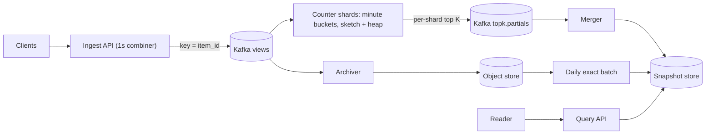

## In one minute
- **Partition the stream by item ID.** If every event for an item lands on one shard, each shard's local top K is exact for its items, and the global top K is just the top K of the shards' lists. Partition any other way and merging per-shard lists gives wrong answers.
- **Decide per window whether you need exact or approximate.** Minute and hour leaderboards tolerate a small, bounded error and can use a count-min sketch with a heap. Daily and all-time charts that feed payouts or editorial decisions come from an exact batch job.
- **Build long windows from short buckets.** Keep counts per minute, slide an hour by adding the newest minute and subtracting the oldest, and roll minutes into hours and days. Never recount the raw stream for every window.
- **Serve precomputed snapshots.** Readers never trigger computation. A merger publishes the top K for each window and scope as a small blob, and the read path is a cache lookup.
- **Pre-aggregate at the edge to tame viral items.** One video can draw a large share of traffic for an hour. Summing counts for a second in each ingest node turns thousands of events into one.

## Requirements

**Functional**
- Return the top K (K up to 1,000) most viewed items for the last 1 minute, 1 hour, 1 day and all time.
- Scopes: global, per country and per category.
- Each entry includes the item ID and its count for the window.

**Non-functional**
- Results for a minute window available within about 10 seconds of the minute ending.
- Read latency under 50 ms at p99, at tens of thousands of reads per second.
- Minute and hour lists may be approximate within a stated bound. Daily and all-time lists must be exact.
- Ingest must not lose events at peak, and a counter-node crash must not double count.

**Out of scope:** personalised ranking, spam and bot filtering (assume an upstream filter), and arbitrary ad hoc time ranges.

## Back-of-envelope
- **Events:** assume 10 billion view events per day. 1e10 / 86,400 ≈ 116k events/s on average, and about 3× that at peak, so plan for 350k/s.
- **Event size:** about 50 B (item, user hash, timestamp, country, category), so peak ingest is 350k × 50 B ≈ 17.5 MB/s. Raw storage is 1e10 × 50 B = 500 GB/day, about 900 TB over 5 years uncompressed, much less in Parquet.
- **Distinct items:** perhaps 1 billion items exist, but only tens of millions receive a view in a given hour. Assume 50M distinct items per hour.
- **Exact hourly state:** 50M items × (8 B ID + 8 B count + ~40 B hash map overhead) ≈ 2.8 GB. Spread over 32 counter shards, that is about 90 MB each. Exact counting per hour is affordable, which is worth noticing before reaching for sketches.
- **Per-scope state:** 200 countries × 30 categories multiplies scopes. Exact counts for every (scope, item) pair blow up to tens of GB per hour, and that is where a sketch pays for itself.
- **Count-min sketch sizing:** for error ε·N with probability 1 − δ, width w = ⌈e/ε⌉ and depth d = ⌈ln(1/δ)⌉ ([Cormode and Muthukrishnan](https://dsf.berkeley.edu/cs286/papers/countmin-latin2004.pdf)). With ε = 1e-5 and δ = 0.01: w ≈ 272k, d = 5, so 1.36M counters × 4 B ≈ 5.4 MB per sketch. In an hour with N = 1.5e9 views per shard group, the error bound is 15k views, well below the count of anything in a top 1,000.
- **Reads:** maybe 20k reads/s of snapshots of at most 1,000 × 16 B ≈ 16 KB; most readers want only the first 10 to 100.

## API

```http
GET /v1/top?window=1h&scope=country:BR&k=100
  -> 200 {
       "window": "1h",
       "scope": "country:BR",
       "as_of": "2026-10-15T12:34:00Z",
       "exact": false,
       "error_bound": 15000,
       "items": [{"item_id": "v_8842", "count": 1294021}, ...]
     }

POST /v1/events   (internal, batched)
  {"events": [{"item_id": "v_8842", "ts": 1760531640123, "country": "BR", "category": 7}, ...]}
  -> 202
```

`exact` and `error_bound` are part of the contract, so a product team knows whether a number can be shown on a public chart.

## Data model

**Kafka topic `views`**, keyed by `item_id`. Kafka's default partitioner hashes the key, so every event for an item goes to the same partition. This is the decision that makes exact merging possible.

**Counter state per shard** (in the stream processor, checkpointed):
- `minute_counts[minute][item] → count` for the last 60 minutes, so the hour can be slid.
- `hour_running[item] → count`, updated by adding each new minute and subtracting the expiring one.
- One count-min sketch and one candidate heap per (scope, window) for the long-tail scopes.

**Snapshot store** (Redis or a replicated key-value store): key `topk:{window}:{scope}:{bucket_start}`, value a compact sorted list of `(item_id, count)` plus metadata. The key includes the bucket, so a reader can ask for the previous minute and writers never overwrite a list a reader is paging through.

**Batch tables** (warehouse): `daily_item_counts(dt, scope, item_id, views)`, partitioned by `dt` and clustered by `scope`. The all-time table is `item_totals(item_id, views)` updated by adding each day's partition.

## High-level design



**Write path.** Clients send view events to the ingest tier. Each ingest node sums events per `(item, scope)` for one second and emits one record with a count. Records go to Kafka keyed by item ID. Counter shards consume their partitions, add counts into the current minute bucket, update sketches for the per-scope windows, and keep a heap of candidates. When a minute closes (by event time, with a few seconds of grace), each shard emits its local top K for each window and scope to `topk.partials`.

**Merge path.** The merger collects one partial list per shard per window. Because items are partitioned, no item appears in two lists, so the global top K is the top K of the concatenation. It writes the snapshot and moves an alias such as `topk:1h:global:latest` to it.

**Read path.** The query API reads the latest snapshot for the window and scope, slices the first k entries and returns them. A local in-process cache with a 1-second TTL absorbs the hottest keys.

**Batch path.** Nightly, a Spark job counts the archived day exactly per scope and writes the daily and all-time tables and snapshots, which replace the streaming daily list.

## Deep dives

### 1. Exact counting versus sketches
Exact counting with a hash map is the simplest correct answer, and the arithmetic says it fits for the global scope (about 90 MB per shard per hour). It stops fitting when scopes multiply: 6,000 country and category combinations each with their own long tail.

For those, each shard keeps a **count-min sketch** and a **min-heap of size K**. On each event the shard adds to the sketch, reads the item's estimate (the minimum over d rows), and offers it to the heap: if the item is already a candidate, update it; if the heap has room, insert; otherwise replace the heap minimum only if the new estimate is larger. The sketch never underestimates, so a true heavy hitter cannot be missed because of the sketch. It can only be overestimated by at most ε·N with high probability.

I also considered **Space-Saving** ([Metwally et al.](https://www.cs.ucsb.edu/sites/default/files/documents/2005-23.pdf)), which keeps exactly m counters and, when full, evicts the smallest and lets the newcomer inherit its count. It has a tighter guarantee per byte for top K and no hashing. A common belief is that it cannot be merged; in fact Space-Saving and Misra-Gries summaries are equivalent and both merge with no loss in their error bound ([Agarwal et al., PODS 2012](https://cse.hkust.edu.hk/~yike/pods12-mergeable.pdf)), which is why Apache DataSketches ships a mergeable frequent-items sketch ([DataSketches](https://datasketches.apache.org/docs/Frequency/FrequentItemsOverview.html)). What these counter summaries cannot do is subtract: you cannot remove the minute that just slid out of the hour. A plain count-min sketch is linear, so the expiring minute's counter array can be subtracted element-wise, which suits a sliding hour built from minute buckets. Redis's built-in Top-K is a third option: it uses HeavyKeeper, which decays the counts of small flows so heavy ones keep their slots, plus a min-heap of K items ([Redis docs](https://redis.io/docs/latest/develop/data-types/probabilistic/top-k/)). Since Redis 8 it ships in core Redis rather than as a separate Redis Stack module ([Redis](https://redis.io/blog/agplv3/)). **I chose exact maps for global scopes and sketch plus heap for per-scope windows**, with the batch job as the exact backstop.

### 2. Windows and the merge
A sliding hour cannot be computed by merging 60 per-minute top K lists. An item that ranks 1,001st in every minute could be in the hourly top 1,000, and it would appear in none of the minute lists. So each shard keeps the full minute counts for the last 60 minutes and maintains `hour_running` incrementally: add the new minute's map, subtract the minute that falls out. Its heap is rebuilt from `hour_running` in O(n log K) once per minute, which for 1.5M items per shard is tens of milliseconds.

Across shards, the merge is exact only because of item partitioning. If events were spread by a random key, an item's count would be split across shards, and the top K of per-shard top Ks is wrong. The fix there is either to re-key by item before counting, or to ask every shard for its top K' (K' several times K) and accept an approximation. The day window is not slid in the stream at all. It is computed by the batch job and, for freshness, approximated in the stream by summing hourly sketches.

### 3. Viral items, skew and serving
Because partitioning is by item, a viral video sends all its events to one partition. At 350k events/s, an item with 5% share is 17.5k events/s, which one consumer handles. At 30% share during a live event it is 100k/s, and that partition lags while the rest are idle. The one-second combiner in the ingest tier fixes this: with 200 ingest nodes, the hottest item produces at most 200 records per second into Kafka, regardless of its view rate.

Serving is easy once results are precomputed: snapshots are kilobytes, held in the query API's memory and refreshed when the alias moves.

### Variant: A scalable like counter
A like counter looks like top-K with K = 1, but the requirement flips from "approximately right, ranked" to "exactly right, per item, forever". A view event may be counted twice with little harm, because the batch job later corrects it. A like may not, because the number sits beside a heart the viewer toggles, and users notice an off-by-one. That one change rewrites the design.

**The fact is an edge, not an event.** Store one row per `(user, post)` with a state and a version, partitioned by user. A like is a conditional write that reports an affected row only when the state flips and the version is newer. Retries, double taps and an unlike arriving before its like all produce no delta. Only a real flip emits a +1 or -1, and the delta is published from the database change stream (CDC or an outbox row), so a crash between commit and publish cannot lose it. Top-K counts requests; this design counts state changes.

**Numbers shift too.** Assume 500M daily users at 20 likes each: 10B likes a day, about 116k/s on average and 350k/s at peak. Reads dominate at roughly 10 to 1, because every post view shows a count and the viewer's own state, batched 20 posts at a time. The expensive storage is the edges (about 60 B a row, 600 GB a day), not the counters.

**Aggregation is per key, with exact checkpoints.** The log is keyed by post, so one aggregator owns each counter and folds a second of deltas into one write; a post taking 50,000 likes a second costs one write a second. The aggregator commits its log offset in the same transaction as the counter updates, so a restart neither skips nor repeats deltas. Top-K gets the same property from Flink-style checkpoints but tolerates sketch error, which this design cannot. If one post outgrows a single partition, salt its key into sub-counters that readers sum, as in Firestore's sharded counters ([Firestore docs](https://docs.cloud.google.com/firestore/docs/solutions/counters)), which trade extra read cost for write throughput.

**Serving adds read-your-writes.** The aggregator sets the cache to the committed total instead of incrementing it, which is idempotent. The count may lag a few seconds, but the heart comes from the edge row, and the read path adds the viewer's own unapplied delta so the number never jumps back. A recount from the edges, sampled nightly, catches drift, because a derived counter eventually disagrees with its source.

## Down the stack

### Layer 1: The contract
- A minute window's top K is published within 10 seconds of the minute's end plus grace, and an hour window's within 15 seconds.
- For sketch-based lists, every reported count c satisfies true ≤ c ≤ true + ε·N with probability at least 1 − δ, and the response states the bound. An item whose true count beats the K-th true count by more than ε·N will, with that same probability, be in the list once its next event arrives, because its estimate can only grow.
- Daily and all-time lists are exact with respect to the archived events after the batch job completes, and are labelled `exact: true`.
- Counts reflect each Kafka record once: counter state and consumed offsets are checkpointed together, using the asynchronous barrier snapshots Flink is built on ([Carbone et al.](https://arxiv.org/abs/1506.08603)).

### Layer 2: The mechanism
- **Partitioning.** For a keyed record the Kafka producer picks the partition from a hash of the key modulo the partition count ([Kafka producer configs](https://kafka.apache.org/43/configuration/producer-configs/)). Adding partitions changes that mapping for new records, and Kafka does not move existing data ([Kafka operations docs](https://kafka.apache.org/43/operations/basic-kafka-operations/)), so an item's counts would briefly live on two shards. The count is fixed up front (say 128) and over-provisioned.
- **Count-min update.** For row i, the column is `h_i(item) mod w`, computed from two base hashes as `h1 + i·h2` (the [Kirsch-Mitzenmacher](https://www.eecs.harvard.edu/~michaelm/postscripts/rsa2008.pdf) trick), often the two halves of one 128-bit hash, so one hash computation per event serves all d rows. Update increments d counters; a query reads d counters and returns the minimum. A conservative-update variant increments only counters equal to the current minimum, which reduces overestimation ([Count-min sketch](https://en.wikipedia.org/wiki/Count%E2%80%93min_sketch)). The cost is that the update depends on the other counters, so the sketch is no longer a simple sum of per-event contributions and subtracting an expired bucket element-wise is unsafe. Use it only for windows that are rebuilt rather than slid.
- **Heap.** A binary min-heap of K entries plus a hash map from item to heap index, so updating an existing candidate is O(log K) instead of a scan.
- **Window state.** Minute buckets are keyed state with timers at each minute boundary. When the timer fires, the shard folds the bucket into the running hour, subtracts the expiring bucket and emits the partial list.

### Layer 3: The machine
- **Sketch memory access.** A 5.4 MB sketch does not fit in a typical L2 cache but may fit in a shared L3. Each update touches d = 5 random counters; if they miss to DRAM, that is about 5 × 80 ns = 400 ns per event, so one core does roughly 2 to 3M updates/s. Laying the d counters of an item in one cache line (a "blocked" sketch) cuts that to one miss, at a small cost in accuracy.
- **Heap.** K = 1,000 entries of 16 B is 16 KB, which sits in L1 and L2. Heap operations cost tens of nanoseconds.
- **Hash map for exact counts.** A Go or Java map with 1.5M entries uses roughly 50 to 100 B per entry with overhead, about 100 MB, and rebuilding it each hour causes a GC spike. Open-addressing tables with primitive keys and values (for example 16 B per slot at 50% load) use a third of that.
- **Network.** Partial lists are 128 shards × 16 KB per window and scope each minute, negligible next to the event stream.

### Why it's built this way
1. Counting needs all of an item's events in one place, so the stream is partitioned by item. That makes merging exact and cheap.
2. Partitioning by item concentrates viral items, so counts are combined before the partition step.
3. Scopes multiply state faster than traffic grows, so per-scope windows use fixed-size sketches whose error is bounded and stated.
4. Sketch error and streaming lateness are unacceptable for payouts, so a batch job over the durable log produces exact daily numbers.
5. Readers vastly outnumber window changes, so results are computed once per minute and served as static snapshots.

## Failure modes
- **10× load:** ingest combiners cut record volume roughly in proportion to item concentration, so Kafka sees far less than 10×. Counter shards lag, and snapshots go stale rather than wrong; the API returns `as_of` so clients can show it. Add consumers up to the partition count, which is why it is over-provisioned.
- **Hot key beyond the combiner:** if one item still saturates its partition, split it into `item#0..n` sub-keys at ingest, and have the merger sum sub-keys before ranking. This is the only case where the merger needs to aggregate rather than concatenate.
- **Region outage:** each region counts its own traffic and publishes regional partials. A global merger sums per-item counts across regions. Losing a region's partials makes global lists undercount that region; mark them `partial: true` instead of silently publishing.
- **Counter shard crash:** it restores from the last checkpoint and replays Kafka from the checkpointed offsets, so counts are neither lost nor doubled. The minute it was in may publish a few seconds late.
- **Bad merger output:** snapshots are immutable, so rollback moves the `latest` alias back.

## In the wild
- **Report URI, 2021: sizing a count-min sketch for hundreds of billions of reports.** With about 669 billion reports processed, the team worked out that ε = 0.001 at 99.9% confidence needs about 20,000 counters (roughly 160 KB with 64-bit counters), while tighter bounds grow to 604 million counters (4.8 GB, or 2.4 GB with 32-bit counters). It noted that its existing Redis servers had room for a sketch of that size, and pointed to a Top-K structure as the way to list the most frequent reports ([Scott Helme](https://scotthelme.co.uk/frequency-analysis-hundreds-billions-reports-report-uri-count-min-sketch/)).
- **Cloudflare, 2018: precomputed rollups at 6M requests per second.** Cloudflare's analytics replaced a Citus (PostgreSQL) pipeline that rolled minute aggregates up to hours, days and months with raw rows in ClickHouse plus SummingMergeTree materialized views, so the API reads from 8 pre-aggregated views instead of scanning raw requests. Over 60 billion rows were migrated ([Cloudflare](https://blog.cloudflare.com/http-analytics-for-6m-requests-per-second-using-clickhouse/)).
- **Salesforce, 2026: heavy hitters as an operational signal.** Moving Marketing Cloud caching (about 1.5M cache events per second) from Memcached to Redis Cluster exposed keys hot enough to pin a shard's single command thread. Hot keys were moved to local in-memory caches backed by Redis, and the plan for detecting new ones is a count-min sketch in the data access layer with per-key throttling ([Salesforce Engineering](https://engineering.salesforce.com/migration-at-scale-moving-marketing-cloud-caching-from-memcached-to-redis-at-1-5m-rps-without-downtime/)).

## Trade-offs

| Option | Strengths | Weaknesses | Choose when |
|---|---|---|---|
| Exact hash map per shard | Exact, simple | Memory grows with distinct items and scopes | Few scopes, tens of millions of items |
| Count-min sketch + heap | Fixed memory, mergeable | Overestimates by up to ε·N | Many scopes, approximate lists acceptable |
| Space-Saving | Tight bound, no hashing, mergeable | Cannot subtract an expired bucket | Tumbling windows and rollups |
| Partition by item | Exact merge by concatenation | Hot items on one partition | Default |
| Partition randomly | Even load | Merge needs full counts or is approximate | Only with a re-key step after |
| Batch for long windows | Exact, cheap per event | Hours of delay | Daily and all-time charts |

## Leadership lens
- **Build first:** the exact global minute and hour lists with item partitioning and an ingest combiner. Add sketches only when the number of scopes makes exact maps too large, and measure that first.
- **Ownership:** a stream platform team owns Kafka and the counter framework; the product team owns the scope definitions and K. Adding a scope costs memory on every shard, so scope additions go through review.
- **Cost drivers:** counter memory (scopes × distinct items) and the batch job's scan of the day. The query tier is cheap.
- **Rollout:** run the new pipeline beside the old one and compare lists per window with a rank-overlap metric before switching any reader.
- **Design-review questions:** Which lists are allowed to be approximate, and who signed off on ε? How is the partition count chosen, and what happens if it has to change?

## Check yourself
1. Why can't the hourly top K be computed by merging the 60 per-minute top K lists?
   **Answer:** An item that ranks 1,001st in every minute could be in the hourly top 1,000 yet appear in none of the minute lists. So each shard keeps full minute counts for the last 60 minutes and slides `hour_running` by adding the newest minute and subtracting the expiring one.
2. Why does the design partition the event stream by item ID, and what does that cost when a video goes viral?
   **Answer:** With all of an item's events on one shard, no item appears in two partial lists, so the global top K is just the top K of the concatenation. The cost is that a viral item concentrates on one partition, which the one-second ingest combiner fixes by capping it at about one record per ingest node per second.
3. Exact counting for the global scope fits in memory. Why do per-scope windows switch to a count-min sketch, and how big is one sketch?
   **Answer:** Exact global hourly state is about 2.8 GB, or 90 MB per shard across 32 shards, but 200 countries x 30 categories pushes exact per-scope counts to tens of GB per hour. With ε = 1e-5 and δ = 0.01 a sketch is about 272k x 5 counters, roughly 5.4 MB, with an error bound of 15k views per hour.
4. A counter shard crashes mid-minute. Why are counts neither lost nor doubled?
   **Answer:** Counter state and consumed Kafka offsets are checkpointed together, so the shard restores from the last checkpoint and replays from the checkpointed offsets. The only visible effect is that the minute it was processing may publish a few seconds late.

## Practice
**Task:** Build the counting core of a heavy-hitters tracker. `CountMinSketch(width, depth)` hashes an item for row r with 32-bit FNV-1a over the UTF-8 bytes of `str(r) + ":" + item`, modulo width; `add(item, count)` increments one counter per row and `estimate(item)` returns the minimum. `HeavyHitters(k, width, depth)` owns a sketch and at most k candidates: on `add`, update the sketch, read the estimate, then update the candidate if present, insert if there is room, or replace the smallest candidate (lowest estimate, ties broken by smallest item) only if the new estimate is strictly larger. `top()` returns `[item, estimate]` pairs sorted by estimate descending, then item ascending. `merge_top_k(shard_lists, k)` merges per-shard `[item, count]` lists by summing counts per item and returns the top k in the same order; with item-partitioned shards this is exact.

```python starter
def fnv1a32(s):
    # TODO: 32-bit FNV-1a over UTF-8 bytes
    raise NotImplementedError


class CountMinSketch:
    def __init__(self, width, depth):
        pass

    def add(self, item, count=1):
        raise NotImplementedError

    def estimate(self, item):
        raise NotImplementedError


class HeavyHitters:
    def __init__(self, k, width, depth):
        pass

    def add(self, item, count=1):
        raise NotImplementedError

    def top(self):
        raise NotImplementedError


def merge_top_k(shard_lists, k):
    raise NotImplementedError
```

```python tests
def test_cms_never_underestimates():
    cms = CountMinSketch(16, 3)
    truth = {}
    for i in range(300):
        key = "k" + str(i % 37)
        n = i % 5 + 1
        cms.add(key, n)
        truth[key] = truth.get(key, 0) + n
    for key, c in truth.items():
        assert cms.estimate(key) >= c, key

def test_cms_exact_when_wide():
    cms = CountMinSketch(2048, 4)
    cms.add("apple", 3)
    cms.add("banana", 5)
    assert cms.estimate("apple") == 3
    assert cms.estimate("banana") == 5
    assert cms.estimate("cherry") == 0

def test_finds_heavy_hitters_among_noise():
    hh = HeavyHitters(3, 1024, 4)
    for i in range(30):
        hh.add("noise" + str(i))
    for _ in range(50):
        hh.add("a")
    for _ in range(30):
        hh.add("b")
    for _ in range(20):
        hh.add("c")
    assert hh.top() == [["a", 50], ["b", 30], ["c", 20]]

def test_larger_newcomer_displaces_minimum():
    hh = HeavyHitters(2, 1024, 4)
    hh.add("x", 5)
    hh.add("y", 3)
    hh.add("z", 4)
    assert hh.top() == [["x", 5], ["z", 4]]

def test_equal_estimate_does_not_evict_and_ties_sort_by_item():
    hh = HeavyHitters(2, 1024, 4)
    hh.add("m", 2)
    hh.add("b", 2)
    hh.add("a", 2)
    assert hh.top() == [["b", 2], ["m", 2]]

def test_existing_candidate_is_updated():
    hh = HeavyHitters(2, 1024, 4)
    hh.add("x", 1)
    hh.add("y", 2)
    hh.add("x", 5)
    assert hh.top() == [["x", 6], ["y", 2]]

def test_merge_partitioned_shards():
    shards = [[["a", 10], ["b", 4]], [["c", 7], ["d", 1]], []]
    assert merge_top_k(shards, 3) == [["a", 10], ["c", 7], ["b", 4]]

def test_merge_sums_and_handles_large_k():
    shards = [[["a", 3]], [["a", 2], ["b", 5]]]
    assert merge_top_k(shards, 10) == [["a", 5], ["b", 5]]
    assert merge_top_k([], 3) == []
```

```python solution
import heapq


def fnv1a32(s):
    h = 2166136261
    for b in s.encode("utf-8"):
        h ^= b
        h = (h * 16777619) & 0xFFFFFFFF
    return h


class CountMinSketch:
    def __init__(self, width, depth):
        self.width = width
        self.depth = depth
        self.rows = [[0] * width for _ in range(depth)]

    def _col(self, item, row):
        return fnv1a32(str(row) + ":" + item) % self.width

    def add(self, item, count=1):
        for r in range(self.depth):
            self.rows[r][self._col(item, r)] += count

    def estimate(self, item):
        return min(self.rows[r][self._col(item, r)] for r in range(self.depth))


class HeavyHitters:
    def __init__(self, k, width, depth):
        self.k = k
        self.cms = CountMinSketch(width, depth)
        self.cand = {}
        self.heap = []

    def _clean(self):
        while self.heap and self.cand.get(self.heap[0][1]) != self.heap[0][0]:
            heapq.heappop(self.heap)

    def add(self, item, count=1):
        self.cms.add(item, count)
        est = self.cms.estimate(item)
        if item in self.cand or len(self.cand) < self.k:
            self.cand[item] = est
            heapq.heappush(self.heap, (est, item))
            return
        self._clean()
        min_est, min_item = self.heap[0]
        if est > min_est:
            heapq.heappop(self.heap)
            del self.cand[min_item]
            self.cand[item] = est
            heapq.heappush(self.heap, (est, item))

    def top(self):
        pairs = [[i, e] for i, e in self.cand.items()]
        return sorted(pairs, key=lambda p: (-p[1], p[0]))


def merge_top_k(shard_lists, k):
    totals = {}
    for lst in shard_lists:
        for item, count in lst:
            totals[item] = totals.get(item, 0) + count
    pairs = sorted(([i, c] for i, c in totals.items()), key=lambda p: (-p[1], p[0]))
    return pairs[:k]
```

```typescript starter
export type Pair = [string, number];

export function fnv1a32(s: string): number { throw new Error("TODO"); }

export class CountMinSketch {
  constructor(width: number, depth: number) {}
  add(item: string, count: number = 1): void { throw new Error("TODO"); }
  estimate(item: string): number { throw new Error("TODO"); }
}

export class HeavyHitters {
  constructor(k: number, width: number, depth: number) {}
  add(item: string, count: number = 1): void { throw new Error("TODO"); }
  top(): Pair[] { throw new Error("TODO"); }
}

export function mergeTopK(shardLists: Pair[][], k: number): Pair[] { throw new Error("TODO"); }
```

```typescript tests
test("cms never underestimates", () => {
  const cms = new CountMinSketch(16, 3);
  const truth = new Map<string, number>();
  for (let i = 0; i < 300; i++) {
    const key = "k" + (i % 37);
    const n = (i % 5) + 1;
    cms.add(key, n);
    truth.set(key, (truth.get(key) ?? 0) + n);
  }
  for (const [key, c] of truth) assert(cms.estimate(key) >= c, key);
});

test("cms exact when wide", () => {
  const cms = new CountMinSketch(2048, 4);
  cms.add("apple", 3);
  cms.add("banana", 5);
  assertEqual(cms.estimate("apple"), 3);
  assertEqual(cms.estimate("banana"), 5);
  assertEqual(cms.estimate("cherry"), 0);
});

test("finds heavy hitters among noise", () => {
  const hh = new HeavyHitters(3, 1024, 4);
  for (let i = 0; i < 30; i++) hh.add("noise" + i);
  for (let i = 0; i < 50; i++) hh.add("a");
  for (let i = 0; i < 30; i++) hh.add("b");
  for (let i = 0; i < 20; i++) hh.add("c");
  assertEqual(hh.top(), [["a", 50], ["b", 30], ["c", 20]]);
});

test("larger newcomer displaces minimum", () => {
  const hh = new HeavyHitters(2, 1024, 4);
  hh.add("x", 5);
  hh.add("y", 3);
  hh.add("z", 4);
  assertEqual(hh.top(), [["x", 5], ["z", 4]]);
});

test("equal estimate does not evict and ties sort by item", () => {
  const hh = new HeavyHitters(2, 1024, 4);
  hh.add("m", 2);
  hh.add("b", 2);
  hh.add("a", 2);
  assertEqual(hh.top(), [["b", 2], ["m", 2]]);
});

test("existing candidate is updated", () => {
  const hh = new HeavyHitters(2, 1024, 4);
  hh.add("x", 1);
  hh.add("y", 2);
  hh.add("x", 5);
  assertEqual(hh.top(), [["x", 6], ["y", 2]]);
});

test("merge partitioned shards", () => {
  assertEqual(mergeTopK([[["a", 10], ["b", 4]], [["c", 7], ["d", 1]], []], 3), [["a", 10], ["c", 7], ["b", 4]]);
});

test("merge sums and handles large k", () => {
  assertEqual(mergeTopK([[["a", 3]], [["a", 2], ["b", 5]]], 10), [["a", 5], ["b", 5]]);
  assertEqual(mergeTopK([], 3), []);
});
```

```typescript solution
export type Pair = [string, number];

export function fnv1a32(s: string): number {
  const bytes = unescape(encodeURIComponent(s));
  let h = 2166136261;
  for (let i = 0; i < bytes.length; i++) {
    h ^= bytes.charCodeAt(i);
    h = Math.imul(h, 16777619) >>> 0;
  }
  return h >>> 0;
}

declare function unescape(s: string): string;

export class CountMinSketch {
  private rows: number[][];
  constructor(private width: number, private depth: number) {
    this.rows = Array.from({ length: depth }, () => new Array<number>(width).fill(0));
  }
  private col(item: string, row: number): number {
    return fnv1a32(row + ":" + item) % this.width;
  }
  add(item: string, count: number = 1): void {
    for (let r = 0; r < this.depth; r++) this.rows[r][this.col(item, r)] += count;
  }
  estimate(item: string): number {
    let m = Infinity;
    for (let r = 0; r < this.depth; r++) m = Math.min(m, this.rows[r][this.col(item, r)]);
    return m;
  }
}

const byCountThenItem = (a: Pair, b: Pair): number =>
  b[1] - a[1] || (a[0] < b[0] ? -1 : a[0] > b[0] ? 1 : 0);

export class HeavyHitters {
  private cms: CountMinSketch;
  private cand = new Map<string, number>();
  constructor(private k: number, width: number, depth: number) {
    this.cms = new CountMinSketch(width, depth);
  }
  add(item: string, count: number = 1): void {
    this.cms.add(item, count);
    const est = this.cms.estimate(item);
    if (this.cand.has(item) || this.cand.size < this.k) {
      this.cand.set(item, est);
      return;
    }
    // k is small: a linear scan finds the same minimum a heap would.
    let minItem = "";
    let minEst = Infinity;
    for (const [i, e] of this.cand) {
      if (e < minEst || (e === minEst && i < minItem)) {
        minEst = e;
        minItem = i;
      }
    }
    if (est > minEst) {
      this.cand.delete(minItem);
      this.cand.set(item, est);
    }
  }
  top(): Pair[] {
    return [...this.cand].map(([i, e]): Pair => [i, e]).sort(byCountThenItem);
  }
}

export function mergeTopK(shardLists: Pair[][], k: number): Pair[] {
  const totals = new Map<string, number>();
  for (const lst of shardLists) for (const [i, c] of lst) totals.set(i, (totals.get(i) ?? 0) + c);
  return [...totals].map(([i, c]): Pair => [i, c]).sort(byCountThenItem).slice(0, k);
}
```

```go starter
package practice

type ItemCount struct {
	Item  string
	Count int
}

func FNV1a32(s string) uint32 { panic("TODO") }

type CountMinSketch struct{}

func NewCountMinSketch(width, depth int) *CountMinSketch { return &CountMinSketch{} }

func (c *CountMinSketch) Add(item string, count int) { panic("TODO") }

func (c *CountMinSketch) Estimate(item string) int { panic("TODO") }

type HeavyHitters struct{}

func NewHeavyHitters(k, width, depth int) *HeavyHitters { return &HeavyHitters{} }

func (h *HeavyHitters) Add(item string, count int) { panic("TODO") }

func (h *HeavyHitters) Top() []ItemCount { panic("TODO") }

func MergeTopK(shardLists [][]ItemCount, k int) []ItemCount { panic("TODO") }
```

```go tests
package practice

import (
	"reflect"
	"strconv"
	"testing"
)

func eqTop(t *testing.T, got, want []ItemCount) {
	t.Helper()
	if len(got) == 0 && len(want) == 0 {
		return
	}
	if !reflect.DeepEqual(got, want) {
		t.Fatalf("got %v, want %v", got, want)
	}
}

func TestCMSNeverUnderestimates(t *testing.T) {
	cms := NewCountMinSketch(16, 3)
	truth := map[string]int{}
	for i := 0; i < 300; i++ {
		key := "k" + strconv.Itoa(i%37)
		n := i%5 + 1
		cms.Add(key, n)
		truth[key] += n
	}
	for key, c := range truth {
		if cms.Estimate(key) < c {
			t.Fatalf("%s: %d < %d", key, cms.Estimate(key), c)
		}
	}
}

func TestCMSExactWhenWide(t *testing.T) {
	cms := NewCountMinSketch(2048, 4)
	cms.Add("apple", 3)
	cms.Add("banana", 5)
	if cms.Estimate("apple") != 3 || cms.Estimate("banana") != 5 || cms.Estimate("cherry") != 0 {
		t.Fatal("expected exact estimates")
	}
}

func TestFindsHeavyHittersAmongNoise(t *testing.T) {
	hh := NewHeavyHitters(3, 1024, 4)
	for i := 0; i < 30; i++ {
		hh.Add("noise"+strconv.Itoa(i), 1)
	}
	for i := 0; i < 50; i++ {
		hh.Add("a", 1)
	}
	for i := 0; i < 30; i++ {
		hh.Add("b", 1)
	}
	for i := 0; i < 20; i++ {
		hh.Add("c", 1)
	}
	eqTop(t, hh.Top(), []ItemCount{{"a", 50}, {"b", 30}, {"c", 20}})
}

func TestLargerNewcomerDisplacesMinimum(t *testing.T) {
	hh := NewHeavyHitters(2, 1024, 4)
	hh.Add("x", 5)
	hh.Add("y", 3)
	hh.Add("z", 4)
	eqTop(t, hh.Top(), []ItemCount{{"x", 5}, {"z", 4}})
}

func TestEqualEstimateDoesNotEvict(t *testing.T) {
	hh := NewHeavyHitters(2, 1024, 4)
	hh.Add("m", 2)
	hh.Add("b", 2)
	hh.Add("a", 2)
	eqTop(t, hh.Top(), []ItemCount{{"b", 2}, {"m", 2}})
}

func TestExistingCandidateIsUpdated(t *testing.T) {
	hh := NewHeavyHitters(2, 1024, 4)
	hh.Add("x", 1)
	hh.Add("y", 2)
	hh.Add("x", 5)
	eqTop(t, hh.Top(), []ItemCount{{"x", 6}, {"y", 2}})
}

func TestMergePartitionedShards(t *testing.T) {
	shards := [][]ItemCount{{{"a", 10}, {"b", 4}}, {{"c", 7}, {"d", 1}}, {}}
	eqTop(t, MergeTopK(shards, 3), []ItemCount{{"a", 10}, {"c", 7}, {"b", 4}})
}

func TestMergeSumsAndHandlesLargeK(t *testing.T) {
	shards := [][]ItemCount{{{"a", 3}}, {{"a", 2}, {"b", 5}}}
	eqTop(t, MergeTopK(shards, 10), []ItemCount{{"a", 5}, {"b", 5}})
	eqTop(t, MergeTopK(nil, 3), nil)
}
```

```go solution
package practice

import (
	"container/heap"
	"sort"
	"strconv"
)

type ItemCount struct {
	Item  string
	Count int
}

func FNV1a32(s string) uint32 {
	h := uint32(2166136261)
	for i := 0; i < len(s); i++ {
		h ^= uint32(s[i])
		h *= 16777619
	}
	return h
}

type CountMinSketch struct {
	width int
	rows  [][]int
}

func NewCountMinSketch(width, depth int) *CountMinSketch {
	rows := make([][]int, depth)
	for i := range rows {
		rows[i] = make([]int, width)
	}
	return &CountMinSketch{width: width, rows: rows}
}

func (c *CountMinSketch) col(item string, row int) int {
	return int(FNV1a32(strconv.Itoa(row)+":"+item) % uint32(c.width))
}

func (c *CountMinSketch) Add(item string, count int) {
	for r := range c.rows {
		c.rows[r][c.col(item, r)] += count
	}
}

func (c *CountMinSketch) Estimate(item string) int {
	m := -1
	for r := range c.rows {
		v := c.rows[r][c.col(item, r)]
		if m < 0 || v < m {
			m = v
		}
	}
	return m
}

// minHeap orders candidates by (count asc, item asc); index tracks positions for Fix.
type minHeap struct {
	items []ItemCount
	index map[string]int
}

func (h *minHeap) Len() int { return len(h.items) }
func (h *minHeap) Less(i, j int) bool {
	a, b := h.items[i], h.items[j]
	return a.Count < b.Count || (a.Count == b.Count && a.Item < b.Item)
}
func (h *minHeap) Swap(i, j int) {
	h.items[i], h.items[j] = h.items[j], h.items[i]
	h.index[h.items[i].Item] = i
	h.index[h.items[j].Item] = j
}
func (h *minHeap) Push(x any) {
	ic := x.(ItemCount)
	h.index[ic.Item] = len(h.items)
	h.items = append(h.items, ic)
}
func (h *minHeap) Pop() any {
	last := h.items[len(h.items)-1]
	h.items = h.items[:len(h.items)-1]
	delete(h.index, last.Item)
	return last
}

type HeavyHitters struct {
	k   int
	cms *CountMinSketch
	h   *minHeap
}

func NewHeavyHitters(k, width, depth int) *HeavyHitters {
	return &HeavyHitters{k: k, cms: NewCountMinSketch(width, depth), h: &minHeap{index: map[string]int{}}}
}

func (hh *HeavyHitters) Add(item string, count int) {
	hh.cms.Add(item, count)
	est := hh.cms.Estimate(item)
	if i, ok := hh.h.index[item]; ok {
		hh.h.items[i].Count = est
		heap.Fix(hh.h, i)
		return
	}
	if hh.h.Len() < hh.k {
		heap.Push(hh.h, ItemCount{item, est})
		return
	}
	if est > hh.h.items[0].Count {
		heap.Pop(hh.h)
		heap.Push(hh.h, ItemCount{item, est})
	}
}

func sortPairs(p []ItemCount) {
	sort.Slice(p, func(i, j int) bool {
		return p[i].Count > p[j].Count || (p[i].Count == p[j].Count && p[i].Item < p[j].Item)
	})
}

func (hh *HeavyHitters) Top() []ItemCount {
	out := append([]ItemCount(nil), hh.h.items...)
	sortPairs(out)
	return out
}

func MergeTopK(shardLists [][]ItemCount, k int) []ItemCount {
	totals := map[string]int{}
	for _, lst := range shardLists {
		for _, ic := range lst {
			totals[ic.Item] += ic.Count
		}
	}
	out := make([]ItemCount, 0, len(totals))
	for item, c := range totals {
		out = append(out, ItemCount{item, c})
	}
	sortPairs(out)
	if len(out) > k {
		out = out[:k]
	}
	return out
}
```

## Mock interview
**Prompt:** Design a service that returns the top 100 most viewed videos for the last minute, hour, day and all time, globally and per country, for a platform with about 10 billion views a day.

- Follow-up: You shard counting across 32 machines. Under what partitioning is merging their top 100 lists exact, and what goes wrong otherwise?
- Follow-up: A single live stream gets 30% of all views for an hour. What breaks first, and how do you fix it?
- Follow-up: Product wants the per-country hourly lists to be exact too. What does that cost, and what would you push back with?

**A strong answer covers:**
- Requirements that separate approximate windows from exact ones, with the error bound stated in the API.
- Memory arithmetic showing when exact maps fit and when scope multiplication forces a sketch.
- Count-min sketch plus heap mechanics, why the sketch never misses a true heavy hitter, and how to size w and d.
- Item partitioning for exact merges, and why merging per-minute top K lists cannot produce an hourly top K.
- Ingest-side combining or key splitting for viral items.
- Precomputed, versioned snapshots on the read path and a batch job as the exact backstop.

## Sources and further study
**Primary**
- [An Improved Data Stream Summary: The Count-Min Sketch and its Applications (Cormode and Muthukrishnan)](https://dsf.berkeley.edu/cs286/papers/countmin-latin2004.pdf): the update and query rules and the w = ⌈e/ε⌉, d = ⌈ln(1/δ)⌉ sizing.
- [Mergeable Summaries (Agarwal et al., PODS 2012)](https://cse.hkust.edu.hk/~yike/pods12-mergeable.pdf): proves Misra-Gries and Space-Saving merge without losing their error bound.
- [HeavyKeeper (Gong et al., USENIX ATC 2018)](https://www.usenix.org/conference/atc18/presentation/gong): count-with-exponential-decay top-k, the algorithm behind Redis Top-K.
- [Less Hashing, Same Performance (Kirsch and Mitzenmacher)](https://www.eecs.harvard.edu/~michaelm/postscripts/rsa2008.pdf): why two hash functions are enough for d rows.

**Systems docs**
- [Apache Kafka: producer configs](https://kafka.apache.org/43/configuration/producer-configs/): the default key-hash partitioner and sticky partitioning for unkeyed records.
- [Apache Kafka: basic operations](https://kafka.apache.org/43/operations/basic-kafka-operations/): what adding partitions does to key placement and existing data.

- [Distributed counters (Google Cloud Firestore docs)](https://docs.cloud.google.com/firestore/docs/solutions/counters): sharded counters, where write throughput and read cost both grow with the shard count.
- [Debezium MySQL connector](https://debezium.io/documentation/reference/stable/connectors/mysql.html): turning binlog row changes into an event stream, the source of the like deltas.

**Books**
- *System Design Interview, Volume 1*, Alex Xu, chapter 13 "Design A Search Autocomplete System": top-k by frequency with offline aggregation and a precomputed serving structure.
- *Designing Data-Intensive Applications*, 2nd edition, Kleppmann and Riccomini, chapter 12 "Stream Processing": windows, stream state and fault tolerance for the counter shards.

**Other curricula**
- [system-design-primer: Design Amazon's sales rank by category](https://github.com/donnemartin/system-design-primer/blob/master/solutions/system_design/sales_rank/README.md): frames top-k as an hourly batch MapReduce over logs into a SQL table, the slow exact path of this design.
- [Azure Architecture Center: Materialized View pattern](https://learn.microsoft.com/en-us/azure/architecture/patterns/materialized-view): frames the top-k snapshot as a disposable projection, built and validated before it is swapped in.

## Watch
- [System Design Interview: Top K Problem (Heavy Hitters) (System Design Interview)](https://www.youtube.com/watch?v=kx-XDoPjoHw): a thorough walkthrough of the fast approximate path and slow exact path, including count-min sketch.

## Free resources
- [Efficient Computation of Frequent and Top-k Elements in Data Streams (Metwally, Agrawal, El Abbadi)](https://www.cs.ucsb.edu/sites/default/files/documents/2005-23.pdf): the Space-Saving algorithm and its error guarantees.
- [Count-min sketch (Wikipedia)](https://en.wikipedia.org/wiki/Count%E2%80%93min_sketch): the update and query rules, the error bound and the conservative-update variant.
- [Top-K (Redis docs)](https://redis.io/docs/latest/develop/data-types/probabilistic/top-k/): a production heavy-hitters structure and the parameters it exposes.
- [Count-min sketch (Redis docs)](https://redis.io/docs/latest/develop/data-types/probabilistic/count-min-sketch/): how width and depth map to error and probability in a real implementation.
- [Frequent items sketches (Apache DataSketches)](https://datasketches.apache.org/docs/Frequency/FrequentItemsOverview.html): a mergeable frequent-items sketch used in large analytics systems, with its accuracy trade-offs.
