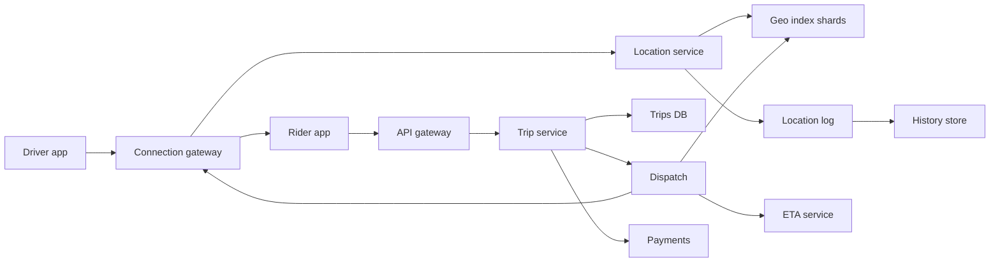

## In one minute
- The core is a real-time spatial index that absorbs a firehose of driver location updates and answers "nearest available drivers to this point" in milliseconds. It is a write-heavy, memory-resident, ephemeral data set, so do not put it in your primary database.
- Shard the index by geography (cells of a grid, geohash or H3), not by driver ID, so a nearest-driver query touches one or a few shards. Handle dense cities by making cells smaller or splitting hot cells.
- Matching is a state machine with a hold: offer a trip to one driver at a time (or a small batch), hold that driver so no other rider can grab them, and time out quickly. The hard correctness bug is double-dispatch.
- Trips and payments are durable and strongly consistent; locations are lossy and eventually consistent. Keeping those two worlds apart is the main architectural decision.
- Push updates to phones over long-lived connections. Polling at this scale wastes radio, battery and server capacity.

## Requirements
Functional:
- Riders see nearby cars on a map and request a ride from A to B with a price estimate.
- The system matches the rider to a nearby available driver who accepts within a few seconds.
- Both parties see each other's live location during pickup and the trip.
- Trip completes, fare is computed, and payment is charged.

Non-functional:
- Match latency: a driver offer within about 1 to 2 seconds of request in normal conditions.
- Location freshness: driver positions in the index are no more than about 5 to 10 seconds old.
- A driver is never assigned to two trips at once.
- High availability per city; a failure in one city or region should not stop others.

Out of scope: surge pricing models, ETA and routing engines (treated as services), fraud, driver onboarding, pooled rides, and food delivery.

## Back-of-envelope
Use round planning numbers rather than Uber's published figures: 5 million drivers online at peak worldwide and 30 million trips per day.

Location updates: each online driver's app sends a position every 4 seconds. 5M / 4 = 1.25 million updates per second at peak. Each update is about 100 bytes on the wire after framing (driver ID, lat, lng, heading, speed, timestamp, status), so ingress is about 125 MB/s, or roughly 1 Gbit/s. That is modest bandwidth but a very high message rate, so per-message CPU matters more than bytes.

Trip requests: 30M per day / 86,400 is about 350 per second on average. Rush hour and weekend nights concentrate demand, so plan for 5x peaks, about 1,750 requests per second, plus 10x that in "show nearby cars" map queries from riders with the app open: say 20,000 nearest-driver queries per second.

Index memory: 5M drivers x about 64 bytes per entry (ID, coordinates, cell, status, timestamp) is 320 MB. The whole live index fits in memory on a single machine; we shard it for throughput and fault isolation, not for capacity.

Location history (for trip receipts, disputes and analytics): 1.25M updates per second x 100 bytes x 86,400 seconds is about 10.8 TB per day if everything is kept. Keep only on-trip points at full resolution and downsample the rest: perhaps 2 to 3 TB per day, roughly 1 PB per year, and 5 PB over five years in compressed columnar storage. These are rough, and compression ratios on GPS tracks can be large.

Trips: 30M per day x about 2 KB per trip record = 60 GB per day, around 110 TB over five years. Small compared to location data, but it is the data that must never be lost.

## API
```
// Driver app, over a persistent connection (WebSocket or gRPC stream)
DriverUpdate { driver_id, lat, lng, heading, speed, status, client_ts }
<- OfferTrip { trip_id, pickup, dropoff_hint, expires_at }
-> RespondOffer { trip_id, accept: bool }

// Rider app
POST /v1/trips        body: { pickup, dropoff, product, idempotency_key }
  -> 202 { trip_id, state: "MATCHING" }
GET  /v1/nearby?lat&lng&product -> { drivers: [ { id, lat, lng, heading } ] }
<- TripEvent { trip_id, state, driver_location, eta } (pushed)
POST /v1/trips/{id}/cancel -> 200 { state }
```

## Data model
- **Live driver index** (in memory, not a database): maps `cell_id -> set(driver_id)` and `driver_id -> {lat, lng, cell_id, status, last_ts}`. Partitioned by `cell_id` (city or region shards own sets of cells). The cell key is chosen because the query starts from a location; the reverse map is needed to move a driver between cells on update.
- **trips**: primary key `trip_id`, columns `rider_id`, `driver_id`, `state`, `pickup`, `dropoff`, `fare`, `created_at`, `version`. Partition by `trip_id`, with a secondary index on `rider_id` and `driver_id` for history screens. Stored in a strongly consistent replicated database because trip state drives money. When Uber rebuilt its fulfillment platform (described in 2021) it chose Spanner for exactly this reason: the earlier design traded consistency for availability and resolved split-brain conflicts with last-write-wins ([Uber Engineering, 2021](https://www.uber.com/us/en/blog/fulfillment-platform-rearchitecture/)).
- **driver_state**: `driver_id -> {status: offline | available | offered | on_trip, trip_id, version}`. This is the record that prevents double dispatch, updated with conditional writes (compare-and-set on `version`). It lives with the dispatch shard in memory with a durable log, or in a store with conditional updates.
- **location_history**: append-only, partitioned by `(driver_id, day)` and clustered by timestamp, in a wide-column or object store. Only queried by trip ID ranges after the fact.

## High-level design


Write path for locations: the driver app keeps one long-lived connection to a gateway node. Each update goes to the location service, which validates it (drops out-of-order or impossible jumps), routes it to the index shard that owns the driver's new cell, and, if the cell changed, removes the driver from the old cell's set. The same update is appended asynchronously to a location log for history and analytics; that path can lag or drop without affecting matching.

Read path for a trip request: the trip service creates a trip in `MATCHING` with the rider's idempotency key, then asks dispatch for a driver. Dispatch queries the index shard for the pickup cell and its neighbours, gets the K nearest available drivers by straight-line distance, re-ranks the top few by road ETA from the ETA service, and attempts to hold the best one with a conditional update on `driver_state` (available to offered). If the hold succeeds, it sends an offer over the driver's connection with a 10 to 15 second expiry. Accept moves the trip to `DRIVER_ASSIGNED` and the driver to `on_trip`; decline or timeout releases the hold and dispatch tries the next candidate.

## Deep dives

### The spatial index: geohash, quadtree or hexagons
A geohash interleaves latitude and longitude bits into a string, so nearby points usually share a prefix. It is easy to compute and store, but cells near a boundary can be close in space and far apart in prefix, so you always search the cell plus its 8 neighbours. A quadtree adapts to density (split a node when it holds too many drivers), which is attractive for cities with a dense core, but every split and merge under a 1.25M-per-second update stream is coordination you have to get right. A hexagonal grid such as Uber's open-source H3 gives cells whose neighbours are all at the same distance from the centre, which makes ring searches and surge zones cleaner, at the cost of a less familiar library. H3 has 16 resolutions, each cell about one seventh the area of its parent, but a hexagon cannot be split exactly into seven smaller hexagons, so a child is only approximately inside its parent ([Uber Engineering, 2018](https://www.uber.com/us/en/blog/h3/)). Rolling cells up to a coarser level is therefore lossy in a way geohash and S2 prefixes are not.

This is not hypothetical history. Uber's dispatch system as described in 2015 sharded its supply index on Google S2 level-12 cells (roughly 3.3 to 6.4 km² each), wrote each driver location to its cell's shard plus a few replicas, and answered a pickup query by computing the cells that cover a circle around the rider ([High Scalability, from Uber's talk](https://highscalability.com/how-uber-scales-their-real-time-market-platform/)).

The choice for the interview: a fixed-resolution grid of cells (geohash or H3) with ring expansion. Pick a cell size of roughly 1 to 2 km so a typical query touches the centre cell plus one ring (H3 resolution 8 averages 0.74 km² with edges of about 0.53 km; resolution 7 averages 5.2 km² ([H3 cell statistics](https://h3geo.org/docs/core-library/restable/))), and expand rings outward until K drivers are found and the next ring is provably farther than the K-th result. Dense areas are handled by using a finer resolution there, not by dynamic tree splits.

### Matching without double dispatch
Two riders a block apart can both see the same nearest driver. If two dispatch workers each send that driver an offer, one rider gets a phantom match. The fix is that every offer is preceded by an atomic hold on the driver's state: `UPDATE driver_state SET status='offered', trip_id=? WHERE driver_id=? AND status='available'`, or the in-memory equivalent on the shard that owns the driver. Only the winner sends the offer. Holds carry an expiry so a crashed dispatcher does not strand a driver. Expiry creates its own race: a dispatcher that stalls past the deadline (a GC pause, a slow network) may still send its offer after another worker has re-held the driver. Give every hold a monotonically increasing version and make the accept path check it, the fencing-token idea ([Kleppmann](https://martin.kleppmann.com/2016/02/08/how-to-do-distributed-locking.html)), so a stale offer cannot be accepted.

An alternative is to route all dispatch for a geographic region to a single-threaded owner (one actor per city or per cell group), which serialises decisions without locks and lets you do batch matching: collect requests for one or two seconds and solve a small assignment problem that minimises total pickup time rather than greedily serving each rider. Batching gives better global outcomes in dense areas at the cost of a short wait. A staff answer mentions both and picks per-region serialisation with a short batching window in busy cities and greedy matching elsewhere.

### Ingesting 1.25 million updates per second
The update path must be cheap per message. Keep connections on gateway nodes that only frame and forward, batch updates per destination shard every few hundred milliseconds, and make the index update an in-memory hash-set move. Drop stale updates by comparing `client_ts` to the stored timestamp, since mobile networks reorder and replay. Expire drivers whose last update is older than a TTL (say 30 seconds) so a phone that lost signal does not keep receiving offers. Persistence of the live index is unnecessary: on shard restart, drivers repopulate it within one update interval. Uber's driver apps send a location every 4 seconds, and the geo index was designed for about a million writes per second ([High Scalability](https://highscalability.com/how-uber-scales-their-real-time-market-platform/)). Shard ownership among index nodes can be handled with a gossip-based consistent-hash ring; Uber's open-source Ringpop was first used for exactly this geospatial service ([Uber Engineering, 2016](https://www.uber.com/us/en/blog/ringpop-open-source-nodejs-library/)).

## Down the stack

### Layer 1: The contract
A nearest-driver query returns up to K available drivers within radius R, each with a position no older than the TTL, sorted by distance, in a few milliseconds of server time. It may miss a driver who moved in the last few seconds. A hold on a driver is linearizable per driver: at most one active offer exists for a driver at any time. Trip state transitions are durable and ordered; a client retrying a request with the same idempotency key gets the same trip.

### Layer 2: The mechanism
Each shard holds a hash map from cell ID to a set of driver IDs and a second map from driver ID to its record. An update computes the new cell (a few floating-point operations and bit interleaving for a geohash, or the H3 index function), compares it with the stored cell, and does at most one set removal and one insertion. A query computes the centre cell, iterates ring by ring, computes exact distances (haversine, or planar distance in a local projection) for drivers in those cells, and keeps the best K in a bounded max-heap. Termination uses the rule that every cell in ring r+1 is at least r cell widths from the query point. Offers and holds are a small state machine per driver: available, offered (with deadline), on_trip, offline.

### Layer 3: The machine
A driver update is about 100 bytes, which fits in a single TCP segment and a single TLS record. At 1.25M messages per second, the cost is dominated by syscalls and wake-ups, so gateways read many messages per `epoll_wait` cycle and batch forwards. An index entry of 64 bytes is one CPU cache line; a ring-1 query on a 1 km cell in a dense city might touch a few hundred entries, which is tens of microseconds of CPU, mostly cache misses at around 100 ns each. Long-lived mobile connections cost memory per socket (kernel buffers of tens of KB), so a gateway holding 500,000 connections needs tens of GB just for socket state, which is why buffer sizes are tuned down. For scale, Uber's push platform (RAMEN) started on Server-Sent Events with acknowledgements and retries layered on top, peaked at over 70,000 messages a second on its first generation, and after a rebuild held more than 1.5 million concurrent connections and pushed over 250,000 messages a second, with a bidirectional gRPC protocol in beta ([Uber Engineering, 2020](https://www.uber.com/us/en/blog/real-time-push-platform/)). Cellular round trips are 50 to 300 ms and radios sleep between sends, so the 4-second interval is a battery trade-off, not a server one.

### Why it's built this way
- Positions change every few seconds, so durable storage of the live index is wasted work; keep it in memory and rebuild from the stream.
- Queries start from a location, so shard and key by location cell, not driver ID.
- Drivers cluster in city centres, so cell size and shard ownership must follow density, not area.
- Two riders can race for one driver, so offers require an atomic per-driver hold.
- Mobile networks are slow and lossy, so use persistent connections, sequence numbers and TTL expiry instead of request-per-update.

## Failure modes
- **10x load (New Year's Eve):** request rate and map queries spike in a few cells. Reduce map refresh rates for riders, widen the batching window, and add read replicas of hot index shards for "nearby cars" display (which tolerates staleness) while keeping dispatch on the primary owner.
- **Region outage:** the live index is rebuilt in a standby region within one update interval once drivers reconnect there. Trip state must be replicated across regions synchronously or with a short, known loss window; in-flight trips continue because the driver app holds the trip ID and pickup locally and can re-sync. Uber took this further: dispatch periodically sent each driver phone an encrypted state digest, and after a datacenter failover the new region asked the phone for it when an update arrived for an unknown trip ([High Scalability](https://highscalability.com/how-uber-scales-their-real-time-market-platform/)). The phones become the backup.
- **Hot key (stadium or airport cell):** one cell holds thousands of drivers and receives most queries. Use finer cells there, an airport queue model (first in, first out) instead of nearest, and split the cell's ownership across workers.
- **Dispatcher crash mid-offer:** holds expire after the offer timeout and the trip service retries dispatch for trips still in `MATCHING`.
- **GPS jitter and spoofing:** reject updates that imply impossible speeds; snap to roads for display.

## In the wild
- **Uber, 2016: the highest-QPS service skipped the clever index.** Uber's geofence lookup service (which city and which zone is this point in) used neither an R-tree nor S2. It indexed city boundaries first and then the fences inside the matched city, cutting candidates from tens of thousands to hundreds, and swapped in rebuilt index segments under a read-write lock. On New Year's Eve 2015 it served 170,000 queries a second on 40 machines at about 35% CPU, with p95 under 5 ms and p99 under 50 ms ([Uber Engineering](https://www.uber.com/us/en/blog/go-geofence-highest-query-per-second-service/)).
- **Uber, 2018: hexagons replace hand-drawn zones.** Uber computes surge pricing from supply and demand measured per H3 hexagon in each city. Hexagons were chosen because every neighbour is the same distance away, which simplifies smoothing across gradients, and because they reduce quantization error as people move through a city ([Uber Engineering](https://www.uber.com/us/en/blog/h3/)).
- **Uber, 2021: last-write-wins was not good enough for trips.** Uber's fulfillment platform, the source of truth for trips and deliveries, dated from 2014 and accepted best-effort consistency with last-write-wins during split-brain. The rebuild moved it to Spanner's multi-region configuration with transactions across rows and tables, added a component to guarantee at-least-once post-commit side effects, and took over 100 engineers about two years ([Uber Engineering](https://www.uber.com/us/en/blog/fulfillment-platform-rearchitecture/)).

## Trade-offs
| Option | Strengths | Weaknesses | Choose when |
|---|---|---|---|
| Fixed grid or geohash | Simple, cheap updates, easy sharding | Boundary effects, uneven density | Default for live driver index |
| Quadtree | Adapts to density | Split/merge churn under heavy writes | Mostly static points of interest |
| H3 hexagons | Uniform neighbour distance, good for zones | Library dependency, less familiar | Surge zones, analytics, ring search |
| Greedy nearest match | Lowest latency, simple | Globally suboptimal in dense areas | Sparse markets |
| Batched assignment | Better total pickup time | Adds 1 to 2 s wait, more compute | Dense city centres at peak |

## Leadership lens
- Build first: the connection gateway, location ingest into an in-memory grid index, and greedy dispatch with atomic holds. That is the minimum viable product. Batch matching, ETA re-ranking and adaptive cells come later.
- Ownership: a realtime platform team owns gateways and push; a marketplace team owns index and dispatch; a trips team owns the durable state machine; payments is separate with its own on-call.
- Cost drivers: gateway fleet sized by concurrent connections, location history storage, and ETA calls (often the most expensive per request). Cache ETAs per cell pair for short periods.
- Rollout: launch city by city, since each city is a natural blast radius and shard boundary. Shadow-run new matching logic and compare pickup times before switching.
- Ask in review: what is the maximum staleness of a position used in dispatch, how a hold is released when anything crashes, and how the system behaves when the ETA service is down (fall back to straight-line distance).

## Check yourself
1. Two riders a block apart both see the same nearest driver. How does the design stop that driver from being dispatched twice?
   **Answer:** Every offer is preceded by an atomic hold, a conditional update that moves `driver_state` from `available` to `offered` only if it is still available, so only the winner sends an offer. Holds carry an expiry so a crashed dispatcher does not strand the driver.
2. With 5M drivers online, why is the live driver index sharded at all, and why is it not persisted?
   **Answer:** At about 64 bytes per entry it is only 320 MB and fits on one machine, so it is sharded for throughput (1.25M updates a second) and fault isolation, not capacity. Positions change every few seconds, so on a shard restart drivers repopulate it within one update interval and durable storage would be wasted work.
3. When would you choose batched assignment over greedy nearest matching?
   **Answer:** In dense city centres at peak, where collecting requests for one or two seconds and solving a small assignment problem minimises total pickup time. Greedy matching has the lowest latency and suits sparse markets, while batching adds a 1 to 2 second wait and more compute.
4. Why does the design use a fixed-resolution grid with ring expansion instead of a quadtree for the live driver index?
   **Answer:** A quadtree adapts to density, but every split and merge under a 1.25M-per-second update stream is coordination that has to be right. A fixed grid keeps each update a cheap in-memory set move, and dense areas are handled by a finer resolution rather than dynamic tree splits.

## Practice
**Task:** Build a grid-based driver index. `DriverIndex(cell_size)` stores drivers on a plane bucketed by `(floor(x / cell_size), floor(y / cell_size))`. `update(driver_id, x, y, ts)` moves a driver and returns True, unless `ts` is not newer than the driver's last update, in which case it is ignored and returns False. `remove(driver_id)` deletes a driver. `nearest(x, y, k, max_radius, now, max_age)` returns up to `k` driver IDs whose Euclidean distance is at most `max_radius` and whose last update satisfies `now - ts <= max_age`, sorted by distance and then by ID. Search ring by ring outward from the query cell and stop once further rings cannot contain anything closer than the current k-th result or lie beyond `max_radius`.

```python starter
class DriverIndex:
    def __init__(self, cell_size):
        # TODO
        raise NotImplementedError

    def update(self, driver_id, x, y, ts):
        raise NotImplementedError

    def remove(self, driver_id):
        raise NotImplementedError

    def nearest(self, x, y, k, max_radius, now, max_age):
        raise NotImplementedError
```

```python tests
def test_nearest_in_neighbour_cell_beats_far_same_cell():
    idx = DriverIndex(10)
    idx.update("a", 0.1, 9.9, 1)
    idx.update("b", 10.1, 0.0, 1)
    assert idx.nearest(9.9, 0.0, 1, 100, 1, 10) == ["b"]

def test_sorted_by_distance_then_id():
    idx = DriverIndex(5)
    idx.update("z", 3, 0, 1)
    idx.update("y", -3, 0, 1)
    idx.update("x", 0, 1, 1)
    assert idx.nearest(0, 0, 3, 10, 1, 10) == ["x", "y", "z"]

def test_moving_driver_leaves_old_cell():
    idx = DriverIndex(10)
    idx.update("a", 1, 1, 1)
    assert idx.update("a", 55, 55, 2) is True
    assert idx.nearest(1, 1, 1, 5, 2, 10) == []
    assert idx.nearest(54, 54, 1, 5, 2, 10) == ["a"]

def test_stale_update_ignored():
    idx = DriverIndex(10)
    idx.update("a", 1, 1, 5)
    assert idx.update("a", 90, 90, 4) is False
    assert idx.update("a", 90, 90, 5) is False
    assert idx.nearest(1, 1, 1, 2, 5, 10) == ["a"]

def test_radius_age_and_remove():
    idx = DriverIndex(10)
    idx.update("near", 1, 0, 100)
    idx.update("old", 0, 1, 50)
    idx.update("far", 40, 0, 100)
    assert idx.nearest(0, 0, 5, 20, 100, 30) == ["near"]
    idx.remove("near")
    idx.remove("ghost")
    assert idx.nearest(0, 0, 5, 50, 100, 30) == ["far"]

def test_negative_coordinates_and_k_limit():
    idx = DriverIndex(4)
    for i in range(6):
        idx.update("d%d" % i, -1 - i * 3, -2, 1)
    assert idx.nearest(-1, -2, 2, 100, 1, 5) == ["d0", "d1"]
```

```python solution
import math


class DriverIndex:
    def __init__(self, cell_size):
        self.size = cell_size
        self.cells = {}
        self.drivers = {}

    def _cell(self, x, y):
        return (math.floor(x / self.size), math.floor(y / self.size))

    def update(self, driver_id, x, y, ts):
        old = self.drivers.get(driver_id)
        if old is not None and ts <= old[3]:
            return False
        if old is not None:
            self.cells[old[2]].discard(driver_id)
        c = self._cell(x, y)
        self.cells.setdefault(c, set()).add(driver_id)
        self.drivers[driver_id] = (x, y, c, ts)
        return True

    def remove(self, driver_id):
        old = self.drivers.pop(driver_id, None)
        if old is not None:
            self.cells[old[2]].discard(driver_id)

    def nearest(self, x, y, k, max_radius, now, max_age):
        cx, cy = self._cell(x, y)
        found = []
        r = 0
        while True:
            if (r - 1) * self.size > max_radius:
                break
            if len(found) >= k and found[k - 1][0] <= (r - 1) * self.size:
                break
            for i in range(cx - r, cx + r + 1):
                for j in range(cy - r, cy + r + 1):
                    if max(abs(i - cx), abs(j - cy)) != r:
                        continue
                    for d in self.cells.get((i, j), ()):
                        dx, dy, _, ts = self.drivers[d]
                        dist = math.hypot(dx - x, dy - y)
                        if dist <= max_radius and now - ts <= max_age:
                            found.append((dist, d))
            found.sort()
            r += 1
        return [d for _, d in found[:k]]
```

```typescript starter
export class DriverIndex {
  constructor(cellSize: number) {
    // TODO
  }
  update(driverId: string, x: number, y: number, ts: number): boolean {
    throw new Error("TODO");
  }
  remove(driverId: string): void {
    throw new Error("TODO");
  }
  nearest(x: number, y: number, k: number, maxRadius: number, now: number, maxAge: number): string[] {
    throw new Error("TODO");
  }
}
```

```typescript tests
test("nearest in neighbour cell beats far same cell", () => {
  const idx = new DriverIndex(10);
  idx.update("a", 0.1, 9.9, 1);
  idx.update("b", 10.1, 0.0, 1);
  assertEqual(idx.nearest(9.9, 0.0, 1, 100, 1, 10), ["b"]);
});

test("sorted by distance then id", () => {
  const idx = new DriverIndex(5);
  idx.update("z", 3, 0, 1);
  idx.update("y", -3, 0, 1);
  idx.update("x", 0, 1, 1);
  assertEqual(idx.nearest(0, 0, 3, 10, 1, 10), ["x", "y", "z"]);
});

test("moving driver leaves old cell", () => {
  const idx = new DriverIndex(10);
  idx.update("a", 1, 1, 1);
  assertEqual(idx.update("a", 55, 55, 2), true);
  assertEqual(idx.nearest(1, 1, 1, 5, 2, 10), []);
  assertEqual(idx.nearest(54, 54, 1, 5, 2, 10), ["a"]);
});

test("stale update ignored", () => {
  const idx = new DriverIndex(10);
  idx.update("a", 1, 1, 5);
  assertEqual(idx.update("a", 90, 90, 4), false);
  assertEqual(idx.update("a", 90, 90, 5), false);
  assertEqual(idx.nearest(1, 1, 1, 2, 5, 10), ["a"]);
});

test("radius age and remove", () => {
  const idx = new DriverIndex(10);
  idx.update("near", 1, 0, 100);
  idx.update("old", 0, 1, 50);
  idx.update("far", 40, 0, 100);
  assertEqual(idx.nearest(0, 0, 5, 20, 100, 30), ["near"]);
  idx.remove("near");
  idx.remove("ghost");
  assertEqual(idx.nearest(0, 0, 5, 50, 100, 30), ["far"]);
});

test("negative coordinates and k limit", () => {
  const idx = new DriverIndex(4);
  for (let i = 0; i < 6; i++) idx.update("d" + i, -1 - i * 3, -2, 1);
  assertEqual(idx.nearest(-1, -2, 2, 100, 1, 5), ["d0", "d1"]);
});
```

```typescript solution
type Rec = { x: number; y: number; cell: string; ts: number };

export class DriverIndex {
  private cells = new Map<string, Set<string>>();
  private drivers = new Map<string, Rec>();
  constructor(private size: number) {}

  private cellOf(x: number, y: number): [number, number] {
    return [Math.floor(x / this.size), Math.floor(y / this.size)];
  }

  update(driverId: string, x: number, y: number, ts: number): boolean {
    const old = this.drivers.get(driverId);
    if (old && ts <= old.ts) return false;
    if (old) this.cells.get(old.cell)!.delete(driverId);
    const [i, j] = this.cellOf(x, y);
    const key = i + "," + j;
    if (!this.cells.has(key)) this.cells.set(key, new Set());
    this.cells.get(key)!.add(driverId);
    this.drivers.set(driverId, { x, y, cell: key, ts });
    return true;
  }

  remove(driverId: string): void {
    const old = this.drivers.get(driverId);
    if (!old) return;
    this.cells.get(old.cell)!.delete(driverId);
    this.drivers.delete(driverId);
  }

  nearest(x: number, y: number, k: number, maxRadius: number, now: number, maxAge: number): string[] {
    const [cx, cy] = this.cellOf(x, y);
    const found: Array<[number, string]> = [];
    const cmp = (a: [number, string], b: [number, string]) =>
      a[0] !== b[0] ? a[0] - b[0] : a[1] < b[1] ? -1 : a[1] > b[1] ? 1 : 0;
    for (let r = 0; ; r++) {
      if ((r - 1) * this.size > maxRadius) break;
      if (found.length >= k && found[k - 1][0] <= (r - 1) * this.size) break;
      for (let i = cx - r; i <= cx + r; i++) {
        for (let j = cy - r; j <= cy + r; j++) {
          if (Math.max(Math.abs(i - cx), Math.abs(j - cy)) !== r) continue;
          for (const d of this.cells.get(i + "," + j) ?? new Set<string>()) {
            const rec = this.drivers.get(d)!;
            const dist = Math.hypot(rec.x - x, rec.y - y);
            if (dist <= maxRadius && now - rec.ts <= maxAge) found.push([dist, d]);
          }
        }
      }
      found.sort(cmp);
    }
    return found.slice(0, k).map((f) => f[1]);
  }
}
```

```go starter
package practice

type DriverIndex struct{}

func NewDriverIndex(cellSize float64) *DriverIndex {
	return &DriverIndex{}
}

func (idx *DriverIndex) Update(driverID string, x, y float64, ts int) bool {
	panic("TODO")
}

func (idx *DriverIndex) Remove(driverID string) {
	panic("TODO")
}

func (idx *DriverIndex) Nearest(x, y float64, k int, maxRadius float64, now, maxAge int) []string {
	panic("TODO")
}
```

```go tests
package practice

import (
	"fmt"
	"testing"
)

func same(a, b []string) bool {
	if len(a) != len(b) {
		return false
	}
	for i := range a {
		if a[i] != b[i] {
			return false
		}
	}
	return true
}

func TestNeighbourCellBeatsFarSameCell(t *testing.T) {
	idx := NewDriverIndex(10)
	idx.Update("a", 0.1, 9.9, 1)
	idx.Update("b", 10.1, 0.0, 1)
	if got := idx.Nearest(9.9, 0.0, 1, 100, 1, 10); !same(got, []string{"b"}) {
		t.Fatalf("got %v", got)
	}
}

func TestSortedByDistanceThenID(t *testing.T) {
	idx := NewDriverIndex(5)
	idx.Update("z", 3, 0, 1)
	idx.Update("y", -3, 0, 1)
	idx.Update("x", 0, 1, 1)
	if got := idx.Nearest(0, 0, 3, 10, 1, 10); !same(got, []string{"x", "y", "z"}) {
		t.Fatalf("got %v", got)
	}
}

func TestMovingDriverLeavesOldCell(t *testing.T) {
	idx := NewDriverIndex(10)
	idx.Update("a", 1, 1, 1)
	if !idx.Update("a", 55, 55, 2) {
		t.Fatal("newer update should apply")
	}
	if got := idx.Nearest(1, 1, 1, 5, 2, 10); len(got) != 0 {
		t.Fatalf("got %v", got)
	}
	if got := idx.Nearest(54, 54, 1, 5, 2, 10); !same(got, []string{"a"}) {
		t.Fatalf("got %v", got)
	}
}

func TestStaleUpdateIgnored(t *testing.T) {
	idx := NewDriverIndex(10)
	idx.Update("a", 1, 1, 5)
	if idx.Update("a", 90, 90, 4) || idx.Update("a", 90, 90, 5) {
		t.Fatal("stale updates must be ignored")
	}
	if got := idx.Nearest(1, 1, 1, 2, 5, 10); !same(got, []string{"a"}) {
		t.Fatalf("got %v", got)
	}
}

func TestRadiusAgeAndRemove(t *testing.T) {
	idx := NewDriverIndex(10)
	idx.Update("near", 1, 0, 100)
	idx.Update("old", 0, 1, 50)
	idx.Update("far", 40, 0, 100)
	if got := idx.Nearest(0, 0, 5, 20, 100, 30); !same(got, []string{"near"}) {
		t.Fatalf("got %v", got)
	}
	idx.Remove("near")
	idx.Remove("ghost")
	if got := idx.Nearest(0, 0, 5, 50, 100, 30); !same(got, []string{"far"}) {
		t.Fatalf("got %v", got)
	}
}

func TestNegativeCoordinatesAndKLimit(t *testing.T) {
	idx := NewDriverIndex(4)
	for i := 0; i < 6; i++ {
		idx.Update(fmt.Sprintf("d%d", i), float64(-1-i*3), -2, 1)
	}
	if got := idx.Nearest(-1, -2, 2, 100, 1, 5); !same(got, []string{"d0", "d1"}) {
		t.Fatalf("got %v", got)
	}
}
```

```go solution
package practice

import (
	"math"
	"sort"
)

type cellKey struct{ i, j int }

type rec struct {
	x, y float64
	cell cellKey
	ts   int
}

type hit struct {
	dist float64
	id   string
}

type DriverIndex struct {
	size    float64
	cells   map[cellKey]map[string]bool
	drivers map[string]rec
}

func NewDriverIndex(cellSize float64) *DriverIndex {
	return &DriverIndex{size: cellSize, cells: map[cellKey]map[string]bool{}, drivers: map[string]rec{}}
}

func (idx *DriverIndex) cellOf(x, y float64) cellKey {
	return cellKey{int(math.Floor(x / idx.size)), int(math.Floor(y / idx.size))}
}

func (idx *DriverIndex) Update(driverID string, x, y float64, ts int) bool {
	old, ok := idx.drivers[driverID]
	if ok && ts <= old.ts {
		return false
	}
	if ok {
		delete(idx.cells[old.cell], driverID)
	}
	c := idx.cellOf(x, y)
	if idx.cells[c] == nil {
		idx.cells[c] = map[string]bool{}
	}
	idx.cells[c][driverID] = true
	idx.drivers[driverID] = rec{x, y, c, ts}
	return true
}

func (idx *DriverIndex) Remove(driverID string) {
	if old, ok := idx.drivers[driverID]; ok {
		delete(idx.cells[old.cell], driverID)
		delete(idx.drivers, driverID)
	}
}

func abs(a int) int {
	if a < 0 {
		return -a
	}
	return a
}

func (idx *DriverIndex) Nearest(x, y float64, k int, maxRadius float64, now, maxAge int) []string {
	c := idx.cellOf(x, y)
	var found []hit
	for r := 0; ; r++ {
		reach := float64(r-1) * idx.size
		if reach > maxRadius || (len(found) >= k && found[k-1].dist <= reach) {
			break
		}
		for i := c.i - r; i <= c.i+r; i++ {
			for j := c.j - r; j <= c.j+r; j++ {
				if abs(i-c.i) != r && abs(j-c.j) != r {
					continue
				}
				for d := range idx.cells[cellKey{i, j}] {
					rc := idx.drivers[d]
					dist := math.Hypot(rc.x-x, rc.y-y)
					if dist <= maxRadius && now-rc.ts <= maxAge {
						found = append(found, hit{dist, d})
					}
				}
			}
		}
		sort.Slice(found, func(a, b int) bool {
			if found[a].dist != found[b].dist {
				return found[a].dist < found[b].dist
			}
			return found[a].id < found[b].id
		})
	}
	out := []string{}
	for i := 0; i < len(found) && i < k; i++ {
		out = append(out, found[i].id)
	}
	return out
}
```

## Mock interview
**Prompt:** Design Uber's ride-hailing backend for about 5 million concurrent drivers sending locations every 4 seconds and around 30 million trips per day. A rider should receive a matched driver within a couple of seconds.

- Follow-up: How exactly do you find the 5 nearest available drivers, and how do you know you can stop searching?
- Follow-up: Two riders request at the same moment and both see the same driver as closest. What prevents a double match, and what happens if the dispatcher crashes after the hold?
- Follow-up: Would you switch from greedy nearest-driver to batch matching? What would you measure first?

**A strong answer covers:**
- The arithmetic showing location ingest (over a million messages per second) dominates, and that the live index fits in memory.
- Separating ephemeral location state from durable trip and payment state, with different consistency for each.
- A cell-based index with ring search and a correct termination rule, sharded by geography with density-aware cell sizes.
- An atomic per-driver hold with expiry, plus idempotent trip creation.
- Persistent connections for push, stale-update rejection and TTL expiry for offline drivers.

## Sources and further study
**Primary**
- [How to do distributed locking (Martin Kleppmann)](https://martin.kleppmann.com/2016/02/08/how-to-do-distributed-locking.html): why a lease with an expiry needs fencing tokens, the same problem as an expiring driver hold.
- [Uber Engineering: Go geofence service](https://www.uber.com/us/en/blog/go-geofence-highest-query-per-second-service/): a measured, deliberately simple spatial lookup at 170k QPS.
- [Uber Engineering: Fulfillment Platform re-architecture](https://www.uber.com/us/en/blog/fulfillment-platform-rearchitecture/): why trip state moved to a strongly consistent store.

**Systems docs**
- [H3 cell statistics by resolution](https://h3geo.org/docs/core-library/restable/): average area and edge length per resolution, for picking the cell size.
- [H3 grid traversal API](https://h3geo.org/docs/api/traversal/): `gridDisk` and `gridRing`, the ring search used by nearest-driver queries, and their pentagon caveats.
- [S2 cell statistics](http://s2geometry.io/resources/s2cell_statistics.html): the area range of the level-12 cells Uber originally sharded on.

**Books**
- *System Design Interview, Volume 2*, Alex Xu and Sahn Lam, Ch 1 "Proximity Service" and Ch 2 "Nearby Friends": geohash and quadtree indexes and high-rate location updates over WebSockets.
- *Designing Data-Intensive Applications* (1st ed.), Martin Kleppmann, Ch 8 "The Trouble with Distributed Systems": process pauses, leases and fencing, the failure behind double dispatch.

**Other curricula**
- [High Scalability: How Uber scales their real-time market platform](https://highscalability.com/how-uber-scales-their-real-time-market-platform/): a summary of Uber's own talk, framing dispatch as supply and demand services over an S2-sharded index with Ringpop and phone-held state digests.
- [Azure Architecture Center: Geode pattern](https://learn.microsoft.com/en-us/azure/architecture/patterns/geodes): frames the per-region active-active deployment, and warns that it fits poorly when sessions hold temporary state, as an in-progress trip does.

## Watch
- [Engineering an H3-based Geospatial Data Platform at Uber (Uber Engineering)](https://www.youtube.com/watch?v=aCj-YVZ0mlE): how Uber uses hexagonal cells for marketplace data.
- [Design Uber/Lyft Location Index, Deep Dives (Jordan has no life)](https://www.youtube.com/watch?v=8wDRlS3vJvc): an interview-style deep dive on location indexing trade-offs.

## Free resources
- [H3: Uber's Hexagonal Hierarchical Spatial Index (Uber Engineering)](https://www.uber.com/us/en/blog/h3/): why hexagons, and how Uber uses them for supply, demand and pricing.
- [H3 documentation](https://h3geo.org/docs/): resolutions, cell areas, and neighbour (ring) operations.
- [Uber's Real-Time Push Platform (Uber Engineering)](https://www.uber.com/us/en/blog/real-time-push-platform/): how Uber pushes trip and location updates to apps over persistent connections.
- [Ringpop (Uber Engineering)](https://www.uber.com/us/en/blog/ringpop-open-source-nodejs-library/): consistent hashing and membership used to shard stateful services such as dispatch.
- [Geohash (Wikipedia)](https://en.wikipedia.org/wiki/Geohash): the encoding, precision per character, and boundary caveats.
