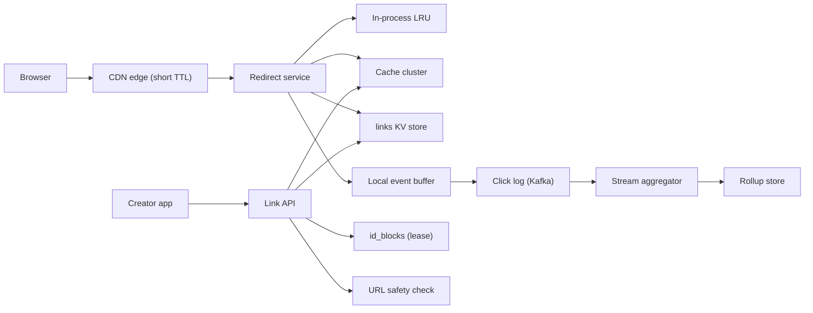

## In one minute
- **The redirect is the product, so design for reads.** Expect around 100 redirects per link created. A redirect is one key lookup and a few hundred bytes, so the job is keeping that lookup in memory close to the user.
- **Allocate codes from a leased counter, not from hashes or random draws.** Each server leases a block of the counter and turns numbers into 7-character base62 codes with no collision check. Custom aliases live in the same table but in a namespace whose shape can never match a generated code.
- **Pick the redirect status on purpose.** A `301` is cached by browsers with no expiry date, so you lose the click count and can never change or disable the link for that browser. A `302` costs one request per click and keeps you in control. Most link services want control.
- **Keep analytics off the hot path.** Record each click as an event in a local buffer and ship it to a log asynchronously. A slow analytics pipeline must never slow a redirect.
- **Abuse is a first-class requirement.** Short links hide their destination, which makes them a phishing tool. Scanning at creation, fast disabling and creation rate limits ship in version one.

## Requirements

**Functional**
- Create a short link for a long URL and return a 7-character code such as `sho.rt/aZ3kQ9x`.
- Optional custom alias (`sho.rt/spring-sale`) for signed-in users, unique and case-insensitive.
- Redirect `GET /{code}` to the long URL. Unknown, expired and disabled codes return an error page.
- Optional expiry per link; owners can disable or delete links.
- Click analytics per link: totals, daily series, top countries and referrers.

**Non-functional**
- Redirect p99 under 50 ms at the edge for cached links and under 150 ms on a full miss.
- Redirect availability of 99.99%. Link creation can be less available (99.9%) and degrade first.
- A created link resolves immediately from the region that created it, and everywhere within a few seconds.
- Codes are never reused and never point to a different URL than the one the creator gave.
- Disabling a link (by the owner or by trust and safety) takes effect everywhere within 60 seconds.

**Out of scope**
- Editing a link's destination after creation (allowed in some products, but it complicates caching and abuse review), QR code generation, link-in-bio pages, and billing.

## Back-of-envelope
Assume 50M new links per day and a 100:1 redirect-to-create ratio. These are round planning numbers, not any company's published figures.

- **Create QPS:** 50,000,000 / 86,400 s ≈ 580 per second on average. With a 3x daily peak, about 1,750 per second.
- **Redirect QPS:** 5B per day / 86,400 ≈ 58,000 per second on average, about 175,000 per second at peak. One viral link can add 50,000 per second on a single key.
- **Link storage:** about 500 bytes per row (a 200-byte average long URL, the code, owner, timestamps, status and index overhead). 50M × 500 B = 25 GB per day, about 9 TB per year and about 46 TB over 5 years. With three replicas that is roughly 140 TB on disk.
- **Code space:** 5 years × 365 × 50M ≈ 91B codes. 62^6 ≈ 56.8B is too small. 62^7 ≈ 3.52T gives about 38x headroom, so codes are 7 characters.
- **Click events:** 5B per day × about 100 bytes = 500 GB per day of raw events, about 180 TB per year. Keep raw events for 90 days (45 TB) and only rollups after that.
- **Bandwidth:** a redirect is about 500 bytes of headers. 175,000 × 500 B ≈ 87 MB/s, about 700 Mbit/s at peak for the fleet. Request rate and tail latency are the constraints, not bandwidth.
- **Hot set:** links follow a power law. If 200M distinct links are clicked on a given day, caching them takes 200M × about 300 bytes = 60 GB, which fits in a small in-memory cache cluster.

## API

```
POST /v1/links
  Idempotency-Key: 7f3c...
  { "long_url": "https://shop.example/spring?utm_source=mail",
    "alias": "spring-sale",              // optional
    "expires_at": "2027-01-01T00:00:00Z" } // optional
  -> 201 { "code": "spring-sale", "short_url": "https://sho.rt/spring-sale" }
  -> 400 { "error": "invalid_alias" }   409 { "error": "alias_taken" }
  -> 422 { "error": "url_blocked" }     429 rate limited

GET /{code}
  -> 302 Location: https://shop.example/spring?utm_source=mail
     Cache-Control: private, max-age=60
  -> 404 unknown or deleted     410 expired or disabled

GET /v1/links/{code}/stats?from=2026-10-01&to=2026-10-16&granularity=day
  -> 200 { "total": 182340, "series": [...], "top_countries": [...] }

DELETE /v1/links/{code}   (owner only) -> 204
```

The idempotency key matters because mobile clients retry on timeouts. Without it, one tap can mint two codes for the same URL. The server keeps the key and the response for 24 hours, the same pattern described in the Idempotency lesson.

## Data model
- **links** (a key-value store such as DynamoDB or Cassandra): partition key `code`; attributes `long_url`, `owner_id`, `created_at`, `expires_at`, `status` (`active`, `disabled`, `deleted`), `kind` (`generated` or `alias`). The only hot query is "get by code", so the code is the whole key. Hash partitioning spreads codes evenly; a viral link is the only hot key, and the caches absorb it. Aliases share this table under their lowercased form, which is safe because an alias can never have the shape of a generated code (see deep dive 2).
- **links_by_owner** (a secondary index on `owner_id`, sorted by `created_at`): powers the dashboard. It is eventually consistent, which is fine for a list page.
- **id_blocks** (a small relational table): `(region, next_value)`. One row per region. A server leases a block with a single `UPDATE ... RETURNING`. A few writes per minute; one Postgres primary is plenty.
- **click_events** (a log such as Kafka, partitioned by `code`): `event_id`, `code`, `ts`, `country`, `referrer_host`, `user_agent_class`. Partitioning by code lets the aggregator count per link without shuffling.
- **click_rollups** (a columnar store such as ClickHouse or Druid): `(code, day, country, referrer_host) -> clicks, unique_visitors_sketch`. Stats queries read rollups, never raw events.

## High-level design



**Write path.** The link API authenticates the caller, applies the per-user creation rate limit, normalises the long URL (scheme and host lowercased, 2 KB cap) and checks it against a blocklist and a URL reputation service. Pick that service with the licence in mind: Google's Safe Browsing API is for non-commercial use only, and Google points commercial products to its Web Risk API ([Google Safe Browsing](https://developers.google.com/safe-browsing)), whose Update API keeps hashed lists locally so you don't send every user's URL to a third party ([Web Risk overview](https://docs.cloud.google.com/web-risk/docs/overview)). With no alias, it takes the next number from its locally leased block, encodes it as 7 base62 characters and writes the row with a plain put, since the code is guaranteed unique. With an alias, it validates the shape and writes with a conditional put (`attribute_not_exists(code)`), returning 409 if the alias is taken by someone else ([DynamoDB condition expressions](https://docs.aws.amazon.com/amazondynamodb/latest/developerguide/Expressions.ConditionExpressions.html)). Finally it writes the new row into the cache cluster and deletes any negative-cache entry for that code, then returns 201.

**Read path.** The CDN edge answers repeat clicks on popular links from its cache. On an edge miss, the redirect service checks its in-process LRU (about 100 ns), then the cache cluster (about 0.3 ms in-region), then the key-value store (a few ms). It checks `status` and `expires_at`, appends a click event to a local buffer, and returns a `302` with the `Location` header. A background thread flushes the buffer to Kafka in batches every 100 ms.

## Deep dives

### 1. The redirect hot path: status codes and cache layers
**301 or 302.** RFC 9110 makes a `301` "heuristically cacheable", so a cache may store it even when the response says nothing about freshness, while a `302` is not ([RFC 9110, section 15.4](https://www.rfc-editor.org/rfc/rfc9110#name-redirection-3xx)). In practice browsers keep permanent redirects with no fixed expiry. After the first visit the browser skips you entirely: you stop seeing clicks, and a disabled phishing link keeps working for every browser that cached it. A `302` (or `307`) is only cached when the response says so. I'd return `302` with `Cache-Control: private, max-age=60` for browsers and let the CDN cache for 60 seconds with a surrogate key per code. Customers can opt into `301` per link.

**Cache layers.** The CDN absorbs viral links: 50,000 clicks per second on one code become a handful of origin requests per PoP per minute. The in-process LRU absorbs hot keys that miss the CDN. The cache cluster holds the daily working set (about 60 GB), so the database sees mostly cold links. **Negative caching** is the overlooked part: scanners and typos request codes that don't exist, and every miss would otherwise go to the database. Cache "not found" for 30 seconds, and have the create path delete that entry, so a code someone probed just before creation still resolves immediately afterwards. Put an explicit short `Cache-Control` on the 404 and 410 responses too: RFC 9110 lists both as heuristically cacheable, so leaving the header off lets a browser or proxy decide for itself how long "not found" lasts ([RFC 9110, 404](https://www.rfc-editor.org/rfc/rfc9110#name-404-not-found)).

**Disable within 60 seconds.** A disable writes `status = disabled`, publishes the code on an invalidation topic that redirect nodes use to evict their LRU entry, deletes the cache key, and purges the CDN by surrogate key, a tag the origin attaches to each cached response so one purge call removes every object carrying it ([Fastly surrogate keys](https://www.fastly.com/documentation/guides/full-site-delivery/purging/working-with-surrogate-keys/)). The browser `max-age=60` bounds the worst case.

### 2. Allocating codes and handling custom aliases
The generator choices (random codes with retry, truncated hashes, counters) are compared in the Pastebin and Generating Unique IDs lessons. I'd use leased counter blocks here for the same reason: uniqueness without a read before every write. It is the same idea as Flickr's ticket servers, which handed out IDs from a dedicated database instead of letting each shard pick its own ([Flickr](https://code.flickr.net/2010/02/08/ticket-servers-distributed-unique-primary-keys-on-the-cheap/)). This section covers what is specific to a shortener.

**Block size.** At 1,750 creates per second across 20 API servers, each server uses about 90 numbers per second, so a block of 10,000 lasts almost two minutes and `id_blocks` sees about 10 leases per minute. A crash wastes at most one block; a crash every minute for five years wastes 26 billion, under 1% of the space. Servers prefetch the next block when the current one is half used, so a slow `id_blocks` database never blocks a create.

**Multiple regions.** Each region owns a disjoint slice of the counter space, so a region cut off from the others keeps issuing codes and failover can never produce a duplicate. The number passes through a reversible scramble before encoding, as in the Pastebin lesson, so a customer's campaign links aren't adjacent and enumerable.

**Aliases.** A custom alias must not collide with a code the counter will issue next year. The rule that removes that risk is about shape: generated codes are exactly 7 characters from `[0-9a-zA-Z]`, so an alias of exactly 7 alphanumeric characters is rejected, and every other alias (4 to 30 characters of letters, digits, `-` and `_`) can only clash with other aliases. Aliases are compared case-insensitively and stored under their lowercased form, because `Spring-Sale` and `spring-sale` owned by different people is a phishing gift. A reserved list (`api`, `admin`, `login`, brand names) is checked first. Creating the same alias for the same URL by the same owner returns the existing link, so a retried request without an idempotency key is still safe. Any other clash returns 409.

**Same URL twice.** Two creates of the same long URL get different codes, even for one user, because campaigns often want separate counts for the same destination.

### 3. Click analytics without slowing redirects
Counting synchronously (`INCR clicks:{code}` in Redis per redirect) adds a network call to the hot path and makes a viral link a hot counter key. Instead, the redirect node appends a compact event to an in-memory ring buffer and returns. A flusher sends batches to Kafka with `acks=all`, so the leader waits for every in-sync replica before acknowledging ([Kafka producer configs](https://kafka.apache.org/41/configuration/producer-configs/)). If the buffer fills because Kafka is slow, the node drops events and increments a `clicks_dropped` metric rather than blocking redirects. That is an explicit choice: analytics are best effort to within a stated error, and redirects are not.

Delivery to Kafka is at least once, so the stream aggregator deduplicates on `event_id` within a short window and then rolls events up into per-minute and per-day counts by `(code, country, referrer_host)`. Unique visitors are estimated with a HyperLogLog sketch per link per day, not by storing visitor IDs. Redis's version uses at most 12 KB with a standard error of 0.81%, and sketches merge across days ([Redis HyperLogLog](https://redis.io/docs/latest/develop/data-types/probabilistic/hyperloglogs/)). Bot traffic, mostly chat-app link previews and security scanners, is excluded from customer-facing counts but kept for abuse analysis.

### Variant: a text-sharing service (Pastebin)
A paste service looks like a shortener with a bigger payload, but the payload changes the design. A link row is about 500 bytes; a paste can be 10 MB, so the record splits in two. A small metadata row (ID, owner, expiry, size, content pointer) stays in the key-value store and is the only part on the strict consistency path, while the text goes to an object store. Pastes under roughly 4 KB compressed can stay inline in the row, because most pastes are tiny and an object-store round trip costs more than the data. Key-value stores also cap item size (DynamoDB at 400 KB), and large values hurt compaction ([DynamoDB constraints](https://docs.aws.amazon.com/amazondynamodb/latest/developerguide/Constraints.html)).

The numbers move too. At 5 million new pastes a day, writes are only about 58 per second on average, far below the shortener's 1,750 creates per second. Storage is the real cost: at a 10 KB average that is 50 GB a day and around 91 TB over five years before expiry. Roughly 9 billion IDs over five years still fit in 7 base62 characters, so the counter-block allocator carries over unchanged.

Immutability is the gift. A paste never changes after it is written, so reads suit a CDN with the raw text keyed by a content-hash ETag. Redirect-style invalidation by surrogate key is replaced by expiry and delete, and the CDN `max-age` must be capped at the remaining lifetime so an expired paste is not served from the edge. Private pastes need `private, no-store` and a signed or owner-checked path, since a cache that serves one user's page to another is a data leak.

Expiry has three jobs. The origin compares `expires_at` on every read and returns 404, which is the correctness rule. A background sweeper or TTL feature reclaims rows eventually; DynamoDB TTL, for example, can take days, and expired items may still appear in reads until filtered. An object-store lifecycle rule on date-prefixed keys reclaims the blobs. Burn-after-read needs exactly-once behavior: the read becomes a conditional delete that returns the old item, so of two simultaneous readers one gets the text and the other a 404.

Abuse replaces click analytics as the workload that never goes away. Pastes host malware, leaked credentials and spam, so version one needs per-IP and per-account rate limits, a size cap, an asynchronous content scanner that can quarantine a paste, and a takedown path that also purges caches. Visibility needs honest names: "unlisted" hides a paste from listings but anyone with the URL can read it, which is what GitHub's "secret" gists mean ([GitHub Docs](https://docs.github.com/en/get-started/writing-on-github/editing-and-sharing-content-with-gists/creating-gists)).

## Down the stack

### Layer 1: The contract
`GET /{code}` returns a `302` to exactly the URL stored when that code was created, or a 404 or 410. It never returns another link's URL, even across a regional failover, because codes are unique by construction and immutable. A created link resolves in its home region as soon as the 201 is returned; other regions see it within the replication lag, typically under 2 seconds. A disabled link stops redirecting within 60 seconds everywhere. Click counts are eventually consistent (about one minute behind) and may undercount by the dropped-event rate, which is published as a metric.

### Layer 2: The mechanism
A redirect node runs an LRU keyed by code with entries of about 300 bytes; one million entries take about 300 MB. On a miss it sends `GET link:{code}` to the cache cluster, where the client hashes the key onto a consistent-hash ring of cache nodes (see Consistent Hashing). On a cache miss, concurrent requests for the same code are coalesced into one `GetItem` on the partition key. The click event is a fixed-layout struct appended to a per-thread ring buffer: no lock and no allocation per click.

### Layer 3: The machine
A `302` with a 200-byte `Location` header is about 400 bytes, which fits in a single TCP segment (a typical MSS is 1,460 bytes), so the whole redirect is one packet out after the request arrives. For a new visitor, the TCP handshake and the 1-RTT TLS 1.3 handshake cost two round trips before the request is even sent ([RFC 8446](https://www.rfc-editor.org/rfc/rfc8446)), which is why terminating TLS at an edge PoP 10 ms away instead of an origin 80 ms away matters more than any database tuning. An LRU hit costs around 100 ns, a cache cluster hit one in-region round trip of 200 to 500 µs, and a database read 2 to 10 ms. With a 95% LRU hit rate and 4.9% cache-cluster hits, the average origin lookup is under 50 µs, so the round trip to the user is the entire latency budget.

### Why it's built this way
1. Every click pays the network round trip, so the answer must come from as close to the user as possible: edge first, then memory.
2. Caches take away your ability to change answers, so the status code and TTLs bound how long a disabled link lives.
3. Caches need keys that never change meaning, so codes are immutable and unique by construction, which a counter gives without a read before each write.
4. A counter needs coordination, and coordination is slow, so servers lease blocks and coordinate once every few thousand codes.
5. Anything extra on the redirect path multiplies across 175,000 requests per second, so analytics are buffered and shipped asynchronously.

## Failure modes
- **10x load from a viral link.** One code at 500,000 clicks per second. The CDN absorbs nearly all of it; what reaches origin hits the in-process LRU, and the event buffer batches the clicks, so no backend key is hot.
- **Cache cluster loss.** Every lookup falls through to the database, which is sized for the cold tail, not for 175,000 per second. Mitigation: request coalescing, the in-process LRU for the hottest keys, and shedding analytics before redirects.
- **Region outage.** DNS or anycast moves users to the surviving regions. The links table is replicated across regions asynchronously, so links created in the last second or two before the outage may 404 until the region returns. That window is accepted and documented.
- **id_blocks database down.** Servers keep issuing from their current and pre-fetched blocks for several minutes. If it stays down, generated-code creation fails while alias creation and all redirects continue.
- **Code enumeration.** Bots walk the code space looking for private documents. A 2016 study sampled random 6-character bit.ly tokens and found about 42% of them in use, so a dense space can be scanned for shared files and map directions ([Georgiev and Shmatikov](https://arxiv.org/abs/1604.02734)). Mitigation: per-IP limits on 404s, negative caching, and the scramble, which hides order but not density. Links to anything private should carry a long random token of their own, not rely on the short code.
- **Phishing campaign.** Thousands of links to one malicious domain. Mitigation: scanning at creation, a domain-level block that disables every link to that host in one operation, and the 60-second disable path.

## In the wild
- **Google, 2018 to 2025: shutting down goo.gl.** Google stopped new goo.gl shortening in 2018. In July 2024 it said every goo.gl link would stop responding after 25 August 2025, noting that more than 99% of links had no activity in the previous month, and from August 2024 it showed an interstitial page before some redirects. On 1 August 2025 it reversed course: only links idle since late 2024 were switched off, actively used links keep working, and links generated by Google apps such as Maps sharing were kept. Codes outlive the service that issued them, so retiring a shortener is a data-migration problem, not a shutdown ([Google Developers Blog](https://developers.googleblog.com/en/google-url-shortener-links-will-no-longer-be-available/)).
- **OneDrive and Google Maps, 2015 to 2016: short codes that could be scanned.** Researchers sampled 100 million random 6-character bit.ly tokens and got 42,229,055 valid mappings, about 42% density. OneDrive's 1drv.ms links shared bit.ly's token space, so scanning exposed shared documents, and more than 7% of the OneDrive and Google Drive accounts they reached had world-writable folders, open to malware injection. Google answered within a week by giving new Google Maps short links 11 or 12-character tokens from 21 September 2015; Microsoft removed OneDrive's "shorten link" option in March 2016 while saying the report played no role ([Georgiev and Shmatikov](https://arxiv.org/abs/1604.02734)).

## Trade-offs

| Option | Strengths | Weaknesses | Choose when |
|---|---|---|---|
| 301 redirect | Browser caches it; fewest requests | Lose clicks; cannot disable for cached browsers | Permanent links where control doesn't matter |
| 302 with short max-age | Every click counted; links can be disabled | One request per click (mostly edge hits) | Default for a link service |
| Leased counter blocks | No collision check; dense codes | Coordinator table; needs a scramble | Default code generator |
| Random 7-character codes | No coordination at all | Conditional put and retries; collisions grow with fill | Small services or very high write fan-out |
| Synchronous click counter | Exact, real-time counts | Extra hop and hot keys on the redirect path | Very low traffic only |
| Async click log and rollups | Redirect path untouched; rich analytics | Counts lag by about a minute; best effort under overload | Any service at scale |

## Leadership lens
- **Build first.** The redirect path with its cache layers and the disable mechanism. A shortener that can't kill a phishing link quickly will be blocklisted by email providers and browsers, and then every link you host stops working.
- **Rollout.** Launch with generated codes and basic counts. Add aliases once the reserved list and abuse review exist, and edge caching once purge-by-key is tested.
- **Ownership.** One team owns redirect and creation. A data team owns the click pipeline, with a written contract on schema and acceptable loss. Trust and safety owns blocklists through an admin tool that needs no engineer.
- **Cost drivers.** CDN requests and analytics storage dominate; the link table is small. Raw event retention is the easiest lever: 90 days of raw events versus one year is a 4x storage difference.
- **Design review questions.** How long does a disabled link keep redirecting, worst case, and which cache sets that bound? What fraction of clicks can we lose, and how would we know?

## Check yourself
1. Why does the design default to a `302` with a short `max-age` rather than a `301`?
   **Answer:** Browsers cache a `301` with no fixed expiry and then skip the service entirely, so clicks stop being counted and a disabled phishing link keeps working for those browsers. A `302` with `Cache-Control: private, max-age=60` costs one request per click, mostly served at the edge, but keeps the service in control.
2. Why are codes 7 base62 characters and not 6?
   **Answer:** Five years at 50M links a day is about 91B codes, more than 62^6 (about 56.8B). 62^7 is about 3.52T, which gives about 38x headroom.
3. How can a custom alias never collide with a code the counter will generate next year?
   **Answer:** Generated codes are exactly 7 characters from `[0-9a-zA-Z]`, so any alias of exactly 7 alphanumeric characters is rejected and every other alias can only clash with other aliases. Aliases are also stored lowercased and written with a conditional put that returns 409 if taken.
4. Kafka slows down and the redirect node's click buffer fills. What does the node do, and why?
   **Answer:** It drops click events and increments a `clicks_dropped` metric rather than blocking redirects. Analytics are explicitly best effort within a stated error, while redirects are not, so a slow pipeline must never slow the hot path.

## Practice
**Task:** Build the code allocator and link registry for a shortener. `encode62(n)` returns the 7-character base62 encoding of `n` (alphabet `0-9a-zA-Z` in that order, left-padded with `0`) and raises an error if `n` is outside `[0, 62^7)`. A `Coordinator(block_size, start=0)` hands out half-open blocks `[lo, hi)` from a shared counter with `lease()` and counts how many leases it has granted; an `Allocator(coordinator)` (one per server) issues numbers from its current block in order and leases a new block only when the current one is used up, so a server that crashes wastes the rest of its block. A `LinkStore(allocator, reserved)` has `create(url, owner, alias=None)` returning `(status, code)` and `resolve(code)` returning the URL or none. Without an alias it assigns the next generated code. A valid alias is 4 to 30 characters from letters, digits, `-` and `_`, is not exactly 7 alphanumeric characters (that shape belongs to generated codes), and is not in `reserved` (case-insensitive); otherwise return `("invalid", None)`. Aliases are unique case-insensitively: the same owner creating the same alias for the same URL gets `("exists", <alias as first registered>)`, any other clash gets `("conflict", None)`, and alias creation never consumes a counter value. `resolve` matches generated codes exactly and aliases case-insensitively.

```python starter
ALPHABET = "0123456789abcdefghijklmnopqrstuvwxyzABCDEFGHIJKLMNOPQRSTUVWXYZ"
CODE_LEN = 7
SPACE = 62 ** CODE_LEN


def encode62(n):
    # TODO: 7-character base62, ValueError if n is out of range
    raise NotImplementedError


class Coordinator:
    def __init__(self, block_size, start=0):
        self.block_size = block_size
        self.next = start
        self.leases = 0

    def lease(self):
        # TODO: return (lo, hi) and advance the shared counter
        raise NotImplementedError


class Allocator:
    def __init__(self, coordinator):
        self.coordinator = coordinator

    def next_code(self):
        # TODO: issue from the current block, lease a new one when it runs out
        raise NotImplementedError


class LinkStore:
    def __init__(self, allocator, reserved):
        self.allocator = allocator
        self.reserved = reserved

    def create(self, url, owner, alias=None):
        # TODO: return (status, code)
        raise NotImplementedError

    def resolve(self, code):
        # TODO: return the long URL or None
        raise NotImplementedError
```

```python tests
def _store():
    return LinkStore(Allocator(Coordinator(100)), {"admin", "api"})


def test_encode62_bounds():
    assert encode62(0) == "0000000"
    assert encode62(61) == "000000Z"
    assert encode62(62) == "0000010"
    assert encode62(SPACE - 1) == "ZZZZZZZ"
    for bad in (-1, SPACE):
        try:
            encode62(bad)
            assert False, "out of range must raise"
        except ValueError:
            pass


def test_servers_lease_disjoint_blocks():
    c = Coordinator(3)
    a, b = Allocator(c), Allocator(c)
    assert [a.next_code(), a.next_code()] == ["0000000", "0000001"]
    assert b.next_code() == "0000003"
    assert a.next_code() == "0000002"
    assert a.next_code() == "0000006", "a leases a fresh block after using its own"
    assert c.leases == 3


def test_space_exhaustion_raises():
    a = Allocator(Coordinator(2, SPACE - 3))
    assert [a.next_code(), a.next_code(), a.next_code()] == ["ZZZZZZX", "ZZZZZZY", "ZZZZZZZ"]
    try:
        a.next_code()
        assert False, "must not issue codes past 62^7"
    except ValueError:
        pass


def test_generated_links_resolve():
    s = _store()
    assert s.create("https://a.example/x", "u1") == ("created", "0000000")
    assert s.create("https://a.example/x", "u1") == ("created", "0000001"), "no dedupe of generated links"
    assert s.resolve("0000000") == "https://a.example/x"
    assert s.resolve("0000002") is None
    assert s.resolve("000000A") is None, "generated codes are case-sensitive"


def test_alias_idempotent_and_case_insensitive():
    s = _store()
    url = "https://shop.example/spring"
    assert s.create(url, "u1", "Spring-Sale") == ("created", "Spring-Sale")
    assert s.create(url, "u1", "spring-sale") == ("exists", "Spring-Sale")
    assert s.create("https://evil.example", "u1", "SPRING-SALE") == ("conflict", None)
    assert s.create(url, "u2", "spring-sale") == ("conflict", None)
    assert s.resolve("SPRING-sale") == url
    assert s.create(url, "u1") == ("created", "0000000"), "aliases consume no counter values"


def test_invalid_aliases():
    s = _store()
    for bad in ("abc", "a" * 31, "has space", "abcdefg", "Admin", "API", "café-1"):
        assert s.create("https://x.example", "u1", bad) == ("invalid", None), bad
    assert s.create("https://x.example", "u1", "abc-efg") == ("created", "abc-efg")
    assert s.create("https://x.example", "u1", "abcdefgh") == ("created", "abcdefgh")
    assert s.resolve("ABC-EFG") == "https://x.example"
```

```python solution
ALPHABET = "0123456789abcdefghijklmnopqrstuvwxyzABCDEFGHIJKLMNOPQRSTUVWXYZ"
CODE_LEN = 7
SPACE = 62 ** CODE_LEN
_ALNUM = set(ALPHABET)
_ALIAS_CHARS = set(ALPHABET + "-_")


def encode62(n):
    if n < 0 or n >= SPACE:
        raise ValueError("code space exhausted or negative input")
    out = []
    for _ in range(CODE_LEN):
        n, r = divmod(n, 62)
        out.append(ALPHABET[r])
    return "".join(reversed(out))


def _generated_shape(s):
    return len(s) == CODE_LEN and all(ch in _ALNUM for ch in s)


class Coordinator:
    def __init__(self, block_size, start=0):
        self.block_size = block_size
        self.next = start
        self.leases = 0

    def lease(self):
        lo = self.next
        self.next += self.block_size
        self.leases += 1
        return lo, self.next


class Allocator:
    def __init__(self, coordinator):
        self.coordinator = coordinator
        self.cur = 0
        self.end = 0

    def next_code(self):
        if self.cur >= self.end:
            self.cur, self.end = self.coordinator.lease()
        n = self.cur
        self.cur += 1
        return encode62(n)


class LinkStore:
    def __init__(self, allocator, reserved):
        self.allocator = allocator
        self.reserved = set(r.lower() for r in reserved)
        self.links = {}

    def _valid_alias(self, alias):
        if len(alias) < 4 or len(alias) > 30:
            return False
        if any(ch not in _ALIAS_CHARS for ch in alias):
            return False
        if _generated_shape(alias):
            return False
        return alias.lower() not in self.reserved

    def create(self, url, owner, alias=None):
        if alias is None:
            code = self.allocator.next_code()
            self.links[code] = (url, owner, code)
            return ("created", code)
        if not self._valid_alias(alias):
            return ("invalid", None)
        key = alias.lower()
        cur = self.links.get(key)
        if cur is not None:
            if cur[0] == url and cur[1] == owner:
                return ("exists", cur[2])
            return ("conflict", None)
        self.links[key] = (url, owner, alias)
        return ("created", alias)

    def resolve(self, code):
        key = code if _generated_shape(code) else code.lower()
        cur = self.links.get(key)
        return None if cur is None else cur[0]
```

```typescript starter
export const ALPHABET = "0123456789abcdefghijklmnopqrstuvwxyzABCDEFGHIJKLMNOPQRSTUVWXYZ";
export const CODE_LEN = 7;
export const SPACE = Math.pow(62, CODE_LEN);

export function encode62(n: number): string {
  throw new Error("TODO");
}

export class Coordinator {
  leases = 0;
  constructor(public blockSize: number, public next: number = 0) {}
  lease(): [number, number] {
    throw new Error("TODO");
  }
}

export class Allocator {
  constructor(private coordinator: Coordinator) {}
  nextCode(): string {
    throw new Error("TODO");
  }
}

export type Status = "created" | "exists" | "conflict" | "invalid";

export class LinkStore {
  constructor(private allocator: Allocator, reserved: string[]) {}
  create(url: string, owner: string, alias: string | null = null): [Status, string | null] {
    throw new Error("TODO");
  }
  resolve(code: string): string | null {
    throw new Error("TODO");
  }
}
```

```typescript tests
function mkStore(): LinkStore {
  return new LinkStore(new Allocator(new Coordinator(100)), ["admin", "api"]);
}

function throwsError(fn: () => unknown): boolean {
  try {
    fn();
    return false;
  } catch (e) {
    return true;
  }
}

test("encode62 bounds", () => {
  assertEqual(encode62(0), "0000000");
  assertEqual(encode62(61), "000000Z");
  assertEqual(encode62(62), "0000010");
  assertEqual(encode62(SPACE - 1), "ZZZZZZZ");
  assert(throwsError(() => encode62(-1)), "negative must throw");
  assert(throwsError(() => encode62(SPACE)), "62^7 must throw");
});

test("servers lease disjoint blocks", () => {
  const c = new Coordinator(3);
  const a = new Allocator(c);
  const b = new Allocator(c);
  assertEqual([a.nextCode(), a.nextCode()], ["0000000", "0000001"]);
  assertEqual(b.nextCode(), "0000003");
  assertEqual(a.nextCode(), "0000002");
  assertEqual(a.nextCode(), "0000006", "a leases a fresh block");
  assertEqual(c.leases, 3);
});

test("space exhaustion throws", () => {
  const a = new Allocator(new Coordinator(2, SPACE - 3));
  assertEqual([a.nextCode(), a.nextCode(), a.nextCode()], ["ZZZZZZX", "ZZZZZZY", "ZZZZZZZ"]);
  assert(throwsError(() => a.nextCode()), "must not issue past 62^7");
});

test("generated links resolve", () => {
  const s = mkStore();
  assertEqual(s.create("https://a.example/x", "u1"), ["created", "0000000"]);
  assertEqual(s.create("https://a.example/x", "u1"), ["created", "0000001"]);
  assertEqual(s.resolve("0000000"), "https://a.example/x");
  assertEqual(s.resolve("0000002"), null);
  assertEqual(s.resolve("000000A"), null, "generated codes are case-sensitive");
});

test("alias idempotent and case-insensitive", () => {
  const s = mkStore();
  const url = "https://shop.example/spring";
  assertEqual(s.create(url, "u1", "Spring-Sale"), ["created", "Spring-Sale"]);
  assertEqual(s.create(url, "u1", "spring-sale"), ["exists", "Spring-Sale"]);
  assertEqual(s.create("https://evil.example", "u1", "SPRING-SALE"), ["conflict", null]);
  assertEqual(s.create(url, "u2", "spring-sale"), ["conflict", null]);
  assertEqual(s.resolve("SPRING-sale"), url);
  assertEqual(s.create(url, "u1"), ["created", "0000000"], "aliases consume no counter values");
});

test("invalid aliases", () => {
  const s = mkStore();
  for (const bad of ["abc", "a".repeat(31), "has space", "abcdefg", "Admin", "API", "café-1"]) {
    assertEqual(s.create("https://x.example", "u1", bad), ["invalid", null], bad);
  }
  assertEqual(s.create("https://x.example", "u1", "abc-efg"), ["created", "abc-efg"]);
  assertEqual(s.create("https://x.example", "u1", "abcdefgh"), ["created", "abcdefgh"]);
  assertEqual(s.resolve("ABC-EFG"), "https://x.example");
});
```

```typescript solution
export const ALPHABET = "0123456789abcdefghijklmnopqrstuvwxyzABCDEFGHIJKLMNOPQRSTUVWXYZ";
export const CODE_LEN = 7;
export const SPACE = Math.pow(62, CODE_LEN);

export function encode62(n: number): string {
  if (!Number.isInteger(n) || n < 0 || n >= SPACE) throw new Error("out of range");
  let out = "";
  for (let i = 0; i < CODE_LEN; i++) {
    out = ALPHABET[n % 62] + out;
    n = Math.floor(n / 62);
  }
  return out;
}

function isAlnum(ch: string): boolean {
  return ALPHABET.indexOf(ch) >= 0;
}

function generatedShape(s: string): boolean {
  return s.length === CODE_LEN && s.split("").every(isAlnum);
}

export class Coordinator {
  leases = 0;
  constructor(public blockSize: number, public next: number = 0) {}
  lease(): [number, number] {
    const lo = this.next;
    this.next += this.blockSize;
    this.leases++;
    return [lo, this.next];
  }
}

export class Allocator {
  private cur = 0;
  private end = 0;
  constructor(private coordinator: Coordinator) {}
  nextCode(): string {
    if (this.cur >= this.end) {
      [this.cur, this.end] = this.coordinator.lease();
    }
    const n = this.cur;
    this.cur++;
    return encode62(n);
  }
}

export type Status = "created" | "exists" | "conflict" | "invalid";

interface Link { url: string; owner: string; display: string }

export class LinkStore {
  private reserved: Set<string>;
  private links = new Map<string, Link>();

  constructor(private allocator: Allocator, reserved: string[]) {
    this.reserved = new Set(reserved.map((r) => r.toLowerCase()));
  }

  private validAlias(alias: string): boolean {
    if (alias.length < 4 || alias.length > 30) return false;
    for (const ch of alias) {
      if (!isAlnum(ch) && ch !== "-" && ch !== "_") return false;
    }
    if (generatedShape(alias)) return false;
    return !this.reserved.has(alias.toLowerCase());
  }

  create(url: string, owner: string, alias: string | null = null): [Status, string | null] {
    if (alias === null) {
      const code = this.allocator.nextCode();
      this.links.set(code, { url, owner, display: code });
      return ["created", code];
    }
    if (!this.validAlias(alias)) return ["invalid", null];
    const key = alias.toLowerCase();
    const cur = this.links.get(key);
    if (cur !== undefined) {
      if (cur.url === url && cur.owner === owner) return ["exists", cur.display];
      return ["conflict", null];
    }
    this.links.set(key, { url, owner, display: alias });
    return ["created", alias];
  }

  resolve(code: string): string | null {
    const key = generatedShape(code) ? code : code.toLowerCase();
    const cur = this.links.get(key);
    return cur === undefined ? null : cur.url;
  }
}
```

```go starter
package practice

const Alphabet = "0123456789abcdefghijklmnopqrstuvwxyzABCDEFGHIJKLMNOPQRSTUVWXYZ"
const CodeLen = 7
const Space int64 = 3521614606208 // 62^7

// Encode62 returns the 7-character base62 code, or an error if n is out of range.
func Encode62(n int64) (string, error) {
	panic("TODO")
}

type Coordinator struct {
	BlockSize int64
	Next      int64
	Leases    int
}

func NewCoordinator(blockSize, start int64) *Coordinator {
	return &Coordinator{BlockSize: blockSize, Next: start}
}

// Lease returns a half-open block [lo, hi).
func (c *Coordinator) Lease() (int64, int64) {
	panic("TODO")
}

type Allocator struct{}

func NewAllocator(c *Coordinator) *Allocator { return &Allocator{} }

func (a *Allocator) NextCode() (string, error) {
	panic("TODO")
}

type LinkStore struct{}

func NewLinkStore(a *Allocator, reserved []string) *LinkStore { return &LinkStore{} }

// Create returns (status, code). alias == "" means generate a code.
// Status is "created", "exists", "conflict", "invalid" or "error".
func (s *LinkStore) Create(url, owner, alias string) (string, string) {
	panic("TODO")
}

// Resolve returns the long URL and whether the code exists.
func (s *LinkStore) Resolve(code string) (string, bool) {
	panic("TODO")
}
```

```go tests
package practice

import (
	"strings"
	"testing"
)

func newTestStore() *LinkStore {
	return NewLinkStore(NewAllocator(NewCoordinator(100, 0)), []string{"admin", "api"})
}

func mustCode(t *testing.T, a *Allocator) string {
	t.Helper()
	c, err := a.NextCode()
	if err != nil {
		t.Fatalf("unexpected error: %v", err)
	}
	return c
}

func expectCreate(t *testing.T, s *LinkStore, url, owner, alias, wantStatus, wantCode string) {
	t.Helper()
	st, code := s.Create(url, owner, alias)
	if st != wantStatus || code != wantCode {
		t.Fatalf("Create(%q, %q, %q) = (%q, %q), want (%q, %q)", url, owner, alias, st, code, wantStatus, wantCode)
	}
}

func TestEncode62Bounds(t *testing.T) {
	cases := map[int64]string{0: "0000000", 61: "000000Z", 62: "0000010", Space - 1: "ZZZZZZZ"}
	for n, want := range cases {
		got, err := Encode62(n)
		if err != nil || got != want {
			t.Fatalf("Encode62(%d) = %q, %v; want %q", n, got, err, want)
		}
	}
	if _, err := Encode62(-1); err == nil {
		t.Fatal("negative must error")
	}
	if _, err := Encode62(Space); err == nil {
		t.Fatal("62^7 must error")
	}
}

func TestServersLeaseDisjointBlocks(t *testing.T) {
	c := NewCoordinator(3, 0)
	a, b := NewAllocator(c), NewAllocator(c)
	got := []string{mustCode(t, a), mustCode(t, a), mustCode(t, b), mustCode(t, a), mustCode(t, a)}
	want := []string{"0000000", "0000001", "0000003", "0000002", "0000006"}
	if strings.Join(got, ",") != strings.Join(want, ",") {
		t.Fatalf("got %v, want %v", got, want)
	}
	if c.Leases != 3 {
		t.Fatalf("leases = %d, want 3", c.Leases)
	}
}

func TestSpaceExhaustion(t *testing.T) {
	a := NewAllocator(NewCoordinator(2, Space-3))
	got := []string{mustCode(t, a), mustCode(t, a), mustCode(t, a)}
	if strings.Join(got, ",") != "ZZZZZZX,ZZZZZZY,ZZZZZZZ" {
		t.Fatalf("got %v", got)
	}
	if _, err := a.NextCode(); err == nil {
		t.Fatal("must not issue past 62^7")
	}
}

func TestGeneratedLinksResolve(t *testing.T) {
	s := newTestStore()
	expectCreate(t, s, "https://a.example/x", "u1", "", "created", "0000000")
	expectCreate(t, s, "https://a.example/x", "u1", "", "created", "0000001")
	if u, ok := s.Resolve("0000000"); !ok || u != "https://a.example/x" {
		t.Fatalf("resolve got %q %v", u, ok)
	}
	if _, ok := s.Resolve("0000002"); ok {
		t.Fatal("unissued code must not resolve")
	}
	if _, ok := s.Resolve("000000A"); ok {
		t.Fatal("generated codes are case-sensitive")
	}
}

func TestAliasIdempotentAndCaseInsensitive(t *testing.T) {
	s := newTestStore()
	url := "https://shop.example/spring"
	expectCreate(t, s, url, "u1", "Spring-Sale", "created", "Spring-Sale")
	expectCreate(t, s, url, "u1", "spring-sale", "exists", "Spring-Sale")
	expectCreate(t, s, "https://evil.example", "u1", "SPRING-SALE", "conflict", "")
	expectCreate(t, s, url, "u2", "spring-sale", "conflict", "")
	if u, ok := s.Resolve("SPRING-sale"); !ok || u != url {
		t.Fatalf("alias resolve got %q %v", u, ok)
	}
	expectCreate(t, s, url, "u1", "", "created", "0000000")
}

func TestInvalidAliases(t *testing.T) {
	s := newTestStore()
	for _, bad := range []string{"abc", strings.Repeat("a", 31), "has space", "abcdefg", "Admin", "API", "café-1"} {
		expectCreate(t, s, "https://x.example", "u1", bad, "invalid", "")
	}
	expectCreate(t, s, "https://x.example", "u1", "abc-efg", "created", "abc-efg")
	expectCreate(t, s, "https://x.example", "u1", "abcdefgh", "created", "abcdefgh")
	if u, ok := s.Resolve("ABC-EFG"); !ok || u != "https://x.example" {
		t.Fatalf("got %q %v", u, ok)
	}
}
```

```go solution
package practice

import (
	"errors"
	"strings"
)

const Alphabet = "0123456789abcdefghijklmnopqrstuvwxyzABCDEFGHIJKLMNOPQRSTUVWXYZ"
const CodeLen = 7
const Space int64 = 3521614606208 // 62^7

var ErrOutOfRange = errors.New("code out of range")

func Encode62(n int64) (string, error) {
	if n < 0 || n >= Space {
		return "", ErrOutOfRange
	}
	buf := make([]byte, CodeLen)
	for i := CodeLen - 1; i >= 0; i-- {
		buf[i] = Alphabet[n%62]
		n /= 62
	}
	return string(buf), nil
}

func isAlnum(r rune) bool { return r < 128 && strings.IndexRune(Alphabet, r) >= 0 }

func generatedShape(s string) bool {
	if len(s) != CodeLen {
		return false
	}
	for _, r := range s {
		if !isAlnum(r) {
			return false
		}
	}
	return true
}

type Coordinator struct {
	BlockSize int64
	Next      int64
	Leases    int
}

func NewCoordinator(blockSize, start int64) *Coordinator {
	return &Coordinator{BlockSize: blockSize, Next: start}
}

func (c *Coordinator) Lease() (int64, int64) {
	lo := c.Next
	c.Next += c.BlockSize
	c.Leases++
	return lo, c.Next
}

type Allocator struct {
	coord    *Coordinator
	cur, end int64
}

func NewAllocator(c *Coordinator) *Allocator { return &Allocator{coord: c} }

func (a *Allocator) NextCode() (string, error) {
	if a.cur >= a.end {
		a.cur, a.end = a.coord.Lease()
	}
	n := a.cur
	a.cur++
	return Encode62(n)
}

type link struct{ url, owner, display string }

type LinkStore struct {
	alloc    *Allocator
	reserved map[string]bool
	links    map[string]link
}

func NewLinkStore(a *Allocator, reserved []string) *LinkStore {
	r := map[string]bool{}
	for _, w := range reserved {
		r[strings.ToLower(w)] = true
	}
	return &LinkStore{alloc: a, reserved: r, links: map[string]link{}}
}

func (s *LinkStore) validAlias(alias string) bool {
	if len(alias) < 4 || len(alias) > 30 {
		return false
	}
	for _, r := range alias {
		if !isAlnum(r) && r != '-' && r != '_' {
			return false
		}
	}
	if generatedShape(alias) {
		return false
	}
	return !s.reserved[strings.ToLower(alias)]
}

func (s *LinkStore) Create(url, owner, alias string) (string, string) {
	if alias == "" {
		code, err := s.alloc.NextCode()
		if err != nil {
			return "error", ""
		}
		s.links[code] = link{url, owner, code}
		return "created", code
	}
	if !s.validAlias(alias) {
		return "invalid", ""
	}
	key := strings.ToLower(alias)
	if cur, ok := s.links[key]; ok {
		if cur.url == url && cur.owner == owner {
			return "exists", cur.display
		}
		return "conflict", ""
	}
	s.links[key] = link{url, owner, alias}
	return "created", alias
}

func (s *LinkStore) Resolve(code string) (string, bool) {
	key := code
	if !generatedShape(code) {
		key = strings.ToLower(code)
	}
	cur, ok := s.links[key]
	return cur.url, ok
}
```

## Mock interview
**Prompt:** Design a URL shortener like Bitly. Assume 50 million new links a day and 5 billion redirects a day, with click analytics for link owners and support for custom aliases.

- Follow-up: Your counter coordinator is in one region and that region goes down. What happens to link creation in the other regions, and could two links ever get the same code?
- Follow-up: Trust and safety flags a phishing link that is being clicked 20,000 times a second. Walk me through every cache that still holds it and how long until it stops redirecting.
- Follow-up: Marketing wants real-time click counts on the dashboard, updated every second. What does that cost, and what would you push back on?

**A strong answer covers:**
- Numbers that justify 7-character codes and show that redirects drive the design.
- Leased counter blocks with region-disjoint ranges, and aliases in a namespace that can't clash with generated codes.
- A deliberate 301 versus 302 choice, with explicit TTLs at each cache layer.
- Negative caching and request coalescing so scans and cache loss don't overload the database.
- Analytics as an asynchronous, deduplicated pipeline with a stated tolerance for loss.
- Abuse controls in the core design: scanning, rate limits and a fast disable path.

## Sources and further study
**Primary**
- [RFC 9111: HTTP Caching, section 4.2.2](https://www.rfc-editor.org/rfc/rfc9111#name-calculating-heuristic-fresh): how a cache invents a lifetime for a heuristically cacheable response like a `301` or `404` when you send no `Cache-Control`.
- [Gone in Six Characters (Georgiev and Shmatikov, 2016)](https://arxiv.org/abs/1604.02734): the measurement study that shows how dense short-code spaces leak whatever the links point to.

**Systems docs**
- [Fastly: working with surrogate keys](https://www.fastly.com/documentation/guides/full-site-delivery/purging/working-with-surrogate-keys/): tagging cached responses so one purge removes every copy of a disabled link.
- [Google Web Risk overview](https://docs.cloud.google.com/web-risk/docs/overview): the commercial URL reputation service, and the privacy difference between its Lookup and Update APIs.
- [Redis HyperLogLog](https://redis.io/docs/latest/develop/data-types/probabilistic/hyperloglogs/): the 12 KB, 0.81% error sketch used for unique-visitor counts.
- [Amazon DynamoDB constraints](https://docs.aws.amazon.com/amazondynamodb/latest/developerguide/Constraints.html): the 400 KB item limit that pushes large paste bodies out of the row.
- [Kafka producer configs](https://kafka.apache.org/41/configuration/producer-configs/): what `acks=all` promises for the click log.

**Books**
- *System Design Interview, Volume 1*, Alex Xu, chapter 8 "Design A URL Shortener" and chapter 7 "Design A Unique ID Generator In Distributed Systems": the hash-versus-counter choice at interview depth.
- *Designing Data-Intensive Applications* (1st edition), Martin Kleppmann, chapter 11 "Stream Processing": event logs, deduplication and windowed aggregation behind the click pipeline.

**Other curricula**
- [donnemartin/system-design-primer: Pastebin (or Bit.ly)](https://github.com/donnemartin/system-design-primer/blob/master/solutions/system_design/pastebin/README.md): treats the shortener as Pastebin without content and generates codes by base62-encoding an MD5 of IP plus timestamp, the hashing approach this lesson argues against.
- [Azure Architecture Center: Cache-Aside pattern](https://learn.microsoft.com/en-us/azure/architecture/patterns/cache-aside): frames the redirect lookup as load-on-miss caching and focuses on expiry and invalidation, the same problem as the 60-second disable.
- [Azure Architecture Center: Valet Key pattern](https://learn.microsoft.com/en-us/azure/architecture/patterns/valet-key): large uploads and downloads go straight to storage with a short-lived scoped token, the alternative to streaming big paste bodies through API servers.

## Watch
- [Beginner System Design Interview: Design Bitly w/ a Ex-Meta Staff Engineer (Hello Interview)](https://www.youtube.com/watch?v=iUU4O1sWtJA): a full interview walkthrough, including code generation options and caching.
- [Design a URL Shortener (Bitly) - System Design Interview (NeetCodeIO)](https://www.youtube.com/watch?v=qSJAvd5Mgio): a compact second take on the same question, useful for comparing trade-off choices.
- [TinyURL System Design (codeKarle)](https://www.youtube.com/watch?v=AVztRY77xxA): a walkthrough that spends time on the ID range allocation approach.

## Free resources
- [RFC 9110: HTTP Semantics, redirection status codes](https://www.rfc-editor.org/rfc/rfc9110#name-redirection-3xx): the exact caching and method rules for 301, 302, 307 and 308.
- [301 Moved Permanently (MDN)](https://developer.mozilla.org/en-US/docs/Web/HTTP/Status/301): how browsers treat permanent redirects in practice.
- [Ticket Servers: Distributed Unique Primary Keys on the Cheap (Flickr)](https://code.flickr.net/2010/02/08/ticket-servers-distributed-unique-primary-keys-on-the-cheap/): the classic counter service that block leasing builds on.
- [Condition expressions (Amazon DynamoDB)](https://docs.aws.amazon.com/amazondynamodb/latest/developerguide/Expressions.ConditionExpressions.html): how a conditional put claims an alias atomically.
- [Google Safe Browsing](https://developers.google.com/safe-browsing): the kind of URL reputation check a shortener runs at creation time.
