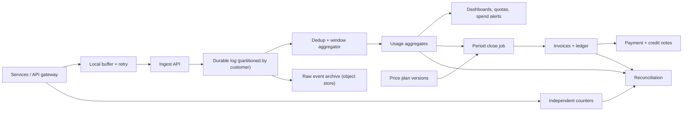

## In one minute
- **Every usage event carries a producer-assigned idempotency key.** Pipelines retry, so duplicates are certain. The key, enforced at the aggregator and again in the archive, bills one use once.
- **Bill by event time, with a closing rule.** Aggregate by when usage happened, close after a stated lateness bound, and send later arrivals through a visible adjustment path.
- **Keep raw events, aggregates and invoices apart.** Events are immutable facts, aggregates are rebuildable, and a final invoice changes only through credit notes and adjustment lines.
- **Money is integers with a written rounding rule.** Micro-unit prices, one rounding step per line, a ledger that sums to zero, and no floats.
- **Reconcile against an independent count,** such as gateway counters, before invoices go out.

## Requirements

**Functional**
- Accept usage events (API calls, tokens, GB-hours) from many services, each tied to a customer, a metric, a quantity and an event time.
- Aggregate usage per customer, metric and window, and expose it in near real time for dashboards, quotas and spend alerts.
- Rate usage against a price plan: flat rates, graduated tiers, included allowances, minimums and per-plan overrides, with plan changes mid-period.
- Produce monthly invoices with line items, apply prepaid and promotional credits, and handle corrections after the invoice is issued.
- Support audit: for any invoice line, show the raw events and the plan version behind it.

**Non-functional**
- Billing accuracy: no event is counted twice, and no accepted event is lost. Invoices reproduce exactly when re-run from the same inputs.
- Ingest 200k events per second at peak with p99 under 100 ms at the API, durable before it acknowledges.
- Dashboards lag by under 5 minutes. Invoices need correctness, not speed: a daily or monthly batch is fine.
- Raw events retained at least 13 months for disputes.

**Out of scope:** payment collection and retries on cards, tax calculation, and the rate limiter that protects the API (a separate, approximate mechanism).

## Back-of-envelope
- **Events:** 40k paying customers and 5B billable events per day. 5B / 86,400 ≈ 58k events/s on average. With a 3x daily peak, about 175k events/s.
- **Raw size:** about 200 bytes per event (ids, customer, metric, quantity, timestamps, a few dimensions). 5B × 200 B = 1 TB/day. Compressed columnar files in object storage shrink that about 5x, so five years is about 1.8 PB raw or 365 TB compressed.
- **Ingest bandwidth:** 175k × 200 B ≈ 35 MB/s at peak, about 105 MB/s of disk writes at replication factor 3. Modest for a partitioned log.
- **Dedup state:** keep event ids for 48 hours. 10B ids × about 24 bytes ≈ 240 GB. Split over 64 partitions that is under 4 GB each, which fits in an embedded key-value store on local SSD but would be wasteful in RAM.
- **Aggregates:** 40k customers × 5 metrics × 24 hours = 4.8M hourly rows per day. At 100 bytes that is 480 MB/day and about 880 GB over five years. This is the table dashboards and rating read.
- **Invoices:** 40k per month with about 20 lines each. The invoice side is a correctness problem, not a scale problem.

## API

Producers send batches. Each event has an id the producer generates and keeps stable across retries.

```http
POST /v1/usage-events
Authorization: Bearer <service-token>
{
  "events": [
    {"event_id": "gw-7f3a-000912", "customer_id": "cus_8832", "metric": "llm_tokens_out",
     "quantity": 1840, "timestamp": "2026-03-14T09:15:02.113Z",
     "dimensions": {"model": "large", "region": "eu"}}
  ]
}
-> 207 {"results": [{"event_id": "gw-7f3a-000912", "status": "accepted"}]}
   status is one of: accepted | duplicate | rejected(reason)
```

```http
GET  /v1/customers/cus_8832/usage?metric=llm_tokens_out&from=2026-03-01&to=2026-03-15&granularity=day
POST /v1/usage-events/adjustments    {"cancel": {"event_id": "gw-7f3a-000912"}, "reason": "double-emitted by gateway bug"}
POST /v1/invoices/preview            {"customer_id": "cus_8832", "period": "2026-03"}
POST /v1/invoices/{id}/finalize      Idempotency-Key: close-cus_8832-2026-03
POST /v1/credit-grants               {"customer_id": "cus_8832", "amount_cents": 50000, "expires_at": "2027-03-01"}
```

Stripe's meter-event API has the same shape: an event name, a customer in the payload, a numeric value, a caller-chosen `identifier`, and a `timestamp` accepted only within the past 35 days or up to 5 minutes ahead ([Stripe API](https://docs.stripe.com/api/billing/meter-event)). Its adjustment endpoint cancels a single event by identifier and reports `pending` until processed ([Stripe API](https://docs.stripe.com/api/billing/meter-event-adjustment)). A bound on how old an event may be is what makes closing a window possible at all.

## Data model

- **`usage_events`** (immutable, append-only, in a log plus columnar files). Key `(customer_id, event_id)`, partitioned by `customer_id` hash and event-time day. Columns: metric, quantity (integer), event time, ingest time, source, dimensions.
- **`usage_aggregates`**. Primary key `(customer_id, metric, window_start)` with `quantity`, `event_count`, and `watermark_version`. Upserted by the aggregator. Because it is derived, it can always be rebuilt from `usage_events`.
- **`price_plans`** and **`plan_versions`**. A version is immutable, with `effective_from`. Tier rows hold `(plan_version, metric, up_to, unit_price_micros)`. A customer subscription points at a version, never at a mutable plan.
- **`invoices`** and **`invoice_lines`**. Line items store quantity, unit price, plan version, a rounded amount in minor units, and `adjusts_period` for correction lines. Unique key `(customer_id, period)` makes finalising idempotent.
- **`ledger_entries`**. Double entry: each posting has a debit account, a credit account, an amount, and a reference to the invoice or credit grant. Postings in one transaction sum to zero.
- **`credit_grants`**: amount, remaining, expiry. Drawdown is soonest-expiring first.

Store money as integers in the smallest unit that matters (cents for amounts, micro-dollars for unit prices) or as Postgres `numeric`, which is exact, and never as `float` or `double precision`, which the Postgres docs describe as inexact ([PostgreSQL docs](https://www.postgresql.org/docs/current/datatype-numeric.html)).

## High-level design



**Write path.** A service emits an event with a stable id into a local buffer (a disk-backed queue), which retries until the ingest API acknowledges. The ingest API validates the schema, rejects timestamps outside the allowed window, and appends to a log partitioned by customer. It acknowledges only after the log has replicated the write. The aggregator reads each partition, drops duplicate ids using local keyed state, and adds the quantity to the hourly window for the event's time. It commits state and offsets together so a restart does not double-add. A second consumer writes the same stream to the raw archive.

**Read path.** Dashboards and spend alerts read `usage_aggregates`, which lag by a minute or two and show the current window as provisional. The period-close job runs after the lateness bound has passed, reads aggregates for each customer, rates them against the plan versions in force, writes the invoice and ledger postings in one transaction, and emits an event to payments. Reconciliation runs alongside: it compares independent counters, aggregates, and invoiced quantities, and flags drift beyond a threshold.

## Deep dives

### 1. Idempotent ingestion and duplicate suppression

Duplicates come from three places: a producer retries after a timeout that hid a success, the log redelivers after a consumer restart, and a bug emits an event twice with different ids. Mechanism handles the first two; reconciliation handles the third.

Options for the first two:
- **Rely on the transport.** Log systems offer idempotent producers and transactional writes, which stop retry duplicates inside one pipeline. They do not stop a service that restarts and re-emits from its own queue with new sequence numbers.
- **Unique key in the sink.** A unique `(customer_id, event_id)` in a database. Exact, but costly at 175k events/s.
- **Keyed dedup state in the stream processor, plus a unique key in the archive.** The aggregator keeps ids for 48 hours in local state; the archive writer deduplicates again by key on compaction.

Choice: the third. The key is producer-assigned and stable across retries, which the idempotent-consumer pattern depends on ([microservices.io](https://microservices.io/patterns/communication-style/idempotent-consumer.html)) and which Stripe applies to payment requests ([Stripe blog](https://stripe.com/blog/idempotency)). Stripe's meter API enforces identifier uniqueness over a rolling period of at least 24 hours, not forever; Lago's docs describe the same trade-off, with its high-volume pipeline using both `transaction_id` and `timestamp` for uniqueness ([Lago docs](https://docs.getlago.com/guide/events/ingesting-usage)). A retry after the dedup window looks new, so the window must exceed the longest retry horizon. The same id with a different quantity is flagged as a conflict, not silently dropped.

### 2. Windows, late events and the closing rule

Aggregate by event time, or a backed-up queue bills a midnight burst to the wrong day. That needs a notion of "no more events older than T are expected", which stream systems call a watermark. Flink's bounded-out-of-orderness strategy states it directly: the watermark trails the maximum timestamp seen by a fixed delay ([Flink docs](https://nightlies.apache.org/flink/flink-docs-stable/docs/dev/datastream/event-time/generating_watermarks/)). The Dataflow paper adds the key insight that a watermark is a heuristic, so a window can fire again for late data, with accumulating or retracting output ([Akidau et al., VLDB 2015](https://www.vldb.org/pvldb/vol8/p1792-Akidau.pdf)).

Billing adds a twist: the *invoice* has a hard close. The scheme has three clocks:
1. **Dashboard windows** stay open and update as late data arrives. Nobody is charged yet.
2. **The invoice close** happens after a lateness bound, for example 48 hours past the period end, which is also the maximum event age the API accepts.
3. **Post-close late events** (a mobile client offline for a week, a replayed backfill) are still stored, marked `late`, and billed as an adjustment line on the next invoice.

Adjustment lines should be re-rating deltas. Rate the whole original period with the late usage included, subtract what was already billed, and bill the difference. Rating the late quantity alone is wrong under graduated tiers, because its tier depends on everything before it. The practice problem implements this.

### 3. Rating, credits, and money correctness

Rating is a pure function: `(plan version, aggregated quantity) -> line amount`. Keep it pure, versioned and re-runnable, so an auditor or a support engineer can reproduce any line.

- **Units and rounding.** Unit prices like $0.000002 per token do not fit in cents. Hold prices in micro-dollars, multiply by an integer quantity, and round once, at the invoice line, to minor units with a documented mode (half up here). Rounding per event instead of per line produces systematic drift: a million events each rounded up by a fraction of a cent adds visible dollars.
- **Plan changes mid-period.** Split the period at the effective instant and rate each segment under its own version.
- **Credits.** Prepaid and promotional credits are balances with expiry. Stripe models them as credit grants applied to usage-based invoices, for prepayment or promotions with expiry dates ([Stripe docs](https://docs.stripe.com/billing/subscriptions/usage-based/billing-credits)). Drawdown is an append-only ledger entry per invoice, not an edited balance, and the draw happens in the same transaction that finalises the invoice.
- **Ledger.** Post double-entry rows so every transaction sums to zero. Square's Books service chose this model after finding that a single-entry settlement database let payouts drift from payments, because it forces each cent moved to be matched by a cent received ([Square Engineering](https://developer.squareup.com/blog/books-an-immutable-double-entry-accounting-database-service/)).
- **Finalisation is idempotent.** A unique `(customer_id, period)` means a re-run after a crash yields the same invoice.

## Down the stack

### Layer 1: The contract
- **Exactly-once effect, at-least-once delivery.** An event with a given `(customer_id, event_id)` contributes to at most one invoice line, once. A retry within the dedup window returns `duplicate` and changes nothing; the same id with a different payload returns a conflict.
- **Bounded staleness.** Dashboards include events acknowledged more than 2 minutes ago. Invoices include every in-period event acknowledged before the close; later arrivals are billed as adjustments within one cycle.
- **Reproducibility.** Re-running the close for a period with the same raw events and plan versions yields byte-identical lines. Finalised invoices are never edited; corrections are new documents that reference the old one.
- **Acknowledgement means durable.** Success is returned only after the log has replicated the batch.

### Layer 2: The mechanism
- **Ingest.** Batches of up to 500 events are appended to a replicated log partitioned by `hash(customer_id)`, so one aggregator owns each customer and dedup stays local.
- **Aggregator state machine.** For each event: look up `(customer, event_id)` in the keyed store; if present, count a duplicate and stop; else add the id with a 48-hour TTL, add the quantity to the `(customer, metric, hour)` cell, and emit the updated cell. Offsets and state commit atomically, which is the same exactly-once-by-checkpoint idea stream engines use. Kleppmann describes this reliance on idempotence and atomic commit as the way stream processors get exactly-once effects (*Designing Data-Intensive Applications*, 1st ed., ch. 11).
- **Window closing.** A watermark per partition equals the maximum event time minus the lateness bound. The close job requires watermark ≥ period end plus bound for every partition of the customer, so a stalled partition delays invoices instead of producing short ones.
- **Rating.** Tiers are rows `(up_to, unit_price_micros)`. Graduated rating walks them, taking `min(remaining, up_to - previous_cap)` units in each. Everything is `int64`, whose maximum of 9.22 × 10^18 micro-dollars is about $9.2 trillion.
- **Close transaction.** One database transaction inserts the invoice, lines, ledger postings, credit drawdowns and an outbox row for the payment event.

### Layer 3: The machine
- **Durability cost.** A replicated log append waits on an `fsync` or a replica quorum, around 1 to 5 ms in a zone. A batch of 500 events amortises that to microseconds per event, and 35 MB/s is trivial for sequential writes on NVMe, which sustains over 1 GB/s.
- **State store.** Dedup state in an embedded LSM tree on local SSD takes a write to the memtable plus a sequential write-ahead log append per new id, and a point read, mostly served by Bloom filters and block cache, for each lookup.
- **Clocks.** Event timestamps come from many machines. NTP keeps most hosts within tens of milliseconds, but a drifting host can be seconds or minutes off. Stamp ingest time too, and reject events outside the accepted window, or one wrong clock moves usage across a month boundary.
- **Arithmetic.** An IEEE 754 double has 53 bits of mantissa, so integers are exact only to 9.0 × 10^15, and 0.1 + 0.2 ≠ 0.3. Float sums depend on addition order, which differs between a streaming run and a batch rebuild. Integer sums do not.

### Why it's built this way
1. A lost acknowledgement can only be answered by retrying, so duplicates exist and idempotency keys come first.
2. Clocks differ and queues back up, so billing uses event time, whose watermark is a guess. A lateness bound and an adjustment path are therefore part of the product.
3. Customers dispute bills, so raw facts are immutable, aggregates are rebuildable, and invoices are corrected by new documents.
4. Money must add up to the cent, so integers, one rounding step and a double-entry ledger that fails loudly.
5. A counter cannot see its own bugs, so an independent count reconciles before money moves.

## Failure modes
- **Retry storm or 10x traffic.** A producer outage ends and 4 hours of buffered events arrive at once. Ingest sheds load with `429` and `Retry-After`, producers back off with jitter, and the log absorbs the burst. Dashboards show staleness; invoices wait for watermarks.
- **Hot customer.** One tenant sends 30% of traffic and saturates its partition. Sub-partition by `(customer_id, hash(event_id) mod k)` for ingest, pre-aggregate in the producer or a combiner stage, and merge sub-aggregates per window, which works because sums are commutative.
- **Region outage.** Producers keep buffering and ingest fails over. Stable ids make replays dedupe, and watermarks wait for the lost partitions, so close is delayed, not wrong.
- **Dedup state loss.** Restore from the last checkpoint and replay the log from the matching offset. If that is impossible, rebuild aggregates from the raw archive, which deduplicates by key independently.
- **Pricing bug.** A wrong tier price goes live. Plan versions are immutable, so the blast radius is invoices rated with that version. A preview diff against last month gates finalisation, and mispriced invoices get credit notes, not edits.
- **Double emission by a service bug.** Different ids, same usage, invisible to dedup. Reconciliation against the gateway's independent counter trips when the ratio leaves a band around 1.0, and a human cancels the events with an adjustment.

## In the wild
- **Twilio, 2013: a read-only Redis balance store triggers repeated card charges.** A network blip made replicas resync, the Redis master then lost its balance data and, through an incorrect configuration, came back as a replica of itself, read-only and with balances at zero, and each billable usage then triggered an auto-recharge that could not update the balance. About 1.4% of customers were affected, billing was shut down, and charges were refunded with a 10% credit. Twilio changed recovery to pivot a replica, and added fail-safes so charges and suspensions are blocked when balances are missing or unwritable ([Twilio post-mortem](https://www.twilio.com/en-us/blog/company/communications/billing-incident-post-mortem-breakdown-analysis-and-root-cause-html)).
- **Stripe, 2017: idempotency keys for safe retries.** Stripe's API accepts a client-chosen key on mutating requests and stores the outcome, so a retry after a timeout gets the stored result instead of a second charge. Clients retry with exponential backoff and jitter. The post is about payments, but its reasoning (a lost response must not become a second effect) is the reason usage APIs ask callers for a stable event identifier ([Stripe blog](https://stripe.com/blog/idempotency)).
- **Square, 2019: moving settlement onto an immutable double-entry ledger.** Square found its settlement tables could drift from payments, since nothing stopped a payout reference being nulled out, and sharding added cross-shard transfers on top. It built Books on Cloud Spanner, where every journal entry balances to zero ([Square Engineering](https://developer.squareup.com/blog/books-an-immutable-double-entry-accounting-database-service/)).

## Trade-offs

| Decision | Option A | Option B | Choose when |
|---|---|---|---|
| Dedup location | Stream processor state with TTL | Unique key in a database | A for volume with a bounded retry horizon, B when events are low volume and retries can be arbitrarily old |
| Billing time basis | Event time with lateness bound | Ingest (processing) time | A when customers dispute usage dates, B only if producers are unreliable and you accept mis-dated usage |
| Late data | Adjustment line on next invoice | Hold invoice open longer | A for predictable invoice dates, B for contracts that demand exactness and tolerate delay |
| Money type | Integer micro/minor units | Decimal type in the database | A in code that rates in the pipeline, B in SQL-heavy reporting; never floats |
| Build or buy | Own pipeline | Metering vendor or Stripe-style meters | Buy until pricing logic or volume outgrows it |

## Pitfalls in production
- **Random event ids generated per retry.** The retry looks new, so it is billed twice. Generate the id once, at the point of the real-world action, and persist it with the pending event.
- **Floats in rating.** A total differs by a cent between the streaming path and a batch rebuild. Use integers or exact decimals end to end and test with a million random events.
- **Silent late-event drops.** Events beyond the watermark vanish and invoices undercount. Route them to the adjustment path and alert on the late rate.
- **Editing finalised invoices.** Support patches a total in place and the ledger no longer matches. Issue a credit note or adjustment and keep the original.
- **Mutable price plans.** Someone edits a tier and last quarter's invoices cannot be reproduced. Version plans and pin subscriptions to versions.
- **Trusting one count.** A bug in the aggregator undercharges for weeks and nothing notices. Reconcile against an independent counter every day and gate invoice finalisation on it.

## Leadership lens
- **Ownership.** Metering is a platform capability with an SLO, but plans and invoice semantics belong to finance and product. Agree who approves plan changes and signs off reconciliation.
- **Roll out in shadow.** Run beside the old system for two or three cycles, compare invoice by invoice, and explain every difference first.
- **Build first:** idempotent ingest, the raw archive, and the reconciliation job. Real-time dashboards and fancy plans come after you can prove the counts are right.
- **Cost drivers.** Raw event storage (1 TB/day here), dedup state, and dispute handling. A self-serve usage export is the cheapest dispute resolver.
- **Design-review questions.** What happens to an event 10 days late? Who can cancel events, and where is that logged? What if the watermark stalls on day 1?

## Check yourself
1. A producer times out on the ingest call and retries with the same `event_id`. The first attempt had in fact succeeded. What does the customer get billed, and what stops a double charge?
   **Answer:** One event's worth. The retry carries the same producer-assigned id, so the aggregator's keyed state (and the archive's unique key) reports a duplicate and adds nothing. This only holds within the dedup window and if the id is stable across retries.
2. A customer on graduated tiers has 15 units billed for March. Three late units for March arrive after the invoice closed. Why not simply rate the three units on their own?
   **Answer:** Tier boundaries depend on cumulative quantity. The late units may fall in a more expensive tier than a fresh start would price them. Re-rate 18 units, subtract the amount already billed for 15, and bill the difference.
3. Why round once per invoice line, not once per event?
   **Answer:** Per-event rounding builds a systematic bias over millions of events and makes totals depend on batching. One rounding of the exact micro-unit total is deterministic and off by at most half a cent per line.
4. The aggregator, the invoice job, and the gateway all agree in March, yet customers report being overcharged. Where could the error live and what would find it?
   **Answer:** A service that emitted every event twice with different ids passes all internal checks. An independent count (provider logs, upstream request counters) compared by customer and day exposes the ratio drift. Internal agreement is not proof.

## Practice
**Task:** Build the core of a usage meter: idempotent event ingestion, graduated-tier rating in integer money, period close that produces an invoice, late-event corrections, and credit drawdown. `ingest` returns `accepted`, `duplicate` (same id and payload), `conflict` (same id, different payload), `late` (event time falls in a period already closed) or `rejected` (non-positive quantity or unknown metric). `close_period(customer, start, end)` rates each metric with graduated tiers (prices in millionths of a dollar, one half-up rounding to cents per line), adds adjustment lines for late events in earlier periods, applies credit up to the subtotal, and returns the same invoice if called again. An adjustment is the re-rated period minus what was already billed. Periods are half-open `[start, end)`, and all times are arguments.

```python starter
# Money is integer arithmetic only: prices in millionths of a dollar ("micros"),
# invoice amounts in cents. Periods are half-open [start, end) in epoch seconds.
# A tier is (upto, price_micros); upto=None marks the last, unbounded tier.

def rate_micros(tiers, qty):
    """Graduated pricing: each unit costs the price of the tier it falls in."""
    # TODO
    raise NotImplementedError

def to_cents(micros):
    """Round half up to whole cents (1 cent = 10_000 micros)."""
    # TODO
    raise NotImplementedError


class UsageMeter:
    def __init__(self, plans):
        # plans: {metric: tiers}
        self.plans = plans

    def ingest(self, event_id, customer, metric, qty, ts):
        """Return 'accepted', 'duplicate', 'conflict', 'late' or 'rejected'."""
        # TODO
        raise NotImplementedError

    def usage_total(self, customer, metric, start, end):
        # TODO
        raise NotImplementedError

    def grant_credit(self, customer, cents):
        # TODO
        raise NotImplementedError

    def credit_balance(self, customer):
        # TODO
        raise NotImplementedError

    def close_period(self, customer, start, end):
        """Return an invoice dict. Closing the same period twice returns the same invoice."""
        # TODO
        raise NotImplementedError
```

```python tests
PLANS = {
    "tokens": [(1000, 0), (10000, 2000), (None, 1000)],
    "calls": [(10, 0), (None, 1000000)],
}

def test_duplicate_and_conflict_do_not_double_count():
    m = UsageMeter(PLANS)
    assert m.ingest("e1", "acme", "calls", 5, 10) == "accepted"
    assert m.ingest("e1", "acme", "calls", 5, 10) == "duplicate"
    assert m.ingest("e1", "acme", "calls", 9, 10) == "conflict"
    assert m.ingest("e2", "acme", "calls", 0, 10) == "rejected"
    assert m.usage_total("acme", "calls", 0, 100) == 5

def test_graduated_tiers():
    assert rate_micros(PLANS["tokens"], 500) == 0
    assert rate_micros(PLANS["tokens"], 1000 + 9000) == 18000000
    assert rate_micros(PLANS["tokens"], 12000) == 18000000 + 2000 * 1000

def test_rounding_half_up_to_cents():
    assert to_cents(5000) == 1
    assert to_cents(4999) == 0
    assert to_cents(20000000) == 2000

def test_period_is_half_open():
    m = UsageMeter(PLANS)
    m.ingest("a", "acme", "calls", 1, 99)
    m.ingest("b", "acme", "calls", 1, 100)
    assert m.usage_total("acme", "calls", 0, 100) == 1
    assert m.usage_total("acme", "calls", 100, 200) == 1

def test_invoice_lines_and_idempotent_close():
    m = UsageMeter(PLANS)
    m.ingest("a", "acme", "calls", 15, 50)
    m.ingest("b", "acme", "tokens", 12000, 60)
    inv = m.close_period("acme", 0, 100)
    assert [(l["metric"], l["qty"], l["cents"]) for l in inv["lines"]] == [
        ("calls", 15, 500), ("tokens", 12000, 2000)]
    assert inv["subtotal_cents"] == 2500 and inv["total_cents"] == 2500
    assert m.close_period("acme", 0, 100) == inv

def test_late_event_becomes_delta_on_next_invoice():
    m = UsageMeter(PLANS)
    m.ingest("a", "acme", "calls", 15, 50)
    first = m.close_period("acme", 0, 100)
    assert first["total_cents"] == 500
    assert m.ingest("late1", "acme", "calls", 3, 70) == "late"
    assert m.close_period("acme", 0, 100)["total_cents"] == 500
    m.ingest("c", "acme", "calls", 11, 150)
    second = m.close_period("acme", 100, 200)
    adj = [l for l in second["lines"] if l["adjusts"] == 0]
    assert len(adj) == 1 and adj[0]["cents"] == 300
    assert second["total_cents"] == 100 + 300
    third = m.close_period("acme", 200, 300)
    assert third["lines"] == [] and third["total_cents"] == 0

def test_credits_apply_up_to_subtotal():
    m = UsageMeter(PLANS)
    m.grant_credit("acme", 800)
    m.ingest("a", "acme", "calls", 15, 50)
    inv = m.close_period("acme", 0, 100)
    assert inv["credit_cents"] == 500 and inv["total_cents"] == 0
    assert m.credit_balance("acme") == 300
    m.ingest("b", "acme", "calls", 20, 150)
    inv2 = m.close_period("acme", 100, 200)
    assert inv2["credit_cents"] == 300 and inv2["total_cents"] == 700
    assert m.credit_balance("acme") == 0

def test_customers_are_isolated():
    m = UsageMeter(PLANS)
    m.ingest("a", "acme", "calls", 20, 5)
    m.ingest("b", "globex", "calls", 11, 5)
    assert m.close_period("globex", 0, 100)["total_cents"] == 100
    assert m.close_period("acme", 0, 100)["total_cents"] == 1000
```

```python solution
def rate_micros(tiers, qty):
    remaining = qty
    prev = 0
    total = 0
    for upto, price in tiers:
        if remaining <= 0:
            break
        take = remaining if upto is None else min(remaining, upto - prev)
        total += take * price
        remaining -= take
        if upto is not None:
            prev = upto
    return total

def to_cents(micros):
    return (micros + 5000) // 10000


class UsageMeter:
    def __init__(self, plans):
        self.plans = plans
        self.events = {}      # event_id -> (customer, metric, qty, ts)
        self.invoices = {}    # (customer, start, end) -> invoice
        self.closed = {}      # customer -> list of (start, end) in close order
        self.billed = {}      # (customer, start, end) -> {metric: qty already billed}
        self.late = {}        # (customer, start, end) -> {metric: qty not yet billed}
        self.credits = {}

    def _closed_period(self, customer, ts):
        for start, end in self.closed.get(customer, []):
            if start <= ts < end:
                return (customer, start, end)
        return None

    def ingest(self, event_id, customer, metric, qty, ts):
        if qty <= 0 or metric not in self.plans:
            return "rejected"
        payload = (customer, metric, qty, ts)
        if event_id in self.events:
            return "duplicate" if self.events[event_id] == payload else "conflict"
        self.events[event_id] = payload
        key = self._closed_period(customer, ts)
        if key is None:
            return "accepted"
        pending = self.late.setdefault(key, {})
        pending[metric] = pending.get(metric, 0) + qty
        return "late"

    def usage_total(self, customer, metric, start, end):
        return sum(q for (c, mt, q, ts) in self.events.values()
                   if c == customer and mt == metric and start <= ts < end)

    def grant_credit(self, customer, cents):
        self.credits[customer] = self.credits.get(customer, 0) + cents

    def credit_balance(self, customer):
        return self.credits.get(customer, 0)

    def close_period(self, customer, start, end):
        key = (customer, start, end)
        if key in self.invoices:
            return self.invoices[key]
        lines = []
        billed = {}
        for metric in sorted(self.plans):
            qty = self.usage_total(customer, metric, start, end)
            if qty > 0:
                billed[metric] = qty
                lines.append({"metric": metric, "qty": qty,
                              "cents": to_cents(rate_micros(self.plans[metric], qty)),
                              "adjusts": None})
        # late usage for earlier periods: bill the difference of re-rating the whole period
        for pstart, pend in self.closed.get(customer, []):
            pkey = (customer, pstart, pend)
            pending = self.late.get(pkey, {})
            for metric in sorted(pending):
                old = self.billed[pkey].get(metric, 0)
                new = old + pending[metric]
                tiers = self.plans[metric]
                delta = to_cents(rate_micros(tiers, new)) - to_cents(rate_micros(tiers, old))
                lines.append({"metric": metric, "qty": pending[metric],
                              "cents": delta, "adjusts": pstart})
                self.billed[pkey][metric] = new
            self.late[pkey] = {}
        subtotal = sum(l["cents"] for l in lines)
        applied = min(self.credits.get(customer, 0), max(subtotal, 0))
        self.credits[customer] = self.credits.get(customer, 0) - applied
        inv = {"customer": customer, "start": start, "end": end, "lines": lines,
               "subtotal_cents": subtotal, "credit_cents": applied,
               "total_cents": subtotal - applied}
        self.invoices[key] = inv
        self.billed[key] = billed
        self.closed.setdefault(customer, []).append((start, end))
        return inv
```

```typescript starter
// Money is integer arithmetic only: prices in millionths of a dollar ("micros"),
// invoice amounts in cents. Periods are half-open [start, end) in epoch seconds.
export interface Tier { upTo: number | null; priceMicros: number; } // null = last, unbounded tier
export interface Line { metric: string; qty: number; cents: number; adjusts: number | null; }
export interface Invoice {
  customer: string; start: number; end: number; lines: Line[];
  subtotalCents: number; creditCents: number; totalCents: number;
}
export type IngestResult = "accepted" | "duplicate" | "conflict" | "late" | "rejected";

export function rateMicros(tiers: Tier[], qty: number): number { throw new Error("TODO"); }
export function toCents(micros: number): number { throw new Error("TODO"); }

export class UsageMeter {
  constructor(plans: Record<string, Tier[]>) {}
  ingest(eventId: string, customer: string, metric: string, qty: number, ts: number): IngestResult {
    throw new Error("TODO");
  }
  usageTotal(customer: string, metric: string, start: number, end: number): number { throw new Error("TODO"); }
  grantCredit(customer: string, cents: number): void { throw new Error("TODO"); }
  creditBalance(customer: string): number { throw new Error("TODO"); }
  closePeriod(customer: string, start: number, end: number): Invoice { throw new Error("TODO"); }
}
```

```typescript tests
const PLANS: Record<string, Tier[]> = {
  tokens: [{ upTo: 1000, priceMicros: 0 }, { upTo: 10000, priceMicros: 2000 }, { upTo: null, priceMicros: 1000 }],
  calls: [{ upTo: 10, priceMicros: 0 }, { upTo: null, priceMicros: 1000000 }],
};

test("duplicate and conflict do not double count", () => {
  const m = new UsageMeter(PLANS);
  assertEqual(m.ingest("e1", "acme", "calls", 5, 10), "accepted");
  assertEqual(m.ingest("e1", "acme", "calls", 5, 10), "duplicate");
  assertEqual(m.ingest("e1", "acme", "calls", 9, 10), "conflict");
  assertEqual(m.ingest("e2", "acme", "calls", 0, 10), "rejected");
  assertEqual(m.usageTotal("acme", "calls", 0, 100), 5);
});

test("graduated tiers", () => {
  assertEqual(rateMicros(PLANS.tokens, 500), 0);
  assertEqual(rateMicros(PLANS.tokens, 10000), 18000000);
  assertEqual(rateMicros(PLANS.tokens, 12000), 18000000 + 2000 * 1000);
});

test("rounding half up to cents", () => {
  assertEqual(toCents(5000), 1);
  assertEqual(toCents(4999), 0);
  assertEqual(toCents(20000000), 2000);
});

test("period is half open", () => {
  const m = new UsageMeter(PLANS);
  m.ingest("a", "acme", "calls", 1, 99);
  m.ingest("b", "acme", "calls", 1, 100);
  assertEqual(m.usageTotal("acme", "calls", 0, 100), 1);
  assertEqual(m.usageTotal("acme", "calls", 100, 200), 1);
});

test("invoice lines and idempotent close", () => {
  const m = new UsageMeter(PLANS);
  m.ingest("a", "acme", "calls", 15, 50);
  m.ingest("b", "acme", "tokens", 12000, 60);
  const inv = m.closePeriod("acme", 0, 100);
  assertEqual(inv.lines.map((l) => [l.metric, l.qty, l.cents]), [["calls", 15, 500], ["tokens", 12000, 2000]]);
  assertEqual([inv.subtotalCents, inv.totalCents], [2500, 2500]);
  assertEqual(m.closePeriod("acme", 0, 100), inv);
});

test("late event becomes a delta on the next invoice", () => {
  const m = new UsageMeter(PLANS);
  m.ingest("a", "acme", "calls", 15, 50);
  assertEqual(m.closePeriod("acme", 0, 100).totalCents, 500);
  assertEqual(m.ingest("late1", "acme", "calls", 3, 70), "late");
  assertEqual(m.closePeriod("acme", 0, 100).totalCents, 500);
  m.ingest("c", "acme", "calls", 11, 150);
  const second = m.closePeriod("acme", 100, 200);
  const adj = second.lines.filter((l) => l.adjusts === 0);
  assertEqual(adj.length, 1);
  assertEqual(adj[0].cents, 300);
  assertEqual(second.totalCents, 400);
  const third = m.closePeriod("acme", 200, 300);
  assertEqual([third.lines.length, third.totalCents], [0, 0]);
});

test("credits apply up to the subtotal", () => {
  const m = new UsageMeter(PLANS);
  m.grantCredit("acme", 800);
  m.ingest("a", "acme", "calls", 15, 50);
  const inv = m.closePeriod("acme", 0, 100);
  assertEqual([inv.creditCents, inv.totalCents], [500, 0]);
  assertEqual(m.creditBalance("acme"), 300);
  m.ingest("b", "acme", "calls", 20, 150);
  const inv2 = m.closePeriod("acme", 100, 200);
  assertEqual([inv2.creditCents, inv2.totalCents], [300, 700]);
  assertEqual(m.creditBalance("acme"), 0);
});

test("customers are isolated", () => {
  const m = new UsageMeter(PLANS);
  m.ingest("a", "acme", "calls", 20, 5);
  m.ingest("b", "globex", "calls", 11, 5);
  assertEqual(m.closePeriod("globex", 0, 100).totalCents, 100);
  assertEqual(m.closePeriod("acme", 0, 100).totalCents, 1000);
});
```

```typescript solution
export interface Tier { upTo: number | null; priceMicros: number; }
export interface Line { metric: string; qty: number; cents: number; adjusts: number | null; }
export interface Invoice {
  customer: string; start: number; end: number; lines: Line[];
  subtotalCents: number; creditCents: number; totalCents: number;
}
export type IngestResult = "accepted" | "duplicate" | "conflict" | "late" | "rejected";

export function rateMicros(tiers: Tier[], qty: number): number {
  let remaining = qty;
  let prev = 0;
  let total = 0;
  for (const t of tiers) {
    if (remaining <= 0) break;
    const take = t.upTo === null ? remaining : Math.min(remaining, t.upTo - prev);
    total += take * t.priceMicros;
    remaining -= take;
    if (t.upTo !== null) prev = t.upTo;
  }
  return total;
}

export function toCents(micros: number): number {
  return Math.floor((micros + 5000) / 10000);
}

interface Ev { customer: string; metric: string; qty: number; ts: number; }

export class UsageMeter {
  private events = new Map<string, Ev>();
  private invoices = new Map<string, Invoice>();
  private closed = new Map<string, Array<[number, number]>>();
  private billed = new Map<string, Record<string, number>>();
  private late = new Map<string, Record<string, number>>();
  private credits = new Map<string, number>();

  constructor(private plans: Record<string, Tier[]>) {}

  private key(c: string, s: number, e: number): string { return `${c}|${s}|${e}`; }

  ingest(eventId: string, customer: string, metric: string, qty: number, ts: number): IngestResult {
    if (qty <= 0 || !(metric in this.plans)) return "rejected";
    const prior = this.events.get(eventId);
    if (prior) {
      const same = prior.customer === customer && prior.metric === metric && prior.qty === qty && prior.ts === ts;
      return same ? "duplicate" : "conflict";
    }
    this.events.set(eventId, { customer, metric, qty, ts });
    for (const [s, e] of this.closed.get(customer) ?? []) {
      if (s <= ts && ts < e) {
        const k = this.key(customer, s, e);
        const pending = this.late.get(k) ?? {};
        pending[metric] = (pending[metric] ?? 0) + qty;
        this.late.set(k, pending);
        return "late";
      }
    }
    return "accepted";
  }

  usageTotal(customer: string, metric: string, start: number, end: number): number {
    let sum = 0;
    for (const ev of this.events.values()) {
      if (ev.customer === customer && ev.metric === metric && ev.ts >= start && ev.ts < end) sum += ev.qty;
    }
    return sum;
  }

  grantCredit(customer: string, cents: number): void {
    this.credits.set(customer, (this.credits.get(customer) ?? 0) + cents);
  }

  creditBalance(customer: string): number { return this.credits.get(customer) ?? 0; }

  closePeriod(customer: string, start: number, end: number): Invoice {
    const key = this.key(customer, start, end);
    const existing = this.invoices.get(key);
    if (existing) return existing;
    const lines: Line[] = [];
    const billed: Record<string, number> = {};
    for (const metric of Object.keys(this.plans).sort()) {
      const qty = this.usageTotal(customer, metric, start, end);
      if (qty > 0) {
        billed[metric] = qty;
        lines.push({ metric, qty, cents: toCents(rateMicros(this.plans[metric], qty)), adjusts: null });
      }
    }
    for (const [ps, pe] of this.closed.get(customer) ?? []) {
      const pk = this.key(customer, ps, pe);
      const pending = this.late.get(pk) ?? {};
      const done = this.billed.get(pk) ?? {};
      for (const metric of Object.keys(pending).sort()) {
        const oldQty = done[metric] ?? 0;
        const newQty = oldQty + pending[metric];
        const tiers = this.plans[metric];
        const delta = toCents(rateMicros(tiers, newQty)) - toCents(rateMicros(tiers, oldQty));
        lines.push({ metric, qty: pending[metric], cents: delta, adjusts: ps });
        done[metric] = newQty;
      }
      this.billed.set(pk, done);
      this.late.set(pk, {});
    }
    const subtotal = lines.reduce((a, l) => a + l.cents, 0);
    const applied = Math.min(this.creditBalance(customer), Math.max(subtotal, 0));
    this.credits.set(customer, this.creditBalance(customer) - applied);
    const inv: Invoice = {
      customer, start, end, lines,
      subtotalCents: subtotal, creditCents: applied, totalCents: subtotal - applied,
    };
    this.invoices.set(key, inv);
    this.billed.set(key, billed);
    const list = this.closed.get(customer) ?? [];
    list.push([start, end]);
    this.closed.set(customer, list);
    return inv;
  }
}
```

```go starter
package practice

// Money is integer arithmetic only: prices in millionths of a dollar ("micros"),
// invoice amounts in cents. Periods are half-open [start, end) in epoch seconds.

// Tier prices units up to UpTo (cumulative). UpTo = -1 marks the last, unbounded tier.
type Tier struct {
	UpTo        int
	PriceMicros int
}

// Line is one invoice line. Adjusts is the start of the earlier period it corrects, or -1.
type Line struct {
	Metric  string
	Qty     int
	Cents   int
	Adjusts int
}

type Invoice struct {
	Customer      string
	Start, End    int
	Lines         []Line
	SubtotalCents int
	CreditCents   int
	TotalCents    int
}

func RateMicros(tiers []Tier, qty int) int { panic("TODO") }
func ToCents(micros int) int               { panic("TODO") }

type UsageMeter struct{}

func NewUsageMeter(plans map[string][]Tier) *UsageMeter { return &UsageMeter{} }

// Ingest returns "accepted", "duplicate", "conflict", "late" or "rejected".
func (m *UsageMeter) Ingest(eventID, customer, metric string, qty, ts int) string {
	panic("TODO")
}
func (m *UsageMeter) UsageTotal(customer, metric string, start, end int) int { panic("TODO") }
func (m *UsageMeter) GrantCredit(customer string, cents int)                { panic("TODO") }
func (m *UsageMeter) CreditBalance(customer string) int                     { panic("TODO") }

// ClosePeriod returns the same *Invoice when called again for the same period.
func (m *UsageMeter) ClosePeriod(customer string, start, end int) *Invoice { panic("TODO") }
```

```go tests
package practice

import "testing"

func plans() map[string][]Tier {
	return map[string][]Tier{
		"tokens": {{1000, 0}, {10000, 2000}, {-1, 1000}},
		"calls":  {{10, 0}, {-1, 1000000}},
	}
}

func TestDuplicateAndConflict(t *testing.T) {
	m := NewUsageMeter(plans())
	if r := m.Ingest("e1", "acme", "calls", 5, 10); r != "accepted" {
		t.Fatalf("first: %s", r)
	}
	if r := m.Ingest("e1", "acme", "calls", 5, 10); r != "duplicate" {
		t.Fatalf("replay: %s", r)
	}
	if r := m.Ingest("e1", "acme", "calls", 9, 10); r != "conflict" {
		t.Fatalf("changed payload: %s", r)
	}
	if r := m.Ingest("e2", "acme", "calls", 0, 10); r != "rejected" {
		t.Fatalf("zero qty: %s", r)
	}
	if got := m.UsageTotal("acme", "calls", 0, 100); got != 5 {
		t.Fatalf("total = %d", got)
	}
}

func TestGraduatedTiers(t *testing.T) {
	p := plans()["tokens"]
	if RateMicros(p, 500) != 0 || RateMicros(p, 10000) != 18000000 || RateMicros(p, 12000) != 20000000 {
		t.Fatal("tier arithmetic wrong")
	}
}

func TestRoundingHalfUp(t *testing.T) {
	if ToCents(5000) != 1 || ToCents(4999) != 0 || ToCents(20000000) != 2000 {
		t.Fatal("rounding wrong")
	}
}

func TestPeriodHalfOpen(t *testing.T) {
	m := NewUsageMeter(plans())
	m.Ingest("a", "acme", "calls", 1, 99)
	m.Ingest("b", "acme", "calls", 1, 100)
	if m.UsageTotal("acme", "calls", 0, 100) != 1 || m.UsageTotal("acme", "calls", 100, 200) != 1 {
		t.Fatal("boundary event counted in the wrong period")
	}
}

func TestInvoiceLinesAndIdempotentClose(t *testing.T) {
	m := NewUsageMeter(plans())
	m.Ingest("a", "acme", "calls", 15, 50)
	m.Ingest("b", "acme", "tokens", 12000, 60)
	inv := m.ClosePeriod("acme", 0, 100)
	if len(inv.Lines) != 2 || inv.Lines[0].Metric != "calls" || inv.Lines[0].Cents != 500 ||
		inv.Lines[1].Metric != "tokens" || inv.Lines[1].Cents != 2000 {
		t.Fatalf("lines = %+v", inv.Lines)
	}
	if inv.SubtotalCents != 2500 || inv.TotalCents != 2500 {
		t.Fatalf("totals = %d %d", inv.SubtotalCents, inv.TotalCents)
	}
	if m.ClosePeriod("acme", 0, 100) != inv {
		t.Fatal("second close must return the same invoice")
	}
}

func TestLateEventBecomesDelta(t *testing.T) {
	m := NewUsageMeter(plans())
	m.Ingest("a", "acme", "calls", 15, 50)
	if m.ClosePeriod("acme", 0, 100).TotalCents != 500 {
		t.Fatal("first invoice")
	}
	if r := m.Ingest("late1", "acme", "calls", 3, 70); r != "late" {
		t.Fatalf("late = %s", r)
	}
	if m.ClosePeriod("acme", 0, 100).TotalCents != 500 {
		t.Fatal("closed invoice must not change")
	}
	m.Ingest("c", "acme", "calls", 11, 150)
	second := m.ClosePeriod("acme", 100, 200)
	var adj []Line
	for _, l := range second.Lines {
		if l.Adjusts == 0 {
			adj = append(adj, l)
		}
	}
	if len(adj) != 1 || adj[0].Cents != 300 || second.TotalCents != 400 {
		t.Fatalf("adjustments = %+v total %d", adj, second.TotalCents)
	}
	third := m.ClosePeriod("acme", 200, 300)
	if len(third.Lines) != 0 || third.TotalCents != 0 {
		t.Fatalf("adjustment billed twice: %+v", third)
	}
}

func TestCreditsApplyUpToSubtotal(t *testing.T) {
	m := NewUsageMeter(plans())
	m.GrantCredit("acme", 800)
	m.Ingest("a", "acme", "calls", 15, 50)
	inv := m.ClosePeriod("acme", 0, 100)
	if inv.CreditCents != 500 || inv.TotalCents != 0 || m.CreditBalance("acme") != 300 {
		t.Fatalf("first: %+v bal %d", inv, m.CreditBalance("acme"))
	}
	m.Ingest("b", "acme", "calls", 20, 150)
	inv2 := m.ClosePeriod("acme", 100, 200)
	if inv2.CreditCents != 300 || inv2.TotalCents != 700 || m.CreditBalance("acme") != 0 {
		t.Fatalf("second: %+v", inv2)
	}
}

func TestCustomersIsolated(t *testing.T) {
	m := NewUsageMeter(plans())
	m.Ingest("a", "acme", "calls", 20, 5)
	m.Ingest("b", "globex", "calls", 11, 5)
	if m.ClosePeriod("globex", 0, 100).TotalCents != 100 || m.ClosePeriod("acme", 0, 100).TotalCents != 1000 {
		t.Fatal("customers leaked into each other")
	}
}
```

```go solution
package practice

import (
	"fmt"
	"sort"
)

type Tier struct {
	UpTo        int
	PriceMicros int
}

type Line struct {
	Metric  string
	Qty     int
	Cents   int
	Adjusts int
}

type Invoice struct {
	Customer      string
	Start, End    int
	Lines         []Line
	SubtotalCents int
	CreditCents   int
	TotalCents    int
}

func RateMicros(tiers []Tier, qty int) int {
	remaining, prev, total := qty, 0, 0
	for _, t := range tiers {
		if remaining <= 0 {
			break
		}
		take := remaining
		if t.UpTo >= 0 && t.UpTo-prev < take {
			take = t.UpTo - prev
		}
		total += take * t.PriceMicros
		remaining -= take
		if t.UpTo >= 0 {
			prev = t.UpTo
		}
	}
	return total
}

func ToCents(micros int) int { return (micros + 5000) / 10000 }

type event struct {
	customer, metric string
	qty, ts          int
}

type period struct{ start, end int }

type UsageMeter struct {
	plans    map[string][]Tier
	events   map[string]event
	order    []string
	invoices map[string]*Invoice
	closed   map[string][]period
	billed   map[string]map[string]int
	late     map[string]map[string]int
	credits  map[string]int
}

func NewUsageMeter(plans map[string][]Tier) *UsageMeter {
	return &UsageMeter{
		plans: plans, events: map[string]event{}, invoices: map[string]*Invoice{},
		closed: map[string][]period{}, billed: map[string]map[string]int{},
		late: map[string]map[string]int{}, credits: map[string]int{},
	}
}

func pkey(c string, s, e int) string { return fmt.Sprintf("%s|%d|%d", c, s, e) }

func (m *UsageMeter) Ingest(eventID, customer, metric string, qty, ts int) string {
	if _, ok := m.plans[metric]; !ok || qty <= 0 {
		return "rejected"
	}
	ev := event{customer, metric, qty, ts}
	if prior, ok := m.events[eventID]; ok {
		if prior == ev {
			return "duplicate"
		}
		return "conflict"
	}
	m.events[eventID] = ev
	m.order = append(m.order, eventID)
	for _, p := range m.closed[customer] {
		if p.start <= ts && ts < p.end {
			k := pkey(customer, p.start, p.end)
			if m.late[k] == nil {
				m.late[k] = map[string]int{}
			}
			m.late[k][metric] += qty
			return "late"
		}
	}
	return "accepted"
}

func (m *UsageMeter) UsageTotal(customer, metric string, start, end int) int {
	sum := 0
	for _, ev := range m.events {
		if ev.customer == customer && ev.metric == metric && ev.ts >= start && ev.ts < end {
			sum += ev.qty
		}
	}
	return sum
}

func (m *UsageMeter) GrantCredit(customer string, cents int) { m.credits[customer] += cents }
func (m *UsageMeter) CreditBalance(customer string) int      { return m.credits[customer] }

func sortedKeys(mp map[string]int) []string {
	keys := make([]string, 0, len(mp))
	for k := range mp {
		keys = append(keys, k)
	}
	sort.Strings(keys)
	return keys
}

func (m *UsageMeter) ClosePeriod(customer string, start, end int) *Invoice {
	key := pkey(customer, start, end)
	if inv, ok := m.invoices[key]; ok {
		return inv
	}
	var lines []Line
	billed := map[string]int{}
	metrics := make([]string, 0, len(m.plans))
	for name := range m.plans {
		metrics = append(metrics, name)
	}
	sort.Strings(metrics)
	for _, metric := range metrics {
		qty := m.UsageTotal(customer, metric, start, end)
		if qty > 0 {
			billed[metric] = qty
			lines = append(lines, Line{metric, qty, ToCents(RateMicros(m.plans[metric], qty)), -1})
		}
	}
	for _, p := range m.closed[customer] {
		pk := pkey(customer, p.start, p.end)
		pending := m.late[pk]
		for _, metric := range sortedKeys(pending) {
			oldQty := m.billed[pk][metric]
			newQty := oldQty + pending[metric]
			tiers := m.plans[metric]
			delta := ToCents(RateMicros(tiers, newQty)) - ToCents(RateMicros(tiers, oldQty))
			lines = append(lines, Line{metric, pending[metric], delta, p.start})
			m.billed[pk][metric] = newQty
		}
		m.late[pk] = nil
	}
	subtotal := 0
	for _, l := range lines {
		subtotal += l.Cents
	}
	applied := m.credits[customer]
	if subtotal < applied {
		applied = subtotal
	}
	if applied < 0 {
		applied = 0
	}
	m.credits[customer] -= applied
	inv := &Invoice{customer, start, end, lines, subtotal, applied, subtotal - applied}
	m.invoices[key] = inv
	m.billed[key] = billed
	m.closed[customer] = append(m.closed[customer], period{start, end})
	return inv
}
```

## Mock interview
**Prompt:** Design the usage metering and billing system for an AI API platform. About 40,000 customers send roughly 5 billion billable events a day (requests and tokens), peaking near 175k events/s. Customers are billed monthly under tiered plans with prepaid credits, and finance wants every invoice to be reproducible and auditable.

- Follow-up: A gateway retries an event whose first attempt succeeded. What stops a double bill, and how long does that protection last?
- Follow-up: On the 2nd of the month, a region's 30-hour backlog arrives, some of it dated the 31st. Do you hold the invoice or adjust, and how do tiers affect the adjustment?
- Follow-up: A customer says they were billed 12% more than their own logs show. How do you investigate, and what in the design could cause it?

**A strong answer covers:**
- Producer-assigned stable event ids, dedup in keyed state with a stated window longer than the retry horizon, a unique key in the archive, and a conflict status for the same id with a different payload.
- Event-time aggregation with an explicit lateness bound, dashboards that update with late data, and invoices that close at a defined point with later arrivals billed as re-rated delta lines.
- A raw immutable archive, rebuildable aggregates, and invoices that are snapshots referencing plan versions, so any line can be reproduced and audited.
- Integer money, prices in sub-cent units, one rounding step per line, a double-entry ledger, and idempotent finalisation keyed on customer and period.
- Credits as expiring grants drawn down in the invoice transaction, and corrections via credit notes, never edits.
- Reconciliation against an independent count, a shadow-run rollout, and degradation when a partition stalls or a region fails.

## Sources and further study

**Primary**
- [Akidau et al., The Dataflow Model (VLDB 2015)](https://www.vldb.org/pvldb/vol8/p1792-Akidau.pdf): event time, watermarks, triggers and accumulating versus retracting output for late data.
- [Stripe engineering, Designing robust and predictable APIs with idempotency](https://stripe.com/blog/idempotency): why a retry must not repeat the effect, and how keys and backoff with jitter achieve it.
- [Square Engineering, Books: an immutable double-entry accounting database service](https://developer.squareup.com/blog/books-an-immutable-double-entry-accounting-database-service/): why a ledger that balances to zero prevents a class of silent drift.

**Systems docs**
- [Stripe API: meter events](https://docs.stripe.com/api/billing/meter-event): identifier uniqueness window and the accepted timestamp range.
- [Stripe API: meter event adjustments](https://docs.stripe.com/api/billing/meter-event-adjustment): cancelling an event instead of rewriting it.
- [Stripe docs: billing credits](https://docs.stripe.com/billing/subscriptions/usage-based/billing-credits): prepaid and promotional credit grants.
- [Lago docs: ingesting usage](https://docs.getlago.com/guide/events/ingesting-usage): an open-source metering engine's event schema and deduplication behaviour.
- [Apache Flink: generating watermarks](https://nightlies.apache.org/flink/flink-docs-stable/docs/dev/datastream/event-time/generating_watermarks/): bounded-out-of-orderness watermarks in practice.
- [PostgreSQL: numeric types](https://www.postgresql.org/docs/current/datatype-numeric.html): exact `numeric` versus inexact floating point.

**Books**
- Martin Kleppmann, *Designing Data-Intensive Applications* (1st ed.), ch. 11 Stream Processing: event time, windows, and exactly-once effects through idempotence.

**Other curricula**
- [microservices.io, Idempotent Consumer](https://microservices.io/patterns/communication-style/idempotent-consumer.html): the pattern as a message-handling building block.

## Watch
- [Tech Talk: Fix Your Ledger Before It Breaks Your Payments (Modern Treasury)](https://www.youtube.com/watch?v=cu8ZNl_GFdo): ledger design problems that show up as payment bugs.
- [System Design: Payment Gateway (System Design Fight Club)](https://www.youtube.com/watch?v=shipSEFMzHs): an idempotent authorize-and-capture workflow, end to end.

## Free resources
- [Stripe docs: usage-based pricing models](https://docs.stripe.com/billing/subscriptions/usage-based/pricing-models): the plan shapes (flat, tiered, graduated) a rating engine must support.
- [AWS Builders' Library: Making retries safe with idempotent APIs](https://aws.amazon.com/builders-library/making-retries-safe-with-idempotent-APIs/): client tokens, semantic equivalence and what to return on a replay.
- [Azure Architecture Center: Event Sourcing pattern](https://learn.microsoft.com/en-us/azure/architecture/patterns/event-sourcing): immutable events as the source of truth with derived views.
