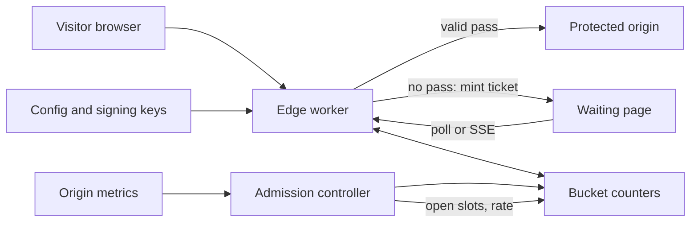

## In one minute
- **Queue at the edge, not at the origin.** The waiting room is a thin layer in front of the protected site. It must absorb 100x the normal load while the origin sees a flat, chosen rate. If the queue lives on the machines you are protecting, the surge kills the queue first.
- **State rides in a signed token.** The browser carries a tamper-proof ticket (join time, bucket, signature), so any edge server can verify it without a lookup. The server keeps counters, not one row per person.
- **Admission rate is derived from backend capacity.** The room lets in `capacity - active` people, capped by a per-second rate. Measured session length, not a guess, sets the number. The rate is a dial that operators and automation can turn.
- **Fairness is a policy, and bots attack it.** First-in-first-out rewards the fastest script. Bucketing arrivals and ordering randomly inside a bucket, plus proof-of-work or challenge before joining, takes most of the speed advantage away.
- **Abandonment and honest status decide whether it feels fair.** Heartbeats release the places of people who left. Status shows position and an estimate that admits uncertainty, and says plainly when the event is likely to sell out.

## Requirements

**Functional**
- A visitor who arrives while the protected site is full gets a ticket and a waiting page. When their turn comes they get a time-limited pass that the protected site accepts.
- The waiting page shows position (or a range) and an estimated wait, and updates without the visitor hammering refresh.
- A visitor who closes the tab and comes back within a grace period keeps their place. A visitor who leaves for good frees their place.
- Operators set the capacity, ordering policy (FIFO, bucketed random) and event schedule, and can pause admission or change the rate while the event is live.
- Passes expire so that a held pass cannot be hoarded, shared or replayed forever.

**Non-functional**
- Survive an arrival spike of 20,000 joins per second with the origin seeing no more than the configured admission rate.
- The room is more available than the origin: it keeps working when the origin is down, and it must not become a single point of failure for the whole site.
- Join and status calls answer in under 50 ms at the edge. Position may be a few seconds stale.
- Fair: no ordering advantage from faster networks or scripts beyond what the policy intends; no queue-jumping by rejoining or opening many tabs.

**Out of scope:** the purchase flow itself (seat holds, payments; see the flash sale and double-booking lessons), identity verification of buyers, and resale.

## Back-of-envelope

Assume a stadium on-sale: 60,000 tickets, 3 million people who want them, most arriving in the first 10 minutes.

- **Arrival peak.** 3M visitors in 10 minutes is 5,000 joins/s on average. Real arrivals cluster at the start time, so plan for 4x: about 20,000 joins/s. A join is a token mint of a few microseconds; the cost is the connection rate, not the CPU.
- **Origin capacity.** Suppose the checkout path is load-tested at 8,000 concurrent shoppers. The mean shopper session is 8 minutes (480 s). By Little's law, the sustainable admission rate is 8,000 / 480 ≈ 17 admissions per second, about 1,000 per minute.
- **How long the line is.** If half of admitted shoppers buy a pair of tickets, 60,000 tickets need about 60,000 admissions. At 1,000 per minute that is one hour. The other 2.9 million people will never get in. The design should tell them early rather than make them wait.
- **Status polling.** 3M waiting visitors polling every 10 s is 300,000 requests/s. At 400 bytes each that is about 120 MB/s of egress. Polling is the biggest load in the system, bigger than joins, so its cost sets the design. Server-sent events or a longer poll interval for people far from the front cut it by 5x or more.
- **State.** One in-memory record per person is about 100 bytes: 3M x 100 B = 300 MB. That fits in a few nodes, but scanning it is costly, so the design keeps counters per arrival bucket instead.

## API

```
POST /waitingroom/{event}/join
  headers: Cookie: wr_ticket=<token>        // optional; present on return visits
  body:    { "challenge": "<proof-of-work or CAPTCHA solution>" }
  200 -> { "state": "waiting", "ticket": "<token>", "poll_after_ms": 8000 }
  200 -> { "state": "admitted", "pass": "<token>", "expires_at": 1767225600 }
  429 -> { "state": "retry", "retry_after_ms": 3000 }    // join storm shed

GET /waitingroom/{event}/status
  headers: Cookie: wr_ticket=<token>
  200 -> { "state": "waiting", "position_range": [18200, 18800], "eta_min": 17,
           "sold_out_likelihood": "high", "poll_after_ms": 10000 }
  200 -> { "state": "admitted", "pass": "<token>", "expires_at": 1767225600 }
  401 -> { "state": "invalid" }       // bad signature
  410 -> { "state": "expired" }       // missed heartbeat window; must rejoin

Protected origin (every request):
  Cookie: wr_pass=<token>             // verified at the edge with the shared key
  no valid pass -> 302 to /waitingroom/{event}

Operator (authenticated)
PUT /admin/events/{event}  { "capacity": 8000, "max_admit_per_sec": 25,
                              "ordering": "bucketed_random", "bucket_seconds": 60,
                              "session_ttl_s": 600, "heartbeat_ttl_s": 45 }
POST /admin/events/{event}/pause
```

Position is returned as a range, not an exact integer. Exact numbers imply a precision the system does not have, and they invite people to compare notes and argue.

## Data model

The system holds little durable data. Most of it is counters and signed blobs.

- **Ticket token** (client-held, signed): `{event, client_id, joined_at, bucket, nonce, key_id}` plus an HMAC. The edge verifies it without any lookup. `joined_at` and `bucket` come from the server clock, never from the client.
- **Pass token** (client-held, signed): `{event, client_id, issued_at, expires_at, key_id}` plus an HMAC. The origin or its edge verifies the signature and expiry on every request.
- **Bucket counters** (store keyed by `event, bucket_id`): `{arrived, admitted, abandoned}` per arrival bucket (for example one per minute). Position of a ticket is the sum of unadmitted counts in earlier buckets plus a within-bucket estimate. Counters are small and mergeable, so they shard by event and replicate cheaply.
- **Active set** (per event): a count of live passes plus a sorted index of their expiries.
- **Heartbeat window** (per client): last-seen time in a TTL cache keyed by `client_id`.
- **Event config** (small, strongly consistent): capacity, rate, ordering policy, signing keys with ids and validity windows. Changes are versioned and pushed to every edge.

The partition key is the event id, then the bucket id. One on-sale is one hot partition, so counters are further split per edge location and summed periodically.

## High-level design



**Join path.** The visitor hits the protected URL. The edge worker checks for a valid pass cookie. If there is one, the request goes through. If not, the worker checks whether the site is full. If the active count is below capacity and nobody is queued, it mints a pass and lets the visitor in. Otherwise it verifies a join challenge, mints a ticket for the current arrival bucket, increments that bucket's counter, and serves a static waiting page. Everything here is served from the edge, so the origin never sees the surge.

**Admission path.** A controller runs every second. It reads origin health and the live pass count, computes the number of free slots (bounded by `max_admit_per_sec`), and advances the admission watermark: the oldest bucket that is not yet fully admitted. Tickets at or behind the watermark are admitted. A ticket in the bucket currently being drained is admitted by a deterministic pseudo-random draw against the remaining fraction.

**Read path (status).** The waiting page polls status with its ticket. The edge verifies the signature, compares the ticket's bucket and draw with the watermark, and answers *waiting* with a range, or *admitted* with a fresh pass. The ticket cookie being refreshed is the heartbeat. No database row is read for a typical poll, only the cached watermark and counters.

## Deep dives

### 1. Where the queue lives: signed tokens and counters

*Option A: a central queue* (a list or sorted set in Redis, one entry per visitor). It gives exact positions and trivial FIFO. But 3M entries and 300,000 polls per second hit one data structure, every poll is a rank query, and failover loses people's places.

*Option B: stateless tokens.* The ticket itself says when the holder arrived. The server only needs to know how far admission has progressed. Cloudflare's design is the model: [each visitor gets a cookie with the timestamp of first arrival](https://developers.cloudflare.com/waiting-room/reference/queueing-methods/), and visitors are [bucketed by arrival minute with the oldest buckets admitted first](https://blog.cloudflare.com/building-waiting-room-on-workers-and-durable-objects/).

**Choice: B with counters.** Per-bucket counters give approximate positions at constant cost per poll. The price is that position is an estimate, and that the signing key becomes critical: leak it and anyone can mint a ticket for the front. Keys carry ids and validity windows so they can rotate while old tickets stay valid for a few minutes. Cloudflare also [rejected an eventually consistent store for the global counts](https://blog.cloudflare.com/building-waiting-room-on-workers-and-durable-objects/) because stale reads over-admit. Each data center reports to one coordinating object per event, and the slice each location may admit follows its recent share of traffic.

### 2. Fairness and bots

*Pure FIFO* rewards the fastest connection and the best script. A bot that joins within a few milliseconds of the opening beats a person who clicked a second later. Cloudflare's docs describe [FIFO as rewarding the people who queue first, and Random as the more equitable choice](https://developers.cloudflare.com/waiting-room/reference/queueing-methods/).

*Bucketed random* is the compromise: order by arrival bucket (so someone who arrived 40 minutes ago is not overtaken by someone who arrived a minute ago), and shuffle inside a bucket with a random draw fixed at join time. For the opening minute you can widen the first bucket so that "everybody within the first 5 minutes" is one lottery. This removes the millisecond race.

Bots then switch to quantity: many tickets per person. Defences stack, and none is perfect:
- Make joining cost something: proof-of-work or an invisible challenge, scaled up under suspicion.
- Bind identity: one ticket per account, device signal or pre-registered code. Ticketmaster's Verified Fan presale used pre-registration, and the 2022 Eras Tour sale [still saw 3.5 billion system requests, 4x its previous peak, from bots and fans without codes](https://web.archive.org/web/20230101022610/https://business.ticketmaster.com/business-solutions/taylor-swift-the-eras-tour-onsale-explained/).
- Make rejoining no better than staying: joining twice returns the same ticket.

**Choice:** bucketed random with a challenge on join and per-identity de-duplication. State the residual: a determined, well-funded operator will still get through, and the aim is to raise their cost above the resale margin.

### 3. Admission rate tied to capacity, and abandonment

The room admits at the rate the origin can absorb. Three controllers, from simplest:
- **Static.** `capacity = 8000`, admit when `active < capacity`. Simple, but the number is a load-test guess and the real limit moves with a database failover or a slow payment provider.
- **Rate-limited static.** Add `max_admit_per_sec`, a token-bucket style cap. This stops a thousand slots opening at once when a batch of passes expires together, which would itself be a mini-surge.
- **Feedback.** Lower the rate when origin p99 latency or error rate crosses a threshold, and raise it slowly, the same shape as TCP's additive increase and multiplicative decrease. Google's SRE book makes the same point about [adaptive throttling and serving degraded responses when overloaded](https://sre.google/sre-book/handling-overload/).

**Choice:** rate-limited static as the floor, with a feedback multiplier that can only reduce the rate automatically. Increases are a human decision, or a slow ramp.

**Abandonment** is the thing that makes capacity maths fail. A third of the queue may be gone within minutes. If their places stay reserved, admitted passes go unused and the origin idles while the line stalls. The fix is the heartbeat: each status poll refreshes a last-seen time, and a ticket that misses its window (45 s here) is dropped. The same applies after admission: an unused pass should expire in a minute or two, and a shopper's session should have a hard ceiling so a slot always comes back.

## Down the stack

### Layer 1: The contract

- A visitor with a valid pass is served by the origin. A visitor without one never reaches the origin, except through a documented bypass (health checks, payment callbacks).
- A ticket confers a place, never access. A pass confers access for a bounded time, and only the room can mint one.
- Admission is monotone: if ticket A is ahead of ticket B under the policy and both stay live, A is admitted no later than B (exactly for FIFO, in distribution for bucketed random).
- The number of live passes never exceeds `capacity`, and passes minted in any second never exceed `max_admit_per_sec` plus a small stated overshoot from replication delay.
- Joining twice returns the same ticket. Missing the heartbeat window loses the place, and the response says so (`410`).

### Layer 2: The mechanism

A ticket is `base64(payload) "." base64(HMAC-SHA256(key_id, payload))`. [HMAC](https://www.rfc-editor.org/rfc/rfc2104) with a shared secret is enough because the edge both mints and verifies, so there is no need for public-key signatures; a JWT with `HS256` ([RFC 7519](https://www.rfc-editor.org/rfc/rfc7519)) is the same idea in a standard envelope. The payload holds the arrival bucket and a random draw taken at join, so ordering needs no server memory. Verification recomputes the MAC and compares in constant time, so response timing does not leak the signature.

Each admission tick does this: expire stale heartbeats and passes, add the elapsed time times the rate to a credit counter (capped at one second of burst), compute `slots = min(capacity - active, floor(credit))`, then advance the watermark by `slots` through the buckets in order. A pass is minted lazily, when the holder next polls and finds its ticket behind the watermark. This keeps the admission loop O(buckets), not O(people).

The status channel can be plain polling with a `poll_after_ms` hint, or [server-sent events](https://html.spec.whatwg.org/multipage/server-sent-events.html), which hold one cheap connection per visitor and push *admitted* the moment it happens. Joins shed under overload return [`429`](https://www.rfc-editor.org/rfc/rfc6585) with a retry delay.

### Layer 3: The machine

At 20,000 joins per second the limit is accepting connections and TLS handshakes, not hashing. A TLS 1.3 handshake costs a few hundred microseconds of server CPU, while an HMAC-SHA256 over 100 bytes takes roughly 1 microsecond. Session resumption and HTTP/2 multiplexing keep the 300,000 polls per second on warm connections instead of a new TCP handshake each.

The waiting page is a few KB of static HTML and JS served from the edge cache, so 3M visitors cost cache hits, not origin work. A status response is a few hundred bytes, which fits in one TCP segment (MSS around 1,460 bytes) and one TLS record. Each SSE connection holds a socket and roughly 10 to 30 KB of kernel and TLS state, so one tuned edge node (file descriptors, `epoll`) holds hundreds of thousands.

### Why it's built this way

1. The surge is 100x the origin's capacity, so the origin cannot be the thing that sorts it out. The queue goes to the edge, where capacity is cheap and already global.
2. 3M people polling needs lookups that cost nothing, so the token carries the state and the server keeps counters. That makes verification stateless and lets any edge answer any poll.
3. Stateless tokens are forgeable if the key leaks and cannot be revoked one by one, so tokens are short-lived, keys are rotated by id, and passes are bound to a short expiry.
4. Fairness is chosen by the business, and the cheapest attack is speed, so ordering uses buckets and randomness and joining has a cost.
5. The origin's real limit moves, so the rate is a controlled dial with automatic decreases and human increases.

## Failure modes

- **10x join surge (200,000/s).** Joins are shed with `429` and a randomized retry delay at the outermost layer, before challenge verification. The static waiting page is cached, so the visitor sees a page, not an error. Without jittered retries the shed requests return in lockstep. See the [AWS guidance on backoff with jitter](https://aws.amazon.com/builders-library/timeouts-retries-and-backoff-with-jitter/).
- **Counter store partition or loss.** Edges that cannot reach counters fall back to a frozen watermark and admit nobody new. The origin stays safe at the cost of a stalled line. Never fail open into the origin, because the room exists to prevent exactly that.
- **Signing key leaked.** Rotate: publish a new key id, stop minting under the old one, and accept old tickets for the heartbeat window only. Passes signed with the old key expire within minutes. Monitor the share of tickets that join in the opening second.
- **Region outage.** Clients move to another region, which honours existing tickets once it has the latest watermark. Positions may jump, and the status copy should say so.
- **Origin degraded.** The feedback controller cuts the rate and operators can pause; existing pass holders continue.
- **Thundering herd at admission.** If a thousand passes expire at once, a thousand tickets would be admitted at once. The per-second rate cap spreads them.

## In the wild
- **Cloudflare, 2021: Waiting Room for vaccine sign-ups.** Built for Project Fair Shot to protect COVID-19 vaccination sites, configured as total active users plus new users per minute. Users are bucketed by arrival minute and the oldest buckets admitted first. Per-data-center Durable Objects report to one global object, and each location's slot share follows its traffic ratio from two minutes earlier, so propagation delay causes only small overshoots. Workers KV was rejected as eventually consistent. One county site saw surges of up to 23,000 users ([Cloudflare engineering blog](https://blog.cloudflare.com/building-waiting-room-on-workers-and-durable-objects/)).
- **Ticketmaster, 2022: Eras Tour Verified Fan presale.** Over 3.5 million people pre-registered and about 1.5 million were sent codes. Bot attacks and fans without codes drove 3.5 billion system requests, 4x the previous peak. Ticketmaster slowed some sales and pushed others back, which meant longer queue waits. It estimated about 15% of interactions had issues, including passcode validation errors that dropped carted tickets. More than 2 million tickets still sold that day ([Ticketmaster, archived](https://web.archive.org/web/20230101022610/https://business.ticketmaster.com/business-solutions/taylor-swift-the-eras-tour-onsale-explained/)).

## Trade-offs

| Option | Strengths | Weaknesses | Choose when |
|---|---|---|---|
| FIFO ordering | Easy to explain; rewards early arrival | Rewards speed and bots; the opening second decides everything | Low bot risk, small events |
| Bucketed random | Kills the millisecond race; early arrivals still favoured | Harder to explain; positions are estimates | High-demand on-sales |
| Central queue (sorted set) | Exact positions, simple code | Single hot structure; polls are rank queries; failover loses places | Small rooms under about 50,000 people |
| Stateless tokens + counters | Constant cost per poll; any edge answers | Approximate position; key management is critical | Large, spiky events |
| SSE or WebSocket push | Instant admit; far fewer requests | Many open sockets; needs reconnect handling | Waiting pages that stay open for long |
| Feedback-controlled rate | Tracks real origin health | Can oscillate; harder to test | After static is proven, with human-approved increases |

## Leadership lens
- **Rollout.** Ship in passthrough mode first, which records arrival rate and session length without queueing anyone, as Cloudflare's docs recommend for [choosing thresholds](https://developers.cloudflare.com/waiting-room/reference/queueing-methods/). Then run a dark-launch for a real small event, then a large one.
- **Build or buy.** A waiting room is a commodity at the edge. Build only if ordering rules, identity checks or purchase-flow integration are unusual. Either way you own the capacity number and the fairness policy.
- **Ownership.** The team that owns checkout owns the capacity number and must re-measure it before each event. Stale numbers cause most bad nights.
- **Cost drivers.** Egress for status polling, challenge verification and load-test time. Compute is minor.
- **Questions for design review.** What happens when the room is down? Who can raise the admission rate during the event? What do we tell the 2.9 million people who will not get in? How do we know the line is fair, and who audits it afterwards?
- **Build first.** Static capacity, signed tickets, bucket counters, heartbeat expiry and an operator pause.

## Check yourself
1. Your origin handles 6,000 concurrent shoppers and the mean session is 5 minutes. What admission rate keeps it at capacity, and why does a longer real session mean the room must slow down?
   **Answer:** By Little's law, 6,000 / 300 s = 20 admissions per second. If sessions stretch to 10 minutes, the same rate would fill twice the capacity at steady state, so the rate must fall to 10 per second, or the active count will cross the limit.
2. Why is pure FIFO a weak fairness policy for an on-sale, and what does bucketing change?
   **Answer:** FIFO is decided by arrival order at millisecond precision, which a script wins. Bucketing groups arrivals into windows such as one minute and shuffles inside each window, so the speed advantage within a window vanishes, while people who arrived earlier still go first.
3. The counter store becomes unreachable during an event. Should edges fail open or closed, and what does the visitor see?
   **Answer:** Closed: freeze the watermark and admit nobody new, because opening the gate lets the whole surge hit the origin. Visitors keep seeing the waiting page with a status message, and existing pass holders continue.
4. Why does the status poll dominate the load, and what two changes cut it?
   **Answer:** 3M waiting visitors polling every 10 s is 300,000 requests/s versus a few thousand joins/s. Longer intervals far from the front, and server-sent events, cut it several times over.

## Practice
**Task:** Implement the core of the waiting room as a class `WaitingRoom(capacity, admit_per_sec, session_ms, ttl_ms, bucket_ms, clock, rand, sign)`. `clock()` returns milliseconds, `rand()` returns a float in [0, 1) and `sign(payload)` returns a signature string (production uses HMAC-SHA256; tests use a stand-in). `join(client_id)` returns a signed ticket `payload + "." + sign(payload)` and is idempotent: a client who is already waiting or admitted gets the same ticket back. A new joiner's order key is `(joined_ms // bucket_ms, rand(), sequence)`, so buckets are served oldest first and ties inside a bucket are shuffled. `poll(ticket)` first advances the room, then reports `invalid` (bad signature), `expired` (the client is no longer known, or the ticket is from an earlier join), `admitted` (with a signed `pass`) or `waiting` with `position` (1 is next) and `eta_ms` (position times 1000 divided by `admit_per_sec`, rounded up); a waiting poll refreshes the heartbeat. Advancing the room does three things in order: drop waiting clients whose last poll is `ttl_ms` or more ago, drop admitted clients whose session has ended, then add `elapsed_ms * admit_per_sec` to an integer credit (capped at `admit_per_sec * 1000`, starting at 0) and admit the lowest order keys while credit is at least 1000 and fewer than `capacity` are active; each admission costs 1000 and lasts `session_ms`. `verify_pass(pass)` is stateless: valid signature and not yet expired. Also expose `active()` and `waiting()` counts.

```python starter
class WaitingRoom:
    def __init__(self, capacity, admit_per_sec, session_ms, ttl_ms, bucket_ms, clock, rand, sign):
        pass

    def join(self, client_id):
        # TODO: idempotent; returns a signed ticket
        raise NotImplementedError

    def poll(self, ticket):
        # TODO: {"state": "invalid" | "expired" | "admitted" | "waiting", ...}
        raise NotImplementedError

    def verify_pass(self, pass_token):
        raise NotImplementedError

    def active(self):
        raise NotImplementedError

    def waiting(self):
        raise NotImplementedError
```

```python tests
import hashlib

class Clock:
    def __init__(self):
        self.now = 0
    def __call__(self):
        return self.now

def sign(s):
    return hashlib.sha256(("secret" + s).encode()).hexdigest()[:16]

def scripted(values):
    it = iter(values)
    return lambda: next(it)

def room(c, capacity=10, rate=1, session=60000, ttl=5000, bucket=50, rand=None):
    return WaitingRoom(capacity, rate, session, ttl, bucket, c, rand or (lambda: 0.5), sign)

def test_buckets_are_served_oldest_first_at_the_admission_rate():
    c = Clock()
    r = room(c, rand=scripted([0.9, 0.5, 0.1]))
    ta = r.join("a")
    c.now = 100
    tb = r.join("b")
    c.now = 200
    tc = r.join("c")
    assert [r.poll(t)["position"] for t in (ta, tb, tc)] == [1, 2, 3]
    assert r.poll(tc)["eta_ms"] == 3000
    c.now = 1000
    assert r.poll(ta)["state"] == "admitted"
    assert r.poll(tb)["state"] == "waiting"
    c.now = 2000
    assert r.poll(tb)["state"] == "admitted"
    assert r.poll(tc)["state"] == "waiting"

def test_random_tiebreak_inside_one_bucket():
    c = Clock()
    r = room(c, bucket=1000, rand=scripted([0.9, 0.1]))
    ta = r.join("a")
    tb = r.join("b")
    assert r.poll(tb)["position"] == 1
    assert r.poll(ta)["position"] == 2

def test_join_is_idempotent():
    c = Clock()
    r = room(c)
    t1 = r.join("a")
    c.now = 10
    assert r.join("a") == t1
    assert r.waiting() == 1

def test_capacity_blocks_until_a_session_ends():
    c = Clock()
    r = room(c, capacity=1, rate=100, session=5000, ttl=60000)
    ta = r.join("a")
    c.now = 10
    tb = r.join("b")
    c.now = 1000
    assert r.poll(ta)["state"] == "admitted"
    assert r.poll(tb) == {"state": "waiting", "position": 1, "eta_ms": 10}
    assert r.active() == 1
    c.now = 5009
    assert r.poll(tb)["state"] == "waiting"
    c.now = 5010
    assert r.poll(tb)["state"] == "admitted"

def test_tampered_ticket_and_pass_are_rejected():
    c = Clock()
    r = room(c, rate=1000)
    t = r.join("a")
    c.now = 5
    p = r.poll(t)["pass"]
    assert r.verify_pass(p)
    assert not r.verify_pass(p.replace("a", "b", 1))
    assert r.poll(t.replace("a", "b", 1)) == {"state": "invalid"}
    assert r.poll("garbage") == {"state": "invalid"}
    assert not r.verify_pass(t)
    c.now = 5 + 60000
    assert not r.verify_pass(p), "pass expires"

def test_missed_heartbeat_releases_the_place():
    c = Clock()
    r = room(c, capacity=0, ttl=5000)
    ta = r.join("a")
    tb = r.join("b")
    c.now = 3000
    assert r.poll(ta)["state"] == "waiting"
    c.now = 6000
    assert r.poll(tb) == {"state": "expired"}
    assert r.poll(ta)["state"] == "waiting"
    assert r.waiting() == 1

def test_rejoin_after_expiry_goes_to_the_back():
    c = Clock()
    r = room(c, capacity=0, ttl=1000, bucket=1000)
    old = r.join("a")
    c.now = 2000
    r.join("b")
    assert r.poll(old) == {"state": "expired"}
    new = r.join("a")
    assert new != old
    assert r.poll(new)["position"] == 2
```

```python solution
class WaitingRoom:
    def __init__(self, capacity, admit_per_sec, session_ms, ttl_ms, bucket_ms, clock, rand, sign):
        self.capacity = capacity
        self.rate = admit_per_sec
        self.session_ms = session_ms
        self.ttl_ms = ttl_ms
        self.bucket_ms = bucket_ms
        self.clock = clock
        self.rand = rand
        self.sign = sign
        self.waiting_map = {}   # client -> {"key": (bucket, r, seq), "seen": ms}
        self.admitted = {}      # client -> session end ms
        self.joined = {}        # client -> join ms
        self.seq = 0
        self.credit = 0
        self.last = clock()

    def _seal(self, payload):
        return payload + "." + self.sign(payload)

    def _open(self, token):
        payload, dot, sig = token.rpartition(".")
        if not dot or self.sign(payload) != sig:
            return None
        return payload.split("|")

    def _drop(self, client):
        self.waiting_map.pop(client, None)
        self.admitted.pop(client, None)
        self.joined.pop(client, None)

    def _advance(self):
        now = self.clock()
        for c in [c for c, w in self.waiting_map.items() if now - w["seen"] >= self.ttl_ms]:
            self._drop(c)
        for c in [c for c, end in self.admitted.items() if end <= now]:
            self._drop(c)
        self.credit = min(self.credit + (now - self.last) * self.rate, self.rate * 1000)
        self.last = now
        while self.waiting_map and len(self.admitted) < self.capacity and self.credit >= 1000:
            c = min(self.waiting_map, key=lambda k: self.waiting_map[k]["key"])
            del self.waiting_map[c]
            self.admitted[c] = now + self.session_ms
            self.credit -= 1000

    def join(self, client_id):
        self._advance()
        if client_id not in self.joined:
            now = self.clock()
            self.joined[client_id] = now
            key = (now // self.bucket_ms, self.rand(), self.seq)
            self.seq += 1
            self.waiting_map[client_id] = {"key": key, "seen": now}
            self._advance()
        return self._seal("w|%s|%d" % (client_id, self.joined[client_id]))

    def poll(self, ticket):
        parts = self._open(ticket)
        if parts is None or parts[0] != "w":
            return {"state": "invalid"}
        self._advance()
        client, joined = parts[1], int(parts[2])
        if self.joined.get(client) != joined:
            return {"state": "expired"}
        if client in self.admitted:
            return {"state": "admitted", "pass": self._seal("p|%s|%d" % (client, self.admitted[client]))}
        w = self.waiting_map[client]
        w["seen"] = self.clock()
        position = 1 + sum(1 for o in self.waiting_map.values() if o["key"] < w["key"])
        return {"state": "waiting", "position": position,
                "eta_ms": (position * 1000 + self.rate - 1) // self.rate}

    def verify_pass(self, pass_token):
        parts = self._open(pass_token)
        return parts is not None and parts[0] == "p" and int(parts[2]) > self.clock()

    def active(self):
        return len(self.admitted)

    def waiting(self):
        return len(self.waiting_map)
```

The same problem in TypeScript and Go.

```typescript starter
export type Clock = () => number;

export interface Status {
  state: string;
  position?: number;
  etaMs?: number;
  pass?: string;
}

export class WaitingRoom {
  constructor(
    capacity: number,
    admitPerSec: number,
    sessionMs: number,
    ttlMs: number,
    bucketMs: number,
    clock: Clock,
    rand: () => number,
    sign: (payload: string) => string,
  ) {}

  join(clientId: string): string {
    // TODO: idempotent; returns a signed ticket
    throw new Error("TODO");
  }

  poll(ticket: string): Status {
    throw new Error("TODO");
  }

  verifyPass(pass: string): boolean {
    throw new Error("TODO");
  }

  active(): number {
    throw new Error("TODO");
  }

  waiting(): number {
    throw new Error("TODO");
  }
}
```

```typescript tests
function mkClock(): { now: number; fn: Clock } {
  const c = { now: 0, fn: (): number => c.now };
  return c;
}

function sign(s: string): string {
  const t = "secret" + s;
  let h = 2166136261;
  for (let i = 0; i < t.length; i++) {
    h ^= t.charCodeAt(i);
    h = Math.imul(h, 16777619) >>> 0;
  }
  return h.toString(16);
}

function scripted(values: number[]): () => number {
  let i = 0;
  return () => values[i++];
}

function room(c: { fn: Clock }, capacity = 10, rate = 1, session = 60000, ttl = 5000,
              bucket = 50, rand: () => number = () => 0.5): WaitingRoom {
  return new WaitingRoom(capacity, rate, session, ttl, bucket, c.fn, rand, sign);
}

test("buckets are served oldest first at the admission rate", () => {
  const c = mkClock();
  const r = room(c, 10, 1, 60000, 5000, 50, scripted([0.9, 0.5, 0.1]));
  const ta = r.join("a");
  c.now = 100;
  const tb = r.join("b");
  c.now = 200;
  const tc = r.join("c");
  assertEqual([ta, tb, tc].map((t) => r.poll(t).position), [1, 2, 3]);
  assertEqual(r.poll(tc).etaMs, 3000);
  c.now = 1000;
  assertEqual(r.poll(ta).state, "admitted");
  assertEqual(r.poll(tb).state, "waiting");
  c.now = 2000;
  assertEqual(r.poll(tb).state, "admitted");
  assertEqual(r.poll(tc).state, "waiting");
});

test("random tiebreak inside one bucket", () => {
  const c = mkClock();
  const r = room(c, 10, 1, 60000, 5000, 1000, scripted([0.9, 0.1]));
  const ta = r.join("a");
  const tb = r.join("b");
  assertEqual(r.poll(tb).position, 1);
  assertEqual(r.poll(ta).position, 2);
});

test("join is idempotent", () => {
  const c = mkClock();
  const r = room(c);
  const t1 = r.join("a");
  c.now = 10;
  assertEqual(r.join("a"), t1);
  assertEqual(r.waiting(), 1);
});

test("capacity blocks until a session ends", () => {
  const c = mkClock();
  const r = room(c, 1, 100, 5000, 60000);
  const ta = r.join("a");
  c.now = 10;
  const tb = r.join("b");
  c.now = 1000;
  assertEqual(r.poll(ta).state, "admitted");
  assertEqual(r.poll(tb), { state: "waiting", position: 1, etaMs: 10 });
  assertEqual(r.active(), 1);
  c.now = 5009;
  assertEqual(r.poll(tb).state, "waiting");
  c.now = 5010;
  assertEqual(r.poll(tb).state, "admitted");
});

test("tampered ticket and pass are rejected", () => {
  const c = mkClock();
  const r = room(c, 10, 1000);
  const t = r.join("a");
  c.now = 5;
  const p = r.poll(t).pass as string;
  assert(r.verifyPass(p), "genuine pass");
  assert(!r.verifyPass(p.replace("a", "b")), "tampered pass");
  assertEqual(r.poll(t.replace("a", "b")), { state: "invalid" });
  assertEqual(r.poll("garbage"), { state: "invalid" });
  assert(!r.verifyPass(t), "a ticket is not a pass");
  c.now = 5 + 60000;
  assert(!r.verifyPass(p), "pass expires");
});

test("missed heartbeat releases the place", () => {
  const c = mkClock();
  const r = room(c, 0, 1, 60000, 5000);
  const ta = r.join("a");
  const tb = r.join("b");
  c.now = 3000;
  assertEqual(r.poll(ta).state, "waiting");
  c.now = 6000;
  assertEqual(r.poll(tb), { state: "expired" });
  assertEqual(r.poll(ta).state, "waiting");
  assertEqual(r.waiting(), 1);
});

test("rejoin after expiry goes to the back", () => {
  const c = mkClock();
  const r = room(c, 0, 1, 60000, 1000, 1000);
  const old = r.join("a");
  c.now = 2000;
  r.join("b");
  assertEqual(r.poll(old), { state: "expired" });
  const fresh = r.join("a");
  assert(fresh !== old, "new ticket");
  assertEqual(r.poll(fresh).position, 2);
});
```

```typescript solution
export type Clock = () => number;

export interface Status {
  state: string;
  position?: number;
  etaMs?: number;
  pass?: string;
}

interface Key { bucket: number; r: number; seq: number }
interface Waiter { key: Key; seen: number }

function before(a: Key, b: Key): boolean {
  if (a.bucket !== b.bucket) return a.bucket < b.bucket;
  if (a.r !== b.r) return a.r < b.r;
  return a.seq < b.seq;
}

export class WaitingRoom {
  private waitingMap = new Map<string, Waiter>();
  private admitted = new Map<string, number>();
  private joined = new Map<string, number>();
  private seq = 0;
  private credit = 0;
  private last: number;

  constructor(
    private capacity: number,
    private rate: number,
    private sessionMs: number,
    private ttlMs: number,
    private bucketMs: number,
    private clock: Clock,
    private rand: () => number,
    private sign: (payload: string) => string,
  ) {
    this.last = clock();
  }

  private seal(payload: string): string {
    return payload + "." + this.sign(payload);
  }

  private open(token: string): string[] | null {
    const i = token.lastIndexOf(".");
    if (i < 0) return null;
    const payload = token.slice(0, i);
    if (this.sign(payload) !== token.slice(i + 1)) return null;
    return payload.split("|");
  }

  private drop(client: string): void {
    this.waitingMap.delete(client);
    this.admitted.delete(client);
    this.joined.delete(client);
  }

  private advance(): void {
    const now = this.clock();
    for (const [c, w] of Array.from(this.waitingMap)) {
      if (now - w.seen >= this.ttlMs) this.drop(c);
    }
    for (const [c, end] of Array.from(this.admitted)) {
      if (end <= now) this.drop(c);
    }
    this.credit = Math.min(this.credit + (now - this.last) * this.rate, this.rate * 1000);
    this.last = now;
    while (this.waitingMap.size > 0 && this.admitted.size < this.capacity && this.credit >= 1000) {
      let best = "";
      let bestKey: Key | null = null;
      for (const [c, w] of Array.from(this.waitingMap)) {
        if (bestKey === null || before(w.key, bestKey)) {
          best = c;
          bestKey = w.key;
        }
      }
      this.waitingMap.delete(best);
      this.admitted.set(best, now + this.sessionMs);
      this.credit -= 1000;
    }
  }

  join(clientId: string): string {
    this.advance();
    if (!this.joined.has(clientId)) {
      const now = this.clock();
      this.joined.set(clientId, now);
      const key = { bucket: Math.floor(now / this.bucketMs), r: this.rand(), seq: this.seq++ };
      this.waitingMap.set(clientId, { key, seen: now });
      this.advance();
    }
    return this.seal("w|" + clientId + "|" + this.joined.get(clientId));
  }

  poll(ticket: string): Status {
    const parts = this.open(ticket);
    if (parts === null || parts[0] !== "w") return { state: "invalid" };
    this.advance();
    const client = parts[1];
    if (this.joined.get(client) !== Number(parts[2])) return { state: "expired" };
    const end = this.admitted.get(client);
    if (end !== undefined) {
      return { state: "admitted", pass: this.seal("p|" + client + "|" + end) };
    }
    const w = this.waitingMap.get(client) as Waiter;
    w.seen = this.clock();
    let position = 1;
    for (const o of Array.from(this.waitingMap.values())) {
      if (before(o.key, w.key)) position++;
    }
    return { state: "waiting", position, etaMs: Math.ceil((position * 1000) / this.rate) };
  }

  verifyPass(pass: string): boolean {
    const parts = this.open(pass);
    return parts !== null && parts[0] === "p" && Number(parts[2]) > this.clock();
  }

  active(): number {
    return this.admitted.size;
  }

  waiting(): number {
    return this.waitingMap.size;
  }
}
```

```go starter
package practice

type WaitingRoom struct{}

type Status struct {
	State    string
	Position int
	EtaMs    int64
	Pass     string
}

func NewWaitingRoom(capacity int, admitPerSec, sessionMs, ttlMs, bucketMs int64,
	clock func() int64, rand func() float64, sign func(string) string) *WaitingRoom {
	return &WaitingRoom{}
}

func (w *WaitingRoom) Join(clientID string) string {
	// TODO: idempotent; returns a signed ticket
	panic("TODO")
}

func (w *WaitingRoom) Poll(ticket string) Status {
	panic("TODO")
}

func (w *WaitingRoom) VerifyPass(pass string) bool {
	panic("TODO")
}

func (w *WaitingRoom) Active() int {
	panic("TODO")
}

func (w *WaitingRoom) Waiting() int {
	panic("TODO")
}
```

```go tests
package practice

import (
	"crypto/hmac"
	"crypto/sha256"
	"encoding/hex"
	"strings"
	"testing"
)

type clk struct{ now int64 }

func (c *clk) fn() int64 { return c.now }

func sign(s string) string {
	m := hmac.New(sha256.New, []byte("secret"))
	m.Write([]byte(s))
	return hex.EncodeToString(m.Sum(nil))[:16]
}

func scripted(v ...float64) func() float64 {
	i := 0
	return func() float64 { x := v[i]; i++; return x }
}

func half() float64 { return 0.5 }

func mk(c *clk, capacity int, rate, session, ttl, bucket int64, rnd func() float64) *WaitingRoom {
	return NewWaitingRoom(capacity, rate, session, ttl, bucket, c.fn, rnd, sign)
}

func TestBucketsServedOldestFirst(t *testing.T) {
	c := &clk{}
	r := mk(c, 10, 1, 60000, 5000, 50, scripted(0.9, 0.5, 0.1))
	ta := r.Join("a")
	c.now = 100
	tb := r.Join("b")
	c.now = 200
	tc := r.Join("c")
	if r.Poll(ta).Position != 1 || r.Poll(tb).Position != 2 || r.Poll(tc).Position != 3 {
		t.Fatal("positions should follow bucket order")
	}
	if r.Poll(tc).EtaMs != 3000 {
		t.Fatalf("eta %d", r.Poll(tc).EtaMs)
	}
	c.now = 1000
	if r.Poll(ta).State != "admitted" || r.Poll(tb).State != "waiting" {
		t.Fatal("only a admitted at 1s")
	}
	c.now = 2000
	if r.Poll(tb).State != "admitted" || r.Poll(tc).State != "waiting" {
		t.Fatal("b admitted at 2s")
	}
}

func TestRandomTiebreakInsideBucket(t *testing.T) {
	c := &clk{}
	r := mk(c, 10, 1, 60000, 5000, 1000, scripted(0.9, 0.1))
	ta := r.Join("a")
	tb := r.Join("b")
	if r.Poll(tb).Position != 1 || r.Poll(ta).Position != 2 {
		t.Fatal("lower random draw goes first")
	}
}

func TestJoinIdempotent(t *testing.T) {
	c := &clk{}
	r := mk(c, 10, 1, 60000, 5000, 50, half)
	t1 := r.Join("a")
	c.now = 10
	if r.Join("a") != t1 || r.Waiting() != 1 {
		t.Fatal("second join must return the same ticket")
	}
}

func TestCapacityBlocksUntilSessionEnds(t *testing.T) {
	c := &clk{}
	r := mk(c, 1, 100, 5000, 60000, 50, half)
	ta := r.Join("a")
	c.now = 10
	tb := r.Join("b")
	c.now = 1000
	if r.Poll(ta).State != "admitted" {
		t.Fatal("a admitted")
	}
	if s := r.Poll(tb); s.State != "waiting" || s.Position != 1 || s.EtaMs != 10 {
		t.Fatalf("got %+v", s)
	}
	if r.Active() != 1 {
		t.Fatal("one active")
	}
	c.now = 5009
	if r.Poll(tb).State != "waiting" {
		t.Fatal("still full")
	}
	c.now = 5010
	if r.Poll(tb).State != "admitted" {
		t.Fatal("slot freed")
	}
}

func TestTamperedTokensRejected(t *testing.T) {
	c := &clk{}
	r := mk(c, 10, 1000, 60000, 5000, 50, half)
	tk := r.Join("a")
	c.now = 5
	p := r.Poll(tk).Pass
	if !r.VerifyPass(p) {
		t.Fatal("genuine pass")
	}
	if r.VerifyPass(strings.Replace(p, "a", "b", 1)) {
		t.Fatal("tampered pass accepted")
	}
	if r.Poll(strings.Replace(tk, "a", "b", 1)).State != "invalid" || r.Poll("garbage").State != "invalid" {
		t.Fatal("bad tickets must be invalid")
	}
	if r.VerifyPass(tk) {
		t.Fatal("a ticket is not a pass")
	}
	c.now = 5 + 60000
	if r.VerifyPass(p) {
		t.Fatal("pass must expire")
	}
}

func TestMissedHeartbeatReleasesPlace(t *testing.T) {
	c := &clk{}
	r := mk(c, 0, 1, 60000, 5000, 50, half)
	ta := r.Join("a")
	tb := r.Join("b")
	c.now = 3000
	if r.Poll(ta).State != "waiting" {
		t.Fatal("a waiting")
	}
	c.now = 6000
	if r.Poll(tb).State != "expired" {
		t.Fatal("b missed heartbeat")
	}
	if r.Poll(ta).State != "waiting" || r.Waiting() != 1 {
		t.Fatal("a keeps its place")
	}
}

func TestRejoinGoesToBack(t *testing.T) {
	c := &clk{}
	r := mk(c, 0, 1, 60000, 1000, 1000, half)
	old := r.Join("a")
	c.now = 2000
	r.Join("b")
	if r.Poll(old).State != "expired" {
		t.Fatal("old ticket expired")
	}
	fresh := r.Join("a")
	if fresh == old || r.Poll(fresh).Position != 2 {
		t.Fatal("rejoin should be last")
	}
}
```

```go solution
package practice

import (
	"strconv"
	"strings"
)

type wrKey struct {
	bucket int64
	r      float64
	seq    int
}

func (a wrKey) before(b wrKey) bool {
	if a.bucket != b.bucket {
		return a.bucket < b.bucket
	}
	if a.r != b.r {
		return a.r < b.r
	}
	return a.seq < b.seq
}

type waiter struct {
	key  wrKey
	seen int64
}

type Status struct {
	State    string
	Position int
	EtaMs    int64
	Pass     string
}

type WaitingRoom struct {
	capacity  int
	rate      int64
	sessionMs int64
	ttlMs     int64
	bucketMs  int64
	clock     func() int64
	rand      func() float64
	sign      func(string) string
	waiters   map[string]*waiter
	admitted  map[string]int64
	joined    map[string]int64
	seq       int
	credit    int64
	last      int64
}

func NewWaitingRoom(capacity int, admitPerSec, sessionMs, ttlMs, bucketMs int64,
	clock func() int64, rand func() float64, sign func(string) string) *WaitingRoom {
	return &WaitingRoom{capacity: capacity, rate: admitPerSec, sessionMs: sessionMs, ttlMs: ttlMs,
		bucketMs: bucketMs, clock: clock, rand: rand, sign: sign,
		waiters: map[string]*waiter{}, admitted: map[string]int64{}, joined: map[string]int64{},
		last: clock()}
}

func (w *WaitingRoom) seal(payload string) string { return payload + "." + w.sign(payload) }

func (w *WaitingRoom) open(token string) []string {
	i := strings.LastIndex(token, ".")
	if i < 0 {
		return nil
	}
	payload := token[:i]
	if w.sign(payload) != token[i+1:] {
		return nil
	}
	return strings.Split(payload, "|")
}

func (w *WaitingRoom) drop(c string) {
	delete(w.waiters, c)
	delete(w.admitted, c)
	delete(w.joined, c)
}

func (w *WaitingRoom) advance() {
	now := w.clock()
	for c, x := range w.waiters {
		if now-x.seen >= w.ttlMs {
			w.drop(c)
		}
	}
	for c, end := range w.admitted {
		if end <= now {
			w.drop(c)
		}
	}
	w.credit += (now - w.last) * w.rate
	if limit := w.rate * 1000; w.credit > limit {
		w.credit = limit
	}
	w.last = now
	for len(w.waiters) > 0 && len(w.admitted) < w.capacity && w.credit >= 1000 {
		best, found := "", false
		for c, x := range w.waiters {
			if !found || x.key.before(w.waiters[best].key) {
				best, found = c, true
			}
		}
		delete(w.waiters, best)
		w.admitted[best] = now + w.sessionMs
		w.credit -= 1000
	}
}

func (w *WaitingRoom) Join(clientID string) string {
	w.advance()
	if _, ok := w.joined[clientID]; !ok {
		now := w.clock()
		w.joined[clientID] = now
		w.waiters[clientID] = &waiter{key: wrKey{now / w.bucketMs, w.rand(), w.seq}, seen: now}
		w.seq++
		w.advance()
	}
	return w.seal("w|" + clientID + "|" + strconv.FormatInt(w.joined[clientID], 10))
}

func (w *WaitingRoom) Poll(ticket string) Status {
	parts := w.open(ticket)
	if parts == nil || parts[0] != "w" {
		return Status{State: "invalid"}
	}
	w.advance()
	client := parts[1]
	joined, _ := strconv.ParseInt(parts[2], 10, 64)
	if j, ok := w.joined[client]; !ok || j != joined {
		return Status{State: "expired"}
	}
	if end, ok := w.admitted[client]; ok {
		return Status{State: "admitted", Pass: w.seal("p|" + client + "|" + strconv.FormatInt(end, 10))}
	}
	me := w.waiters[client]
	me.seen = w.clock()
	position := 1
	for _, o := range w.waiters {
		if o.key.before(me.key) {
			position++
		}
	}
	return Status{State: "waiting", Position: position,
		EtaMs: (int64(position)*1000 + w.rate - 1) / w.rate}
}

func (w *WaitingRoom) VerifyPass(pass string) bool {
	parts := w.open(pass)
	if parts == nil || parts[0] != "p" {
		return false
	}
	end, err := strconv.ParseInt(parts[2], 10, 64)
	return err == nil && end > w.clock()
}

func (w *WaitingRoom) Active() int { return len(w.admitted) }

func (w *WaitingRoom) Waiting() int { return len(w.waiters) }
```

## Mock interview
**Prompt:** Design a virtual waiting room for a stadium on-sale. 3 million people arrive within 10 minutes for 60,000 tickets, the checkout path is load-tested for 8,000 concurrent shoppers, and the previous on-sale was overrun by bots. Walk me through the architecture, how you decide who gets in and when, and what the visitor sees.

- Follow-up: Where is each person's place in line stored, and what happens to it when one edge location or the counter store fails?
- Follow-up: A bot operator opens 50,000 sessions in the first second. What does your design do about it, and what do you say to the interviewer about what it cannot stop?
- Follow-up: Half the admitted shoppers never check out and just sit on their pass. How do you notice, and what changes?

**A strong answer covers:**
- The origin is protected by a gate at the edge that serves a cached static page to everyone else, so the surge never reaches the origin.
- Admission rate derived from capacity and session length (Little's law: 8,000 / 480 s), with a per-second cap and a way to lower it automatically when origin health drops.
- Signed tokens carrying arrival time or bucket, with counters instead of per-user rows, and a stated key-rotation story.
- A fairness policy chosen deliberately (bucketed random versus FIFO) with an explanation of why millisecond FIFO favours bots, plus join cost, per-identity de-duplication and the honest limits of bot defence.
- Heartbeats to release abandoned places, short pass expiry, and a hard session ceiling so slots always return.
- Failure policy: fail closed to the origin, shed joins with jittered retries, and operator controls (pause, change rate). Status as ranges with an honest "likely sold out" message, and the cost of polling reduced with long intervals or push.

## Sources and further study
**Primary**
- [RFC 2104: HMAC](https://www.rfc-editor.org/rfc/rfc2104): the keyed-hash construction behind signed ticket and pass tokens.
- [RFC 7519: JSON Web Token](https://www.rfc-editor.org/rfc/rfc7519): the standard signed-claims envelope, including expiry (`exp`) semantics.
- [RFC 6585, section 4](https://www.rfc-editor.org/rfc/rfc6585#section-4): `429 Too Many Requests` for shedding joins.
- [HTML Standard: server-sent events](https://html.spec.whatwg.org/multipage/server-sent-events.html): the one-way push channel for status, with automatic reconnect.

**Systems docs**
- [Cloudflare Waiting Room docs](https://developers.cloudflare.com/waiting-room/): thresholds on active users and new users per minute, estimated wait, and session handling.
- [Cloudflare Waiting Room: queueing methods](https://developers.cloudflare.com/waiting-room/reference/queueing-methods/): FIFO, random, passthrough and reject, and how ordering is derived from a cookie timestamp.
- [Cloudflare: Building Waiting Room on Workers and Durable Objects](https://blog.cloudflare.com/building-waiting-room-on-workers-and-durable-objects/): bucketed admission, global counts and the consistency trade-off.

**Books**
- *Site Reliability Engineering*, Beyer et al. (Google), chapter 21 "Handling Overload": load shedding, criticality and adaptive throttling.
- *Release It!*, 2nd edition, Michael Nygard, chapter 5 "Stability Patterns": load shedding, circuit breakers and bulkheads that keep a surge from spreading.

**Other curricula**
- [AWS Builders' Library: Using load shedding to avoid overload](https://aws.amazon.com/builders-library/using-load-shedding-to-avoid-overload/): frames overload as a capacity-aware admission decision made as early as possible.
- [Azure Architecture Center: Queue-Based Load Leveling](https://learn.microsoft.com/en-us/azure/architecture/patterns/queue-based-load-leveling): the pattern of buffering bursts so the backend works at a steady pace.

## Free resources
- [Cloudflare: Waiting Room announcement](https://blog.cloudflare.com/cloudflare-waiting-room/): why waiting rooms exist and how they protect origins during vaccine sign-ups.
- [Fairness in multi-tenant systems (AWS Builders' Library)](https://aws.amazon.com/builders-library/fairness-in-multi-tenant-systems/): how quotas and admission control keep one burst of demand from starving everyone else.
- [Timeouts, retries and backoff with jitter (AWS Builders' Library)](https://aws.amazon.com/builders-library/timeouts-retries-and-backoff-with-jitter/): why shed clients must retry with randomised delays.
- [Handling Overload (Google SRE book)](https://sre.google/sre-book/handling-overload/): per-client quotas and adaptive throttling.
