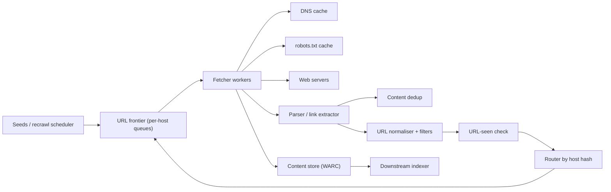

## In one minute
- The crawler is a scheduling problem, not a downloading problem. Fetching is easy to parallelise; deciding which URL to fetch next, from which host, and when, is the whole design.
- Politeness is a hard constraint. Partition the frontier by host, give each host one queue and one "next allowed fetch" time, and never let two workers hit the same host at once.
- Deduplicate twice: URLs before they enter the frontier (a URL-seen set, often a Bloom filter in front of a durable store), and content after download (a fingerprint of the page body) so mirrors and session-ID variants do not consume budget.
- Shard everything by host. A host's queue, its robots.txt cache, its rate limit and its DNS entry all live on one crawler node, so politeness needs no cross-node coordination.
- Treat the web as adversarial: spider traps, infinite calendars, slow servers and huge responses. Every fetch has a byte cap, a time cap and a per-host URL budget.

## Requirements
Functional:
- Start from seed URLs, fetch pages over HTTP(S), extract links, and keep crawling.
- Obey robots.txt (RFC 9309), including disallow rules and any crawl delay we choose to honour.
- Store raw pages and extracted metadata for downstream consumers (an indexer, an ML training pipeline).
- Recrawl pages on a schedule that reflects how often they change.

Non-functional:
- Throughput: about 1 billion pages per week to start, designed to scale to several times that.
- Politeness: at most one in-flight request per host by default and a configurable minimum gap between requests.
- Robustness: no single trap, slow host or bad parser can stall the crawl.
- Durability: frontier and seen-set survive node restarts; losing a few minutes of crawl progress is acceptable.

Out of scope: indexing and ranking, JavaScript rendering (an extension), and authenticated content.

## Back-of-envelope
Rough numbers; the goal is orders of magnitude.

- Throughput: 1B pages per week / 604,800 s is about 1,650 pages per second on average. Plan for 3,000 to 5,000 per second at peak to absorb retries and recrawls. For scale, the IRLbot research crawler sustained 1,789 pages per second from a single server for 41 days in 2007, fetching 6.3 billion HTML pages ([Lee et al.](http://irl.cs.tamu.edu/people/hsin-tsang/papers/tweb2009.pdf)), so the hard part is the frontier, not the fetching.
- Page size: HTTP Archive's 2024 Web Almanac puts the median home page at 18 KB of HTML ([Web Almanac 2024](https://almanac.httparchive.org/en/2024/page-weight)). The Almanac's inner pages are about the same size, but long-tail pages with comments and inline scripts run larger, so plan on a conservative 100 KB uncompressed and 25 to 30 KB on the wire per fetch.
- Bandwidth: 1,650 pages/s x 100 KB is about 165 MB/s, or 1.3 Gbit/s average downstream if we fetch uncompressed; with gzip or brotli about a third of that. Peaks of 5 Gbit/s are comfortable for a small cluster.
- Storage per week: 1B x 100 KB is 100 TB raw; compressed in WARC-style container files at roughly 4:1, about 25 TB per week. Over 5 years (260 weeks), about 6.5 PB if we kept every fetch, which we would not. Keeping the latest two versions of each URL keeps the store near 50 to 100 TB of compressed content per billion live URLs.
- URL-seen set: if each page yields 50 links and half are new, the known-URL space grows to tens of billions. At 8 bytes per 64-bit fingerprint, 10B URLs is 80 GB, which fits sharded across RAM on a few dozen nodes. A Bloom filter at 1% false positives needs about 9.6 bits per entry, so 10B entries is about 12 GB.
- Concurrency: a fetch takes perhaps 500 ms including DNS, TCP, TLS and transfer. Little's law: 1,650/s x 0.5 s means about 825 fetches in flight on average, and a few thousand at peak. That is a modest number of async sockets per node.
- Politeness, not bandwidth, bounds any single large site: at one request per second, a 10M-page site takes 116 days.

## API
The crawler is an internal system, so its API is control-plane RPCs plus the frontier's internal interface.

```
POST /v1/crawls                    { seeds: [url], scope: {domains, max_depth}, priority }
  -> 202 { crawl_id }
GET  /v1/crawls/{crawl_id}/stats   -> { fetched, queued, errors_by_class, hosts_active }
PUT  /v1/hosts/{host}/policy       { min_delay_ms, max_parallel, paused }

// Frontier service (per shard)
Enqueue(urls: [ {url, priority, discovered_from, depth} ]) -> { accepted: int }
Lease(worker_id, max: int) -> [ {url, host, lease_id, deadline} ]
Complete(lease_id, status, http_code, content_hash, outlinks_count)
```

Lease and Complete make delivery at-least-once: if a worker dies, its lease expires and the URL is re-offered.

## Data model
- **frontier (per shard)**: one FIFO queue per host plus a priority heap of hosts keyed by `next_fetch_at`. Persisted as an append-only log of enqueued URLs and a checkpoint of queue heads. Partition key is `hash(registered_domain)` so all subdomains of a site share a politeness budget.
- **url_seen**: key `fp64(normalised_url)`, value `first_seen_at`. Sharded by the same host hash, so the seen check is local to the node that owns the host. A Bloom filter in RAM answers "definitely new" fast; a RocksDB-style LSM store on SSD resolves "maybe seen".
- **url_state**: key `fp64(url)`, columns `url`, `last_fetch_at`, `last_status`, `content_hash`, `etag`, `last_modified`, `change_rate_estimate`, `next_recrawl_at`. Wide-column store partitioned by host hash; a secondary scan by `next_recrawl_at` feeds the recrawl scheduler.
- **host_state**: key `host`, columns `robots_txt`, `robots_fetched_at`, `crawl_delay_ms`, `error_streak`, `ip`, `dns_expires_at`. Small and hot; cached in memory on the owning node.
- **content store**: WARC files of roughly 1 GB in object storage (the size the WARC 1.1 standard recommends, with each record gzipped as its own member so a reader can seek straight to one; [WARC 1.1](https://iipc.github.io/warc-specifications/specifications/warc-format/warc-1.1/)), named `{crawl_id}/{shard}/{timestamp}.warc.gz`, with an index from `(url, fetch_time)` to `(file, offset, length)`.
- **content_fingerprints**: key `content_hash` (exact) or SimHash bands (near-duplicate), value canonical URL.

## High-level design


Write path (discovering URLs): a parser extracts links from a fetched page, resolves them against the base URL, normalises them (lowercase scheme and host, drop fragments, remove default ports, strip known tracking parameters), and filters by scope and by a trap heuristic. Each surviving URL is hashed to its owning shard and sent there in batches. The owning shard checks the seen-set; new URLs are appended to the host's queue and the seen-set is updated.

Read path (fetching): fetcher workers on each shard ask the local frontier for work. The frontier pops the host whose `next_fetch_at` is earliest and already in the past, hands out one URL from that host's queue, and pushes the host back with `next_fetch_at = now + delay`. The worker resolves DNS from a local cache, checks robots.txt (fetching it first if stale), downloads with byte and time caps, writes the body to the content store, and passes it to the parser.

## Deep dives

### The polite frontier
Options: a single global priority queue (simple, but any worker may pick two URLs from the same host and hammer it); a queue per host with a global lock (correct, but a bottleneck); or the two-level design from Mercator: front queues ordered by priority, feeding back queues that each hold exactly one host, with a min-heap of back queues keyed by the earliest time each host may be contacted again. Mercator's authors ran about three times as many back queues as fetcher threads so every thread always had a host it was allowed to contact ([Najork and Heydon, 2001](https://www.cs.cornell.edu/courses/cs685/2002fa/mercator.pdf)). I choose the per-host back queues with a heap, sharded by host so each node owns its hosts outright.

The delay for a host is the larger of our default (say 1 second), the robots.txt crawl delay if we honour it, and an adaptive value of about 10 times the last response time, the rule Mercator used in production, so a slow server automatically gets fewer requests. Google's crawler documentation gives a similar ceiling from the site owner's side: Googlebot should not hit a site more than once every few seconds on average ([Googlebot](https://developers.google.com/search/docs/crawling-indexing/googlebot)). On 429 or 503 responses the delay doubles, capped at several minutes, and resets slowly on success. Priority lives in the front queues: a page from a frequently changing, high-value site is refilled into its back queue before a deep page on a low-value site.

### URL dedup and normalisation
Without dedup, link-heavy sites produce the same URL thousands of times and the frontier explodes. Options: an exact set of full URLs in a database (correct, but each lookup is a network round trip at tens of thousands of checks per second); a Bloom filter alone (fast and small, but false positives silently drop new URLs forever, around 1% of them); or a Bloom filter in front of an exact fingerprint store. I pick the layered approach: the filter answers most "new" checks from RAM, and only "maybe seen" results go to the local LSM store keyed by a 64-bit fingerprint. 64-bit fingerprints give a handful of collisions across 10B URLs (about n squared over 2 to the 65th), which a crawler can tolerate.

Normalisation matters as much as the set. `HTTP://Example.com:80/a#top` and `http://example.com/a` are the same resource. Session IDs in query strings are worse: they create a new URL on every visit. Per-host rules such as "parameter `sid` never changes content" can be learned by comparing content hashes of URLs that differ in one parameter.

Content dedup is the second line: an exact hash catches mirrors; SimHash with banded lookup catches near-duplicates that differ only in timestamps or ads. Google's crawl team showed that 64-bit SimHash fingerprints, treating pages within 3 differing bits as duplicates, work for a repository of 8 billion pages ([Manku, Jain and Das Sarma, WWW 2007](https://research.google/pubs/detecting-near-duplicates-for-web-crawling/)). A host whose pages are mostly duplicates gets its URL budget cut.

### Recrawl and freshness
Options: uniform recrawl (simple, wastes budget on pages that never change), or per-URL scheduling from an estimated change rate. Treating changes as a Poisson process, each fetch tells us whether content changed since the last one; a simple estimator keeps the observed change rate per URL and sets the next interval proportional to its inverse, clamped between hours and months. Conditional GET with `If-None-Match` and `If-Modified-Since` makes the recheck of an unchanged page cost a 304 with no body ([RFC 9110](https://www.rfc-editor.org/rfc/rfc9110#name-304-not-modified)). The recrawl scheduler scans `url_state` by `next_recrawl_at` and enqueues into the same frontier, so politeness rules apply uniformly to new and old URLs.

### Variant: a web search engine on top of the crawler
Asked to "design Google Search", the crawler becomes only the ingestion half. The problem splits into an offline pipeline (crawl, parse, deduplicate, score, index) and an online serving system with a latency budget near 300 ms at the p99. The two meet at the index, which the pipeline publishes as immutable segments and serving only reads.

The numbers change shape. Crawl volume is set by corpus size and refresh interval: 400B documents refreshed every 30 days is about 13B fetches a day, roughly 155K per second. Serving is sized by fan-out, not by user queries: 10B queries a day is about 230K QPS at peak, and if a replica has 1,000 leaf shards, each uncached query becomes 1,000 leaf requests.

The index is partitioned by document, not by term. Each shard holds a full inverted index (sorted, delta-encoded posting lists) for a slice of the web. Every query then touches every shard, but each does small, local, equal work, and a lost shard costs a sliver of recall instead of every result for a word. Jeff Dean's WSDM 2009 keynote describes Google weighing both layouts and sharding index and document servers by document ID ([Dean, WSDM 2009](https://static.googleusercontent.com/media/research.google.com/en//people/jeff/WSDM09-keynote.pdf)).

Fan-out turns rare slowness into the norm. If each leaf is slow 1% of the time, a 1,000-leaf query almost always meets a slow one. The remedies are deadlines that travel with every RPC, partial results flagged for monitoring, hedged requests to a second replica after the 95th percentile latency, and a tree of mixers that bounds how many replies one host merges ([Dean and Barroso, 2013](https://www.barroso.org/publications/TheTailAtScale.pdf)).

Ranking runs as a cascade. Leaves score candidates cheaply, using early termination and precomputed per-document signals such as link-based authority, and return a few hundred or thousand hits. A heavier model reranks only the merged top few hundred, and doc servers build snippets for the final ten.

Freshness becomes a serving concern. Google's Caffeine replaced layers rebuilt in batches with continuous incremental indexing ([Google, 2010](https://googleblog.blogspot.com/2010/06/our-new-search-index-caffeine.html)). A small fresh tier carries news within minutes, the main tier merges new segments in the background like an LSM tree, and takedowns are tombstones checked at query time. The crawler's recrawl scheduler feeds both tiers by change rate and importance.

New failure modes follow: a query of death that crashes every leaf (send it to one or two canary leaves first), and a bad index push (roll out per replica and keep the previous generation for rollback).

## Down the stack

### Layer 1: The contract
The frontier promises: every URL accepted by `Enqueue` is offered by `Lease` at least once unless it is filtered by robots.txt or budget; no host has more than `max_parallel` leases outstanding; and two leases for the same host are separated by at least that host's delay as measured on the shard's clock. The seen-set promises no false negatives (a seen URL is never re-enqueued) and accepts a small rate of false positives (a new URL occasionally dropped). Fetches are bounded: 30 seconds wall time and perhaps 10 MB body by default. Production crawlers cap far lower for HTML: Google's current Googlebot page (last updated February 2026) says it reads only the first 2 MB of a supported file type for Search (64 MB for a PDF), measured on the uncompressed bytes ([Googlebot](https://developers.google.com/search/docs/crawling-indexing/googlebot)).

### Layer 2: The mechanism
Each shard keeps a hash map from host to a deque of URLs, plus a binary heap of `(next_fetch_at, host)`. `Lease` pops the heap top if its time has passed, takes one URL from the deque, and reinserts the host only when the worker completes, so `max_parallel = 1` falls out naturally. The on-disk frontier is a segmented append log, much like a Kafka partition: URLs are appended in batches, and a checkpoint records per-host read offsets. robots.txt is parsed into a longest-match rule list per user agent, with `allow` winning a tie, as RFC 9309 specifies, and cached for up to 24 hours ([RFC 9309](https://www.rfc-editor.org/rfc/rfc9309)). The fetch result matters as much as the rules: a 4xx means no robots.txt, so the crawler may fetch anything; a 5xx or network error means assume complete disallow; after a long outage (the RFC suggests 30 days) the crawler may fall back to a cached copy or treat the file as absent. Parsers must read at least 500 KiB and follow up to five redirects. Google adds that it ignores `crawl-delay`, treats `429` as a server error rather than a 4xx, and pauses crawling for 12 hours when robots.txt returns 5xx ([Google robots.txt spec](https://developers.google.com/search/docs/crawling-indexing/robots/robots_txt)). The seen-set is an LSM tree: a memtable absorbs inserts, flushes to sorted SSTables, and each SSTable carries its own Bloom filter so a negative lookup touches no disk.

### Layer 3: The machine
A fetch is DNS (a UDP round trip, avoided by caching), a TCP handshake (one RTT), a TLS 1.3 handshake (one more RTT), then the request and a response that arrives in roughly 10 segments for a 14 KB initial congestion window, more for bigger pages. With cross-continent RTTs of 100 to 200 ms, most of a fetch's 500 ms is waiting, which is why one process can drive thousands of sockets through `epoll_wait` with almost no CPU. The CPU goes to TLS handshakes, decompression and HTML parsing, perhaps a millisecond or two per page. On disk, appending WARC records is sequential writes at hundreds of MB/s; the seen-set's random reads hit NVMe at tens of microseconds per 4 KB page, so the Bloom filter in RAM (tens of nanoseconds per probe, one cache miss per hash) is what keeps the path cheap.

### Why it's built this way
- Remote servers are owned by other people and can be overloaded, so politeness must be enforced per host, which forces per-host queues.
- Per-host state must be consistent, and cross-node locking is slow, so the frontier is sharded by host and each host has exactly one owner.
- Most URLs a parser sees are already known, and network lookups are slow, so dedup must be answered from RAM, which makes a Bloom filter the first check.
- Fetch latency is dominated by network round trips, not CPU, so the fetcher is an async event loop with thousands of sockets rather than a thread per request.
- Bandwidth and storage cost money and most pages rarely change, so recrawl frequency follows measured change rates and uses conditional requests.

## Failure modes
- **10x load:** the frontier grows faster than we fetch. Admission control by priority: drop or defer low-priority URLs (deep, low-value hosts) at enqueue, and cap per-host queue length so one huge site cannot consume all memory.
- **Shard or node loss:** its hosts stop being crawled. Shards are reassigned through consistent hashing with a coordination service lease; the new owner replays the frontier log from the last checkpoint. Some URLs are fetched twice, which is harmless.
- **Region outage:** regions own disjoint hosts; on loss, another region adopts them after a delay.
- **Hot host:** a massive site with millions of queued URLs. It is still one queue and one delay, so it cannot overload anything; the risk is memory, so spill long host queues to disk and keep only the head in RAM.
- **Spider traps:** infinite calendars or generated paths. Limit URL length, path depth and repeated path segments, and cap URLs per host per crawl cycle. Set that cap from reputation the site cannot fake: IRLbot gave each domain a budget proportional to links pointing in from other domains, so a spam farm that links only to itself earns almost nothing ([Lee et al.](http://irl.cs.tamu.edu/people/hsin-tsang/papers/tweb2009.pdf)).

## In the wild
- **Read the Docs, 2024: a crawler with no conditional GET.** In May 2024 one AI crawler downloaded 73 TB of zipped HTML from Read the Docs, nearly 10 TB of it in a single day, costing over $5,000 in bandwidth. A bug made it fetch the same files again and again, it had no bandwidth limit, and it ignored `ETag` and `Last-Modified`, so every recheck was a full download. Per-IP rate limits failed because the crawlers used many addresses; blocking AI crawlers and fixing CDN caching cut download bandwidth by 75%, from about 800 GB to 200 GB a day ([Read the Docs](https://about.readthedocs.com/blog/2024/07/ai-crawlers-abuse/)).
- **Wikimedia, 2025: crawlers miss the cache that humans hit.** Bandwidth for Wikimedia's multimedia grew about 50% from January 2024, mostly from scrapers. Bots made about 35% of pageviews but at least 65% of the most expensive traffic, because they bulk-read unpopular pages that are not in the regional caches and must be served from the core data center. A polite crawler's cost to a site is set by cache misses, not just request rate ([Wikimedia Foundation](https://diff.wikimedia.org/2025/04/01/how-crawlers-impact-the-operations-of-the-wikimedia-projects/)).
- **Hugging Face, 2024: deduplicating Common Crawl.** Building the FineWeb dataset, the team ran MinHash near-duplicate detection (112 hashes in 14 bands of 8 over word 5-grams). Deduplicating globally across 96 crawl snapshots removed up to 90% of older data and kept lower-quality text, barely beating no dedup at all; deduplicating each snapshot on its own worked better. How you scope content dedup changes what survives ([Penedo et al.](https://arxiv.org/abs/2406.17557)).

## Trade-offs
| Option | Strengths | Weaknesses | Choose when |
|---|---|---|---|
| Bloom filter only for URL-seen | Tiny, all in RAM | False positives lose URLs for good | Throwaway or focused crawls |
| Bloom plus exact LSM store | No silent loss, still fast | More moving parts, SSD needed | Long-running web-scale crawl |
| Shard by host hash | Politeness is local, no locks | Skewed load from giant hosts | Default for any polite crawler |
| Shard by URL hash | Even load | Politeness needs global coordination | Crawling one cooperative site |
| BFS ordering | Simple, good early coverage | Wastes budget on low-value pages | Small scoped crawls |
| Priority by estimated value | Best pages first | Needs signals and tuning | General web crawl |
| Headless browser rendering | Sees JS-built content | 10 to 100 times the CPU per page | Only for hosts that need it |

## Leadership lens
- Build first: a single-node crawler with per-host queues, robots.txt, a Bloom filter seen-set and WARC output. Prove politeness and trap handling before sharding; most crawler incidents are complaints from site owners, not outages.
- Ownership: a frontier and scheduling team, a fetch and network team (DNS, TLS, proxies, egress IPs), and a content team (parsing, dedup, extraction).
- Cost drivers: egress and ingress bandwidth, storage of raw pages, and CPU for parsing and, if added, rendering. JS rendering is the line item that grows fastest, so gate it per host.
- Rollout: ramp crawl rate per host gradually, publish the user agent and IP ranges, and keep a global kill switch and per-host pause.

## Check yourself
1. Why is the frontier sharded by a hash of the registered domain rather than by URL hash?
   **Answer:** All of a host's queue, robots.txt cache, rate limit and DNS entry then live on one node, so politeness needs no cross-node coordination or locks. Sharding by URL hash spreads load evenly but forces global coordination to enforce politeness, at the cost of some load skew from giant hosts.
2. Why not use a Bloom filter alone for the URL-seen set?
   **Answer:** Its false positives silently drop new URLs forever, around 1% of them at the chosen size. The design puts the Bloom filter in RAM in front of an exact 64-bit fingerprint store on SSD, so most "new" checks are answered from memory and "maybe seen" results are resolved without silent loss.
3. At 1B pages a week and about 500 ms per fetch, how many fetches are in flight, and why does that favour an async event loop?
   **Answer:** 1B per week is about 1,650 pages a second, and by Little's law 1,650 x 0.5 s is about 825 fetches in flight on average, a few thousand at peak. Most of each fetch is waiting on network round trips, so one process can drive thousands of sockets through `epoll_wait` with almost no CPU.
4. An infinite calendar on one site keeps generating new URLs. What stops it from consuming the crawl?
   **Answer:** Trap heuristics limit URL length, path depth and repeated path segments, and each host has a URL budget per crawl cycle. Every fetch also has byte and time caps, and per-host queue length is capped so one site cannot consume all memory.

## Practice
**Task:** Build a polite URL frontier. `Frontier(clock, default_delay)` takes a zero-argument clock returning seconds. `add(url)` normalises the URL (lowercase scheme and host, drop any `#fragment`, use `/` when the path is empty) and returns `True` only the first time a normalised URL is seen. `set_crawl_delay(host, seconds)` overrides the delay for one host. `next_url()` returns the next URL to fetch or `None`: among hosts with queued URLs whose next allowed time has passed, choose the one with the earliest allowed time (hosts never fetched count as ready since forever; break ties by host name), pop its oldest URL, and set its next allowed time to now plus its delay. A host keeps its next allowed time even when its queue empties. `next_ready_at()` returns the earliest time a queued URL may be fetched (never earlier than now) or `None` if empty, and `size()` returns the number of queued URLs.

```python starter
class Frontier:
    def __init__(self, clock, default_delay):
        # TODO
        raise NotImplementedError

    def add(self, url):
        raise NotImplementedError

    def set_crawl_delay(self, host, seconds):
        raise NotImplementedError

    def next_url(self):
        raise NotImplementedError

    def next_ready_at(self):
        raise NotImplementedError

    def size(self):
        raise NotImplementedError
```

```python tests
class FakeClock:
    def __init__(self):
        self.t = 0.0
    def __call__(self):
        return self.t

def test_dedup_and_normalisation():
    f = Frontier(FakeClock(), 1.0)
    assert f.add("http://a.com/x") is True
    assert f.add("http://a.com/x") is False
    assert f.add("HTTP://A.com/x#top") is False
    assert f.add("http://a.com") is True
    assert f.add("http://A.COM/") is False
    assert f.size() == 2

def test_fifo_and_politeness_delay():
    c = FakeClock()
    f = Frontier(c, 2.0)
    f.add("http://a.com/1")
    f.add("http://a.com/2")
    assert f.next_url() == "http://a.com/1"
    assert f.next_url() is None, "a.com must wait 2s"
    assert f.next_ready_at() == 2.0
    c.t = 2.0
    assert f.next_url() == "http://a.com/2"

def test_hosts_interleave_by_name_then_wait():
    f = Frontier(FakeClock(), 1.0)
    f.add("http://b.com/1")
    f.add("http://a.com/1")
    f.add("http://a.com/2")
    assert f.next_url() == "http://a.com/1"
    assert f.next_url() == "http://b.com/1"
    assert f.next_url() is None
    assert f.size() == 1

def test_per_host_crawl_delay():
    c = FakeClock()
    f = Frontier(c, 1.0)
    f.set_crawl_delay("b.com", 10.0)
    for u in ["http://a.com/1", "http://a.com/2", "http://b.com/1", "http://b.com/2"]:
        f.add(u)
    f.next_url()
    f.next_url()
    c.t = 1.0
    assert f.next_url() == "http://a.com/2"
    assert f.next_url() is None
    assert f.next_ready_at() == 10.0
    c.t = 10.0
    assert f.next_url() == "http://b.com/2"

def test_delay_survives_empty_queue():
    c = FakeClock()
    f = Frontier(c, 2.0)
    f.add("http://a.com/1")
    assert f.next_url() == "http://a.com/1"
    c.t = 1.0
    f.add("http://a.com/2")
    assert f.next_url() is None
    c.t = 2.0
    assert f.next_url() == "http://a.com/2"

def test_longest_waiting_host_first():
    c = FakeClock()
    f = Frontier(c, 2.0)
    f.add("http://a.com/1"); f.add("http://b.com/1")
    f.add("http://a.com/2"); f.add("http://b.com/2")
    assert f.next_url() == "http://a.com/1"
    c.t = 1.0
    f.set_crawl_delay("b.com", 0.5)
    assert f.next_url() == "http://b.com/1"
    c.t = 5.0
    assert f.next_url() == "http://b.com/2", "b ready at 1.5, before a at 2"
    assert f.next_url() == "http://a.com/2"

def test_empty_frontier():
    c = FakeClock()
    c.t = 7.0
    f = Frontier(c, 1.0)
    assert f.next_url() is None
    assert f.next_ready_at() is None
    assert f.size() == 0
    f.add("http://z.com/")
    assert f.next_ready_at() == 7.0
```

```python solution
from collections import deque


def _normalise(url):
    url = url.split("#", 1)[0]
    scheme, sep, rest = url.partition("://")
    if not sep:
        scheme, rest = "http", url
    slash = rest.find("/")
    if slash == -1:
        host, path = rest, "/"
    else:
        host, path = rest[:slash], rest[slash:]
    return scheme.lower() + "://" + host.lower() + path, host.lower()


class Frontier:
    def __init__(self, clock, default_delay):
        self.clock = clock
        self.default_delay = default_delay
        self.seen = set()
        self.queues = {}
        self.ready_at = {}
        self.delays = {}

    def add(self, url):
        norm, host = _normalise(url)
        if norm in self.seen:
            return False
        self.seen.add(norm)
        self.queues.setdefault(host, deque()).append(norm)
        return True

    def set_crawl_delay(self, host, seconds):
        self.delays[host.lower()] = seconds

    def _candidates(self):
        return [(self.ready_at.get(h, float("-inf")), h) for h, q in self.queues.items() if q]

    def next_url(self):
        now = self.clock()
        ready = [c for c in self._candidates() if c[0] <= now]
        if not ready:
            return None
        _, host = min(ready)
        url = self.queues[host].popleft()
        self.ready_at[host] = now + self.delays.get(host, self.default_delay)
        return url

    def next_ready_at(self):
        cands = self._candidates()
        if not cands:
            return None
        return max(self.clock(), min(cands)[0])

    def size(self):
        return sum(len(q) for q in self.queues.values())
```

```typescript starter
export class Frontier {
  constructor(clock: () => number, defaultDelay: number) {
    throw new Error("TODO");
  }
  add(url: string): boolean {
    throw new Error("TODO");
  }
  setCrawlDelay(host: string, seconds: number): void {
    throw new Error("TODO");
  }
  nextUrl(): string | null {
    throw new Error("TODO");
  }
  nextReadyAt(): number | null {
    throw new Error("TODO");
  }
  size(): number {
    throw new Error("TODO");
  }
}
```

```typescript tests
function fakeClock() {
  const c = { t: 0, now: () => c.t };
  return c;
}

test("dedup and normalisation", () => {
  const f = new Frontier(fakeClock().now, 1);
  assertEqual(f.add("http://a.com/x"), true);
  assertEqual(f.add("http://a.com/x"), false);
  assertEqual(f.add("HTTP://A.com/x#top"), false);
  assertEqual(f.add("http://a.com"), true);
  assertEqual(f.add("http://A.COM/"), false);
  assertEqual(f.size(), 2);
});

test("fifo and politeness delay", () => {
  const c = fakeClock();
  const f = new Frontier(c.now, 2);
  f.add("http://a.com/1");
  f.add("http://a.com/2");
  assertEqual(f.nextUrl(), "http://a.com/1");
  assertEqual(f.nextUrl(), null, "a.com must wait 2s");
  assertEqual(f.nextReadyAt(), 2);
  c.t = 2;
  assertEqual(f.nextUrl(), "http://a.com/2");
});

test("hosts interleave by name then wait", () => {
  const f = new Frontier(fakeClock().now, 1);
  f.add("http://b.com/1");
  f.add("http://a.com/1");
  f.add("http://a.com/2");
  assertEqual(f.nextUrl(), "http://a.com/1");
  assertEqual(f.nextUrl(), "http://b.com/1");
  assertEqual(f.nextUrl(), null);
  assertEqual(f.size(), 1);
});

test("per host crawl delay", () => {
  const c = fakeClock();
  const f = new Frontier(c.now, 1);
  f.setCrawlDelay("b.com", 10);
  for (const u of ["http://a.com/1", "http://a.com/2", "http://b.com/1", "http://b.com/2"]) f.add(u);
  f.nextUrl();
  f.nextUrl();
  c.t = 1;
  assertEqual(f.nextUrl(), "http://a.com/2");
  assertEqual(f.nextUrl(), null);
  assertEqual(f.nextReadyAt(), 10);
  c.t = 10;
  assertEqual(f.nextUrl(), "http://b.com/2");
});

test("delay survives empty queue", () => {
  const c = fakeClock();
  const f = new Frontier(c.now, 2);
  f.add("http://a.com/1");
  assertEqual(f.nextUrl(), "http://a.com/1");
  c.t = 1;
  f.add("http://a.com/2");
  assertEqual(f.nextUrl(), null);
  c.t = 2;
  assertEqual(f.nextUrl(), "http://a.com/2");
});

test("longest waiting host first", () => {
  const c = fakeClock();
  const f = new Frontier(c.now, 2);
  f.add("http://a.com/1"); f.add("http://b.com/1");
  f.add("http://a.com/2"); f.add("http://b.com/2");
  assertEqual(f.nextUrl(), "http://a.com/1");
  c.t = 1;
  f.setCrawlDelay("b.com", 0.5);
  assertEqual(f.nextUrl(), "http://b.com/1");
  c.t = 5;
  assertEqual(f.nextUrl(), "http://b.com/2", "b ready at 1.5, before a at 2");
  assertEqual(f.nextUrl(), "http://a.com/2");
});

test("empty frontier", () => {
  const c = fakeClock();
  c.t = 7;
  const f = new Frontier(c.now, 1);
  assertEqual(f.nextUrl(), null);
  assertEqual(f.nextReadyAt(), null);
  assertEqual(f.size(), 0);
  f.add("http://z.com/");
  assertEqual(f.nextReadyAt(), 7);
});
```

```typescript solution
function normalise(url: string): [string, string] {
  url = url.split("#")[0];
  let scheme = "http";
  let rest = url;
  const i = url.indexOf("://");
  if (i >= 0) {
    scheme = url.slice(0, i);
    rest = url.slice(i + 3);
  }
  const slash = rest.indexOf("/");
  const host = (slash === -1 ? rest : rest.slice(0, slash)).toLowerCase();
  const path = slash === -1 ? "/" : rest.slice(slash);
  return [scheme.toLowerCase() + "://" + host + path, host];
}

export class Frontier {
  private seen = new Set<string>();
  private queues = new Map<string, string[]>();
  private readyAt = new Map<string, number>();
  private delays = new Map<string, number>();

  constructor(private clock: () => number, private defaultDelay: number) {}

  add(url: string): boolean {
    const [norm, host] = normalise(url);
    if (this.seen.has(norm)) return false;
    this.seen.add(norm);
    if (!this.queues.has(host)) this.queues.set(host, []);
    this.queues.get(host)!.push(norm);
    return true;
  }

  setCrawlDelay(host: string, seconds: number): void {
    this.delays.set(host.toLowerCase(), seconds);
  }

  private best(onlyReady: boolean): [number, string] | null {
    const now = this.clock();
    let best: [number, string] | null = null;
    for (const [host, q] of this.queues) {
      if (q.length === 0) continue;
      const r = this.readyAt.has(host) ? this.readyAt.get(host)! : -Infinity;
      if (onlyReady && r > now) continue;
      if (best === null || r < best[0] || (r === best[0] && host < best[1])) best = [r, host];
    }
    return best;
  }

  nextUrl(): string | null {
    const b = this.best(true);
    if (b === null) return null;
    const host = b[1];
    const url = this.queues.get(host)!.shift()!;
    const d = this.delays.has(host) ? this.delays.get(host)! : this.defaultDelay;
    this.readyAt.set(host, this.clock() + d);
    return url;
  }

  nextReadyAt(): number | null {
    const b = this.best(false);
    if (b === null) return null;
    return Math.max(this.clock(), b[0]);
  }

  size(): number {
    let n = 0;
    for (const q of this.queues.values()) n += q.length;
    return n;
  }
}
```

```go starter
package practice

type Frontier struct{}

func NewFrontier(clock func() float64, defaultDelay float64) *Frontier {
	return &Frontier{}
}

func (f *Frontier) Add(url string) bool { panic("TODO") }

func (f *Frontier) SetCrawlDelay(host string, seconds float64) { panic("TODO") }

// NextURL returns the next URL and true, or "" and false if nothing is ready.
func (f *Frontier) NextURL() (string, bool) { panic("TODO") }

// NextReadyAt returns the earliest fetch time and true, or 0 and false if empty.
func (f *Frontier) NextReadyAt() (float64, bool) { panic("TODO") }

func (f *Frontier) Size() int { panic("TODO") }
```

```go tests
package practice

import "testing"

type fakeClock struct{ t float64 }

func (c *fakeClock) Now() float64 { return c.t }

func mustNext(t *testing.T, f *Frontier, want string) {
	t.Helper()
	got, ok := f.NextURL()
	if want == "" {
		if ok {
			t.Fatalf("expected nothing ready, got %q", got)
		}
		return
	}
	if !ok || got != want {
		t.Fatalf("NextURL = %q,%v want %q", got, ok, want)
	}
}

func TestDedupAndNormalisation(t *testing.T) {
	f := NewFrontier((&fakeClock{}).Now, 1)
	cases := []struct {
		u    string
		want bool
	}{{"http://a.com/x", true}, {"http://a.com/x", false}, {"HTTP://A.com/x#top", false}, {"http://a.com", true}, {"http://A.COM/", false}}
	for _, c := range cases {
		if got := f.Add(c.u); got != c.want {
			t.Fatalf("Add(%q) = %v", c.u, got)
		}
	}
	if f.Size() != 2 {
		t.Fatalf("size %d", f.Size())
	}
}

func TestFifoAndPolitenessDelay(t *testing.T) {
	c := &fakeClock{}
	f := NewFrontier(c.Now, 2)
	f.Add("http://a.com/1")
	f.Add("http://a.com/2")
	mustNext(t, f, "http://a.com/1")
	mustNext(t, f, "")
	if r, ok := f.NextReadyAt(); !ok || r != 2 {
		t.Fatalf("ready at %v", r)
	}
	c.t = 2
	mustNext(t, f, "http://a.com/2")
}

func TestHostsInterleaveByNameThenWait(t *testing.T) {
	f := NewFrontier((&fakeClock{}).Now, 1)
	f.Add("http://b.com/1")
	f.Add("http://a.com/1")
	f.Add("http://a.com/2")
	mustNext(t, f, "http://a.com/1")
	mustNext(t, f, "http://b.com/1")
	mustNext(t, f, "")
	if f.Size() != 1 {
		t.Fatal("size")
	}
}

func TestPerHostCrawlDelay(t *testing.T) {
	c := &fakeClock{}
	f := NewFrontier(c.Now, 1)
	f.SetCrawlDelay("b.com", 10)
	for _, u := range []string{"http://a.com/1", "http://a.com/2", "http://b.com/1", "http://b.com/2"} {
		f.Add(u)
	}
	f.NextURL()
	f.NextURL()
	c.t = 1
	mustNext(t, f, "http://a.com/2")
	mustNext(t, f, "")
	if r, _ := f.NextReadyAt(); r != 10 {
		t.Fatalf("ready at %v", r)
	}
	c.t = 10
	mustNext(t, f, "http://b.com/2")
}

func TestDelaySurvivesEmptyQueue(t *testing.T) {
	c := &fakeClock{}
	f := NewFrontier(c.Now, 2)
	f.Add("http://a.com/1")
	mustNext(t, f, "http://a.com/1")
	c.t = 1
	f.Add("http://a.com/2")
	mustNext(t, f, "")
	c.t = 2
	mustNext(t, f, "http://a.com/2")
}

func TestLongestWaitingHostFirst(t *testing.T) {
	c := &fakeClock{}
	f := NewFrontier(c.Now, 2)
	f.Add("http://a.com/1")
	f.Add("http://b.com/1")
	f.Add("http://a.com/2")
	f.Add("http://b.com/2")
	mustNext(t, f, "http://a.com/1")
	c.t = 1
	f.SetCrawlDelay("b.com", 0.5)
	mustNext(t, f, "http://b.com/1")
	c.t = 5
	mustNext(t, f, "http://b.com/2")
	mustNext(t, f, "http://a.com/2")
}

func TestEmptyFrontier(t *testing.T) {
	c := &fakeClock{t: 7}
	f := NewFrontier(c.Now, 1)
	mustNext(t, f, "")
	if _, ok := f.NextReadyAt(); ok {
		t.Fatal("expected empty")
	}
	if f.Size() != 0 {
		t.Fatal("size")
	}
	f.Add("http://z.com/")
	if r, ok := f.NextReadyAt(); !ok || r != 7 {
		t.Fatalf("ready at %v", r)
	}
}
```

```go solution
package practice

import (
	"math"
	"strings"
)

type Frontier struct {
	clock        func() float64
	defaultDelay float64
	seen         map[string]bool
	queues       map[string][]string
	readyAt      map[string]float64
	delays       map[string]float64
}

func NewFrontier(clock func() float64, defaultDelay float64) *Frontier {
	return &Frontier{clock: clock, defaultDelay: defaultDelay, seen: map[string]bool{},
		queues: map[string][]string{}, readyAt: map[string]float64{}, delays: map[string]float64{}}
}

func normalise(url string) (string, string) {
	if i := strings.Index(url, "#"); i >= 0 {
		url = url[:i]
	}
	scheme, rest := "http", url
	if i := strings.Index(url, "://"); i >= 0 {
		scheme, rest = url[:i], url[i+3:]
	}
	host, path := rest, "/"
	if i := strings.Index(rest, "/"); i >= 0 {
		host, path = rest[:i], rest[i:]
	}
	host = strings.ToLower(host)
	return strings.ToLower(scheme) + "://" + host + path, host
}

func (f *Frontier) Add(url string) bool {
	norm, host := normalise(url)
	if f.seen[norm] {
		return false
	}
	f.seen[norm] = true
	f.queues[host] = append(f.queues[host], norm)
	return true
}

func (f *Frontier) SetCrawlDelay(host string, seconds float64) {
	f.delays[strings.ToLower(host)] = seconds
}

func (f *Frontier) best(onlyReady bool) (float64, string, bool) {
	now := f.clock()
	bestT, bestH, found := 0.0, "", false
	for h, q := range f.queues {
		if len(q) == 0 {
			continue
		}
		r, ok := f.readyAt[h]
		if !ok {
			r = math.Inf(-1)
		}
		if onlyReady && r > now {
			continue
		}
		if !found || r < bestT || (r == bestT && h < bestH) {
			bestT, bestH, found = r, h, true
		}
	}
	return bestT, bestH, found
}

func (f *Frontier) NextURL() (string, bool) {
	_, h, ok := f.best(true)
	if !ok {
		return "", false
	}
	url := f.queues[h][0]
	f.queues[h] = f.queues[h][1:]
	d, ok := f.delays[h]
	if !ok {
		d = f.defaultDelay
	}
	f.readyAt[h] = f.clock() + d
	return url, true
}

func (f *Frontier) NextReadyAt() (float64, bool) {
	r, _, ok := f.best(false)
	if !ok {
		return 0, false
	}
	return math.Max(f.clock(), r), true
}

func (f *Frontier) Size() int {
	n := 0
	for _, q := range f.queues {
		n += len(q)
	}
	return n
}
```

## Mock interview
**Prompt:** Design a web crawler that fetches about a billion pages a week for a search engine, respects robots.txt and site owners' capacity, and keeps popular pages fresh.

- Follow-up: Two workers on different machines both pull URLs for the same news site. How do you guarantee you never exceed one request per second to it?
- Follow-up: Your seen-set is a Bloom filter and it is now 90% full. What happens to the crawl, and how would you notice?
- Follow-up: Would you render JavaScript for every page? How would you decide which hosts get a headless browser?

**A strong answer covers:**
- Arithmetic that shows about 1,650 pages per second and roughly a thousand fetches in flight, so the fetcher is I/O-bound and async.
- A two-level frontier with per-host queues and a heap of next-allowed times, sharded by registered domain so politeness is local.
- Layered URL dedup (normalisation, Bloom filter, exact fingerprint store) plus content dedup with exact and near-duplicate hashing.
- Trap defences: byte and time caps, URL length and depth limits, and per-host budgets.
- Change-rate-driven recrawl with conditional GETs, feeding the same frontier.

## Sources and further study
**Primary**
- [Najork and Heydon, "High-Performance Web Crawling" (Compaq SRC report 173, 2001)](https://www.cs.cornell.edu/courses/cs685/2002fa/mercator.pdf): Mercator's front and back queues, the 10x politeness wait and checkpointing.
- [Manku, Jain and Das Sarma, "Detecting Near-Duplicates for Web Crawling" (WWW 2007)](https://research.google/pubs/detecting-near-duplicates-for-web-crawling/): 64-bit SimHash with a 3-bit threshold, validated on 8 billion pages.
- [WARC 1.1 specification](https://iipc.github.io/warc-specifications/specifications/warc-format/warc-1.1/): the archive container, per-record gzip and the 1 GB file guideline.
- [Dean and Barroso, "The Tail at Scale" (CACM 2013)](https://www.barroso.org/publications/TheTailAtScale.pdf): hedged requests, deadlines and canary requests for wide fan-out serving.

**Systems docs**
- [Google: how Google interprets the robots.txt specification](https://developers.google.com/search/docs/crawling-indexing/robots/robots_txt): status-code handling, caching and the unsupported `crawl-delay`.
- [Googlebot](https://developers.google.com/search/docs/crawling-indexing/googlebot): file size limits and the crawl-rate promise to site owners.
- [Google: Our new search index, Caffeine (2010)](https://googleblog.blogspot.com/2010/06/our-new-search-index-caffeine.html): the move from batch-rebuilt index layers to continuous updates.

**Books**
- *Introduction to Information Retrieval*, Manning, Raghavan and Schütze, chapter 20 "Web crawling and indexes" and chapter 19 "Web search basics" (near-duplicates and shingling) ([free online](https://nlp.stanford.edu/IR-book/html/htmledition/web-crawling-and-indexes-1.html)).
- *Designing Data-Intensive Applications* (1st edition), Martin Kleppmann, chapter 6 "Partitioning", section "Partitioning and Secondary Indexes": document-partitioned versus term-partitioned indexes and scatter/gather, the serving side of the search variant.
- *System Design Interview, Volume 1*, Alex Xu, chapter 9 "Design A Web Crawler": the URL frontier, politeness and dedup at interview depth.

**Other curricula**
- [donnemartin/system-design-primer: Design a web crawler](https://github.com/donnemartin/system-design-primer/blob/master/solutions/system_design/web_crawler/README.md): keeps the frontier as a Redis sorted set by priority and detects duplicates with page signatures, but leaves politeness and robots.txt largely aside.
- [AWS Builders' Library: Timeouts, retries and backoff with jitter](https://aws.amazon.com/builders-library/timeouts-retries-and-backoff-with-jitter/): frames retries as a load amplifier and argues for capped, jittered backoff, the same reasoning behind doubling a host's delay on 429 and 503.

## Watch
- [Design a Web Crawler System Design Interview w/ a Ex-Meta Staff Engineer (Hello Interview)](https://www.youtube.com/watch?v=krsuaUp__pM): a full interview-style walkthrough with requirements, frontier design and deep dives.
- [System Design distributed web crawler to crawl Billions of web pages (Tech Dummies)](https://www.youtube.com/watch?v=BKZxZwUgL3Y): covers the URL frontier, dedup and distributed fetchers.

## Free resources
- [RFC 9309: Robots Exclusion Protocol](https://www.rfc-editor.org/rfc/rfc9309): the standardised robots.txt rules, matching order and caching guidance.
- [The URL frontier (Introduction to Information Retrieval, Stanford)](https://nlp.stanford.edu/IR-book/html/htmledition/the-url-frontier-1.html): the classic front-queue and back-queue design explained clearly.
- [IRLbot: Scaling to 6 Billion Pages and Beyond (Lee et al.)](http://irl.cs.tamu.edu/people/hsin-tsang/papers/tweb2009.pdf): a research crawler's account of URL-seen checks at scale, spam avoidance and per-host budgets.
- [Large site owner's guide to managing crawl budget (Google Search Central)](https://developers.google.com/search/docs/crawling-indexing/large-site-managing-crawl-budget): how a production crawler decides crawl rate and demand, seen from the site owner's side.
- [Common Crawl overview](https://commoncrawl.org/overview): an open web-scale crawl that publishes its data in WARC files.
