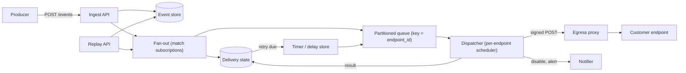

## In one minute
- **Promise at-least-once, never exactly-once.** A delivery succeeds only when the customer answers 2xx, and a lost response looks identical to a lost request. So duplicates are certain, and the contract is: every event carries a stable ID, and receivers deduplicate on it.
- **Isolate every endpoint.** One slow or dead customer must never delay another. That means a logical queue, a concurrency cap and a failure state per endpoint, scheduled fairly across endpoints.
- **Retry with exponential backoff, full jitter and a deadline.** Retries stretch over hours or days. Jitter and a per-endpoint ramp keep a recovering customer from being flattened by its own backlog.
- **Sign every request, and bind the signature to a timestamp and an ID.** An HMAC over `id.timestamp.body` proves origin and integrity. The timestamp bounds replay, and secret rotation lets two secrets be valid for a while.
- **Keep the events, not only the deliveries.** Replay needs a retention window (30 days is common), and ordering is best effort. Say so in the contract, and give receivers an API to fetch current state.

## Requirements

**Functional**
- Tenants register endpoints (HTTPS URL, event types, secret). Producers publish events, and each event is delivered to every matching endpoint.
- Retry failed deliveries on a schedule. Mark endpoints unhealthy, disable them after sustained failure and tell the tenant.
- Sign each delivery. Support secret rotation.
- Show a delivery log per endpoint (attempts, status, latency, response snippet). Support manual and bulk replay of events within the retention window.

**Non-functional**
- First attempt within 5 seconds at p99 for healthy endpoints, measured from event accepted to request sent.
- No accepted event is lost, even if a region or a queue node fails after acceptance. Duplicates are allowed and documented.
- Isolation: a failing endpoint adds no more than a few percent to anyone else's latency.
- Scale to 2M endpoints, 1B events per day and bursts of 5x.

**Out of scope**
- Building the producing systems, a customer-facing UI, transformation or routing languages, and non-HTTP sinks (queues, functions) beyond naming them as extra delivery adapters.

## Back-of-envelope
- **Events:** 1B/day divided by 86,400 s is about 11.6k events/s. Peak at 5x is about 58k/s. Average fan-out is close to 1 delivery per event, because most events have one subscriber and a few have dozens.
- **Attempts:** with about 20% extra from retries, that is about 14k attempts/s average and about 70k/s at peak.
- **Concurrency (Little's law):** healthy endpoints answer in about 300 ms, so 70k/s means 21k requests in flight. If 1% of attempts hit a 10 s timeout, that is 700/s times 10 s, another 7k connections held open doing nothing. So size for about 30k to 40k concurrent connections, or about 20 workers at 2k each.
- **Event storage:** 1B events at 2 KB is 2 TB per day. A 30-day replay window is 60 TB before replication, so payloads live in a cheap blob or wide-column store, not in the queue.

## API

```http
POST /v1/endpoints
{ "tenant_id": "t_91", "url": "https://shop.example.com/hooks",
  "event_types": ["order.paid", "order.refunded"], "ordered": false }
-> 201 { "endpoint_id": "ep_7f3", "secret": "whsec_..." }

POST /v1/events                      (producers; Idempotency-Key header required)
{ "tenant_id": "t_91", "type": "order.paid", "data": { "order_id": "o_55", "version": 12 } }
-> 202 { "event_id": "evt_01J9..." }

GET  /v1/endpoints/ep_7f3/deliveries?status=failed&since=2026-10-01T00:00:00Z
POST /v1/endpoints/ep_7f3/replay     { "from": "2026-10-16T09:00:00Z", "to": "2026-10-16T11:00:00Z", "only_failed": true }
POST /v1/endpoints/ep_7f3/rotate-secret
```

What the customer receives follows the shape of the open Standard Webhooks specification ([Standard Webhooks spec](https://github.com/standard-webhooks/standard-webhooks/blob/main/spec/standard-webhooks.md)):

```http
POST /hooks HTTP/1.1
webhook-id: msg_2KWPBg        # stable across retries and replays
webhook-timestamp: 1760695200 # seconds, set on every attempt
webhook-signature: v1,K5oZfzN95Z9UVu1Esf...   # base64 HMAC-SHA256 of "id.timestamp.body"
content-type: application/json

{"type":"order.paid","data":{"order_id":"o_55","version":12}}
```

Any 2xx is success. `429` and `503` with `Retry-After` are honoured. Everything else, including redirects and timeouts, is a failure.

## Data model

- **`endpoints`**, key `(tenant_id, endpoint_id)`: URL, event-type filter, `ordered` flag, up to two active secrets with `valid_until`, `state` (`active`, `degraded`, `paused`, `disabled`), `first_failure_at`. Small and read-heavy, so it is cached in memory and invalidated by version.
- **`events`**, partition key `(tenant_id, day)`, clustering by `event_id` (time-sortable ULID): payload and metadata. Immutable. This is the source for replay and is the table that holds the 30-day retention window.
- **`deliveries`**, partition key `endpoint_id`, clustering by `event_id`: `status` (`pending`, `in_flight`, `succeeded`, `retrying`, `dead`), `attempt`, `next_attempt_at`, `last_status`. This is the state machine. Partitioning by endpoint makes "all pending work for this endpoint" a single-partition read, which is what fairness and replay need.
- **`attempts`**, partition key `(endpoint_id, day)`: one row per try, with latency and status. Append-only, TTL 30 days.

Committing the `events` row and the `deliveries` rows together (a transactional outbox) is what makes "accepted means not lost" true.

## High-level design



**Write path.**
1. The ingest API authenticates the producer, deduplicates on the idempotency key, and commits the event and its delivery rows together. It answers `202`.
2. Fan-out looks up matching endpoints (cached) and publishes one message per delivery to a partitioned queue, keyed by `endpoint_id`. All work for one endpoint lands on one partition, so one dispatcher owns that endpoint's state.
3. The dispatcher keeps, per active endpoint, a small in-memory queue, an in-flight count, a failure streak and a circuit state. A fair scheduler picks the next endpoint with capacity. It loads the payload, signs it with the current secret and sends it through the egress proxy.
4. On 2xx it marks the delivery `succeeded`. On failure it records the attempt, computes the next time with jittered backoff, and writes `next_attempt_at`. A timer service re-publishes the delivery to the queue when it is due.

**Read path.** The delivery log and replay API read `deliveries` and `attempts` by endpoint. Replay creates new delivery rows for stored events with the same `webhook-id`, so receivers can deduplicate across copies.

## Deep dives

### 1. Retries, backoff and the recovery stampede

**Options.** Fixed interval retries are simple, but every failed delivery comes back in lockstep. Exponential backoff spreads them out. Exponential backoff with full jitter spreads them further, because retries from many senders are randomised across the whole window, which AWS's simulations found reduces contention compared with no jitter ([AWS Architecture Blog](https://aws.amazon.com/blogs/architecture/exponential-backoff-and-jitter/)).

**Choice.** Delay is `random(0, min(cap, base * 2^(attempt-1)))`, with a long schedule. Real services retry for hours to days. Stripe retries live-mode events for up to three days with exponential backoff ([Stripe docs](https://docs.stripe.com/webhooks)), and Svix's default schedule is immediately, 5 s, 5 min, 30 min, 2 h, 5 h, 10 h and 10 h more ([Svix docs](https://docs.svix.com/retries)). Shopify retries 8 times over 4 hours ([Shopify docs](https://shopify.dev/docs/apps/build/webhooks/subscribe/https)).

**The part people forget.** Jitter handles retries of the same age. It does not handle a customer that was down for six hours and comes back with 400k queued events. If you release them all, you knock the endpoint over again. So each endpoint has a **concurrency limit that adapts like TCP congestion control**: start at 1 to 4 in flight, add one per success window, halve on timeout or 5xx, honour `Retry-After`. The backlog drains at whatever rate the customer can take.  Waiting deliveries sit in a timer store (a table indexed on `next_attempt_at`), not in worker memory.

### 2. Fairness, slow endpoints and circuit breaking

**The failure to prevent.** A shared pool of workers and a shared FIFO means one customer whose endpoint takes 10 s to time out can hold all workers. Every other customer then waits behind it. This is head-of-line blocking plus a noisy neighbour, a problem [AWS describes for multi-tenant systems](https://aws.amazon.com/builders-library/fairness-in-multi-tenant-systems/).

**Options.** One physical queue per endpoint isolates perfectly, but 2M mostly empty queues are a management problem. One shared queue with a per-tenant rate limit is cheap but guards against volume, not slowness. The middle path is a **logical queue per endpoint multiplexed on shared partitions**, with a per-endpoint scheduler in the dispatcher.

**Choice: the middle path.** The scheduler is round robin over endpoints that have work and capacity (the same shape as the practice problem). Each endpoint has a hard cap on in-flight requests and a tight connect and total timeout (GitHub asks receivers to answer within 10 seconds and cuts the connection after that, [GitHub docs](https://docs.github.com/en/webhooks/using-webhooks/best-practices-for-using-webhooks)). A circuit breaker, in the sense of [Fowler's pattern](https://martinfowler.com/bliki/CircuitBreaker.html), opens after a failure streak: the endpoint stops getting traffic except a single probe delivery, and goes half-open when the probe succeeds.

**Dead endpoints.** After a configured period of continuous failure (say 3 days), mark the endpoint `disabled`, keep the events, email the tenant and offer one-click replay. Shopify instead deletes an Admin-API subscription after 8 consecutive failures, which is harsher than keeping events.

### 3. Ordering, idempotency and replay

**Ordering.** Strict ordering and high availability conflict here. To deliver event 2 after event 1 you must hold event 2 until event 1 succeeds, so one failing event blocks the whole endpoint. Stripe states it does not guarantee delivery in the order events are generated ([Stripe docs](https://docs.stripe.com/webhooks)). The default should be unordered with a per-resource `version` or `created` field in the payload. For tenants that need order, offer an `ordered` endpoint: a single in-flight delivery per endpoint (or per ordering key, such as the order ID), at the price of head-of-line blocking. 

**Idempotency.** Duplicates come from the sender (a timeout after the customer already processed the request), from replay, and from the queue (redelivery after a dispatcher crash). The sender cannot remove them. It can make them recognisable: `webhook-id` stays the same across attempts and replays. The receiver stores processed IDs and ignores repeats, as Stripe's advice to track event IDs and the Standard Webhooks advice to treat `webhook-id` as an idempotency key both say.

**Replay.** Replay is a new set of `deliveries` rows over stored events, with a filter (time range, event type, only failed). It reuses the original `webhook-id`, gets a new timestamp and signature, and goes through the same per-endpoint scheduler, so a bulk replay of 5M events is still rate limited by the endpoint's adaptive concurrency. Retention bounds what can be replayed: Stripe lets you resend an event for up to 30 days ([Stripe docs](https://docs.stripe.com/webhooks)).

## Down the stack

### Layer 1: The contract
- **Delivery:** for every accepted event and every matching, enabled endpoint, the service attempts delivery until it gets a 2xx, the retry window ends, or the endpoint is disabled. Each failure is visible in the log.
- **Duplicates:** may occur. The same `webhook-id` is used on every attempt and replay of the same event for the same endpoint.
- **Ordering:** none by default. With `ordered: true`, event N+1 is not sent until event N has succeeded or been dead-lettered.
- **Authenticity:** a request is valid only if the HMAC over `id.timestamp.body` matches one of the signatures sent and the timestamp is within a tolerance (Stripe's libraries default to 5 minutes, [Stripe docs](https://docs.stripe.com/webhooks/signatures)).

### Layer 2: The mechanism
- **State machine per delivery:** `pending -> in_flight -> succeeded`, or `in_flight -> retrying -> pending` (when `next_attempt_at` arrives), or `-> dead` after the last attempt. Every transition is a conditional write on `(status, attempt)`, so two dispatchers that both think they own a delivery cannot both record success.
- **Lease:** an `in_flight` delivery carries a lease. If the dispatcher dies the lease expires and the delivery is re-published, a source of duplicates.
- **Signing:** the signed string is `webhook-id + "." + webhook-timestamp + "." + body`, the MAC is HMAC ([RFC 2104](https://www.rfc-editor.org/rfc/rfc2104)) with SHA-256, and the receiver must hash the raw bytes, not a re-serialised JSON object. Secrets are per endpoint. Rotation sends two signatures separated by a space (both `v1,...` entries), so the customer can switch without downtime. GitHub's `X-Hub-Signature-256` signs the body alone ([GitHub docs](https://docs.github.com/en/webhooks/using-webhooks/validating-webhook-deliveries)), which has no replay protection. Binding a timestamp fixes that.

### Layer 3: The machine
- **Connections:** a fresh TLS 1.3 connection costs one round trip for TCP plus one for TLS, about 2 RTT, so 100 to 300 ms to a distant customer. Reusing connections per host with keep-alive makes the common case one RTT. Dispatchers keep a pool per destination host.
- **Port exhaustion:** the default Linux ephemeral range, 32768 to 60999, gives about 28k source ports per (source IP, destination IP, destination port). A single large customer receiving 50k/s through one egress IP runs out. Spread egress over several source IPs, or reuse connections with HTTP/2.
- **DNS and SSRF:** the egress proxy resolves the name itself, rejects private, loopback and link-local addresses (including cloud metadata addresses such as 169.254.169.254), and connects to the resolved IP. Without that, a tenant can point an endpoint at your internal network, and DNS rebinding can swap the address between check and connect.
- **HMAC cost:** SHA-256 runs at about 1 to 2 GB/s per core with hardware instructions, so signing a 2 KB payload takes a couple of microseconds. Signing is never the bottleneck. Per-attempt signing is cheap, which is why every attempt gets a fresh timestamp.

### Why it's built this way
1. The customer's server is outside your control and fails often, so you cannot ever know whether it processed a request. So delivery is at-least-once, and the protocol hands the receiver an ID to deduplicate on.
2. Failures last from seconds to days. So retries live in a durable timer store with a long schedule, not in a worker's memory.
3. Customers share your capacity but not each other's fate. So you need per-endpoint state (queue, cap, breaker), because a timeout holds a connection for as long as the timeout is.
4. Nothing proves a request came from you except a secret. So requests are signed over a body, ID and timestamp, and secrets rotate with overlap.
5. People fix their endpoints later and want the missed events. So events are kept past delivery, and replay is a first-class, rate-limited operation, not a support ticket.

## Worked example

A tenant, Acme, has one endpoint subscribed to `order.paid` and receives 40 events/s. Its server goes down for 5 hours (18,000 s). The dispatcher uses base 5 s, cap 10 h, full jitter, and caps the probe interval at 5 minutes while the breaker is open.

- At the start, attempts fail fast (connection refused in about 20 ms). The breaker opens after 5 consecutive failures, about 125 ms in. From then on the dispatcher sends about one probe per 5 minutes instead of 40 requests/s. Over the outage that avoids roughly 720k doomed requests.
- Events pile up as `retrying`: 40 x 18,000 = 720k deliveries, about 1.4 GB of payload in the event store and a modest number of timer rows. No other tenant sees a change, since only Acme's logical queue grew.
- The server returns. The next probe succeeds, the breaker closes, and concurrency starts at 2 and grows by one per 100 successes. Acme's server can handle about 200 requests/s, and the ramp reaches that in about a minute.
- Draining at 200/s while 40/s keep arriving nets 160/s, so 720,000 / 160 = 4,500 s, or 75 minutes, until Acme is current.
- A few events arrive twice, because a timeout fired after the handler committed. Acme deduplicates on `webhook-id`.

## Failure modes
- **Producer burst at 10x.** Ingest is cheap and durable, so accept up to a per-tenant quota (shed the rest with `429`). Delivery is protected by per-endpoint caps, so a burst for one tenant makes only that tenant's backlog longer.
- **Customer outage with a huge backlog.** The stampede on recovery is the real risk. Mitigate with the adaptive concurrency ramp, `Retry-After`, a per-endpoint rate limit tenants can lower, and replay that runs through the same scheduler.
- **Slow but not dead endpoint.** Responses at 9.5 s never trip a failure breaker but hold connections. Track a latency signal (p95 near the timeout) and treat it as degraded: lower its concurrency cap rather than waiting for failures.

## In the wild
- **GitHub, 2018: a backlog of five million webhook events.** During the 21 October 2018 incident, MySQL clusters became inconsistent after a network partition. To protect data integrity, GitHub paused webhook delivery and Pages builds on purpose. When processing resumed there were over five million hook events and 80 thousand Pages builds queued. About 200,000 payloads had outlived an internal TTL and were dropped. GitHub paused, raised the TTL and finished the backlog at 23:03 UTC on 22 October. The lesson for this design is that queue retention must outlast your worst outage ([GitHub incident analysis](https://github.blog/news-insights/company-news/oct21-post-incident-analysis/)).
- **Shopify: a published failure policy.** Shopify asks receivers to answer within five seconds, retries 8 times over 4 hours, and deletes an Admin-API subscription after 8 consecutive failures. It also tells apps to build a reconciliation job that fetches what they may have missed, because delivery is not a complete record ([Shopify docs](https://shopify.dev/docs/apps/build/webhooks/subscribe/https)).
- **Stripe: documented guarantees and their limits.** Stripe retries live events for up to three days with exponential backoff, offers manual resend for up to 30 days, says plainly that event order is not guaranteed, and tells receivers to track event IDs to catch duplicates ([Stripe docs](https://docs.stripe.com/webhooks)).

## Trade-offs

| Option | Strengths | Weaknesses | Choose when |
|---|---|---|---|
| Logical per-endpoint queue on shared partitions | Isolation without millions of queues; state is rebuildable | Needs a scheduler and per-endpoint memory | Many small and a few large endpoints (this design) |
| Physical queue per endpoint | Strongest isolation | Queue count, cost, management | Few, very large, regulated tenants |
| Unordered delivery | Highest availability; parallelism per endpoint | Receivers must handle reordering | Default |
| Ordered delivery per key | Simple receiver logic | Head-of-line blocking; low throughput | Per-aggregate streams where order is required |
| Push only | Low latency; no polling | Receiver must be reachable | Default |
| Push plus pull events API | Receivers recover alone; fewer replay tickets | More API surface | Anything with strict completeness |

## Leadership lens
- **Rollout.** Ship delivery, retries and signing first, with the delivery log from day one, because support tickets will be "did you send it?" Add the adaptive limiter and breaker before the first large customer, and replay in the second release.
- **Cost drivers.** Event retention (60 TB at 30 days), attempt logs and the connection fleet. Retention is a product knob, so price it.
- **Design-review questions.** What happens to events when an endpoint is down for a week? What is the cap on in-flight requests per endpoint? Who is told when we disable an endpoint? Can a tenant point us at 169.254.169.254?

## Check yourself
1. A customer's endpoint returns 200 and then the connection drops before your service reads the response. What does your service do, and what must the receiver have done to make that safe?
   **Answer:** It sees a failure and retries, so the receiver gets a duplicate. The receiver must deduplicate on the stable `webhook-id` (store processed IDs), because the sender cannot tell a lost response from a lost request.
2. Why use full jitter on the retry delay, and why is jitter alone not enough after a six-hour customer outage?
   **Answer:** Jitter spreads retries of similar age so they do not arrive in lockstep. After a long outage, the backlog itself is the stampede, so you also need a per-endpoint adaptive concurrency limit that ramps up as the receiver proves it can take load.
3. Your pipeline is a single shared worker pool and a FIFO queue. One customer's endpoint starts timing out at 10 s. What breaks, and what is the minimum fix?
   **Answer:** Workers fill up with 10 s waits, so every tenant's deliveries queue behind them. The minimum fix is a per-endpoint in-flight cap with a short timeout, a failure breaker, and fair scheduling across endpoints.
4. With 1B events/day and 20% retry overhead, roughly how many attempts per second are made on average and how many connections are open at 300 ms latency?
   **Answer:** 1.2B / 86,400 is about 14k attempts/s. By Little's law, 14k x 0.3 s is about 4.2k open requests, before adding slow timeouts and the 5x peak.

## Practice
**Task:** Implement the dispatcher core as a `Scheduler`, driven by an injected clock (integer milliseconds) and an injected random source (float in [0, 1)). `enqueue(endpoint, event_id)` returns false for an `(endpoint, event_id)` pair seen before. `poll()` hands out the head-of-line delivery of the next endpoint, in round-robin order, that is not disabled, whose head is not already in flight and whose retry time has arrived, returning `(endpoint, event_id, attempt)` with attempts starting at 1, or nothing. `report(endpoint, event_id, ok)` removes the head on success and resets the endpoint's failure streak. On failure it increments the attempt count and the streak, sets the next try to `now + backoff(attempt)`, moves the event to the endpoint's dead letters once attempts reach `max_attempts` (so the next event can proceed), and disables the endpoint once the streak reaches `disable_after`. `backoff(attempt)` is `int(rand() * min(cap, base * 2^(attempt-1)))`. `replay(endpoint)` puts the dead letters back at the front of the queue with attempts reset, resets the other queued events' attempts and retry times, clears the streak, re-enables the endpoint and returns how many dead letters were restored.

```python starter
class Scheduler:
    def __init__(self, clock, rand, base_ms=1000, cap_ms=60000, max_attempts=5, disable_after=3):
        # clock() -> int milliseconds; rand() -> float in [0, 1)
        self.clock = clock
        self.rand = rand

    def backoff(self, attempt):
        # Full jitter: int(rand() * min(cap, base * 2**(attempt-1))), attempt starts at 1.
        # TODO
        raise NotImplementedError

    def enqueue(self, endpoint, event_id):
        # Returns False if (endpoint, event_id) was ever enqueued before.
        # TODO
        raise NotImplementedError

    def poll(self):
        # Returns (endpoint, event_id, attempt) or None.
        # TODO
        raise NotImplementedError

    def report(self, endpoint, event_id, ok):
        # TODO
        raise NotImplementedError

    def is_disabled(self, endpoint):
        # TODO
        raise NotImplementedError

    def dead_letters(self, endpoint):
        # TODO
        raise NotImplementedError

    def replay(self, endpoint):
        # Returns how many dead letters were put back.
        # TODO
        raise NotImplementedError
```

```python tests
def make(rand=0.5, **kw):
    t = [0]
    s = Scheduler(lambda: t[0], lambda: rand, **kw)
    return s, t


def drain(s):
    out = []
    while True:
        d = s.poll()
        if d is None:
            return out
        out.append(d)
        s.report(d[0], d[1], True)


def test_fifo_and_dedupe():
    s, t = make()
    assert s.enqueue("a", "e1") and s.enqueue("a", "e2")
    assert not s.enqueue("a", "e1"), "same event id for same endpoint is a duplicate"
    assert s.enqueue("b", "e1"), "same id on another endpoint is a new delivery"
    assert drain(s) == [("a", "e1", 1), ("b", "e1", 1), ("a", "e2", 1)]


def test_round_robin_fairness():
    s, t = make()
    for e in ("e1", "e2", "e3"):
        s.enqueue("a", e)
    s.enqueue("b", "f1")
    assert drain(s) == [("a", "e1", 1), ("b", "f1", 1), ("a", "e2", 1), ("a", "e3", 1)]


def test_backoff_full_jitter_and_cap():
    s, t = make(rand=0.5, base_ms=1000, cap_ms=8000)
    assert [s.backoff(n) for n in range(1, 7)] == [500, 1000, 2000, 4000, 4000, 4000]
    s2, t2 = make(rand=0.0, base_ms=1000, cap_ms=8000)
    assert s2.backoff(3) == 0


def test_slow_endpoint_does_not_block_others():
    s, t = make(rand=0.5, base_ms=1000, cap_ms=8000)
    s.enqueue("a", "e1")
    s.enqueue("b", "f1")
    d = s.poll()
    assert d == ("a", "e1", 1)
    s.report("a", "e1", False)
    d = s.poll()
    assert d == ("b", "f1", 1)
    s.report("b", "f1", True)
    assert s.poll() is None
    t[0] = 499
    assert s.poll() is None, "retry not due yet"
    t[0] = 500
    assert s.poll() == ("a", "e1", 2)


def test_in_flight_head_is_not_handed_out_twice():
    s, t = make()
    s.enqueue("a", "e1")
    s.enqueue("a", "e2")
    assert s.poll() == ("a", "e1", 1)
    assert s.poll() is None, "head of line is in flight, e2 must wait for it"


def test_dead_letter_after_max_attempts_then_next_event_proceeds():
    s, t = make(rand=0.0, max_attempts=3, disable_after=10)
    s.enqueue("a", "e1")
    s.enqueue("a", "e2")
    for n in (1, 2, 3):
        assert s.poll() == ("a", "e1", n)
        s.report("a", "e1", False)
    assert s.dead_letters("a") == ["e1"]
    assert s.poll() == ("a", "e2", 1)


def test_disable_after_streak_and_replay():
    s, t = make(rand=0.0, max_attempts=2, disable_after=2)
    s.enqueue("a", "e1")
    s.enqueue("a", "e2")
    for n in (1, 2):
        assert s.poll() == ("a", "e1", n)
        s.report("a", "e1", False)
    assert s.is_disabled("a")
    s.enqueue("b", "f1")
    t[0] = 10**9
    assert s.poll() == ("b", "f1", 1), "other endpoints are unaffected"
    s.report("b", "f1", True)
    assert s.poll() is None, "disabled endpoint holds its events"
    assert s.replay("a") == 1
    assert not s.is_disabled("a")
    assert s.dead_letters("a") == []
    assert drain(s) == [("a", "e1", 1), ("a", "e2", 1)]


def test_success_resets_failure_streak():
    s, t = make(rand=0.0, max_attempts=10, disable_after=2)
    for e in ("e1", "e2"):
        s.enqueue("a", e)
    assert s.poll() == ("a", "e1", 1)
    s.report("a", "e1", False)
    assert s.poll() == ("a", "e1", 2)
    s.report("a", "e1", True)
    assert s.poll() == ("a", "e2", 1)
    s.report("a", "e2", False)
    assert not s.is_disabled("a"), "streak restarted after the success"
    assert s.poll() == ("a", "e2", 2)
```

```python solution
class Scheduler:
    def __init__(self, clock, rand, base_ms=1000, cap_ms=60000, max_attempts=5, disable_after=3):
        self.clock = clock
        self.rand = rand
        self.base = base_ms
        self.cap = cap_ms
        self.max_attempts = max_attempts
        self.disable_after = disable_after
        self.queues = {}
        self.order = []
        self.cursor = 0
        self.seen = set()
        self.streak = {}
        self.disabled = set()
        self.dead = {}

    def backoff(self, attempt):
        ceiling = self.base
        for _ in range(attempt - 1):
            if ceiling >= self.cap:
                break
            ceiling *= 2
        ceiling = min(ceiling, self.cap)
        return int(self.rand() * ceiling)

    def enqueue(self, endpoint, event_id):
        if (endpoint, event_id) in self.seen:
            return False
        self.seen.add((endpoint, event_id))
        if endpoint not in self.queues:
            self.queues[endpoint] = []
            self.order.append(endpoint)
            self.streak[endpoint] = 0
            self.dead[endpoint] = []
        self.queues[endpoint].append({"id": event_id, "attempts": 0, "next_at": 0, "inflight": False})
        return True

    def poll(self):
        n = len(self.order)
        now = self.clock()
        for i in range(n):
            idx = (self.cursor + i) % n
            ep = self.order[idx]
            q = self.queues[ep]
            if ep in self.disabled or not q:
                continue
            head = q[0]
            if head["inflight"] or head["next_at"] > now:
                continue
            head["inflight"] = True
            self.cursor = (idx + 1) % n
            return (ep, head["id"], head["attempts"] + 1)
        return None

    def report(self, endpoint, event_id, ok):
        q = self.queues[endpoint]
        head = q[0]
        if head["id"] != event_id or not head["inflight"]:
            return
        head["inflight"] = False
        if ok:
            q.pop(0)
            self.streak[endpoint] = 0
            return
        head["attempts"] += 1
        self.streak[endpoint] += 1
        if head["attempts"] >= self.max_attempts:
            q.pop(0)
            self.dead[endpoint].append(event_id)
        else:
            head["next_at"] = self.clock() + self.backoff(head["attempts"])
        if self.streak[endpoint] >= self.disable_after:
            self.disabled.add(endpoint)

    def is_disabled(self, endpoint):
        return endpoint in self.disabled

    def dead_letters(self, endpoint):
        return list(self.dead.get(endpoint, []))

    def replay(self, endpoint):
        if endpoint not in self.queues:
            return 0
        revived = [{"id": e, "attempts": 0, "next_at": 0, "inflight": False} for e in self.dead[endpoint]]
        for item in self.queues[endpoint]:
            item["attempts"] = 0
            item["next_at"] = 0
        self.queues[endpoint] = revived + self.queues[endpoint]
        self.dead[endpoint] = []
        self.streak[endpoint] = 0
        self.disabled.discard(endpoint)
        return len(revived)
```

The same problem in **TypeScript** and **Go** follows, with the same behaviour and equivalent tests.

```typescript starter
export type Clock = () => number;
export type Rand = () => number;
export interface Delivery {
  endpoint: string;
  eventId: string;
  attempt: number;
}

export class Scheduler {
  constructor(
    private clock: Clock,
    private rand: Rand,
    private baseMs = 1000,
    private capMs = 60000,
    private maxAttempts = 5,
    private disableAfter = 3,
  ) {}

  // Full jitter: floor(rand() * min(cap, base * 2^(attempt-1))), attempt starts at 1.
  backoff(attempt: number): number {
    throw new Error("TODO");
  }

  // false if (endpoint, eventId) was ever enqueued before.
  enqueue(endpoint: string, eventId: string): boolean {
    throw new Error("TODO");
  }

  poll(): Delivery | null {
    throw new Error("TODO");
  }

  report(endpoint: string, eventId: string, ok: boolean): void {
    throw new Error("TODO");
  }

  isDisabled(endpoint: string): boolean {
    throw new Error("TODO");
  }

  deadLetters(endpoint: string): string[] {
    throw new Error("TODO");
  }

  // Returns how many dead letters were put back.
  replay(endpoint: string): number {
    throw new Error("TODO");
  }
}
```

```typescript tests
function make(rand = 0.5, opts: { base?: number; cap?: number; max?: number; dis?: number } = {}): { s: Scheduler; c: { now: number } } {
  const c = { now: 0 };
  const s = new Scheduler(() => c.now, () => rand, opts.base ?? 1000, opts.cap ?? 60000, opts.max ?? 5, opts.dis ?? 3);
  return { s, c };
}

function d(endpoint: string, eventId: string, attempt: number): Delivery {
  return { endpoint, eventId, attempt };
}

function drain(s: Scheduler): Delivery[] {
  const out: Delivery[] = [];
  for (;;) {
    const x = s.poll();
    if (x === null) return out;
    out.push(x);
    s.report(x.endpoint, x.eventId, true);
  }
}

test("fifo and dedupe", () => {
  const { s } = make();
  assert(s.enqueue("a", "e1") && s.enqueue("a", "e2"), "first enqueues");
  assert(!s.enqueue("a", "e1"), "same event id for same endpoint is a duplicate");
  assert(s.enqueue("b", "e1"), "same id on another endpoint is a new delivery");
  assertEqual(drain(s), [d("a", "e1", 1), d("b", "e1", 1), d("a", "e2", 1)], "order");
});

test("round robin fairness", () => {
  const { s } = make();
  for (const e of ["e1", "e2", "e3"]) s.enqueue("a", e);
  s.enqueue("b", "f1");
  assertEqual(drain(s), [d("a", "e1", 1), d("b", "f1", 1), d("a", "e2", 1), d("a", "e3", 1)], "interleaved");
});

test("backoff full jitter and cap", () => {
  const { s } = make(0.5, { base: 1000, cap: 8000 });
  assertEqual([1, 2, 3, 4, 5, 6].map((n) => s.backoff(n)), [500, 1000, 2000, 4000, 4000, 4000], "delays");
  assertEqual(make(0, { base: 1000, cap: 8000 }).s.backoff(3), 0, "rand zero");
});

test("slow endpoint does not block others", () => {
  const { s, c } = make(0.5, { base: 1000, cap: 8000 });
  s.enqueue("a", "e1");
  s.enqueue("b", "f1");
  assertEqual(s.poll(), d("a", "e1", 1), "a first");
  s.report("a", "e1", false);
  assertEqual(s.poll(), d("b", "f1", 1), "b goes while a waits");
  s.report("b", "f1", true);
  assertEqual(s.poll(), null, "nothing due");
  c.now = 499;
  assertEqual(s.poll(), null, "retry not due yet");
  c.now = 500;
  assertEqual(s.poll(), d("a", "e1", 2), "retry due");
});

test("in-flight head is not handed out twice", () => {
  const { s } = make();
  s.enqueue("a", "e1");
  s.enqueue("a", "e2");
  assertEqual(s.poll(), d("a", "e1", 1), "e1");
  assertEqual(s.poll(), null, "e2 waits for e1");
});

test("dead letter after max attempts then next event proceeds", () => {
  const { s } = make(0, { max: 3, dis: 10 });
  s.enqueue("a", "e1");
  s.enqueue("a", "e2");
  for (const n of [1, 2, 3]) {
    assertEqual(s.poll(), d("a", "e1", n), "attempt " + n);
    s.report("a", "e1", false);
  }
  assertEqual(s.deadLetters("a"), ["e1"], "dead");
  assertEqual(s.poll(), d("a", "e2", 1), "e2 proceeds");
});

test("disable after streak and replay", () => {
  const { s, c } = make(0, { max: 2, dis: 2 });
  s.enqueue("a", "e1");
  s.enqueue("a", "e2");
  for (const n of [1, 2]) {
    assertEqual(s.poll(), d("a", "e1", n), "attempt " + n);
    s.report("a", "e1", false);
  }
  assert(s.isDisabled("a"), "disabled");
  s.enqueue("b", "f1");
  c.now = 1e9;
  assertEqual(s.poll(), d("b", "f1", 1), "other endpoints unaffected");
  s.report("b", "f1", true);
  assertEqual(s.poll(), null, "disabled endpoint holds its events");
  assertEqual(s.replay("a"), 1, "one dead letter back");
  assert(!s.isDisabled("a"), "enabled again");
  assertEqual(s.deadLetters("a"), [], "dead letters cleared");
  assertEqual(drain(s), [d("a", "e1", 1), d("a", "e2", 1)], "replayed in order");
});

test("success resets failure streak", () => {
  const { s } = make(0, { max: 10, dis: 2 });
  s.enqueue("a", "e1");
  s.enqueue("a", "e2");
  assertEqual(s.poll(), d("a", "e1", 1), "e1 first");
  s.report("a", "e1", false);
  assertEqual(s.poll(), d("a", "e1", 2), "e1 retry");
  s.report("a", "e1", true);
  assertEqual(s.poll(), d("a", "e2", 1), "e2");
  s.report("a", "e2", false);
  assert(!s.isDisabled("a"), "streak restarted after success");
});
```

```typescript solution
export type Clock = () => number;
export type Rand = () => number;
export interface Delivery {
  endpoint: string;
  eventId: string;
  attempt: number;
}

interface Item {
  id: string;
  attempts: number;
  nextAt: number;
  inflight: boolean;
}

export class Scheduler {
  private queues = new Map<string, Item[]>();
  private order: string[] = [];
  private cursor = 0;
  private seen = new Set<string>();
  private streak = new Map<string, number>();
  private disabled = new Set<string>();
  private dead = new Map<string, string[]>();

  constructor(
    private clock: Clock,
    private rand: Rand,
    private baseMs = 1000,
    private capMs = 60000,
    private maxAttempts = 5,
    private disableAfter = 3,
  ) {}

  backoff(attempt: number): number {
    let ceiling = this.baseMs;
    for (let i = 0; i < attempt - 1 && ceiling < this.capMs; i++) ceiling *= 2;
    ceiling = Math.min(ceiling, this.capMs);
    return Math.floor(this.rand() * ceiling);
  }

  enqueue(endpoint: string, eventId: string): boolean {
    const key = endpoint + "\u0000" + eventId;
    if (this.seen.has(key)) return false;
    this.seen.add(key);
    if (!this.queues.has(endpoint)) {
      this.queues.set(endpoint, []);
      this.order.push(endpoint);
      this.streak.set(endpoint, 0);
      this.dead.set(endpoint, []);
    }
    this.queues.get(endpoint)!.push({ id: eventId, attempts: 0, nextAt: 0, inflight: false });
    return true;
  }

  poll(): Delivery | null {
    const n = this.order.length;
    const now = this.clock();
    for (let i = 0; i < n; i++) {
      const idx = (this.cursor + i) % n;
      const ep = this.order[idx];
      const q = this.queues.get(ep)!;
      if (this.disabled.has(ep) || q.length === 0) continue;
      const head = q[0];
      if (head.inflight || head.nextAt > now) continue;
      head.inflight = true;
      this.cursor = (idx + 1) % n;
      return { endpoint: ep, eventId: head.id, attempt: head.attempts + 1 };
    }
    return null;
  }

  report(endpoint: string, eventId: string, ok: boolean): void {
    const q = this.queues.get(endpoint);
    if (!q || q.length === 0) return;
    const head = q[0];
    if (head.id !== eventId || !head.inflight) return;
    head.inflight = false;
    if (ok) {
      q.shift();
      this.streak.set(endpoint, 0);
      return;
    }
    head.attempts += 1;
    const s = (this.streak.get(endpoint) as number) + 1;
    this.streak.set(endpoint, s);
    if (head.attempts >= this.maxAttempts) {
      q.shift();
      this.dead.get(endpoint)!.push(eventId);
    } else {
      head.nextAt = this.clock() + this.backoff(head.attempts);
    }
    if (s >= this.disableAfter) this.disabled.add(endpoint);
  }

  isDisabled(endpoint: string): boolean {
    return this.disabled.has(endpoint);
  }

  deadLetters(endpoint: string): string[] {
    return [...(this.dead.get(endpoint) ?? [])];
  }

  replay(endpoint: string): number {
    const q = this.queues.get(endpoint);
    if (!q) return 0;
    const revived: Item[] = this.dead.get(endpoint)!.map((id) => ({ id, attempts: 0, nextAt: 0, inflight: false }));
    for (const it of q) {
      it.attempts = 0;
      it.nextAt = 0;
    }
    this.queues.set(endpoint, revived.concat(q));
    this.dead.set(endpoint, []);
    this.streak.set(endpoint, 0);
    this.disabled.delete(endpoint);
    return revived.length;
  }
}
```

```go starter
package practice

type Clock func() int64
type Rand func() float64

type Delivery struct {
	Endpoint string
	EventID  string
	Attempt  int
}

type Scheduler struct{}

func NewScheduler(clock Clock, rand Rand, baseMs, capMs int64, maxAttempts, disableAfter int) *Scheduler {
	return &Scheduler{}
}

// Backoff is full jitter: int64(rand() * min(cap, base * 2^(attempt-1))), attempt starts at 1.
func (s *Scheduler) Backoff(attempt int) int64 { panic("TODO") }

// Enqueue returns false if (endpoint, eventID) was ever enqueued before.
func (s *Scheduler) Enqueue(endpoint, eventID string) bool { panic("TODO") }

func (s *Scheduler) Poll() (Delivery, bool) { panic("TODO") }

func (s *Scheduler) Report(endpoint, eventID string, ok bool) { panic("TODO") }

func (s *Scheduler) IsDisabled(endpoint string) bool { panic("TODO") }

func (s *Scheduler) DeadLetters(endpoint string) []string { panic("TODO") }

// Replay returns how many dead letters were put back.
func (s *Scheduler) Replay(endpoint string) int { panic("TODO") }
```

```go tests
package practice

import (
	"reflect"
	"testing"
)

func newSched(rand float64, base, capMs int64, max, dis int) (*Scheduler, *int64) {
	now := new(int64)
	s := NewScheduler(func() int64 { return *now }, func() float64 { return rand }, base, capMs, max, dis)
	return s, now
}

func drain(s *Scheduler) []Delivery {
	var out []Delivery
	for {
		d, ok := s.Poll()
		if !ok {
			return out
		}
		out = append(out, d)
		s.Report(d.Endpoint, d.EventID, true)
	}
}

func expect(t *testing.T, got, want []Delivery) {
	t.Helper()
	if !reflect.DeepEqual(got, want) {
		t.Fatalf("got %v, want %v", got, want)
	}
}

func mustPoll(t *testing.T, s *Scheduler, want Delivery) {
	t.Helper()
	d, ok := s.Poll()
	if !ok || d != want {
		t.Fatalf("poll = %v, %v; want %v", d, ok, want)
	}
}

func mustNotPoll(t *testing.T, s *Scheduler, msg string) {
	t.Helper()
	if d, ok := s.Poll(); ok {
		t.Fatalf("%s: got %v", msg, d)
	}
}

func TestFIFOAndDedupe(t *testing.T) {
	s, _ := newSched(0.5, 1000, 60000, 5, 3)
	if !s.Enqueue("a", "e1") || !s.Enqueue("a", "e2") {
		t.Fatal("first enqueues must succeed")
	}
	if s.Enqueue("a", "e1") {
		t.Fatal("duplicate must be rejected")
	}
	if !s.Enqueue("b", "e1") {
		t.Fatal("same id on another endpoint is new")
	}
	expect(t, drain(s), []Delivery{{"a", "e1", 1}, {"b", "e1", 1}, {"a", "e2", 1}})
}

func TestRoundRobinFairness(t *testing.T) {
	s, _ := newSched(0.5, 1000, 60000, 5, 3)
	for _, e := range []string{"e1", "e2", "e3"} {
		s.Enqueue("a", e)
	}
	s.Enqueue("b", "f1")
	expect(t, drain(s), []Delivery{{"a", "e1", 1}, {"b", "f1", 1}, {"a", "e2", 1}, {"a", "e3", 1}})
}

func TestBackoffFullJitterAndCap(t *testing.T) {
	s, _ := newSched(0.5, 1000, 8000, 5, 3)
	want := []int64{500, 1000, 2000, 4000, 4000, 4000}
	for i, w := range want {
		if got := s.Backoff(i + 1); got != w {
			t.Fatalf("Backoff(%d) = %d, want %d", i+1, got, w)
		}
	}
	z, _ := newSched(0, 1000, 8000, 5, 3)
	if z.Backoff(3) != 0 {
		t.Fatal("rand zero must give zero delay")
	}
}

func TestSlowEndpointDoesNotBlockOthers(t *testing.T) {
	s, now := newSched(0.5, 1000, 8000, 5, 3)
	s.Enqueue("a", "e1")
	s.Enqueue("b", "f1")
	mustPoll(t, s, Delivery{"a", "e1", 1})
	s.Report("a", "e1", false)
	mustPoll(t, s, Delivery{"b", "f1", 1})
	s.Report("b", "f1", true)
	mustNotPoll(t, s, "nothing due")
	*now = 499
	mustNotPoll(t, s, "retry not due yet")
	*now = 500
	mustPoll(t, s, Delivery{"a", "e1", 2})
}

func TestInFlightHeadNotHandedOutTwice(t *testing.T) {
	s, _ := newSched(0.5, 1000, 60000, 5, 3)
	s.Enqueue("a", "e1")
	s.Enqueue("a", "e2")
	mustPoll(t, s, Delivery{"a", "e1", 1})
	mustNotPoll(t, s, "e2 must wait for e1")
}

func TestDeadLetterThenNextEventProceeds(t *testing.T) {
	s, _ := newSched(0, 1000, 60000, 3, 10)
	s.Enqueue("a", "e1")
	s.Enqueue("a", "e2")
	for n := 1; n <= 3; n++ {
		mustPoll(t, s, Delivery{"a", "e1", n})
		s.Report("a", "e1", false)
	}
	if !reflect.DeepEqual(s.DeadLetters("a"), []string{"e1"}) {
		t.Fatalf("dead = %v", s.DeadLetters("a"))
	}
	mustPoll(t, s, Delivery{"a", "e2", 1})
}

func TestDisableAfterStreakAndReplay(t *testing.T) {
	s, now := newSched(0, 1000, 60000, 2, 2)
	s.Enqueue("a", "e1")
	s.Enqueue("a", "e2")
	for n := 1; n <= 2; n++ {
		mustPoll(t, s, Delivery{"a", "e1", n})
		s.Report("a", "e1", false)
	}
	if !s.IsDisabled("a") {
		t.Fatal("a should be disabled")
	}
	s.Enqueue("b", "f1")
	*now = 1000000000
	mustPoll(t, s, Delivery{"b", "f1", 1})
	s.Report("b", "f1", true)
	mustNotPoll(t, s, "disabled endpoint holds its events")
	if n := s.Replay("a"); n != 1 {
		t.Fatalf("replay = %d", n)
	}
	if s.IsDisabled("a") || len(s.DeadLetters("a")) != 0 {
		t.Fatal("replay must re-enable and clear dead letters")
	}
	expect(t, drain(s), []Delivery{{"a", "e1", 1}, {"a", "e2", 1}})
}

func TestSuccessResetsStreak(t *testing.T) {
	s, _ := newSched(0, 1000, 60000, 10, 2)
	s.Enqueue("a", "e1")
	s.Enqueue("a", "e2")
	mustPoll(t, s, Delivery{"a", "e1", 1})
	s.Report("a", "e1", false)
	mustPoll(t, s, Delivery{"a", "e1", 2})
	s.Report("a", "e1", true)
	mustPoll(t, s, Delivery{"a", "e2", 1})
	s.Report("a", "e2", false)
	if s.IsDisabled("a") {
		t.Fatal("streak should have restarted after the success")
	}
}
```

```go solution
package practice

type Clock func() int64
type Rand func() float64

type Delivery struct {
	Endpoint string
	EventID  string
	Attempt  int
}

type item struct {
	id       string
	attempts int
	nextAt   int64
	inflight bool
}

type Scheduler struct {
	clock         Clock
	rand          Rand
	baseMs, capMs int64
	maxAttempts   int
	disableAfter  int
	queues        map[string][]*item
	order         []string
	cursor        int
	seen          map[[2]string]bool
	streak        map[string]int
	disabled      map[string]bool
	dead          map[string][]string
}

func NewScheduler(clock Clock, rand Rand, baseMs, capMs int64, maxAttempts, disableAfter int) *Scheduler {
	return &Scheduler{
		clock: clock, rand: rand, baseMs: baseMs, capMs: capMs,
		maxAttempts: maxAttempts, disableAfter: disableAfter,
		queues: map[string][]*item{}, seen: map[[2]string]bool{},
		streak: map[string]int{}, disabled: map[string]bool{}, dead: map[string][]string{},
	}
}

func (s *Scheduler) Backoff(attempt int) int64 {
	ceiling := s.baseMs
	for i := 0; i < attempt-1 && ceiling < s.capMs; i++ {
		ceiling *= 2
	}
	if ceiling > s.capMs {
		ceiling = s.capMs
	}
	return int64(s.rand() * float64(ceiling))
}

func (s *Scheduler) Enqueue(endpoint, eventID string) bool {
	k := [2]string{endpoint, eventID}
	if s.seen[k] {
		return false
	}
	s.seen[k] = true
	if _, ok := s.queues[endpoint]; !ok {
		s.queues[endpoint] = nil
		s.order = append(s.order, endpoint)
	}
	s.queues[endpoint] = append(s.queues[endpoint], &item{id: eventID})
	return true
}

func (s *Scheduler) Poll() (Delivery, bool) {
	n := len(s.order)
	now := s.clock()
	for i := 0; i < n; i++ {
		idx := (s.cursor + i) % n
		ep := s.order[idx]
		q := s.queues[ep]
		if s.disabled[ep] || len(q) == 0 {
			continue
		}
		head := q[0]
		if head.inflight || head.nextAt > now {
			continue
		}
		head.inflight = true
		s.cursor = (idx + 1) % n
		return Delivery{ep, head.id, head.attempts + 1}, true
	}
	return Delivery{}, false
}

func (s *Scheduler) Report(endpoint, eventID string, ok bool) {
	q := s.queues[endpoint]
	if len(q) == 0 {
		return
	}
	head := q[0]
	if head.id != eventID || !head.inflight {
		return
	}
	head.inflight = false
	if ok {
		s.queues[endpoint] = q[1:]
		s.streak[endpoint] = 0
		return
	}
	head.attempts++
	s.streak[endpoint]++
	if head.attempts >= s.maxAttempts {
		s.queues[endpoint] = q[1:]
		s.dead[endpoint] = append(s.dead[endpoint], eventID)
	} else {
		head.nextAt = s.clock() + s.Backoff(head.attempts)
	}
	if s.streak[endpoint] >= s.disableAfter {
		s.disabled[endpoint] = true
	}
}

func (s *Scheduler) IsDisabled(endpoint string) bool { return s.disabled[endpoint] }

func (s *Scheduler) DeadLetters(endpoint string) []string {
	return append([]string{}, s.dead[endpoint]...)
}

func (s *Scheduler) Replay(endpoint string) int {
	q, ok := s.queues[endpoint]
	if !ok {
		return 0
	}
	revived := make([]*item, 0, len(s.dead[endpoint])+len(q))
	for _, id := range s.dead[endpoint] {
		revived = append(revived, &item{id: id})
	}
	n := len(revived)
	for _, it := range q {
		it.attempts = 0
		it.nextAt = 0
		revived = append(revived, it)
	}
	s.queues[endpoint] = revived
	s.dead[endpoint] = nil
	s.streak[endpoint] = 0
	delete(s.disabled, endpoint)
	return n
}
```

## Mock interview
**Prompt:** Design a webhook delivery service for a SaaS platform with 2M customer endpoints. Producers emit 1B events per day, peaks are 5x, and customers' servers are unreliable and sometimes hostile. Walk me through delivery guarantees, retries and what you do when a customer's server is slow or down for days.

- Follow-up: A customer says they received the same event three times and charged a card twice. Whose bug is it, and what do you change in the product?
- Follow-up: One endpoint takes 10 s to respond on every call and accounts for 30% of your workers' time. How did that happen, and how do you stop it?
- Follow-up: A tenant was down for two days and now asks you to replay 80M events. How does the system behave, and what protects their server?
- Follow-up: How would you let customers verify that a request came from you, and how do you rotate a leaked secret without downtime?

**A strong answer covers:**
- An explicit at-least-once contract, with a stable event ID and a clear statement that exactly-once is not achievable over HTTP.
- Back-of-envelope numbers: attempts per second, open connections by Little's law, and storage for the replay window.
- Per-endpoint isolation: logical queues, in-flight caps, short timeouts, circuit breaker, and round-robin or weighted fair scheduling.
- Retry design: exponential backoff with full jitter, a documented window, `Retry-After`, and an adaptive ramp after outages.
- HMAC signing over ID, timestamp and raw body, tolerance for replay attacks, rotation with two valid secrets, and SSRF protection in the egress path.
- Ordering as best effort by default, optional ordered mode with its head-of-line cost, plus replay and a pull API for recovery.

## Sources and further study
**Primary**
- [Standard Webhooks specification](https://github.com/standard-webhooks/standard-webhooks/blob/main/spec/standard-webhooks.md): the `webhook-id`, `webhook-timestamp` and `webhook-signature` headers, signed content format and verification guidance.
- [RFC 2104: HMAC](https://www.rfc-editor.org/rfc/rfc2104): the keyed-hash construction every webhook signature scheme uses.
- [RFC 9110: HTTP Semantics](https://datatracker.ietf.org/doc/html/rfc9110): status code classes and the `Retry-After` field that govern retry decisions.

**Systems docs**
- [Stripe: webhooks](https://docs.stripe.com/webhooks): retry window, resend limit, event ordering and duplicate handling.
- [Stripe: signature verification](https://docs.stripe.com/webhooks/signatures): timestamped signatures and the replay tolerance.
- [GitHub: best practices for webhooks](https://docs.github.com/en/webhooks/using-webhooks/best-practices-for-using-webhooks): the 10-second response limit, redelivery and `X-GitHub-Delivery`.
- [Shopify: HTTPS webhook delivery](https://shopify.dev/docs/apps/build/webhooks/subscribe/https): retry count, automatic subscription removal and reconciliation advice.
- [Svix: retry schedule](https://docs.svix.com/retries): a concrete backoff schedule and endpoint disabling.

**Books**
- *Release It!*, 2nd edition, Michael Nygard, chapter 5 "Stability Patterns": circuit breaker, bulkhead and timeouts for calls to systems you do not control.
- *Designing Data-Intensive Applications*, 1st edition, Martin Kleppmann, chapter 11 "Stream Processing": acknowledgements, redelivery and what exactly-once really means.

**Other curricula**
- [Martin Fowler: Idempotent Receiver](https://martinfowler.com/articles/patterns-of-distributed-systems/idempotent-receiver.html): frames deduplication as a property of the receiver, keyed by a client-supplied ID.
- [AWS Builders' Library: timeouts, retries and backoff with jitter](https://aws.amazon.com/builders-library/timeouts-retries-and-backoff-with-jitter/): the sender-side view of retry storms.

## Watch
- [Webhook Architecture Design with Svix Founder & CEO Tom Hacohen (Svix)](https://www.youtube.com/watch?v=4jvV75OD620): a conversation with a webhook-infrastructure founder about how such a service is architected.
- [Webhook handling: building rock-solid Stripe integrations (Stripe Developers)](https://www.youtube.com/watch?v=47sSju0UhPk): the receiver's side of the same contract.

## Free resources
- [Exponential backoff and jitter (AWS Architecture Blog)](https://aws.amazon.com/blogs/architecture/exponential-backoff-and-jitter/): simulations comparing full, equal and decorrelated jitter.
- [Fairness in multi-tenant systems (AWS Builders' Library)](https://aws.amazon.com/builders-library/fairness-in-multi-tenant-systems/): quotas, admission control and shuffle sharding for noisy neighbours.
- [Validating webhook deliveries (GitHub)](https://docs.github.com/en/webhooks/using-webhooks/validating-webhook-deliveries): HMAC verification with code samples in several languages.
- [Implementing Stripe-like idempotency keys in Postgres (Brandur Leach)](https://brandur.org/idempotency-keys): a transactional approach to the duplicate problem.
- [Circuit Breaker (Martin Fowler)](https://martinfowler.com/bliki/CircuitBreaker.html): states and trip conditions in a short page.
