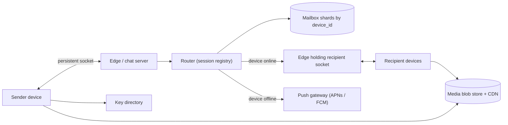

## In one minute
- **The server is a post office, not an archive.** Messages are end-to-end encrypted, so the server stores an opaque envelope only until the recipient's device acknowledges it, then deletes it. History lives on phones and in user backups.
- **The device is the unit of delivery, not the user.** Every phone, laptop and tablet has its own identity key and mailbox, so one message to a person with three devices is three ciphertexts.
- **Delivery is an acknowledgement protocol.** A message moves from sent to delivered to read, each step a small receipt flowing back to the sender. The server deletes only what a device has acked.
- **Connections, not messages, set the size of the fleet.** Hundreds of millions of phones hold a socket open all day, so memory per idle connection decides how many servers you buy.
- **Groups are bounded, so fan-out on write is fine.** With at most about a thousand members, copying each message into every member device's mailbox is affordable, unlike a Slack channel.

## Requirements

**Functional**
- Send text messages to one person or a group of up to 1,024 members ([WhatsApp](https://blog.whatsapp.com/communities-now-available)), with end-to-end encryption.
- Show the sender one tick (accepted), two ticks (delivered) and blue ticks (read).
- Deliver messages to devices that were offline when they were sent, as soon as they reconnect.
- Support a phone plus up to four linked companion devices that keep working when the phone is off ([Meta](https://engineering.fb.com/2021/07/14/security/whatsapp-multi-device/)).
- Send photos, video, voice notes and documents. Show presence ("online", "last seen") and typing indicators.

**Non-functional**
- Send-to-deliver latency under 500 ms p99 when both devices are online in the same region.
- No message lost once the sender sees one tick. No duplicate shown to the recipient.
- Messages from one sender appear in send order on every device.
- The server must never hold plaintext or keys that decrypt message content.
- Battery friendly: one long-lived connection per device, no polling.

**Out of scope:** calls (see the WebRTC lesson), payments, Status, Channels, spam detection and cryptographic proofs.

## Back-of-envelope
Round assumed numbers, not Meta's published figures.

- **DAU:** 1.5B. Each sends 60 messages a day, so 1.5B × 60 = 90B messages a day.
- **Send QPS:** 90B / 86,400 ≈ 1.04M/s on average. Global time zones flatten the curve, so peak is about 2× average, roughly 2M/s.
- **Device copies:** most messages are one-to-one, but groups and linked devices multiply copies. Assume 2.5 recipient devices per message on average: 2.6M mailbox writes/s average, about 5M/s at peak. Receipts add two small frames per copy (delivered, read), so about 15M frames/s at peak through the edge.
- **Connections:** if 40% of DAU are connected at any moment, that is 600M sockets. At 1M sockets per edge host (about what WhatsApp ran per chat server in 2014, [High Scalability](https://highscalability.com/how-whatsapp-grew-to-nearly-500-million-users-11000-cores-an/)), 600 hosts; plan for 1,200 so each runs at half capacity and can absorb a neighbour's failover.
- **Transient message storage:** an envelope is about 300 bytes. 90B × 2.5 × 300 B ≈ 68 TB written per day, nearly all deleted within seconds. If the average copy waits 30 minutes, the resident set is 68 TB × (0.5 / 24) ≈ 1.4 TB; provision about 10 TB for outages.
- **Five-year storage:** no server-side history, so this stays flat, versus about 1.5 PB for a Slack-sized product that keeps everything.
- **Media:** if 8% of messages carry media averaging 250 KB, that is 7.2B × 250 KB ≈ 1.8 PB uploaded per day. Keeping blobs 30 days for redownload means about 54 PB resident. Media is the real bill.
- **Bandwidth:** text: 5M copies/s × 300 B ≈ 1.5 GB/s at peak. Media: 1.8 PB / 86,400 ≈ 21 GB/s in and roughly 2.5× that out, about 50 GB/s, served from CDN edges.

## API
The client speaks a binary protocol over one persistent connection. WhatsApp wraps it in Noise Pipes (Curve25519, AES-GCM, SHA-256) rather than TLS, because it gives a fast, lightweight connection setup and resume ([WhatsApp Encryption Overview](https://www.whatsapp.com/security/WhatsApp-Security-Whitepaper.pdf)). Media goes over HTTPS. The frames below are shown as JSON for readability.

```text
-> hello      { device_id, auth_token, last_acked_offset: 81231 }
<- welcome    { pending: 14 }

-> send       { client_msg_id, conv_id, copies: [ { device_id, ciphertext } ... ] }
<- accepted   { client_msg_id, conv_id, seq: 5512, server_ts }        (one tick)

<- deliver    { offset: 81232, conv_id, seq: 5512, from_device, ciphertext }
-> ack        { upto_offset: 81245 }                                   (server deletes)

-> receipt    { conv_id, to_user, kind: "delivered" | "read", upto_seq: 5512 }
<- receipt    { conv_id, from_user, kind, upto_seq }                   (two ticks / blue)

GET  /v1/keys/{user_id}            -> { devices: [ { device_id, identity_key, signed_prekey, one_time_prekey } ] }
POST /v1/media (resumable upload)  -> { media_id, url }  ciphertext only; key travels inside the message
```

The sender encrypts once per recipient device, so `send` carries a list of copies. `client_msg_id` makes a retried send idempotent. Receipts are cumulative (`upto_seq`), so opening a chat with 40 unread messages sends one read receipt, not 40.

## Data model

**mailbox** is partitioned by `device_id`, primary key `(device_id, offset)`. Columns: `conv_id`, `seq`, `from_device`, `ciphertext`, `enqueued_at`. `offset` is a per-device counter. It is a queue: inserts at the tail, range reads after the last ack, deletes at the head. Partitioning by device makes catch-up a single range scan on one shard.

**conversations** is partitioned by `conv_id`. Columns: `kind` (direct or group), `head_seq`, `membership_version`. `head_seq` assigns a per-conversation sequence number on accept, giving receivers a stable order and making cumulative receipts possible.

**group_members** is partitioned by `group_id`: `(group_id, user_id) -> role, joined_at`. Groups are small, so one partition read returns the whole roster. Every membership change bumps `membership_version`, and senders must encrypt for the current version or the server rejects the send.

**devices** (the key directory) is partitioned by `user_id`: `(user_id, device_id) -> identity_key, signed_prekey, prekey_count, last_seen`. A second table holds one-time prekeys, each handed out once and then deleted.

**dedupe** holds `(conv_id, sender_device, client_msg_id) -> seq` with a TTL of a few days, long enough to absorb any client retry.

**media** lives in object storage keyed by a random `media_id`, holding only ciphertext.

## High-level design



**Write path.**
1. The sender's app gets the recipient's device list and prekeys from the key directory (cached locally), encrypts once per recipient device and per its own other devices, and sends one `send` frame with all copies.
2. The edge server checks the dedupe table; a retried `client_msg_id` gets the original `seq` back.
3. The router increments `head_seq` for the conversation and appends each copy to the recipient device's mailbox. Once every append is durable it replies `accepted` (one tick).
4. For each recipient device with a live socket in the session registry, the router forwards the envelope to that edge server. Otherwise it asks the push gateway for a notification. On iOS this cannot be a silent background push: Apple treats those as low priority, may throttle them, and says to send no more than two or three per hour ([Apple](https://developer.apple.com/documentation/usernotifications/pushing-background-updates-to-your-app)). Messaging apps send a visible alert carrying the ciphertext and decrypt it in a notification service extension, which has about 30 seconds to rewrite the payload ([Apple](https://developer.apple.com/documentation/usernotifications/modifying-content-in-newly-delivered-notifications)).

**Read path.**
1. A device connects and sends `hello` with the last offset it acknowledged.
2. The edge server streams mailbox entries after that offset, in batches.
3. The device decrypts, stores locally, and sends `ack upto_offset`. The server deletes those rows and emits a delivery receipt to each sender.
4. When the user opens a chat, the app sends one cumulative read receipt per sender.

## Deep dives

### 1. The offline inbox: queue, not log
Option one is the Design Slack model: a per-conversation log kept forever, synced by cursor. Under end-to-end encryption that history is useless to the server (no search, no previews), and every device must poll every conversation. Option two is a per-device mailbox that deletes on ack. I choose the mailbox: a reconnect costs one range scan proportional to what this device missed, and storage shrinks to the in-flight set.

The subtle part is the ack. The device must ack only after the message is durable in its own local database, never on receipt of the frame. Acks are cumulative offsets so a device that received 500 messages sends one ack. A device that disconnects before acking gets the same entries again and drops them by `(conv_id, seq)`: at-least-once on the wire, exactly-once on screen. A sweeper expires entries after about 30 days, which matches what WhatsApp documents: undelivered messages are kept encrypted for up to 30 days, and delivered ones are deleted from its servers ([WhatsApp privacy policy](https://www.whatsapp.com/legal/privacy-policy)).

### 2. Multi-device fan-out under end-to-end encryption
Options considered: give all of a user's devices the same key (simple, but one stolen laptop reads everything forever and you cannot revoke a device), make the phone the only real device and relay through it (WhatsApp's original web client worked this way and failed whenever the phone's battery died), or give every device its own identity and encrypt per device. Meta's 2021 multi-device design chose the last option: each device has its own identity key, the sender encrypts once per device ("client-fanout"), and a new companion gets recent history as an encrypted bundle from the phone rather than from the server ([Meta](https://engineering.fb.com/2021/07/14/security/whatsapp-multi-device/)). I choose the same; one encryption per device costs microseconds.

For groups, encrypting a 1 KB message 2,000 times would be slow on a cheap phone. The Signal Protocol's sender keys solve this: each member distributes one symmetric sender key to the group once over pairwise sessions, then encrypts each message once and uploads a single ciphertext, and the server does the fan-out ([WhatsApp Encryption Overview](https://www.whatsapp.com/security/WhatsApp-Security-Whitepaper.pdf)). So for groups the `send` frame carries one body, not one copy per device. The server still writes one mailbox entry per device, but those entries share that body, so the router stores it once and references it. When a member leaves, every remaining member clears its sender key and starts over, which is why membership changes are expensive and why the server enforces `membership_version` on sends.

### 3. Receipts, presence and the chatter around messages
Receipts are themselves tiny encrypted messages routed back to the sender's devices, so they reuse the mailbox and inherit its delivery guarantee. In a group, the sender's app aggregates them: a message shows two ticks only when every recipient has at least one device that acked, and blue ticks only when every recipient has read it. Cumulative `upto_seq` receipts and batching (one receipt per chat per second, not per message) cut receipt traffic by an order of magnitude.

Presence and typing indicators are the opposite: ephemeral, never stored, sent only to subscribers online right now, and rate-limited. Losing one costs nothing, so the router sheds them first under overload.

## Down the stack

### Layer 1: The contract
- **Accept.** When the sender gets `accepted` with a `seq`, every recipient device's copy is durable on at least two mailbox replicas. A retry with the same `client_msg_id` returns the same `seq`.
- **Deliver.** Each copy reaches its device at least once while the device reconnects within the retention window. Copies for one device are handed out in `offset` order. The device deduplicates by `(conv_id, seq)`.
- **Ack.** `ack upto_offset = n` deletes every entry with `offset <= n` for that device and is idempotent.
- **Receipts.** Status per message only moves forward: sent, then delivered, then read. A read receipt implies delivered.

### Layer 2: The mechanism
WhatsApp built its server on Erlang running on FreeBSD, with a protocol derived from XMPP and compressed into short binary tokens. Each connected device is one lightweight Erlang process holding the socket; the session registry maps `device_id` to that process, and sending to a device is an Erlang message to it. Offline storage used Mnesia, Erlang's replicated database. In 2014 WhatsApp reported that about half of messages are read within 60 seconds, and a write-back cache added in front of offline storage, so messages could be delivered before being written to disk, had a 98% hit rate ([High Scalability](https://highscalability.com/how-whatsapp-grew-to-nearly-500-million-users-11000-cores-an/)).

Encryption follows the Signal Protocol. X3DH sets up a pairwise session from a published identity key, signed prekey and one-time prekey, so a sender can encrypt to an offline device. The Double Ratchet then derives a fresh key per message for forward secrecy. Note the drift: Signal itself replaced X3DH with PQXDH in 2023, adding a post-quantum KEM to session setup ([Signal PQXDH](https://signal.org/docs/specifications/pqxdh/)), while WhatsApp's February 2026 overview still describes classical Curve25519 prekeys.

### Layer 3: The machine
- **Memory per connection.** A newly spawned Erlang process uses 327 words, about 2.6 KB on a 64-bit VM, including its heap and stack ([Erlang efficiency guide](https://www.erlang.org/doc/system/eff_guide_processes.html)). Add kernel socket buffers (a few KB when idle, tuned down from defaults) and TLS or Noise session state, and an idle device costs roughly 10 to 20 KB. WhatsApp engineers reported over 2 million connections on one server in January 2012 ([WhatsApp blog](https://blog.whatsapp.com/1-million-is-so-2011)), which works out to tens of GB of RAM, well within a large host.
- **Readiness.** The VM uses `kqueue` on FreeBSD (`epoll` on Linux), so one scheduler thread per core waits on millions of sockets.
- **Frame cost.** A 300-byte envelope plus TLS record overhead fits in one TCP segment (MSS about 1,448 bytes), so delivery to an online device is one packet. On the phone, waking a cellular radio costs seconds of high-power state, so acks and receipts are batched and keepalives are minutes apart.
- **Mailbox writes.** Append-then-delete within seconds suits a replicated in-memory table with a write-ahead log, or an LSM store where most entries die in the memtable.

### Why it's built this way
1. Phones are offline often and unpredictably, so the server must hold messages for them; holding them per device makes catch-up one range scan.
2. End-to-end encryption means the server cannot use history for anything, so deleting on ack is both cheaper and safer.
3. Deleting on ack requires a precise ack, so acks are cumulative offsets sent only after the client has persisted the message.
4. Idle sockets dominate cost, so the runtime must make an idle connection nearly free.
5. Groups are capped near a thousand, so per-device fan-out on write stays bounded and the read path stays a single queue.

## Failure modes
- **10x load (New Year's Eve).** Rates spike at midnight in each time zone. Shed presence and typing first, batch receipts harder, and let mailboxes absorb the burst.
- **Reconnect storm.** An edge deploy or a carrier outage drops tens of millions of sockets. Clients reconnect with exponential backoff and full jitter, the edge drains slowly during deploys, and catch-up costs only the device's own backlog.
- **Region outage.** Mailbox shards replicate across zones synchronously and across regions asynchronously. Losing a region can lose copies accepted in its last seconds. Senders keep unconfirmed sends in a local outbox and retry with the same `client_msg_id`, so lost copies are re-sent and survivors are deduplicated.
- **Hot group.** A 1,024-member group with an active sender produces thousands of copies per message and a flood of receipts. Store one ciphertext body per message and reference it from each mailbox entry, aggregate receipts on the server side per minute for large groups, and rate-limit sends per group.
- **Stale device list.** A recipient linked a new laptop but the sender's cached key list is old. The server compares the device set in the `send` frame with the directory and rejects with "devices changed", and the client refetches keys and re-encrypts.

## In the wild
- **WhatsApp, 2014: a dropped VLAN, not load, causes a 210-minute outage.** On 22 February 2014 a back-end router dropped a VLAN, and the mass disconnect and reconnect of Erlang nodes left the cluster in a state the team had never seen. The `pg2` process-group module can generate n³ messages on reconnects, and its queues went from zero to 4 million within seconds. WhatsApp stopped everything and restarted it, which it had not done in years, then rolled out a patch to `pg2`. The lesson for this design: reconnect storms happen inside the server fleet too, not only between phones and edges ([High Scalability, from Rick Reed's Erlang Factory talk](https://highscalability.com/how-whatsapp-grew-to-nearly-500-million-users-11000-cores-an/)).
- **Meta, 2021: a backbone command takes WhatsApp, Instagram and Facebook offline.** On 4 October a command meant to assess global backbone capacity disconnected every backbone link, and a bug in the audit tool let it run. Meta's DNS servers, unable to reach the data centres, withdrew their BGP anycast routes as designed, so no client could even resolve the chat servers. Engineers had to go on site, and services were restored in stages to avoid power and load surges as billions of clients reconnected ([Meta](https://engineering.fb.com/2021/10/05/networking-traffic/outage-details/)).

## Trade-offs

| Option | Strengths | Weaknesses | Choose when |
|---|---|---|---|
| Per-device mailbox, delete on ack | Tiny server storage, catch-up is one range scan | No server-side history or search | End-to-end encrypted messaging |
| Per-conversation log kept forever | Search, history on new devices, simple sync | Petabytes of storage, server sees content | Workplace chat (Slack) |
| Per-device keys | Revocable, phone can be off | Encrypt per device, key directory to run | Multi-device with E2EE |
| Phone as relay for other devices | One identity, simple server | Fails when the phone is off | Early web clients only |
| Pairwise encryption in groups | Simplest, strongest isolation | Cost grows with group size | Groups of a few people |
| Sender keys | One encryption per message | Re-key on every membership change | Groups up to about a thousand |
| MLS (RFC 9420) | Efficient re-keying for large groups | Newer, more complex state | Very large or frequently changing groups |

## Leadership lens
- **Build first:** the mailbox with offsets and cumulative acks, idempotent `send`, and the reconnect catch-up. Without those, nothing else is trustworthy. Encryption and multi-device come next; presence and typing come last because users forgive them.
- **Team ownership:** an edge team owns connections and the session registry, a messaging core team owns mailboxes and the delivery contract, a crypto and identity team owns the key directory and protocol, and a media team owns blob storage and the CDN. Shared test vectors for ack and receipt rules keep the client platforms consistent.
- **Cost drivers:** RAM per idle connection, media storage and CDN egress, and push gateway volume. Text message storage barely registers.
- **Rollout:** negotiate protocol versions in `hello`, roll out by device cohort, and keep old frame formats readable for several app releases.
- **Review questions:** what exactly triggers an ack on each platform; how long is an undelivered message kept and who decided; what happens to a message sent while a recipient is linking a new device.

## Check yourself
1. Why must a device ack a message only after it is durable in its local database, and what happens if it disconnects before acking?
   **Answer:** The server deletes mailbox entries once acked, so an ack sent on receipt of the frame could lose a message the phone never saved. A device that disconnects before acking gets the same entries again and drops duplicates by `(conv_id, seq)`, giving at-least-once on the wire and exactly-once on screen.
2. Why does the design use a per-device mailbox that deletes on ack instead of a per-conversation log kept forever?
   **Answer:** Under end-to-end encryption the server cannot use history for search or previews, so keeping it costs petabytes for nothing. A mailbox makes reconnect one range scan proportional to what the device missed and shrinks storage to the in-flight set, at the cost of no server-side history.
3. With 1.5B DAU and 40% connected at any moment, how many edge hosts does the design plan for, and why does memory per idle connection matter so much?
   **Answer:** That is 600M sockets, or 600 hosts at 1M sockets each, planned as 1,200 so each runs at half capacity and can absorb a neighbour's failover. Connections, not messages, size the fleet, so an idle device costing roughly 10 to 20 KB decides how many servers you buy.
4. Why do groups use sender keys rather than pairwise encryption, and what does that choice make expensive?
   **Answer:** Encrypting a message once per member device would be slow on a cheap phone for a large group, while sender keys let each member encrypt each message once. When a member leaves, every remaining member must rotate its sender key, so membership changes are expensive and the server enforces `membership_version` on sends.

## Practice
**Task:** Build the two halves of delivery state. `Mailbox` is the server-side per-device inbox. `enqueue(device, conv, seq)` appends an entry and returns its per-device offset (starting at 1); enqueuing the same `(conv, seq)` for the same device again returns the original offset and adds nothing, even after it was acked. `pull(device, after, limit)` returns up to `limit` pending entries with `offset > after` as `(offset, conv, seq)` in offset order. `ack(device, upto)` deletes every pending entry with `offset <= upto` and returns the deleted `(conv, seq)` pairs in offset order (an empty list if nothing was pending). `ReceiptTracker` runs on the sender's device: `track(conv, seq, recipients)` registers a sent message, `receipt(conv, user, kind, upto_seq)` applies a cumulative `"delivered"` or `"read"` receipt to every tracked message in that conversation with `seq <= upto_seq` that lists `user` as a recipient (read implies delivered), and `status(conv, seq)` returns `"sent"`, `"delivered"` (all recipients delivered), `"read"` (all recipients read) or `"unknown"`.

```python starter
class Mailbox:
    def __init__(self):
        pass

    def enqueue(self, device, conv, seq):
        # TODO: per-device offset starting at 1; idempotent on (conv, seq)
        raise NotImplementedError

    def pull(self, device, after, limit):
        # TODO: list of (offset, conv, seq) with offset > after, ascending
        raise NotImplementedError

    def ack(self, device, upto):
        # TODO: delete pending entries with offset <= upto; return their (conv, seq)
        raise NotImplementedError


class ReceiptTracker:
    def __init__(self):
        pass

    def track(self, conv, seq, recipients):
        raise NotImplementedError

    def receipt(self, conv, user, kind, upto_seq):
        # TODO: cumulative receipt, "delivered" or "read"
        raise NotImplementedError

    def status(self, conv, seq):
        # TODO: "sent", "delivered", "read" or "unknown"
        raise NotImplementedError
```

```python tests
def test_offsets_are_per_device():
    m = Mailbox()
    assert m.enqueue("d1", "c", 1) == 1
    assert m.enqueue("d1", "c", 2) == 2
    assert m.enqueue("d2", "c", 1) == 1

def test_enqueue_is_idempotent_even_after_ack():
    m = Mailbox()
    assert m.enqueue("d1", "c", 7) == 1
    assert m.enqueue("d1", "c", 7) == 1
    assert m.ack("d1", 1) == [("c", 7)]
    assert m.enqueue("d1", "c", 7) == 1, "already delivered copy is not re-queued"
    assert m.pull("d1", 0, 10) == []

def test_pull_pages_after_cursor():
    m = Mailbox()
    for s in range(1, 6):
        m.enqueue("d1", "c", s)
    assert m.pull("d1", 0, 2) == [(1, "c", 1), (2, "c", 2)]
    assert m.pull("d1", 2, 10) == [(3, "c", 3), (4, "c", 4), (5, "c", 5)]
    assert m.pull("unknown", 0, 5) == []

def test_ack_is_cumulative_and_idempotent():
    m = Mailbox()
    m.enqueue("d1", "a", 1)
    m.enqueue("d1", "b", 1)
    m.enqueue("d1", "a", 2)
    assert m.ack("d1", 2) == [("a", 1), ("b", 1)]
    assert m.ack("d1", 2) == []
    assert m.pull("d1", 0, 10) == [(3, "a", 2)]
    assert m.enqueue("d1", "b", 2) == 4, "offsets keep growing after acks"

def test_direct_message_ticks():
    r = ReceiptTracker()
    r.track("c", 1, ["bob"])
    assert r.status("c", 1) == "sent"
    r.receipt("c", "bob", "delivered", 1)
    assert r.status("c", 1) == "delivered"
    r.receipt("c", "bob", "read", 1)
    assert r.status("c", 1) == "read"
    assert r.status("c", 9) == "unknown"

def test_group_needs_every_recipient():
    r = ReceiptTracker()
    r.track("g", 1, ["bob", "eve"])
    r.receipt("g", "bob", "read", 1)
    assert r.status("g", 1) == "sent", "eve has nothing yet"
    r.receipt("g", "eve", "delivered", 1)
    assert r.status("g", 1) == "delivered", "read by bob implies delivered"
    r.receipt("g", "eve", "read", 1)
    assert r.status("g", 1) == "read"

def test_receipts_are_cumulative_and_never_regress():
    r = ReceiptTracker()
    for s in (1, 2, 3):
        r.track("c", s, ["bob"])
    r.receipt("c", "bob", "read", 2)
    assert [r.status("c", s) for s in (1, 2, 3)] == ["read", "read", "sent"]
    r.receipt("c", "bob", "delivered", 3)
    assert [r.status("c", s) for s in (1, 2, 3)] == ["read", "read", "delivered"]

def test_receipt_from_non_recipient_is_ignored():
    r = ReceiptTracker()
    r.track("g", 1, ["bob"])
    r.receipt("g", "mallory", "read", 1)
    r.receipt("other", "bob", "read", 1)
    assert r.status("g", 1) == "sent"
```

```python solution
class Mailbox:
    def __init__(self):
        self._next = {}
        self._pending = {}
        self._seen = {}

    def enqueue(self, device, conv, seq):
        seen = self._seen.setdefault(device, {})
        key = (conv, seq)
        if key in seen:
            return seen[key]
        off = self._next.get(device, 0) + 1
        self._next[device] = off
        seen[key] = off
        self._pending.setdefault(device, []).append((off, conv, seq))
        return off

    def pull(self, device, after, limit):
        out = []
        for e in self._pending.get(device, []):
            if e[0] > after:
                out.append(e)
                if len(out) == limit:
                    break
        return out

    def ack(self, device, upto):
        q = self._pending.get(device, [])
        i = 0
        while i < len(q) and q[i][0] <= upto:
            i += 1
        done = [(c, s) for _, c, s in q[:i]]
        self._pending[device] = q[i:]
        return done


class ReceiptTracker:
    def __init__(self):
        self._msgs = {}

    def track(self, conv, seq, recipients):
        self._msgs[(conv, seq)] = {u: 0 for u in recipients}

    def receipt(self, conv, user, kind, upto_seq):
        level = 2 if kind == "read" else 1
        for (c, s), state in self._msgs.items():
            if c == conv and s <= upto_seq and user in state:
                if state[user] < level:
                    state[user] = level

    def status(self, conv, seq):
        state = self._msgs.get((conv, seq))
        if state is None:
            return "unknown"
        low = min(state.values()) if state else 2
        return ["sent", "delivered", "read"][low]
```

```typescript starter
export type Entry = [number, string, number];

export class Mailbox {
  enqueue(device: string, conv: string, seq: number): number {
    throw new Error("TODO");
  }
  pull(device: string, after: number, limit: number): Entry[] {
    throw new Error("TODO");
  }
  ack(device: string, upto: number): [string, number][] {
    throw new Error("TODO");
  }
}

export class ReceiptTracker {
  track(conv: string, seq: number, recipients: string[]): void {
    throw new Error("TODO");
  }
  receipt(conv: string, user: string, kind: string, uptoSeq: number): void {
    throw new Error("TODO");
  }
  status(conv: string, seq: number): string {
    throw new Error("TODO");
  }
}
```

```typescript tests
test("offsets are per device", () => {
  const m = new Mailbox();
  assertEqual(m.enqueue("d1", "c", 1), 1);
  assertEqual(m.enqueue("d1", "c", 2), 2);
  assertEqual(m.enqueue("d2", "c", 1), 1);
});

test("enqueue is idempotent even after ack", () => {
  const m = new Mailbox();
  assertEqual(m.enqueue("d1", "c", 7), 1);
  assertEqual(m.enqueue("d1", "c", 7), 1);
  assertEqual(m.ack("d1", 1), [["c", 7]]);
  assertEqual(m.enqueue("d1", "c", 7), 1, "already delivered copy is not re-queued");
  assertEqual(m.pull("d1", 0, 10), []);
});

test("pull pages after cursor", () => {
  const m = new Mailbox();
  for (let s = 1; s <= 5; s++) m.enqueue("d1", "c", s);
  assertEqual(m.pull("d1", 0, 2), [[1, "c", 1], [2, "c", 2]]);
  assertEqual(m.pull("d1", 2, 10), [[3, "c", 3], [4, "c", 4], [5, "c", 5]]);
  assertEqual(m.pull("unknown", 0, 5), []);
});

test("ack is cumulative and idempotent", () => {
  const m = new Mailbox();
  m.enqueue("d1", "a", 1);
  m.enqueue("d1", "b", 1);
  m.enqueue("d1", "a", 2);
  assertEqual(m.ack("d1", 2), [["a", 1], ["b", 1]]);
  assertEqual(m.ack("d1", 2), []);
  assertEqual(m.pull("d1", 0, 10), [[3, "a", 2]]);
  assertEqual(m.enqueue("d1", "b", 2), 4, "offsets keep growing after acks");
});

test("direct message ticks", () => {
  const r = new ReceiptTracker();
  r.track("c", 1, ["bob"]);
  assertEqual(r.status("c", 1), "sent");
  r.receipt("c", "bob", "delivered", 1);
  assertEqual(r.status("c", 1), "delivered");
  r.receipt("c", "bob", "read", 1);
  assertEqual(r.status("c", 1), "read");
  assertEqual(r.status("c", 9), "unknown");
});

test("group needs every recipient", () => {
  const r = new ReceiptTracker();
  r.track("g", 1, ["bob", "eve"]);
  r.receipt("g", "bob", "read", 1);
  assertEqual(r.status("g", 1), "sent", "eve has nothing yet");
  r.receipt("g", "eve", "delivered", 1);
  assertEqual(r.status("g", 1), "delivered", "read by bob implies delivered");
  r.receipt("g", "eve", "read", 1);
  assertEqual(r.status("g", 1), "read");
});

test("receipts are cumulative and never regress", () => {
  const r = new ReceiptTracker();
  for (const s of [1, 2, 3]) r.track("c", s, ["bob"]);
  r.receipt("c", "bob", "read", 2);
  assertEqual([1, 2, 3].map((s) => r.status("c", s)), ["read", "read", "sent"]);
  r.receipt("c", "bob", "delivered", 3);
  assertEqual([1, 2, 3].map((s) => r.status("c", s)), ["read", "read", "delivered"]);
});

test("receipt from non recipient is ignored", () => {
  const r = new ReceiptTracker();
  r.track("g", 1, ["bob"]);
  r.receipt("g", "mallory", "read", 1);
  r.receipt("other", "bob", "read", 1);
  assertEqual(r.status("g", 1), "sent");
});
```

```typescript solution
export type Entry = [number, string, number];

export class Mailbox {
  private next = new Map<string, number>();
  private pending = new Map<string, Entry[]>();
  private seen = new Map<string, Map<string, number>>();

  enqueue(device: string, conv: string, seq: number): number {
    let seen = this.seen.get(device);
    if (!seen) {
      seen = new Map();
      this.seen.set(device, seen);
    }
    const key = conv + "\u0000" + seq;
    const prior = seen.get(key);
    if (prior !== undefined) return prior;
    const off = (this.next.get(device) ?? 0) + 1;
    this.next.set(device, off);
    seen.set(key, off);
    const q = this.pending.get(device) ?? [];
    q.push([off, conv, seq]);
    this.pending.set(device, q);
    return off;
  }

  pull(device: string, after: number, limit: number): Entry[] {
    const out: Entry[] = [];
    for (const e of this.pending.get(device) ?? []) {
      if (e[0] > after) {
        out.push(e);
        if (out.length === limit) break;
      }
    }
    return out;
  }

  ack(device: string, upto: number): [string, number][] {
    const q = this.pending.get(device) ?? [];
    let i = 0;
    while (i < q.length && q[i][0] <= upto) i++;
    const done: [string, number][] = q.slice(0, i).map((e) => [e[1], e[2]]);
    this.pending.set(device, q.slice(i));
    return done;
  }
}

interface Tracked {
  conv: string;
  seq: number;
  levels: Map<string, number>;
}

export class ReceiptTracker {
  private msgs = new Map<string, Tracked>();

  track(conv: string, seq: number, recipients: string[]): void {
    const levels = new Map<string, number>();
    for (const u of recipients) levels.set(u, 0);
    this.msgs.set(conv + "\u0000" + seq, { conv, seq, levels });
  }

  receipt(conv: string, user: string, kind: string, uptoSeq: number): void {
    const level = kind === "read" ? 2 : 1;
    for (const m of this.msgs.values()) {
      if (m.conv !== conv || m.seq > uptoSeq) continue;
      const cur = m.levels.get(user);
      if (cur !== undefined && cur < level) m.levels.set(user, level);
    }
  }

  status(conv: string, seq: number): string {
    const m = this.msgs.get(conv + "\u0000" + seq);
    if (!m) return "unknown";
    let low = 2;
    for (const v of m.levels.values()) low = Math.min(low, v);
    return ["sent", "delivered", "read"][low];
  }
}
```

```go starter
package practice

type Entry struct {
	Offset int
	Conv   string
	Seq    int
}

type Delivered struct {
	Conv string
	Seq  int
}

type Mailbox struct{}

func NewMailbox() *Mailbox { return &Mailbox{} }

func (m *Mailbox) Enqueue(device, conv string, seq int) int { panic("TODO") }

func (m *Mailbox) Pull(device string, after, limit int) []Entry { panic("TODO") }

func (m *Mailbox) Ack(device string, upto int) []Delivered { panic("TODO") }

type ReceiptTracker struct{}

func NewReceiptTracker() *ReceiptTracker { return &ReceiptTracker{} }

func (r *ReceiptTracker) Track(conv string, seq int, recipients []string) { panic("TODO") }

func (r *ReceiptTracker) Receipt(conv, user, kind string, uptoSeq int) { panic("TODO") }

func (r *ReceiptTracker) Status(conv string, seq int) string { panic("TODO") }
```

```go tests
package practice

import (
	"reflect"
	"testing"
)

func TestOffsetsArePerDevice(t *testing.T) {
	m := NewMailbox()
	if m.Enqueue("d1", "c", 1) != 1 || m.Enqueue("d1", "c", 2) != 2 || m.Enqueue("d2", "c", 1) != 1 {
		t.Fatal("bad offsets")
	}
}

func TestEnqueueIsIdempotentEvenAfterAck(t *testing.T) {
	m := NewMailbox()
	if m.Enqueue("d1", "c", 7) != 1 || m.Enqueue("d1", "c", 7) != 1 {
		t.Fatal("retry should return original offset")
	}
	if got := m.Ack("d1", 1); !reflect.DeepEqual(got, []Delivered{{"c", 7}}) {
		t.Fatalf("ack got %v", got)
	}
	if m.Enqueue("d1", "c", 7) != 1 {
		t.Fatal("already delivered copy is not re-queued")
	}
	if len(m.Pull("d1", 0, 10)) != 0 {
		t.Fatal("nothing should be pending")
	}
}

func TestPullPagesAfterCursor(t *testing.T) {
	m := NewMailbox()
	for s := 1; s <= 5; s++ {
		m.Enqueue("d1", "c", s)
	}
	if got := m.Pull("d1", 0, 2); !reflect.DeepEqual(got, []Entry{{1, "c", 1}, {2, "c", 2}}) {
		t.Fatalf("page 1 got %v", got)
	}
	if got := m.Pull("d1", 2, 10); !reflect.DeepEqual(got, []Entry{{3, "c", 3}, {4, "c", 4}, {5, "c", 5}}) {
		t.Fatalf("page 2 got %v", got)
	}
	if len(m.Pull("unknown", 0, 5)) != 0 {
		t.Fatal("unknown device should be empty")
	}
}

func TestAckIsCumulativeAndIdempotent(t *testing.T) {
	m := NewMailbox()
	m.Enqueue("d1", "a", 1)
	m.Enqueue("d1", "b", 1)
	m.Enqueue("d1", "a", 2)
	if got := m.Ack("d1", 2); !reflect.DeepEqual(got, []Delivered{{"a", 1}, {"b", 1}}) {
		t.Fatalf("ack got %v", got)
	}
	if len(m.Ack("d1", 2)) != 0 {
		t.Fatal("second ack should delete nothing")
	}
	if got := m.Pull("d1", 0, 10); !reflect.DeepEqual(got, []Entry{{3, "a", 2}}) {
		t.Fatalf("pending got %v", got)
	}
	if m.Enqueue("d1", "b", 2) != 4 {
		t.Fatal("offsets keep growing after acks")
	}
}

func TestDirectMessageTicks(t *testing.T) {
	r := NewReceiptTracker()
	r.Track("c", 1, []string{"bob"})
	if r.Status("c", 1) != "sent" {
		t.Fatal("want sent")
	}
	r.Receipt("c", "bob", "delivered", 1)
	if r.Status("c", 1) != "delivered" {
		t.Fatal("want delivered")
	}
	r.Receipt("c", "bob", "read", 1)
	if r.Status("c", 1) != "read" || r.Status("c", 9) != "unknown" {
		t.Fatal("want read and unknown")
	}
}

func TestGroupNeedsEveryRecipient(t *testing.T) {
	r := NewReceiptTracker()
	r.Track("g", 1, []string{"bob", "eve"})
	r.Receipt("g", "bob", "read", 1)
	if r.Status("g", 1) != "sent" {
		t.Fatal("eve has nothing yet")
	}
	r.Receipt("g", "eve", "delivered", 1)
	if r.Status("g", 1) != "delivered" {
		t.Fatal("read by bob implies delivered")
	}
	r.Receipt("g", "eve", "read", 1)
	if r.Status("g", 1) != "read" {
		t.Fatal("want read")
	}
}

func TestReceiptsAreCumulativeAndNeverRegress(t *testing.T) {
	r := NewReceiptTracker()
	for _, s := range []int{1, 2, 3} {
		r.Track("c", s, []string{"bob"})
	}
	r.Receipt("c", "bob", "read", 2)
	got := []string{r.Status("c", 1), r.Status("c", 2), r.Status("c", 3)}
	if !reflect.DeepEqual(got, []string{"read", "read", "sent"}) {
		t.Fatalf("got %v", got)
	}
	r.Receipt("c", "bob", "delivered", 3)
	got = []string{r.Status("c", 1), r.Status("c", 2), r.Status("c", 3)}
	if !reflect.DeepEqual(got, []string{"read", "read", "delivered"}) {
		t.Fatalf("got %v", got)
	}
}

func TestReceiptFromNonRecipientIsIgnored(t *testing.T) {
	r := NewReceiptTracker()
	r.Track("g", 1, []string{"bob"})
	r.Receipt("g", "mallory", "read", 1)
	r.Receipt("other", "bob", "read", 1)
	if r.Status("g", 1) != "sent" {
		t.Fatal("want sent")
	}
}
```

```go solution
package practice

type Entry struct {
	Offset int
	Conv   string
	Seq    int
}

type Delivered struct {
	Conv string
	Seq  int
}

type msgKey struct {
	conv string
	seq  int
}

type Mailbox struct {
	next    map[string]int
	pending map[string][]Entry
	seen    map[string]map[msgKey]int
}

func NewMailbox() *Mailbox {
	return &Mailbox{
		next:    map[string]int{},
		pending: map[string][]Entry{},
		seen:    map[string]map[msgKey]int{},
	}
}

func (m *Mailbox) Enqueue(device, conv string, seq int) int {
	seen, ok := m.seen[device]
	if !ok {
		seen = map[msgKey]int{}
		m.seen[device] = seen
	}
	k := msgKey{conv, seq}
	if off, ok := seen[k]; ok {
		return off
	}
	off := m.next[device] + 1
	m.next[device] = off
	seen[k] = off
	m.pending[device] = append(m.pending[device], Entry{off, conv, seq})
	return off
}

func (m *Mailbox) Pull(device string, after, limit int) []Entry {
	out := []Entry{}
	for _, e := range m.pending[device] {
		if e.Offset > after {
			out = append(out, e)
			if len(out) == limit {
				break
			}
		}
	}
	return out
}

func (m *Mailbox) Ack(device string, upto int) []Delivered {
	q := m.pending[device]
	i := 0
	for i < len(q) && q[i].Offset <= upto {
		i++
	}
	done := []Delivered{}
	for _, e := range q[:i] {
		done = append(done, Delivered{e.Conv, e.Seq})
	}
	m.pending[device] = append([]Entry{}, q[i:]...)
	return done
}

type ReceiptTracker struct {
	msgs map[msgKey]map[string]int
}

func NewReceiptTracker() *ReceiptTracker {
	return &ReceiptTracker{msgs: map[msgKey]map[string]int{}}
}

func (r *ReceiptTracker) Track(conv string, seq int, recipients []string) {
	levels := map[string]int{}
	for _, u := range recipients {
		levels[u] = 0
	}
	r.msgs[msgKey{conv, seq}] = levels
}

func (r *ReceiptTracker) Receipt(conv, user, kind string, uptoSeq int) {
	level := 1
	if kind == "read" {
		level = 2
	}
	for k, levels := range r.msgs {
		if k.conv != conv || k.seq > uptoSeq {
			continue
		}
		if cur, ok := levels[user]; ok && cur < level {
			levels[user] = level
		}
	}
}

func (r *ReceiptTracker) Status(conv string, seq int) string {
	levels, ok := r.msgs[msgKey{conv, seq}]
	if !ok {
		return "unknown"
	}
	low := 2
	for _, v := range levels {
		if v < low {
			low = v
		}
	}
	return []string{"sent", "delivered", "read"}[low]
}
```

## Mock interview
**Prompt:** Design WhatsApp. Assume 1.5 billion daily users, end-to-end encryption that the server cannot break, a phone plus up to four linked devices per account, and groups of up to 1,024 people. Walk me through how one message gets from Alice's phone to Bob's laptop that has been closed for two days.

- Follow-up: Bob's phone received the frame, then the app was killed before it wrote to its local database. What does the server do, and what does Bob see?
- Follow-up: A member leaves a 1,000-person group at the same moment someone posts. How do you make sure the leaver cannot read that post?
- Follow-up: Why not store a per-conversation history on the server and sync devices from it, the way Slack does?

**A strong answer covers:**
- A per-device mailbox with per-device offsets, cumulative acks sent only after local persistence, and deletion on ack.
- Idempotent sends via `client_msg_id`, client-side dedupe by `(conv_id, seq)`, and at-least-once delivery that looks exactly-once on screen.
- Per-device keys, X3DH for offline recipients, and sender keys with re-keying on membership change.
- Receipts as small messages routed back to the sender, cumulative and batched, with group status taken as the minimum across recipients.
- Connection economics (memory per idle socket, jittered reconnects) and media on a separate blob store and CDN.

## Sources and further study
**Primary**
- [The Noise Protocol Framework](https://noiseprotocol.org/noise.html): the handshake patterns behind Noise Pipes, the client-to-server channel WhatsApp uses instead of TLS.
- [The PQXDH Key Agreement Protocol (Signal)](https://signal.org/docs/specifications/pqxdh/): the 2023 successor to X3DH that adds post-quantum forward secrecy to offline session setup.

**Systems docs**
- [WhatsApp blog: 1 million is so 2011](https://blog.whatsapp.com/1-million-is-so-2011): the 2012 post showing over 2 million TCP connections on one FreeBSD server.
- [Erlang efficiency guide: Processes](https://www.erlang.org/doc/system/eff_guide_processes.html): why an idle connection process costs a few kilobytes and how to size its heap.
- [Apple: Pushing background updates to your app](https://developer.apple.com/documentation/usernotifications/pushing-background-updates-to-your-app): why silent pushes are throttled and cannot be the wake-up path for chat.

**Books**
- *System Design Interview, Volume 1*, Alex Xu, chapter 12 "Design A Chat System": stateful chat servers, service discovery, message sync across devices and online presence.
- *High Performance Browser Networking*, Ilya Grigorik, chapter 8 "Optimizing for Mobile Networks": radio state, battery cost of periodic transfers and why chat apps batch acks ([read free](https://hpbn.co/optimizing-for-mobile-networks/)).

**Other curricula**
- [donnemartin/system-design-primer](https://github.com/donnemartin/system-design-primer): lists "Design a chat app like WhatsApp" and answers it with the 2014 High Scalability write-up of the Erlang architecture.
- [AWS Builders' Library: Timeouts, retries and backoff with jitter](https://aws.amazon.com/builders-library/timeouts-retries-and-backoff-with-jitter/): frames reconnect storms as a retry problem and shows why jitter, not just backoff, spreads the load.

## Watch
- [That's 'Billion' with a 'B': Scaling to the Next Level at WhatsApp (Erlang Factory 2014)](https://www.youtube.com/watch?v=c12cYAUTXXs): Rick Reed on the Erlang and FreeBSD server, Mnesia-backed offline storage and the bottlenecks they hit.
- [WhatsApp System Design (Gaurav Sen)](https://www.youtube.com/watch?v=vvhC64hQZMk): an interview-style walkthrough of connections, receipts and group messaging.

## Free resources
- [How WhatsApp enables multi-device capability (Engineering at Meta)](https://engineering.fb.com/2021/07/14/security/whatsapp-multi-device/): per-device identity keys, client fan-out and history sync for companion devices.
- [WhatsApp Encryption Overview (technical white paper)](https://www.whatsapp.com/security/WhatsApp-Security-Whitepaper.pdf): sessions, sender keys for groups, media encryption and how receipts and calls are protected.
- [The Double Ratchet Algorithm (Signal)](https://signal.org/docs/specifications/doubleratchet/) and [X3DH (Signal)](https://signal.org/docs/specifications/x3dh/): the specifications for per-message keys and offline session setup.
- [The Sesame Algorithm (Signal)](https://signal.org/docs/specifications/sesame/): how sessions are managed when users have several devices.
- [The WhatsApp Architecture Facebook Bought for $19 Billion (High Scalability)](https://highscalability.com/the-whatsapp-architecture-facebook-bought-for-19-billion/): a summary of WhatsApp's early Erlang architecture and connection numbers.
- [RFC 9420: The Messaging Layer Security Protocol](https://datatracker.ietf.org/doc/html/rfc9420): the IETF standard for group key agreement at large group sizes.
